# 8. 管理绩效管理表单

既然我们已经启用了绩效管理并创建了表单模板，在启动绩效表单之前，我们还有几个步骤。我们将首先设置将在审核过程的各个步骤中发送给员工的电子邮件通知。我们还将设置员工、经理和人力资源经理基于角色的权限，以允许这些角色访问绩效管理。我们将决定任何路由图步骤的开始和截止日期，并学习如何立即启动表单或安排表单在稍后日期启动。我们将涵盖诸如删除和恢复表单、使表单对某些用户不可见、路由表单以及导入整体评分等主题。

## 电子邮件通知

### 绩效评估表的电子邮件通知

有一系列可启用的、特定于绩效评估表的电子邮件通知。通知会发送给与所需任务或操作相关联的用户。这些电子邮件是基于绩效评估表的流转或用户所需操作而触发的。与绩效评估表相关的电子邮件通知包括：

- 绩效评估表的创建、流转和完成
- 步骤到期和步骤逾期通知
- 请求反馈通知

最常用的通知是流转通知和步骤到期通知。流转通知告知用户其绩效收件箱中有一份表格，有待他们处理。步骤到期通知提醒用户，表格仍在他们的收件箱中，并且需要在步骤到期日之前处理。在第 6 章中，管理员角色已在角色的“管理员权限”部分的“管理系统属性”下，将权限设置为“`电子邮件通知模板设置`”。

要查看所有可能启用的通知，请在搜索栏中输入并选择“`电子邮件通知模板设置`”。屏幕示例如图 8-1 所示。

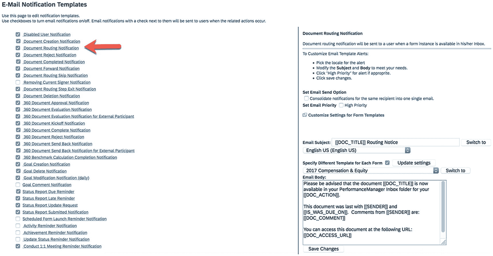

请参阅表 8-1 了解可启用的与绩效相关的通知。

#### 表 8-1：绩效评估表的电子邮件通知

| 电子邮件 | 描述 | 收件人 |
| :--- | :--- | :--- |
| 文档创建 | 在表单启动时创建，通知用户表单已在他们的绩效收件箱中。 | 第一步负责人 |
| 文档流转 | 在表单已流转并进入用户收件箱时发送。 | “流转至”步骤的步骤负责人 |
| 文档驳回 | 表单在签名阶段被驳回。 | 上一步骤的步骤负责人 |
| 文档完成 | 表单已完成，并通知用户表单已在他们的“绩效完成”文件夹中。 | 流转路线中的所有角色，但如果启用，可选择其他收件人 |
| 文档转发 | 当一份已完成的表单被转发到用户的“绩效完成”文件夹时，发送给该用户。 | 收到转发已完成表单的用户 |
| 移除当前签署人 | 当签署人被从表单中移除时，发送给表单的当前签署人。 | 当前签署人 |
| 文档流转步骤退出 | 当某个步骤完成时发送。 | 该步骤的步骤负责人 |
| 文档删除 | 当文档被删除时发送。 | 可选择：经理；经理和雇员；经理、雇员和人力资源；以及整个流转链 |
| 批量创建表单实例 | 当一组表单被启动时发送。 | 发送给启动这些表单的用户 |
| 文档到期 | 发送提醒通知，告知表单即将到期。取决于表单模板高级设置中的默认到期日期以及到期前的默认天数。 | 步骤负责人 |
| 文档逾期 | 使用表单模板高级设置中的默认到期日期以及到期后的默认逾期天数。 | 步骤负责人 |
| 步骤到期 | 根据流转路线步骤中的到期日期和表单模板高级设置中设置的默认到期天数发送。 | 发送给临近步骤到期日的步骤负责人 |
| 步骤逾期 | 一旦步骤逾期，根据流转路线步骤中的到期日期和表单模板高级设置中设置的默认逾期天数发送。 | 发送给已过步骤到期日的步骤负责人 |
| 请求反馈 | 由经理在团队概览中发送，用于请求对其直接下属的反馈。 | 发送给被请求反馈者，并抄送给反馈请求者 |
| 绩效评估启动经理通知 | 经理会收到有关其员工已生成表单（包括表单到期日）的通知。表单的所有步骤及其开始和到期日期都会列出。 | 不再支持 |
| 绩效评估流程更新（面向经理通知） | 经理会收到关于自我评估和反馈请求状态的更新。如果表单的当前步骤没有指定到期日期，则此电子邮件通知将使用表单的到期日期。 | 不再支持 |

单击电子邮件模板名称旁边的复选框以启用该通知。单击页面左侧的通知名称，以查看右侧的通知默认详细信息。您可以将通知优先级设置为高，并更新每种通知类型的电子邮件主题和正文。进行这些修改后，所有与该电子邮件模板关联的表单都将使用更新后的版本。

### 按模板自定义通知

某些通知类型的电子邮件主题和正文可以自定义，以便为每个绩效评估表模板使用不同的措辞。可以自定义的通知列表如下：

- 文档创建
- 文档流转
- 文档完成
- 文档到期
- 文档逾期
- 步骤到期
- 步骤逾期

以下是一个使用步骤到期通知的示例。您可能希望为 2020 年的绩效评估表的步骤到期通知设置特定的文本。而与此电子邮件通知类型关联的其他表单都应使用默认文本。

这可以通过几个步骤完成：

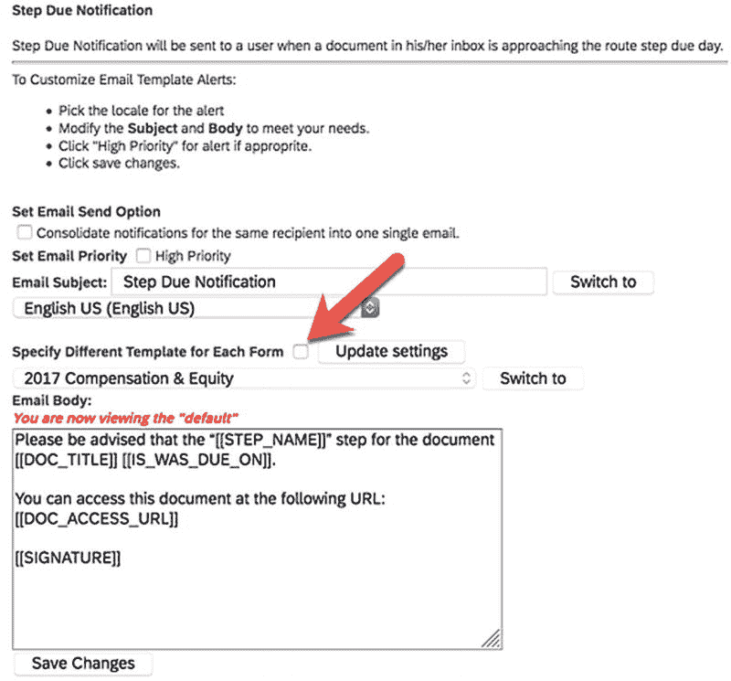

1. 单击“`为每个表单指定不同模板`”右侧的复选框，如图 8-2 所示。对于上述列表中未提及的任何通知，此复选框将不会激活。

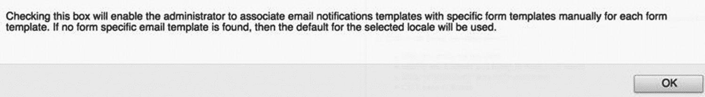

2. 将弹出一个窗口，警告用户与该通知关联的每个表单模板都可能需要手动更新。单击“`确定`”继续，如图 8-3 所示。

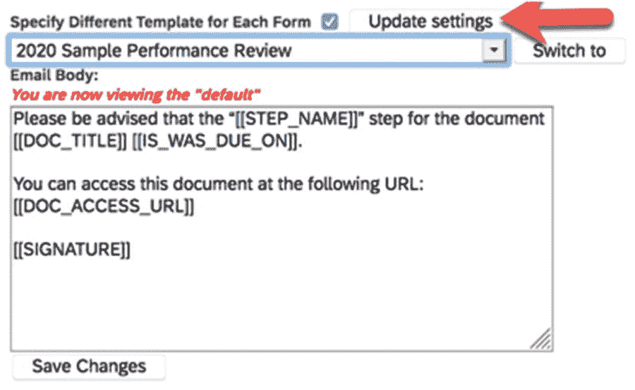

3. 在“`为每个表单指定不同模板`”下方，单击下拉列表，选择您希望为其创建自定义通知的 PM 表单模板。接着，单击“`更新设置`”按钮，如图 8-4 所示。

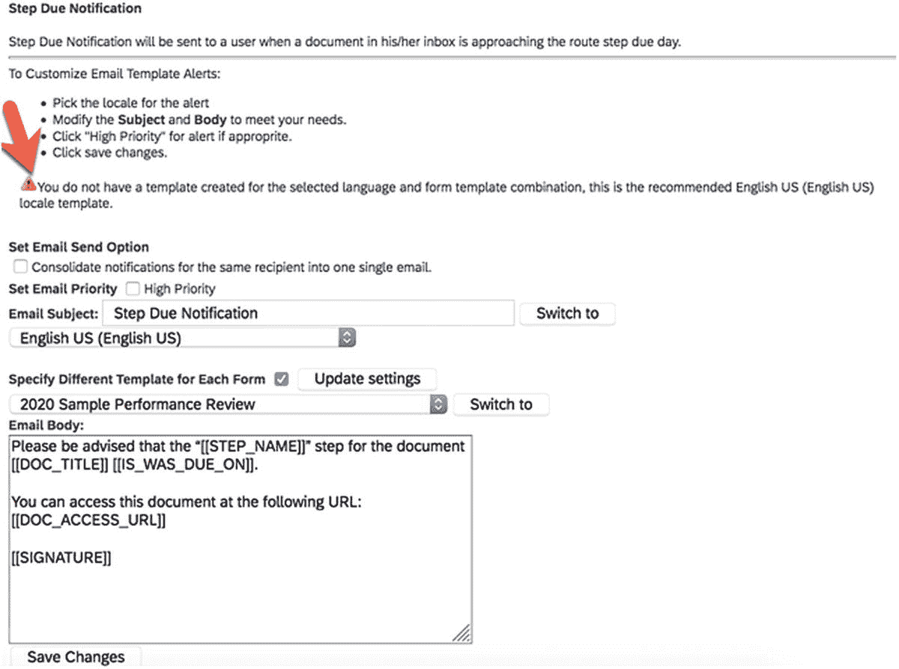

4. 屏幕将刷新，您会看到一条警告消息，提示该语言和表单模板组合没有对应的模板，如图 8-5 所示。

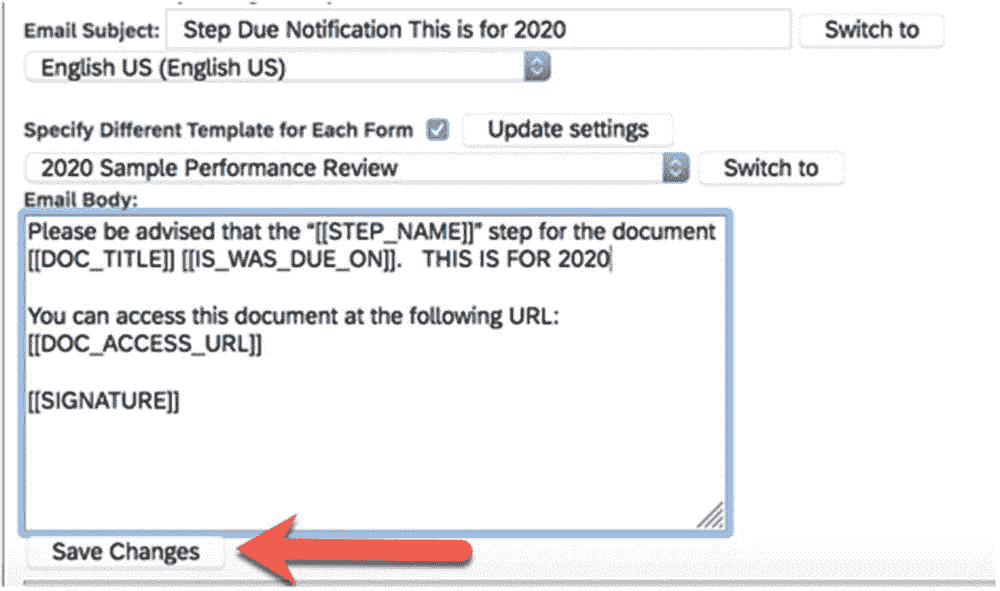

5. 对此表单模板要使用的电子邮件主题、正文和文本进行任何修改，然后单击“`保存更改`”，如图 8-6 所示。

现在，您已经为 2020 年绩效评估示例表单模板的步骤到期通知创建了自定义通知。要查看此通知类型下其他任何表单模板的通知，请从下拉列表中选择另一个表单模板，然后单击“`切换至`”。页面将刷新，并显示所选表单的文本；除非该特定绩效评估表模板的文本已被更新，否则它将显示为默认文本。您可以为所选表单模板进行修改，然后单击“`保存更新`”。

### 令牌

#### 通知与令牌

通知使用从表单中提取数据的令牌。更新电子邮件通知内容时，您可以省略现有令牌，或根据需要添加任何令牌。常用令牌列表请参见表 8-2。

#### 表 8-2：常用令牌

| 令牌 | 说明 |
| :--- | :--- |
| `[[COMPANY_NAME]]` | 公司名称 |
| `[[DOC_COMMENT]]` | 需要包含在电子邮件中的发件人备注 |
| `[[DOC_COMPLETION_DATE]]` | 表单完成日期 |
| `[[DOC_DUE_DATE]]` | 表单截止日期 |
| `[[DOC_LAST_MODIFIED]]` | 表单最后修改日期 |
| `[[DOC_TITLE]]` | 表单名称 |
| `[[EMP_NAME]]` | 主题对象全名 |
| `[[EMP_USER_ID]]` | 主题对象用户 ID |
| `[[EMP_PASSWORD]]` | 主题对象密码 |
| `[[IS_WAS_DUE_ON]]` | 表单截止日期（MM/DD/YYYY 格式） |
| `[[IS_WAS_DUE_ON_LONG]]` | 表单截止日期（月份用文本表示，例如：2020 年 8 月 12 日） |
| `[[NO_OF_DAYS]]` | 当前日期与表单截止日期之间的天数 |
| `[[RECIPIENT_NAME]]` | 此文档的收件人全名 |
| `[[RECIPIENT_USERNAME]]` | 此文档的收件人用户名 |
| `[[REVIEW_END_ON]]` | 审核结束日期 |
| `[[SENDER]]` | 表单发送者名称 |
| `[[SIGNATURE]]` | 签名 |

为了防止表单在路由过程中用户添加备注，请从电子邮件正文中删除 `[DOC_COMMENT]`。

### 自定义通知设置

部分电子邮件通知具有可自定义的设置。对于与通知关联的每个表单模板，都有设置来关闭通知、设置合并间隔，以及选择其他收件人来接收通知。

允许自定义设置的通知包括：

- 文档创建

- 文档路由

- 文档退回

- 文档转发

- 文档完成

- 文档删除

这些通知将显示“为表单模板自定义设置”，如图 8-7 所示。

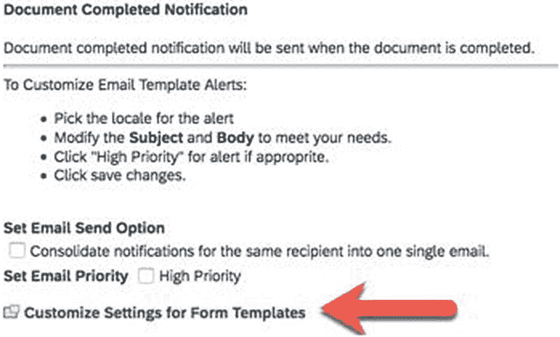

**图 8-7：** 为表单模板自定义设置

点击此链接后，将弹出一个窗口，其中显示与通知关联的所有有效表单模板，如图 8-8 所示。此列表还将包含任何招聘和薪酬表单模板。

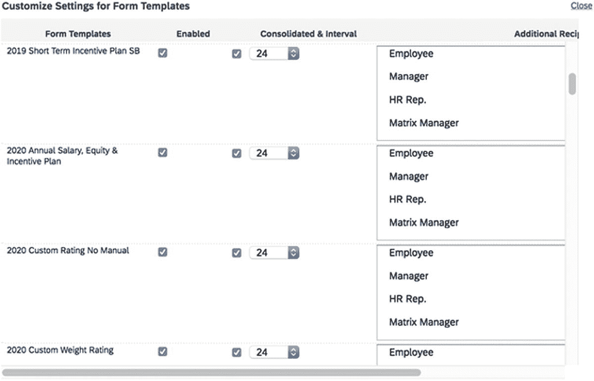

**图 8-8：** 自定义设置

可以自定义的设置位于三列下：“已启用”、“合并和间隔”和“其他收件人”。要关闭任何表单模板的通知发送，请取消选中“已启用”列中的复选框。当“合并和间隔”启用时，所有此类型的通知将以单封电子邮件的形式发送给收件人。您还可以选择合并邮件的发送频率。选项为每 1、2、4、6、8、12 或 24 小时。此设置对于拥有大量直接下属的管理者非常有用。例如，使用文档完成通知，管理者将收到一封列出已完成其绩效表单的直接下属的电子邮件，而不是为每个完成的表单单独接收一封电子邮件。每个表单模板的最后一个可自定义设置是添加其他收件人来接收通知。这允许添加不在路由图中的用户。

### 设置电子邮件发送选项

对于某些没有设置自定义间隔选项的通知，有一个称为“设置电子邮件发送选项”的选项，如图 8-9 所示。

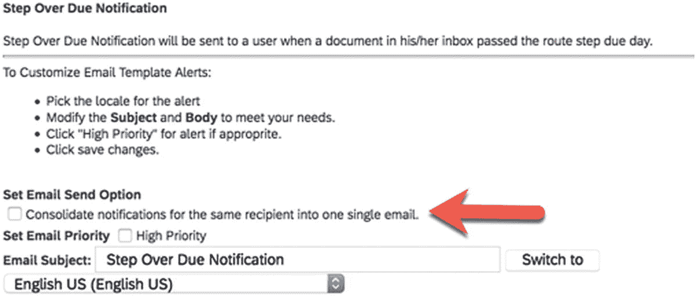

**图 8-9：** 电子邮件合并选项

启用此选项后，它将与页面底部的“合并电子邮件间隔（从凌晨 12:00 开始，以小时计）”配合使用。您可以在此处选择发送合并邮件的默认间隔，选项为 1、2、4、6、8、12 或 24 小时，如图 8-10 所示。


**图 8-10：** 设置发送合并电子邮件的间隔

允许自定义设置的通知也具有此选项：

- 文档创建

- 文档路由

- 文档退回

- 文档完成

- 文档转发

- 文档删除

这些通知可以为特定的表单模板设置合并间隔。以下列出的通知为与该通知关联的所有表单模板设置合并间隔。

这两个无法自定义但可以发送合并邮件的通知是：

- 步骤到期

- 步骤逾期

### 通知的后台作业计划

有少数电子邮件通知需要安排后台作业才能生成通知。

需要计划作业的绩效表单相关电子邮件通知包括：

- 文档到期

- 文档逾期

- 步骤到期

- 步骤逾期

需要计划的后台作业包括：

```
Send Form Due Notification
Send Form Late Notification
Send 360 Step Due Notification
Send 360 Step Late Notification
```

`360 步骤到期`和`360 步骤逾期`通知作业适用于 PM 和 360 表单。

要进行设置，请在预配置模块中，转到“管理计划作业”，如图 8-11 所示。

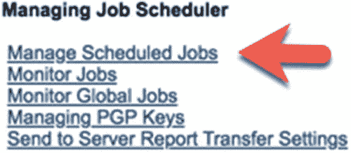

**图 8-11：** 管理计划作业

接下来，转到“创建新作业”，如图 8-12 所示。在这里，我们将为这四个通知设置每日运行的作业。

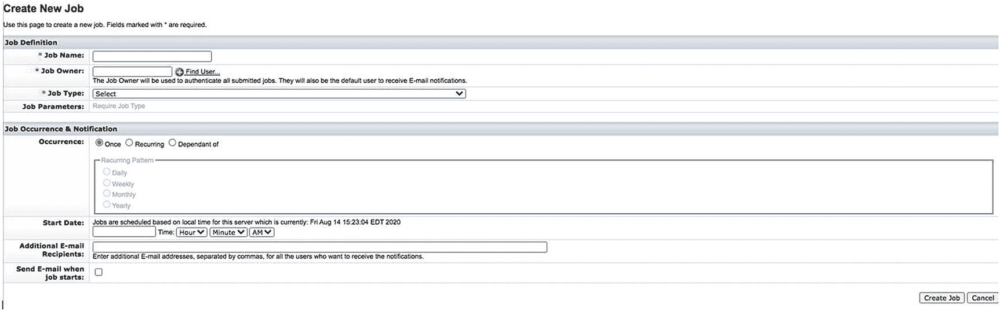

**图 8-12：** 创建新作业

单击“作业类型”下拉列表，从上述列表中找到作业名称。示例如图 8-13 所示。

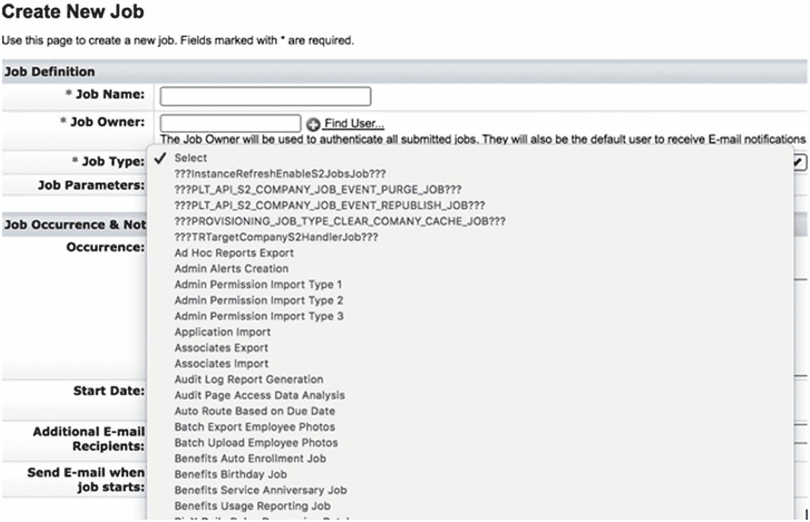

**图 8-13：** 选择作业类型

在创建计划期间，为作业命名并设置其运行频率。对于每日运行的作业，应设置为“重复”。您可以设置为清晨运行，以便在步骤/表单到期后的清晨移动表单。完成输入后，保存作业并提交。这样可以确保作业从您选择的开始日期起开始运行。

> **注意：** 要了解有关如何设置后台作业的更多信息，请参阅 SAP 说明 #2212605。

图 8-14 是步骤到期通知作业的示例，设置为每天凌晨 5:51 运行。

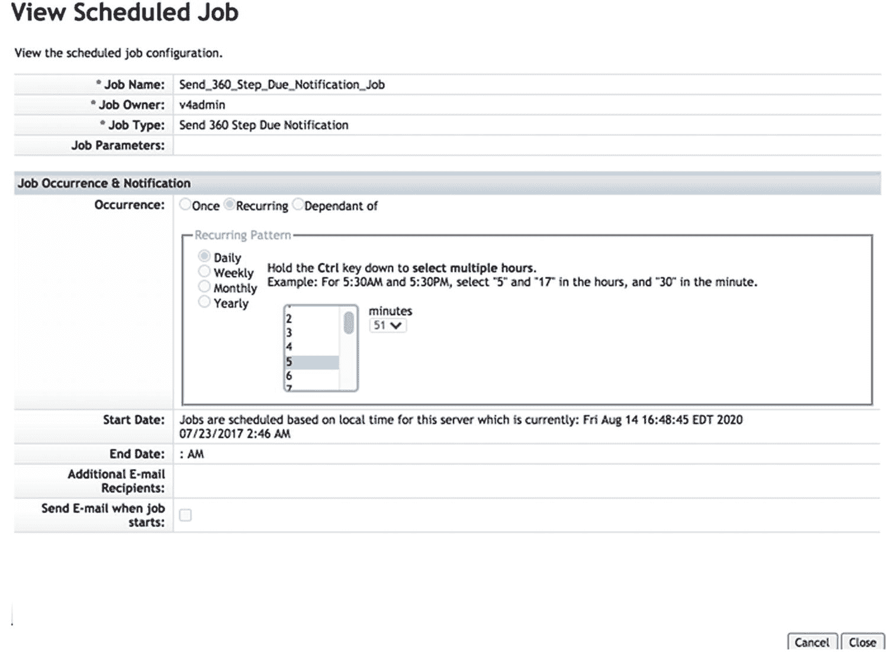

**图 8-14：** 步骤到期通知计划作业

要使此电子邮件通知在绩效表单位于用户收件箱且步骤已逾期时发送给该用户：

- 在`电子邮件通知模板`中启用了“步骤到期通知”。

- 表单模板的路由图设置了步骤到期日期。

- 表单模板在高级设置中设置了“默认到期通知日期（天）”。

- 表单模板在高级设置中未禁用步骤退出通知。

- 已计划后台作业每日运行。

图 8-15 是步骤到期通知的示例电子邮件。

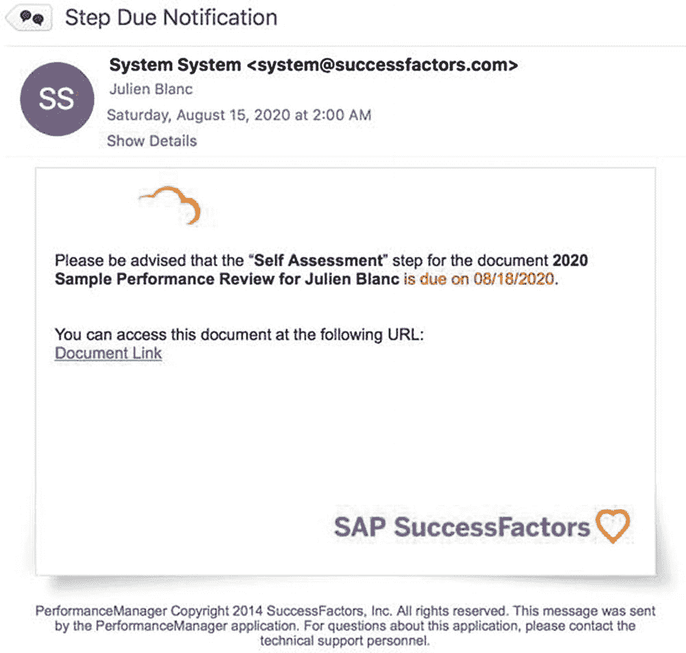

**图 8-15：** 步骤到期通知

## 绩效管理权限与路线图设置

路线图将 8/18/20 设定为自我评估步骤的截止日期。模板的高级设置中，通知时间为截止日期前三天。员工在步骤截止日期前三天收到了这封邮件。

### 基于角色的权限

现在来设置用户访问绩效管理所需的基于角色的权限。我们从员工角色开始。

### 员工权限

用户需要访问以下内容：

- `Home`（首页）菜单中的`Performance`（绩效）选项卡

- 主页上的`To-Do`（待办事项）磁贴

- 目标计划

- 发展计划（如果在绩效表单中显示）

我们需要设置基于角色的权限，以便允许用户看到`Home`菜单中的`Performance`选项卡。在`Manage Permission Roles`（管理权限角色）中，打开员工角色，点击`Permission`（权限），然后进入：

- `User Permissions`（用户权限） ➤ `Performance`（绩效） ➤ `Performance Management Access`（绩效管理访问权限）

*请注意，即使没有此权限，如果用户在收件箱中有表单，仍然能看到`Performance`选项卡。*

用户需要访问主页上的`To-Do`磁贴：

- `User Permissions`（用户权限） ➤ `Homepage v3 Tile Group Permission`（主页 v3 磁贴组权限） ➤ `Homepage v3 To-Do tile group`（主页 v3 待办事项磁贴组）

以下内容适用于在表单模板中使用目标且尚未启用时：

- `User Permissions`（用户权限） ➤ `Goals`（目标） ➤ `Goal Management Access`（目标管理访问权限）

- `User Permissions`（用户权限） ➤ `Goals`（目标） ➤ `Goal Plan Permissions`（目标计划权限）（指定具体计划）

以下内容适用于在表单模板中使用发展计划且尚未启用时：

- `User Permissions`（用户权限） ➤ `Career Development Planning`（职业发展规划） ➤ `Career Development Plan (CDP) Access Permission`（职业发展计划访问权限）

- `User Permissions`（用户权限） ➤ `Goals`（目标） ➤ `Goal Management Access`（目标管理访问权限） ➤ `Goal Plan Permissions`（目标计划权限）（指定具体发展计划）

### 经理权限

为了让经理能够创建或运行绩效相关的临时报告，请确保已启用报告权限。

在`Manage Permission Roles`（管理权限角色）中，打开经理角色，点击`Permission`（权限），然后进入`User Permissions`（用户权限） ➤ `Reports Permission`（报告权限）。您可以包含：

- `Ad Hoc Report Builder Standard Reports Bin`（临时报告生成器标准报告库）（如果使用 EC）
- `Report Center`（报告中心）
- `Classic Reports`（经典报告）
- `Detail Report`（详细报告）
- `List View`（列表视图）
- `Analytics Tiles and Dashboards`（分析磁贴与仪表板）（选择任何与绩效相关的磁贴和仪表板）
- `Create Report`（创建报告）
- `Performance Management`（绩效管理）
- `Run Report`（运行报告）（选择任何与绩效相关的磁贴和仪表板）

同时，为经理角色授予`Performance Management`（绩效管理）访问权限和`Team Overview Access`（团队概览访问权限）：

- `User Permissions`（用户权限） ➤ `Performance`（绩效） ➤ `Performance Management Access`（绩效管理访问权限）
- `User Permissions`（用户权限） ➤ `Performance`（绩效） ➤ `Team Overview Access`（团队概览访问权限）

以下内容适用于在表单模板中使用目标且尚未启用时：

- `User Permissions`（用户权限） ➤ `Goals`（目标） ➤ `Goal Management Access`（目标管理访问权限）
- `User Permissions`（用户权限） ➤ `Goals`（目标） ➤ `Goal Plan Permissions`（目标计划权限）（指定具体计划）

以下内容适用于在表单模板中使用发展计划且尚未启用时：

- `User Permissions`（用户权限） ➤ `Career Development Planning`（职业发展规划） ➤ `Career Development Plan (CDP) Access Permission`（职业发展计划访问权限）
- `User Permissions`（用户权限） ➤ `Goals`（目标） ➤ `Goal Management Access`（目标管理访问权限） ➤ `Goal Plan Permissions`（目标计划权限）（指定具体发展计划）

### 人力资源经理权限

除了管理员可以生成表单外，您可能也决定允许人力资源经理创建表单。例如，您后续可能会创建一个用于绩效改进的混合绩效表单。在这种情况下，经理可以联系支持该团队的人力资源经理来生成表单。由人力资源经理来执行此任务，相比让管理员启动表单，可以为流程提供更高的保密性。

您可以为您刚刚为经理角色设置的相同权限，也为人力资源经理进行设置。与经理角色类似，您可以授予其报告访问权限。

在`Manage Permission Roles`（管理权限角色）中，打开人力资源经理角色，点击`Permissions`（权限），然后进入`User Permissions`（用户权限） ➤ `Reports Permission`（报告权限）。在`Reports Permission`选项中，您可以包含以下内容：

- `Ad Hoc Report Builder Standard Reports Bin`（临时报告生成器标准报告库）（如果使用 EC）
- `Report Center`（报告中心）
- `Classic Reports`（经典报告）
- `Detail Report`（详细报告）
- `List View`（列表视图）
- `Analytics Tiles and Dashboards`（分析磁贴与仪表板）（选择任何与绩效相关的磁贴和仪表板）
- `Create Report`（创建报告）
- `Performance Management`（绩效管理）
- `Run Report`（运行报告）（选择任何与绩效相关的磁贴和仪表板）

与经理角色不同，还需要授予创建表单的权限：

- `User Permissions`（用户权限） ➤ `General User Permission`（一般用户权限） ➤ `Permission to Create Forms`（创建表单的权限）（指定要创建的表单）

授予启动表单的权限：

- `Administrator Permissions`（管理员权限） ➤ `Manage Form Templates`（管理表单模板） ➤ `Mass Create Form Instances`（批量创建表单实例）（立即启动表单）
- `Administrator Permissions`（管理员权限） ➤ `Manage Form Templates`（管理表单模板） ➤ `Schedule Mass Form Creation`（安排批量表单创建）（稍后启动表单）

保存这些角色，接下来我们将讨论路线图。

## 设置路线图日期

在启动绩效表单之前，我们需要在路线图中设置任何步骤的开始日期或截止日期。在搜索栏中输入并选择`Manage Route Maps`（管理路线图）。然后打开与将在表单启动中使用的绩效表单模板相关联的路线图。

通常情况下，人力资源部门会规划绩效评估周期中各步骤的日期。根据评估流程的开始和结束日期，您需要确认他们是否对流程的每个步骤使用了特定的时间窗口。有些公司会在年初设定目标，并保持表单的初始步骤开放，以便员工追踪进度和添加评论。然后他们会沟通年中检核步骤的日期。他们可能希望在某特定日期之前，阻止任何表单进入经理审阅环节。考虑到所有这些因素，您可以查看绩效周期日期，并判断是否需要向路线图添加步骤开始日期和截止日期。

最常用的是步骤开始日期和步骤截止日期，步骤退出日期则不太常见。您需要确认步骤开始日期是否会传达，以及开始日期是否会被强制执行。例如，当表单提前启动，而您不希望员工此时进入并编辑表单时，可以使用步骤开始日期的强制执行功能。在步骤开始日期之前，他们将只有只读访问权限。

另一个重要决策涉及步骤退出日期。如果用户在步骤截止日期前没有完成其收件箱中的表单，您是否希望该表单自动流转到下一个步骤？如果是这样，您需要设置一个步骤截止日期，并在路线图步骤中启用`Automatic send on due date`（截止日期自动发送）选项。

如图 8-16 所示，路线图的第一个步骤定义了步骤截止日期。当启用`Automatic send on due date`（截止日期自动发送）选项时，会显示两个附加选项：

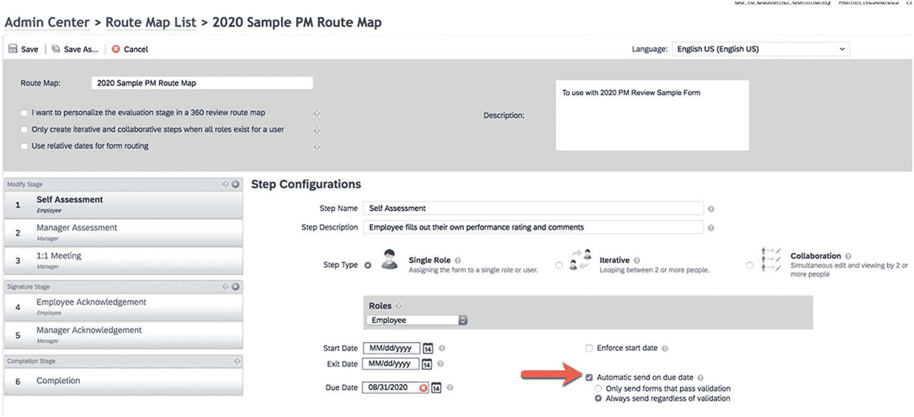

**图 8-16** 配置步骤日期

- **Only send forms that pass validation**（仅发送通过验证的表单）：如果此步骤中存在必填字段，则不将表单向前移动。此选项可用于需要输入评级等必填项的步骤。通过验证的表单将向前移动；有错误的表单则不会。
- **Always send regardless of validation**（无论验证结果如何始终发送）：无论步骤中是否存在必填字段，表单都会自动流转到下一步。

## 使用自动路由功能

当表单处于没有必填字段的步骤时，使用自动路由功能可能会有所帮助。例如，在流程的早期阶段，您可能希望员工在表单上输入备注。与其通过运行报告来追踪员工在流程中的位置，不如让表单在截止日期自动路由。

如果您打算使用步骤日期，并非每个步骤都需要设置。这也适用于`截止日期自动发送`和步骤开始日期强制执行。您可以为某个步骤设置开始日期，为另一个步骤设置带有自动路由的步骤退出日期。只需确保没有步骤日期重叠，以免导致表单卡住。

使用自动移动选项时请务必谨慎。例如，您的路由图在某些早期步骤中未启用`截止日期自动发送`，但在后续步骤中启用了此选项。处于早期步骤的表单不会自动前进。尚未到达自动路由步骤的表单在该步骤到期时也不会被自动路由。这意味着任何尚未到达自动路由步骤的表单都不会被自动路由。对于某个步骤，自动路由仅基于该步骤的截止日期执行一次。如果表单在截止日期之后才到达自动路由步骤，则不会执行自动路由。只有处于设置了截止日期且启用了自动路由的步骤中的表单才会被移动到下一步。

如果您已设置任何自动路由步骤，则需要安排一个每日运行的后台作业来处理路由。我们接下来将介绍这部分内容。

### 调度自动路由步骤到期后台作业

在本章前面部分，我们讨论了电子邮件通知的设置以及步骤到期和步骤逾期通知所需的后台作业。如果您正在使用自动路由选项，那么启用步骤到期日期的电子邮件通知也是合理的，这可以提醒用户在表单移动之前完成该步骤。

# 表单模板高级设置与配置

正如我们之前讨论的，如果您计划发送步骤到期通知，需要在表单模板的高级模板设置中启用通知，开启电子邮件通知，并设置好后合作业。

自动路由过程也需要一个后台作业。此作业将在步骤到期日后的第二天，按照作业中设定的时间移动表单。

要设置此作业，请进入`配置`，转到`管理计划作业` ➤ `创建新作业`，如图 8-17 所示，然后设置`自动路由步骤到期文档`计划作业。

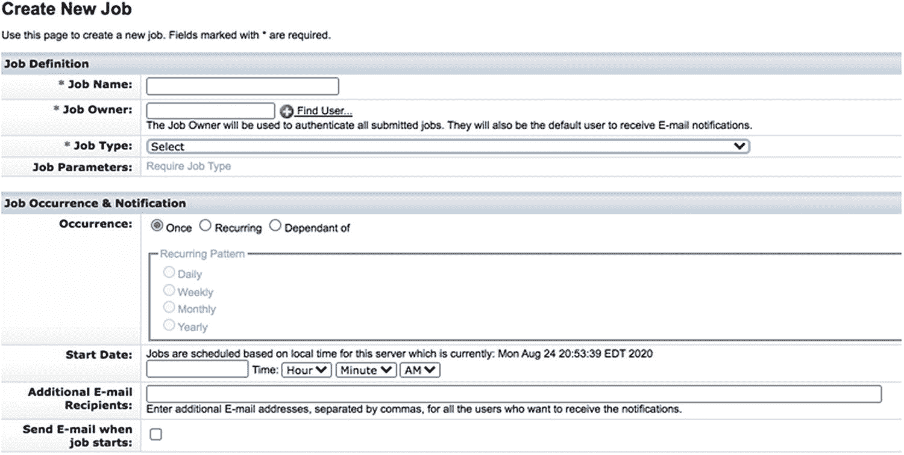

**图 8-17** 创建新后台作业

点击`作业类型`字段中的向下箭头，找到`基于截止日期自动路由`。为作业命名并设置执行频率。应设置为`定期`以每日运行。您可以将运行时间设置在清晨，这样表单就会在步骤到期后的清晨被移动。保存作业并提交。这将确保作业从您选择的开始日期起开始运行。

已创建作业的示例如图 8-18 所示。

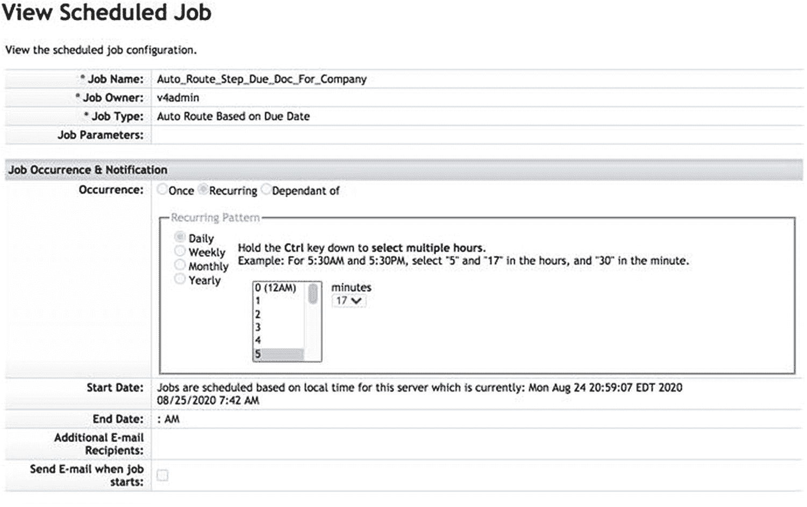

**图 8-18** 步骤截止日期自动路由作业

> **注意：** 有关在路由图中使用日期的更多信息，请参阅 SAP 注释 #2087333。

## 路由图上的相对截止日期

可以在路由图上使用相对日期来表示开始日期、退出日期和截止日期。

相对日期让您可以根据另一个活动之前或之后的天数来指定开始、退出或截止日期。

为了在路由图上使用相对日期，必须在`配置`中进行设置。为此，请转到`公司设置`并启用此选项：`为表单路由启用相对日期`。

启用后，您的路由图将显示`为表单路由使用相对日期`选项，如图 8-19 所示。

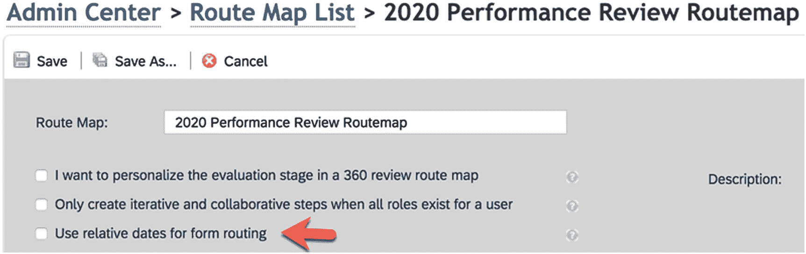

**图 8-19** 使用相对日期的选项

选中后，您将看到一个弹出警告：`更改此选项将重置您的路由图日期设置。是否继续？`示例如图 8-20 所示。

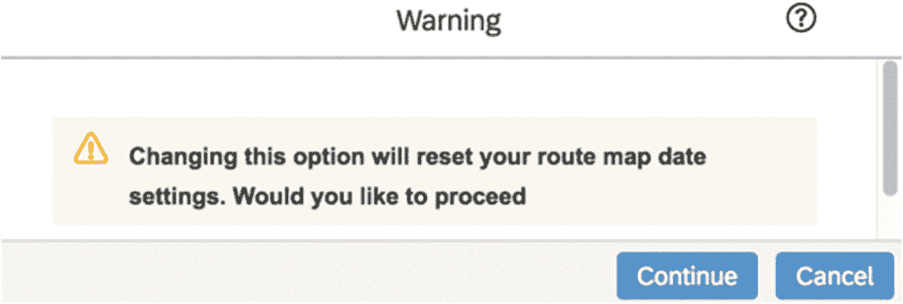

**图 8-20** 使用相对日期时的警告消息

选择`继续`。将出现一条说明，指出当启用相对日期时，不允许重新排序路由图中步骤的位置。

您会注意到路由图上的步骤开始、步骤退出和步骤截止日期选项现已更改。一个示例路由图如图 8-21 所示。

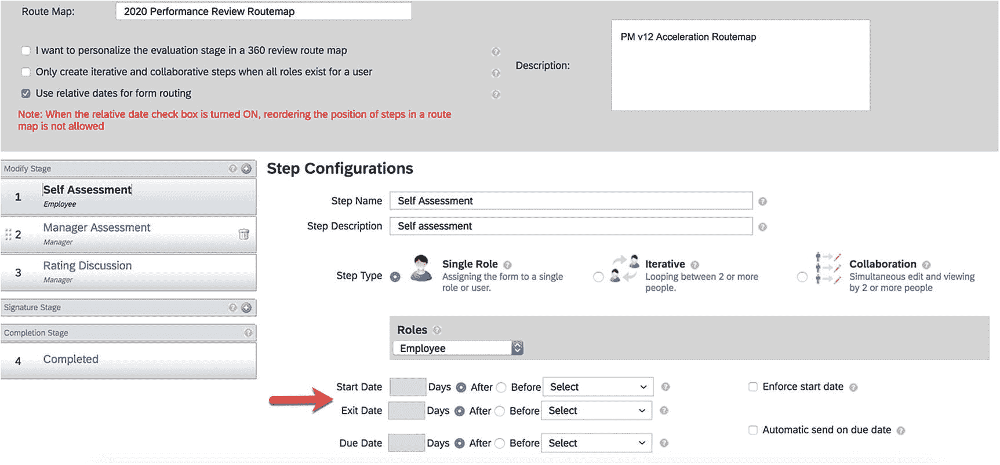

**图 8-21** 在路由图上设置相对截止日期

您将无法再选择固定日期。相反，路由步骤日期将相对于所选日期选项之前或之后的天数而定。

对于路由步骤日期，您需要选择`之后`或`之前`并指定天数。根据您设置的是哪种日期（开始、退出或截止）以及选择的是天数`之前`还是`之后`，可用的日期选择选项会有所不同。示例如图 8-22 所示。

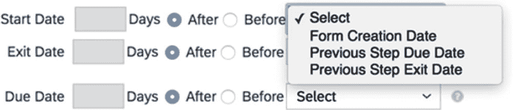

**图 8-22** 相对日期选项

下拉列表中可能显示的可选选项包括以下内容：

- `表单创建日期`

- `表单截止日期`

- `同一步骤开始日期`

- `同一步骤截止日期`

- `同一步骤退出日期`

- `前一步骤退出日期`

- `前一步骤截止日期`

在设置相对日期时，您不会看到所有这些选项；选项基于您正在设置的路由步骤日期类型，以及该日期是所选日期的`之前`还是`之后`。

设置步骤开始日期和截止日期的示例如图 8-23 所示。

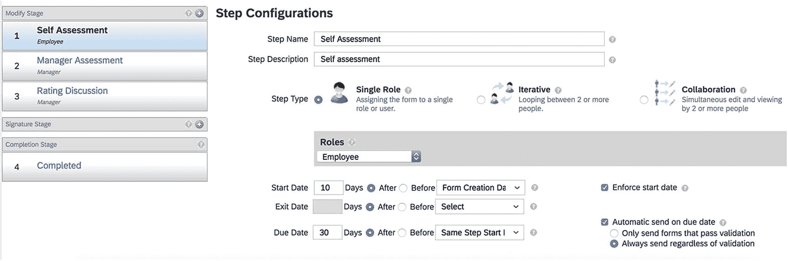

**图 8-23** 设置第一个步骤的日期

对于此路由图的第一个步骤，强制步骤开始日期设置为表单创建日期后的 10 天。该步骤在步骤开始日期后的 30 天到期。

## 待办事项磁贴

在启动表单之前，我们还有一项设置任务。

在主页上，待办事项面板中会显示一个与绩效管理相关的待办事项磁贴。用户需要执行的任何与绩效相关的操作都将显示在此磁贴中。示例如图 8-24 所示。

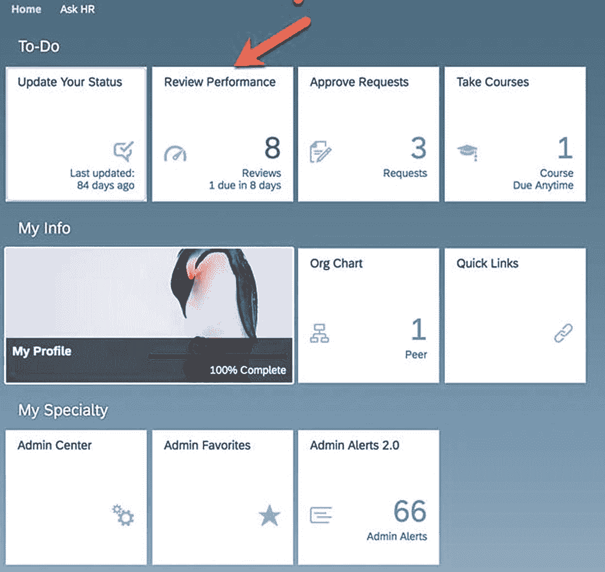

**图 8-24** 主页上的待办事项面板

此待办事项磁贴上的项目可能来自路由给用户的绩效表单。示例如图 8-25 所示。需要操作的项目包含一个链接，可将用户引导至所需操作或表单以完成任务。

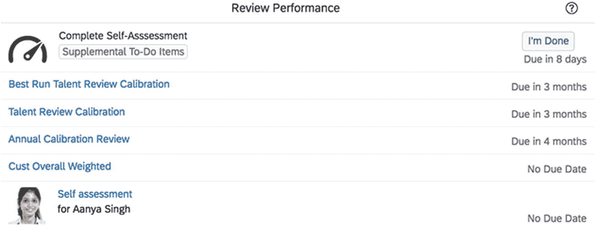

**图 8-25** 绩效相关的待办事项

管理员也可以向磁贴中添加补充待办事项。在第 6 章中，我们讨论了一些可授予的可选管理员权限。如果尚未完成，管理员角色需要拥有更新待办事项磁贴的权限。在搜索栏中输入并选择“管理权限角色”。打开管理员角色并添加以下权限。在“管理员权限”部分下，找到“管理用户”，然后选择“待办事项管理员”和“管理主页”。保存角色，然后我们可以继续。

要设置此磁贴，请在搜索栏中输入并选择“管理主页”。接下来，单击“待办事项设置”，如图 8-26 所示。您将看到所有可以更新的选项。

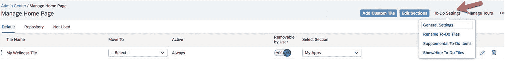

**图 8-26** 待办事项设置

### 常规设置

单击“常规设置”，如图 8-27 所示。在这里，我们可以更改待办事项显示的默认日期。

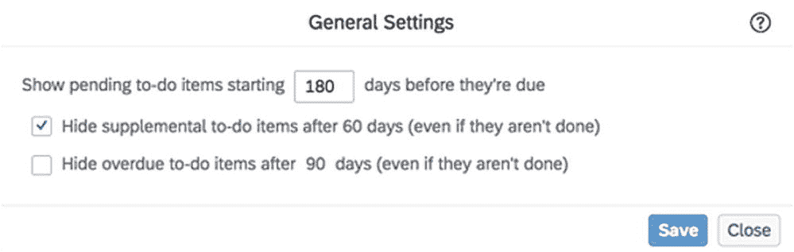

**图 8-27** 常规设置

设置项包括：

*   待处理项目

*   隐藏补充项目

*   隐藏逾期项目

这些设置用于确定待处理的待办事项何时显示，以及补充待办事项或逾期项目是否可以在指定天数后隐藏。请注意，此处的任何更改都将影响所有待办事项磁贴。

### 重命名待办事项磁贴

此外，在“待办事项设置”下，您可以重命名“审阅绩效”待办事项磁贴，如图 8-28 所示。更改“显示名称”列中的标签。

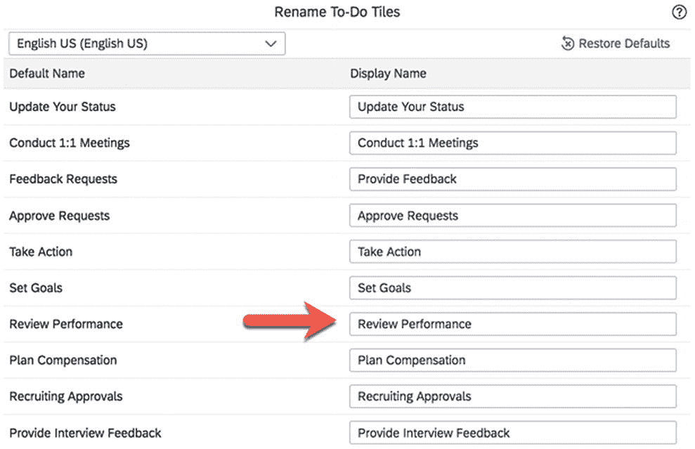

**图 8-28** 重命名待办事项磁贴

### 显示/隐藏待办事项磁贴

接下来，我们需要确保已启用*绩效管理*的待办事项磁贴。此设置也在“待办事项设置”中。单击“显示/隐藏待办事项磁贴”，将弹出一个窗口，如图 8-29 所示。确保“审阅绩效”设置为显示。如果没有，请将其更改为“是”并保存。

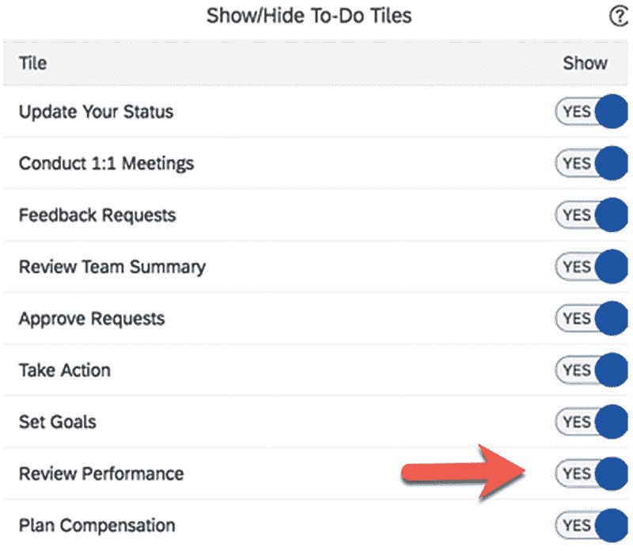

**图 8-29** 启用“审阅绩效”待办事项磁贴

### 补充待办事项

您还可以添加补充待办事项。例如，如果您没有使用步骤到期电子邮件通知，您希望提醒员工其绩效评估的自我评估步骤即将到期。

在“待办事项设置”中单击“补充待办事项”，将弹出一个窗口，如图 8-30 所示。选择附加待办事项将驻留的磁贴，为该“待办事项”设置一个名称及其到期日期。您还需要确定哪个角色会看到此附加待办事项。在此示例中，一个待办事项将驻留在“审阅绩效”待办事项磁贴中，标签为“完成自我评估”，并附带到期日期。员工角色将看到该项目。

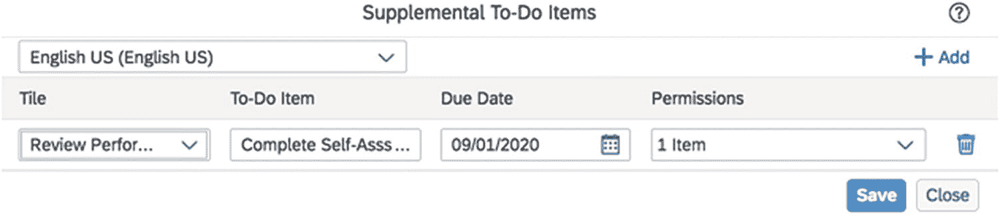

**图 8-30** 添加一个与绩效相关的补充待办事项

图 8-31 显示了用户“审阅绩效”待办事项磁贴中一个补充待办事项的示例。

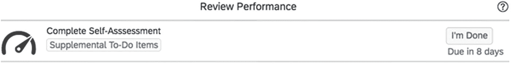

`图 8-31`

补充待办事项

如果用户单击“我已完成”，该项目将从其待办事项列表中移除。

此部分需要考虑的事项如下：

* 待办事项列表使用路线图步骤描述，而非路线图步骤名称。

* 待办事项使用步骤到期日期。如果没有步骤到期日期，该待办事项将在磁贴中显示“无到期日期”。

* 待办事项按到期日期排序，然后按字母顺序排列。

* 如果待办事项具有相同的路线图步骤名称和相同的步骤到期日期，它们将组合在待办事项磁贴中。

我们现在已经完成了启动表单所需的所有设置和配置，那么让我们开始吧！

### 启动表单

我们现在将启动基于表单模板的表单。我们将确定使用哪个表单模板，为哪些员工以及在何时创建绩效表单。启动表单的角色将需要在`管理员权限`中的`管理表单模板`下拥有基于角色的权限`批量创建表单实例`和`计划批量创建表单`。

此外，该角色还需要拥有创建表单的权限。通常，管理员角色能够创建任何表单，因为已经授予了所有表单的权限。但是，如果您希望某个角色只能启动特定的表单，请在该角色的权限中，转到`用户权限 ➤ 常规用户权限 ➤ 创建表单的权限`，如图 8-32 所示。

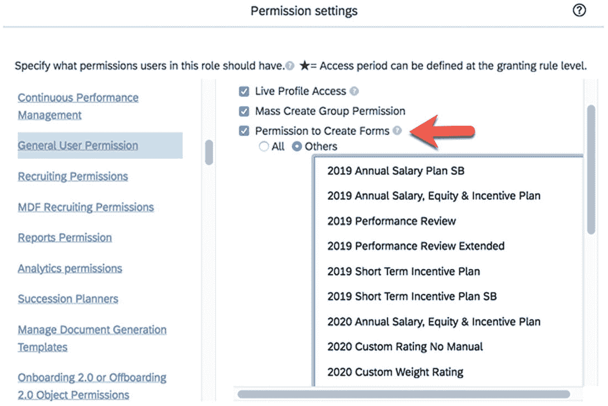

`图 8-32`

创建表单的权限

您需要单击“其他”单选按钮，并选择该角色可以创建的特定表单。保存更新，然后我们将开始启动流程。

在搜索栏中输入并选择“启动表单”。“启动表单”屏幕如图 8-33 所示。

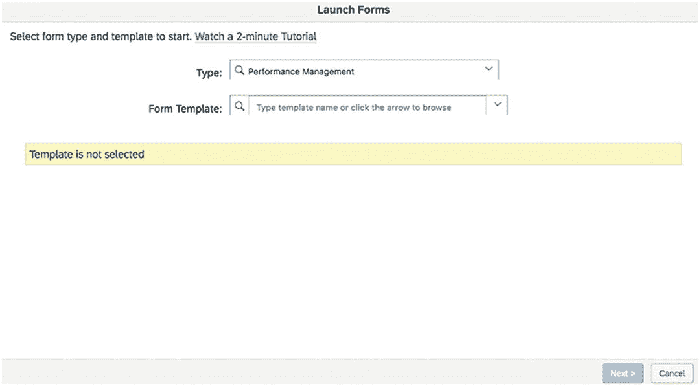

`图 8-33`

选择要启动的表单模板

在初始的“启动表单”屏幕上，选择要生成的表单类型，然后选择表单模板。模板类型下拉列表中的选项包括“全部”、360 或绩效管理。选择“绩效管理”。基于选择的类型为“绩效管理”，“表单模板”下拉列表将包含用户有权创建的所有活动绩效模板。

选择表单后，将显示有关所选表单模板的信息，如图 8-34 所示。

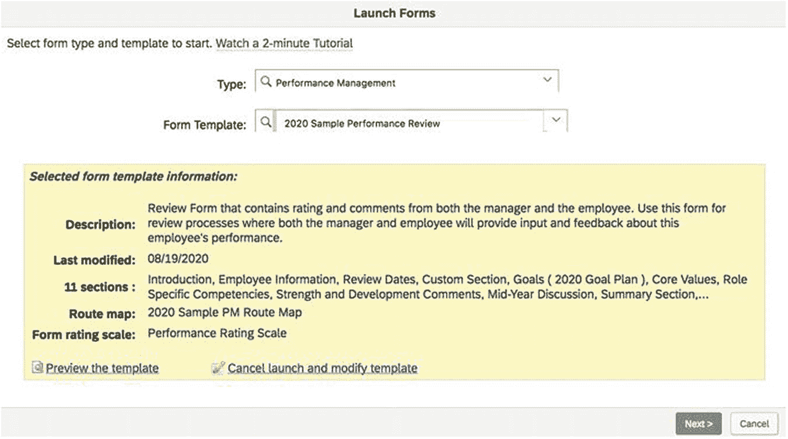

`图 8-34`

表单模板信息

将显示表单模板描述、路线图、评分量表、模板部分和最后修改日期。在此启动步骤中，您可以预览表单模板或取消启动。如果取消，您将返回到“管理模板”中的表单模板以进行编辑。

### 启动日期

单击“下一步”将进入启动流程的步骤 1。步骤 1 如图 8-35 所示。

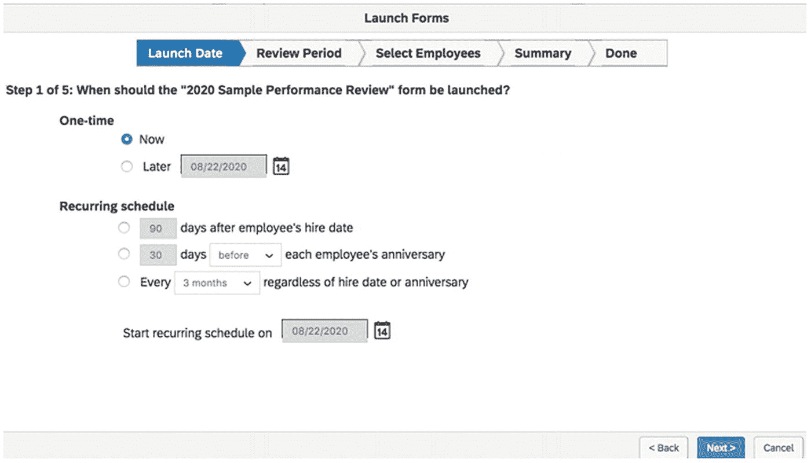

`图 8-35`

步骤 1，启动的“启动日期”步骤

此步骤允许您进行一次性启动，立即启动或选择稍后日期。或者，启动可以根据选定的标准重复进行。我们将研究这两种选项。

#### 一次性启动

此选项仅生成一次表单。您可以立即启动表单，或选择特定的启动日期。出于我们的目的，我们将选择“现在”，但您也可以选择将来的日期。

#### 定期计划

另一种选项启用定期启动。此选项用于您希望根据特定的基于日期的标准重复批量创建表单的情况。在启动时符合标准的员工将生成一个表单。

有三个与日期相关的选项可供选择：