# 8. 管理绩效管理表单

既然我们已经启用了绩效管理并创建了表单模板，在启动绩效表单之前，我们还有几个步骤。我们将首先设置将在审核过程的各个步骤中发送给员工的电子邮件通知。我们还将设置员工、经理和人力资源经理基于角色的权限，以允许这些角色访问绩效管理。我们将决定任何路由图步骤的开始和截止日期，并学习如何立即启动表单或安排表单在稍后日期启动。我们将涵盖诸如删除和恢复表单、使表单对某些用户不可见、路由表单以及导入整体评分等主题。

## 电子邮件通知

### 绩效评估表的电子邮件通知

有一系列可启用的、特定于绩效评估表的电子邮件通知。通知会发送给与所需任务或操作相关联的用户。这些电子邮件是基于绩效评估表的流转或用户所需操作而触发的。与绩效评估表相关的电子邮件通知包括：

- 绩效评估表的创建、流转和完成
- 步骤到期和步骤逾期通知
- 请求反馈通知

最常用的通知是流转通知和步骤到期通知。流转通知告知用户其绩效收件箱中有一份表格，有待他们处理。步骤到期通知提醒用户，表格仍在他们的收件箱中，并且需要在步骤到期日之前处理。在第 6 章中，管理员角色已在角色的“管理员权限”部分的“管理系统属性”下，将权限设置为“`电子邮件通知模板设置`”。

要查看所有可能启用的通知，请在搜索栏中输入并选择“`电子邮件通知模板设置`”。屏幕示例如图 8-1 所示。

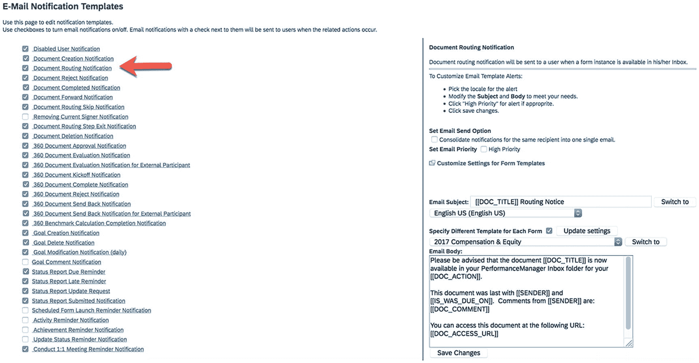

请参阅表 8-1 了解可启用的与绩效相关的通知。

#### 表 8-1：绩效评估表的电子邮件通知

| 电子邮件 | 描述 | 收件人 |
| :--- | :--- | :--- |
| 文档创建 | 在表单启动时创建，通知用户表单已在他们的绩效收件箱中。 | 第一步负责人 |
| 文档流转 | 在表单已流转并进入用户收件箱时发送。 | “流转至”步骤的步骤负责人 |
| 文档驳回 | 表单在签名阶段被驳回。 | 上一步骤的步骤负责人 |
| 文档完成 | 表单已完成，并通知用户表单已在他们的“绩效完成”文件夹中。 | 流转路线中的所有角色，但如果启用，可选择其他收件人 |
| 文档转发 | 当一份已完成的表单被转发到用户的“绩效完成”文件夹时，发送给该用户。 | 收到转发已完成表单的用户 |
| 移除当前签署人 | 当签署人被从表单中移除时，发送给表单的当前签署人。 | 当前签署人 |
| 文档流转步骤退出 | 当某个步骤完成时发送。 | 该步骤的步骤负责人 |
| 文档删除 | 当文档被删除时发送。 | 可选择：经理；经理和雇员；经理、雇员和人力资源；以及整个流转链 |
| 批量创建表单实例 | 当一组表单被启动时发送。 | 发送给启动这些表单的用户 |
| 文档到期 | 发送提醒通知，告知表单即将到期。取决于表单模板高级设置中的默认到期日期以及到期前的默认天数。 | 步骤负责人 |
| 文档逾期 | 使用表单模板高级设置中的默认到期日期以及到期后的默认逾期天数。 | 步骤负责人 |
| 步骤到期 | 根据流转路线步骤中的到期日期和表单模板高级设置中设置的默认到期天数发送。 | 发送给临近步骤到期日的步骤负责人 |
| 步骤逾期 | 一旦步骤逾期，根据流转路线步骤中的到期日期和表单模板高级设置中设置的默认逾期天数发送。 | 发送给已过步骤到期日的步骤负责人 |
| 请求反馈 | 由经理在团队概览中发送，用于请求对其直接下属的反馈。 | 发送给被请求反馈者，并抄送给反馈请求者 |
| 绩效评估启动经理通知 | 经理会收到有关其员工已生成表单（包括表单到期日）的通知。表单的所有步骤及其开始和到期日期都会列出。 | 不再支持 |
| 绩效评估流程更新（面向经理通知） | 经理会收到关于自我评估和反馈请求状态的更新。如果表单的当前步骤没有指定到期日期，则此电子邮件通知将使用表单的到期日期。 | 不再支持 |

单击电子邮件模板名称旁边的复选框以启用该通知。单击页面左侧的通知名称，以查看右侧的通知默认详细信息。您可以将通知优先级设置为高，并更新每种通知类型的电子邮件主题和正文。进行这些修改后，所有与该电子邮件模板关联的表单都将使用更新后的版本。

### 按模板自定义通知

某些通知类型的电子邮件主题和正文可以自定义，以便为每个绩效评估表模板使用不同的措辞。可以自定义的通知列表如下：

- 文档创建
- 文档流转
- 文档完成
- 文档到期
- 文档逾期
- 步骤到期
- 步骤逾期

以下是一个使用步骤到期通知的示例。您可能希望为 2020 年的绩效评估表的步骤到期通知设置特定的文本。而与此电子邮件通知类型关联的其他表单都应使用默认文本。

这可以通过几个步骤完成：

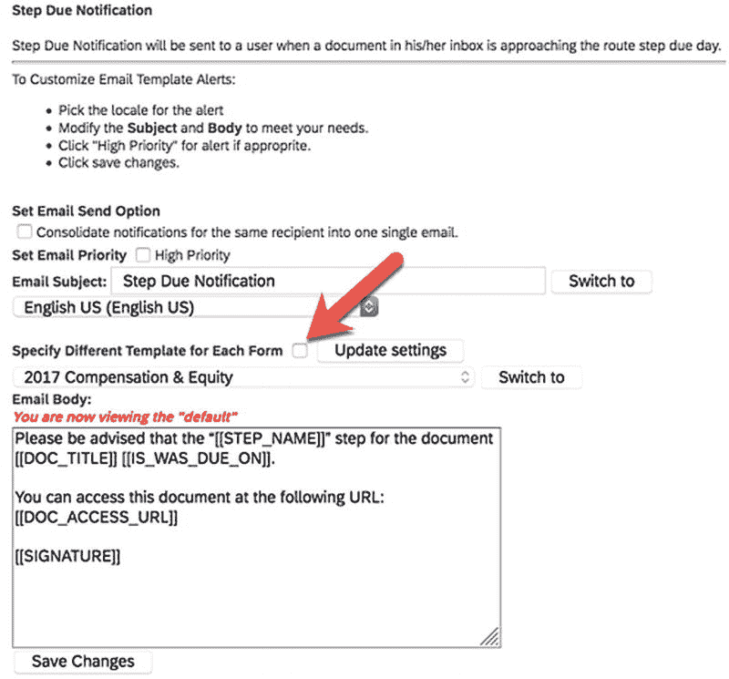

1. 单击“`为每个表单指定不同模板`”右侧的复选框，如图 8-2 所示。对于上述列表中未提及的任何通知，此复选框将不会激活。

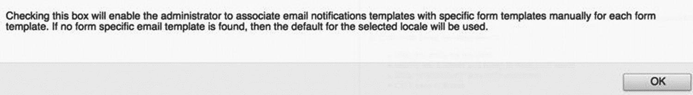

2. 将弹出一个窗口，警告用户与该通知关联的每个表单模板都可能需要手动更新。单击“`确定`”继续，如图 8-3 所示。

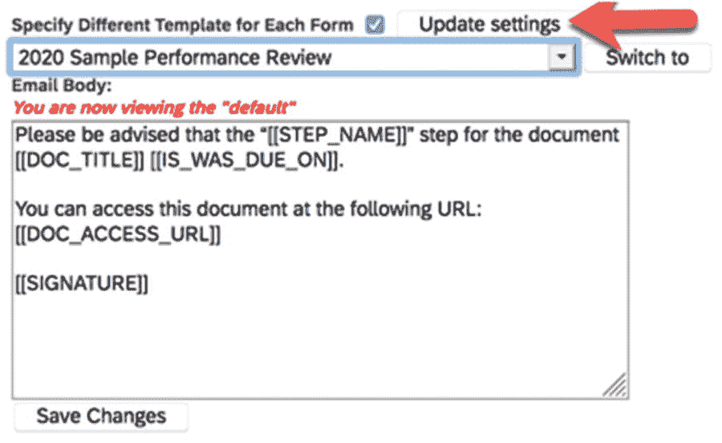

3. 在“`为每个表单指定不同模板`”下方，单击下拉列表，选择您希望为其创建自定义通知的 PM 表单模板。接着，单击“`更新设置`”按钮，如图 8-4 所示。

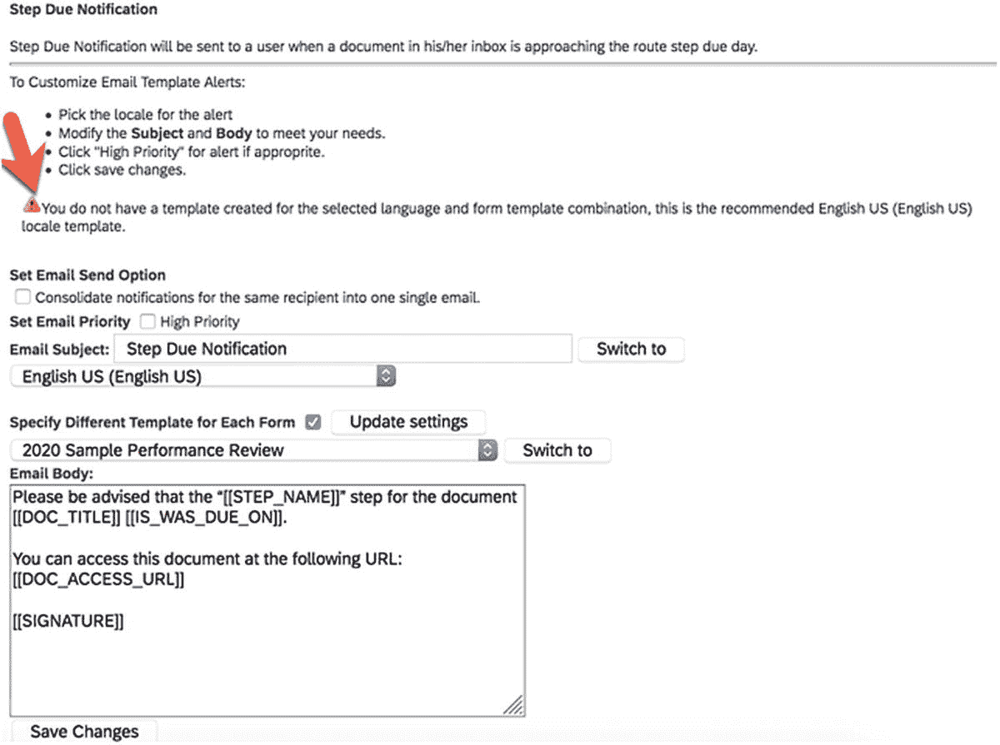

4. 屏幕将刷新，您会看到一条警告消息，提示该语言和表单模板组合没有对应的模板，如图 8-5 所示。

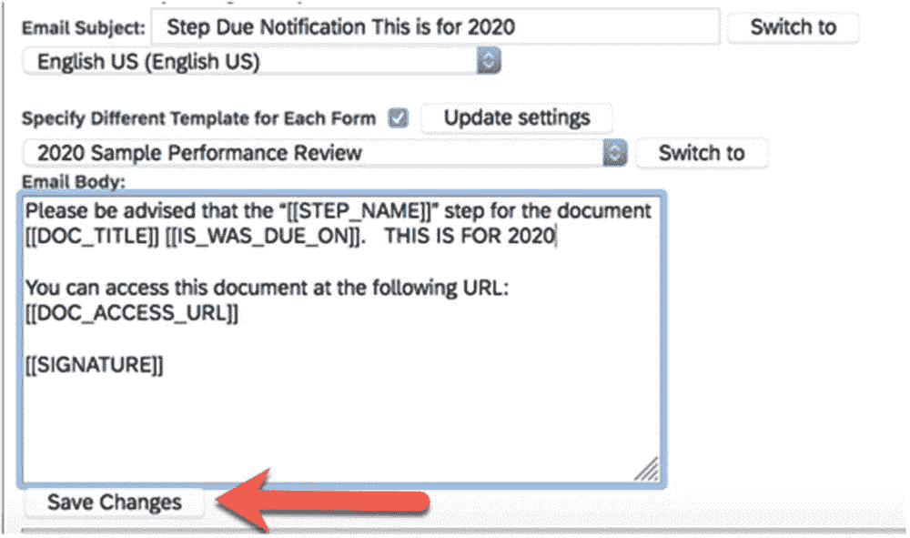

5. 对此表单模板要使用的电子邮件主题、正文和文本进行任何修改，然后单击“`保存更改`”，如图 8-6 所示。

现在，您已经为 2020 年绩效评估示例表单模板的步骤到期通知创建了自定义通知。要查看此通知类型下其他任何表单模板的通知，请从下拉列表中选择另一个表单模板，然后单击“`切换至`”。页面将刷新，并显示所选表单的文本；除非该特定绩效评估表模板的文本已被更新，否则它将显示为默认文本。您可以为所选表单模板进行修改，然后单击“`保存更新`”。

### 令牌

#### 通知与令牌

通知使用从表单中提取数据的令牌。更新电子邮件通知内容时，您可以省略现有令牌，或根据需要添加任何令牌。常用令牌列表请参见表 8-2。

#### 表 8-2：常用令牌

| 令牌 | 说明 |
| :--- | :--- |
| `[[COMPANY_NAME]]` | 公司名称 |
| `[[DOC_COMMENT]]` | 需要包含在电子邮件中的发件人备注 |
| `[[DOC_COMPLETION_DATE]]` | 表单完成日期 |
| `[[DOC_DUE_DATE]]` | 表单截止日期 |
| `[[DOC_LAST_MODIFIED]]` | 表单最后修改日期 |
| `[[DOC_TITLE]]` | 表单名称 |
| `[[EMP_NAME]]` | 主题对象全名 |
| `[[EMP_USER_ID]]` | 主题对象用户 ID |
| `[[EMP_PASSWORD]]` | 主题对象密码 |
| `[[IS_WAS_DUE_ON]]` | 表单截止日期（MM/DD/YYYY 格式） |
| `[[IS_WAS_DUE_ON_LONG]]` | 表单截止日期（月份用文本表示，例如：2020 年 8 月 12 日） |
| `[[NO_OF_DAYS]]` | 当前日期与表单截止日期之间的天数 |
| `[[RECIPIENT_NAME]]` | 此文档的收件人全名 |
| `[[RECIPIENT_USERNAME]]` | 此文档的收件人用户名 |
| `[[REVIEW_END_ON]]` | 审核结束日期 |
| `[[SENDER]]` | 表单发送者名称 |
| `[[SIGNATURE]]` | 签名 |

为了防止表单在路由过程中用户添加备注，请从电子邮件正文中删除 `[DOC_COMMENT]`。

### 自定义通知设置

部分电子邮件通知具有可自定义的设置。对于与通知关联的每个表单模板，都有设置来关闭通知、设置合并间隔，以及选择其他收件人来接收通知。

允许自定义设置的通知包括：

- 文档创建

- 文档路由

- 文档退回

- 文档转发

- 文档完成

- 文档删除

这些通知将显示“为表单模板自定义设置”，如图 8-7 所示。

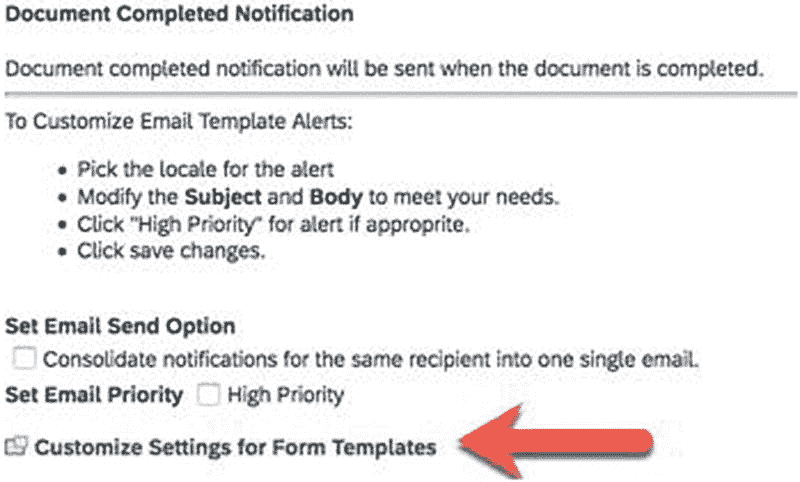

**图 8-7：** 为表单模板自定义设置

点击此链接后，将弹出一个窗口，其中显示与通知关联的所有有效表单模板，如图 8-8 所示。此列表还将包含任何招聘和薪酬表单模板。

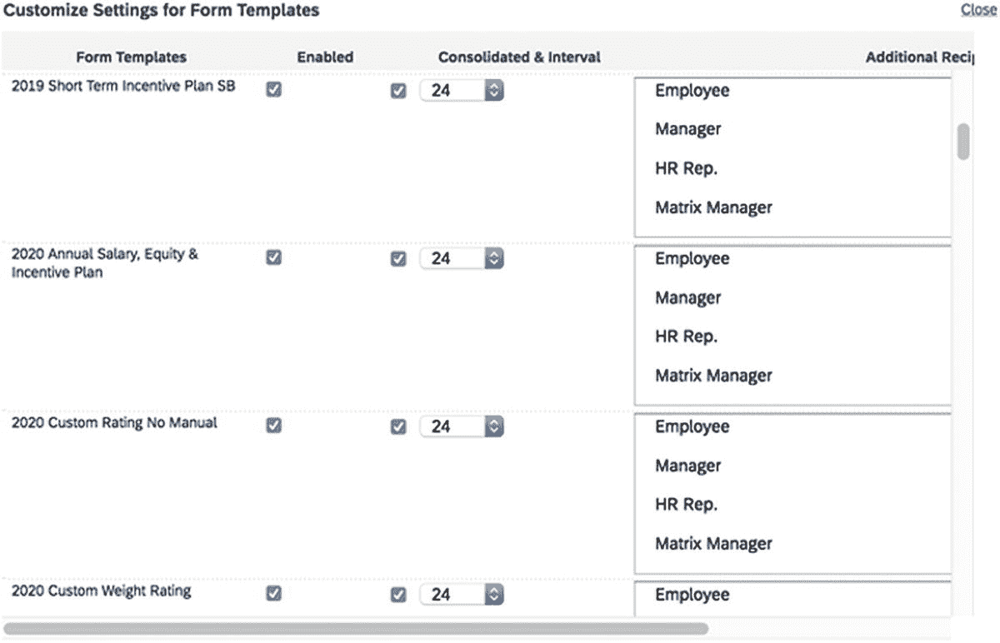

**图 8-8：** 自定义设置

可以自定义的设置位于三列下：“已启用”、“合并和间隔”和“其他收件人”。要关闭任何表单模板的通知发送，请取消选中“已启用”列中的复选框。当“合并和间隔”启用时，所有此类型的通知将以单封电子邮件的形式发送给收件人。您还可以选择合并邮件的发送频率。选项为每 1、2、4、6、8、12 或 24 小时。此设置对于拥有大量直接下属的管理者非常有用。例如，使用文档完成通知，管理者将收到一封列出已完成其绩效表单的直接下属的电子邮件，而不是为每个完成的表单单独接收一封电子邮件。每个表单模板的最后一个可自定义设置是添加其他收件人来接收通知。这允许添加不在路由图中的用户。

### 设置电子邮件发送选项

对于某些没有设置自定义间隔选项的通知，有一个称为“设置电子邮件发送选项”的选项，如图 8-9 所示。

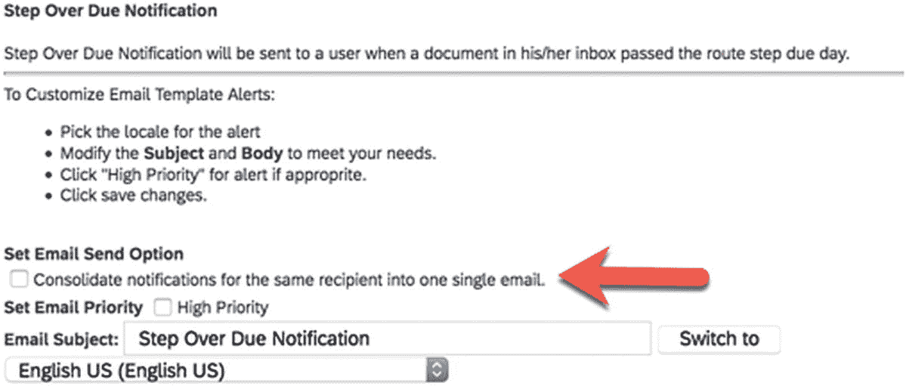

**图 8-9：** 电子邮件合并选项

启用此选项后，它将与页面底部的“合并电子邮件间隔（从凌晨 12:00 开始，以小时计）”配合使用。您可以在此处选择发送合并邮件的默认间隔，选项为 1、2、4、6、8、12 或 24 小时，如图 8-10 所示。


**图 8-10：** 设置发送合并电子邮件的间隔

允许自定义设置的通知也具有此选项：

- 文档创建

- 文档路由

- 文档退回

- 文档完成

- 文档转发

- 文档删除

这些通知可以为特定的表单模板设置合并间隔。以下列出的通知为与该通知关联的所有表单模板设置合并间隔。

这两个无法自定义但可以发送合并邮件的通知是：

- 步骤到期

- 步骤逾期

### 通知的后台作业计划

有少数电子邮件通知需要安排后台作业才能生成通知。

需要计划作业的绩效表单相关电子邮件通知包括：

- 文档到期

- 文档逾期

- 步骤到期

- 步骤逾期

需要计划的后台作业包括：

```
Send Form Due Notification
Send Form Late Notification
Send 360 Step Due Notification
Send 360 Step Late Notification
```

`360 步骤到期`和`360 步骤逾期`通知作业适用于 PM 和 360 表单。

要进行设置，请在预配置模块中，转到“管理计划作业”，如图 8-11 所示。

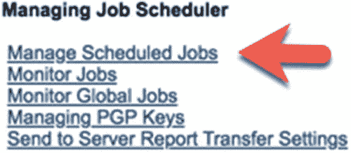

**图 8-11：** 管理计划作业

接下来，转到“创建新作业”，如图 8-12 所示。在这里，我们将为这四个通知设置每日运行的作业。

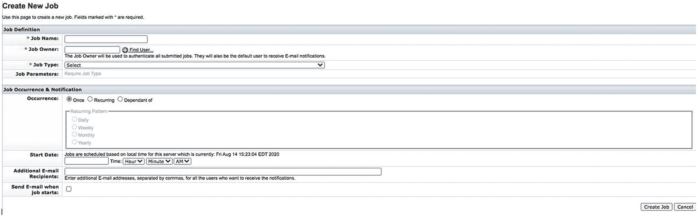

**图 8-12：** 创建新作业

单击“作业类型”下拉列表，从上述列表中找到作业名称。示例如图 8-13 所示。

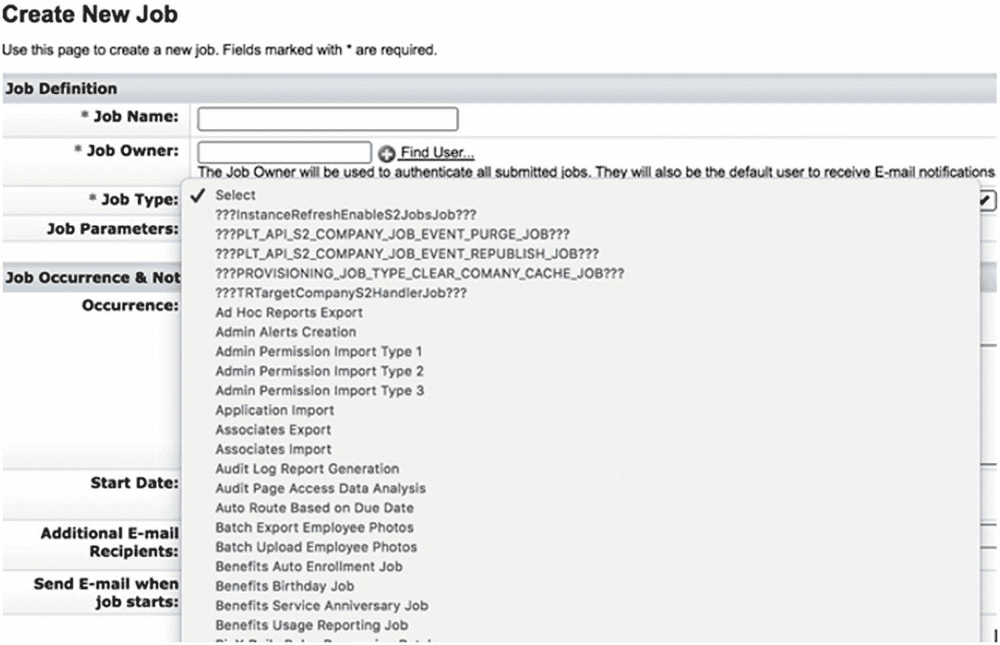

**图 8-13：** 选择作业类型

在创建计划期间，为作业命名并设置其运行频率。对于每日运行的作业，应设置为“重复”。您可以设置为清晨运行，以便在步骤/表单到期后的清晨移动表单。完成输入后，保存作业并提交。这样可以确保作业从您选择的开始日期起开始运行。

> **注意：** 要了解有关如何设置后台作业的更多信息，请参阅 SAP 说明 #2212605。

图 8-14 是步骤到期通知作业的示例，设置为每天凌晨 5:51 运行。

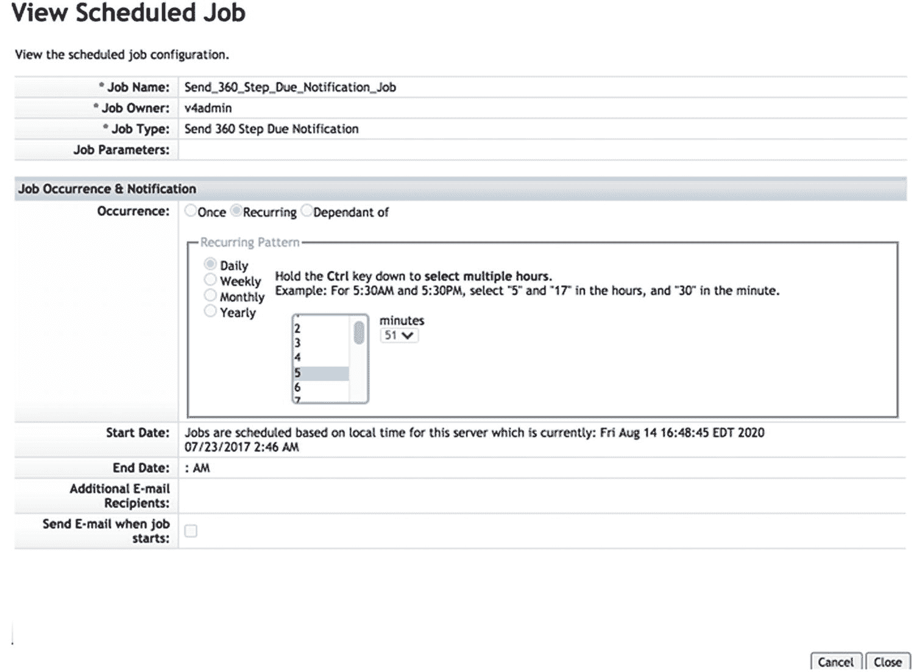

**图 8-14：** 步骤到期通知计划作业

要使此电子邮件通知在绩效表单位于用户收件箱且步骤已逾期时发送给该用户：

- 在`电子邮件通知模板`中启用了“步骤到期通知”。

- 表单模板的路由图设置了步骤到期日期。

- 表单模板在高级设置中设置了“默认到期通知日期（天）”。

- 表单模板在高级设置中未禁用步骤退出通知。

- 已计划后台作业每日运行。

图 8-15 是步骤到期通知的示例电子邮件。

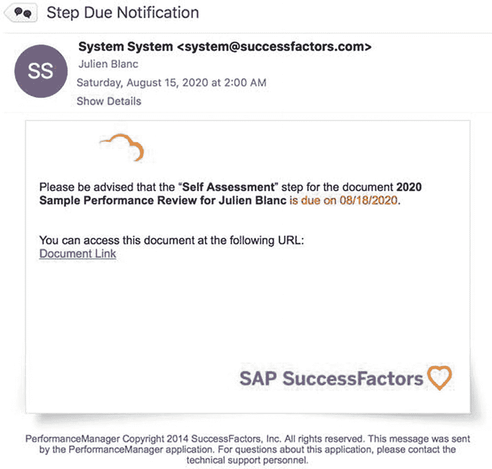

**图 8-15：** 步骤到期通知

## 绩效管理权限与路线图设置

路线图将 8/18/20 设定为自我评估步骤的截止日期。模板的高级设置中，通知时间为截止日期前三天。员工在步骤截止日期前三天收到了这封邮件。

### 基于角色的权限

现在来设置用户访问绩效管理所需的基于角色的权限。我们从员工角色开始。

### 员工权限

用户需要访问以下内容：

- `Home`（首页）菜单中的`Performance`（绩效）选项卡

- 主页上的`To-Do`（待办事项）磁贴

- 目标计划

- 发展计划（如果在绩效表单中显示）

我们需要设置基于角色的权限，以便允许用户看到`Home`菜单中的`Performance`选项卡。在`Manage Permission Roles`（管理权限角色）中，打开员工角色，点击`Permission`（权限），然后进入：

- `User Permissions`（用户权限） ➤ `Performance`（绩效） ➤ `Performance Management Access`（绩效管理访问权限）

*请注意，即使没有此权限，如果用户在收件箱中有表单，仍然能看到`Performance`选项卡。*

用户需要访问主页上的`To-Do`磁贴：

- `User Permissions`（用户权限） ➤ `Homepage v3 Tile Group Permission`（主页 v3 磁贴组权限） ➤ `Homepage v3 To-Do tile group`（主页 v3 待办事项磁贴组）

以下内容适用于在表单模板中使用目标且尚未启用时：

- `User Permissions`（用户权限） ➤ `Goals`（目标） ➤ `Goal Management Access`（目标管理访问权限）

- `User Permissions`（用户权限） ➤ `Goals`（目标） ➤ `Goal Plan Permissions`（目标计划权限）（指定具体计划）

以下内容适用于在表单模板中使用发展计划且尚未启用时：

- `User Permissions`（用户权限） ➤ `Career Development Planning`（职业发展规划） ➤ `Career Development Plan (CDP) Access Permission`（职业发展计划访问权限）

- `User Permissions`（用户权限） ➤ `Goals`（目标） ➤ `Goal Management Access`（目标管理访问权限） ➤ `Goal Plan Permissions`（目标计划权限）（指定具体发展计划）

### 经理权限

为了让经理能够创建或运行绩效相关的临时报告，请确保已启用报告权限。

在`Manage Permission Roles`（管理权限角色）中，打开经理角色，点击`Permission`（权限），然后进入`User Permissions`（用户权限） ➤ `Reports Permission`（报告权限）。您可以包含：

- `Ad Hoc Report Builder Standard Reports Bin`（临时报告生成器标准报告库）（如果使用 EC）
- `Report Center`（报告中心）
- `Classic Reports`（经典报告）
- `Detail Report`（详细报告）
- `List View`（列表视图）
- `Analytics Tiles and Dashboards`（分析磁贴与仪表板）（选择任何与绩效相关的磁贴和仪表板）
- `Create Report`（创建报告）
- `Performance Management`（绩效管理）
- `Run Report`（运行报告）（选择任何与绩效相关的磁贴和仪表板）

同时，为经理角色授予`Performance Management`（绩效管理）访问权限和`Team Overview Access`（团队概览访问权限）：

- `User Permissions`（用户权限） ➤ `Performance`（绩效） ➤ `Performance Management Access`（绩效管理访问权限）
- `User Permissions`（用户权限） ➤ `Performance`（绩效） ➤ `Team Overview Access`（团队概览访问权限）

以下内容适用于在表单模板中使用目标且尚未启用时：

- `User Permissions`（用户权限） ➤ `Goals`（目标） ➤ `Goal Management Access`（目标管理访问权限）
- `User Permissions`（用户权限） ➤ `Goals`（目标） ➤ `Goal Plan Permissions`（目标计划权限）（指定具体计划）

以下内容适用于在表单模板中使用发展计划且尚未启用时：

- `User Permissions`（用户权限） ➤ `Career Development Planning`（职业发展规划） ➤ `Career Development Plan (CDP) Access Permission`（职业发展计划访问权限）
- `User Permissions`（用户权限） ➤ `Goals`（目标） ➤ `Goal Management Access`（目标管理访问权限） ➤ `Goal Plan Permissions`（目标计划权限）（指定具体发展计划）

### 人力资源经理权限

除了管理员可以生成表单外，您可能也决定允许人力资源经理创建表单。例如，您后续可能会创建一个用于绩效改进的混合绩效表单。在这种情况下，经理可以联系支持该团队的人力资源经理来生成表单。由人力资源经理来执行此任务，相比让管理员启动表单，可以为流程提供更高的保密性。

您可以为您刚刚为经理角色设置的相同权限，也为人力资源经理进行设置。与经理角色类似，您可以授予其报告访问权限。

在`Manage Permission Roles`（管理权限角色）中，打开人力资源经理角色，点击`Permissions`（权限），然后进入`User Permissions`（用户权限） ➤ `Reports Permission`（报告权限）。在`Reports Permission`选项中，您可以包含以下内容：

- `Ad Hoc Report Builder Standard Reports Bin`（临时报告生成器标准报告库）（如果使用 EC）
- `Report Center`（报告中心）
- `Classic Reports`（经典报告）
- `Detail Report`（详细报告）
- `List View`（列表视图）
- `Analytics Tiles and Dashboards`（分析磁贴与仪表板）（选择任何与绩效相关的磁贴和仪表板）
- `Create Report`（创建报告）
- `Performance Management`（绩效管理）
- `Run Report`（运行报告）（选择任何与绩效相关的磁贴和仪表板）

与经理角色不同，还需要授予创建表单的权限：

- `User Permissions`（用户权限） ➤ `General User Permission`（一般用户权限） ➤ `Permission to Create Forms`（创建表单的权限）（指定要创建的表单）

授予启动表单的权限：

- `Administrator Permissions`（管理员权限） ➤ `Manage Form Templates`（管理表单模板） ➤ `Mass Create Form Instances`（批量创建表单实例）（立即启动表单）
- `Administrator Permissions`（管理员权限） ➤ `Manage Form Templates`（管理表单模板） ➤ `Schedule Mass Form Creation`（安排批量表单创建）（稍后启动表单）

保存这些角色，接下来我们将讨论路线图。

## 设置路线图日期

在启动绩效表单之前，我们需要在路线图中设置任何步骤的开始日期或截止日期。在搜索栏中输入并选择`Manage Route Maps`（管理路线图）。然后打开与将在表单启动中使用的绩效表单模板相关联的路线图。

通常情况下，人力资源部门会规划绩效评估周期中各步骤的日期。根据评估流程的开始和结束日期，您需要确认他们是否对流程的每个步骤使用了特定的时间窗口。有些公司会在年初设定目标，并保持表单的初始步骤开放，以便员工追踪进度和添加评论。然后他们会沟通年中检核步骤的日期。他们可能希望在某特定日期之前，阻止任何表单进入经理审阅环节。考虑到所有这些因素，您可以查看绩效周期日期，并判断是否需要向路线图添加步骤开始日期和截止日期。

最常用的是步骤开始日期和步骤截止日期，步骤退出日期则不太常见。您需要确认步骤开始日期是否会传达，以及开始日期是否会被强制执行。例如，当表单提前启动，而您不希望员工此时进入并编辑表单时，可以使用步骤开始日期的强制执行功能。在步骤开始日期之前，他们将只有只读访问权限。

另一个重要决策涉及步骤退出日期。如果用户在步骤截止日期前没有完成其收件箱中的表单，您是否希望该表单自动流转到下一个步骤？如果是这样，您需要设置一个步骤截止日期，并在路线图步骤中启用`Automatic send on due date`（截止日期自动发送）选项。

如图 8-16 所示，路线图的第一个步骤定义了步骤截止日期。当启用`Automatic send on due date`（截止日期自动发送）选项时，会显示两个附加选项：

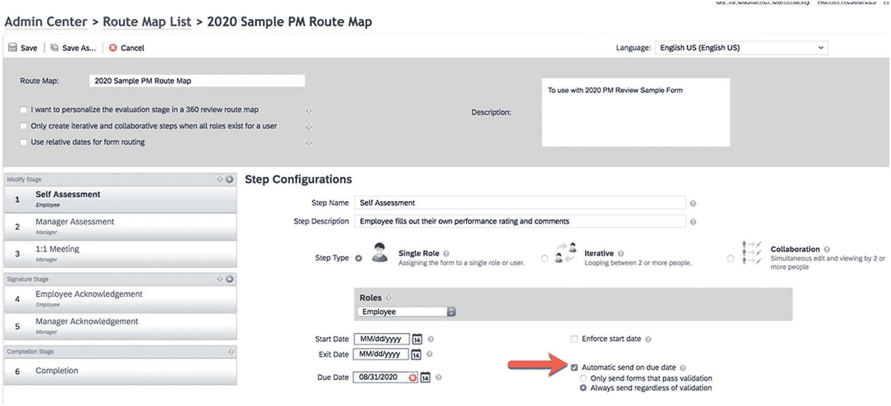

**图 8-16** 配置步骤日期

- **Only send forms that pass validation**（仅发送通过验证的表单）：如果此步骤中存在必填字段，则不将表单向前移动。此选项可用于需要输入评级等必填项的步骤。通过验证的表单将向前移动；有错误的表单则不会。
- **Always send regardless of validation**（无论验证结果如何始终发送）：无论步骤中是否存在必填字段，表单都会自动流转到下一步。

## 使用自动路由功能

当表单处于没有必填字段的步骤时，使用自动路由功能可能会有所帮助。例如，在流程的早期阶段，您可能希望员工在表单上输入备注。与其通过运行报告来追踪员工在流程中的位置，不如让表单在截止日期自动路由。

如果您打算使用步骤日期，并非每个步骤都需要设置。这也适用于`截止日期自动发送`和步骤开始日期强制执行。您可以为某个步骤设置开始日期，为另一个步骤设置带有自动路由的步骤退出日期。只需确保没有步骤日期重叠，以免导致表单卡住。

使用自动移动选项时请务必谨慎。例如，您的路由图在某些早期步骤中未启用`截止日期自动发送`，但在后续步骤中启用了此选项。处于早期步骤的表单不会自动前进。尚未到达自动路由步骤的表单在该步骤到期时也不会被自动路由。这意味着任何尚未到达自动路由步骤的表单都不会被自动路由。对于某个步骤，自动路由仅基于该步骤的截止日期执行一次。如果表单在截止日期之后才到达自动路由步骤，则不会执行自动路由。只有处于设置了截止日期且启用了自动路由的步骤中的表单才会被移动到下一步。

如果您已设置任何自动路由步骤，则需要安排一个每日运行的后台作业来处理路由。我们接下来将介绍这部分内容。

### 调度自动路由步骤到期后台作业

在本章前面部分，我们讨论了电子邮件通知的设置以及步骤到期和步骤逾期通知所需的后台作业。如果您正在使用自动路由选项，那么启用步骤到期日期的电子邮件通知也是合理的，这可以提醒用户在表单移动之前完成该步骤。

# 表单模板高级设置与配置

正如我们之前讨论的，如果您计划发送步骤到期通知，需要在表单模板的高级模板设置中启用通知，开启电子邮件通知，并设置好后合作业。

自动路由过程也需要一个后台作业。此作业将在步骤到期日后的第二天，按照作业中设定的时间移动表单。

要设置此作业，请进入`配置`，转到`管理计划作业` ➤ `创建新作业`，如图 8-17 所示，然后设置`自动路由步骤到期文档`计划作业。

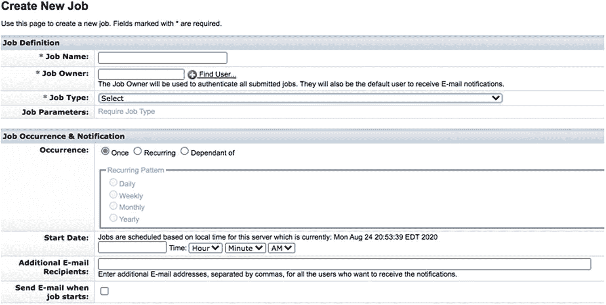

**图 8-17** 创建新后台作业

点击`作业类型`字段中的向下箭头，找到`基于截止日期自动路由`。为作业命名并设置执行频率。应设置为`定期`以每日运行。您可以将运行时间设置在清晨，这样表单就会在步骤到期后的清晨被移动。保存作业并提交。这将确保作业从您选择的开始日期起开始运行。

已创建作业的示例如图 8-18 所示。

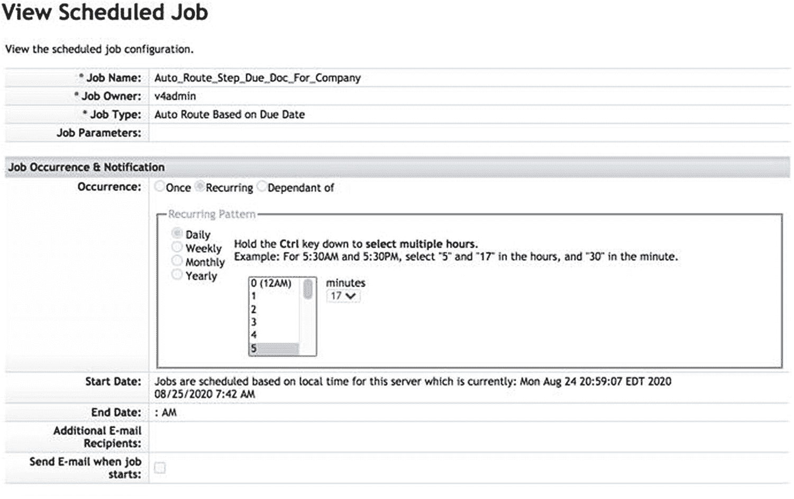

**图 8-18** 步骤截止日期自动路由作业

> **注意：** 有关在路由图中使用日期的更多信息，请参阅 SAP 注释 #2087333。

## 路由图上的相对截止日期

可以在路由图上使用相对日期来表示开始日期、退出日期和截止日期。

相对日期让您可以根据另一个活动之前或之后的天数来指定开始、退出或截止日期。

为了在路由图上使用相对日期，必须在`配置`中进行设置。为此，请转到`公司设置`并启用此选项：`为表单路由启用相对日期`。

启用后，您的路由图将显示`为表单路由使用相对日期`选项，如图 8-19 所示。

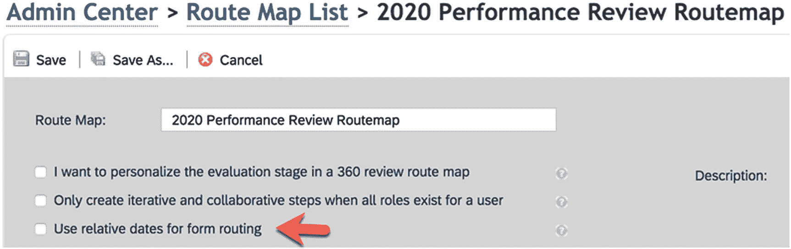

**图 8-19** 使用相对日期的选项

选中后，您将看到一个弹出警告：`更改此选项将重置您的路由图日期设置。是否继续？`示例如图 8-20 所示。

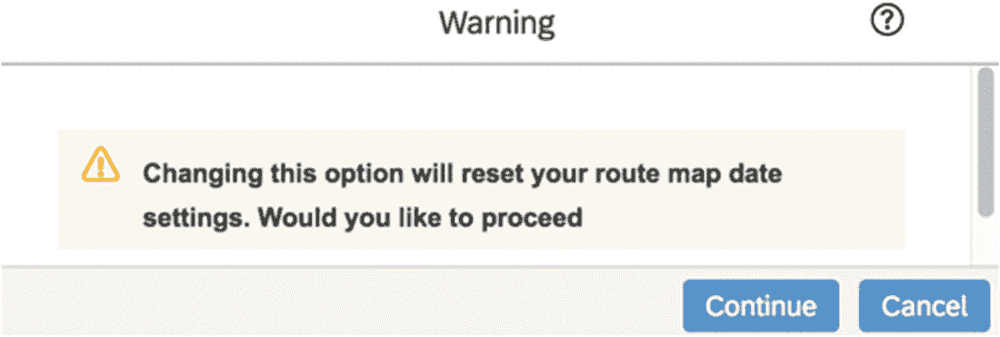

**图 8-20** 使用相对日期时的警告消息

选择`继续`。将出现一条说明，指出当启用相对日期时，不允许重新排序路由图中步骤的位置。

您会注意到路由图上的步骤开始、步骤退出和步骤截止日期选项现已更改。一个示例路由图如图 8-21 所示。

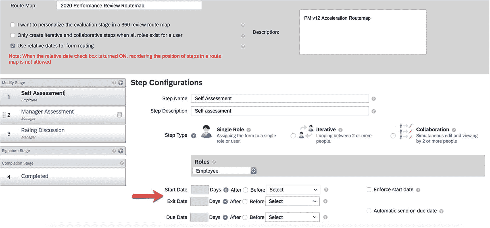

**图 8-21** 在路由图上设置相对截止日期

您将无法再选择固定日期。相反，路由步骤日期将相对于所选日期选项之前或之后的天数而定。

对于路由步骤日期，您需要选择`之后`或`之前`并指定天数。根据您设置的是哪种日期（开始、退出或截止）以及选择的是天数`之前`还是`之后`，可用的日期选择选项会有所不同。示例如图 8-22 所示。

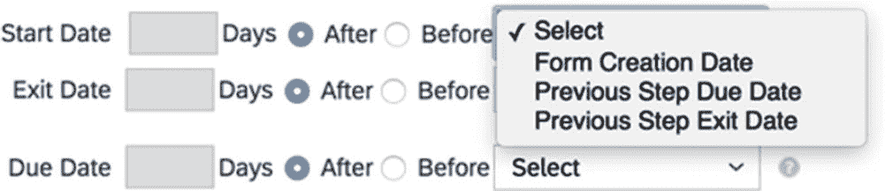

**图 8-22** 相对日期选项

下拉列表中可能显示的可选选项包括以下内容：

- `表单创建日期`

- `表单截止日期`

- `同一步骤开始日期`

- `同一步骤截止日期`

- `同一步骤退出日期`

- `前一步骤退出日期`

- `前一步骤截止日期`

在设置相对日期时，您不会看到所有这些选项；选项基于您正在设置的路由步骤日期类型，以及该日期是所选日期的`之前`还是`之后`。

设置步骤开始日期和截止日期的示例如图 8-23 所示。

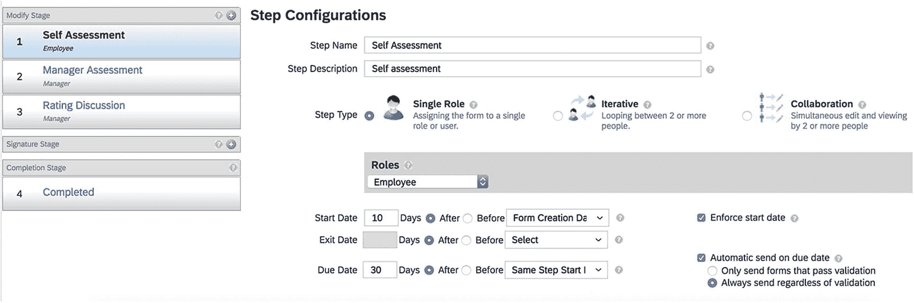

**图 8-23** 设置第一个步骤的日期

对于此路由图的第一个步骤，强制步骤开始日期设置为表单创建日期后的 10 天。该步骤在步骤开始日期后的 30 天到期。

## 待办事项磁贴

在启动表单之前，我们还有一项设置任务。

在主页上，待办事项面板中会显示一个与绩效管理相关的待办事项磁贴。用户需要执行的任何与绩效相关的操作都将显示在此磁贴中。示例如图 8-24 所示。

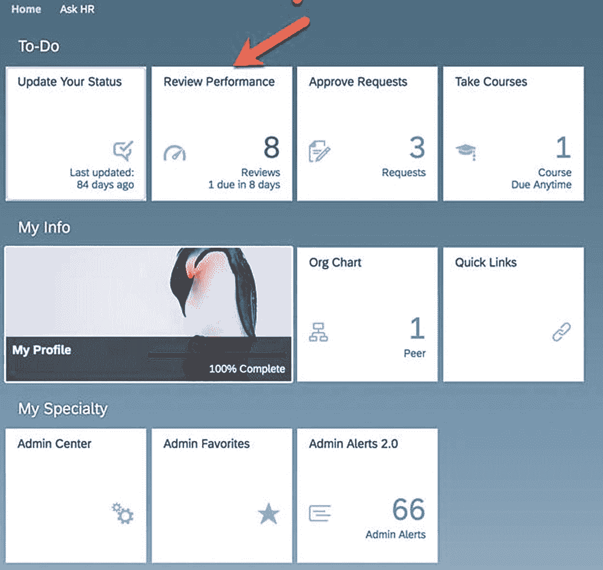

**图 8-24** 主页上的待办事项面板

此待办事项磁贴上的项目可能来自路由给用户的绩效表单。示例如图 8-25 所示。需要操作的项目包含一个链接，可将用户引导至所需操作或表单以完成任务。

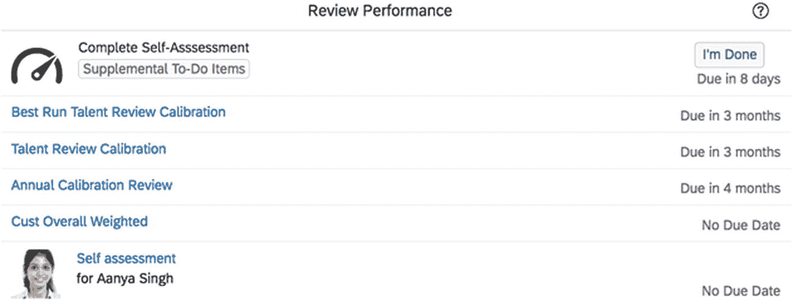

**图 8-25** 绩效相关的待办事项

管理员也可以向磁贴中添加补充待办事项。在第 6 章中，我们讨论了一些可授予的可选管理员权限。如果尚未完成，管理员角色需要拥有更新待办事项磁贴的权限。在搜索栏中输入并选择“管理权限角色”。打开管理员角色并添加以下权限。在“管理员权限”部分下，找到“管理用户”，然后选择“待办事项管理员”和“管理主页”。保存角色，然后我们可以继续。

要设置此磁贴，请在搜索栏中输入并选择“管理主页”。接下来，单击“待办事项设置”，如图 8-26 所示。您将看到所有可以更新的选项。

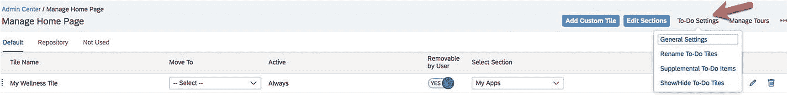

**图 8-26** 待办事项设置

### 常规设置

单击“常规设置”，如图 8-27 所示。在这里，我们可以更改待办事项显示的默认日期。

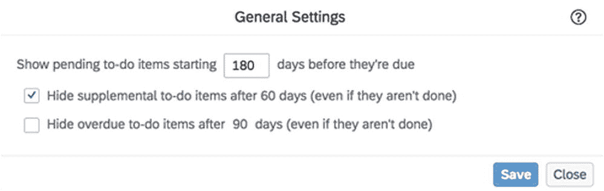

**图 8-27** 常规设置

设置项包括：

*   待处理项目

*   隐藏补充项目

*   隐藏逾期项目

这些设置用于确定待处理的待办事项何时显示，以及补充待办事项或逾期项目是否可以在指定天数后隐藏。请注意，此处的任何更改都将影响所有待办事项磁贴。

### 重命名待办事项磁贴

此外，在“待办事项设置”下，您可以重命名“审阅绩效”待办事项磁贴，如图 8-28 所示。更改“显示名称”列中的标签。

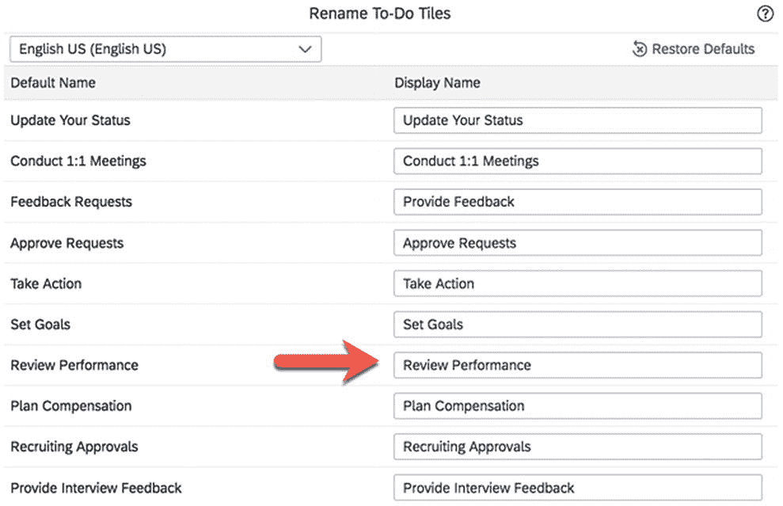

**图 8-28** 重命名待办事项磁贴

### 显示/隐藏待办事项磁贴

接下来，我们需要确保已启用*绩效管理*的待办事项磁贴。此设置也在“待办事项设置”中。单击“显示/隐藏待办事项磁贴”，将弹出一个窗口，如图 8-29 所示。确保“审阅绩效”设置为显示。如果没有，请将其更改为“是”并保存。

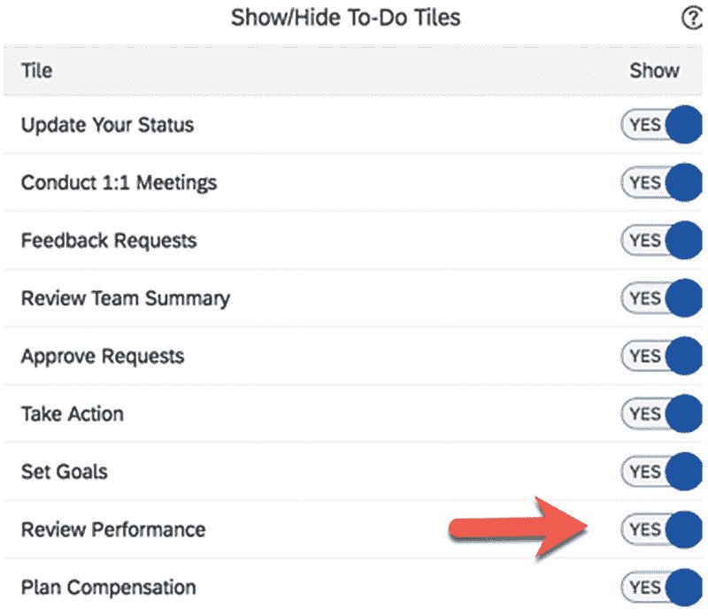

**图 8-29** 启用“审阅绩效”待办事项磁贴

### 补充待办事项

您还可以添加补充待办事项。例如，如果您没有使用步骤到期电子邮件通知，您希望提醒员工其绩效评估的自我评估步骤即将到期。

在“待办事项设置”中单击“补充待办事项”，将弹出一个窗口，如图 8-30 所示。选择附加待办事项将驻留的磁贴，为该“待办事项”设置一个名称及其到期日期。您还需要确定哪个角色会看到此附加待办事项。在此示例中，一个待办事项将驻留在“审阅绩效”待办事项磁贴中，标签为“完成自我评估”，并附带到期日期。员工角色将看到该项目。

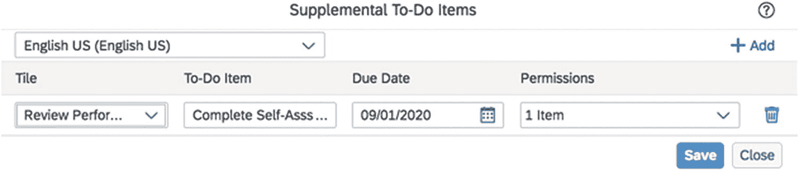

**图 8-30** 添加一个与绩效相关的补充待办事项

图 8-31 显示了用户“审阅绩效”待办事项磁贴中一个补充待办事项的示例。

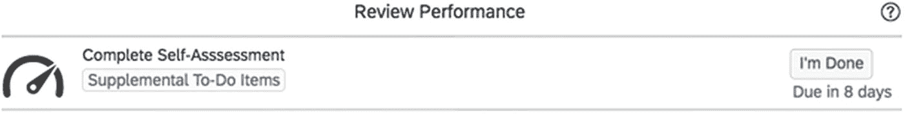

`图 8-31`

补充待办事项

如果用户单击“我已完成”，该项目将从其待办事项列表中移除。

此部分需要考虑的事项如下：

* 待办事项列表使用路线图步骤描述，而非路线图步骤名称。

* 待办事项使用步骤到期日期。如果没有步骤到期日期，该待办事项将在磁贴中显示“无到期日期”。

* 待办事项按到期日期排序，然后按字母顺序排列。

* 如果待办事项具有相同的路线图步骤名称和相同的步骤到期日期，它们将组合在待办事项磁贴中。

我们现在已经完成了启动表单所需的所有设置和配置，那么让我们开始吧！

### 启动表单

我们现在将启动基于表单模板的表单。我们将确定使用哪个表单模板，为哪些员工以及在何时创建绩效表单。启动表单的角色将需要在`管理员权限`中的`管理表单模板`下拥有基于角色的权限`批量创建表单实例`和`计划批量创建表单`。

此外，该角色还需要拥有创建表单的权限。通常，管理员角色能够创建任何表单，因为已经授予了所有表单的权限。但是，如果您希望某个角色只能启动特定的表单，请在该角色的权限中，转到`用户权限 ➤ 常规用户权限 ➤ 创建表单的权限`，如图 8-32 所示。

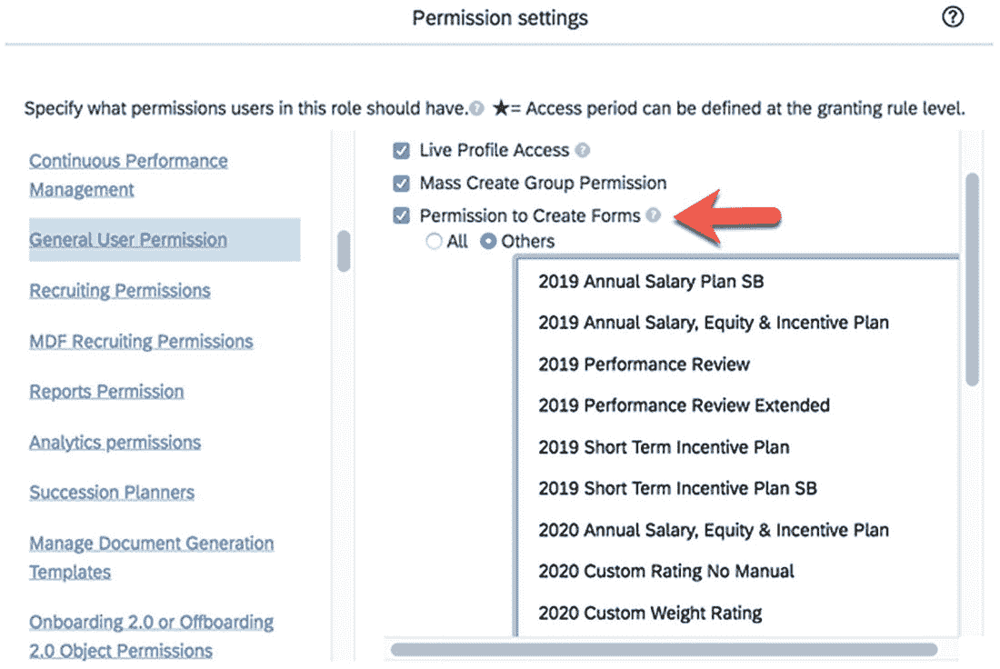

`图 8-32`

创建表单的权限

您需要单击“其他”单选按钮，并选择该角色可以创建的特定表单。保存更新，然后我们将开始启动流程。

在搜索栏中输入并选择“启动表单”。“启动表单”屏幕如图 8-33 所示。

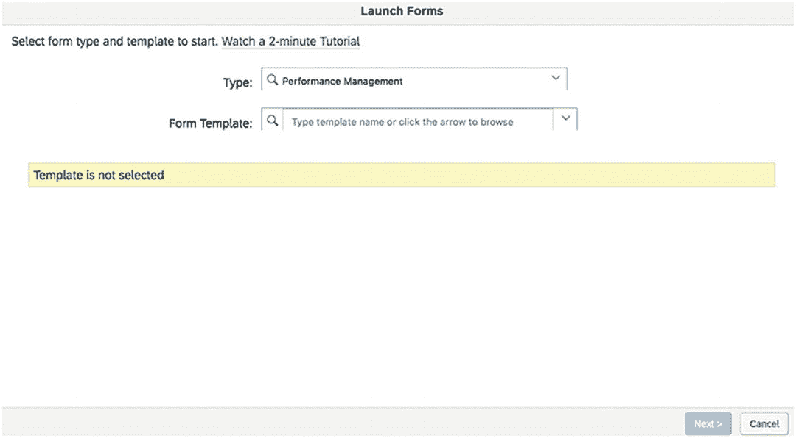

`图 8-33`

选择要启动的表单模板

在初始的“启动表单”屏幕上，选择要生成的表单类型，然后选择表单模板。模板类型下拉列表中的选项包括“全部”、360 或绩效管理。选择“绩效管理”。基于选择的类型为“绩效管理”，“表单模板”下拉列表将包含用户有权创建的所有活动绩效模板。

选择表单后，将显示有关所选表单模板的信息，如图 8-34 所示。

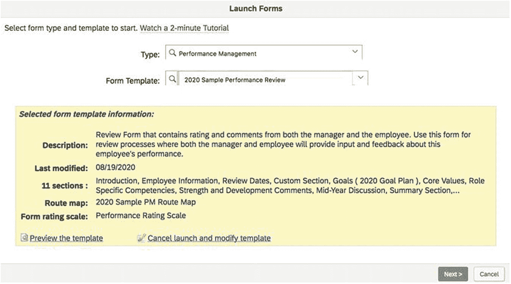

`图 8-34`

表单模板信息

将显示表单模板描述、路线图、评分量表、模板部分和最后修改日期。在此启动步骤中，您可以预览表单模板或取消启动。如果取消，您将返回到“管理模板”中的表单模板以进行编辑。

### 启动日期

单击“下一步”将进入启动流程的步骤 1。步骤 1 如图 8-35 所示。

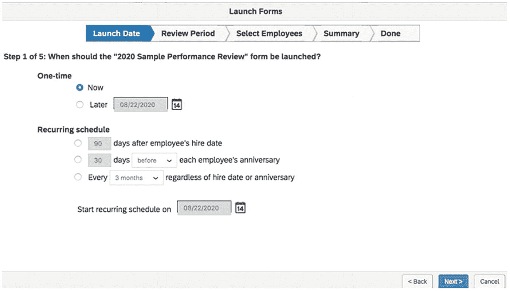

`图 8-35`

步骤 1，启动的“启动日期”步骤

此步骤允许您进行一次性启动，立即启动或选择稍后日期。或者，启动可以根据选定的标准重复进行。我们将研究这两种选项。

#### 一次性启动

此选项仅生成一次表单。您可以立即启动表单，或选择特定的启动日期。出于我们的目的，我们将选择“现在”，但您也可以选择将来的日期。

#### 定期计划

另一种选项启用定期启动。此选项用于您希望根据特定的基于日期的标准重复批量创建表单的情况。在启动时符合标准的员工将生成一个表单。

有三个与日期相关的选项可供选择：

# 1. 入职日期：选择入职后的天数，以启动表单。

例如，新员工入职时间尚短，不足以参与年度评审流程，因此你可以创建一份新员工试用期表单，用于评价其进展或作为设定目标的框架。在所选天数过后，将为新员工启动其试用期表单。

# 2. 周年日期

选择周年纪念日之前或之后的天数，以启动表单。

如果贵组织按照员工的入职周年日期进行绩效评估，而非所有员工采用统一的评审周期，则可以使用此选项。

# 3. 根据所选月份数（1、3、6 或 12）启动表单

例如，如果你选择在入职日期后 90 天启动表单，那么任何距离今天入职日期正好满 90 天的员工，今天都会生成一份表单。明天，则任何距离当天入职日期满 90 天的员工会在那时生成表单，以此类推。定期计划启动会根据当前日期，查看所选的天数/月数或年数，从而确定今天哪些人会生成表单。

要使用这些选项中的任何一个，都需要设置每天运行的后台作业。该每日作业会运行，检查当天符合条件的人员，并为这些用户生成表单。我们将在启动表单讨论的最后部分对此进行说明。

选择其中一个选项后，你需要指明定期计划作业应开始运行的日期。点击“下一步”进入第 2 步。

## 评审周期

启动流程的第 2 步用于定义进行评审的时间段。有四个选项可供选择，如图 `8-36` 所示。

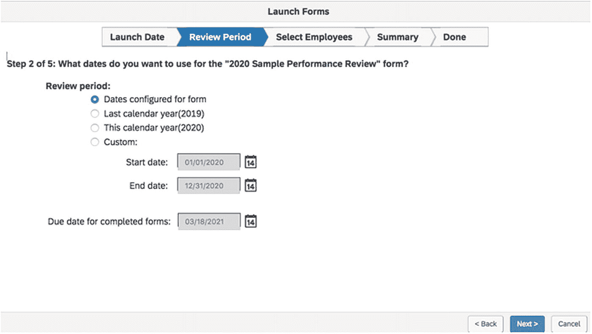

`图 8-36` 启动流程的第二步：评审周期步骤

### 评审周期选项

1.  **为表单配置的日期：** 日期来自表单模板高级设置中的默认开始日期、结束日期和到期日期。
2.  **上一个日历年：** 使用上一日历年的 1 月 1 日作为开始日期，12 月 31 日作为结束日期。
3.  **本日历年：** 使用当前年的 1 月 1 日作为开始日期，12 月 31 日作为结束日期。
4.  **自定义：** 你自行选择评审周期的开始和结束日期。

选项 2、3 和 4 还需要为已完成的表单设置到期日期。点击“下一步”进入启动流程的第 3 步。

## 选择员工

在启动流程的第 3 步，你将选择为其生成表单的用户。界面示例如图 `8-37` 所示。

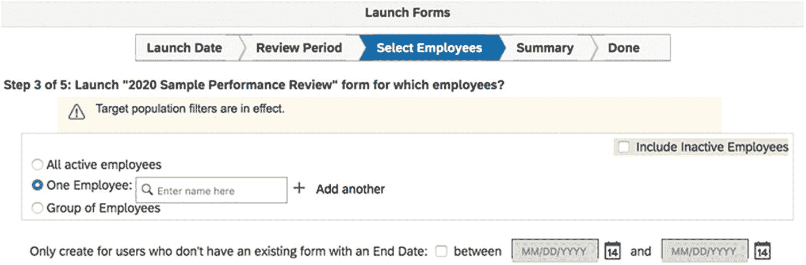

`图 8-37` 启动流程的选择员工步骤

有多个选项可供选择：

*   **截至启动日期的所有在职员工**
*   **一位员工** – 按姓名搜索，并可继续逐个添加用户
*   **员工组**

有两种选项可与所选员工配合使用：

1.  你可以选择包含非在职员工。这适用于除已排除非在职员工的动态组之外的任何员工选项。
2.  仅当用户在选定日期范围内没有现有表单时，才为其创建表单。

选择`“员工组”`将展开该区域，显示更多可供选择的组选项，如图 `8-38` 所示。

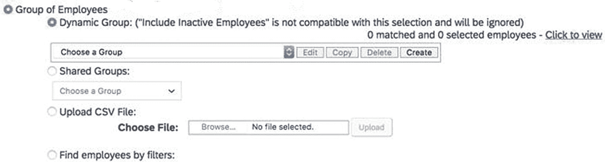

`图 8-38` 为表单启动选择员工组

*   **动态组：** 使用或复制现有动态组，或创建一个新的动态组以供使用。
*   **共享组：** 如果你正在使用共享组，请选择此单选按钮，然后从下拉列表中查找共享组。

### 上传 CSV 文件
导入一个包含用户 `ID` 的 `CSV` 文件。该文件中的所有用户 `ID` 都将生成一份表单。

### 按筛选条件查找员工
点击此选项，您将看到可供选择的筛选条件。

请注意，您选择中包含的员工取决于您的目标人群和启动日期。做出选择后，点击“下一步”继续下一个启动步骤。有关创建组群的更多信息，请参阅 `SAP` 说明 `#2088248`。

## 编辑介绍文本

如果您在表单模板中设置了自定义板块，并启用了“在批量创建中编辑介绍文本描述”，您将看到一个额外的步骤，如图 `8-39` 所示。

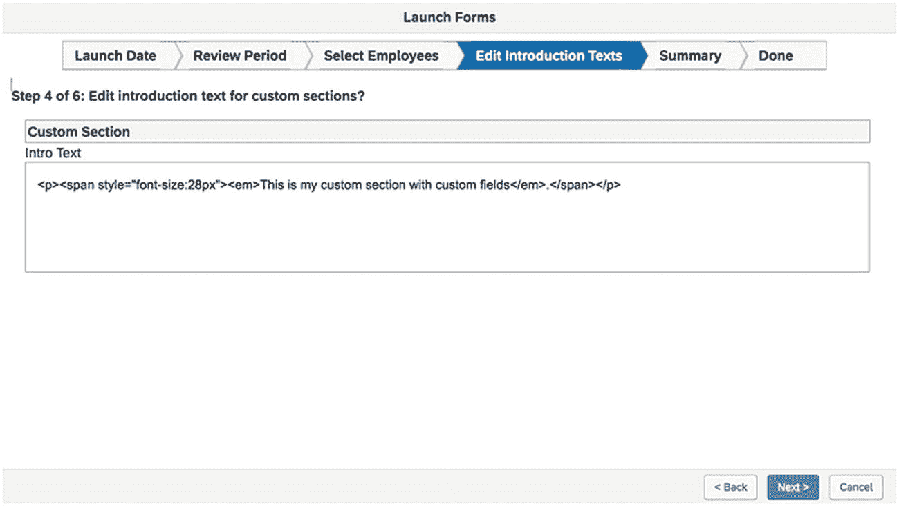

`图 8-39` 更新自定义介绍文本

启用后，在此处输入的文本将显示在表单自定义板块的顶部。

## 摘要

启动流程中的“摘要”部分，如图 `8-40` 所示，会显示之前所有步骤的选择结果。

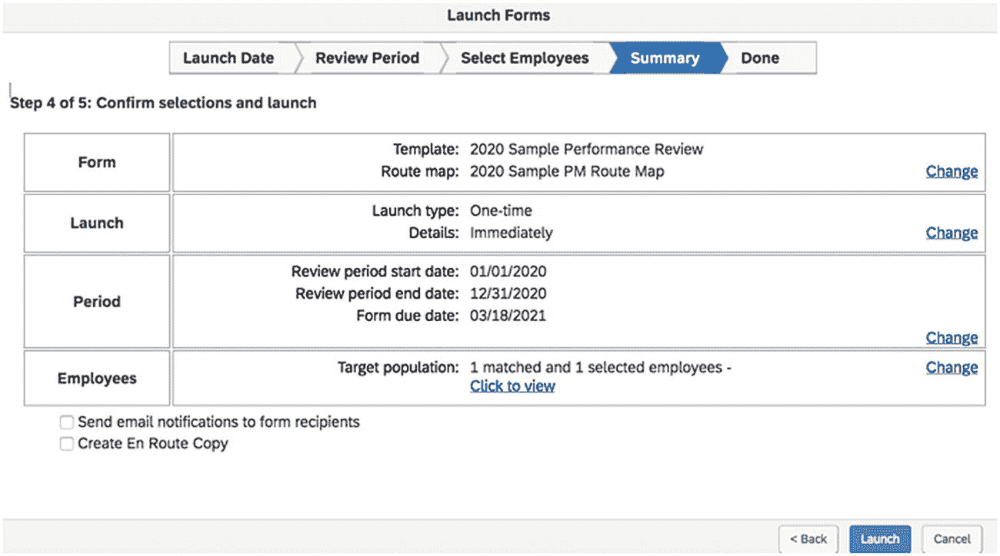

`图 8-40` 启动的摘要步骤

任何或所有步骤的决策都可以更改。点击任意部分的“更改”，它将带您回到相应的步骤，您可以在启动前进行任何编辑。然后，您需要逐步浏览启动屏幕，直到返回“摘要”步骤。

“摘要”屏幕上还有两个复选框：

- **向表单收件人发送电子邮件通知**：路由流程中的第一个人将收到表单已创建的通知。该表单将出现在用户的“绩效收件箱”中，并且在其主页的“绩效”磁贴中会有一个“待办事项”项目。如果“文档创建”电子邮件通知已启用，但此选项未勾选，则不会生成电子邮件。
建议启用此选项，以便在审核流程开始时，路由流程中的第一个用户能知道表单何时进入其收件箱。对于后续步骤，系统将发送路由邮件，告知用户表单已进入其收件箱，等待他们处理。

- **创建在途副本**：启动表单的用户会将其表单副本发送到其“在途”表单文件夹。如果启动表单的管理员勾选了此选项，他们将会收到大量表单，因此不建议使用。

进行任何更改或启用选项后，点击“启动”，将显示一个确认弹出窗口，如图 `8-41` 所示。

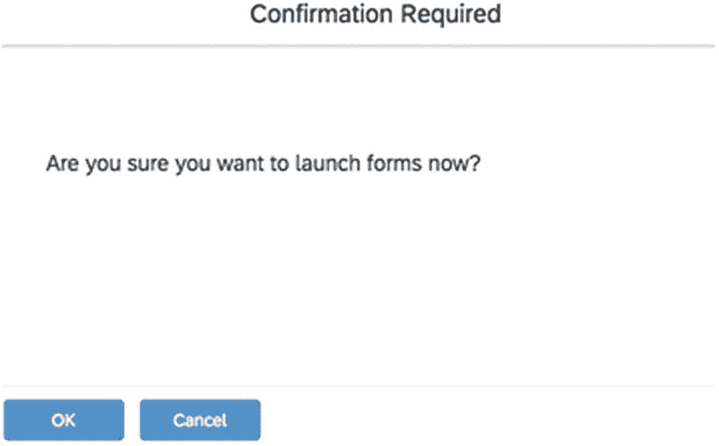

`图 8-41` 启动确认

点击“确定”后，您将看到“完成”步骤，如图 `8-42` 所示。

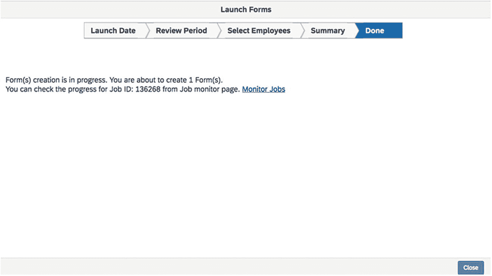

`图 8-42` 启动的完成步骤

如果您尚未启用“批量创建表单实例”通知，并且想确认启动已完成，请记下“完成”步骤中列出的作业 `ID`，然后点击“监控作业”。

“批量创建表单作业监控器”将在一个弹出屏幕中显示。点击“筛选”旁边的展开图标，如图 `8-43` 所示。

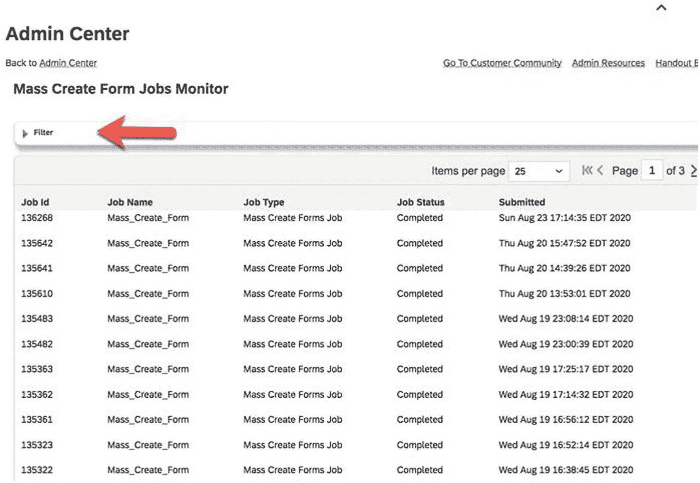

`图 8-43` 批量创建表单作业监控器

继续点击“刷新”按钮，直到看到您已启动表单的作业 `ID`，如图 `8-44` 所示。

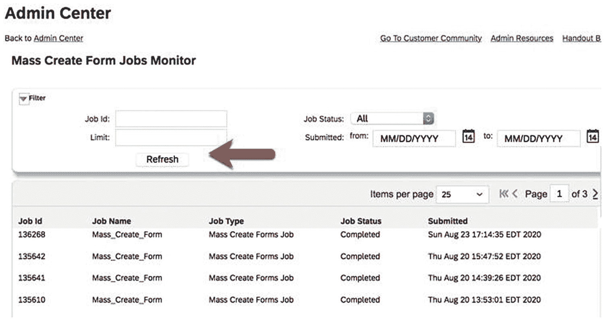

`图 8-44` 刷新直至作业完成

一旦您看到任务 `ID` 且任务状态为“已完成”，则表示您已成功启动绩效表单！关闭弹出窗口，然后关闭启动页面。

在启动的“启动日期”步骤中，当我们选择了循环表单启动时，我们简要提到了需要设置后台任务。使用与设置邮件通知运行任务相同的步骤。进入 `Provisioning`，转到 `Manage Scheduled Jobs` ➤ `Create New Job`，然后创建“计划表单创建”。将任务计划为每天运行。图 `8-45` 显示了一个示例。

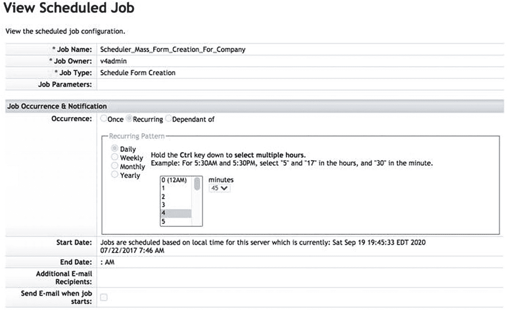

`图 8-45` 循环表单启动的后台任务

**注意**
有关管理计划评审的更多信息，请参阅 `SAP` 说明 `#2076115`；要了解有关批量启动表单的更多信息，请参阅 `SAP` 说明 `#2601584`。

## 附加管理员功能

一旦评审周期开始，管理员就可以忙于设置报表和仪表盘，并将“绩效历史”Portlet 添加到人员档案中。接下来我们将介绍这些功能。

## 报表

在这里，我们将介绍一些可用的绩效管理相关报表。作为经理和 HR 经理角色权限设置的一部分，我们授予了他们对标准报表、仪表盘和即席查询报表的访问权限。

### 标准报表

对于我们将要查看的报表，经理和 HR 经理角色需要能够访问经典报表和列表视图报表。要验证角色是否拥有这些权限，请在搜索栏中键入并选择“管理权限角色”。选择要检查权限的角色。在 `User Permissions` 部分中，找到“报表权限”，然后选择“经典报表”和“列表视图”。保存角色。

在这里，我们将查看经典报表和列表视图报表。当用户拥有报表访问权限时，它将出现在主页菜单中，如图 `8-46` 所示。

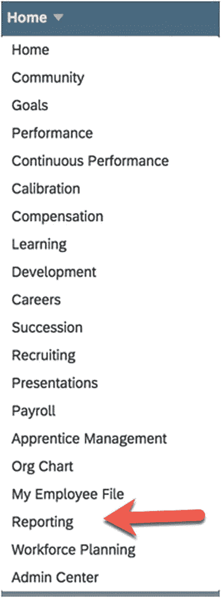

`图 8-46` 主页菜单

# 报表与仪表盘功能

从主页菜单中，选择“报表”。如果显示了报表中心视图，请单击“切换到经典视图”，如图 8-47 所示。

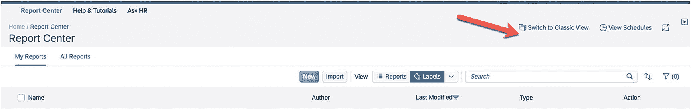

**图 8-47** 报表中心

标准报表将列出，如图 8-48 所示。请注意，根据权限，您可能看不到所显示的所有报表。

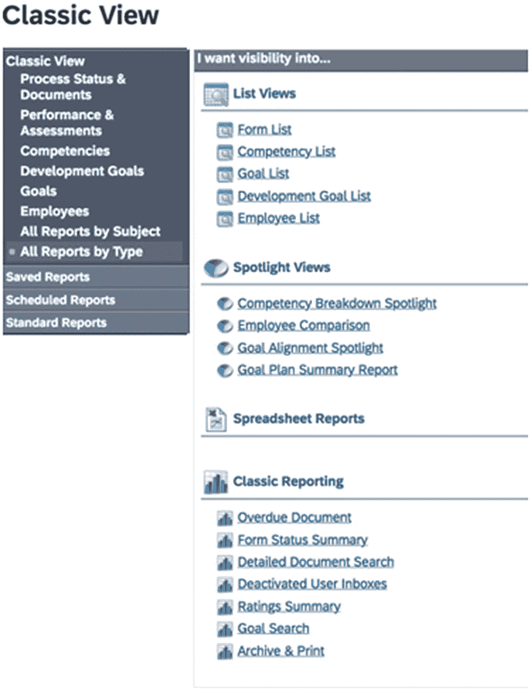

**图 8-48** 经典报表

在左侧面板上，报表按类别分组。选择“按类型显示所有报表”以查看如图 8-49 所示的视图。

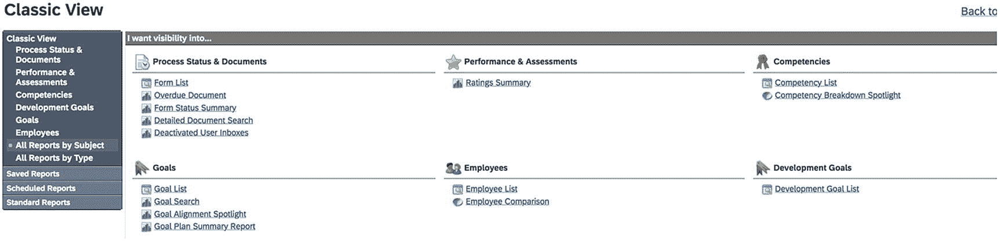

**图 8-49** 按类型显示的报表

绩效相关报表包括：
*   表单列表
*   逾期文档
*   表单状态摘要
*   评级摘要

图 8-50 是表单列表的示例。

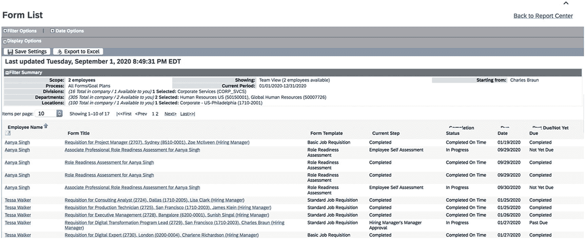

**图 8-50** 表单列表报表

此报表列出用户的当前表单。每一行还显示与绩效表单关联的表单模板、表单状态、当前步骤、到期日期以及表单是否已完成。管理员可以运行此报表以在整个组织内进行报告。如果由 HR 经理运行，该报表将仅包含其支持的员工。如果由经理运行，该报表将仅包括向其汇报的下属及其以下级别的员工。

## 仪表盘

有一些可从`SuccessStore`添加的标准绩效相关仪表盘。我们将简要介绍执行此操作的过程。在搜索栏中键入并选择“管理仪表盘”。如图 8-51 所示，单击“管理标准仪表盘”和“`YouCalc` 文件”。

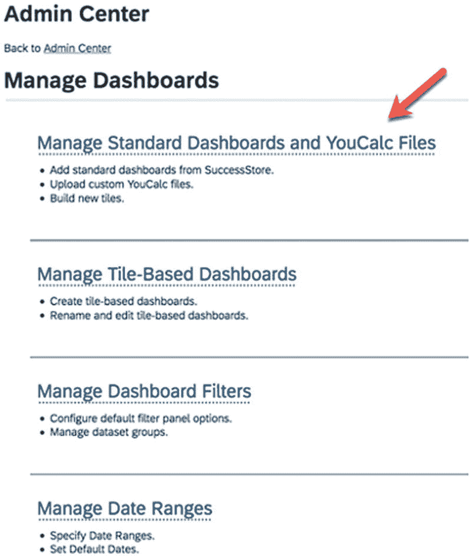

**图 8-51** 管理仪表盘

接下来，单击“从`SuccessStore`添加标准仪表盘”。在这里，您将看到所有可从`SuccessStore`获取的仪表盘和磁贴。如图 8-52 所示，有绩效相关的磁贴和仪表盘。


**图 8-52** 绩效相关仪表盘和磁贴

标准的绩效相关磁贴包括：
*   绩效表单分布
*   绩效表单状态
*   绩效表单逾期
*   总体绩效评级分布

添加后，转到“操作”列并点击“编辑”，如图 8-53 所示。


**图 8-53** 编辑磁贴

要使磁贴在主页上可用，请转到“可用性”选项卡并选择“主页”，如图 8-54 所示。


**图 8-54** 在主页上启用

保存磁贴。对每个添加的磁贴执行此操作。接下来，在搜索栏中键入并选择“管理主页”。在这里，我们将确保磁贴可见。找到绩效磁贴。将磁贴从“存储库”或“未使用”选项卡移动到“默认”选项卡，如图 8-55 所示。


**图 8-55** 将磁贴移至默认选项卡

将它们与其他经理相关磁贴一起放入“我的团队”版块。图 8-56 显示了一个示例。


**图 8-56** 添加到“我的团队”的磁贴

保存更新。只要经理角色启用了分析磁贴和仪表盘，他们就会在主页上看到这些内容。所需的权限如图 8-57 所示。


**图 8-57** 管理员的磁贴和仪表盘权限

可能显示在经理主页上的绩效相关磁贴示例如图 8-58 所示。


**图 8-58** 经理主页上的绩效磁贴

还有一些可用的标准绩效仪表盘：
*   绩效仪表盘
*   绩效和能力仪表盘

请注意，绩效仪表盘包含一个用于“绩效与潜力”的磁贴。如果您未在表单模板中使用“绩效潜力摘要”部分，此磁贴将为空白且无法移除。同样，如果您的表单模板不评估能力，请不要使用绩效和能力仪表盘。仪表盘可以共享，这使用户能够在报表中心内生成仪表盘。

> **注意** 要了解有关仪表盘和磁贴的更多信息，请参阅 SAP 说明 #2536495。

## 即席查询报表

管理员可以创建供自己使用的报表，也可以创建可供其他用户运行的共享报表。

### 绩效管理报表

创建临时报表时，需要选择“绩效管理”作为域，如图 8-59 所示。


**图 8-59** 绩效管理报表的域

向导会逐步引导您完成报表的创建。示例如图 8-60 所示。


**图 8-60** 创建临时报表的步骤

使用向导创建临时报表时，在“人员”选项卡上，选择“已登录用户”以及管理员应有权访问的级别数量。示例如图 8-61 所示。


**图 8-61** 选择报表类型

如果已授予绩效管理数据的临时报表创建权限，HR 管理员和/或部门主管即可为其目标群体创建临时报表。例如，当部门主管运行此报表时，结果将只包含其团队成员。作为管理员，您可以创建可供 HR 管理员和部门主管使用的临时报表，以便他们为其目标群体运行报表。这可通过共享报表来实现，如图 8-62 所示。


**图 8-62** 共享临时报表

然后，您可以选择与谁共享该报表。报表可按角色共享，如图 8-63 所示。


**图 8-63** 按角色共享报表

可被纳入报表的字段有很多，如图 8-64 所示。


**图 8-64** 绩效表单字段

> **注意** 要了解更多关于临时报表的信息，请参阅 SAP 说明 #2536445。

## 人员档案中的绩效相关模块

如果在数据模型中配置并启用了绩效评级背景元素，这些元素可以显示在人员档案中。通常，这些元素会出现在档案的“人才档案”部分，只有员工和部门主管可以查看。其中部分模块可能仅允许部门主管查看。对于数据模型中的任何评级背景元素，请确保相应的角色拥有查看权限。在角色设置中，通过“用户权限”➤“员工数据”进入“背景元素”部分。在图 8-65 中，正在为部门主管角色授予“绩效历史面板”的查看权限。

## 图 8-67  
#### 为人才资料板块的子板块命名

您可以重命名该板块，如图 8-68 所示。


## 图 8-68  
#### 重命名绩效历史板块

如果您的模板包含`绩效潜力摘要`板块或`目标胜任力摘要`板块，这些板块可以被允许并配置为也显示在个人资料中。在下一章中，您将看到用户资料中的板块。

现在我们已经了解了如何报告绩效数据，接下来我们将探讨管理员在评审周期中可能需要执行的一些管理功能。

#### 删除表单

在某些情况下，可能需要删除表单。例如，可能需要启动一个新表单，从而删除原有表单。在搜索栏中键入并选择 `Delete Form`。您将看到多种删除表单的方式。示例如图 8-69 所示。


## 图 8-69  
#### 删除表单

可以根据用户或表单属性进行高级搜索。此外，还可以上传包含文档 ID 的文件。所有符合条件表单都将显示；您可以选择一个、多个或全部进行删除。示例如图 8-70 所示。


## 图 8-70  
#### 选择要删除的表单

#### 恢复表单

在某些情况下，可能为已离职但现已返岗的用户删除了表单，或是表单被意外删除。与“删除表单”操作类似，表单也可以恢复。

在搜索栏中键入并选择 `Restore Form`。示例如图 8-71 所示。


## 图 8-71  
#### 恢复表单

高级搜索选项基于用户属性或表单属性。符合搜索条件的表单将显示，您可以选择要恢复的表单。表单将恢复到其被删除时的步骤。

#### 隐藏文档可见性

可以隐藏对用户可见的表单。例如，某位经理拥有其直接下属 2016 年至 2019 年的绩效表单副本。这些表单位于其 `Performance Completed` 文件夹中。该经理转岗为个人贡献者，不应再访问这些表单。我们希望这些表单不再出现在该用户的 `Performance Completed` 文件夹中。这可以通过隐藏文档对用户的可见性来实现。此操作不会删除表单，也不会影响拥有表单副本的其他用户。此功能适用于用户 `Performance En Route` 或 `Completed` 文件夹中的表单。它不会隐藏用户收件箱中的表单。

如果管理员角色尚未获得相应权限，则需要获取权限才能执行此操作。在搜索栏中键入并选择 `Manage Permission Roles`。选择要添加权限的角色。在 `Administrator Permissions` 部分中找到 `Manage Documents`，然后选择 `Manage Document Visibility`。保存该角色。

现在我们来隐藏一份文档。在搜索栏中键入并选择 `Manage Document Visibility`。屏幕示例如图 8-72 所示。


## 图 8-72  
#### 管理文档可见性

要定位需要隐藏的特定表单，有三种选项：

*   按用户
*   按文档 ID
*   按 CSV 上传

根据所选单选按钮，所需的输入项会有所不同。

我们将逐一查看每个选项。

##### 按用户


**图 8-73** 按用户移除文档可见性

- 为了隐藏一个用户的表单，使其对另一个用户不可见。
- 要移除文档可见性，需要具有可见性的用户和文档主体。示例如图 8-73 所示。

在该示例中，列出了经理 `George Hill` 拥有的所有关于 `Jada Baker` 的表单。管理员可以选择任意或全部表单，从 `George` 的可见性中移除。选择后，点击 `Remove Visibility`。将显示一个确认弹窗，如图 8-74 所示。


**图 8-74** 确认文档可见性移除

点击 `OK` 后，将显示表单名称以及失去可见性的用户。示例如图 8-75 所示。


**图 8-75** 表单已成功隐藏

##### 按文档 ID 隐藏

表单可基于文档 ID 进行隐藏。


**图 8-76** 按文档 ID 移除可见性

- 为了隐藏一个用户的表单，使其对另一个用户不可见。
- 要移除文档可见性，需要文档 ID 和具有表单可见性的用户。示例如图 8-76 所示。

此选项的工作方式与按用户移除表单相同。选择文档 ID 和具有可见性的用户。搜索结果显示后，选择表单并移除可见性。当确认弹窗出现时，点击 `OK` 以隐藏文档。该表单将不再对所选用户可见。

##### 按 CSV 上传

可以通过文件上传来移除文档可见性，具体方式如下：

- 进行批量移除表单可见性。
- 为多个用户隐藏多个表单。
- 提供两种文件模板：按角色或按用户 ID。

点击 `by CSV Upload` 按钮，您将能够下载一个用于上传的文件模板。示例如图 8-77 所示。


**图 8-77** 下载用于文档可见性移除上传的模板

您可以下载 `By Roles` 模板或 `By User ID` 模板。

`By Roles` 模板使用表单 ID 和用户角色。一个包含条目的示例如图 8-78 所示。


**图 8-78** “按角色”模板

`By Roles` 模板使用表单 ID 和用户在路线图中的角色。这基于用户在表单路线图中的角色。

`By User ID` 模板使用表单 ID 和用户 ID。用户 ID 是您希望为其隐藏表单的员工 ID。

两种上传的方法相同。我们将通过用户 ID 进行上传。

`By User ID` 模板的示例如图 8-79 所示。


**图 8-79**

用于隐藏表单可见性的用户 ID 文件

在文件中，您可以输入多个表单 ID 及对应的用户 ID。您可以选择对多个用户隐藏同一个表单。

保存 CSV 文件后，选择该文件并上传。

屏幕将刷新。如果文件没有问题，您将看到“Success”（成功），并且文件中的表单列表将显示出来。选择要隐藏的表单，然后点击“Remove Visibility”（移除可见性），如图 8-80 所示。


**图 8-80** 所选表单的可见性

此时将显示确认弹出窗口；确认后，这些表单将被隐藏。

表单隐藏后，您将看到已隐藏的表单名称和用户名。示例如图 [8-81] 所示。


**图 8-81** 表单已被设为不可见

请注意，如果您移除了所有有权访问表单的用户的文档可见性，系统将删除该文档。现在我们已经了解了如何隐藏表单，接下来学习如何恢复隐藏的表单。

### 恢复文档可见性

任何隐藏的文档都可以恢复其可见性。此操作位于`管理文档可见性`屏幕底部。可以通过输入文档 ID 逐个恢复文档。点击`列出已移除的用户`，所有失去该文档可见性的用户都会显示出来。示例如图 [8-82] 所示。


**图 8-82** 恢复文档可见性

选择用户，随后将显示确认弹出窗口。确认后，表单即被恢复。

屏幕将显示表单 ID 以及已恢复表单的用户。示例如图 [8-83] 所示。


**图 8-83** 文档已恢复

该表单将被恢复至隐藏前所在的`绩效`文件夹中的用户。

## 路由表单

作为管理员，您可能需要将表单移至上一步或下一步。这可以针对单个表单或多个表单执行。路由表单需要依次操作一系列屏幕。在搜索栏中输入并选择`路由文档`，我们将从这里开始操作。屏幕示例如图 [8-84] 所示。


**图 8-84** 路由表单

您首先需要搜索表单，然后选择表单，最后决定如何路由该表单。根据在`搜索方式`下拉列表中选择的搜索类型，您将拥有不同的搜索选项，下文将对此进行说明。

### 按表单 ID 搜索

选中此选项时，搜索选项包括输入单个表单的文档编号，或上传包含多个表单 ID 的 CSV 文件。此方法允许您为多个用户以及单个表单移动表单。

### 按表单模板搜索

选中此选项时，您可以搜索所有表单模板，包括非活跃的模板。选中后，您可以进一步通过用户或表单属性来定义搜索。还有其他搜索选项，如图 [8-85] 所示。


**图 8-85** 为特定模板选择一组表单

当您需要移动同时启动的大量表单时，此选项非常有用。例如，您可能决定跳过年中评估步骤，直接将表单移至年终评估。此方法即可完成移动。选择表单组后，表单将按步骤显示，如图 [8-86] 所示。


**图 8-86** 按步骤选择表单

您可以取消选择任何步骤中的表单，从而仅针对特定一个或多个步骤中的表单。然后，您将能够选择所选步骤中的哪些表单需要移动。

### 按员工文件夹搜索

此搜索用于识别员工及搜索其“我的表单”文件夹。示例如图 8-87 所示。


**图 8-87** 按员工文件夹搜索

此搜索用于查找单个用户的表单。

### 按主题用户搜索

最后一种搜索类型是按用户名搜索。你也可以按用户或表单属性进行搜索。此搜索用于查找单个用户的表单。示例如图 8-88 所示。


**图 8-88** 按主题搜索

此搜索用于为单个用户流转表单。

选定表单后，必须选择流转选项。示例如图 8-89 所示。


**图 8-89** 流转选项

根据当前步骤，你可以将表单向前或向后移动一步，移动到特定步骤，或移动到新步骤。选中的单选按钮将提供不同的选项。

将表单向前移动一步的示例如图 8-90 所示。


**图 8-90** 将表单向前移动一步

选项包括*更改原因*、*表单验证选项*和*通知选项*。如果你希望包含必填字段的表单向前移动，应选择“跳过表单验证”。位于包含未填写必填项的步骤中的表单将被流转。如果启用了流转电子邮件通知，你需要决定是否发送流转通知。

单击单选按钮查看可选选项。确定流转选项后，单击“下一步”，流转将开始执行。摘要页面将显示结果，如图 8-91 所示。


**图 8-91** 表单流转确认

至此，您已成功移动了绩效表单。

### 修改流转路线图

我们已了解如何将表单流转到其他步骤。现在，我们将学习如何更改已启动表单的流转路线图。假设您正处于绩效评估周期中，并且在路线图中使用了步骤截止日期。现已决定延长输入评级的期限。这需要更改已启动表单的步骤截止日期。无需删除表单并重新开始，可以更改路线图上任何步骤的截止日期。

路线图修改的四个选项如下：

1.  **修改通用选项。** 更改路线图标签的文本；更改步骤日期。

2.  **更改步骤类型和权限。** 针对特定步骤，更改其类型和权限。

3.  **添加步骤。** 为选定表单的路线图添加一个步骤。

4.  **删除步骤。** 从选定表单的路线图中移除一个步骤。

首先，在搜索栏中输入并选择`修改表单流转路线图`。屏幕示例如图 8-92 所示。


**图 8-92** 修改表单流转路线图页面

您将看到与流转表单相同的“搜索方式”选项。下拉列表显示的选项如图 8-93 所示。


**图 8-93** 搜索选项

根据搜索类型的不同，有不同的搜索条件：

*   **表单 ID：** 选择表单 ID。

*   **表单模板：** 选择模板，您还可以添加按用户和模板属性的搜索。

*   **员工文件夹：** 选择员工姓名和文件夹（`全部`、`收件箱`、`流转中`或`已完成`）。

*   **主题用户：** 选择员工姓名，您还可以添加按用户和模板属性的搜索。

根据搜索条件，您可以选择单个表单或多个表单。在我们的示例中，我们将修改一组表单的步骤截止日期。我们将按模板名称进行搜索。更改路线图步骤日期是该工具最常见的用途。我们将详细介绍此类更改，并简要提及其他选项。

#### 更改步骤截止日期

选择模板并选择该模板的表单组，如图 8-94 所示。


**图 8-94** 选择表单组

# 更新活动表单路线图

单击“选择”以查看所选模板的已启动表单组，如图 8-95 所示。组是在单次启动期间创建的表单。


图 8-95 选择表单

选择组后，单击“完成”，弹出窗口将关闭，组信息将被填充，如图 8-96 所示。单击“搜索”。


图 8-96 搜索表单

选择所有表单，然后单击“下一步”，如图 8-97 所示。这将更改该组中所有表单的步骤截止日期。


图 8-97 选择所有表单

选择后，将显示选项，如图 8-98 所示。选择“修改通用选项”并单击“下一步”。这将允许我们更改步骤截止日期。


图 8-98 选择一个操作

与所选表单模板关联的路线图将显示出来，如图 8-99 所示。


图 8-99 更新路线图

在此处，我们将更改步骤截止日期，如图 8-100 所示。


图 8-100 更新步骤截止日期

单击“下一步”，将显示摘要屏幕，如图 8-101 所示。


图 8-101 更新摘要

摘要将显示已更改和未更改表单的数量。您已成功更新一组已启动表单的步骤截止日期。我们将简要了解其他三个选项。

### 更改步骤类型和权限

使用四种“搜索方式”之一识别将更新路线图的表单后，您将选择路线图更改类型。从下拉列表中，您将选择与表单模板关联的路线图中的步骤，如图 8-102 所示。


图 8-102 选择一个步骤

选择后，屏幕将显示将要修改的表单数量。图 8-103 展示了一个示例。请注意，更改仅适用于尚未进入所选步骤的表单。


图 8-103 待更新的表单

点击“下一步”后，路线图将会显示，并且要更新的步骤将高亮显示。您将能够对路线图进行修改，如图 8-104 所示。完成后点击“下一步”。


图 8-104 更新路线图步骤

将显示一个摘要屏幕，其中包含已更改和未更改的表单数量。

### 添加步骤

选择要更新的表单后，在向导的“选择操作”步骤中，您将选择“添加步骤”。路线图随即打开，您可以添加一个步骤，如图 8-105 所示。


图 8-105 添加步骤的路线图

将显示一个弹出窗口，您可以在此命名该步骤，如图 8-106 所示。


图 8-106 向路线图添加步骤

在此示例中，在“经理确认”之后添加了一个额外的签名步骤。如图 8-107 所示，更改摘要会显示出来。


图 8-107 更改摘要

现在，您已为所选表单的路线图添加了一个步骤。

### 移除步骤

更新活动表单路线图的最后一个选项是删除一个步骤。

搜索并找到要修改的表单后，选择“移除步骤”，如图 8-108 所示。


图 8-108 选择路线图更改类型

从下拉菜单中，您将选择要移除的步骤。选择该步骤后，将要修改的表单数量会显示出来，如图 8-109 所示。


图 8-109 待修改的表单

删除后，“摘要”页面将显示已更改和未更改的表单数量，如图 8-110 所示。


图 8-110 更改摘要

至此，我们已经了解了更新活动表单路线图的各种方式。接下来，我们来看一个可用于已启动表单的附加管理工具。

## 导入总体评分

在某些情况下，您可能需要将总体绩效评级加载到绩效表单中。例如，您已经在旧版系统中启动了审核流程，现在正转换为 SAP SuccessFactors 绩效管理模块。部分员工已获得评级，您希望将这些评级加载到新的 SAP SuccessFactors 绩效表单中。另一个例子涉及 SAP SuccessFactors 薪酬模块。绩效表单的评级会被加载到薪酬工作表中，用于做出加薪和奖金决策。您可能没有运行绩效周期，但薪酬团队需要这些绩效评级。您可以创建一个简单的绩效模板，其中包含一个用于输入手动总体评级的“摘要”部分。导入文件可以将评级加载到这些表单中，然后薪酬模块便可在工作表中使用这些评级。

管理员角色需要具备导入评分的权限。基于角色的导入评分权限可以添加到管理员角色的权限中。该权限位于“管理员权限”下，通过**管理文档** > **导入总体评分**进行授予。

在搜索栏中输入并选择“导入总体评分”。导入评分屏幕的示例如图 8-111 所示。


图 8-111 导入总体评分

使用的导入文件非常简单。请记住以下要点：

- 应为 CSV 文件。
- 文件必须包含标题行。
- 第一列的标题必须是 `DOCUMENT_ID`。这是用户绩效表单的唯一标识符。您可以通过查看单个表单上的“信息”图标轻松找到此编号。但是，要批量上传评分，您可以运行临时查询来获取特定模板的文档 ID。
- 绩效模板必须包含一个带有手动总体评级字段的“摘要”部分。
- 在评级加载中使用与模板中相同的评级量表。
- 评级可以包含小数。

可为绩效、绩效潜能、目标和能力摘要部分导入手动总体绩效评级分数。

在导入评级之前，所有将加载评级的表单都需要移至可以输入手动评级的步骤。请参阅本章前面的“路由表单”部分。

手动总体评级分数的列标题为：

- `PERFORMANCE`
- `POTENTIAL`
- `COMPETENCY`
- `OBJECTIVE`

示例文件如图 8-112 所示。


**图 8-112** 示例导入绩效评级文件

在示例中，正在为列出的文档 ID 加载绩效评级。使用的是数字评分。

仅包含要加载的评级类型的列。导入后，系统将生成一封包含导入结果的电子邮件。示例如图 8-113 所示。


**图 8-113** 示例导入邮件

成功完成加载后，打开文件中列出的任意表单，您将在“摘要”部分看到总体评级。

## 结论

我们已经将绩效管理基本原则中学到的知识付诸实践。我们设置了电子邮件通知，确定了用户角色所需的基于角色的权限，配置了路线图中的步骤日期，并设置了一些后台作业。最后，我们介绍了一些绩效管理管理员在评审过程中可能执行的简单管理操作。

通过以上实践，我们对配置决策、权限设置以及已启用功能如何影响表单工作方式有了更深入的理解。在下一章中，我们将从用户的角度逐步介绍绩效评估表单。
