# 11. 请求反馈、获取反馈、添加签署者和添加修改者

现在我们已经从头到尾介绍了绩效管理，让我们看看一些独特的绩效管理功能，它们可以提供价值，但对许多 SuccessFactors 顾问和用户来说却鲜为人知和/或令人困惑。这些功能包括“请求反馈”、“获取反馈”、“添加签署者”和“添加修改者”。在本章中，我们在深入配置之前，会介绍使用每个功能时的注意事项。我们以最终用户如何使用每个功能的演练来结束每节内容。我们认为这些功能值得介绍，因为它们有时可以解决“致命”情况，即复杂的业务需求无法适应典型的绩效管理路线图。

## 请求反馈

“请求反馈”功能使经理能够发送电子邮件，向内部用户或外部用户征集反馈。当需要从您实例中没有 `SuccessFactors` 用户的人那里获取反馈时，例如兄弟公司、外部供应商或客户，此功能非常有用。绩效表单不会发送给反馈提供者；相反，他们会通过回复电子邮件来提供意见。使用“请求反馈”时，请考虑以下几点：

- 通常用于需要从无法通过路线图支持的标准关系识别的个人那里获取信息时。
- 其安全性取决于收件人的电子邮件系统（“获取反馈”更安全，因为它不依赖电子邮件，但仅限于您 `SuccessFactors` 实例中的用户使用）。
- 一旦反馈电子邮件请求发出，*将无法召回。*
- 反馈提供者看不到员工正在被评估的内容，因此其评论可能相关也可能不相关。
- 一旦提供了评论，便无法删除。
- 评论将出现在“支持信息”面板以及“团队概览”中。

### 配置请求反馈

表单模板必须启用“请求反馈”。在表单模板高级设置中，有两个“请求反馈”复选框和两个与日期相关的字段需要设置。示例如图 11-1 所示。

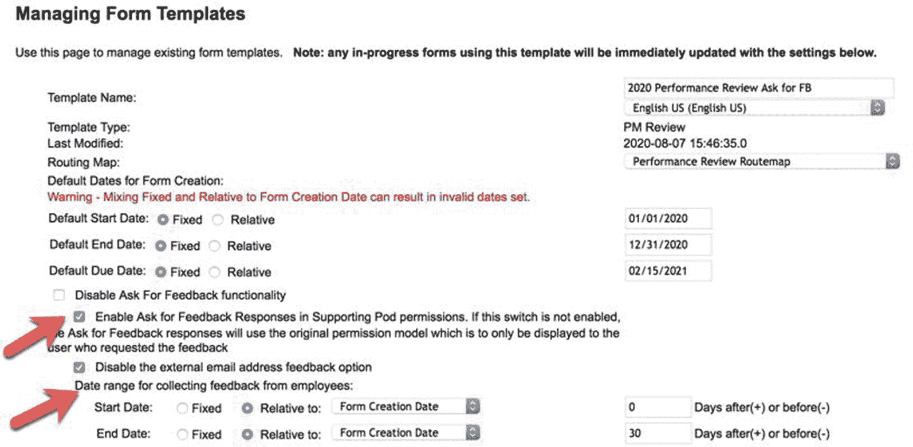

**图 11-1** 请求反馈的高级模板设置

要在表单中使用“请求反馈”，请选中“在支持面板权限中启用请求反馈响应”。如果此选项不可见，请取消选中“禁用请求反馈功能”，该选项应该会变为可见。另一个“请求反馈”复选框，“禁用外部电子邮件地址反馈选项”，用于确定是否仅能在组织内部请求反馈，还是也可以从外部请求。

必须定义收集反馈的日期范围。开始和结束日期可以是固定的，也可以是相对的。相对日期基于相对于以下任意日期的前后天数：

- `表单创建日期`
- `默认开始日期`
- `默认结束日期`
- `默认截止日期`

“请求反馈”的日期独立于任何路线图日期。使用“之前”时，请使用负数来表示相对于基准日期的天数。

#### 常规设置

启用“请求反馈”并保存高级设置后，关闭高级设置弹出窗口。保存并关闭模板。当您重新进入表单模板时，返回“常规设置”，点击“显示高级选项...”，您现在将能够为“请求反馈”创建权限，如图 11-2 所示。

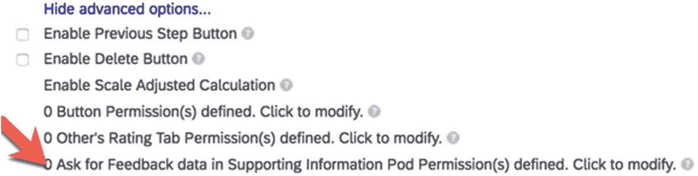

**图 11-2** 请求反馈权限

经理将能够在“团队概览”中查看“请求反馈”的回复。这些评论也可以在绩效表单的“支持信息”面板中找到。在“按钮权限”内，需要为每个步骤中应该有权访问评论的每个角色授予对“支持信息”面板的访问权限。示例如图 11-3 所示。

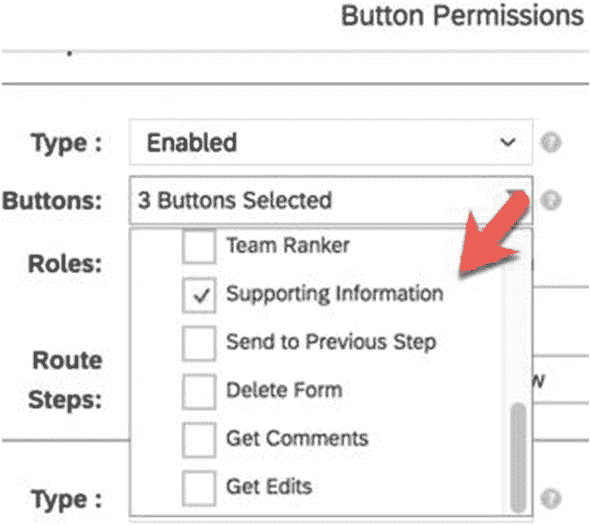

**图 11-3** 支持信息面板权限

授予面板访问权限并不授予查看反馈评论的权限；它仅使该面板在表单上可见。根据组织的透明度，有些组织会对员工隐藏反馈评论。在这些情况下，反馈仅供经理用于帮助做出评级决策。此外，反馈回复者如果知道员工会看到，可能会不太愿意提供真实的反馈。

对反馈回复的访问权限在“支持信息面板权限中的请求反馈数据”中设置。示例如图 11-4 所示。

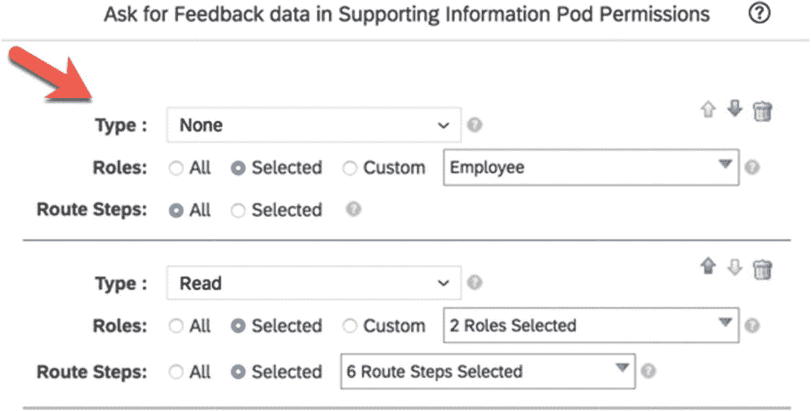

**图 11-4** 请求反馈权限

权限类型为 `无` 或 `读取`。使用 `无` 权限时，用户将不会在“支持信息”面板中看到评论。`读取` 权限授予用户在“支持信息”面板中查看反馈评论的权限。在上图所示的示例中，为员工在“全部”步骤授予了 `无` 权限。这确保员工在完成表单的任何修改步骤和签字步骤中都不会看到评论。为了允许用户访问评论，需要为特定步骤的角色授予 `读取` 权限。如果未设置权限，所有用户将在所有步骤中看到反馈。如果没有提供反馈，评论图标将显示为零，出现在“支持信息”面板中。

### 路线图设置

除了表单模板中的设置和权限外，还需要在与表单模板关联的路线图的第一个步骤中启用一项设置。在搜索栏中输入并选择“管理路线图”。

打开与表单模板关联的路线图。转到第一个步骤并点击“显示高级选项”。滚动到屏幕最底部，在 `步骤 ID` 下方，您将看到三个复选框，如图 11-5 所示。启用“审查开始”并保存路线图。

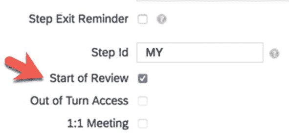

**图 11-5** 为第一个步骤启用“审查开始”

此设置将步骤的开始标识为审查过程的开始。它还确保“请求反馈”按钮在“团队概览”中可用。

### 电子邮件通知

“请求反馈”基于发送给反馈提供者的电子邮件通知，后者直接在电子邮件中回复。需要启用一个电子邮件通知才能使电子邮件请求功能正常工作。在搜索栏中输入并选择“电子邮件通知模板设置”。启用“请求反馈通知”，如图 11-6 所示。您也可以在此处修改电子邮件模板的内容。

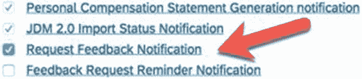

**图 11-6** 启用请求反馈通知

> **注意：** “反馈请求提醒通知”不再受支持，因此请勿启用。

## 使用请求反馈

在“团队概览”中，经理可以通过向一个或多个个人发送电子邮件来请求反馈（请确保您的经理拥有“团队概览访问权限”）。反馈可能来自许多不同的来源。请求可以发送给组织内任何拥有有效电子邮件地址的人。也允许外部回复。个人通过回复电子邮件提供反馈。回复存储绩效表单的一个面板中。回复仅为文本，不带附件。根据我们的经验，我们发现“请求反馈”通常用于以下场景：

- 当需要从多个人那里获取反馈时（最多允许 30 个请求）
- 当您希望经理能够在等待反馈回复时编辑表单时
- 当您不希望反馈提供者对绩效表单有任何可见性时
- 当您希望获得关于员工的不一定与绩效表单中的目标和能力相关的反馈时
- 当您希望有选择外部反馈的选项时
- 当您希望允许在特定时间段内（可能跨越评审流程的多个步骤）收集反馈时

### 团队概览

经理直接下属的任何处于活动状态的表单都会显示在 `团队概览` 屏幕上；正是在这里，可以使用 `请求反馈` 功能来请求反馈、跟踪是否已给出反馈以及查看反馈。在搜索栏中输入并选择 `团队概览` 即可访问。`团队概览` 将显示已启动的表单，并按表单模板分组。示例如图 11-7 所示。

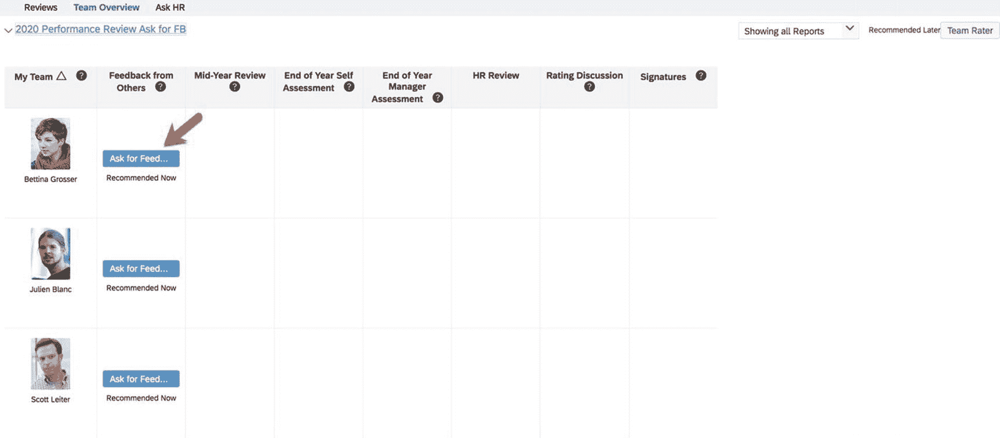

图 11-7 请求反馈

您可以看到每个员工都有一个 `请求反馈` 按钮。"来自他人的反馈"列显示在路线图步骤列之前。

> **注意：**
>
> 经理可以跟踪每个表单的步骤，并根据反馈日期范围，继续请求反馈，直到达到最多 30 个请求的限额或给出反馈的结束日期已过。

点击 `请求反馈` 按钮，将弹出一个窗口，如图 11-8 所示。

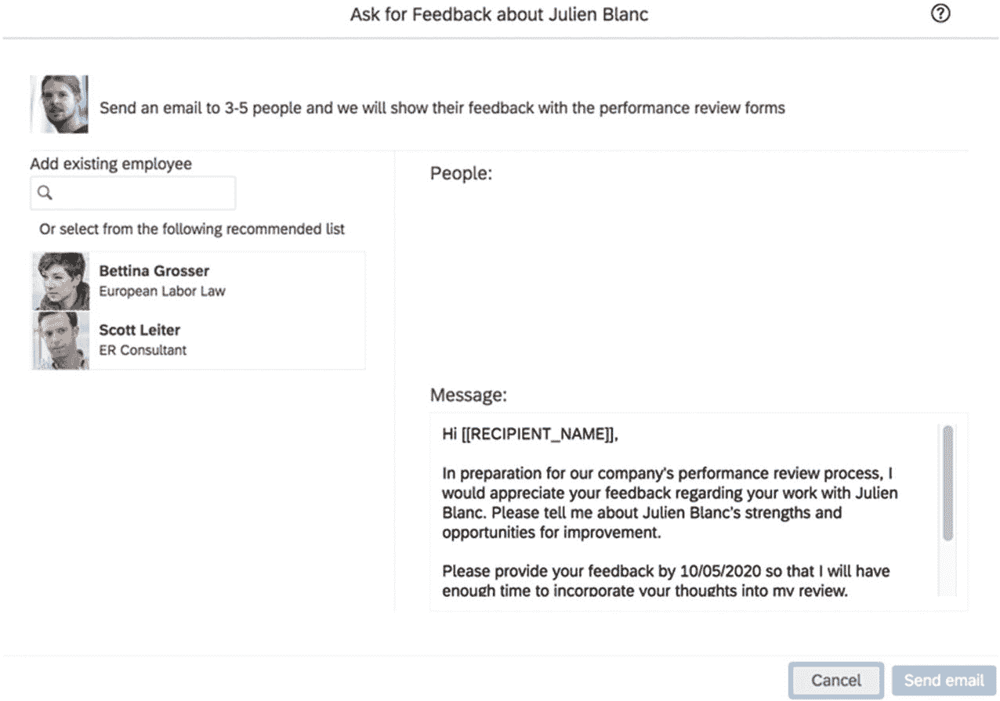

图 11-8 请求反馈

经理可以搜索姓名，或从推荐的员工同事列表中选择。邮件请求中将包含一条预定义消息，但经理可以在发送前对其进行自定义。当搜索并选择姓名后，它们会作为 `新请求` 显示在 `人员` 下方，如图 11-9 所示。

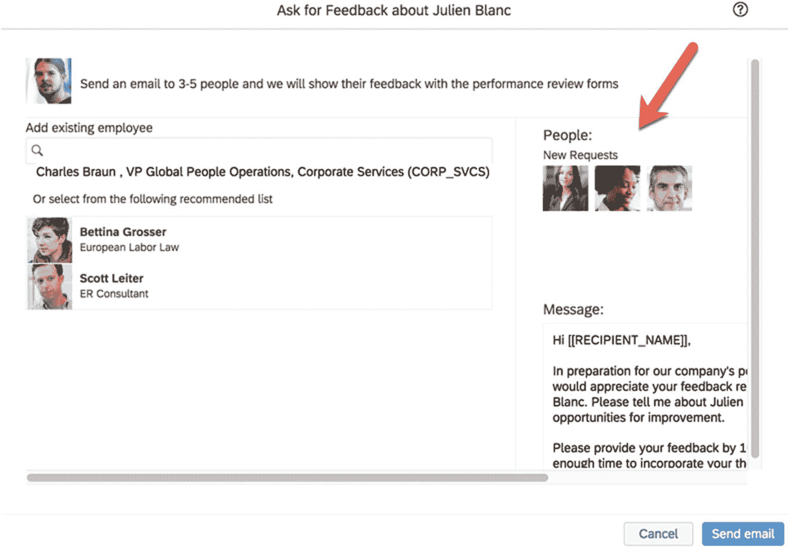

图 11-9 选定的收件人

如果启用了外部用户反馈，还将有一个选择外部电子邮件地址的选项，如图 11-10 所示。

# 绩效反馈功能

## 请求反馈

一旦邮件发送出去，`团队概览`页面将通过显示一个人物图标来表明已请求反馈。示例如图 11-11 所示。

每个已发送的请求都有一个对应的人物图标。此时，或在`请求反馈`日期范围内的任何时间，经理都可以回来请求更多反馈，最多可达 30 个请求。每个反馈提供者都会收到电子邮件请求，如图 11-12 所示。

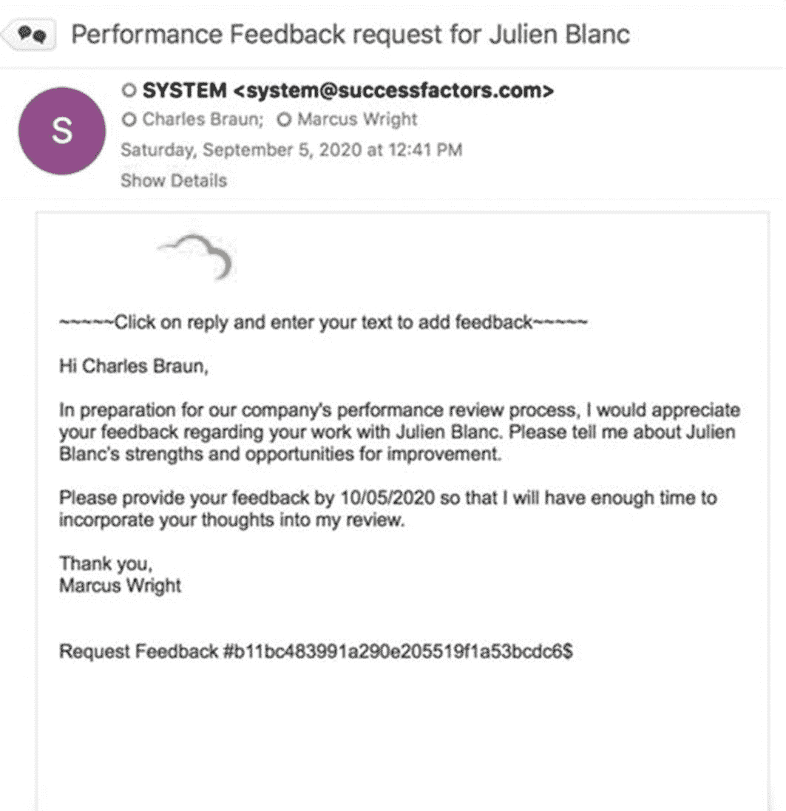

反馈请求的收件人通过回复该邮件来提供评论，如图 11-13 所示。

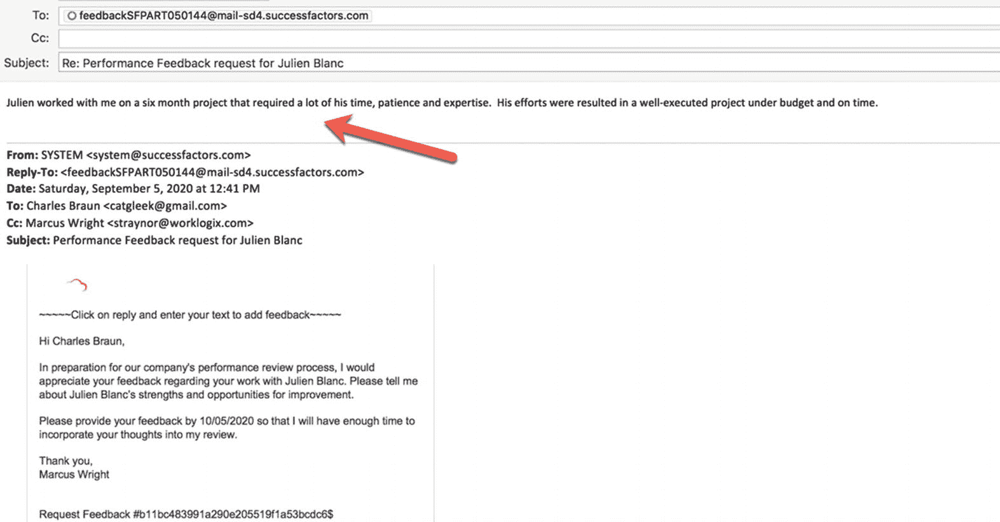

请记住，如果某个反馈提供者未回复，这不会阻止表单进入下一步。设定用于接收反馈的日期范围独立于路线图中设置的任何步骤截止日期。经理可以将鼠标悬停在人物图标上，以查看反馈提供者的姓名以及是否收到了任何反馈。当反馈被发送时，经理将能够看到回复的数量，如图 11-14 所示。

将鼠标悬停在一个人物图标上，将显示回复者的姓名。点击该图标将显示评论，如图 11-15 所示。同时还会显示反馈内容、反馈提供者姓名以及发送日期。

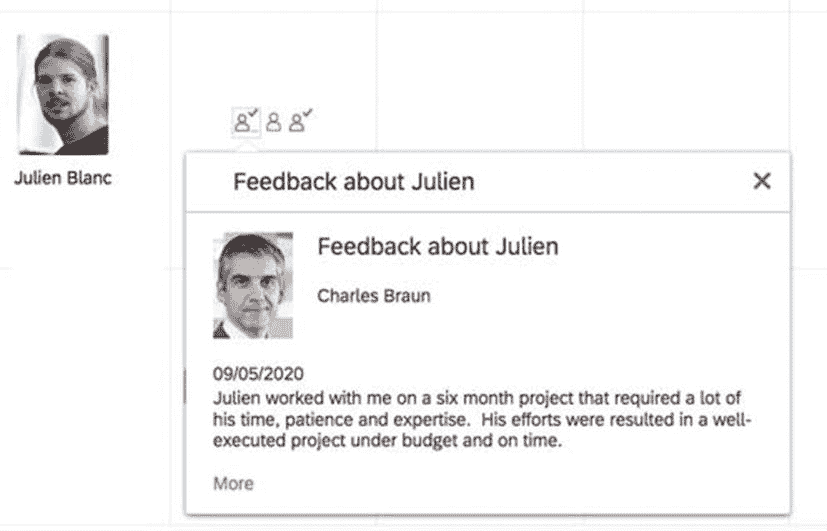

当经理进入员工的表单时，`支持信息`面板也会显示评论。如图 11-16 所示，面板中的评论图标显示有两条评论。该面板也显示附件。在这个例子中，也有一个附件。附件与反馈是分开的，并且可能有不同的权限设置。

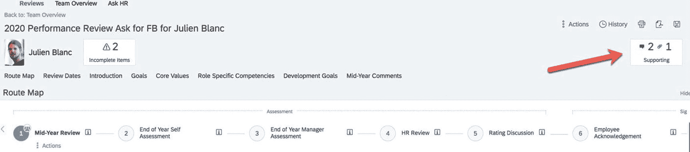

点击该面板将显示其内容，如图 11-17 所示。

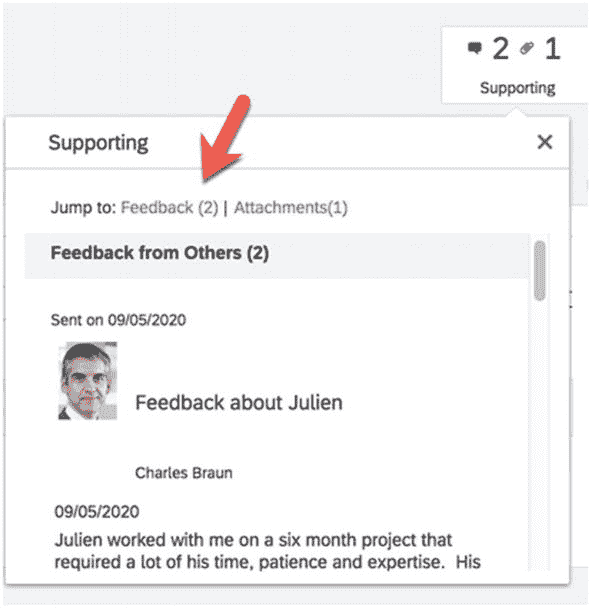

收到的反馈数量将与附件数量一同显示。可以跳转到任一部分。对于每条收到的反馈，会显示评论、反馈提供者以及发送日期。如果`支持信息`面板已配置了附件功能，经理可以添加或查看任何附件。

在图 11-18 所示的示例中，当表单进入员工自评步骤时，`支持信息`面板中不会显示反馈内容。员工只能添加或查看附件。此示例基于表单模板和表单模板 XML 中设置的权限。员工可以查看经理添加的附件，或添加额外的评论。

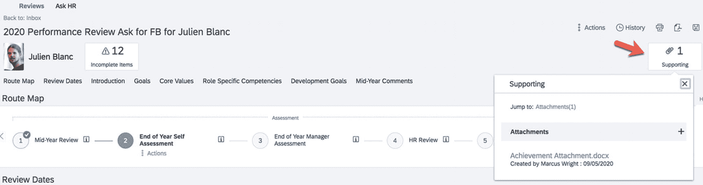

至此，我们已完成对`请求反馈`功能的介绍。您已经了解了使用该功能的一些场景，以及在决定使用它时需要考虑的因素。接着，我们逐步讲解了详细的配置步骤，并查看了`请求反馈`功能在实际中的应用。现在，让我们来看看`获取反馈`。

> **注意**
>
> 如果您在接收反馈时遇到问题，可能是邮件系统阻止了这些邮件。在这种情况下，您可能需要与邮件系统技术资源人员合作，以确保将相关邮件添加到白名单中。我们还建议不要使用邮件系统可能拒绝的大型图形。有关更多故障排除技巧，请参考 SAP 注释 2078040。

## 获取反馈

`Get Feedback`（获取反馈）功能允许用户将绩效表单发送给路线图之外的用户，以便直接在表单上获得修改意见和/或评论。与`Ask for Feedback`（请求反馈）不同，此功能仅限于您 SuccessFactors 实例内的用户。当某个不易在标准 SuccessFactors 角色中识别的人员可能对目标员工的评审提供有益意见时，此功能会很有用。反馈完成后，表单会返回给同一环节的原始用户。使用`Get Feedback`时，请考虑以下几点：

- 当表单被发送以获取反馈时，它会从用户的收件箱中移除且无法编辑。用户必须召回表单或等待反馈提供者完成表单。
- 使用`Get Feedback`不会创建新环节。它的运作方式有点类似于一个迭代环节，即该环节中的一个用户可以进行编辑，而另一个用户可以查看表单。
- 表单一次只能发送给一个反馈提供者。一旦发出以获取反馈，在反馈提供者完成评审或经理召回表单之前，无法再发送给另一个反馈提供者。
- `Get Feedback`不能在协作环节中使用。
- 如果开启了文档流转通知，反馈提供者会收到一封电子邮件通知；否则，他们只会在其主页上看到一个待办事项。
- 当反馈提供者提交表单时，表单会返回到发起请求的那个环节。表单无法流转到下一环节。
- 任何评论都会与反馈提供者的名称相关联。
- 在添加反馈或经理召回表单之前，表单无法流转到下一环节。

### 配置获取反馈

要使用`Get Feedback`，需要在高级表单模板设置中取消选中两个复选框。取消选中后，即可请求评分和评论。此外，还需要在表单模板中启用按钮权限，以允许使用`Get Feedback`按钮。另外，需要在目标、能力和总结部分授予评论和评分字段权限。可以配置模板以允许评论和评分。在未启用并允许`Ask for Edit Routing`的情况下请求评论，将只允许评论，不允许评分。

#### 表单模板高级设置

在表单模板的高级设置中，确保`Disable Ask For Comment Routing`未被勾选。如果您也允许反馈提供者评分，请确保`Disable Ask For Edit Routing`未被勾选。请参见图 11-19 了解设置示例。

这些选项控制着`Get Feedback`按钮在绩效表单上的可见性。当两种流转类型都被禁用时，`Get Feedback`按钮将不可见。用户在选定要发送表单的用户后，将能在`Get Feedback`确认页面中选择请求评论或修改意见。

> **注意**：需要注意的是，通过`Get Feedback`，表单接收方将可以看到私有目标。这对许多客户来说可能是个意外，因此在测试过程中需要特别注意。有关更多信息，请参见 SAP 注释 2072246。

当两个选项都取消选中时，可以允许`Get Comments`和`Get Edits`按钮，以便在使用`Get Feedback`时允许添加评论和评分。如果您只取消了`Disable Ask For Comment Routing`的勾选，则只能授予`Get Comments`按钮的权限。同样，当只取消`Disable Ask For Edit Routing`的勾选时，您只能授予`Get Edits`按钮的权限。如果`Get Comments`或`Get Edits`按钮中的任何一个已被授予权限，`Get Feedback`按钮将在表单上出现。区别在于反馈提供者可以执行哪种操作。

#### 按钮权限

`Get Comments`和`Get Edits`的按钮权限允许反馈提供者在表单上添加评论或评分。根据您希望允许的反馈类型，按角色和环节设置这些按钮权限。在可能提供反馈的环节中，将这些按钮的权限设置为`None`或`Enabled`。这些按钮应仅在您希望在绩效表单上看到`Get Feedback`按钮的环节中设置为`Enabled`。

示例如图 11-20 所示。

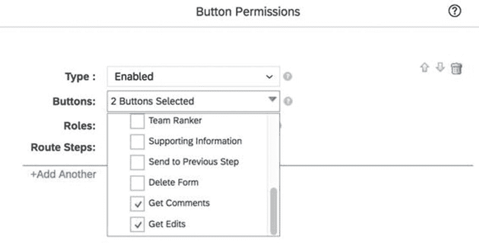
**图 11-20** `Get Feedback` 按钮权限

### 分区和字段权限

如果某个分区或字段在所有环节中对所有角色均已隐藏或禁用，则必须在启用了`Get Feedback`的环节中为所有角色启用它。示例如图 11-21 所示。

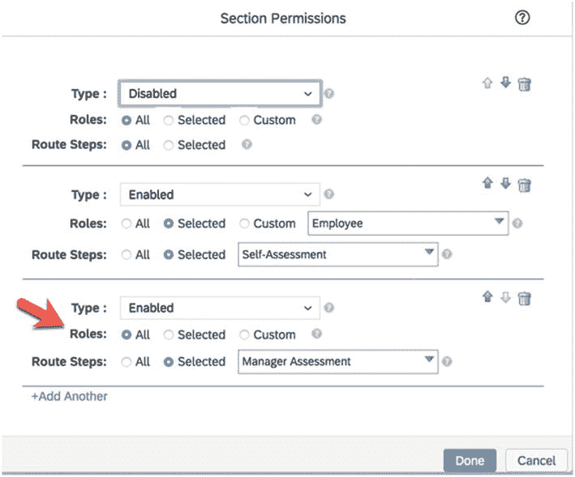
**图 11-21** 反馈提供者编辑分区的权限

根据您的需求，在目标、能力或总结部分设置评论和评分字段权限。您需要使用`All`角色来为使用`Get Feedback`的环节启用权限。您不必在所有分区中都允许评论或评分。例如，您可以决定允许反馈提供者输入目标评论、能力评分以及总结部分评论。再举一个例子，要在目标部分的管理者环节中启用反馈提供者的项目评论，请选择`All`角色并赋予`Write`权限。这将允许反馈提供者提供评论。

要允许反馈提供者评分，最好使用图 11-22 所示的设置。

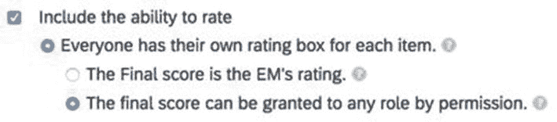
**图 11-22** 允许反馈提供者评分的评分选项

此选项将为每个角色提供一个评分框，最终得分通过在一个环节中使用评分字段权限授予特定角色。

当允许反馈提供者对目标或能力进行评分时，需要授予权限的字段是`Unofficial User Rating`（非官方用户评分），如图 11-23 所示。

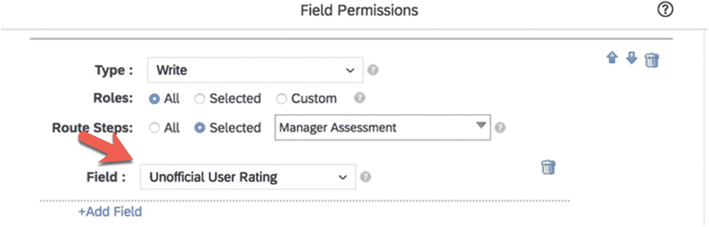
**图 11-23** 反馈提供者的项目评分

在图 11-24 所示的示例中，在目标部分，`The Final score is the EM’s rating`（最终得分是 EM 的评分）选项只允许主体评分和管理者评分。这意味着无法进行`other’s rating`（他人的评分）。如果您希望反馈提供者在某个分区进行项目评分，请不要使用此选项。

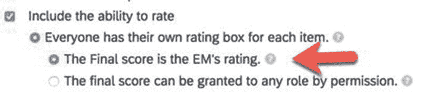
**图 11-24** 不允许他人评分的评分选项

设置好权限后，保存并关闭表单模板。现在，我们来看一下`Get Feedback`的电子邮件通知。

## 电子邮件通知

在搜索栏中键入并选择“电子邮件通知模板设置”。如果希望通知提供反馈的用户，请确认已启用“文档路径通知”。

### 使用获取反馈

管理者可以从绩效表单上的两个位置发送“获取反馈”请求。在表单顶部显示的路径图中，当前步骤会显示一个包含可用操作的下拉列表。如图 11-25 所示，可以看到“获取反馈”选项。

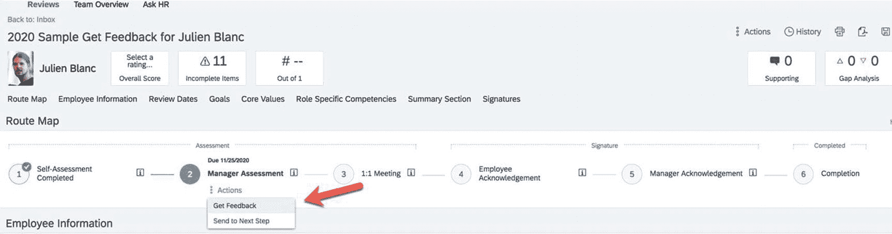
图 11-25 通过路径步骤操作获取反馈

向下滚动表单至按钮区域，将出现“获取反馈”按钮，如图 11-26 所示。

图 11-26 获取反馈按钮

使用任一选项，都会显示一系列屏幕，从名称搜索开始。示例如图 11-27 所示。

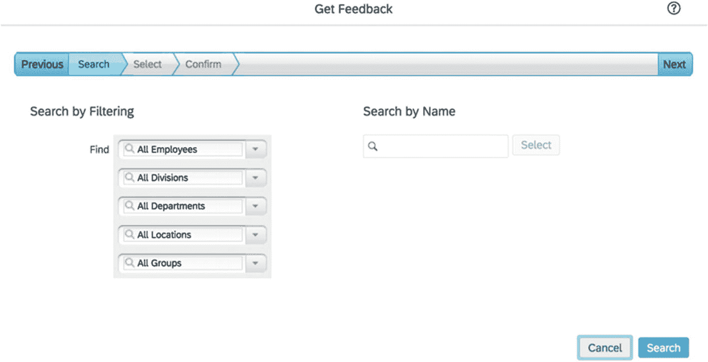
图 11-27 搜索反馈提供者

可以使用筛选器缩小搜索范围。

找到名称后，点击“选择”，如图 11-28 所示。

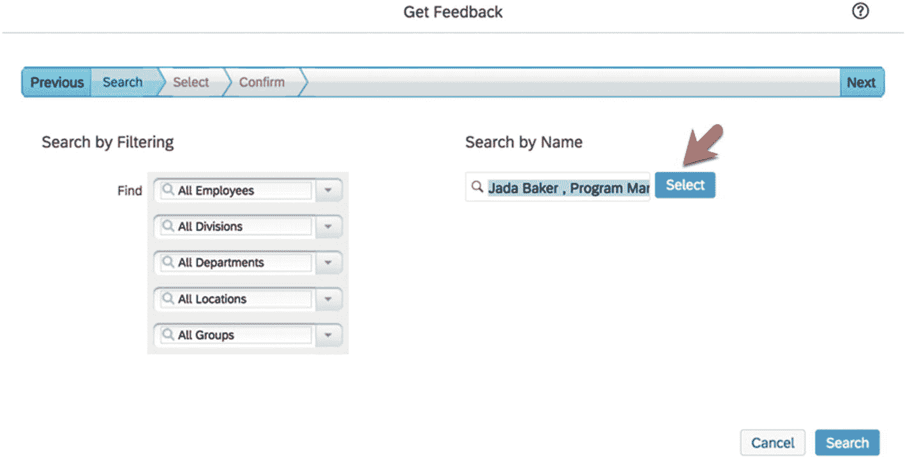
图 11-28 选择用户以获取反馈

随后显示“确认”步骤。在此步骤中，您需要选择是请求评论还是编辑。您可以添加一条将显示在电子邮件中的备注。如果选择“编辑”，并且部分内容允许评分和评论，则用户将能够同时进行这两项操作。示例如图 11-29 所示。

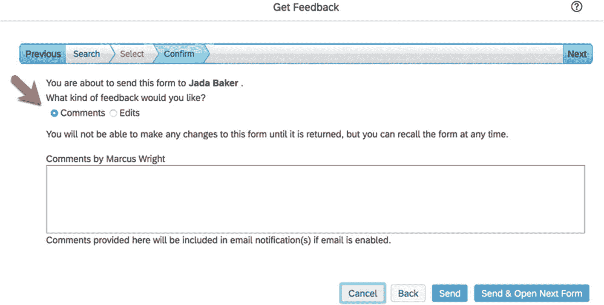
图 11-29 选择反馈类型

表单发送后，将显示管理者的收件箱。但表单不会出现在此处，而是位于管理者的“在途”文件夹中，如图 11-30 所示。这意味着该表单对管理者而言是只读的。

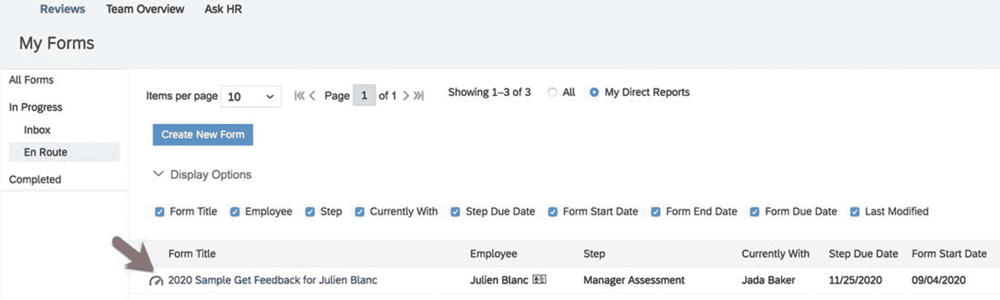
图 11-30 管理者“在途”文件夹中的表单

当管理者请求反馈时，会发送一封电子邮件。示例如图 11-31 所示。

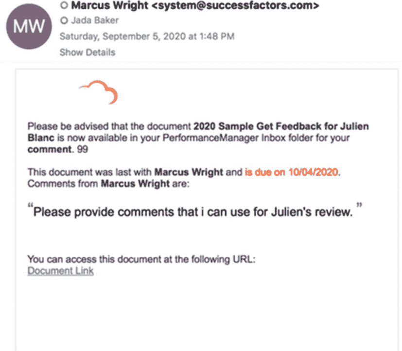
图 11-31 获取反馈请求

在主页的“绩效待办事项”磁贴中，会有一个标记为“评估反馈”的表单。示例如图 11-32 所示。这是一个标准短语，用于标识表单的反馈提供者版本。

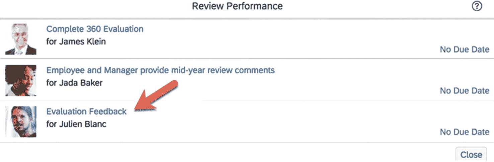
图 11-32 评估反馈

基于表单模板权限，反馈提供者可以输入评论、评分或两者都输入。权限是按部分为项目评分和项目评论设置的。在图 11-33 所示的示例中，反馈提供者可以添加目标项目评分和评论。

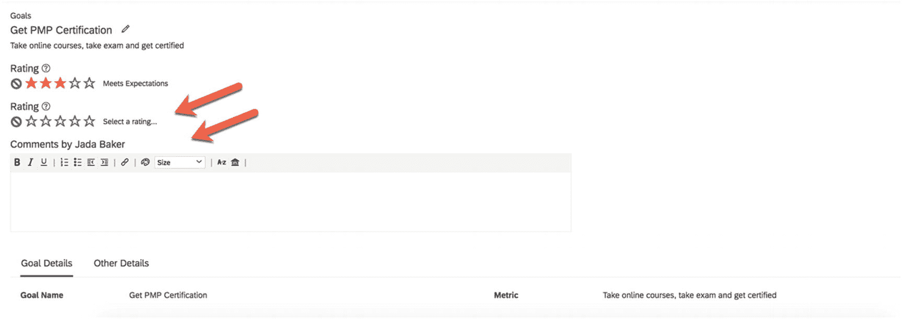
图 11-33 反馈提供者添加目标项目评分和评论

在此示例中，管理者已输入目标项目评分，保存表单，然后发送以征求反馈。随后，反馈提供者能够看到管理者的评分并输入自己的评分。当表单发送回管理者时，管理者将拥有对反馈提供者评论和评分的读取权限，并且可以编辑自己的评分。当表单在反馈提供者手中时，管理者（知道谁持有表单）对表单是只读的。管理者可以通过路径步骤操作或屏幕底部的“召回反馈”按钮来召回表单。示例如图 11-34 所示。

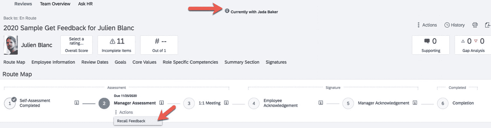
图 11-34 通过步骤操作召回表单

当表单已发送以征求反馈时，唯一可用的按钮是“召回反馈”。如果表单被召回，它将从反馈提供者的收件箱中移除，并返回到管理者的收件箱。您也可以在“团队概览”中查看表单是否已发出征求反馈，如图 11-35 所示。

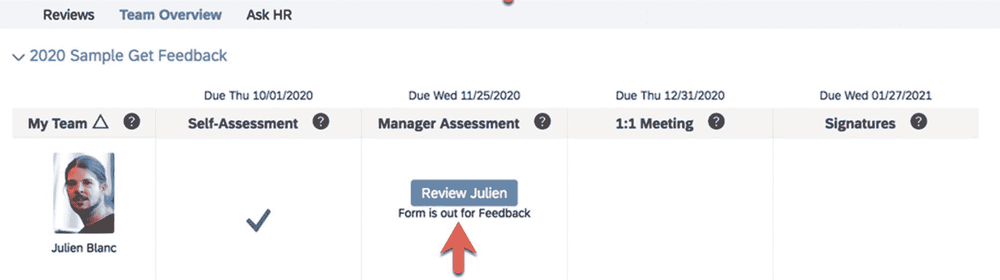
图 11-35 团队概览显示表单已发出征求反馈

现在您已了解如何配置和使用“获取反馈”！接下来，让我们看一下“添加修改者”和“添加签署者”。

## 添加/移除修改者或签署者

“添加修改者”选项允许用户将表单发送给路径图之外的人员以获取评分和评论，或者添加签署者。与“获取反馈”不同，表单会被路由到一个新步骤，然后从那里继续前进到下一步。当某个不易被识别为标准 SuccessFactors 角色之一的人员可能对相关员工的评审有重要意见，并且您希望他们参与评分或签署流程时，此功能会非常有用。

使用“添加修改者”时，务必考虑以下事项：

*   无法限制用户可以添加的修改者数量。
*   此功能会创建一个新的用户定义步骤。
*   表单不会返回到发送表单的用户。表单将继续前进到下一步。
*   添加额外步骤可能会干扰具有强制退出日期的路径图步骤。如果在后续步骤的截止日期前未完成这些额外步骤，表单将不会为后续步骤自动路由。

新步骤及关联的用户名会成为表单顶部显示的路径图的一部分。

## 配置

在表单模板的高级设置中，有一个选项允许用户向表单添加或移除签署者。该设置如图 11-36 所示。

图 11-36 取消勾选“隐藏添加/移除签署者按钮”

要允许添加签署者，不得勾选此选项。

还有一个选项可以指定何时可以添加修改者，如图 11-37 所示。

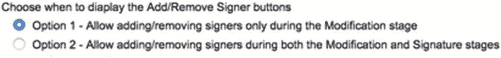

图 11-37 为按钮选择阶段

如果仅在“修改”阶段允许添加签署者，则新签署者将被插入到现有签署者之前。如果表单的当前签署者添加了另一个签署者，则表单将首先路由给新签署者。

**注意：** 请记住，对于“添加修改者”和“添加/移除签署者”功能，按钮权限是在表单模板 XML 中设置的，正如我们在“按钮权限”部分所见。此外，需要为所有角色启用“目标”、“能力”和“摘要”部分，以便添加的用户可以进行编辑。最后，“添加修改者”步骤将使用与常规步骤相同的文档路由通知。

### 使用添加修改者或添加签署者

用户可以通过表单底部的按钮，以及基于按钮权限在绩效表单顶部路径图中当前路由步骤看到的一个操作，来使用`添加修改者`或`添加签署者`功能。此操作只能在表单进入签署步骤之前添加。

示例如图 11-38 所示。

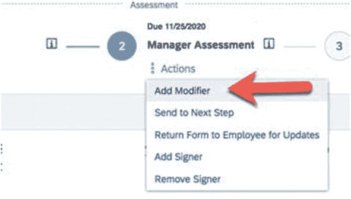

图 11-38 添加修改者的操作

用户选择修改者后，提交表单时，系统会为其创建一个新步骤。如果启用了文档路由电子邮件通知，修改者将会收到通知。该表单将出现在修改者的`绩效收件箱`中，并创建一个`绩效待办事项`。修改者步骤和用户名会添加到表单的路径图中。修改者完成反馈后，表单将进入路径图中的下一步骤。

点击`添加修改者`或`添加签署者`后，会弹出一个向导，引导用户完成选择修改者或签署者的步骤。该过程从名称搜索开始，如图 11-39 中的示例所示。

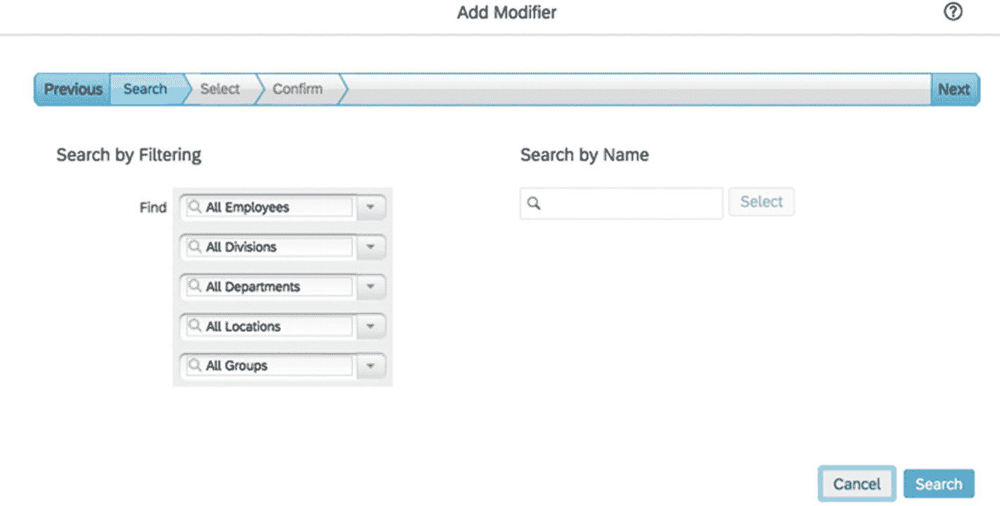

图 11-39 搜索修改者或签署者

选择名称后，在签署向导的确认步骤中，您可以取消、保存或添加更多修改者或签署者，如图 11-40 所示。

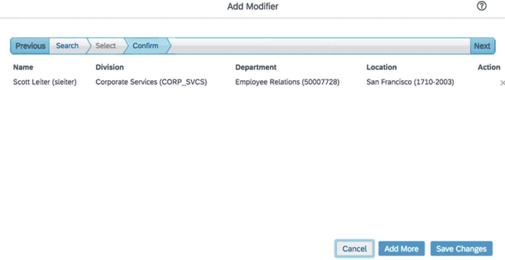

图 11-40 确认签署者

在`操作`列中，您也可以删除已选择的修改者。

点击`添加更多`以选择其他修改者或签署者。`搜索`和`选择`步骤将重复。在`确认`步骤中，可以删除或重新排序修改者或签署者。重新排序会影响哪个修改者优先于另一个。示例如图 11-41 所示。

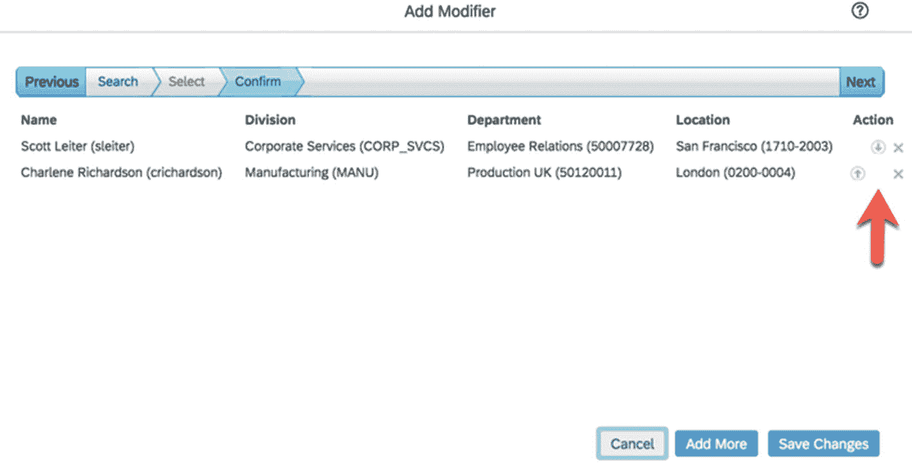

图 11-41 查看已选择的修改者或签署者

完成添加或编辑修改者或签署者后，点击`保存更改`。表单顶部的路径图将反映新增的修改者或签署者作为新步骤，如图 11-42 所示（对于签署者显示为`已添加的签署者`）。

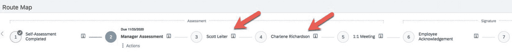

图 11-42 已添加的新修改者步骤

经理在表单上完成更新并将其提交到下一步后，表单将流转给新添加的修改者。

如果启用了路由通知，修改者将收到该通知。修改者将看到一条`绩效磁贴待办事项`，如图 11-43 所示。

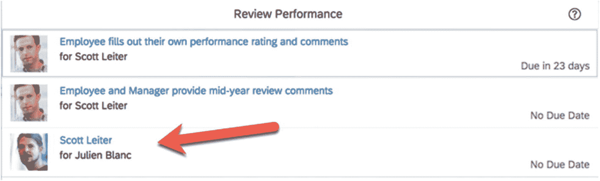

图 11-43 修改者的待办事项

由于此步骤不属于路径图的一部分，因此对于`[employee]`会显示为`修改者名称`。

修改者还会在其`绩效收件箱`中看到该表单。修改者将在允许的章节中进行评分和添加评论。然后修改者会将表单提交到下一步。在我们的示例中，表单会流转给另一位修改者，如图 11-44 所示。

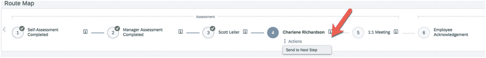

图 11-44 其他修改者

一旦该修改者完成评估，表单将继续按照现有路径图进入下一步。当表单完成所有步骤后，修改者也会在其`已完成`文件夹中收到一份表单副本。

任何被添加为签署者的经理也可以通过`团队概览`访问该表单，如图 11-45 所示。

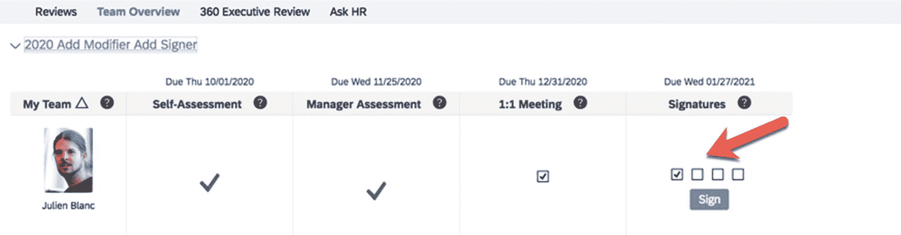

图 11-45 通过团队概览签署表单

当用户点击`签署`按钮时，会弹出一个窗口，用户可以在签署前添加评论，如图 11-46 所示。

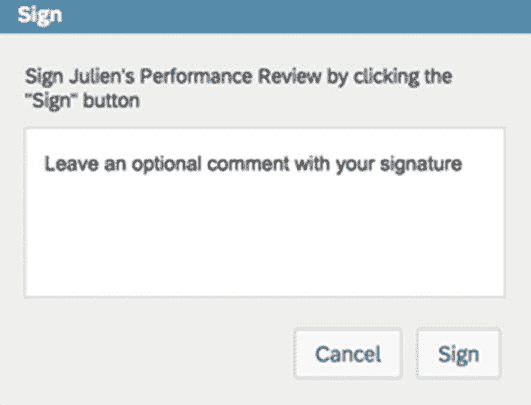

图 11-46 从团队概览签署

当用户点击`签署`时，签名和任何评论都会被添加，表单将流转给下一位签署者。

如图 11-47 中的示例所示，表单会显示其他签署者的签名。

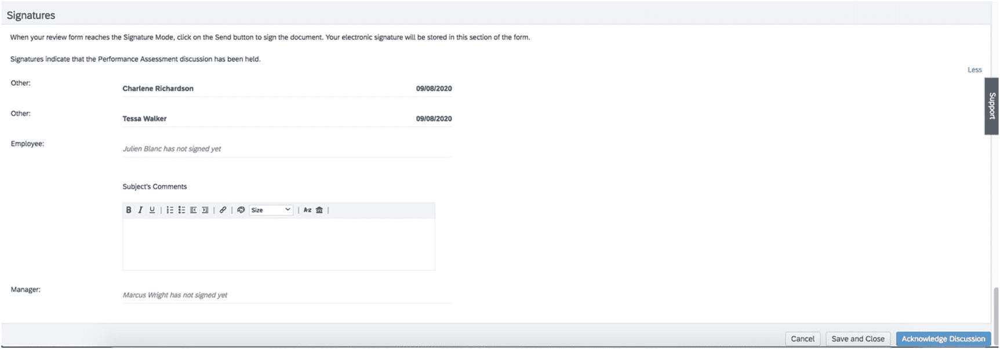

图 11-47 包含其他签署者签名的表单

当所有签署步骤完成后，表单将出现在路径图中所有人员以及已添加的签署者的`已完成`文件夹中。

> **注意**
>
> 只有添加签署者的用户才能移除这些签署者。当新的签署者在其收件箱中收到表单，但后来被移出签署者列表时，可能会发送电子邮件通知。要实现这一点，必须在`电子邮件通知模板设置`中启用`移除当前签署者通知`。

## 总结

希望您喜欢本章！我们讨论了一些有趣的主题，这些主题是许多`SuccessFactors`的顾问和用户不熟悉的：`请求反馈`、`获取反馈`、`添加修改者`和`添加签署者`。现在您应该了解这些功能之间的区别以及它们可能的使用场景。您还应该能够配置每一项功能，并理解它们对最终用户的工作方式。根据我们的经验，这些功能可以作为调整系统以适应复杂需求的创造性方法。
