# 9. 使用绩效管理表单

在前三章中，我们配置了绩效管理，授予了基于角色的权限，并创建了评级量表、路线图和绩效表单模板。我们了解了表单模板的各个部分，并看到了绩效管理管理员可以执行的任务类型。最后，我们启动了一个绩效表单。在本章中，我们将从用户的角度逐步介绍绩效评估流程。

## 绩效表单操作指南

表单启动后，如果启用了“文档创建”电子邮件通知，则评审流程第一步中的用户将收到通知，告知绩效表单已在其绩效收件箱中。

图 9-1 显示了一个示例通知。

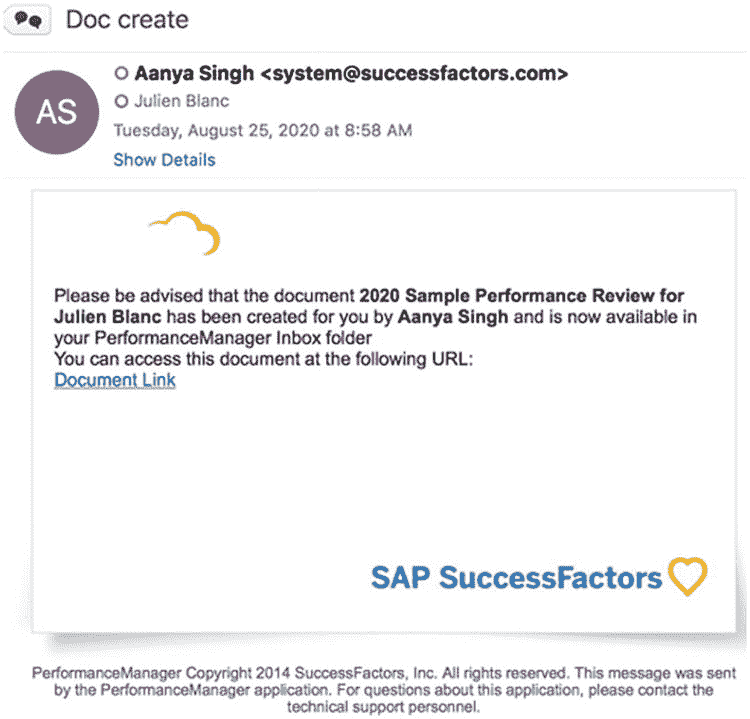

**图 9-1** 收件箱中表单的电子邮件通知

用户可以点击电子邮件中的链接访问表单，或前往 SuccessFactors 主页。在主页的待办事项面板中，会有一个绩效磁贴，当用户有待处理的绩效相关操作时，该磁贴会显示出来。示例如图 9-2 所示。

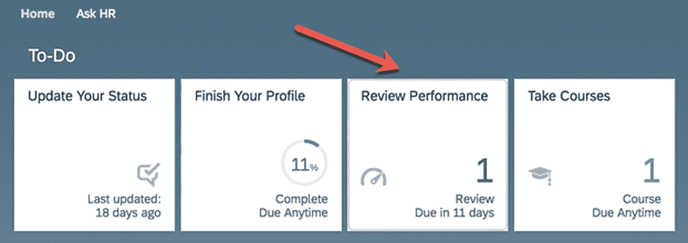

**图 9-2** 绩效待办事项磁贴

该磁贴会显示待处理项目的数量以及项目的截止日期。如果有多个待处理操作，则会显示距首个项目到期还有多少天。点击绩效待办事项磁贴，将弹出一个待办绩效事项弹出窗口，如图 9-3 所示。对于管理者而言，当表单到达管理者评审步骤时，列表可能会非常长。

**图 9-3** 绩效待办事项

请注意，其后会显示路线图步骤描述以及被评估员工的姓名。如果表单的此步骤有截止日期，则还会显示距到期还有多少天。点击链接将打开表单。另一种访问绩效表单的方式是通过主页菜单，我们将在下面讨论。

## 绩效收件箱

如前所述，用户可以通过通知电子邮件或主页上的绩效待办事项磁贴访问表单。绩效收件箱也可以通过主页菜单访问。点击主页下拉箭头，选择“绩效”，如图 9-4 所示。

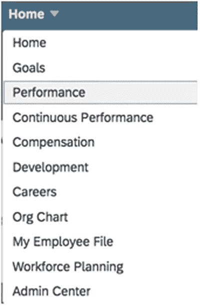

**图 9-4** 通过主页菜单访问绩效

点击链接将用户带到“我的表单”，即绩效收件箱，如图 9-5 所示。

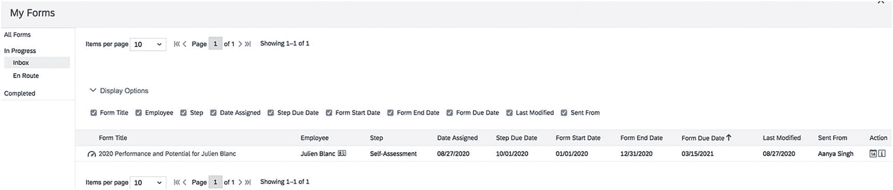

**图 9-5** 绩效我的表单

在屏幕左侧，列出了“我的表单”文件夹：*所有表单*、*进行中*和*已完成*。每个文件夹都有不同的显示选项。显示选项不能重新排序或删除。但是，用户可以通过取消选择来隐藏某列。我们将逐一查看每个文件夹。

### 进行中

表单将出现在用户的收件箱或传输中文件夹中。
- 当前处于用户步骤的表单将出现在收件箱中。这些表单需要执行操作。
- 传输中表单正由路线图中的另一位用户持有。

用户收件箱中的表单概览显示了表单所对应的员工姓名、当前步骤名称以及与表单相关的日期。您还可以看到表单来自谁以及表单的最后修改时间。传输中文件夹有助于查看当前谁持有表单以及表单处于哪个步骤。

#### 已完成

用户在其中扮演过角色的所有已完成文档都会显示在此处。此外，如果已配置，从其他用户发送来的已完成表单也会显示在此处：
- 这是唯一可以添加子文件夹的文件夹。
- 展开此文件夹，您会看到“新建文件夹”和“未归档”。
- 已完成的表单会存放在“未归档”文件夹中，直到用户将其移动到已创建并命名的已完成文件夹。

对于任何类别，都有一个“操作”列。只要未在表单模板高级设置中勾选`禁用信息`按钮，用户就会在“操作”列看到一个信息图标。点击该图标将打开一个表单视图，如图 9-6 所示。

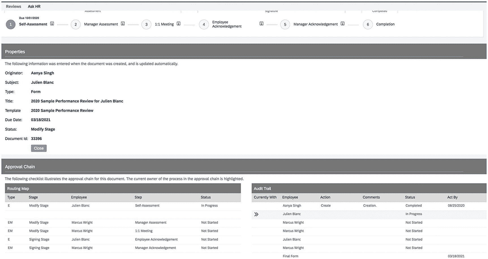

**图 9-6** 绩效表单的信息视图

此视图包含表单属性以及审批链。基于路线图，会显示各个步骤以及每个步骤的用户和表单状态。还有一个审计跟踪，显示在将表单移至下一步时所做的任何评论。您可以点击“属性”部分的“关闭”按钮，或点击此页面顶部的“返回至：”链接来关闭此视图。
有关这些设置以及如何限制访问权限的更多信息，请参见`SAP 注释 #2075925`。

使用电子邮件中的链接、绩效待办事项磁贴中项目的链接或绩效我的表单收件箱中的链接，均可打开绩效表单。

## 绩效表单视图

我们来看一下表单上的一些功能。示例如图 9-7 所示。

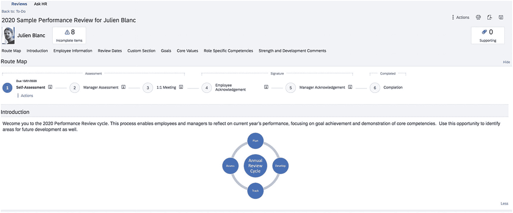

**图 9-7** 绩效表单视图

我们将在表单顶部看到绩效表单标题和一些表单操作。在表单标题上方，还有一个返回绩效收件箱的链接。

在表单的右上角，有一系列图标，这些图标可能因表单模板中的设置而异。示例如图 9-8 所示。操作选项可能包括对整个表单进行拼写检查和法律扫描、查看表单属性的链接以及添加到 Outlook 的链接。

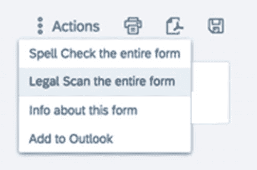

**图 9-8** 表单选项

Outlook 会议请求会随表单链接和表单截止日期一同创建。用户可以给自己发送会议请求，以便获得日历提醒。
要了解如何设置，请参见`SAP 注释 #2089432`。

可能还有用于打印、另存为 PDF 和保存的图标。

表单模板的各部分会列在表单顶部，如图 9-9 所示。

**图 9-9** 表单各部分链接

### 表单上的路线图

点击任一区域，用户即可跳转到表单的相应部分。

接下来，我们将查看显示在表单顶部的路线图。图 9-10 展示了一个示例。

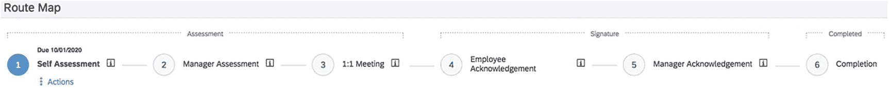

**图 9-10** 表单上的路线图

与表单模板关联的路线图横跨绩效表单顶部显示。路线图中展示了“评估”、“签署”和“已完成”阶段的步骤。当前步骤编号会高亮显示。如果在路线图中为该步骤设置了截止日期，该日期将显示在当前步骤名称上方。您只能看到当前步骤的截止日期，而不会看到其他步骤的。

每个步骤名称右侧都会显示一个信息图标。点击该图标会显示路线图步骤的截止日期、用户姓名及其角色、以及步骤描述。图 9-11 展示了一个示例。

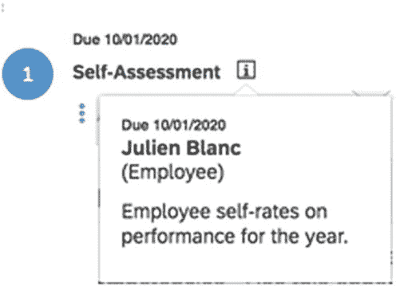

**图 9-11** 步骤名称信息

您可以点击任意步骤的信息图标来查看这些信息。在这里，您可以看到未来步骤的截止日期。

对于当前步骤，您还会在步骤名称下方看到`操作`选项，如图 9-12 所示。

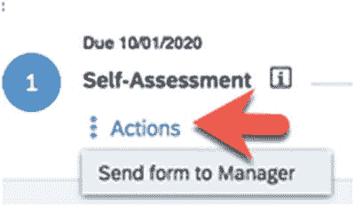

**图 9-12** 路线图步骤的操作

点击`操作`，您将看到该步骤可用的所有操作。显示的操作按钮名称，用于推动表单进入该步骤。如果您滚动到表单底部，会发现按钮名称与当前步骤中的操作名称相同。图 9-13 展示了一个示例。

**图 9-13** 表单底部的按钮

不推动表单前进的按钮不会显示在`操作`下。这意味着`取消`和`保存并关闭`不会列在路线图步骤的`操作`选项中。

在配置工具中的`公司设置`里，`启用可折叠路线图`选项允许折叠路线图。点击表单路线图区域中的`隐藏`按钮，如图 9-14 所示。如果用户需要滚动浏览表单的许多区域，这可以释放一些空间。

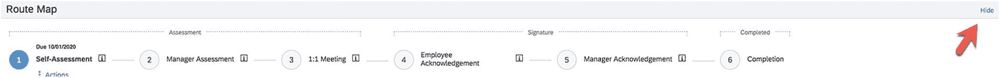

**图 9-14** 隐藏表单上路线图的选项

折叠后，表单的路线图区域将显示表单所属用户的姓名以及步骤截止日期。点击`显示`即可再次展开路线图。图 9-15 展示了一个示例。

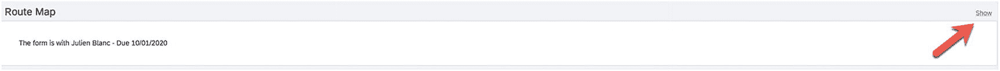

**图 9-15** 折叠后的路线图

### 表单上的 Pod

显示在表单顶部的 Pod 基于表单模板中设置的权限。Pod 权限基于角色和路线图步骤。

在我们的示例中，员工评估步骤有两个可见的 Pod——“未完成项目”和“支持信息”，如图 9-16 所示。

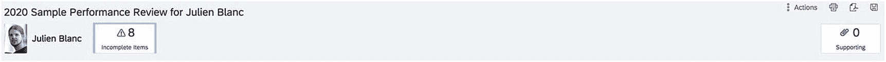

**图 9-16** 绩效表单上的 Pod

Pod 的位置无法更改；每个 Pod 在表单上都有固定的位置。

#### 必填字段

在我们的示例中，“未完成项目”Pod 已启用，并且表单包含必填项。此 Pod 显示表单进入下一步之前需要填写的项目数量。如果您点击该 Pod，将显示未完成项目的列表，如图 9-17 所示。

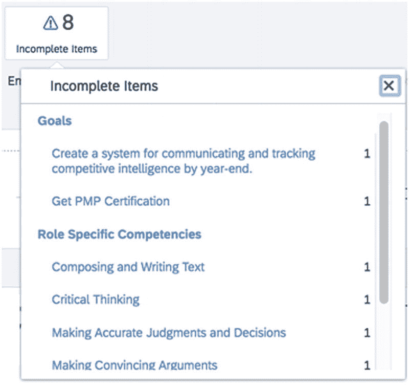

**图 9-17** 未完成项目

点击 Pod 中列出的任意项目，可直接跳转到表单上的必填项。必填项标有红色星号。图 9-18 展示了一个示例。

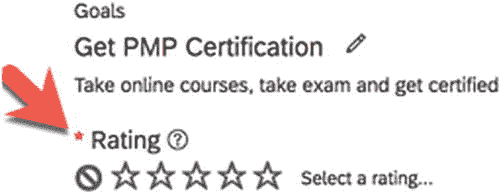

**图 9-18** 必填评级

如果 Pod 已启用，但当前步骤没有必填项，则 Pod 中的计数将为零。如果您在填写必填字段时保存表单，未完成项目的数量会减少。

如果未填写必填字段，则在将表单提交到下一步时，将显示一条错误消息，并且在所有必填字段填写完毕之前，表单无法继续推进。此时会弹出一个窗口，如图 9-19 所示。

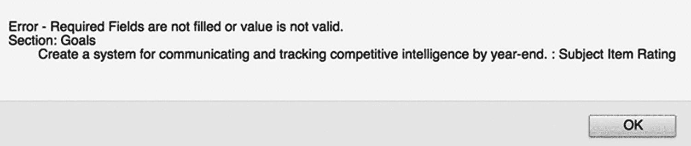

**图 9-19** 必填字段的错误消息

#### 支持信息 Pod

此步骤启用的另一个 Pod 是“支持信息”Pod。回形针图标旁边的数字表示表单当前存在的附件数量。要使此功能生效，必须先在配置工具的`公司设置`中启用附件管理器，并且高级表单模板设置也必须启用附件。

点击该 Pod，用户将能够根据其权限查看、添加或删除附件。此 Pod 如图 9-20 所示。

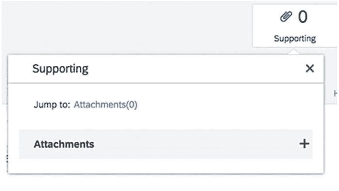

**图 9-20** 在“支持信息”Pod 中添加附件

可附加的文件类型包括：`bmp`、`doc`、`docm`、`docx`、`gif`、`htm`、`html`、`jpg`、`jpeg`、`msg`、`pdf`、`png`、`ppt`、`pptx`、`rtf`、`tif`、`txt`、`xls` 和 `xlsx`。通常，只有添加附件的用户才能删除该附件。大多数情况下，路线图中的任何用户都可以查看其他用户在之前步骤中添加的附件。但是，表单模板 XML 控制着附件权限。您将在第 10 章中了解更多关于如何配置的信息。

### 只读区域

在我们配置的表单模板中，我们使用了几个只读区域：“引言”、“员工信息”和“审核日期”。这些区域本质上是信息性的。这些区域的一个示例如图 9-21 所示。

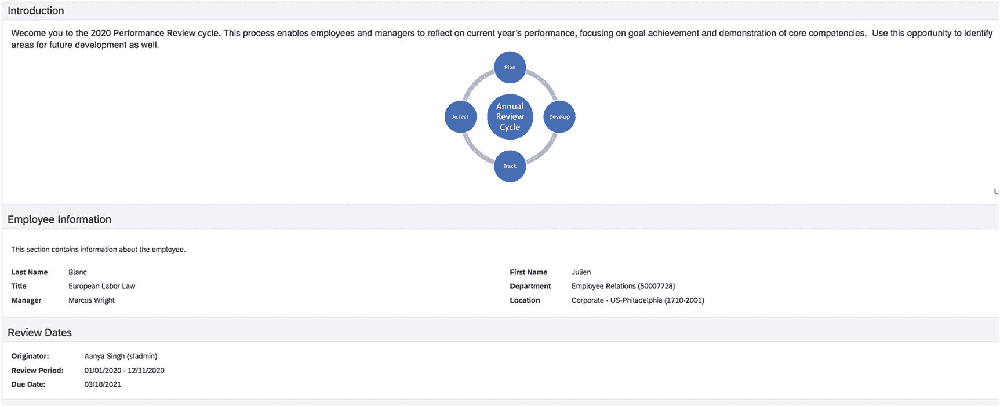

**图 9-21** 绩效表单的只读区域

### 可编辑区域

此表单中的其余区域都是可编辑的。包括一个自定义区域、一个目标区域和两个能力素质区域。每个区域都以描述开头，每个单独的目标或能力素质都划分在自己的子区域中。我们将简要查看每个区域。

#### 目标区域

目标区域的一个示例如图 9-22 所示。

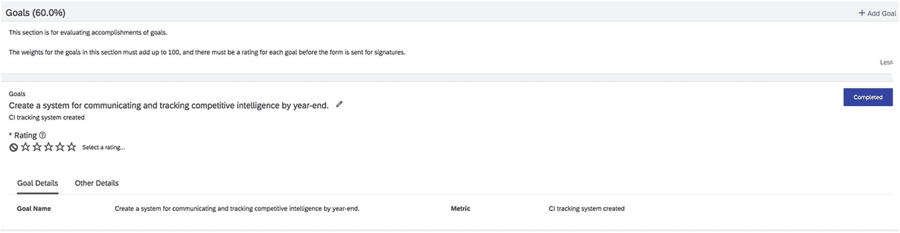

**图 9-22** 目标区域

版块名称显示其在总分中的占比。在本示例中，目标项目的评分将占总分的 60%。根据模板的配置方式，员工可以自行添加额外目标或编辑现有目标。目标项目必须进行评分，红色星号即表示此项为必填项。此处采用标准的星级评分方式。用户可以点击问号图标查看每个评分等级的描述，如图 9-23 所示。

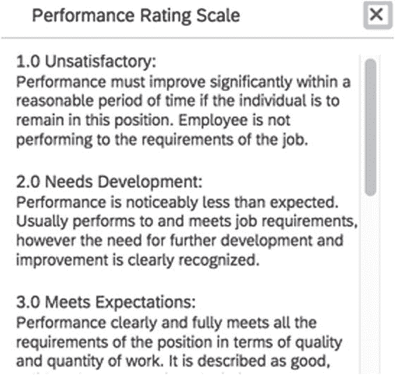

**图 9-23** 评分等级描述

在我们的示例中，没有针对单个目标项目的评论，但存在一个整体目标版块的评论，如图 9-24 所示。

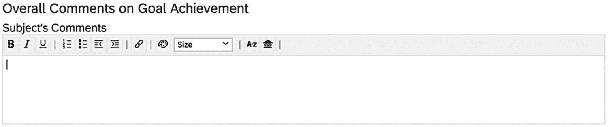

**图 9-24** 目标版块评论

为了避免用户对每个目标进行评论（当目标数量较多时可能会很繁琐），我们配置了整体版块评论。这使得用户可以在一个位置集中突出显示关于目标完成情况的关键要点。在我们的示例中，整体评论为可选项。

#### 能力版块

在第 7 章中，当我们回顾表单模板设置时，我们了解到可以有多个能力版块：核心能力、岗位特定能力和自定义能力。每个版块可以分配不同的权重，并且并非所有能力版块都需要纳入整体表单评分的计算。为了便于说明，我们假设有两个能力版块：核心能力和岗位特定能力。这两个版块都会对每项能力进行评论，但没有整体版块评论。

#### 写作助手

如果你在使用带有项目评论的能力版块并启用了写作助手，那么每个能力项目评论框上方都会出现“写作助手”按钮，如图 9-25 所示。

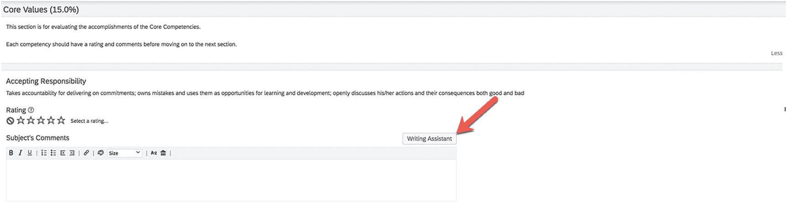

**图 9-25** 能力评论上的写作助手

点击“写作助手”按钮会弹出一个窗口，其中列出了针对该能力的建议评论。这些评论可以作为撰写能力评论时的出发点，也可以直接使用。示例如图 9-26 所示。

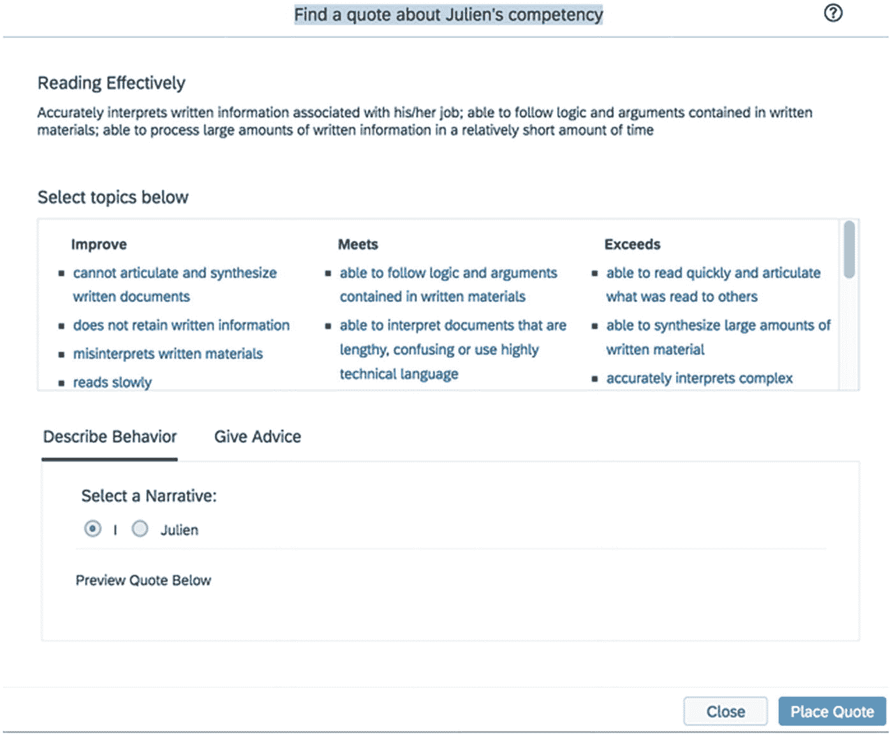

**图 9-26** 为一项能力撰写评论

这些引导性短语是附加在标准能力库中的各项能力上的。如果你使用的是自定义库，则可以添加这些短语。这些短语按不同程度分组，例如改善、符合或超越。用户可以选择使用第一人称（“我”）或第三人称（员工姓名）作为评论的口吻。点击一个短语，然后点击“引用”。对每个要添加的引用都执行此操作；完成后点击“关闭”。

随后，这些评论将显示在能力项目评论中，如图 9-27 所示。这些评论可以编辑。

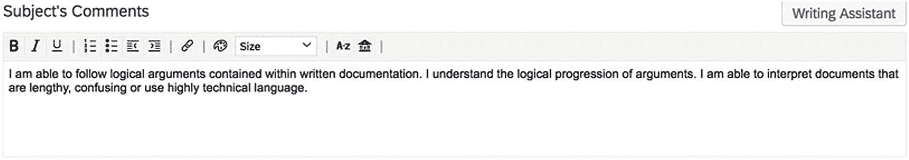

**图 9-27** 从写作助手添加的评论

当管理者使用写作助手时，“您”或员工姓名是叙述选项。

> **注意** 有关写作助手的工作原理及其配置方法的更多信息，请参见 SAP 说明文档 `#2086614`。

特定于角色的能力将位于一个单独的版块中。一个示例角色特定能力版块如图 9-28 所示。

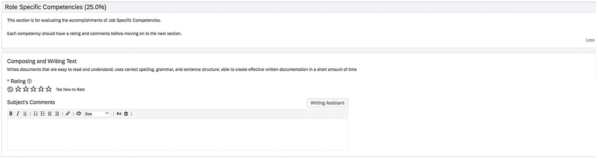

**图 9-28** 角色特定能力

在所示的示例中，每项能力都有评分和评论。你可以选择不为该能力版块设置项目评论。你还可以添加整体能力评论，或将这些字段设置为必填或隐藏。当有多个能力版块时，它们可以使用不同的字段和权限。

#### 附加评论版块

另一个标准版块是附加评论版块。示例如图 9-29 所示。

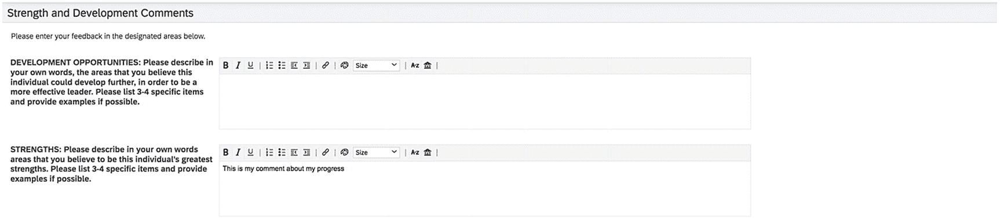

## 附加评论版块

此版块在表单模板中不可设置权限，这意味着除非该版块被隐藏或禁用，否则任何步骤中的任何角色都可以添加或编辑评论。在第 10 章中，我们将学习如何编辑绩效表单模板 XML 以添加这些权限。

## 自定义版块

一个绩效表单可以包含多个自定义版块。这些版块不需要聚集在一起。它们可以出现在任何其他模板版块之间。与标准版块一样，该版块可以按步骤隐藏，并且可以设置权限来隐藏字段、允许编辑字段或查看字段。一个包含两个自定义版块的绩效表单示例，如图 9-30 所示。

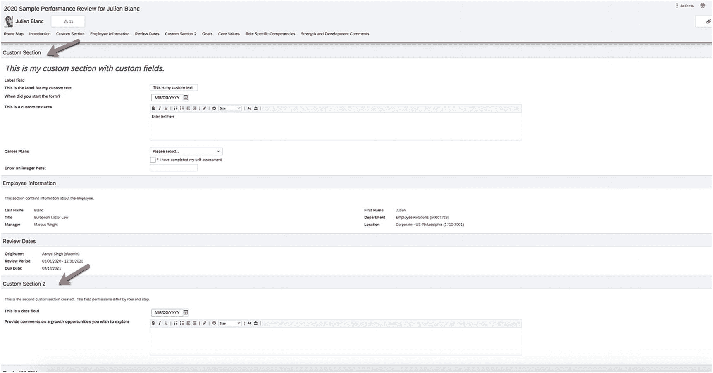

*图 9-30 带有自定义字段的自定义版块*

此示例展示了可使用的各种字段类型：`text`、`textarea`、`date`、`number`、`checkbox` 或 `dropdown list`。任何 `textarea` 字段都有多个可用选项，如图 9-31 所示。

*图 9-31 多行文本选项*

除了文本格式化选项外，用户还可以添加 URL、执行拼写检查或法律扫描。拼写检查和法律扫描将在下面进行说明。

## 拼写检查

在配置系统（`Provisioning`）中进行绩效管理设置时，我们启用了`拼写检查`和`法律扫描`。启用后，我们还在表单模板的高级设置中添加了以下内容：“启用拼写检查”和“启用法律扫描”。

这为用户在表单上提供了三种拼写检查选项：

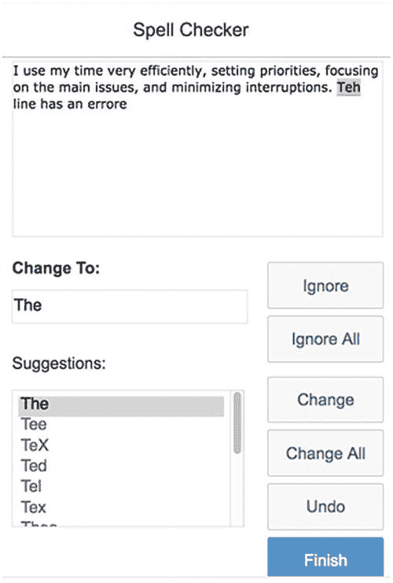

*图 9-32 拼写检查*

1.  通过点击“A–Z”拼写检查图标对`textarea`字段进行拼写检查。如图 9-32 所示弹出窗口。将显示建议的单词更改。

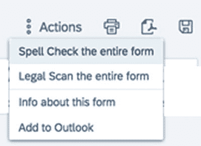

*图 9-33 表单上的操作*

2.  转到表单顶部的“操作”，然后选择“对整个表单进行拼写检查”，如图 9-33 所示。此选项将对表单中的所有文本条目进行拼写检查。

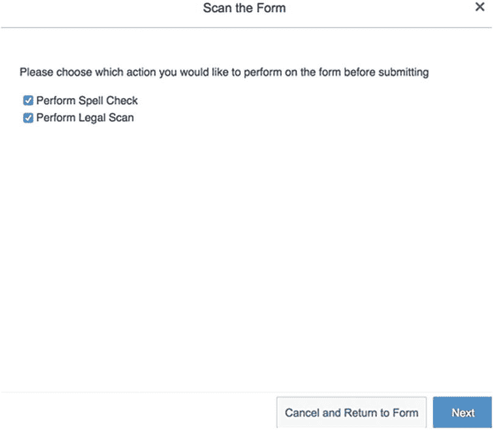

*图 9-34 开始表单扫描*

3.  点击提交按钮将表单移至下一步，此时将弹出一个窗口，如图 9-34 所示。将会出现一系列屏幕来检查表单文本条目，如果发现任何错误，系统将提示用户进行更改。在此示例中，同时执行了拼写检查和法律扫描。一旦扫描完成且没有必填条目的错误，关闭扫描弹出窗口，用户将进入确认界面，以便进入下一步。

## 法律扫描

当启用`Legal Scan`（法律扫描）时，用户将拥有与`Spell Check`（拼写检查）相同的三个选项。`Legal Scan`的弹窗会查找任何不当的词语或短语，并给出替代建议，如图 9-35 所示。

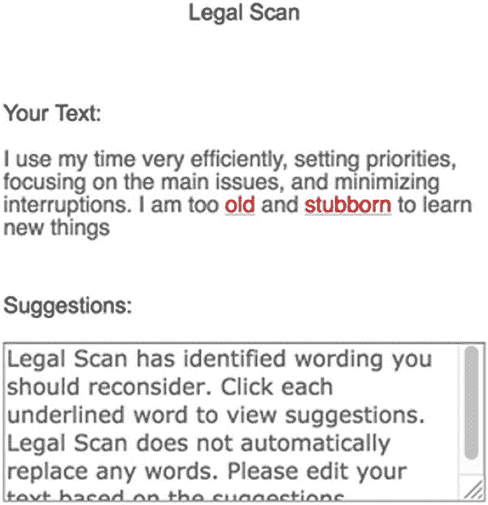

*图 9-35 法律扫描*

如果您希望在每次将表单提交至下一步时避免看到扫描弹窗，可以在高级表单模板设置中，点击`"Disable Spell Check On Route"`（禁用路由拼写检查）和`"Disable Legal Scan on Route"`（禁用路由法律扫描）选项，如图 9-36 所示。

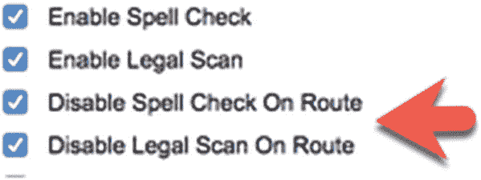

*图 9-36 关闭表单扫描的选项*

用户仍可通过使用`"Actions"`（操作）选项，或分别对每个文本区域进行操作，来进行完整的表单扫描。

## 将表单提交至下一步

在员工填写完所有必填字段并提供备注后，可以将表单发送至下一步。对于包含大量必填字段的表单，建议用户在填写过程中不时点击表单右上角的保存图标。这样做会更新`Incomplete Items`（未完成项）分区中的计数。这是一种确保您能毫无错误地提交表单的简便方法。当所有必填字段都填写完毕时，`Incomplete Items`分区的显示如图 9-37 所示。

*图 9-37 所有必填项已完成*

如果没有拼写检查或法律扫描错误，并且所有必填字段都已填写完毕，用户即可提交表单。这将根据路由图将表单路由至流程中的下一步。

随后会显示一个确认屏幕。这给了用户最后一次机会，可以返回表单进行任何修改，或确认提交至下一步。用户可以添加备注。这些备注将在发送给下一步用户的文档路由邮件中可见。此外，点击备注部分标签旁的问号（如图 9-38 所示），将显示路由图中的文本。

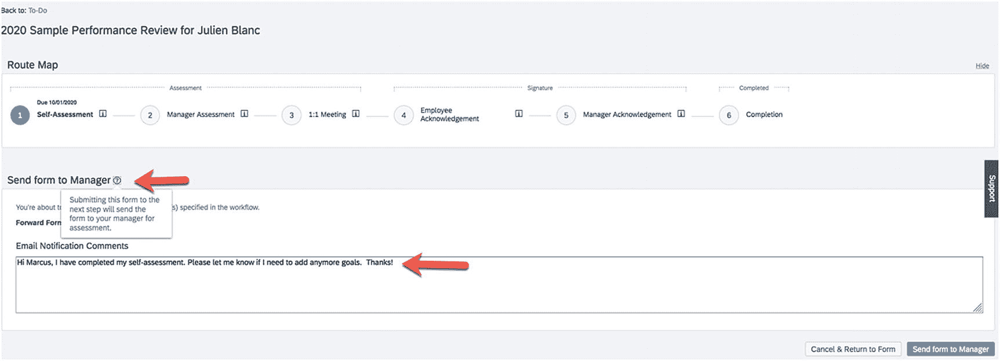

*图 9-38 确认页面*

在路由邮件通知中，`"DOC_COMMENT"`令牌控制是否允许输入备注。示例如图 9-39 所示。

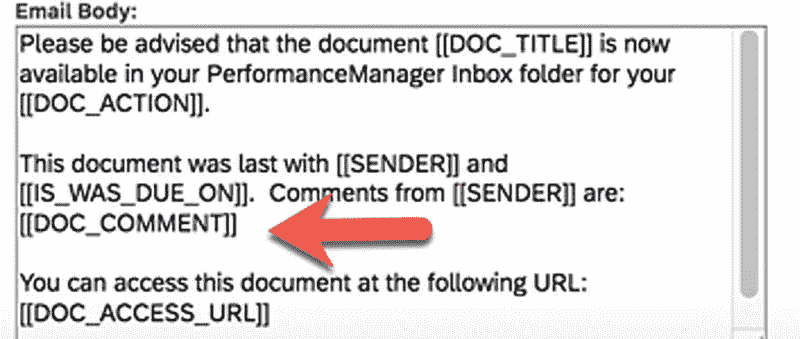

*图 9-39 用于路由文档的邮件*

如果移除了该令牌，用户在提交表单时将无法向邮件通知中添加备注。

提交后，将显示`My Forms`（我的表单）页面。该表单将不再出现在用户的`Inbox`（收件箱）文件夹中。点击`"En Route"`（路由中），您将看到该表单现在位于用户的管理者处。示例如图 9-40 所示。

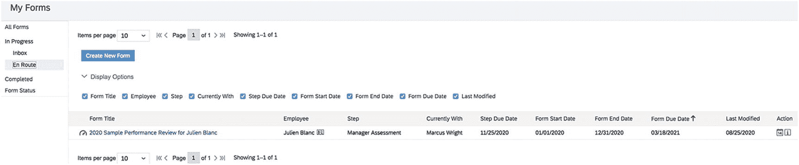

*图 9-40 在“路由中”文件夹中的表单*

如果已启用，当表单流转至下一步时，表单的接收者将收到一份文档路由通知，如图 9-41 所示。

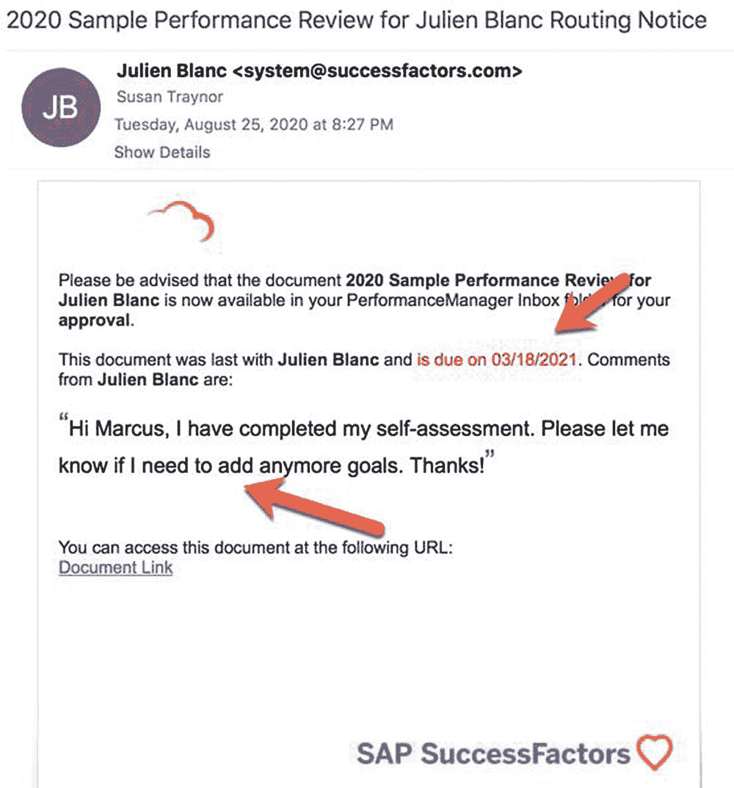

*图 9-41 路由通知*

邮件通知显示员工姓名作为发件人。通知还包含用户在提交确认页面上添加的备注，以及步骤截止日期。该表单现在位于管理者的`Performance Inbox`（绩效收件箱）中。

## 表单的管理者视图

现在，我们将从管理者的角度来查看员工发送后的已启动表单。当管理者收到邮件通知，告知其收件箱中有表单时，他们可以点击邮件中的链接，在主页的`Performance To-Do`（绩效待办）磁贴中找到相关的绩效任务，或者从`Home`（主页）菜单进入`Performance`（绩效）选项卡。

在表单的路由图（如图 9-42 示例所示）中，当前步骤编号会高亮显示，而前一步骤编号则会显示一个绿色的对勾标记。

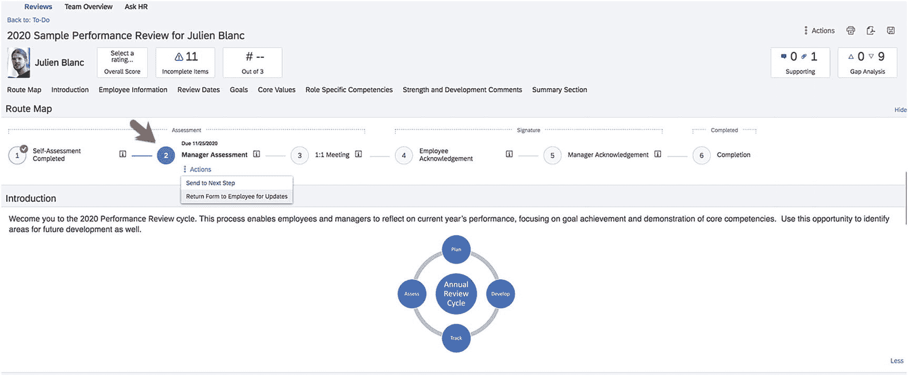

*图 9-42 处于“管理者评估”步骤的表单*

上图中显示的路由图里，前一步骤的名称已经更新。步骤完成后显示的标签是在创建路由图时设置的，它对应的是第一个路由图步骤中的`"Step Name After Completion"`（完成后的步骤名称）。与您在前一步骤中看到的类似，当前步骤显示了该步骤的截止日期以及适用于该步骤的操作。如前所述，步骤截止日期仅对当前步骤显示。

在我们的示例中，对于`Manager Assessment`（管理者评估）步骤，所有分区都已包含在内。由于这是给出总体评级的步骤，我们还包含了`Overall Score`（总体评分）分区。一旦管理者输入最终评级，该分区将显示总体评分。接下来我们将逐一查看每个分区。

### 团队排名器分区

# 绩效评估表单中的分区功能

`Team Ranker`（团队排名器）分区根据总体评分显示管理者直属下属的排名。这与`Team Overview`（团队概览）中出现的`Team Rater`（团队评估器）选项不同。`Team Rater`用于输入能力项得分；`Team Ranker`则根据表单总体评分显示每位直属下属的排名。尚未被评分的员工将没有排名，如图 9-43 所示。此分区仅供管理者使用。如果员工角色被授予了此分区的权限，该分区对他们也不可见。

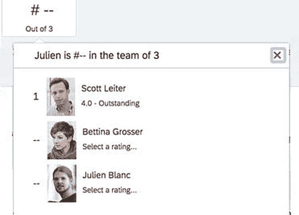

**图 9-43**  
团队排名器分区

### 差距分析分区

`Gap Analysis`（差距分析）分区将显示管理者评分高于或低于员工自评的数量。随着管理者输入评分并保存表单，这些数字会发生变化。示例如图 9-44 所示。

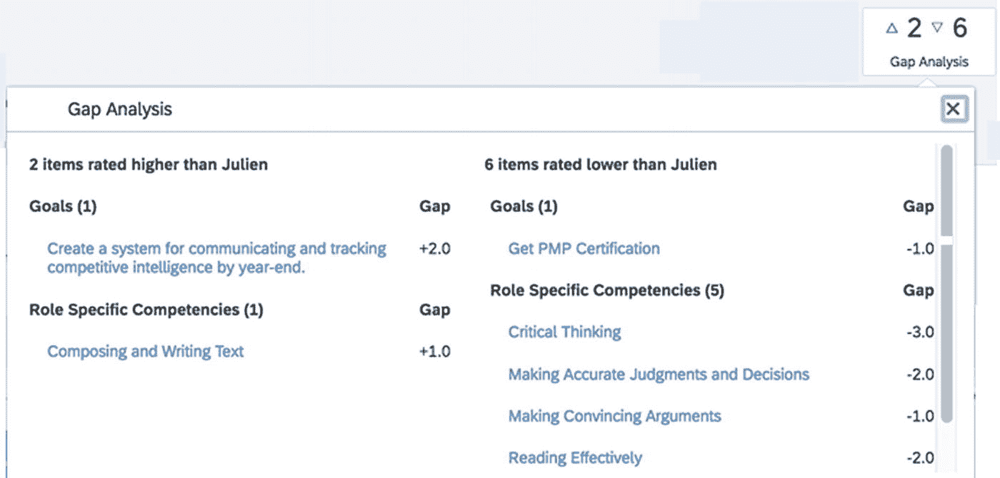

**图 9-44**  
差距分析分区详情

当您点击该分区时，详情会显示管理者的哪些项目评分高于或低于员工的自评。管理者与员工项目评分之间的差异程度用`"+"`或`"-"`表示。例如，如果某个员工在某个项目上自评为*Extraordinary*（杰出），则该标签的数值分数是`"5"`。如果管理者给出的评分是*Meets Expectations*（符合预期），其数值分数是`"3"`，那么这两个评分之间的差距就是`"-2"`。这意味着管理者的评分比员工的评分低了 2 分。如果管理者和员工对某个项目给出了相同的评分，则不存在差异。

### 支撑材料分区

`Supporting Information`（支撑材料）分区如图 9-45 所示。计数数字显示该分区中有多少个附件。根据本例中的配置，管理者可以查看员工添加的附件、添加另一个附件、或删除他们自己添加的附件。您可以决定是否允许管理者删除员工添加的附件，或者在特定步骤中隐藏该分区。

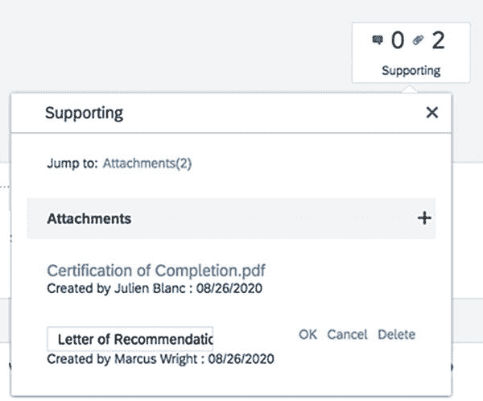

**图 9-45**  
支撑材料分区

您还会注意到，此组件除了有回形针图标及其附件计数外，还有一个带有数字的评论气泡图标。此组件可能还包含“请求反馈”评论以及备注。即使我们的表单未配置使用“请求反馈”功能，经理也会看到评论图标和数字。我们将在第 11 章了解“请求反馈”功能。

现在我们已经介绍了表单顶部可用的组件，我们将探讨一些额外的章节功能。

## EZ-Rater

表单模板的 XML 中可能启用一项名为 `EZ-Rater` 的功能。此功能出现在表单的“目标”和“能力”部分。对于每个目标和能力的评分，经理将能够看到员工自评与经理评分之间的差距。这对于年终与员工讨论时非常有用。

示例如图 9-46 所示。

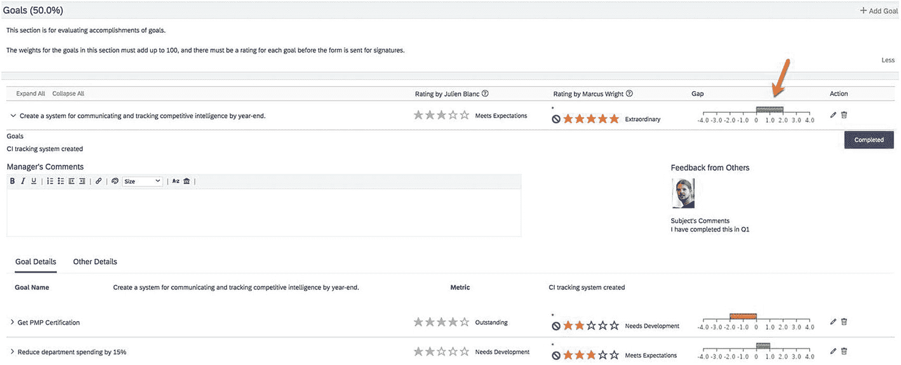

**图 9-46**  
EZ-Rater

在经理录入评分并将表单提交至下一步后，该差距图将在所有后续步骤和角色中可见。

## 他人评分选项卡

在配置表单模板时，我们设置了权限，允许经理在所有步骤中查看来自其他评分者的评分和评论。这意味着员工在先前步骤中录入的条目评分和条目评论将对经理可见。示例如图 9-47 所示。

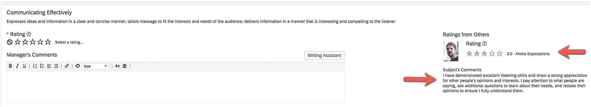

**图 9-47**  
他人评分选项卡

在签署前的所有步骤中，用户将在章节左侧看到自己的评分和评论。在所有步骤中，如果用户有权限，“他人评分”选项卡中的评分和评论将显示在章节右侧。

## 团队概览

我们还讨论了通过“绩效”选项卡中的“我的表单”访问表单。如果启用并授予权限，经理还可以访问“团队概览”选项卡，如图 9-48 所示。

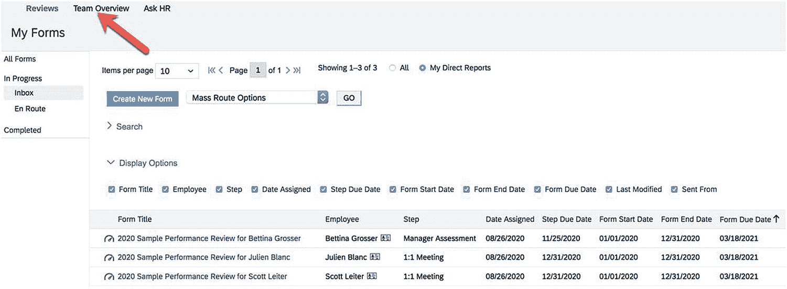

**图 9-48**  
团队概览访问

点击 `团队概览`，您将看到类似于图 9-49 的界面。

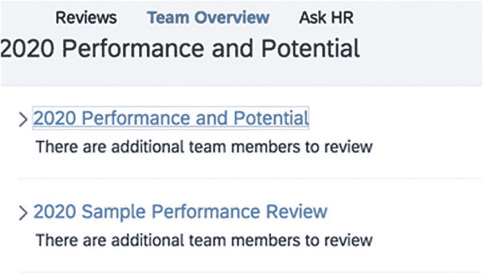

**图 9-49**  
团队概览

此页面为经理提供了一*目了然*的视图，显示哪些表单已启动、哪些员工有已启动的表单，以及每个表单所处的步骤。如果有来自多个模板生成的表单，则每个关联表单的表单模板将按天分组。展开任意表单组以查看详细信息。示例如图 9-50 所示。

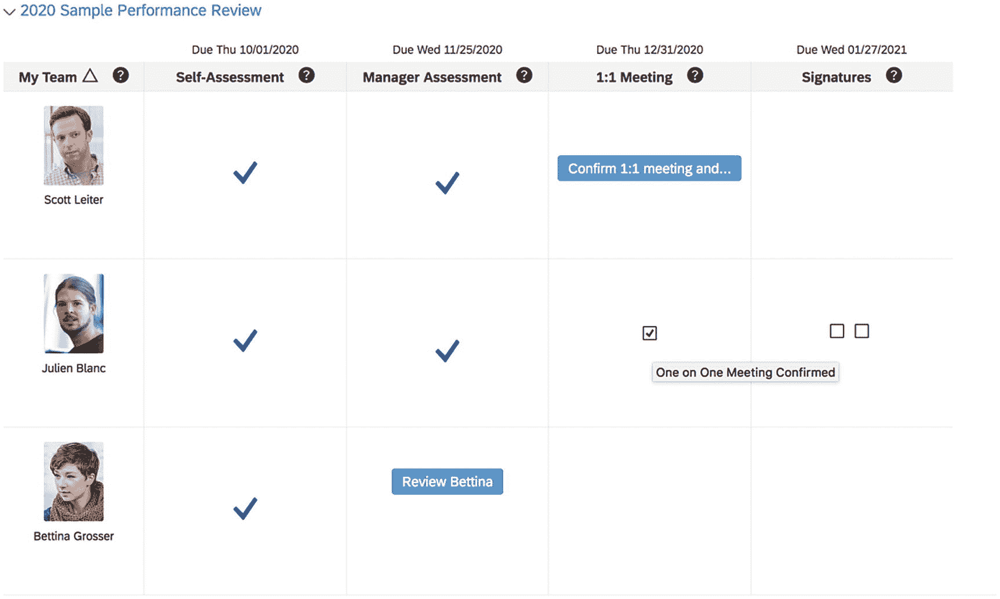

**图 9-50**  
团队概览表单分组

展开后，将显示“我的团队”，其中包含需要审核的表单列表。此列表包括已启动表单的直接下属，以及经理在路由图中担任角色的其他员工的已启动表单。页面将显示路由图步骤及任何步骤的到期日期。如果已配置，员工完成的每个步骤旁边都会有一个对勾标记。这使得经理能够轻松查看每个表单在流程中的位置。已完成的一对一步骤将显示不同的图标。将鼠标悬停在图标上，可以看到该步骤已被确认，如上一图所示。

根据步骤和经理的角色，可能会显示一些按钮，这些按钮可以将经理直接带入表单。例如，表单可能处于经理评估步骤。一个带有链接的按钮将显示 `审核 {员工姓名}`。如果经理点击该按钮，表单将打开，并且他们可以完成该员工的经理评估步骤。任何当前处于经理步骤的表单都将有一个按钮，可进入表单完成操作。

可能还会出现一个“请求反馈”按钮，使经理能够向其他用户请求评论。这些评论将显示在表单上的“支持信息”组件中。您将在第 11 章了解如何配置“请求反馈”。此外，还会讨论此功能的工作原理以及它与另一个名为“获取反馈”的反馈收集选项有何不同。

处于“签署阶段”的表单会显示需要签署的数量以及谁需要先签署表单。这里有一个步骤允许经理召回表单。示例如图 9-51 所示。

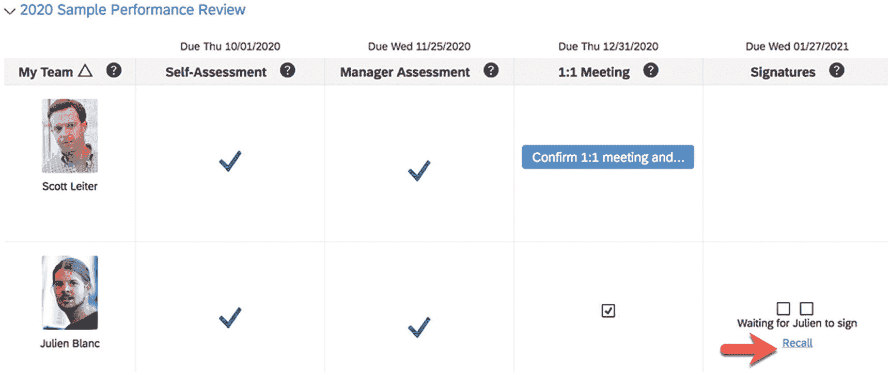

**图 9-51**  
团队概览中的签署步骤

点击 `召回` 链接会将表单退回一步。如果表单没有退回一步的选项，此功能将很有帮助。

## 团队评分者

还有“团队评分者”选项，允许经理为已启动表单的直接下属进行能力评分。该选项如图 9-52 所示。

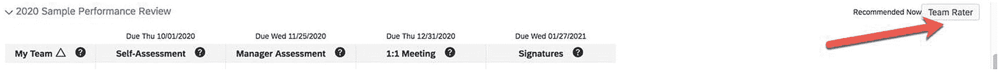

**图 9-52**  
团队评分者选项

在图 9-53 所示的示例中，有一个下拉列表用于选择能力类型。我们的表单包含核心能力和岗位特定能力，因此每个部分将单独评分。

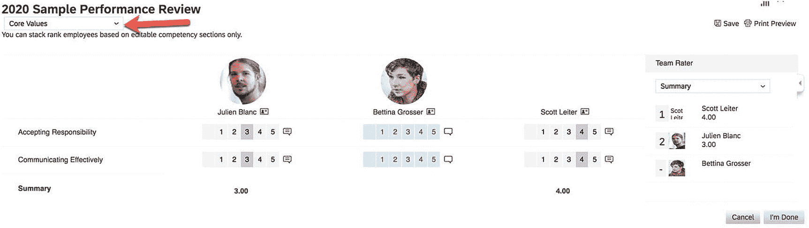

**图 9-53**  
团队评分者

这将更新尚未通过评分步骤的表单中的能力评分。在我们上一图所示的示例中，Julien 和 Scott 的表单已经通过了经理评估步骤，因此无法更新评分。Bettina 的表单尚未被评估，因此经理可以在此处输入他们的能力评分，她的表单将反映这些评分。

> 要了解有关团队概览及其附加功能的更多信息，请参阅 SAP 说明 #2078755。

## 将表单退回一步

在图 9-54 所示的示例中，我们允许经理将表单路由回上一步的员工。

**图 9-54**  
将表单退回一步

在该示例中，经理决定将表单退回至上一步骤，让员工进行更新。如果经理在退回表单前已开始在表单中输入某些评分并保存了表单，员工将看不到经理所做的任何输入。只要经理在其步骤中要填写的任何字段的权限设置为`"None"`，则退回至员工手中的表单将与之前离开员工时的状态完全一致。这意味着员工步骤中的经理评分和经理评语字段的权限应为`"None"`。当表单退回至此步骤时，员工步骤中的所有可编辑字段将恢复可编辑状态。员工完成修改后，将提交表单，表单将再次流转至经理步骤。经理在此步骤中已做的任何输入都将得到保留。

## 摘要部分

经理所使用的摘要部分将包含表单中所有`目标`和`能力`部分的评分，前提是它们在表单模板的摘要部分中已指定了权重。示例如图 9-55 所示。

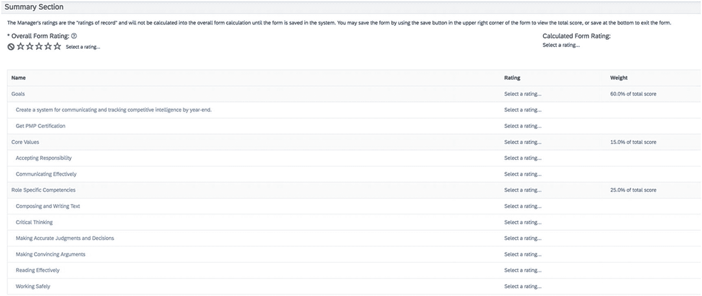

**图 9-55** 经理评分前的摘要部分

根据表单模板配置，每个目标和能力及其项目评分将在此部分显示。各部分的权重也会一并显示。我们也允许经理输入一个手动总体评分，该评分将覆盖计算得出的评分。经理输入评分并保存表单后，表单总体评分将被计算出来。在此示例中，手动总体评分是必填项。一旦输入此评分，`总体得分`数据块将更新为此评分，并将其作为最终记录评分。所有评分已填写的摘要部分示例如图 9-56 所示。

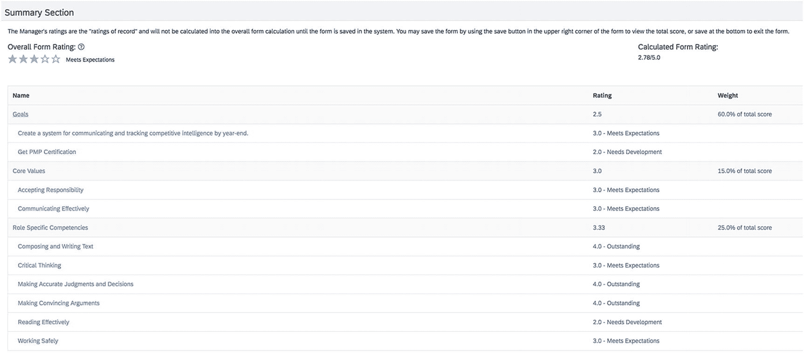

**图 9-56** 包含计算后总体评分的摘要部分

每个单项评分会与各部分的计算评分一同显示。计算评分是数值。尽管每个部分中的项目评分以星级显示，但在此处项目评分显示了数值和文本值。手动评分则使用星级评分系统。

请注意图 9-57 中的示例，手动总体评分也在`总体得分`数据块中使用了数值和文本值进行显示。

**图 9-57** 包含手动总体评分的总体得分数据块

## 团队排名器数据块

为员工设定总体得分后，您可以看到`团队排名器`数据块已更新，根据总体得分纳入了此表单的排名。示例如图 9-58 所示。

**图 9-58** 更新后的团队排名

## 无评语选项的确认屏幕

使用我们的示例模板，经理完成绩效评分后的下一步是与员工进行年终讨论。在此步骤中，经理是角色所有者，因此当确认页面显示时，没有评语选项，如图 9-59 所示。

**图 9-59** 无评语选项的确认屏幕

出现这种情况是因为表单在下一步骤将流转给同一用户，因此无需发送电子邮件通知。

## 表单上评分的视图

根据查看表单的用户身份不同，评分和评语的显示位置也不同。输入评分和评语的用户将在每个目标和能力项的左侧看到这些字段。在我们的示例图 9-60 中，经理的评分和评语位于目标项下方左侧。员工对该项目的评分和评语则位于右侧的`来自他人的评分`下方。

**图 9-60** 经理视角下的项目评分和评语

当以员工身份查看表单时，员工的评分和评语位于左侧，而经理的评分和评语则位于右侧的`来自他人的评分`下方，如图 9-61 所示。

**图 9-61** 员工视角下的项目评分和评语

## 计算后的总体评分

如果您在摘要部分使用计算后的总体评分，同时允许手动总体评分，则手动评分将是最终记录评分。强烈建议在后续任何步骤中隐藏计算后的评分。包含计算后评分的部分如图 9-62 所示。

**图 9-62** 不可见的计算后评分

### 签名步骤

一旦所有修改步骤完成、评分已给出、年终讨论也已进行，表单将进入签名阶段。

此阶段的表单为只读状态。唯一可编辑的部分是签名部分，可以在其中添加评语。如果在高级表单模板设置中进行了配置，则可以显示需要签署表单的用户名称。示例如图 9-63 所示。

**图 9-63** 签署前的签名部分

用户提交表单后，签署日期和电子签名将添加到表单中。员工签署后的签名部分示例如图 9-64 所示。

**图 9-64** 包含一个签名的签名部分

如果您决定不使用签名部分，只需在表单模板中隐藏该部分，那么表单将在最后一个修改步骤后直接进入已完成步骤。

### 已完成步骤

一旦添加了最终签名并提交了表单，表单将进入`我的表单`的`已完成`文件夹，如图 9-65 所示。任何在流程中扮演角色的用户都将在其`绩效已完成`文件夹中收到一份表单副本。

**图 9-65** 已完成文件夹中的表单

### 报告

如果经理被授予了报告访问权限，他们可能能够运行标准报告、运行为其创建的即席报告、创建自己的即席报告、查看磁贴以及生成仪表板。

## 仪表板/磁贴

管理员可以从`SuccessStore`添加标准的绩效表单相关磁贴，然后将其放置在经理的主页上。示例如图 9-66 所示。

**图 9-66** 主页上的绩效磁贴

## 向下钻取

在磁贴中，经理可以向下钻取以查看详细信息。示例如图 9-67 所示。

**图 9-67** 向下钻取磁贴

结果可以下载为 Excel 或 `CSV` 文件。

### 报告中心

在报告中心内，可以生成经理有权访问的仪表盘。`Type` 列将显示“Dashboard”，如图 9-68 所示。

**图 9-68** 报告中心报告

经理可以运行此报告，生成的数据将显示在磁贴中。示例如图 9-69 所示。

**图 9-69** 经理生成的仪表盘

这些是标准磁贴，属于管理员从 `SuccessStore` 添加的标准绩效仪表盘的一部分。

## 即席报告

获得权限后，经理可以运行为其创建的报告。管理员将创建报告，然后进行共享。共享报告将显示一个图标以标识其为共享。经理将仅能看到其直接下属以及根据经理角色权限设置的下级层级的结果。示例如图 9-70 所示。

**图 9-70** 运行共享的即席报告

如果经理的角色具有创建报告的权限，他们可以创建自己的报告。有一个向导可以引导完成创建报告的各个步骤。通常，选择的报告类型是`“Table”`，域为`“Performance Management”`，如图 9-71 所示。

**图 9-72** `People Profile` 上的绩效历史 Portlet

**图 9-71** 创建即席报告

与共享报告和磁贴类似，经理将仅能看到其直接下属以及根据经理角色权限设置的下级层级的结果。人力资源经理角色也可能被授予报告权限，其结果将包括其支持的员工。

查看绩效相关信息的另一种方式是通过 `People Profile`。我们现在将介绍一些可用的 Portlet 和块。

### 绩效历史 Portlet

有一些与绩效相关的 Portlet 和块可能出现在用户的 `People Profile` 中。通常，它们出现在档案的“人才档案”部分，该部分仅对员工和经理可见。绩效历史 Portlet 的示例如图 6-72 所示。

如果表单模板中包含“目标能力摘要”部分，则可能显示目标能力 Portlet。示例如图 9-73 所示。

**图 9-73** 档案中的目标能力矩阵网格

此外，如果数据模型中配置并允许使用评级背景元素，则可以在 `People Profile` 中设置块。整体潜力评级块和最新绩效评级块的示例如图 9-74 所示。

**图 9-74** 整体潜力与绩效评级块

现在，我们已经从用户的角度走完了绩效流程。

## 结论

在最后三章中，我们启用了绩效管理，设置了权限，并创建了表单模板。在本章中，我们通过员工及其经理的视角走完了绩效评估流程。在下一章中，我们将深入探讨一些必须在后端表单模板 `XML` 中完成的配置细节。我们还将学习一些可能用到的`高级功能`。