# 12. 360 度评估

`SuccessFactors`中的`360 度评估`模块使经理和员工能够在绩效评估过程中向其他利益相关者（包括内部和外部）征求反馈。使用`SuccessFactors 绩效与目标管理`进行的典型绩效评估包括直线经理和员工对目标的评估和评分。但这并不能提供关于员工绩效或发展需求的全面反馈，而这些反馈有助于经理在绩效校准或与员工的一对一会议中更好地支持员工。为了专门支持这种情况，组织利用`360 度评估`模块从员工直接或间接合作过的所有利益相关者那里获取反馈。

如图 12-1 所示，员工或代表员工的汇报经理可以向不同的利益相关者请求绩效反馈。从团队成员和其他利益相关者那里获取反馈，有助于员工和经理更准确地评估员工的绩效。这些利益相关者还可以就成功和失败案例提供公正无偏见的反馈，并帮助经理更好地理解员工的发展需求。

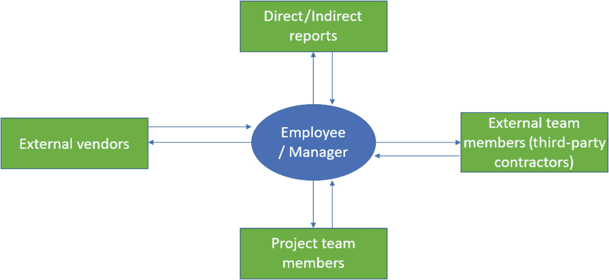

**图 12-1** 360 度评估流程概览

在本章中，我们将回顾`SuccessFactors 360 评估`的功能，并讨论如何配置一份360评估反馈表单。此外，我们还将讨论如何与`职业发展规划（CDP）`和`学习管理系统（LMS）`进行集成。我们还提供了在配置360评估反馈模板时可以参看的`XML`代码片段。

## 360评估反馈流程中的参与者

在开始配置之前，我们先来了解一些关于参与者的关键概念。在本节中，我们将定义`SuccessFactors 360 评估`反馈流程中的不同参与者。本章将始终提及以下参与者：

*   **被评估人（Subject）**：这是为其发起360评估反馈表单的员工。一份表单中只能有一个被评估人。
*   **发起人（Originator）**：这是生成表单的人。系统自动将此角色分配给生成表单的人。通常，此角色由360评估反馈表单管理员或人力资源部门的某人担任。
*   **流程负责人（Process Owner）**：这是将表单分发给参与者并启动流程评估阶段的人。此角色自动分配给点击表单上的分发按钮以将表单分发出去进行评估的人。一份表单只能有一个流程负责人。通常，流程负责人是发起人、被评估人或被评估人的经理。
*   **审批人（Approver）**：在审批阶段，审批人是审阅反馈、参与者选择并批准流程的人。通常，此角色分配给被评估人的经理或人力资源部门的某人。

> **注意**：任何分配给流程且属于路由图的角色都被视为审批人。

审批人有两个子类型：

*   **特权审批人（Privileged approver）**：此角色分配给在流程结束时管理和处理反馈数据的人。
*   **参与评估人（Participant reviewer）**：此角色分配给在评估阶段收到表单并提供关于被评估人反馈的人。参与评估人可以选择拒绝或参与评估流程。拒绝参与反馈流程的参与评估人不会纳入反馈结果。被评估人也可以是参与评估人；换言之，被评估人可以自我评估。流程可以有多个参与评估人。

现在您已了解每个参与者将在流程中扮演的角色，让我们开始在`Provisioning`中激活360功能来准备系统。

## 在Provisioning中激活360评估

在`SuccessFactors Provisioning`中，您需要激活以下开关。这些开关位于“公司设置”中。

> **提示**：在显示的页面上，您可以按`Ctrl+F`搜索这些设置。记得保存您的设置。

*   `360 多评价人`
*   `启用 360 高管评估页面`——需要`360 多评价人`和`基于角色的权限`
*   `图形报告（360）`——需要`360 多评价人`
*   `PM 和 360 的富文本编辑器`
*   `360 团队评价人`
*   `临时报告生成器：360 多评价人被评估人`

> **注意**：目前，我们不会激活名为“360 评估 – SAP Fiori 版本 [未准备就绪用于销售/生产] — 需要 360 多评价人”的开关。我们将在本章后面更详细地讨论`SAP Fiori`。

## 具名与匿名360流程

您可以将360评估反馈表单配置为匿名或具名流程。在`Provisioning`中，点击名为`表单模板管理`的配置步骤。在显示的页面上，点击您将使用的360评估反馈表单。在显示的页面的`编辑表单属性`部分，您可以选择“`匿名 360` 或 `360 显示参与者姓名`”。

在匿名流程中，表单用户将不会在表单的`评估摘要`部分看到评价人的姓名。但是，如果您希望参与者的姓名显示在表单的`评估摘要`部分，可以在特定360评估反馈表单模板的`表单模板设置`部分中启用名为“`在状态摘要中显示参与者（仅适用于匿名 360）`”的开关。在`表单模板设置`中，当您启用“`隐藏 360 文档完成通知和 360 文档拒绝通知的电子邮件发件人（仅适用于匿名 360）`”开关时，“发件人”字段将被隐藏，因此被评估人的经理无法看到发件人的姓名。

在具名流程中，参与者姓名在360评估反馈表单的`评估摘要`部分中可见。在本章后面，我们将讨论如何使360评估反馈表单对某些人匿名，而对另一些人具名。

有了这些背景知识，在下一节中，我们将回顾在配置360评估反馈表单模板之前需要配置的权限。

## 权限

在开始讨论360评估反馈表单的配置之前，让我们回顾一下访问`管理中心`相关配置步骤所需的权限（见表12-1）。

### 表12-1：为360评估反馈流程分配的权限

| 用户/管理员权限 | 权限名称 | 描述 |
|---|---|---|
| 管理文档 | `更改 360 流程负责人` | 此权限允许访问管理工具，以更改已完成或进行中的360评估反馈表单的流程负责人。 |
| | `更改参与者类别` | 此权限允许访问管理工具，以更改已完成或进行中的360评估反馈表单的参与者类别。 |
| | `完成/拒绝 360 文档` | 此权限允许访问管理工具，以代表评价人完成或拒绝一份360评估反馈表单。 |
| | `恢复已完成的 360` | 此权限允许访问以恢复一份已完成的360评估反馈表单。 |
| 360高管评估 | `360 高管评估` | 此权限允许访问以查看360高管评估页面。 |
| | `360 高管评估：添加审批人` | 拥有此360高管评估权限的角色可以添加审批人。 |
| | `360 高管评估：删除 360 表单` | 拥有此360高管评估权限的角色可以删除一份360评估表单。 |
| | `360 高管评估：导出为 XML（适用于已完成表单）` | 拥有此360高管评估权限的角色可以将已完成的表单导出为`XML`格式。 |
| | `360 高管评估：获取表单反馈` | 拥有此360高管评估权限的角色可以为“获取反馈”流程发送一份360评估反馈表单。 |
| | `360 高管评估：修改能力（添加/删除能力）` | 拥有此360高管评估权限的角色可以修改表单中的能力项。 |
| | `360 高管评估：修改参与者（添加/删除参与者）` | 拥有此360高管评估权限的角色可以修改表单中的参与者列表。 |
| | `360 高管评估：退回表单` | 拥有此360高管评估权限的角色可以将表单退回一步。此操作仅在签名步骤有效。 |
| | `360 高管评估：发送副本` | 拥有此360高管评估权限的角色可以将360评估反馈表单的副本发送给另一个用户。 |

## 360度评估权限与配置指南

### 权限说明

#### 360度高管评估：发送电子邮件提醒

拥有此`360 Executive Review`权限的角色可以向参与者列表发送电子邮件提醒。

#### 360度高管评估：查看详细360度报告

拥有此`360 Executive Review`权限的角色可以查看已完成表单的详细`360 Review`报告。

#### 360度高管评估：查看参与者评分（仅限已完成表单）

拥有此`360 Executive Review`权限的角色可以查看已完成表单中各个参与者的评分。

#### 一般用户权限

##### 创建表单的权限

拥有此权限的角色可以创建`360 Review`反馈表单。

### 管理表单模板

#### 表单模板

拥有此权限的角色可以创建和维护`360 Review`反馈表单模板。

### 计划批量创建表单（稍后启动表单）

拥有此权限的角色可以安排在稍后的日期/时间批量创建表单。

### 批量创建表单实例（立即启动表单）

拥有此权限的角色可以批量启动表单。

#### 路由图

拥有此权限的角色可以访问配置屏幕`Routing Maps`，以创建和维护用于`360 Review`反馈表单的路由图。

### 评分量表

拥有此权限的角色可以访问配置屏幕`Rating Scales`，以创建和维护用于`360 Review`反馈表单的评分量表。

> **注意：** 在本节中，我们仅讨论特定于`360 Review`反馈流程的权限。我们不会审查用户特定权限等。
> **注意：** 本节讨论的权限可以在管理中心的 `Admin Center` 中访问。执行`Manage Permission Roles`以访问这些权限。强烈建议在配置`360 Review`反馈表单之前，将这些权限分配给正确的角色。

在讨论了所需的权限之后，请记住将这些权限分配给所需的组。这将帮助我们准备好审查管理中心的 `Admin Center` 中可用的不同配置步骤。

## 管理中心相关配置步骤

现在我们已经拥有了进行配置所需的权限，让我们开始吧！与`360 Review`相关的配置屏幕可以在管理中心的 `Admin Center` 中的 `Company Processes and Cycles` 和 `360 Review` 部分找到（参见图 `12-2`）。表 `12-2` 从高层次描述了每个配置屏幕的功能。

**表 12-2** 360度评估反馈表单的配置屏幕

| 配置屏幕 | 描述 |
|---|---|
| `Change 360 Process Owner` | 执行此配置屏幕以更改`360 Review`反馈表单的所有者。 |

# 配置 360 度评估

| 配置步骤 | 功能说明 |
| :--- | :--- |
| `Change Participant Category` | 执行此配置屏幕以更改`360 Review`反馈表单中的参与者类别。 |
| `Complete / Decline 360 Form` | 执行此配置屏幕以完成或拒绝分配给该用户的`360 Review`反馈表单。<br>**注意：** 执行此配置屏幕时，在登录页面上您将看到选项 `[Mass Decline/Complete 360 Documents](https://salesdemo.successfactors.eu/xi/ui/pm360/pages/mass_decline_forms.xhtml?pess_new_admin=true&_s.crb=4jvSN1icATY2ek4X6wSxw5v%252f8b1Y%252fBQ%252fZ45XLX2WQ5Q%25253d)`。您可以使用此配置选项导入一个包含您想要完成/拒绝的`360 Review`反馈表单文档 ID 的 CSV 文件。当您有多个`360 Review`反馈表单需要处理时，通常会使用此选项。 |
| `E-Mail Notification Templates Settings` | 执行此配置屏幕以访问与`360 Review`审查流程关联的电子邮件模板设置。在显示的页面上，搜索 `*360*` 以访问`360 Review`流程使用的所有电子邮件模板。在此配置屏幕上，您可以启用或禁用提供的电子邮件模板。如果需要，您可以通过配置显示电子邮件部分中的设置来更改电子邮件模板的内容。<br>**注意：** 此配置屏幕用于访问不同模块和平台使用的所有电子邮件模板。 |
| `Form Template Settings` | 使用此配置屏幕更改`360 Review`表单设置，以及下载现有反馈表单或导入新表单。 |
| `Launch 360 Review` | 在此配置屏幕上，您可以创建和启动`360 Review`表单。 |
| `Manage Route Maps` | 使用此配置屏幕创建和维护用于`360 Review`表单的路由图。 |
| `Manage Scheduled Review` | 在此配置屏幕上，您可以修改或取消`360 Review`反馈表单的启动。 |
| `Manage Templates` | 在此配置屏幕上，您可以更改`360 Review`反馈表单的配置并对其进行维护。 |
| `Rating Scales` | 在此配置屏幕上创建和维护`360 Review`表单中使用的评分量表。 |
| `Restore Completed 360` | 在此配置屏幕上，我们可以将已完成的`360 Review`反馈表单恢复给参与者或流程所有者进行评估。 |

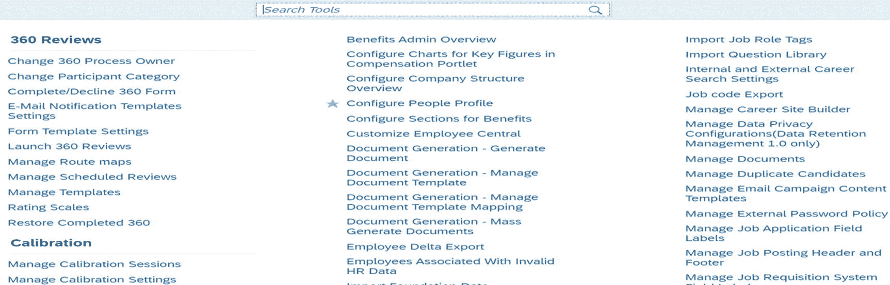

**图 12-2** 管理中心 `Admin Center` 中可用的`360 Review`配置步骤

在了解了这些不同的配置屏幕之后，下一节我们将讨论如何配置一个新的`360 Review`反馈表单。

## 配置路由图

我们将从配置一个新的`360 Review`反馈表单开始。在配置一个新表单之前，我们将配置将在`360 Review`反馈表单中使用的路由图。

我们可以通过执行配置屏幕 `Manage Route Maps` 来配置路由图。在显示的页面上，点击 `Getting Started`。在显示的页面上，点击 `Add New Route Map`。这将显示两个选项（参见图 `12-3`）。我们可以手动构建一个新的路由图，或者使用库中预置的路由图之一。

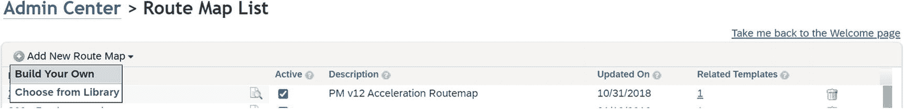

**图 12-3** 创建新的路由图

我们将在本节中讨论这两个选项。

### 使用预置路由图

如图 `12-3` 所示，点击 `Choose from Library` 选项。这将显示 `SuccessStore` 中所有可用的路由图。`360 Review` 特定的路由图带有前缀 `"360"`（参见图 `12-4`）。

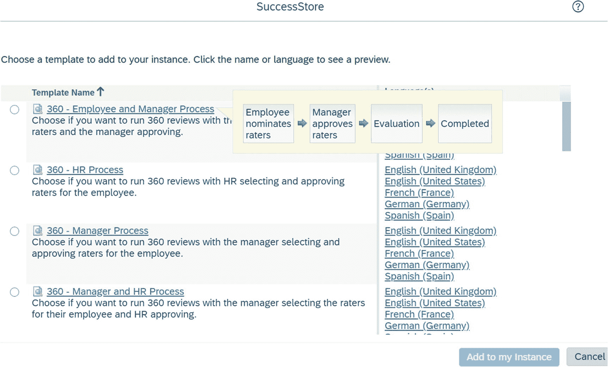

**图 12-4** 使用 `SuccessStore` 中可用的路由图

> **提示：** 在图 `12-4` 中，当您点击某个路由图名称时，系统将为您显示该路由图。您可以查看所有与`360 Review`相关的路由图，并选择最适合您业务需求的一个。如果您没有找到任何满足需求的路由图，您可以手动创建一个新的路由图。

> **注意：** `SuccessFactors` 在 `SuccessStore` 中提供了许多预配置的对象，客户和实施团队可以在配置期间利用这些对象。这些预配置的对象不同于快速部署解决方案 (`Rapid Deployment Solutions`, `RDS`) 中可用的对象。`SuccessStore` 中可用的对象帮助客户和实施团队在配置方面抢占先机。这些预置对象可以用作基线，并进一步配置以满足业务需求。

## 配置路线图与反馈表单

在本次讨论中，我们将选择预配置的路线图 **360 - 员工与经理流程**。点击该路线图旁边的单选按钮，然后点击“添加到我的实例”。这将显示一个新的对话框，您可以在其中输入路线图的名称。点击“保存”以保存您的设置。这将显示路线图，您可以在其中进行进一步修改（如有需要）（参见图 12-5）。

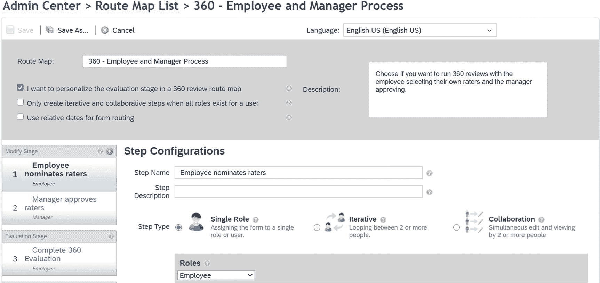

**图 12-5** 维护预交付的路线图

点击路线图中的每个流程步骤；您可以添加详细信息，例如步骤名称、步骤描述以及哪个角色将拥有该特定步骤。当您点击“显示高级选项”时，您可以维护诸如步骤介绍、鼠标悬停文本（如完成后的步骤名称、步骤模式等）之类的详细信息。步骤 ID 通常会预填充，但您可以更改它（例如，提供一个更具描述性的 ID）。

完成更改后，请记得保存。

了解了如何利用预配置的路线图后，我们将回顾如何为 360 评估流程手动创建一个新的路线图。

### 手动构建路线图

我们将手动创建一个新的路线图，其中经理将提名评估者并将其发送给 HR 进行审批，然后再将 360 评估表发送给员工进行评估。

如图 12-3 所示，点击“构建您自己的”。系统将创建一个新的路线图（参见图 12-6）。在显示的页面上，您可以为路线图输入新名称和描述。（请注意，默认情况下，系统会显示“路线图”并附带一个数字作为新路线图的名称。）

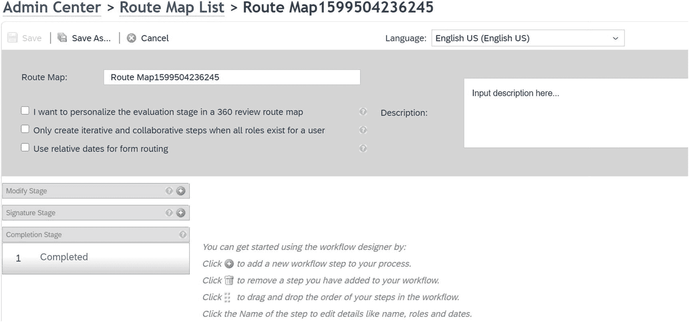

**图 12-6** 手动创建新路线图

在路线图名称下，您会注意到有三个选项。对于我们的路线图，我们将选择以下两个选项：

*   **我想在 360 评估路线图中个性化评估阶段**：选择此选项将允许您编辑评估阶段中评估者可以看到的内容。正是在评估阶段，评估者对员工进行评分和提供反馈。

*   **对表单路由使用相对日期**：选择此选项后，所有路线图日期将变为相对的。通过选择此选项，您可以定义相对于流程中另一个步骤之前/之后的天数。（请注意，您也可以为每个流程步骤输入实际日期。）

> **注意：** 当您选择此选项时，系统将显示一条警告消息：“当相对日期复选框打开时，不允许对路线图中的步骤位置进行重新排序。”这意味着如果您需要重新排序步骤，则需要取消选择此选项以重新排序路线图步骤，然后在需要时再次选择此选项。

> **提示：** 您可以点击每个选项旁边显示的问号（`?`）来了解其含义以及何时/何处可以使用它。

在“修改阶段”部分，点击 `+` 图标以创建一个新步骤。我们将此步骤命名为“直线经理提名评估者”。提供步骤描述。

在“步骤类型”（参见图 12-7）中，选择“单一角色”。在“角色”部分，选择“经理”作为负责此步骤的角色。

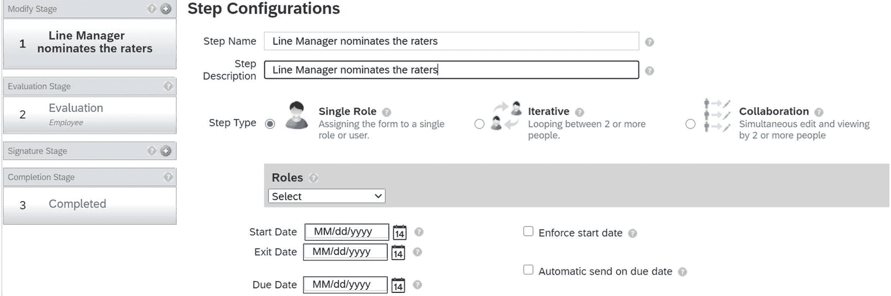

**图 12-7** 配置路线图中的步骤

现在，点击“修改阶段”中显示的 `+` 以创建路线图中的第二个步骤。我们将此步骤命名为“HR 代表批准评估者”。输入步骤描述。在“步骤类型”中，选择“单一角色”并选择“HR 代表”作为负责此步骤的角色。

点击“保存”以保存您的路线图。

## 配置 360 评估反馈表单

在下一步中，我们将开始配置一个新的 360 评估反馈表单。我们将通过执行配置屏幕“管理模板”来配置表单。

### 管理模板

在配置屏幕“管理模板”上，我们可以创建新表单，以及维护已配置的 360 评估反馈表单。在显示的页面（参见图 12-8）上，点击“360 多评估者”选项卡。在显示的页面上，点击“添加新模板”以创建一个新模板。这将显示 `SuccessStore` 中提供的预配置 360 评估反馈表单。点击模板旁边的单选按钮以选择该特定模板。对于我们的讨论，我们将选择名为“[PE 360 Multi-rater form](https://salesdemo.successfactors.eu/xi/ui/admin/pages/template/manageTemplates.xhtml?tab=goal&_s.crb=wFF78bV0cwQHLiORz1KpoU8UDaAdnWH9eQvTq1vB3qw%253d)”的模板。点击“添加到我的实例”以创建新表单。当您点击“添加到我的实例”时，系统将显示一个新的对话框。在该对话框中，您可以输入模板的新名称以符合您的业务需求。点击“保存”以保存您的设置。系统现在将显示模板供您配置。您可以在需要的地方进行更改。

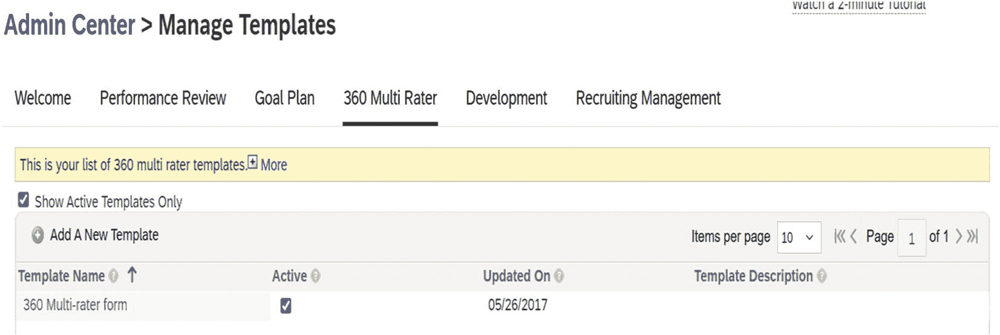

**图 12-8** 配置 360 评估反馈表单

在显示的页面上，点击“常规设置”。在“常规设置”中，您可以提供模板的名称和描述。在“常规设置”中，您可以配置“路线图”和“评分量表”设置。对于我们的讨论，我们将配置我们之前讨论过的路线图 `360 - 员工与经理流程`。如果您希望 360 评估流程的参与者保持匿名，您可以选择“在 360 报告功能中启用匿名”选项。

> **注意**
>
> “路线图”设置和“评分量表”设置都应在“常规设置”中预先配置。路线图是通过执行配置步骤“管理路线图”来配置的，而评分量表则是在“评分量表”屏幕上配置的。

完成“常规设置”部分的配置后，点击“编辑字段和部分”部分。

我们要回顾的第一个部分是“员工信息”。在 360 评估反馈表单中，“员工信息”部分将显示与员工相关的数据。在“管理模板 – 员工信息”部分，我们可以命名该部分的名称、输入该部分的描述，并选择员工数据的哪些详细信息（参见图 12-9）应显示在 360 评估反馈表单中。

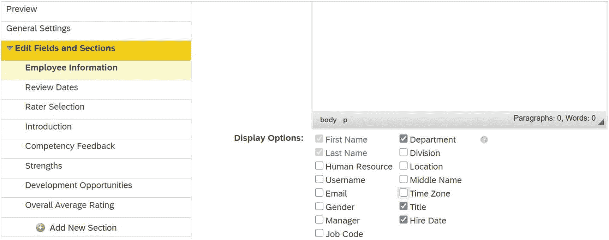

**图 12-9** 配置员工信息部分

点击“保存”以保存您的更改。

> **注意**
>
> 默认情况下，员工的名字和姓氏将显示在 360 评估反馈表单中。此设置无法更改。

在 360 评估反馈表单中，“评估日期”部分将显示您在启动表单时输入的日期。在“管理模板 - 评估日期”部分，您可以命名该部分，以及输入该部分的描述（参见图 12-10）。

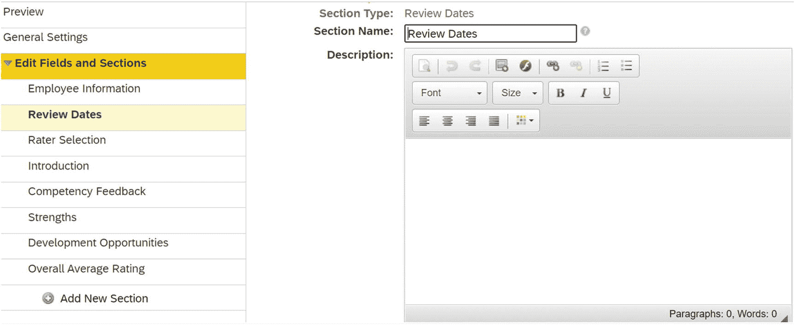

**图 12-10** 配置评估日期部分

在 `Rater Selection`（评估者选择）部分，您可以配置将被分配到表单的不同评估者。您可以更改默认的节名称，并在需要时输入描述。此部分配置的评估者默认会被分配到 360 度评估反馈表单，并且您配置的评估者标签会显示在分配给评估者的角色旁边。

如图 12-11 所示，您可以将直接下属、经理、二级经理、矩阵经理、HR 人员以及这些参与者的多个层级作为指定角色添加到流程中。

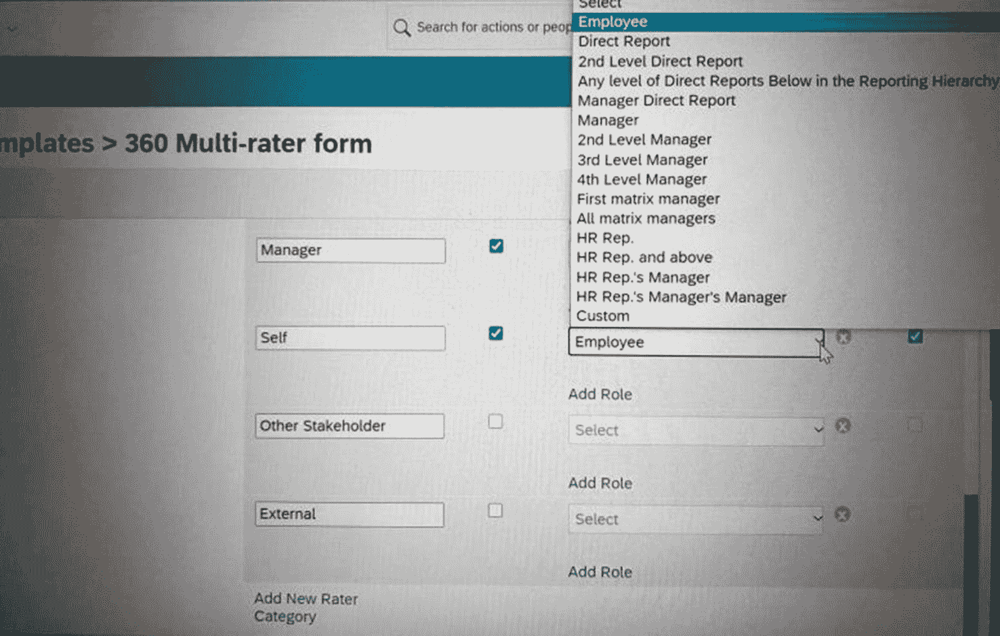

**图 12-11** 配置评估者选择部分

- 在 `Rater Category Name`（评估者类别名称）列中，您可以输入分配给流程的角色的标签。此标签会显示给用户（员工/经理/HR），他们可以选择想要联系的参与者列表以获取反馈。

- 当您选择 `Auto Include in Form`（自动包含在表单中）时，您定义的角色将在表单启动时自动包含在流程中。

- 在 `Role`（角色）列中，您定义需要包含在流程中的角色。配置的角色会在表单发送给评估者进行反馈时自动分配给他们。此处配置的角色将帮助用户（员工/经理/HR）确定谁可以被选择以联系获取反馈。

- `Do not allow user to remove`（不允许用户移除）列用于确定用户是否有权从参与者列表中移除已定义的角色。如果您为定义的角色选择了此列，那么该角色将强制包含在 360 度评估反馈流程中。

在 `Manage Templates – Introduction`（管理模板 – 介绍）部分（见图 12-12），您可以输入关于 360 度评估反馈表单以及流程中对参与者期望的一些介绍文本。

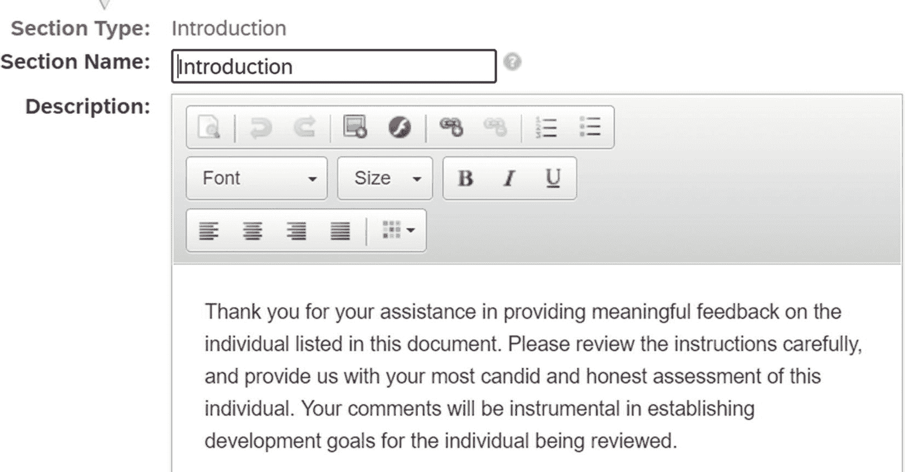

**图 12-12** 介绍部分

**提示**

在介绍部分，客户可以提供一份文档的链接，该文档详细说明了 360 度评估反馈流程的内容，以及该流程如何在企业范围内用于支持员工的发展愿景。

在 `Manage Templates – Competency Feedback`（管理模板 – 能力反馈）部分，您可以配置要包含在 360 度评估反馈表单中的能力项。能力项可以设置为 `Core`（核心）或 `Job Specific`（特定岗位）。与配置其他部分类似，您可以输入节名称和该节的介绍。

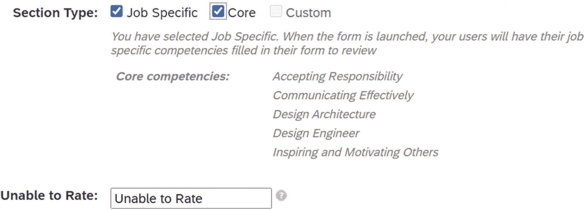

**图 12-13** 配置能力部分

- 在 `Section Type`（节类型）中（见图 12-13），您可以选择是向表单添加 `Job Specific`（特定岗位）、`Core`（核心）还是两种类型的能力项。

**注意**

`Core`（核心）和 `Job Specific`（特定岗位）能力项应在系统中配置并可用，以便您在模板中使用。

**注意**

如果您选择 `Job Specific`（特定岗位），则在表单启动时，系统会在表单中填充特定于岗位的能力项。能力项是作为 `Job Profile Builder`（岗位档案生成器）配置的一部分添加的。更多信息请参见第 3 章。

- `Unable to Rate`（无法评级）字段是评定量表的一部分，但不包含在总体评分中。`Unable to Rate` 等同于 `N/A`。您可以使用系统默认的 `Unable to Rate`，或将其更改为 `N/A` 或您想要显示的任何文本。`Unable to Rate` 评级意味着参与者没有足够的信息，或者拒绝对该特定能力项进行评级。

点击 `Unable to Rate`（无法评级）字段下方显示的 `Show advanced options`（显示高级选项）。这将显示额外的配置选项（见图 12-14）。

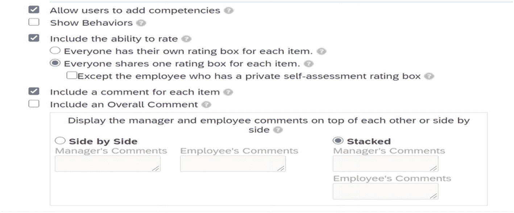

**图 12-14** 配置能力部分的进阶选项

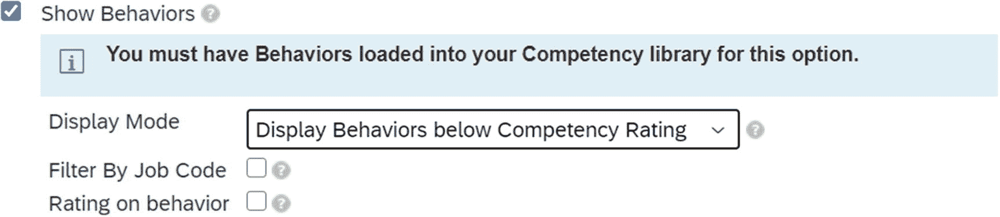

**图 12-15** 配置能力部分的行为描述

- `Allow users to add competencies`（允许用户添加能力项）：如果选择此选项，将允许用户能够从能力项列表中添加能力项到表单中。

- `Show Behaviors`（显示行为描述）：如果选择此选项，并且所选能力项关联了行为描述，则该行为描述将显示在表单中。

    如果选择此选项，系统将显示额外的选项（见图 12-15）。

- `Display Mode`（显示模式）：在显示模式下，您可以选择在能力评级的上方或下方显示行为描述。默认情况下，行为描述将显示在能力评级下方。

- `Filter By Job Code`（按岗位代码筛选）：如果您只想显示特定于岗位的行为描述，请选择此选项。

- `Rating on behavior`（对行为描述评级）：如果您想启用对与能力项关联的行为描述进行评级的选项，请选择此选项。

### 配置能力部分的评级与评论

- `Include the ability to rate`（包含评级能力）：如果您希望评估者使用模板中配置的评定量表对能力项（以及启用时的行为描述）进行评级，请选择此选项。如果未选择此选项，则评估者将无法对能力项进行评级。

当您选择`Include the ability to rate`（包含评级能力）选项时，系统将显示额外的选项（见图 12-16）。

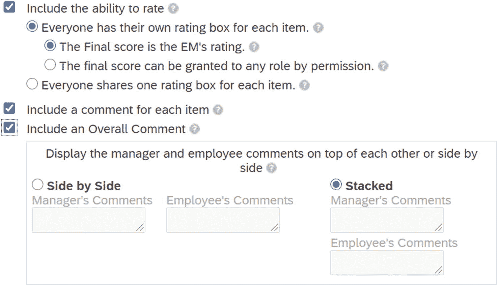

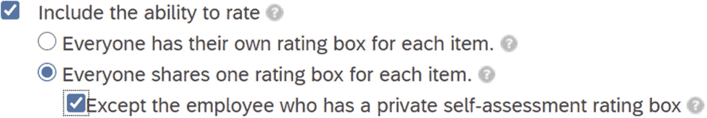

- `Everyone has their own rating box for each item`（每个人在每个项目上都有自己的评级框）：如果选择此选项，每个评估者都将拥有自己的评级框。评估者的评级框将显示在员工自评评级框旁边。选择此选项后，系统将显示额外的选项。
    - `The Final score is the EM’s rating`（最终分数为员工经理的评级）：当选择此选项时，表单将显示评估者提供的评级。系统会将员工经理（角色：EM）提供的分数视为最终分数。
    - `The final score can be granted to any role by permission`（最终分数可通过权限授予任何角色）：当选择此选项时，您可以配置将哪个角色提供的评级视为最终分数。

> **注意** 大家各自拥有对每个项目的评级框是 360 度评估反馈流程中的建议做法。这为经理和当事人（如果有权限）提供了审查其他评估者提供的反馈的机会。

- `Everyone shares one rating box for each item`（每个人在每个项目上共享一个评级框）：如果选择此选项，表单中只会显示一个评级框。哪些角色可以访问评级框可以在模板中进行权限设置。如果评级框由多个评估者共享，则最后输入的分数将被计为该能力项的最终分数。选择此选项后，系统将显示一个额外的选项（见图 12-17）。

好的，作为一名高级文档工程师和翻译员，我将遵循您的注意事项和示例，将给定的英文文本翻译成中文。

- 除拥有私人自评评分框的员工外： 如果您选择此选项，系统将为员工显示一个独立的评分框，员工可使用该框进行自我评估。
- 为每个项目添加评论： 如果选择此选项，每个能力项将显示一个评论框。
- 添加总体评论： 如果选择此选项，表单将显示一个章节评论框。
- 并排或上下显示经理和员工评论： 在此部分中，您可以配置评论框的显示方式。两个选项是并排显示或上下堆叠显示（参见图 12-16）。

### 配置摘要部分

我们将配置的最后一个部分是“摘要”部分。此部分提供表单中所有评估章节的汇总概述。摘要部分将提供每个评估部分的平均分数，以及在表单级别的总体分数。与前面的部分类似，在摘要部分中，您可以在需要时输入自定义名称，也可以使用系统默认值。您还可以选择提供该部分的描述。

此部分可配置的字段如下所示（参见图 12-18）：

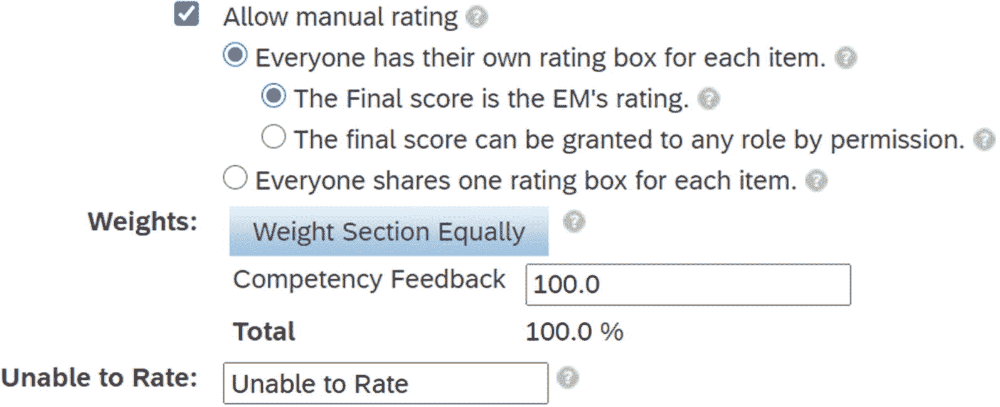

- 允许手动评分： 如果选择此选项，表单将提供一个手动输入总体得分的选项。此总体得分将覆盖系统生成的总体评分。但是，如果选择此选项，系统将把手动输入的评分视为最终分数。因此，即使您确定系统生成的评分为最终分数，您仍然需要手动输入一个可能与系统生成的总体得分相同的分数。

选择此选项后，系统将显示附加选项：
    1. 每个人都有自己的每个项目的评分框
    2. 每个人共享一个每个项目的评分框

勾选第一个选项将显示附加选项：
    - (a) 最终评分是员工经理的评分
    - (b) 最终评分可以通过权限授予任何角色

所有这些选项的行为与我们之前在能力部分讨论的类似。

- 权重： 如果您单击`权重平均分配`按钮，系统将自动平均分配每个评估部分的权重，使其总和为 100%。在我们的讨论中，我们只有一个评估部分：能力反馈。因此，系统为该部分提供了 100.0。
- 无法评分： 此行为与我们之前在能力部分讨论的类似。

> **提示**  
> 我们可以重新排列模板中不同部分的显示顺序。要将某个部分移动到不同的顺序，请将鼠标悬停在该部分名称上。系统将显示“三个垂直点”（参见图 12-22）。如果将鼠标移到这三个垂直点上，光标将变成一个方向十字。抓住它并将其移动到您希望该部分显示的位置。

### 添加新部分

您还有一个向模板`添加新部分`的选项。此新部分必须属于以下部分类型之一：附加评论、能力、年中、目标或签名（参见图 12-19）。新部分的配置将与我们之前在前面的部分中讨论的类似。

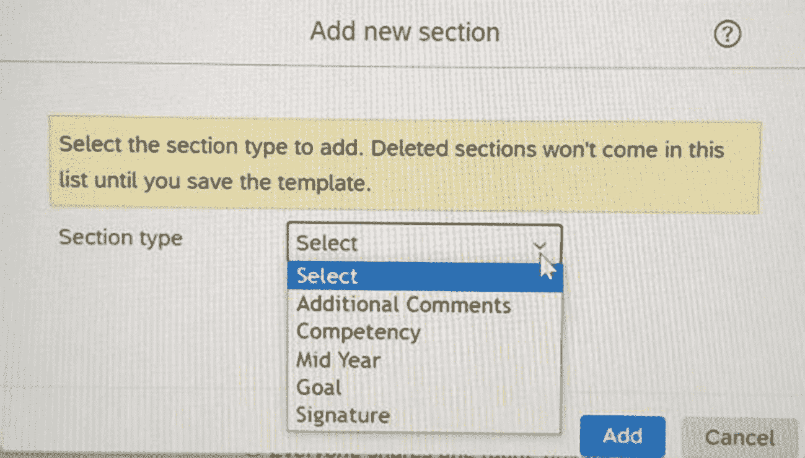

> **注意**  
> 我们通常添加一个新部分来捕获未在交付部分中捕获的评论或评分。例如，我们可能希望评估者对员工在工作特定能力或核心能力方面的表现进行评分。或者，我们可能会添加一个部分来捕获员工及其经理的签名，以完成 360 度评估反馈表。

就我们的讨论而言，我们将添加一个部分；类型为`目标`作为新部分。与其他部分类似，我们可以输入新的部分名称，并提供部分描述。

在部分类型中（参见图 12-20），您可以在目标和个与发展计划之间进行选择。

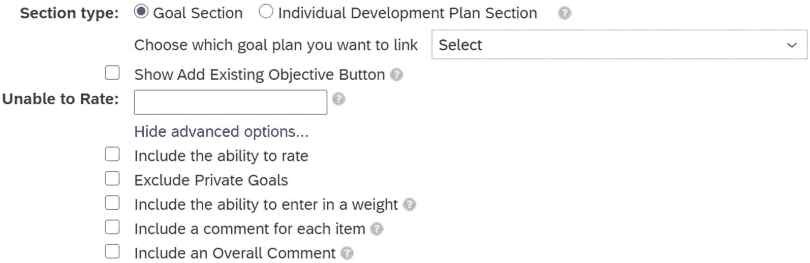

如果我们选择`目标部分`，下拉菜单“选择您要链接的目标计划”将显示系统中处于活动状态的目标计划。

如果我们选择`个人发展计划部分`（参见图 12-21），下拉菜单将显示系统中可用的活跃发展计划。

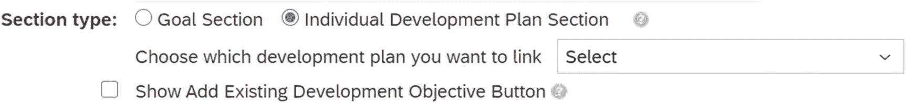

如果您希望评估者能够对目标进行评分，请选择`包含评分功能`选项。如果您不希望私人目标显示在 360 度评估反馈表中，请选择`排除私人目标`选项。如果您希望将目标权重计入分数计算，请选择`包含输入权重功能`选项。如果您希望评估者为每个项目添加评论，请选择`为每个项目添加评论`选项。如果您希望评估者提供总体评论，请选择`添加总体评论`选项。保存您的更改。

> **提示**  
> 如果您需要评估者对目标和个人发展计划都进行评分，则创建两个不同的部分。一个部分可用于目标，第二个部分用于个人发展计划。

### 重新排列部分顺序

我们可以重新排列模板中不同部分的显示顺序。要将某个部分移动到不同的顺序，请将鼠标悬停在该部分名称上。系统将显示一个点状网格。如果将鼠标移到点上，光标将变成一个方向十字（参见图 12-22）。抓住它并将其移动到您希望该部分显示的位置。

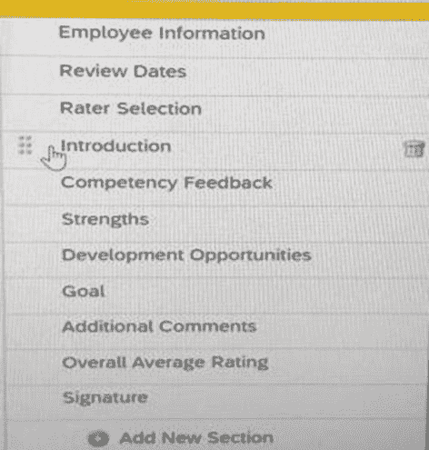

### 表单预览

您可以通过单击`预览`来预览您已配置的模板（参见图 12-23）。在配置期间或启动表单之前预览表单，将帮助您理解和直观地了解 360 度评估反馈表的外观。

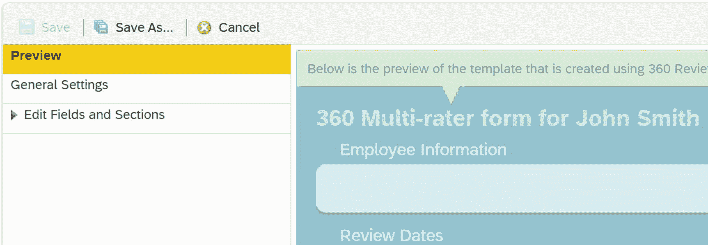

### 表单模板设置

模板的管理设置也可以在`表单模板设置`部分中进行配置。您可以通过执行`表单模板设置`来访问配置屏幕。配置屏幕`表单模板设置`的登陆页面将显示系统中已配置并可用的所有表单。从显示的表单列表中，选择您要配置的 360 度评估反馈模板。登陆页面将显示可供配置的管理设置（参见图 12-24）。

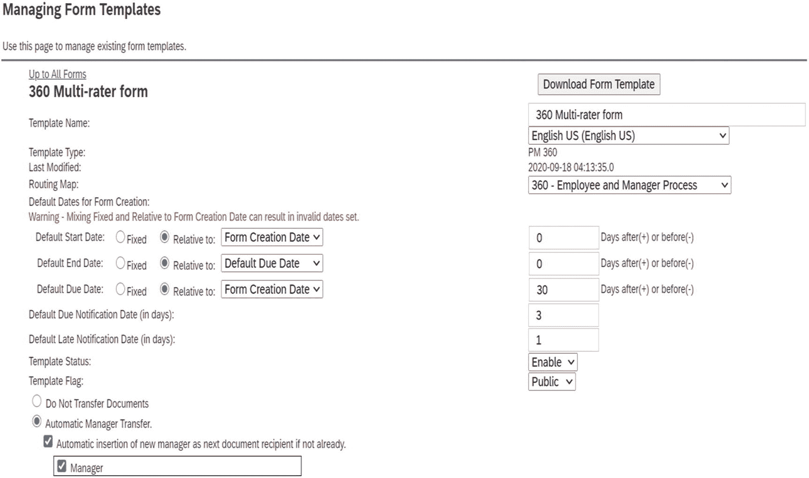

## 访问表单模板设置

您可以在"管理模板"配置屏幕中，通过模板访问"表单模板设置"。在"管理模板 ➤ 表单模板"中显示的模板中，单击"常规设置"，滚动到该部分末尾。"高级设置"链接会将您带到"表单模板设置"配置屏幕。

在本节（参见表 12-3）中，我们将回顾 360 度评估反馈表单的特定管理设置。（注意：关于"表单模板设置"部分的详细讨论，请参阅第 6 章"绩效管理简介"及相关章节。）

### 表 12-3 表单模板设置管理设置

| 管理设置 | 描述 |
| :--- | :--- |
| **模板名称** | 这是表单启动时将显示的名称。您可以根据需要以不同语言配置模板名称。**注意：** 如果表单启动后模板名称发生更改，则新名称仅反映在名称更改后启动的表单上。任何正在进行的表单都不会显示新名称。 |
| **模板类型** | 这是一个只读字段。模板类型反映了为其配置模板的流程。 |
| **路由映射** | 此处显示我们之前配置的路由映射。如有需要，您可以更改路由映射。单击下拉菜单将显示系统中所有可用的已配置路由映射。 |
| **模板状态** | 此字段有两个值：`Enable` 和 `Disable`。如果模板处于活动状态，则其状态为 `Enable`。如果您不再使用该模板，请将状态更改为 `Disable`。 |
| **当旧经理是流程负责人时，将进行中的文档的自动流程负责人更改为新经理（仅适用于 360 度评估）** | 在 360 度评估反馈过程中，如果员工的经理发生变更，选择此选项将自动将进行中的表单转移给新经理。新经理也被标记为该流程的新流程负责人。**注意：** 您也可以在"更改 360 度流程负责人"配置屏幕上更改 360 度评估反馈表单的流程负责人。 |
| **当旧经理是流程负责人时，将已完成文档的自动流程负责人更改为新经理（仅适用于 360 度评估）** | 选择此选项将自动将完整的文档转移给新经理。新经理也被标记为该流程的新流程负责人。 |
| **将 360 度文档从旧经理的收件箱文件夹转移到新经理时，不要自动拒绝旧经理在评估中的参与者表单** | 选择此选项将允许将旧经理正在进行的参与者表单转移给新经理。**注意：** 当表单转移给新经理时，新经理可以联系旧经理（离线方式）并收集他们的意见/反馈，以评估正在进行的表单。 |
| **当转移处于评估阶段的 360 度文档时，将新经理添加为参与者（如果新经理是被移除的参与者，他们将被重新添加）** | 选择此选项将把新经理添加为进行中表单的参与者。 |
| **在 360 度临时报告中隐藏已删除用户的记录（注意：此配置后需要报告同步，以确保现有表单中的已删除用户不会显示在 360 度评估临时报告中。请前往 `Company Settings` 并在 `360 Multi-Rater Subject` 中运行同步）** | 选择此选项将在"报告中心"生成报告时隐藏已删除用户的记录。 |
| **详细 360 度报告权限控制：启用详细 360 度报告权限，适用于：** | 启用此选项将在 360 度评估反馈表单上显示"详细 360 度报告"链接。您可以仅为特定角色启用此选项。 |
| **在 360 度表单中为以下角色隐藏 `decline to participate` 按钮：** | 您可以启用此选项，仅为选定的角色隐藏 `decline to participate` 按钮。**注意：** 如果您选择了所有角色，则该按钮将不会显示在表单的所有角色中。 |
| **在 360 度评估开始后，为以下角色启用添加新参与者：** | 您可以启用此选项，为选定的角色提供 `add new participants` 的选项。 |
| **为以下角色启用 `Send Back`：** | 当您为选定的角色启用此选项时，他们将看到 `Send to Previous Step` 选项。当参与者单击该选项时，系统会将表单发回给路由映射中的先前参与者，以获取更多输入。 |
| **为以下角色启用发送提醒电子邮件：** | 启用此选项后，系统将发送提醒电子邮件以完成流程。**注意：** 要使用此选项，您应该启用配置屏幕 `E-Mail Notification Templates Settings` 上的 `Document Due Notification` 开关。要向外部参与者发送提醒电子邮件，应在同一配置屏幕上启用 `360 Document Evaluation Notification for External Participant` 开关。 |
| **在 360 度评估开始后，为以下角色启用移除参与者：** | 当为进行中的表单启用此选项时，选定的角色将能够从 360 度评估反馈流程中移除参与者。 |
| **从详细 360 度报告中启用差距分析视图** | 启用此选项后，系统将显示差距分析视图。**注意：** 差距分析允许您比较两组评分者之间的评分，并了解评分中的显著性。 |
| **从详细 360 度报告中启用排名视图** | 启用此选项后，系统将显示排名视图。**注意：** 排名视图使您能够在一个列表中查看所有类别的能力或行为。类别可以按从高到低或从低到高排序。 |
| **详细 360 度报告权限控制：启用详细 360 度报告权限，适用于** | 选中此选项后，为其启用（并授予权限）的角色将在 360 度评估反馈表单上看到"详细 360 度报告"链接。 |
| **详细 360 度报告权限控制：使用表单 XML** | 启用此选项后，在模板 XML 中，您可以授予在管理设置"启用详细 360 度报告权限，适用于"中未定义的角色权限。 |
| **在详细 360 度报告中按子项评分计算项目评分** | 启用此选项后，所有评分通过平均所有部分来计算。 |
| **以表单模板中设置的小数位数在详细 360 度报告中显示评分** | 小数位数由模板中的配置设置决定。 |
| **启用 360 度添加外部参与者部分** | 启用此选项后，外部参与者部分将显示在表单中。 |

## 电子邮件通知

在本节（参见表 12-5）中，我们将回顾需要在系统中激活的 360 度评估反馈表单特定的电子邮件通知。您可以通过执行配置屏幕 `E-Mail Notification Template Settings` 来访问该配置。

以下通知默认启用且无法禁用：

*   [360 度高管评审表变更通知](https://pmsalesdemo8.successfactors.com/acme?bplte_company=SFPART050339&fbacme_o=admin&_s.crb=GPg8QXNmsWhlhQzGFITh7TM1JomPz459jJcfH93LdXw%25253d&pess_old_admin=true&ap_param_action=sys_notification&nts_action=PERFORMANCE_360_SUPER_HR_MODIFIED_EMAIL)
*   [PM 360 度高管评审表批量路由通知](https://pmsalesdemo8.successfactors.com/acme?bplte_company=SFPART050339&fbacme_o=admin&_s.crb=GPg8QXNmsWhlhQzGFITh7TM1JomPz459jJcfH93LdXw%25253d&pess_old_admin=true&ap_param_action=sys_notification&nts_action=PERFORMANCE_360_SUPER_HR_MASS_ROUTE_EMAIL)

**注意**

在`<required-fields>`部分之后和`<default-item-comments-label>`部分之前添加了`<calibration-mode/>`。注意：请确保在 XML 模板中正确放置此代码，以获得校准功能。

```xml
<required-fields>
   ...
</required-fields>
<calibration-mode/>
<default-item-comments-label>
   ...
</default-item-comments-label>
```

在结束关于校准的讨论之前，有几点需要注意。

- 校准模式不支持开放式问题。
- 校准模式仅支持下拉式评分量表。
- 在校准模式下，无法编辑/更改项目级评论。

## 评审后阶段

在 360 度评审反馈过程中，有时被评审人或其经理会认为迄今为止收到的反馈不够充分，没有涉及正确类型的参与者，或者忽略（未包含）了一位关键的参与者，或者该参与者现在可以被包含到流程中。

在评估完成之后，但在开始完成或签名步骤之前，流程负责人可以执行以下操作：

- 在表格中添加更多的参与评审人
- 将表格退回给一个（或多个）参与者

在评审后阶段，拥有相应权限的角色可以添加新参与者或移除选定的参与者。当您点击`添加新参与者`时，系统会显示一个页面，您可以在其中添加新的参与者。您可以添加内部或外部参与者。同样，点击`移除选定的参与者`会将该参与者从流程中移除。

在经理评估阶段，被评审人的经理可以将表格退回给参与者，要求其对反馈（包括评论和/或评分）进行复核。当经理点击`召回`按钮（见图 12-27）时，表格将退还给参与者进行重新评估。经理还会看到一个可选的评论框，他们可以在其中输入评论以说明其关注点。

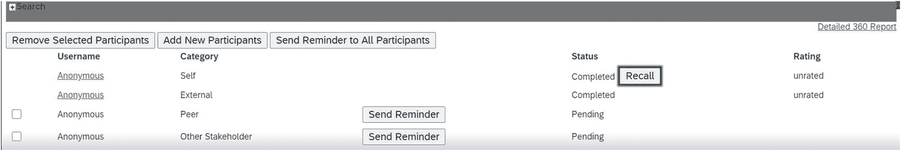
**图 12-27** `添加或移除参与者`以及将表格退回给参与者

## XML 配置

在本节中，我们将审查特定于 360 度评审反馈流程的 XML 配置。

> **注：** 我们在“绩效管理 XML 与翻译”一章中详细审查了 XML 配置。360 度评审反馈流程的 XML 标签与绩效表格中使用的标签类似。

### 添加自定义能力

为了能够向 360 度评审反馈表添加自定义能力，只能通过 XML 进行配置。如果您在配置屏幕`管理模板`上查看模板中的能力部分，您会注意到自定义复选框是灰色的（见图 12-28）。

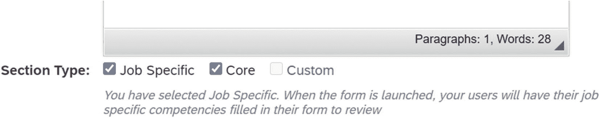
**图 12-28** 添加自定义能力的功能是灰色的。

在您配置 XML 后，自定义复选框将被启用。要配置 XML，请添加这段代码：

```xml
<competency-sect>
  <!-- 在此添加代码 -->
</competency-sect>
```

这段代码需要添加到`<competency-sect>`中。代码需要添加在`</fm-sect-scale>`之后和`<meta-grp-label>`之前。请参考以下代码，了解我们为之前配置的模板所编写的完整代码段：

```xml
<fm-comp-sect>
  <fm-comp-title>说明：请针对与表格上显示的姓名相关的人，对以下陈述做出回应。请选择最能描述该个人的评分。</fm-comp-title>
  <fm-comp-options>
    <fm-comp-option>
      <fm-comp-option-value>1.0</fm-comp-option-value>
      <fm-comp-option-value>1.5</fm-comp-option-value>
    </fm-comp-option>
  </fm-comp-options>
  <fm-comp-id>19901</fm-comp-id>
  <fm-comp-flag>*</fm-comp-flag>
  <fm-comp-category>EM</fm-comp-category>
  <fm-comp-visible>*</fm-comp-visible>
  <fm-comp-weight>100.0</fm-comp-weight>
</fm-comp-sect>
```

将配置好的 XML 导入系统（关于如何更新绩效表格 XML 的更多信息，请参见第 10 章）。导入 XML 后，查看模板中的能力部分。您会注意到自定义复选框现已启用。

> **注：** 能力 ID `19901`（参见标签`<fm-comp-id>`）指的是我们实例中使用的能力的 ID。此 ID 必须是有效的 ID；否则，系统将抛出错误“在您的一个能力部分中发现了无效的能力 ID。请打开文件并验证系统中是否存在该能力。”如果您的实例中存在职位资料构建器，您可以通过执行配置屏幕`管理职位资料内容`来获取能力 ID。更多信息请参见第 3 章。

### 让经理可见 360 度名称，对其他人匿名

360 度评审反馈的 XML 配置为表单中可维护的匿名级别提供了灵活性。在我们的讨论中，我们将让评分作者对经理可见，而对包括员工在内的所有其他评分者匿名。

添加以下代码：

```xml
<meta-cat type="360-anon-for">
  <meta-cat-value>*</meta-cat-value>
  <meta-cat-visible>*</meta-cat-visible>
  <meta-cat-category>EM</meta-cat-category>
</meta-cat>
```

该代码需要添加到 XML 的 meta 部分，并且位于`<meta-360-rollup-category-name>`之前。请参考以下代码，查看我们如何添加特定代码（如前所述）：

```xml
<meta>
  <meta-cat type="360-anon-for">
    <meta-cat-value>*</meta-cat-value>
    <meta-cat-visible>*</meta-cat-visible>
    <meta-cat-category>EM</meta-cat-category>
  </meta-cat>
  <meta-360-rollup-category-name>...</meta-360-rollup-category-name>
</meta>
```

使用此代码，在评估和完成阶段（参见我们指明阶段的标签`route-step`），经理将看到评分者及其评分，而对于所有其他角色，评分将被隐藏。

> **注：** 如果在 XML 中已经存在“自我”的`meta-cat`标签，请删除该代码，以便您可以将新代码添加到 XML 数据模型中。否则，系统将抛出错误，指出“自我”的`meta-cat`存在重复。

### 配置最小/最大评估者数量

在 XML 数据模型中，我们可以配置最小和最大评估者数量。如果表单中未遵守此设置，我们还可以配置警告或错误消息。在`<rater-config>`部分，我们可以配置最小值和最大值以及要计入的消息。

您可以参考以下代码并根据您的业务需求进行更改：

```xml
<rater-config>
  <rater-min>4</rater-min>
  <rater-max>6</rater-max>
  <rater-min-message>您需要至少指定 4 名评估者。</rater-min-message>
  <rater-max-message>您最多可以指定 6 名评估者。</rater-max-message>
</rater-config>
```

在这段代码中，我们设定最小评估者数量应为 4。如果数量少于 4，则表单将显示一条警告消息。我们将最大评估者数量配置为 6。对此，我们配置了一条错误消息。

我们还可以配置每个参与者类别需要分配的最小和最大评估者数量。此配置在 meta 部分完成。请参考以下代码：

```xml
<meta>
  <meta-rater-config cat="direct-report">
    <meta-rater-min>0</meta-rater-min>
    <meta-rater-max>20</meta-rater-max>
  </meta-rater-config>
</meta>
```

在这段代码中，我们配置了属于“直接下属”类别（以及“同事”、“经理”、“其他利益相关者”、“外部”等其他类别）的评估者最多为 20 人。我们没有配置所需的最小数量。

> **注：** 在配置屏幕`表单模板设置`上，点击您正在处理的模板。在显示的页面上，有一个名为`参与者阈值控制`的配置开关。通过此开关，您可以控制在参与者级别还是项目级别排除响应。当您选择`参与者级别`开关时，您可以排除整个表单的响应。当您选择`项目级别`开关时，您可以排除表单中某些部分的响应。您可以参考 KBA 2087236《参与者阈值控制 - 360 度评审》以获取如何在模板设置中添加阈值控制的具体示例。

### 与职业发展规划集成

我们可以在 XML 数据模型中配置与职业发展规划的集成（见图 12-29）。在标签`<sf-360>`中，将选项`embed-cdp-goals`设置为`"true"`。请参考提供的代码：

```xml
<sf-360 embed-cdp-goals="true"/>
```

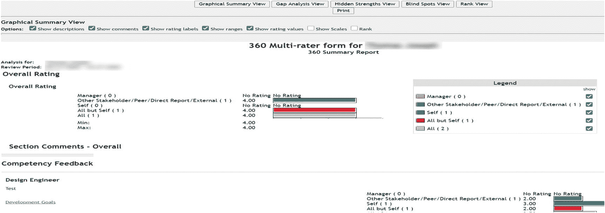
**图 12-29** 包含发展目标链接的详细 360 度评审报告

如图 12-29 所示，当您点击`Development Goals`（发展目标）时，将弹出一个显示`Add Development Goal`（添加发展目标）按钮的窗口（见图 12-30）。点击此按钮后，将显示默认的`CDP`，您可以在其中为员工创建发展目标。

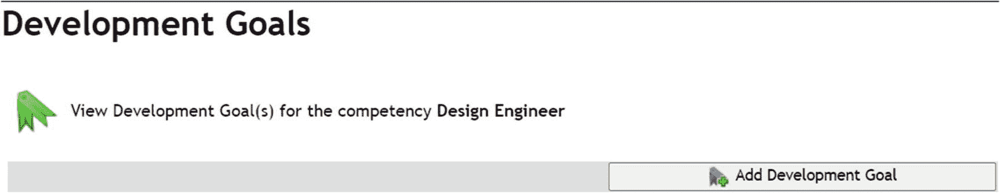
**图 12-30** `添加发展目标`

`Detailed 360 report`（详细 360 反馈报告）的链接显示在表单的`Evaluation Summary`（评估摘要）部分中（图 12-31）。

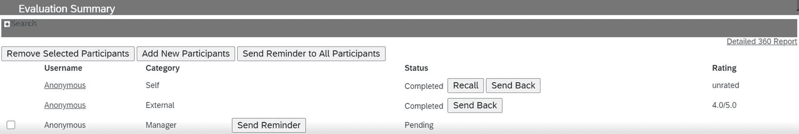
**图 12-31** 包含`Detailed 360 report`（详细 360 反馈报告）链接的`Evaluation Summary`（评估摘要）部分

要使此集成正常工作，请确保完全满足以下前提条件：
* 实例中应已配置 1 个`CDP`计划且该计划可用。
* 如果实例中存在多个`CDP`计划，请确保其中一个为默认计划。

> **注意**
> 如果实例中存在多个`CDP`计划，您无法指定使用哪一个`CDP`计划。因此，前提条件之一是必须将其中一个标记为默认计划。

在配置此集成之前，请考虑以下几点：
* 将`CDP`与`360 Review feedback review`（360 度反馈评审）集成，允许参与者查看或为员工添加发展目标。
* 此集成不允许配置访问`CDP`的权限。因此，如果配置了该集成，任何有权访问`Detailed 360 report`（详细 360 反馈报告）的参与者都可以访问员工的`CDP`。
* `CDP integration`（CDP 集成）在`Detailed 360 report`（详细 360 反馈报告）中访问。此集成仅在`Graphical Summary View`（图形摘要视图）、`Gap Analysis View`（差距分析视图）和`Rank View`（排名视图）中可用。在`Hidden Strengths View`（隐藏优势视图）或`Blind Spot View`（盲点视图）中不可用。

## 与学习的集成

我们可以将`SuccessFactors Learning`与`360 Review feedback`（360 度反馈）集成。要进行配置，您需要访问`Provisioning`（配置）。

在`Provisioning`（配置）中，点击`Form Template Administration`（表单模板管理）。在显示的页面上，点击您想要与`LMS`集成的`360 Review feedback`（360度反馈）模板。在显示的页面上，滚动到`Edit Form Attributes`（编辑表单属性）部分。在该部分中，点击`Enable Learning Integration`（启用学习集成）开关（图 12-32）。请记住保存您的配置更改。

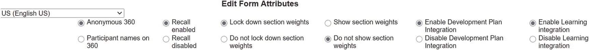

图 12-32 `Enable Learning Integration`（启用学习集成）

此集成起作用需满足以下条件：

*   必须在环境中启用并可用`LMS`。
*   参与者和主体必须拥有访问`LMS`的权限。

如果启用了此集成，`Assign Learning`（分配学习）链接将出现在各能力描述下方。

**提示**
作为练习，请检查您是否可以在`XML`数据模型中启用/禁用此集成。如有需要，可参考“与职业发展规划集成”一节中提供的代码。

## SAP Fiori 版本

`360 Review feedback`（360度反馈）表单提供`SAP Fiori`版本。该版本已正式发布 (GA)，但功能受限。`Fiori`版本由`SAP UI5`技术支持，并提供直观的用户体验。您可以通过安装`Upgrade Center`（升级中心）中提供的新UI来升级到`SAP Fiori`版本。您可以通过在搜索框中执行配置屏幕`Upgrade Center`（升级中心）来访问它。在显示的页面上，可选升级中有一个名为`360 Review – SAP Fiori Version (Beta)`（360度反馈 – SAP Fiori版本（Beta））的选项。点击此选项，在显示的页面上（见图 12-33），您将看到升级到`SAP Fiori`版本的选项。

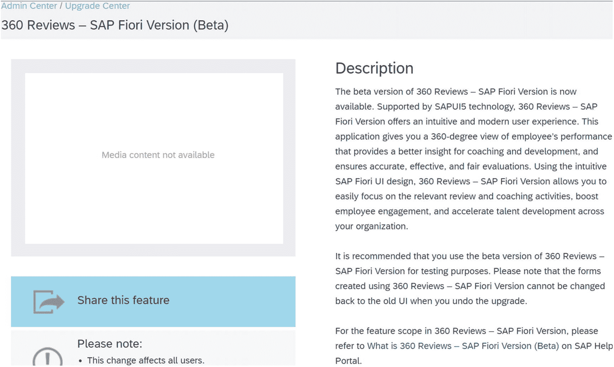

图 12-33 升级到`SAP Fiori`版本（beta）

**注意**
要升级到`SAP Fiori`版本，前提条件是系统中必须已启用并可用`360 Review`（360度反馈）。任何使用旧解决方案配置的模板都需要更新为`SAP Fiori`解决方案。您可以在配置屏幕`Manage Templates`（管理模板）中进行更新。进行中和已完成的表单不受升级影响。升级后，您有最多30天的时间可以回退到旧解决方案。如果您回退到旧解决方案，需要注意以下几点：

*   任何使用`SAP Fiori`版本创建的模板将被系统锁定，无法供将来使用。
*   任何使用`SAP Fiori`版本的表单可以继续使用。但是，这些基于`SAP Fiori`的表单无法回退到旧解决方案。

**提示**
升级后，如果您发现与`OData API`相关的功能未更新，可以刷新缓存。您可以通过执行配置屏幕`OData API Metadata Refresh And Export`（OData API元数据刷新和导出）来访问缓存。

目前，`SAP Fiori`版本不支持旧解决方案中可用的所有功能。从高层面上看，以下功能目前（截至`H1’2020版本`）在`SAP Fiori`版本中不可用：

*   发展目标部分
*   发展目标部分中的学习活动
*   打印功能
*   `EZ rater`（简易评分器）
*   在路线图中添加修改器的功能
*   绩效表单历史记录
*   `360 Review feedback`（360度反馈）表单历史记录

强烈建议您审视自己的业务需求，了解哪些功能可用，并决定是否要升级。在最后几个部分中，我们回顾了`360 Review feedback`（360度反馈）表单的配置。掌握了这些知识后，在下一节中，我们将讨论`360 Review feedback`（360度反馈）表单的部署。

## 部署

在本节中，我们将讨论如何启动表单、内部用户如何访问`360 Review feedback`（360度反馈）表单，以及外部用户如何访问该表单。我们将从启动表单开始回顾。

### 启动表单

负责启动表单的人员（通常是管理员、经理或人力资源团队）可以通过在`Admin Center`（管理中心）或搜索框中执行`Launch Forms`（启动表单）来启动表单。

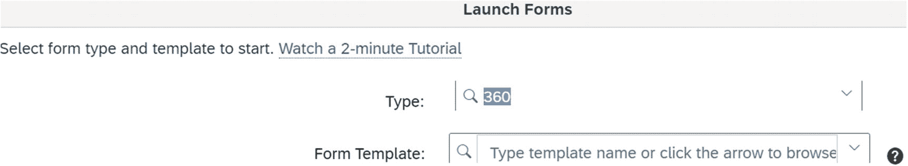

图 12-34 启动表单

*   在显示的页面上（见图 12-34），对于`Type`（类型）字段，选择`360`。在`Form Template`（表单模板）字段中，选择您要用于该表单的模板。点击`Next`（下一步）。
*   在显示的页面上，如果您计划立即启动表单，可以选择“现在”；或者您也可以选择`Later`（稍后）并安排到以后的日期。点击`Next`（下一步）。
*   在显示的页面上，您可以输入要创建表单的评审周期。点击`Next`（下一步）。
*   在显示的页面上，您可以选择要为其创建表单的人群。点击`Next`（下一步）。
*   显示的页面是审核页面，您可以在其中审核之前页面中输入的信息。在此页面上，如果需要，您可以单击选项向员工（表单的主体）发送通知。

**注意** 只有当您启用了[文档创建通知](https://salesdemo.successfactors.eu/acme?bplte_company=SFPART042888&fbacme_o=admin&_s.crb=35m%25252fgA42MPLw0wH3H4uXqb3ufIycpdiOVmYvMcArOb8%25253d&pess_old_admin=true&ap_param_action=sys_notification&nts_action=DocumentCreation)通知时，员工（表单的主体）才会收到通知。您可以通过执行`E-Mail Notifications Template Settings`（电子邮件通知模板设置）来访问此通知。

*   点击`Launch`（启动）以启动表单。

#### 启动并访问 360 度评估反馈表单

您可以通过执行`Launch 360 Review`来启动360度评估反馈表单。执行配置步骤`Launch Forms`时，此配置步骤也会将您带到同一页面。`Launch 360 Review`的着陆页将在“类型”（Type）字段中默认显示“360”（见图 12-34）。

在接下来的部分中，我们将回顾员工和经理如何访问该表单。

### 访问表单

您（外部评估人除外）可以通过单击主页下拉菜单中的`Performance Management`来访问该表单（见图 12-35）。这将带您进入绩效管理收件箱，您将在其中看到分配给您的表单。

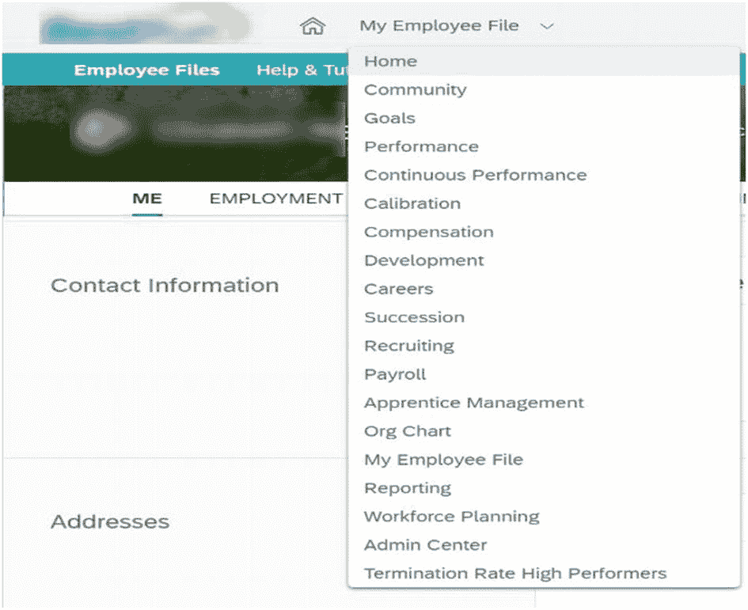

图 12-35：访问 360 度评估反馈表单

**注意**：`Performance Management`选项在您的实例中可能标签不同。要访问360度评估反馈表单，您需要进入绩效管理应用程序的收件箱。

**提示**：如果您在表单启动时收到了通知（请参阅“启动表单”部分），则该通知将包含您可以点击以访问表单的URL。在下一节中，我们将回顾评估对象及其经理如何访问表单的用户体验。

#### 作为评估对象审核表单

员工（评估对象）可以在绩效管理收件箱中访问360度评估反馈表单。通过单击收件箱中显示的链接，员工可以访问表单（见图 12-36），并且员工可以查看已分配的评估人、分配能力、添加新目标以及添加新的评估人。如果员工和经理同意，员工可以删除部分已分配的评估人。

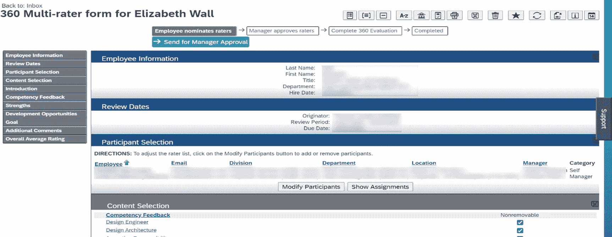

图 12-36：评估对象看到的 360 度评估反馈表单

**注意**：员工可以通过单击`Modify Participants`来添加新的评估人（见图 12-36）。当您单击`Show Assignments`时，您可以快速查看已分配的能力、目标等。要添加外部评估人，您需要添加评估人的电子邮件以及名和姓。添加外部评估人后，您需要选择外部评估人的类别。通常，类别将是`External Rater`或`Other Stakeholder`。

请记住保存您的更改。根据配置的路线图，您可能需要将其发送给经理，以便在完成评估之前批准评估人。

### 作为评估对象的经理审核表单

与其他内部用户类似，评估对象的经理可以从绩效管理收件箱访问该表单。如果配置了通知，经理将收到系统通知，要求他们批准员工分配的评估人。该通知将包含经理可以点击以访问表单的 URL。单击链接将带您进入绩效管理收件箱。

**提示**：需要配置用于通知经理（以及路线图中定义的其他角色）的通知是`Document Routing Notification`。

经理将在主页的“待办事项”部分看到一个名为`Review Performance`的磁贴。经理可以单击`Manager approves raters`链接（见图 12-37），这将直接带经理进入表单。经理可以查看并批准评估人以开始评估。所有评估人都将收到系统通知。

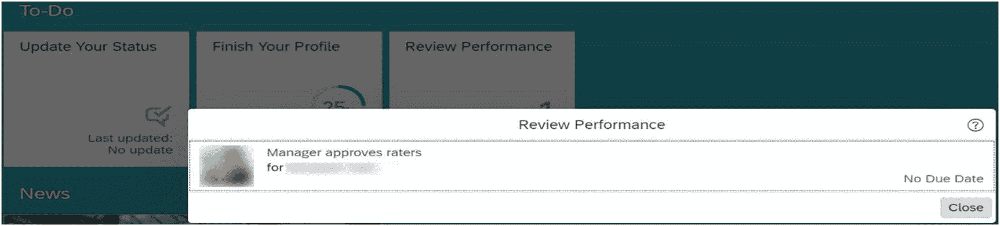

图 12-37：批准评估人的待办事项磁贴

### 作为外部评估人提供反馈/评分

外部评估人将收到一封系统通知（图 12-38），要求他们就评估对象提供意见。

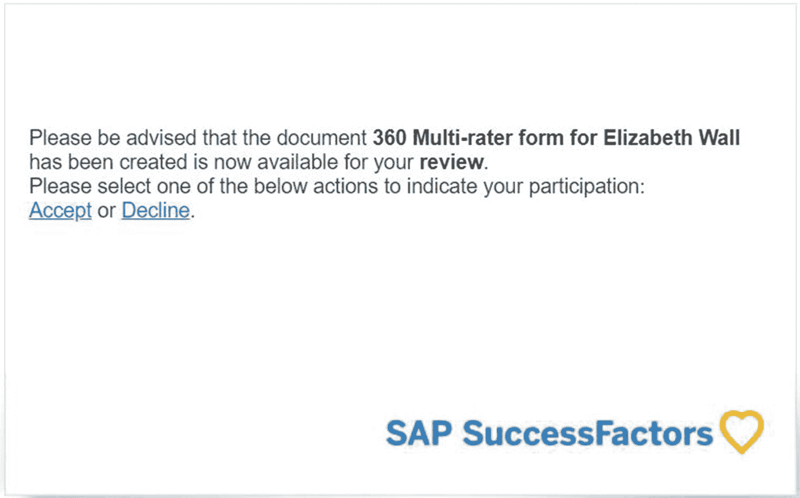

图 12-38：向外部评估人发送电子邮件

外部评估人可以通过单击相应的链接来接受或拒绝该请求。

**注意**：通知中提供的深层链接不可配置。

单击`Accept`将把评估人带到表单，他们可以在其中提供评分和评论。

**注意**：当请求外部评估人在 360 度评估反馈表单中提供意见时，可能会遇到来自 IT 部门及其他方面与 SSO 和安全性相关的阻力。外部评估人将能够绕过已配置的 SSO，并拥有与内部评估人相同的用户体验。当外部评估人登录实例时，他们将无法访问系统中的任何其他功能。

### 作为内部评估人提供反馈/评分

所有内部评估人都可以从绩效管理收件箱访问 360 度评估反馈。当内部评估人访问表单时，系统将显示`Decline to Participate`选项（图 12-39）。

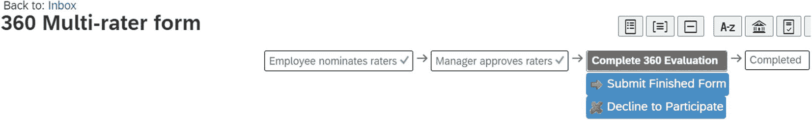

图 12-39：内部评估人看到的 360 度评估反馈表单

如果内部评估人同意参与，他们可以填写评估人信息、提供评论，并单击`Submit Finished Form`。

### 评估对象/经理对表单评分

员工和经理可以从绩效管理收件箱访问该表单以提供评分（员工进行自我评估，或经理对评估对象进行评估）。

### 完成流程

当所有评估人完成评分后，表单将移至完成状态。流程完成后，评估人将收到一份系统生成的通知（见图 12-40），告知他们流程已完成，并且可以在绩效管理收件箱的“已完成”文件夹中访问已完成的表单。（只有内部评估人会收到此通知。）

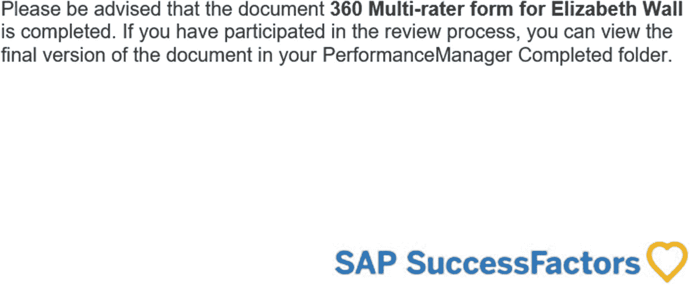

图 12-40：发送给评估人的完成通知

当评估人单击该表单时，他们可以查看由不同评估人提供的评分。评估人的姓名将被隐藏，系统将显示标签`Anonymous`（见图 12-41）。

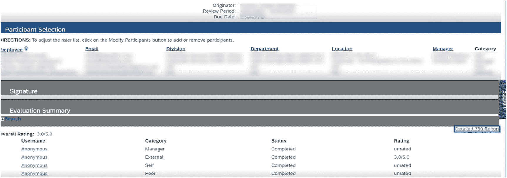

图 12-41：已完成的表单视图

当您单击`Detailed 360 Report`时（见图 12-41），系统将显示一份详细报告，突出显示每个评估人为各项能力提供的评分，以及整体部分评分（见图 12-42）。

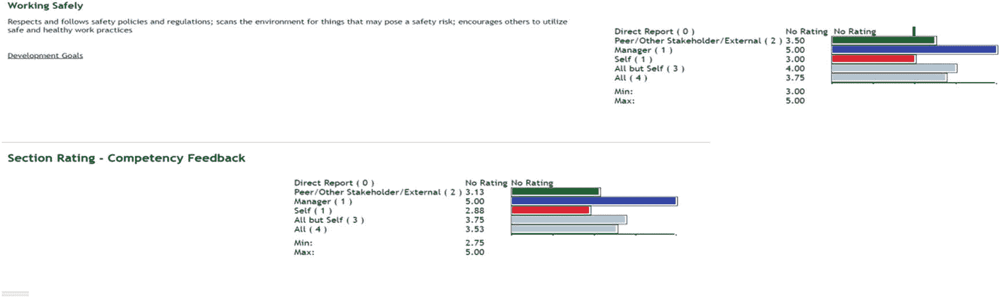

图 12-42：包含评分的详细报告

## 360 度评估反馈流程

您可以点击`图形摘要视图`、`差距分析视图`、`隐藏优势视图`、`盲点视图`和`排名视图`，以不同风格查看报告，并突出显示特定数据点。图 12-43 展示了`自我`（被评估对象/员工）所提供的评分以及所有其他人员的评分（这是所有其他评估者针对每项能力的平均评分）。以绿色显示的差距表明，评估者给予该员工的评分高于其自评分数。

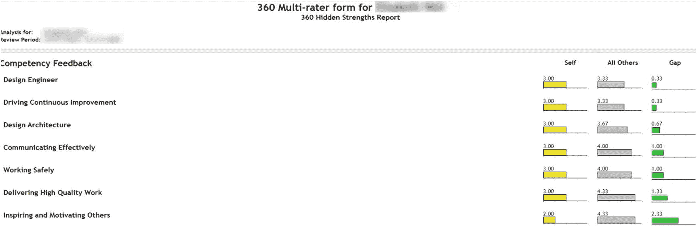

**图 12-43** 隐藏优势报告

## 案例研究

在一个项目中，客户希望了解针对 360 度评估反馈流程的报告功能。在本案例研究中，我们将创建一个测试报告，以了解在`SuccessFactors` 360 度评估反馈流程中可以报告哪些内容。

在`报告中心`，依次点击`新建`、`报表-表格`和`单一域`。在“您希望从哪些数据开始？”字段中，选择`360 度多评估者主体`（参见图 12-44）。

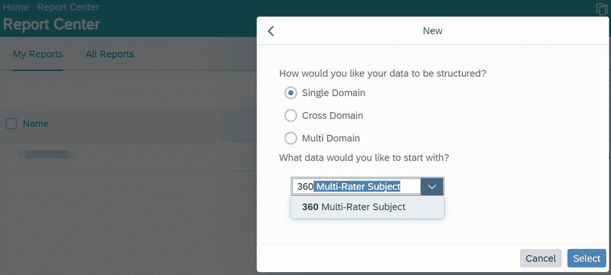

**图 12-44** 创建报告

在报告中，于`数据集`选项中点击`选择模板`，然后选择您要报告的一个或多个模板（图 12-45）。

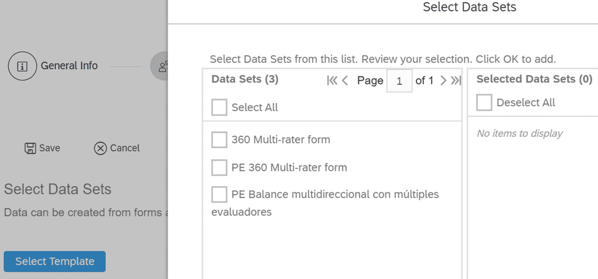

**图 12-45** 选择要报告的模板

在列选项中，选择您希望在报告中显示的列。您还可以为报告添加过滤器。点击`保存`并生成报告。

## 结论

在本章中，我们讨论了 360 度评估反馈流程的功能。我们讨论了如何在`Provisioning`中激活该功能。然后，我们回顾了需要分配哪些权限才能访问`AdminCenter`中提供的不同 360 度评估反馈配置步骤。接着，我们探讨了需要完成的各项不同配置。在配置模板时，我们了解了如何向模板添加章节。利用`XML`，我们学习了如何添加自定义能力，以及如何与`CDP`和`LMS`集成。最后，我们探讨了如何升级到`SAP Fiori`版本，以及该版本目前缺少哪些功能。在下一章中，我们将讨论持续绩效管理（`CPM`）以及如何在您的绩效流程中利用`CPM`。
