# 10. 绩效管理 XML 与翻译

正如我们在目标计划模板中看到的，并非所有配置都可以在 UI 中完成。某些操作、权限和格式设置必须在 `Provisioning` 中的表单模板 `XML` 中完成。在本章中，我们将介绍修改绩效表单模板 `XML` 的一般结构和方法。然后，我们将在相关部分确定仅 `XML` 才需要的配置，并了解只能在 `XML` 中进行的修改类型（除非有特定的 `XML` 专用配置需求，否则此处不会涵盖所有部分类型）。

我们采用逐节分析的方法来检查 `XML`，以避免混淆（即使某个功能的端到端解决方案可能跨越多个部分）。我们首先了解如何访问 `XML`。然后，我们详细查看元（meta）部分。接着，我们总体了解绩效部分的结构以及可配置的内容。随后，我们进入具体部分，包括引言部分、员工信息部分、评审日期部分、目标部分、能力部分、摘要部分、自定义部分和签名部分。最后，我们将介绍如何通过特殊的“消息键”方法来更新翻译。

> **注意：** 这可能是本书中最具挑战性的一章。我们假设您在尝试直接编辑本章中所示的 `XML` 之前，已遵循了之前所有绩效管理章节中的步骤。根据我们的经验，大多数客户需求可通过完全在线配置绩效表单来满足；然而，了解那些在客户提出要求时仍然可用的功能也是好的！同时，理解 `XML` 的工作原理也很重要，这样一些难以理解的技术问题就会变得清晰。例如，特定路由图步骤上的权限问题或翻译不显示正确的问题，通常只能通过直接检查 `XML` 来解决。
>
> 虽然我们在本节中涵盖了客户要求的许多需要直接编辑 `XML` 的场景，但这并不代表所有可能的 `XML` 编辑。如有疑问，请从 SAP note 229273 中下载并检查 `sf-form.dtd`，以全面详细了解 `XML` 的结构和功能。

## 访问 XML

我们将使用我们从 SuccessStore 下载并在 UI 中更新的表单模板。要访问表单模板 `XML`，请在 `Provisioning` 中转到“Form Template Administration”，如图 10-1 所示。

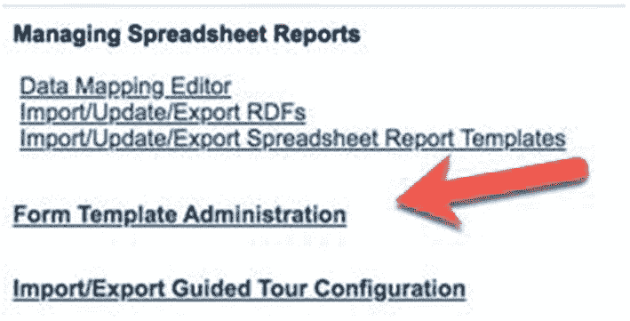

**图 10-1** 访问表单模板 XML

将显示该实例的所有模板。列表将包括现有的绩效、360 度评估、薪酬、角色就绪和招聘模板。模板名称、类型和系统生成的 ID 显示如图 10-2 所示。

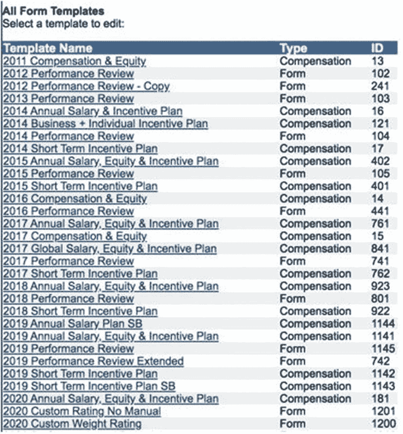

**图 10-2** 表单模板列表

正如我们在用户界面中所见，非活动表单模板可以隐藏但不能删除。在 `Provisioning` 中，活动和未活动的模板都会显示，并且无法区分它们。这意味着你的列表会变得非常冗长且难以管理。处理方法之一是在用户界面中重命名非活动表单模板。你可以在表单模板名称前添加 `"ZZZ"`。这样一来，在 `Provisioning` 中，所有重命名的非活动模板就很容易识别，并且会移动到列表的末尾，如图 10-3 所示。

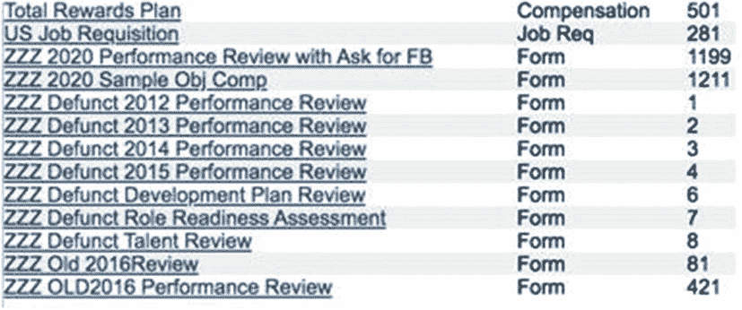

**图 10-3** 非活动表单模板

我们将打开从 SuccessStore 下载并修改过的表单模板。示例如图 10-4 所示。

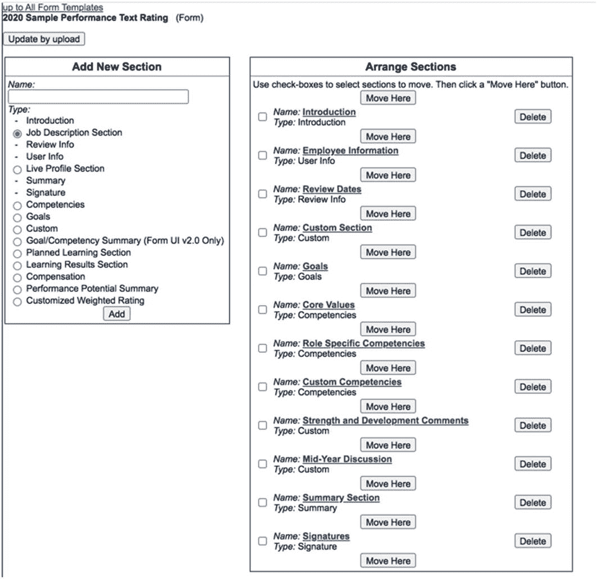

**图 10-4** 添加并重新排列 XML 部分

## 各部分

`XML` 部分是实例中配置的表单模板部分的后端视图。但是，`XML` 部分还具有设置属性、标签和权限的额外功能。

在 `XML` 的顶部，有添加新部分和重新排列部分的选项。这些选项在用户界面的表单模板中也存在，通常在用户界面中添加或重新排序部分会更简单。但是，如果你需要向表单模板中添加额外的“目标”和“能力”部分，那么在 `XML` 中操作可能会更容易。

### 在 XML 中添加部分

从 `"Add New Section"` 中选择部分类型，然后点击 `"Add"`，如图 10-5 所示。

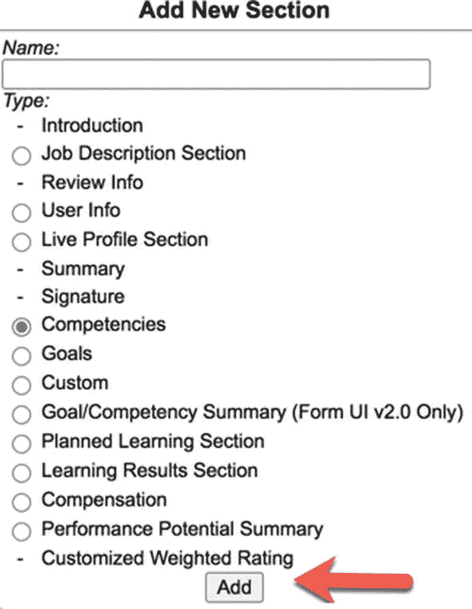

**图 10-5** 添加新部分

该部分将被添加到表单模板的底部。一个新的“能力”部分的示例如图 10-6 所示。

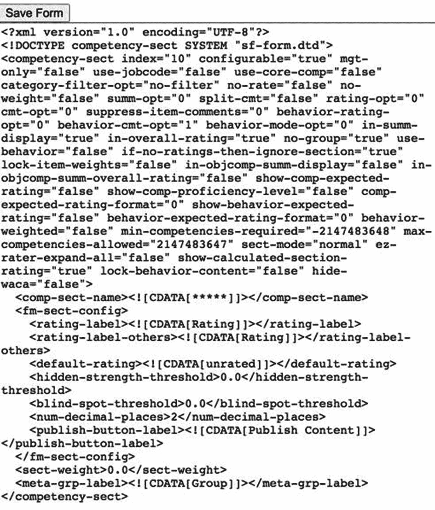

**图 10-6** 添加能力部分

如你所见，添加的代码非常基础。该部分没有命名，也没有关联的评分等级。在这个使用新“能力”部分的例子中，你可以从一个现有的“能力”部分复制代码，然后粘贴到新部分中。这样，你将获得在用户界面中添加“能力”部分时无法获得的额外元素和属性。然后，你可以在此处调整任何权限或属性。

### 移动部分

在刚刚添加了新部分的情况下，你可以使用 `"Arrange Sections"` 选项，如图 10-7 所示。

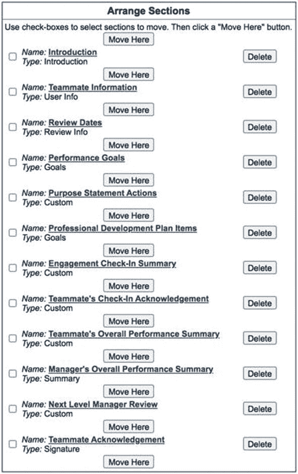

**图 10-7** 移动部分

选中你要移动的部分名称旁边的复选框。点击 `"Move Here"` 按钮来指定放置该部分的位置。

向下滚动 `XML`，有一个可以编辑表单属性的部分。示例如图 10-8 所示。

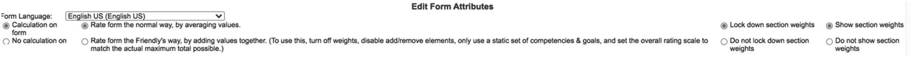

**图 10-8** 编辑表单属性

这些属性也可以在表单模板中配置。

### 路线步骤 ID

在整个 `XML` 部分中，你将看到基于角色和路线图步骤的权限。路线图步骤引用使用来自路线图的步骤 id 名称。示例如图 10-9 所示。

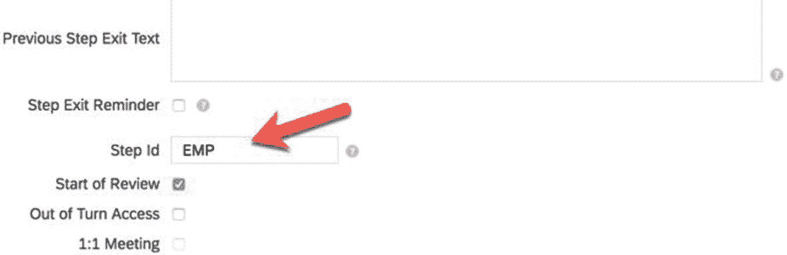

**图 10-9** 路线图步骤中的步骤 ID

在第 6 章中，我们讨论了从 SuccessStore 下载的模板的系统生成路线图 id。在那里，我们建议将步骤 id 更新为简短而有意义的名称。提出此建议是为了避免看到如图 10-10 所示的步骤 id。

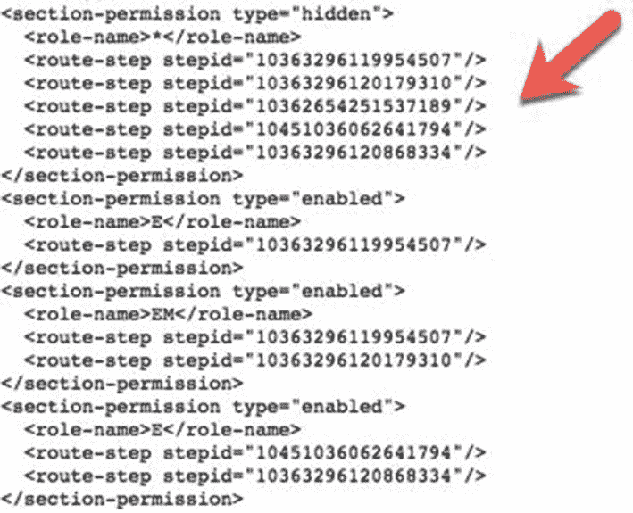

**图 10-10** 系统生成的路线图步骤 ID

如果你需要按步骤添加权限，使用易于识别的步骤名称会容易得多，如图 10-11 所示。

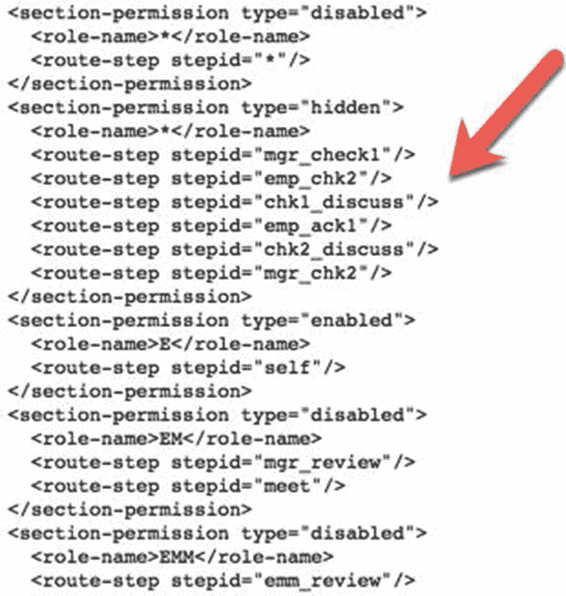

**图 10-11** 易于识别的路线图步骤 ID

当你需要手动将引用步骤 id 的路线步骤权限添加到 `XML` 时，这会很有帮助。

### 元数据部分

`XML` 的元数据部分包含适用于整个表单的权限和设置。已配置的表单模板 `"General Settings"` 都存放在这里，包括按钮和 Pod 权限以及 `Ask for Feedback` 权限。

#### 评分等级

评分等级在此处为表单模板设置。代码片段示例如下：

```xml
<scale-source>1</scale-source>
<scale-id>1</scale-id>
<scale-type>DROPDOWN</scale-type>
```

`<scale-source>` 标签标识了评分等级。通常，来源是 `"1"`。表单模板使用的默认评分等级在此处通过 `<scale-id>` 标签标识。如果你想按部分使用不同的等级，则需要在那些“目标”或“能力”部分中标识替代的 `scale-id`。要看到评分等级的下拉列表，`<scale-type>` 必须为 `"DROPDOWN"`。

#### 评分显示为文本

在 `<fm-sect-scale>` 中使用 `show-value` 来显示评分的数值，并使总体评分为数值。当此属性设置为 `"false"` 时，将显示评分的文本值。

# 这可以在元数据部分用于计算出的总体评分，或分别用于“目标”和“能力”部分。要看到评分的文本名称而不是数字和文本，`sect-scale show-value` 应等于 `"false"`。

元数据部分的示例如图 10-12 所示。

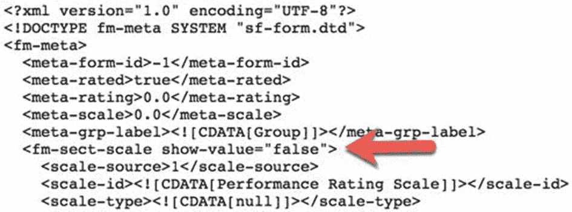

**图 10-12** 评分选项的文本

> **注意**
> 我们发现，当你在在线编辑器中从“常规设置”屏幕选择 `"Hide numeric rating values"` 选项时，会出现一个弹出窗口询问你是否要更改其他部分。但是，它无法识别并更改所有部分！因此，如果你希望此设置在整个表单中保持一致，那么在 XML 中检查每个部分的此项设置非常重要。

## 按钮权限

大多数按钮可以在前端配置工具中进行配置。但是，所有按钮都可以在 XML 中更新。具体来说，`add-modifier` 和 `add-signer` 只能通过 XML 添加，并且与我们将在本章后面介绍的 `"Add Modifier"` 和 `"Add Signer"` 功能相关联。

按钮和 Pod 权限可以按角色和路线图的步骤进行设置。在 `button-permission` 标签内，定义了权限类型（`"None"` 或 `"Enabled"`），标识了角色，标识了按钮（使用参考 ID），并定义了路线图步骤。代码片段示例如下：

```xml
*

```

> **注意**
> 此处我们将角色和步骤设置为 `"*"`，以便所有角色在所有步骤都有权访问这些按钮。通常情况下，你会选择特定的步骤和角色。我们在上一节中概述了识别步骤的最佳实践。有关绩效管理中可用角色的完整列表，请参考 SAP 说明 2087940。

### 附件

在前面的章节中，我们了解了可以添加到绩效表单的附件。附件位于表单的“支持信息”组件中。要使用附件，需要执行多个步骤，其中最后一步只能在 XML 中执行。首先，必须在高级表单模板设置中勾选“启用附件”。示例如图 10-13 所示。

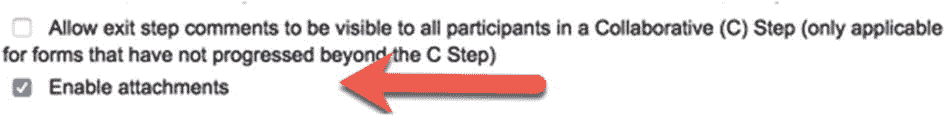

*图 10-13：在高级模板设置中启用附件*

在表单模板的“常规设置”中，还需要授予访问“支持信息”组件的权限。示例如图 10-14 所示。

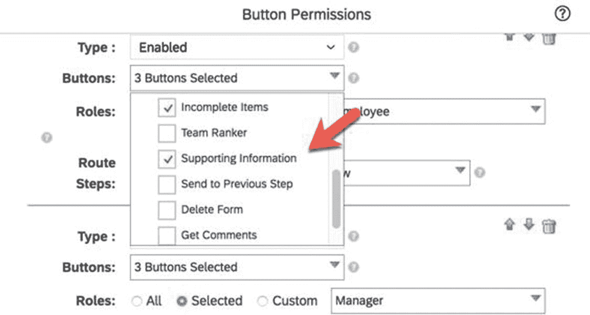

*图 10-14：“支持信息”组件的按钮权限*

要允许用户在“支持信息”组件中添加、查看或删除附件，必须在表单模板 XML 的元部分中添加附件权限。附件权限分为附件权限和附件操作权限。附件权限按角色设置读取和编辑操作。这些权限只能在 XML 中设置。

`attachment` 权限为“无”或“已启用”。

`attachment-action` 权限为“读取”或“编辑”：

-   “读取”权限允许用户查看所有附件，以及添加、重命名/编辑或删除自己的附件。

-   “编辑”权限包含所有读取权限，并且用户还可以删除和重命名/编辑所有其他用户的附件。

`<attachment-permission>` 按角色为每个 `<attach-action>` 设置。附件权限不能按步骤设置。

代码示例如下：

```
*

EM
EH
E

```

在此示例中，员工、经理和人力资源经理可以添加附件、编辑/重命名和删除自己的附件。他们可以看到其他人添加的附件，但不能编辑/重命名或删除这些附件。

`<attachment-permission>` 放在 `<askforfeedback-permission>` 之前（如果使用的话）；否则，它出现在 `<tab-permission>` 之前。

### 征求反馈权限

如果您的表单模板已配置为使用“征求反馈”功能，您将看到 `<askforfeedback-permission>`。它将位于 `<attachment-permission>` 之后，`<tab-permission>` 之前：

```
*

E

EM
EH

```

### 目标选项卡权限

在元部分设置的目标选项卡权限适用于其对应部分中的所有目标（目的）、发展和能力项目。权限按角色和步骤设置。它们只能在 XML 中配置。

可以设置权限的目标选项卡包括：

-   学习活动

-   他人评分

-   上次审核评分

-   目标详情

-   其他详情

-   成就

请参见表 10-1 了解每个选项卡的说明。

*表 10-1：目标选项卡权限*

| 选项卡 ID | 描述 | 适用部分 |
| --- | --- | --- |
| learning-activities | 选项卡将显示与发展目标相关的学习活动。 | 发展目标部分 |
| others-rating | （未提供描述） | 绩效目标、发展目标和能力部分 |
| last-review-rating | 上次能力评分。 | 能力部分 |
| goal-details | 显示在目标计划 XML 的 `<form-layout>` 部分中标识的非表格目标计划字段。 | 绩效目标和发展目标部分 |
| other-details | 包含目标表格字段，例如里程碑、任务和子目标。 | 绩效目标和发展目标部分 |
| achievements | 与目标或发展目标相关的 CPM 成就。 | 如果使用 CPM，则用于绩效目标和发展目标部分 |

我们将查看一些可能为目标显示的选项卡。最重要的选项卡是“他人评分”选项卡。此选项卡的标准标签是“来自他人的评分”。该选项卡包含其他用户给出的目标或能力评分和评论。例如，员工对每个目标和能力进行自我评分。如果配置了，员工还可以为每个目标或能力添加评论。当表单转交经理审核时，员工的评分和评论将显示在“来自他人的评分”选项卡中。

示例如图 10-15 所示。

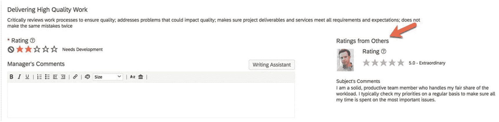

*图 10-15：他人评分选项卡*

在此示例中，经理能够看到员工给出的能力评分和评论。我们将在后面更详细地介绍 XML 的“目标”部分时学习如何授予对此选项卡内容的访问权限（如果您愿意，请参阅“部分内的‘他人评分’选项卡字段权限”部分）。

目标项的“成就”选项卡如图 10-16 所示。该选项卡显示成就名称和日期。还会显示一个奖杯图标。此选项卡仅在使用持续绩效管理时可用于计划目标和发展目标。

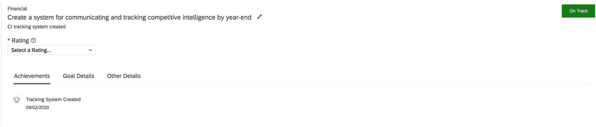

*图 10-16：目标项的成就选项卡*

没有关联成就的目标将显示在“成就”选项卡中，并显示一条声明“没有成就”。无法隐藏没有成就的目标的选项卡。如果允许，“成就”选项卡始终是第一个显示的选项卡。

“目标详情”选项卡的示例如图 10-17 所示。将显示目标计划 XML 中允许的所有目标计划字段，但目标计划表格字段除外。

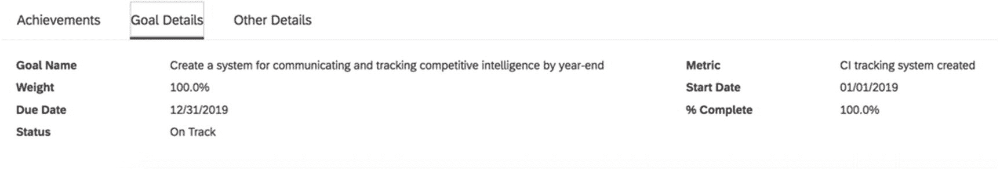

*图 10-17：目标项的目标详情选项卡*

如图 10-18 所示的“其他详情”选项卡显示目标计划表格字段。这包括任务、子任务和里程碑。

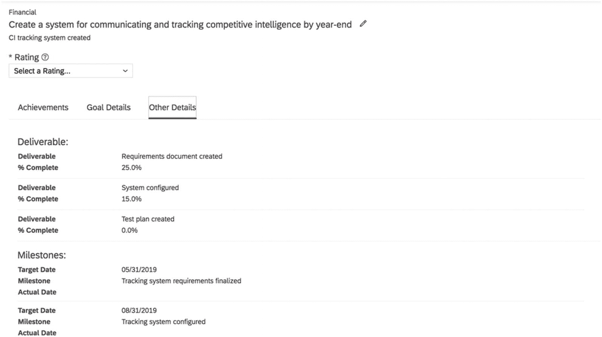

*图 10-18：目标项的其他详情选项卡*

里程碑将显示为列表而不是表格。

“学习活动”选项卡可以被允许为发展目标显示。示例如图 10-19 所示。


*图 10-19：发展目标的学习活动选项卡*

如果允许，此选项卡将显示在所有发展目标中，即使是那些没有学习活动的目标。如果发展目标没有关联的学习活动，该选项卡将包含消息“您没有发展目标的学习活动”。选项卡顺序无法更改。如果还启用了“成就”选项卡，它将作为第一个选项卡列出。

现在我们已经了解了可能使用的目标选项卡，让我们学习如何授予对它们的访问权限。如果启用，这些选项卡是只读的。选项卡权限将出现在 XML 元部分的“征求反馈”权限之后。权限类型为“无”或“已启用”，这意味着选项卡将可见或隐藏。每个选项卡类型的权限可以按角色和步骤单独设置。

包含选项卡权限的代码示例如下：

# 目标与能力章节配置

## 部分

在本文示例中，`manager`角色可以查看所有适用部分的`Goal Details`、`Other Details`、`Achievements`和`Other’s Rating`选项卡。可以为特定角色和步骤设置独立的选项卡权限，也可以在“部分”级别设置这些`goal`选项卡权限。在本章的“目标部分”中，我们将学习如何在表格的特定部分隐藏选项卡。接下来，我们将介绍用户在绩效表单上会看到的部分。

每个部分都有其自己的设置、标签、字段和权限。部分确实有一些共同元素。部分中使用的元素包括：

*   `fm-sect-name`
*   `fm-sect-intro`
*   `fm-sect-config`
*   `fm-element`

部分的顺序基于在每个部分中找到的`fm-sect`索引。每个部分都包含索引，第一个部分的索引号从`0`开始。以下是一个代码段示例：

部分名称标签。简介、员工信息、审核日期和自定义部分的名称在`<fm-sect-name>`标签中定义。`<fm-sect-name>`标签的代码段示例如下：

```
代码段示例
```

目标（客观）、能力、客观能力总结和绩效潜力总结部分的章节名称标签有所不同，如下所示：

*   `<obj-sect-name>`
*   `<comp-sect-name>`
*   `<summary-sect-name>`
*   `<pp-sect-name>`
*   `<oc-sect-name>`

部分介绍标签。简介、员工信息、审核日期和自定义部分将使用`<fm-sect-intro>`标签。这对应于可能在模板实例中添加的介绍文本。`<fm-sect-intro>`标签的代码段示例如下：

```
代码段示例
```

目标（客观）、能力、客观能力总结和绩效潜力总结部分的章节介绍标签有所不同，如下所示：

*   `<obj-sect-intro>`
*   `<comp-sect-intro>`
*   `<summary-sect-intro>`
*   `<pp-sect-intro>`
*   `<oc-sect-intro>`

### 评分选项

在我们对绩效表格的回顾中，我们已经展示了不同评分者可以提供不同评分的地方。评分选项决定了表格中提供的哪个评分将作为记录评分。记录评分很重要，因为它是在其他模块和报告中使用的绩效表格的最终输出。

评分选项属性`rating-opt`用于设置评分选项。它可以具有表 10-2 中描述的值。

**表 10-2 评分选项值**

| 值 | 描述 |
| :--- | :--- |
| `0` | 这是默认值，也是最简单的。所有用户为每个项目共享一个评分框。在 XML 中，此项目评分显示为`item-rating`。系统将使用您的权限设置来确定哪些用户可以查看和编辑此字段。实际上，具有写入权限的用户可以互相覆盖评分，因此最终路线图中具有写入权限的最后一个用户拥有最终决定权。当最终用户查看评论时，用户的评论旁边不会显示评分。 |
| `1` | 此选项通常用于当您希望员工提供他们自己的评分（不算作官方评分）并可以与经理评分进行比较时。使用此设置，默认情况下，所有用户都可以编辑`item-rating`字段，即记录评分。您可以通过设置不同的权限来覆盖此设置。与值`0`类似，最后一个编辑评分的人决定了记录评分。除了默认权限之外，另一个关键区别是员工也将拥有自己独立的评分，他们可以在其中给自己评分。此额外评分在 XML 中显示为`item-cmt-rating`。此评分不计入记录评分。因此，您应该将员工的`item-rating`权限设置为“只读”或“无”，以防止他们错误地设置记录评分。当最终用户查看评论时，评分量表会显示在主体的评论旁边。<br>**注意：** `item-cmt-rating`不能设置为必填。 |
| `2` | 此选项通常用于当您希望除了员工之外，还有更多人有权查看或编辑非官方评分时。这是最具动态性的选项，因为任何角色组合都可以读取或编辑官方的和/或非官方的评分。默认情况下，每个人都授予对`item-cmt-rating`和`item-rating`的访问权限。您只需为您不希望其编辑其中一个或另一个或两者的角色设置“只读”或“无”权限。当最终用户查看评论时，评分量表会显示在所有评估者的评论旁边。<br>**注意：** 使用获取反馈并允许编辑时，评分是用户的非官方评分，由`<item-cmt-rating>`标识。为了使其正常工作，请不要使用`rating-opt "2"`。通过授予经理对此字段的只读权限，经理会在其`item-rating`下方看到一个额外的空白`item-cmt-rating`。除非同时从“他人评分”选项卡中隐藏`item-cmt-rating`，否则无法为经理隐藏此额外字段。使用此字段的“只读”权限，以便查看反馈提供者给出的评分。 |
| `3` | 此选项用于当您希望只有经理才能编辑官方评分，但希望员工仍然收到一个弹出警告，提示需要他们自己的自评时。非官方的员工评分在 XML 中显示为`subject-item-rating`，经理的评分显示为`item-rating`。当最终用户查看评论时，每个用户都会看到他们的评分量表与员工的评分并列显示。 |

**注意**
这些选项会根据您在在线表单编辑器中的选择自动在 XML 中更改，因此无需在 XML 中编辑它们；但是，在测试表单并进行调整时，了解它们如何影响权限和记录评分非常重要。

**注意**
有关更多信息，请参阅 SAP 注释 2185897。

### EZ-Rater 图表可见性

当在目标或能力部分（`sect-mode="EZ-Rater"`）中使用 EZ-Rater 时，每个目标或能力将有一个差距分析图，显示主体和经理评分之间的差异。要删除任何目标或能力部分中的差距分析图可见性，请在`</fm-sect-config>`的最后一行添加`<ez-rater show-gap="false" />`。此设置无法通过“管理模板”在 UI 中更新。

### 部分配置标签

在每个部分中，`<fm-sect-config>`标签包含该部分的一些基本设置。部分权限、必填字段和默认评分标签都可以在此标签内定义。对于目标和能力部分，该标签还将包含：

*   如果评分量表与元部分中的默认评分量表不同，则为该部分的配置
*   “无法评分”文本
*   项目权重

以下是目标部分的代码段示例：

```
0.0
0.0
    *
    EM
    E
    EM
    EMM
    E
    E
    EM
```

### 简介部分

简介部分是只读的，包含介绍性文本。没有需要允许的字段，只有可以在表单模板中设置的部分权限。

**注意**
在介绍性文本中，可以直接链接到员工档案。有关更多信息，请参见 SAP 说明 2384502。

### 员工信息部分

此部分显示有关被评估用户的只读信息。此部分仅允许显示特定字段，以及继任数据模型中配置的 15 个自定义字段中的任意字段。

该部分的代码示例如下：

```
0.0
0.0
```

仅能在表单模板 XML 中对这部分进行的更新包括：

-   更改显示字段顺序。
-   重命名字段。
-   添加 15 个自定义字段之一。
-   更改“立即显示”与“启动时显示”。

`<fm-elements>` 位于 `<fm-sect-config>` 标签之后。

#### 更改显示字段顺序

在员工信息部分中，可以更改字段顺序。**但是，无法通过用户界面中的“管理模板”来执行此操作。** 字段显示顺序基于 XML 中字段的顺序。`fm-element` 索引编号控制显示字段顺序。查看一个元素，索引标识顺序号。第一个显示的字段是 `0`。

`type ="3"` 表示该字段显示在一行上。示例如图 10-20 所示。

### Section Element Tag

`<fm-element>` 标签用于定义自定义字段。此标签可以出现在任何支持自定义字段的部分中。它也用于员工信息部分，以标识将在该部分中显示的与员工相关的字段。

代码片段示例如下：

字段顺序由索引定义，对于每个元素，系统会填充键、名称、值类型和值。如果将 `evalue` 留空，则该字段不会预填充。

表 10-3 包含可用的自定义元素类型。

**表 10-3 自定义元素类型**

| 元素 | 描述 | 元素类型 |
| --- | --- | --- |
| 标签 | 显示为粗体文本标签，无数据输入字段。 | 2 |
| 文本 | 标签字段及用于一行文本的开放框。 | 3 |
| 文本区域 | 多行文本框。 | 4 |
| 日期 | 日期框。 | 5 |
| 列表 | 下拉列表。 | 6 |
| 整数 | 用于整数的文本框。 | 7 |
| 双精度 | 用于带小数的数字的文本框。 | 8 |
| 复选框 | 带标签的复选框。指定 `evalue`；否则，勾选时不会存储任何内容。 | 9 |

在下面的代码示例中，`fm-element` 索引将该字段标识为第一个显示的字段；类型 `3` 表示文本字段：

```
<fm-elements>
```

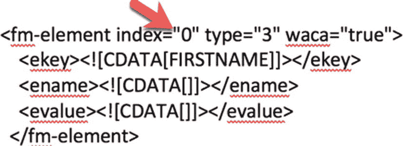

**图 10-20 员工信息部分中的字段元素**

要重新排序，请手动重新排列 `<fm-elements>`，然后更新索引以匹配。

### 重命名字段

*员工信息*部分中任何伴随字段的标签都可以重命名。这是通过字段的 `<ename>` 标签完成的。标签必须全部使用大写字母；否则，它不会在表单中使用。标签在表单中不会全部以大写字母显示。示例如图 10-21 所示。

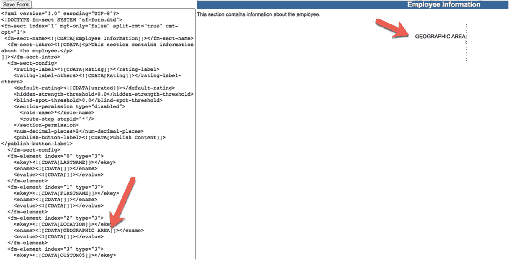

**图 10-21 重命名字段**

您还会注意到，在示例的预览部分中，该字段被重新标记了。

#### 包含自定义字段

可以添加 15 个自定义字段中的任意字段以显示在*员工信息*部分中。

代码片段如下所示：

在 `<ekey>` 标签中输入字段的系统键。在 `<ename>` 标签中输入字段的标签名称，全部使用大写字母。

#### 更新数据视图

此部分中显示的数据反映了表单打开时的员工数据。如果您希望此处显示的员工信息反映创建表单时的数据，请将 `sync-until-completion="false"` 添加到字段中。

代码片段示例如下：

在此示例中，即使之后发生了变更，也会显示表单启动时员工所在的部门。

### 审核日期部分

*审核日期*部分是只读的，可能包含介绍性文本。没有需要允许的字段，只有可以在表单模板中设置的部分权限。字段不能被省略、重新排序或重新标记。不能向此部分添加标准或自定义字段。图 10-22 显示了该部分的示例。

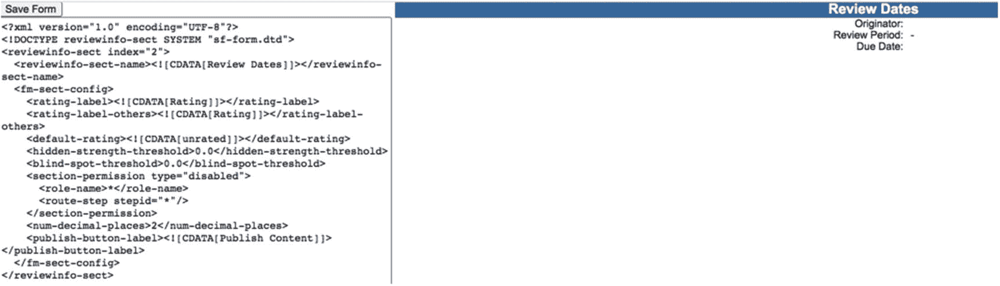

**图 10-22 审核日期部分**

现在我们已经介绍了表单模板的不可编辑部分，接下来将进入目标和能力部分。

### 目标部分

目标部分标识目标计划的来源以及目标的评估方式。

目标部分从用户的目标计划中提取目标项。目标计划的来源在表单模板的目标部分中的 `<obj-sect-plan-id>` 内设置。示例如图 10-23 所示。

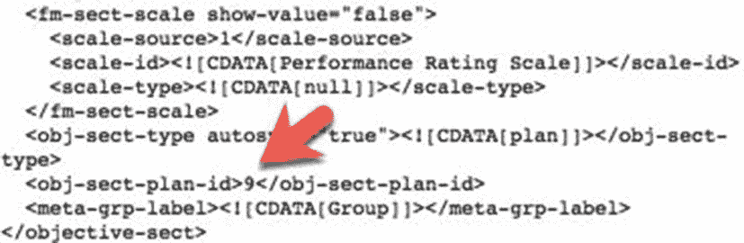

**图 10-23 目标部分中的目标计划 ID**

计划 ID 对应于目标计划 XML 中找到的计划 ID，以及目标计划模板的*管理计划模板*中的计划 ID，如图 10-24 所示。

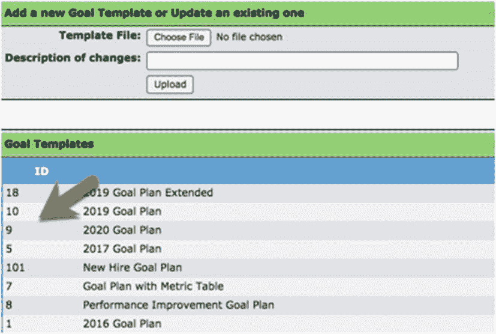

**图 10-24 目标计划 ID**

我们将探讨此部分中可以配置的一些属性。

#### 按部分隐藏目标选项卡

如果您希望隐藏目标或发展目标部分的“目标详情”或“其他详情”选项卡，请在部分级别将所需权限添加到表单中的每个目标部分，而不是在元部分中添加。如果表单模板中有目标部分和发展目标部分，您可能希望在目标上看到“目标详情”选项卡，但在发展目标上则不需要。您可能希望为特定步骤中的特定角色隐藏“其他详情”或“目标详情”选项卡。您可以按角色和步骤设置权限，类似于在元部分中的处理方式。

元部分为所有部分设置全局权限。如果您只需要在某个部分中删除“目标详情”或“其他详情”选项卡，请在部分级别添加代码。要在部分内隐藏选项卡，请为角色、选项卡和步骤设置 `<tab-permission>`。

例如，如果您只想在所有步骤的所有角色的目标部分中隐藏“其他详情”选项卡，可以添加以下代码来限制可见性：

```
*
```

另一个示例如下代码片段所示。在此示例中，员工无法在员工评估步骤中看到目标部分的“其他详情”选项卡。

```
E
```

#### 部分内的“他人评分”选项卡字段权限

“他人评分”选项卡包含另一个角色对目标或能力的评分和评论。评分和评论字段可以为每个角色和步骤设置为可见或隐藏。

`other-rating-tab-item-permission` 定义了“他人评分”选项卡中的字段级访问权限。此权限可以针对目标、发展目标和能力部分定义。

代码片段示例如下：

```
EM
```

对于所示的代码，在经理评估步骤的“他人评分”选项卡中，经理可以看到由员工给出的项目评分。

#### 他人评分标签页中的评分与评论可见性

正如我们刚刚了解到的，可以按板块设置“他人评分”标签页的权限。我们还看到了如何根据角色和板块内的步骤，授予查看该标签页中项目评分和评论的权限。我们可以将两者结合，使得“他人评分”标签页可见，并控制步骤中该标签页的字段可见性。

`other-rating-tab-item-permission` 定义了“他人评分”标签页内的字段级访问权限。

请勿在元板块中定义“他人评分”标签页权限。请在目标或能力板块中使用“他人评分”标签页权限，同时也请使用 `<others-rating-tab-item-permission>` 来标识目标字段、角色和步骤。

将其插入在 `<field-permission>` 之后，`<sect-weight>` 之前。

代码片段如下所示：

```
EM

EM
```

在此示例中，经理可以在经理评估步骤中看到带有项目评分的“他人评分”标签页。这意味着经理可以看到由员工给出的目标项目评分。这些评分将显示在“他人评分”标签页中。此示例中的目标项目评论未被授权。

这些权限可以在每个“目标”、“发展目标”或“能力”板块中定义。

#### 按角色划分的项目评论

在表单模板中，可以指定编写目标或能力板块评论的角色。图 10-25 显示了一个字段权限示例。

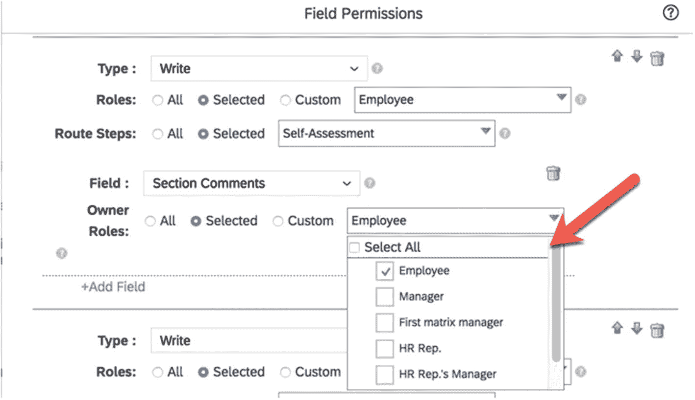

图 10-25 按角色划分的目标板块评论

要查看项目评论，必须启用它，如图 10-26 所示。

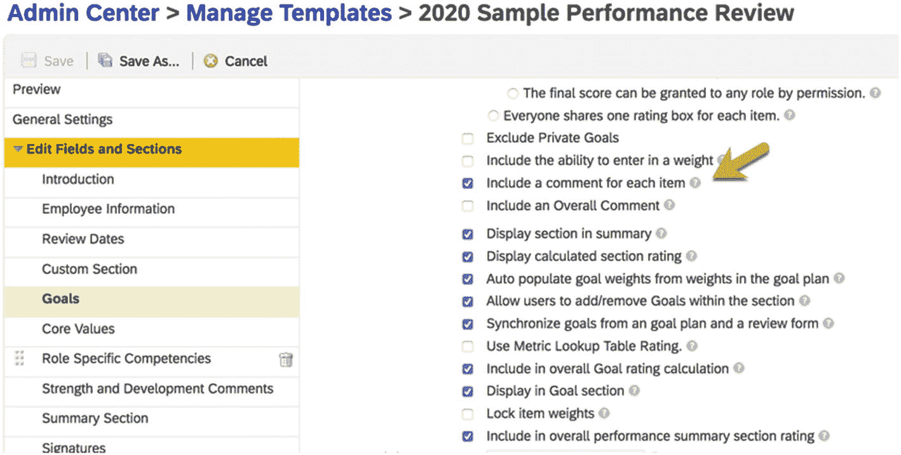

图 10-26 目标板块中的项目评论

在设置项目评论的字段权限时，此选项不可用。您可以选择权限的角色（`读取`、`写入`、`无`）和“项目评论”字段，但没有选项可以选择项目评论的所有者。图 10-27 显示了一个字段权限示例。

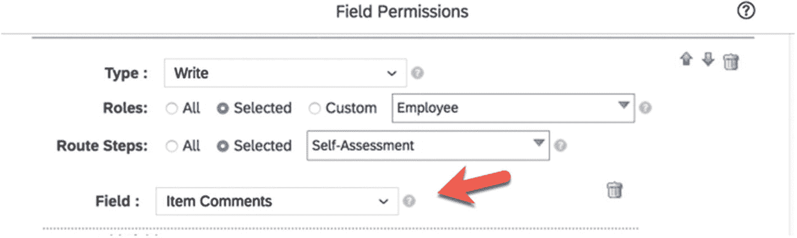

图 10-27 项目评论没有可供选择的角色

在表单模板 XML 中，您可以指定所有者角色。在目标板块或能力板块中，您可以通过将元素角色标识符插入到字段元素中来选择项目评论的所有者。

将

```
*
```

插入到

中。

要指定所有者角色，请用角色替换星号。

下面的代码片段示例显示了按角色定义的项目评论：

```
E

E
```

在此示例中，员工在自我评估步骤中编写项目评论。

员工可以输入项目评论，如图 10-28 所示。

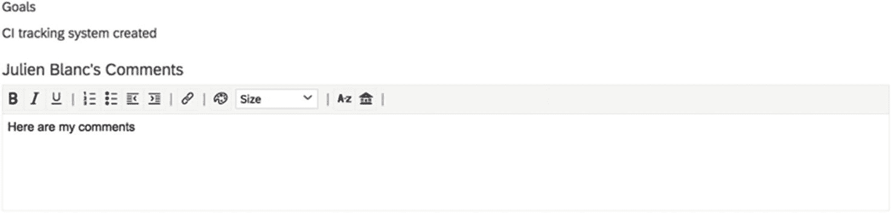

图 10-28 员工添加项目评论

经理可以查看员工的评论，并且也可以输入项目评论。图 10-29 显示了一个示例。

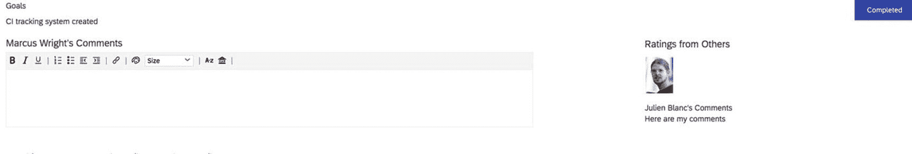

图 10-29 经理添加项目评论

#### 在目标板块中显示的目标计划字段

表单上每个目标显示的计划字段取决于目标计划 XML 的 `<form-layout>` 部分中的目标字段。这在第 4 章中有详细说明。

##### 使目标计划字段为只读

当员工打开他们的表单时，他们可能会看到每个目标的铅笔（编辑）图标。如果该板块对用户启用，则会出现此图标，但在某些目标计划配置场景中，目标仍然是只读的。点击该图标，用户将看到目标字段，但无法编辑目标。铅笔图标的使用会产生误导，因为用户在这种情况下无法编辑目标。图 10-30 显示了一个带有铅笔图标的目标示例。

# 绩效表单目标与能力章节配置指南

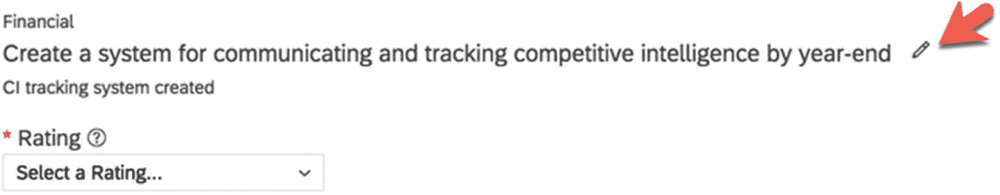

图 10-30 在绩效表单中编辑目标

有一个选项可以使表单“目标”板块中的所有目标字段成为只读。此选项独立于目标计划上的目标详细信息读写设置。这意味着在绩效计划内，打开一个目标时，它完全是只读的，用户无法编辑任何目标计划字段。这是通过使用`tgm-fields`来实现的。

代码片段示例如下：

```
*
```

在该示例中，所有角色在任何步骤中都只能读取而不能编辑目标字段。您可以将其添加为该板块中的第一个字段权限。

将此权限添加到目标板块后，XML 目标不再显示铅笔图标，如图 10-31 所示。

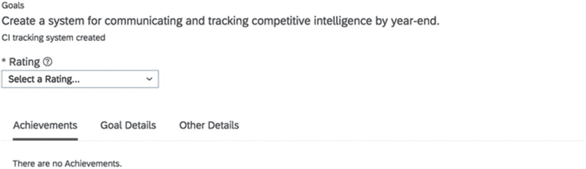

图 10-31 目标不再可编辑

可以查看“目标详情”标签页，但无法对目标进行任何更改。如果用户希望更新目标，可以在目标计划中完成。一旦用户重新打开表单，就会显示更新后的目标。

## 项目评论和板块评论标签

可以使用`文本替换`来重命名为“目标”和“能力”板块显示的“来自他人的评分”标签。此选项不适用于项目评论和板块评论标签。

“目标”、“能力”和“摘要”板块中的项目评论和板块评论标签非常通用，将员工称为“主体”。这些评论标签可以在 XML 中修改。板块摘要评论部分也可以重新命名。

如果对目标和/或能力使用了评论，则可以自定义员工和经理的项目评论标签。用于自定义项目评论的标签是`<manager-comments-label>`和`<subject-comments-label>`。

如果该板块允许板块评论，则在该板块之后会有一个评论摘要部分。图 10-32 显示了一个表单的目标评论部分示例。

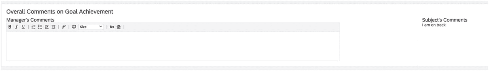

图 10-32 目标板块的标准评论标签

在上图所示的示例中，表单当前由经理持有。显示了经理和主体（员工）的评论标签。

板块评论的标签如下所示，插入到`<blind-spot-threshold>`标签之后。

代码片段示例如下：

```
0.0
```

将这些标签添加到目标板块 XML 后，目标评论部分将反映新的标签，如图 10-33 所示。

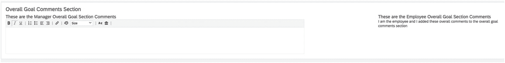

图 10-33 自定义板块和板块评论标签

除了经理和员工的目标板块评论标签外，目标摘要部分也被重新命名了。

### 项目评论标签

现在我们已经了解了如何更新板块评论标签，接下来我们将了解如何更新项目评论标签。这将用于每个目标或能力的评论。项目评论的标签是`<manager-comments-label>`和`<subject-comments-label>`。标准项目评论如图 10-34 所示。

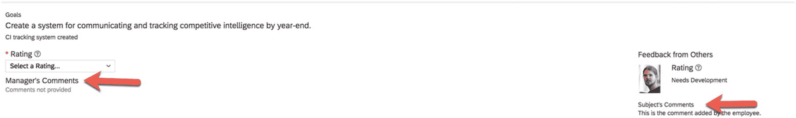

图 10-34 标准项目备注

以下是一个用于自定义项目和章节备注的代码段示例：

```
0.0
```

更新后的目标项目备注示例如图 10-35 所示。

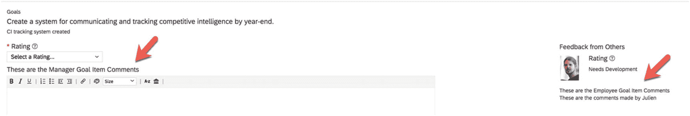

图 10-35 更新后的目标项目备注标签

## 项目评分标签

还可以重命名现有的管理者目标和能力项评分标签。标准评分标签如图 10-36 所示。

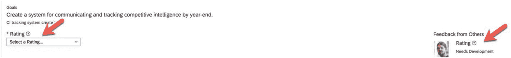

图 10-36 标准项目评分标签

标准评分标签如下所示：

`<rating-label>`通常是管理者的评分；只需将`[Rating]`替换为更新后的表述即可。

对`<rating-label-others>`标签执行相同操作，以表示员工评分。

以下是一个代码段示例。

更新后的目标项目评分和备注标签见图 10-37。

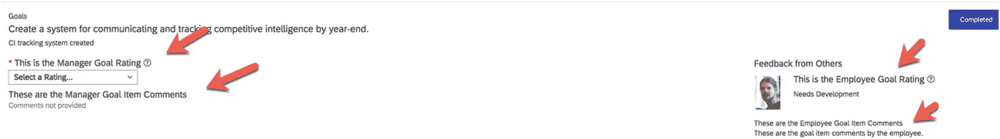

图 10-37 自定义项目评分与项目备注标签

## 筛选绩效表单中包含的目标类别

如果您的目标计划包含多个目标类别，则可以限制哪些目标类别会显示在绩效表单上。必须将需要包含的目标类别添加到目标章节的 XML 中。

通常情况下，所有类别的目标都会出现在 PM 表单的“目标”章节中，如下列代码段所示：

```

```

此代码位于目标章节 XML 的底部。

要限制从目标计划自动填充到特定类别的目标，请使用`<obj-category>`标签来标识这些类别。

**注意** 您需要下载目标计划 XML 以查找目标类别 ID。

以下是从目标计划 XML 中提取的代码段示例：

```
Financial
Customer
Internal Business Processes
Learning and Growth
```

使用您希望在 PM 表单上看到的类别的 ID。

以下是在绩效表单模板的“目标”章节中使用的代码段示例。为目标计划中每个要显示的类别添加`<obj-category>`标签：

```
obj-sect-type>
```

在此示例中，自动填充的目标将来自目标计划的*Customer*和*Financial*类别。

要隐藏目标和能力章节的数字项目评分，请将`show-value`设置为`"false"`。示例如图 10-38 所示。

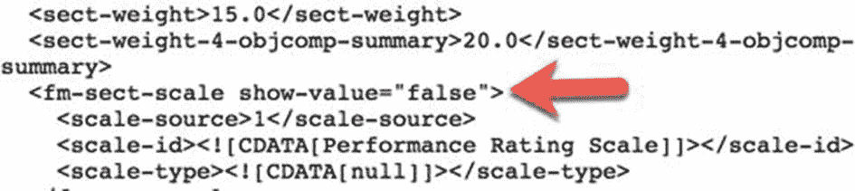

图 10-38 章节中的数字评分

## 能力章节

### PM 表单上的能力类别

与目标章节类似，备注和评分标签是可配置的。

### 核心能力章节中的能力匹配

对于核心能力章节，可以限制显示在用户表单上的核心能力类别。这是通过能力匹配实现的。根据指定的类别，表单将仅提取该类别中的核心能力。

### 限制特定岗位的能力类别

对于特定岗位的能力章节，可以将能力限制在一个类别内。

这是通过为`category-filter-opt`标识类别来实现的。这些类别可以在能力库中找到。

您可以在实例中获取类别。在搜索栏中输入并选择“管理岗位档案内容”。选择“能力”，即可找到如图 10-39 所示的类别。

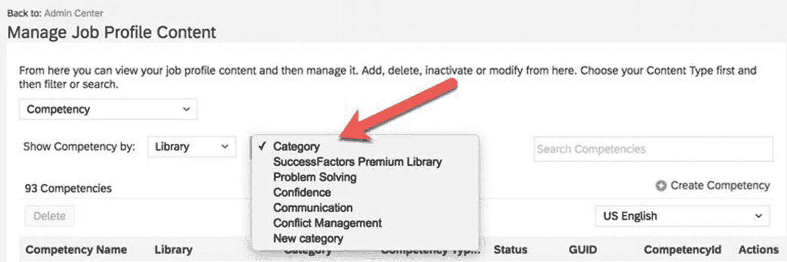

图 10-39 能力类别

使用`category-filter-opt`来显示"指定类别"。图 10-40 展示了职位特定能力部分的一个片段。

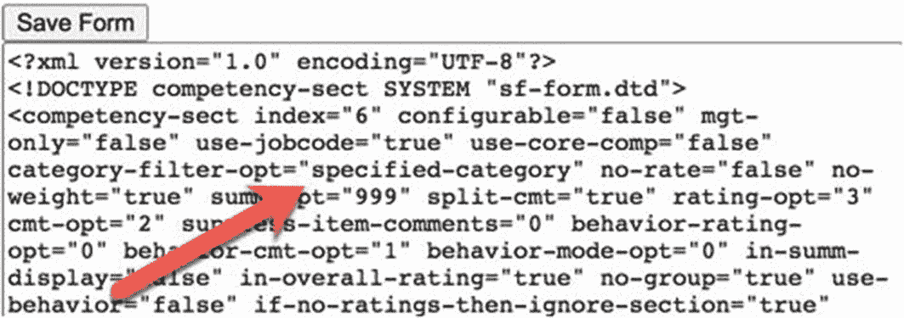

图 10-40 设置`category-filter-opt`

然后滚动到该能力部分的底部。我们将在此处通过插入以下内容来识别能力类别：

```
*以下展示了一段代码示例：*
```

在上述示例中，只有"问题解决"这一职位特定能力会自动填充表单。

## 摘要部分

在摘要部分，可以使用以下标签更改手动总体评分和自动计算总体评分的标签。这些标签添加在字段权限之后，并直接位于`</*summary-sect*>`之前。

要重命名手动总体评分，请插入以下代码，并确保为标签指定名称。要重命名自动计算总体评分，请使用`<calc-rating-label>`。

两个标签的代码示例如下所示：

> **注意**
> 在"绩效潜力摘要"部分和"目标能力摘要"部分，可以通过查找包含"rating-label"的 XML 代码并按照相同流程来更改评分标签。由于本章已介绍适用于这些部分的仅涉及 XML 的相关更改，因此我们不再对这些部分进行详细说明。

## 自定义部分

如果您的自定义部分包含评论，并且您希望使用自定义标签，`split-cmt` 属性控制着主题和经理评论的显示方式。若不更改，将显示标准评论标签。

在 `<fm-sect>` 标签中，将 `split-cmt` 更改为 `"true"`，如以下代码片段所示：

```
<fm-sect split-cmt="true" ...>
```

要更新部分评论标签，请在 `<fm-sect-config>` 标签内添加标签标签：

将这些标签插入在 `<blind-spot-threshold*>` 之后和 `<*section-permissions*>` 之前，如以下代码示例所示：

```
<*-comments-label>Custom Comment Label</*-comments-label>
```

基于这些添加到 XML 自定义部分的自定义标签，自定义评论标签如图 10-41 所示。

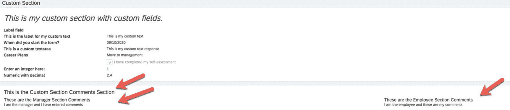

**图 10-41** 自定义评论标签示例

## 签名部分

可以添加一个出现在以下内容之后的自定义评论标签：

```
<*section-permissions*>
```

代码示例如下所示：

```
<*button-label>Submit Review</*button-label>
```

恭喜！您现在应该已经熟悉如何编辑绩效表单 XML，并且了解了一些只能在此处编辑的配置项。现在，让我们来看看翻译功能在绩效管理模块中如何运作。

## 在绩效管理模块中进行翻译

绩效管理模块中有几个区域可以配置翻译。具体来说，除了在绩效表单内部进行配置外，还需要在路径图和评分量表中进行配置。

> **注意**
>
> 如果您的表单使用了能力项，请务必在职位档案内容中对这些能力项进行翻译。更多信息请参考第 3 章。

路径图和评分量表内的翻译是通过在用户界面中简单地从配置屏幕的语言下拉菜单中选择所需语言来完成的，如图 10-42 所示。屏幕会刷新，显示所有可以为所选语言进行翻译的开放文本字段。屏幕刷新后，只需为您希望翻译的每个标签输入翻译内容，然后点击“保存”即可。全部完成！

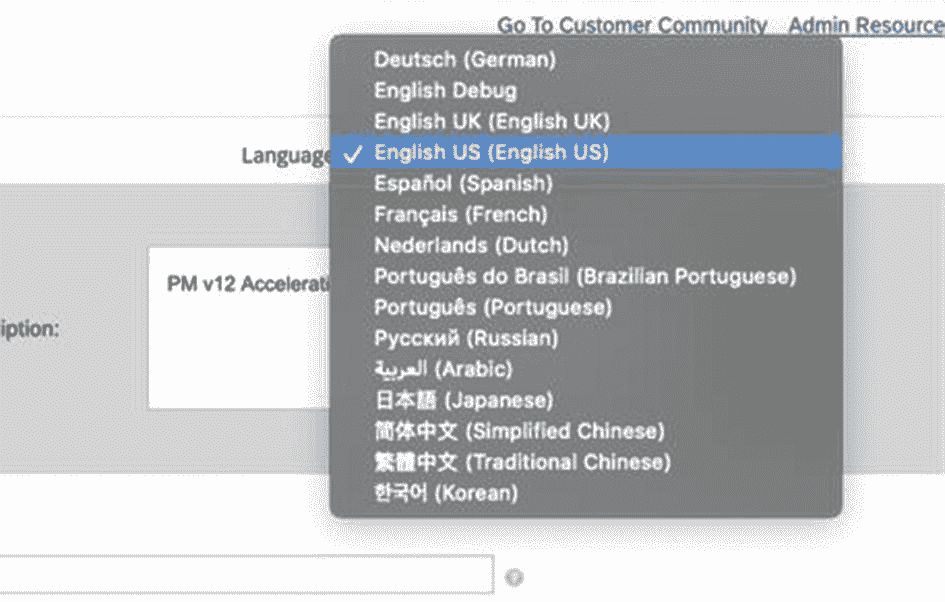

**图 10-42** 在路径图和评分量表屏幕中显示的语言翻译下拉菜单

## 为 PM 表单本身添加翻译

对于 PM 表单本身，该过程需要使用 XML 中的消息键，每个你想要翻译的标签都会用到这些键。

> **注意**
>
> 根据 SAP 注释 2087186，有一种无需直接编辑 XML 即可翻译绩效管理表单的流程。然而，根据我们的经验，我们发现该流程不起作用，最好直接编辑 XML，以确保消息键 ID 有意义并遵循约定，从而实现更直接的维护。

首先，你需要在在线编辑器中添加你想要翻译的语言。在搜索栏中输入并选择 `Manage Templates`。然后，单击你要编辑的表单，再单击 `General Settings`。在表单名称下方，你会看到一个 `Add More` 链接，如图 10-43 所示。

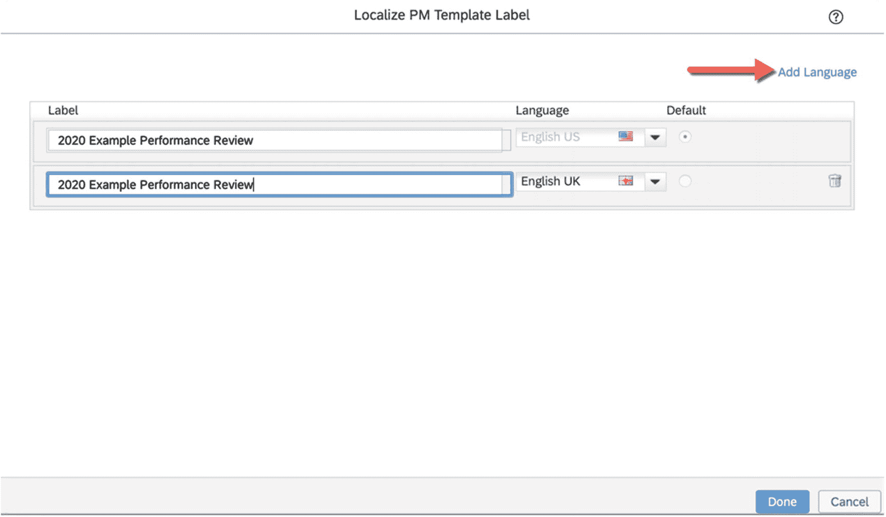

**图 10-44** 向模板名称添加翻译

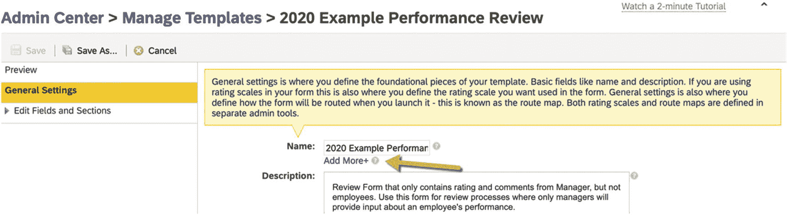

**图 10-43** “添加更多”链接

> **注意**
>
> 请确保你已在 “Provisioning” 的 “公司设置” 中开启了所需的语言。

单击 `Done`，然后单击 `Save`。现在，你需要向 XML 添加消息键。按照前面章节的步骤打开 XML 进行编辑。

你会注意到在 XML 的顶部，有一个关于表单区域设置的声明，如下例所示。我们建议保留此设置不变——这将是管理员创建表单时使用的语言。无论此设置是什么，你仍然可以添加任何语言的消息键：

```
<locale>en_US</locale>
```

插入消息键的过程包括：找到每个对最终用户可见的标签，并向每个带标签的元素添加属性 `msgKey="MESSAGEKEYID"`，其中 `MESSAGEKEYID` 是每个标签的唯一 ID。请参见以下示例：

```
<*sect-name msgKey="MESSAGEKEYID"><![CDATA[Review Dates]]></*-sect-name>
```

在每个部分中，应考虑为以下带标签的元素插入消息键：

- `*-sect-name`
- `*-sect-intro`
- `rating-label`
- `rating-label-others`
- `unrated-rating`
- `default-rating`
- `*-comments-label`
- `*-button-label`

插入此代码后，系统将尝试查找与这些消息键关联的、针对最终用户语言的已上传翻译。如果未找到该语言，它将使用消息键中为标签设置的默认语言。如果仍未找到，系统将默认显示 CDATA 条目，在本例中为 “Review Dates”。

> **注意**
>
> 键可以在多个表单中使用，因此提出一个在各表单间都有意义的 `msgKey` ID 非常重要。例如，如果你复制了一个表单，所有消息键仍然有效，除非你添加了一个尚未分配消息键的字段或部分。如果你决定更改标签的显示文本，则可以编辑这一个键，它将在所有使用它的表单中生效。

一旦你将消息键插入到 XML 代码中，就需要上传与每个键关联的翻译。这可以在 `Manage Form Label Translations` 屏幕中完成。在搜索栏中输入并选择 `Manage Form Label Translations` 以导航到该屏幕。单击 `Export Form Label Translations`。单击 “按表单模板导出标签键” 单选按钮，然后点击 `Select` 按钮选择你的表单模板。然后点击 `Export`。示例如图 10-45 所示。如果你尚未上传任何键，这将仅导出模板的标题行，以便你根据需要添加键。否则，它将导出该模板上使用的所有键，以便你进行更新和添加。

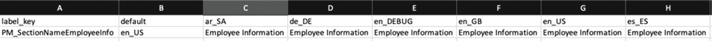

**图 10-46** 在 `.csv` 模板中输入的示例 `msgKey` 翻译

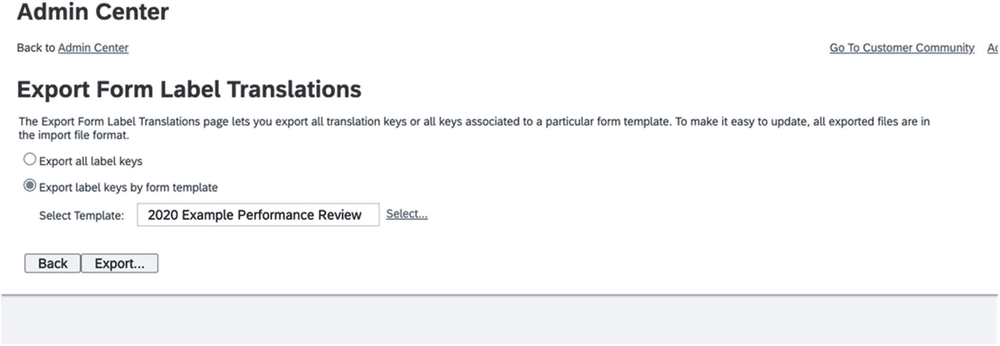

**图 10-45** 上传前导出表单标签翻译

编辑 `.csv` 文件，为你添加到 XML 的每个消息键根据需要添加/更新标签。在你更新 XML 后，消息键不会自动显示；如果这是你第一次在此屏幕上添加翻译，你需要逐个添加。确保你为 `label_key` 插入的值与 XML 中的每个 `msgKey` 值完全匹配（包括大小写）。在 B 列中提供要使用的默认区域设置代码。然后在后续列中为每个区域设置提供翻译。

完成编辑后，单击 `Back`，然后点击 `Import Form Label Translation File`。选择文件并点击 `Upload`。如果文件格式正确，你将收到一条成功消息，如图 10-47 所示。

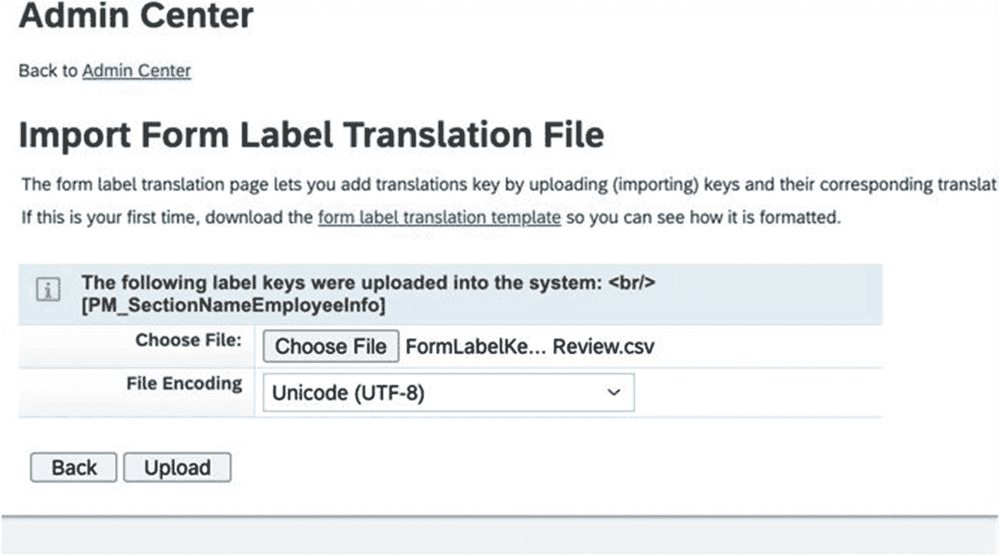

**图 10-47** 成功导入 `msgKey` 翻译

现在，你可以通过单击 `Back` 返回到主屏幕。你将能够在此屏幕上搜索你上传的标签，或按特定表单模板搜索。通过这种方式，如果你在多个模板上使用相同的键，还可以通过单击右侧显示模板数量的链接来查看所有使用相同键的模板。示例如图 10-48 所示。

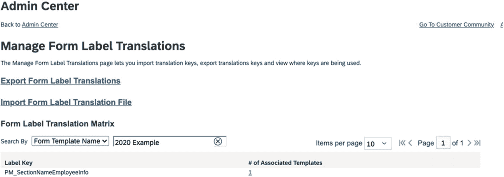

**图 10-48** 按模板名称搜索 `msgKey` 标签

恭喜！现在你知道了如何向绩效表单模板添加翻译！当用户在用户设置中选择了不同的语言并查看绩效表单时，他们将看到标签的翻译版本。

> **注意**
>
> 最终用户在开放式文本字段中输入的任何文本都不会经过翻译过程——因此，作为变更管理和对用户的指导，思考每个用户将使用哪种记录语言非常重要。这对于国际化实施尤其重要，因为员工和经理可能在两个使用不同语言的实体办公室工作。在这种情况下，员工和经理在偏好设置中选择了两种不同的语言，标签将更改为所需的语言；但是，例如，员工以其语言输入的文本将始终以该语言显示。

## 结论

我们希望你喜欢这次关于 XML 及绩效管理配置中可用高级选项的探索之旅！至此，你应该熟悉如何直接在绩效模板 XML 中进行更新，包括那些只能在 XML 中编辑的选项。此外，我们还向你展示了如何管理绩效模板中的翻译。我们希望本章对你作为这些较棘手主题的参考有所帮助！