## 13. 持续绩效管理

持续绩效管理（`CPM`）是一套定期进行的绩效反馈流程。例如，在传统的年度绩效管理流程中，反馈通常只在年中一次和年末一次进行。年度评估流程的缺点在于，它在当今变化的商业环境中效率低下。管理者和员工都认为年度流程过于刻板，几乎不会带来积极成果。员工觉得有必要与管理者定期沟通，以获得关于既定目标和目的（Goals and Objectives）的反馈。管理者则认为需要一个敏捷的评估流程，以便能够根据不断变化的业务需求调整既定的目标和目的。这就是为什么越来越多的公司转向`CPM`的原因——它既敏捷，又为管理者和员工提供了定期会面沟通的机会。

如图 13-1 所示，在`CPM`中，员工与其管理者共同确定和定义目标（Objectives）和目的（Goals）。可以决定短期里程碑，然后员工将朝着这些目标努力。根据双方约定，管理者和员工可以定期进行检查面谈（Check-ins）。通常这些检查面谈每一到三个月进行一次，但也可以是临时安排，甚至更加频繁。在检查面谈之前，员工可以就本次检查面谈想要完成的内容草拟一份议程，并与管理者分享。在检查面谈期间，应鼓励管理者和员工坚持议程，并尽量避免在谈话中讨论常规业务活动。

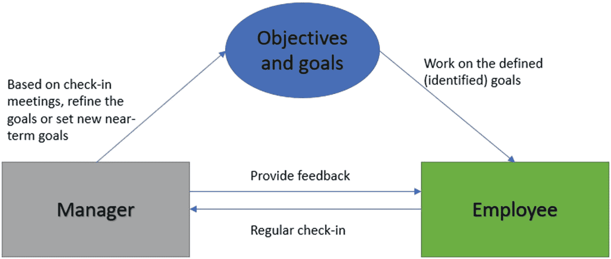

**图 13-1** 持续绩效管理

> **注：** 在图 13-1 中，目标和目的可以同时包括业务目标和发展目标。

检查面谈会议的典型议程包括以下内容：
- 回顾已定义的目标和目的。

# 持续绩效管理概述

- 确定是否需要调整已识别的目标和目的；这可能包括审视已定义的目标是否仍然是优先事项。员工和管理者都应愿意根据需要添加/删除目标。
- 追踪员工相对于目标的进展，并列出具体成就。
- 讨论员工是否需要任何支持。支持可能包括辅导或学习机会，或是更频繁的检查面谈。
- 在检查面谈期间，管理者和员工应保持沟通顺畅且透明。
- 员工应有机会讨论他们可能存在的任何疑虑或优先事项。
- 应鼓励管理者和员工投入一些时间关注员工的个人发展。这一讨论将帮助管理者评估既定目标是否仍然相关，或者是否需要进行任何调整。
- 检查面谈会议应产出切实可行的行动项，以便员工和管理者在下次约定会议之前据此执行。

随着劳动力队伍的持续演变，人力体验管理的趋势表明，员工更倾向于就其绩效获得定期反馈。与难以提供定期反馈机会的传统年度绩效评估流程相比，`CPM`恰好契合了这种需求。

在本章中，我们将讨论`SuccessFactors`如何支持持续绩效管理流程，包括如何在系统中激活`CPM`，以及如何将`CPM`与`SuccessFactors`的`目标`、`绩效管理`、`校准`和`发展`应用集成。

## 激活持续绩效管理

在`管理中心`激活`CPM`之前，您需要完成以下先决条件：
- 在`Provisioning`中，您需要启用开关`启用持续绩效管理`，该开关要求启用`启用通用对象`、`基于角色的权限`（这将禁用管理域）和`启用附件管理器`。

> **注：** 在激活此开关之前，您需要在`Provisioning`中激活`启用通用对象`和`启用附件管理器`开关。

- 员工和管理者应具有访问其汇报管理者或员工的`名字`、`中间名`、`姓氏`、`职位`和`管理者`数据字段的权限。

您可以通过执行名为`绩效管理功能设置`的配置，在`管理中心`中激活`CPM`（参见图 13-2）。

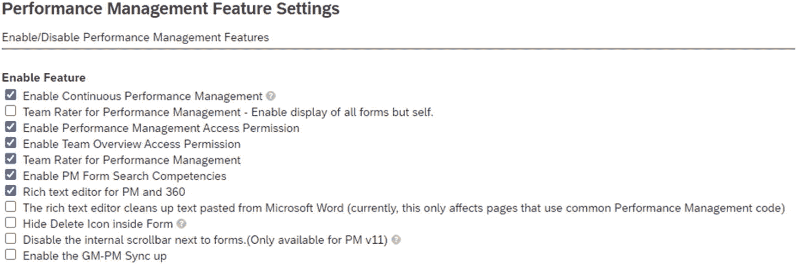
**图 13-2** 激活 CPM

在显示的页面上，选择配置开关`Enable Continuous Performance Management`。
请注意，如果你无权访问配置步骤`Performance Management Feature Settings`，你可以在`Permission Settings` ➤ `Administrator Permissions` ➤ `Manage System Properties` ➤ `Performance Management Feature Settings`中分配所需权限。

## 权限设置

根据角色不同，你需要为经理、员工和 CPM 管理员分配相应的权限。需要配置的权限可通过`Permission Settings` ➤ `User Permissions`以及`Permission Settings` ➤ `Administrator Permissions`访问。

> **注意**
> 在本节中，我们仅审查与 CPM 相关的权限。我们不会审查其他权限，例如`Employee Data`、`Company System`、`Logo Settings`等。

需要分配的权限涵盖在以下各节中。

### 持续绩效管理用户权限

以下是此类别中可用的权限设置：

*   **访问持续绩效管理**：此权限设置将授予对 CPM 的访问权限。

    > **注意**
    > CPM 的访问权限由分配的目标人群驱动。因此，员工的目标人群应包含`Self`，经理的目标人群应包含`Self`和`Direct Reports`。

*   **访问持续反馈**：此权限将授予对组织内所有员工持续反馈的访问权限。

    > **注意**
    > 此权限应授予需要获取所有员工持续反馈数据的人员。直线经理和员工不应被授予此权限。

*   **提供持续反馈**：此权限将授予向你的直接下属以及其他被分配接收持续反馈的人员提供持续反馈的权限。

*   **向他人请求反馈**：此权限将授予向其他人请求反馈的权限。

    > **注意**
    > 你请求反馈的人员应包含在目标人群中。如果你寻求反馈的人员不在你的目标人群中，你将无法通过 CPM 联系该人员并请求反馈。
    > 此权限应与设置“`Limit about whom feedback can be requested`”一起授予。

*   **限制可被请求反馈的人员范围**：此权限将限制可被联系以提供反馈的人员范围。

    > **注意**
    > 此权限应与权限“`Request feedback from others`”一起授予。

### 持续绩效管理

以下是此类别中可用的权限设置（见图 13-3）：

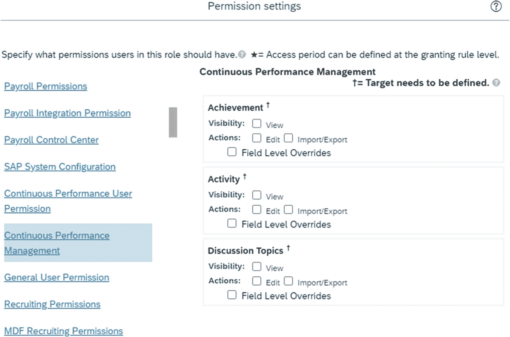
**图 13-3** CPM 相关权限类别

*   **成就**：此权限允许你创建、查看和编辑成就。
*   **活动**：此权限允许你创建、查看和编辑活动。
*   **讨论主题**：此权限允许你创建、查看和编辑讨论主题。

### 管理持续绩效

权限类别`Manage Continuous Performance`可通过`Permission Settings` ➤ `Administrator Permissions`访问。以下是此类别中可用的权限设置：

*   **访问管理配置页面**：此权限应仅分配给 CPM 管理员。此权限授予对 CPM 配置页面的访问权限。
*   **对所有持续绩效管理数据的管理访问权限**：此权限允许你将 CPM 中添加的成就链接到绩效管理中的目标。

> **注意**
> 你可以通过点击`Home`下拉菜单中显示的选项`Continuous Performance`来访问 CPM。

## 移动应用

如果你的实例中启用了`Mobility`，你可以在移动设备上访问 CPM。你可以通过执行`Enable Mobile Features`来启用在移动设备上访问 CPM。在显示的配置页面上，在`Modules`中的`Talent`部分，选择选项`Goal Management`、`Performance Review`和`Continuous Performance`。

移动设备支持以下 CPM 功能：
*   活动
*   成就
*   反馈流程
*   辅导
*   记录一对一会议
*   查看会议历史
*   其他主题

> **注意**
> `SuccessFactors`移动应用可在 iOS（8 版及更新版本）或 Android（4 版及更新版本）上访问。

在下一节中，我们将讨论如何配置 CPM。

## 持续绩效管理配置

你可以通过在搜索栏中执行配置步骤`Continuous Performance Management`来访问 CPM 配置页面。显示的页面（见图 13-4）包含不同的部分。我们将逐一审查每个部分。

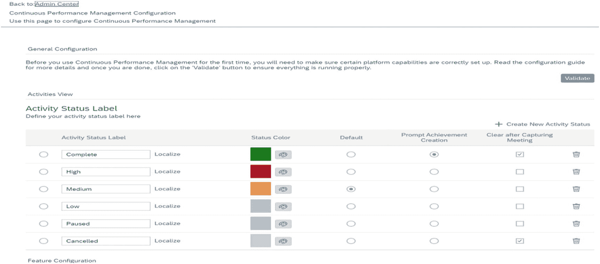
**图 13-4** CPM 配置

*   **常规配置**：此部分中显示的`Validate`按钮会执行配置和权限检查，以确保所需的配置已完成且有效。

检查工具执行以下操作：

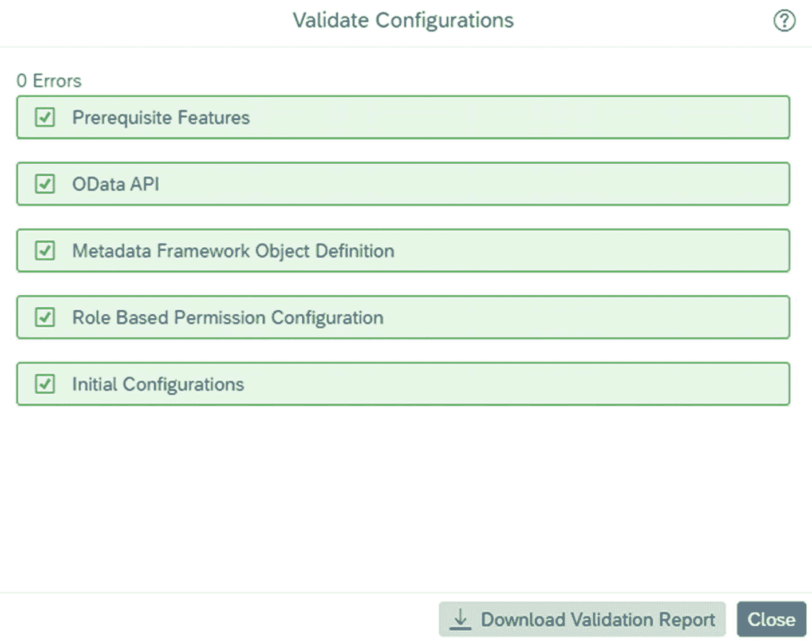
**图 13-5** CPM 配置检查

1.  验证实例中是否提供了 CPM 所需的以下实体：

    *   `ActivityStatus(high)`
    *   `ActivityStatus(medium)`
    *   `ActivityStatus(low)`
    *   `ActivityStatus(paused)`
    *   `ActivityStatus(complete)`
    *   `ActivityStatus(cancelled)`
    *   `OtherTopicStatus(Open)`
    *   `OtherTopicStatus(Closed)`
    *   `FeedbackFlag(Red)`
    *   `CPMNotificationConfig(CPM_1ON1_EMP_TODO_NOTIFICATION)`
    *   `CPMNotificationConfig(CPM_1ON1_MANAGER_TODO_NOTIFICATION)`
    *   `CPMNotificationConfig(CPM_ACTIVITY_REMINDER_NOTIFICATION)`

# CPM 配置验证与功能设置

## 配置验证
1. 验证实例中是否提供了 `CPMNotificationConfig(CPM_ACHIEVEMENT_REMINDER_NOTIFICATION`。
2. 验证实例中是否提供了 CPM 所需的 `Metadata Framework`（MDF）实体。
3. 验证实例中是否分配了所需的权限。具体来说，它会验证以下权限设置：
    * `Access to Continuous Performance Management`
    * `Access to Administrative Configuration page`
    * `Company Info Access`
    * `User Search`
    * `Admin access to OData API`
    * `Read/Write Permission on Metadata Framework`
4. 验证 `Provisioning` 中需要激活的不同开关是否已完成。如图 13-5 所示，它验证先决条件（主要是在 `Provisioning` 中激活开关）是否已完成。
5. 检查实例中是否提供了 CPM 所需的 OData API。

> **注意** 你可以通过执行配置步骤 `OData API Data Dictionary` 来查看实例中可用的所有 OData API 列表。

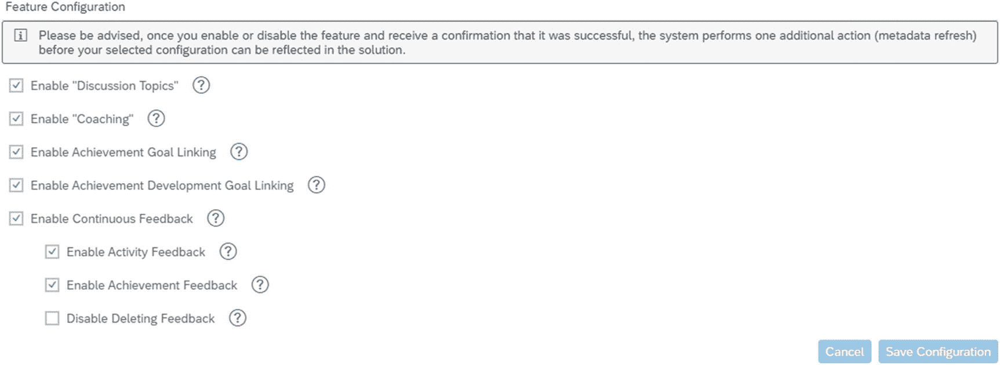

**图 13-6** 在 CPM 中配置功能

## 功能配置

* **活动视图**：在本节中，我们将创建在 CPM 中使用的不同活动。我们可以定义在创建活动时哪个状态将是默认状态。我们还可以定义将触发创建成就的状态。如图 13-4 所示，我们已定义一旦活动标记为完成，它将在 CPM 中创建一个成就。

在本节中（见图 13-6），我们可以勾选/取消勾选 CPM 中可用的不同选项。例如，如果您不希望系统中提供删除反馈的功能，可以取消勾选“禁用删除反馈”选项。

**提示：**

1) 如果将鼠标悬停在问号图标上，您将看到该特定选项的说明。
2) 勾选/取消勾选某个选项后，如果更改未在系统中生效，请执行以下操作：运行 `config OData API Metadata Refresh and Export`。在显示的页面上，点击 `Refresh`。这将刷新缓存并使实例同步更改。

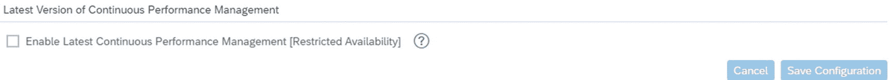

**图 13-7** 启用最新版本的 CPM

## 最新版本的持续绩效管理

如果您有兴趣升级到 CPM 的最新版本，可以启用此选项（见图 13-7）。最新版本尚未全面上市，但自 2020 年 6 月起已可用。

启用此选项后，以下选项将可用：
- **会议纪要**：这是一个新功能。
- **讨论话题**：此功能是新增的，它取代了 CPM 当前可用的“其他话题”功能。启用此选项后，系统会自动将“其他话题”中的数据转换为“讨论话题”。
- **活动视图**。
- **会议视图**。
- **成就视图**：您将获得一个重新设计的视图。

在最新版本中，以下选项被禁用：

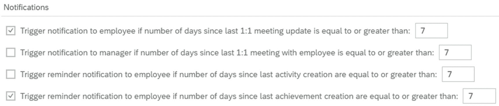

**图 13-8** 在 CPM 中启用通知

- 活动反馈
- 辅导
- 成就目标关联
- 成就发展目标关联
- 持续反馈
- 成就反馈

**注意：** 如果您要启用 CPM 的最新版本，SuccessFactors 建议您同时启用 Fiori 3 主题和页眉。

## 通知

此处（见图 13-8）您可以为员工和经理勾选/取消勾选实例中可用的不同通知和提醒选项。天数的值应大于或等于 1。不接受负数或小数。提醒将显示在主页的 `ToDo` 磁贴中。

**注意：** 如果您激活了这些作业中的任何一个，则需要在 `Provisioning` 中配置一个计划作业。作业类型将是 `CPM Notification Job`。

您也可以配置通过电子邮件发送提醒。如果您想为“更新活动”、“成就”或“其他话题”配置提醒通知，可以在配置步骤 `E-Mail Notification Templates Settings` 中进行设置。（注意：您可以通过在搜索栏中输入 `E-Mail Notification Templates Settings` 来访问配置屏幕进行电子邮件配置。）这将确保员工或经理收到提醒邮件。执行配置步骤 `Email Template Notification` 后，在显示的页面上，搜索通知 `Update Status Reminder Notification`。选中该通知并点击 `Save Notification Settings` 以保存更改。员工将通过电子邮件以及 SuccessFactors 主页上的 `ToDo` 磁贴收到通知。系统将每四天生成一次提醒，直到活动在 CPM 中更新为止。

**提示：** 您可以更新通知中的已交付文本（图 13-9）以适应您的业务需求。

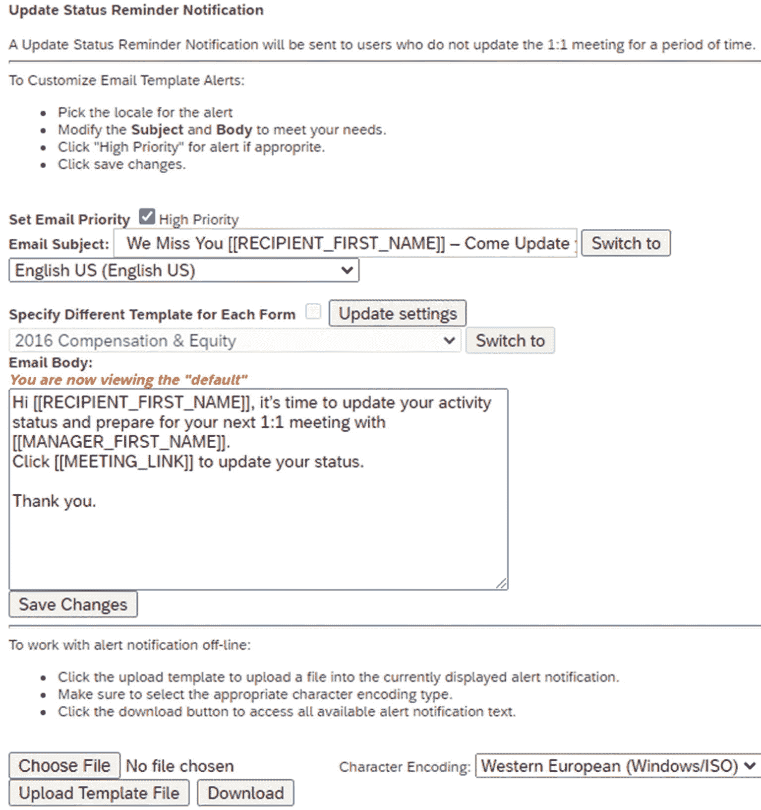

**图 13-9** 更新状态提醒通知页面

如果您想配置向经理发送的提醒通知，以便在他们未在规定天数内与直属下属进行一对一会议时发出提醒，可以在配置步骤 `E-Mail Notification Templates Settings` 中进行设置。执行配置步骤 `E-Mail Template Notification` 后，在显示的页面上，搜索通知 `Conduct 1:1 Meeting Reminder Notification`。选中该通知并记得保存您的设置。您也可以更新通知中的默认文本以满足需求。

我们可以创建一封发送给员工的电子邮件通知，在他们收到反馈或收到对反馈请求的回复时进行通知。与其他通知类似，执行配置步骤 `E-Mail Notification Templates Settings`。在显示的页面上，搜索通知 `Continuous Feedback Received Notification`。选中该通知并记得保存您的设置。您也可以更新通知中的默认文本以满足需求。

**注意：** 此通知的一个前提条件是实例中应启用智能服务 (IS)。

我们可以创建一封发送给员工的电子邮件通知，在他们收到其他员工的反馈请求时提醒他们提供反馈。与其他通知类似，执行配置步骤 `E-Mail Notification Templates Settings`。在显示的页面上，搜索通知 `Continuous Feedback Request Notification`。选中该通知并记得保存您的设置。您也可以更新通知中的默认文本以满足需求。

**注意：** 此通知的一个前提条件是实例中应启用智能服务 (IS)。

我们可以创建一封发送给员工的电子邮件通知，在他们的汇报经理在 CPM 中进行更新或添加评论时进行通知。与其他通知类似，执行配置步骤 `E-Mail Notification Templates Settings`。在显示的页面上，搜索通知 `Activity Update Creation Notification`。选中该通知并记得保存您的设置。您也可以更新通知中的默认文本以满足需求。

**注意：** 与我们之前见过的通知类似，此通知由智能服务触发。要配置此活动，请执行配置步骤 `Intelligent Services Center`。请注意，您可以通过在搜索栏中执行 `Intelligent Services Center (ISC)` 来访问配置屏幕。在显示的页面上，点击 `Continuous Performance Management Activity`。

在显示的页面上（见图 13-10），选择活动“Notify employee about activity update”，并根据需要进行更改。（默认情况下，此流程足以触发电子邮件通知。）点击 `Actions`，然后点击 `Save Flow` 以保存流程规则。

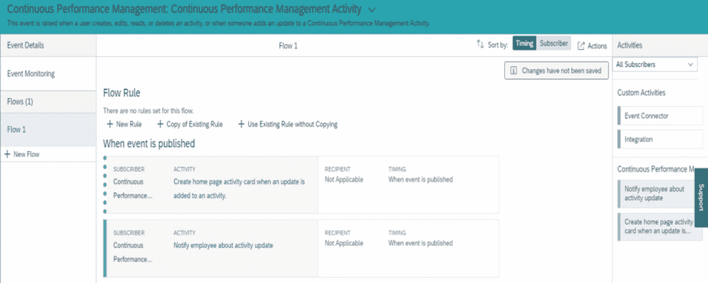

**图 13-10** 配置用于活动更新创建通知的智能服务

每当经理在 CPM 中进行更新或添加评论时，员工将收到一封电子邮件通知。经理所做的更改在 CPM 中也会直接对员工可见。

## 活动

```

员工正在处理的任务可作为活动在 CPM 中跟踪。活动可能与分配给员工的目标或目的相关，也可能不相关。您可以请求对活动进行反馈。CPM 中的所有活动都会关联一个状态。（注意：请参阅“持续绩效管理配置”部分，其中我们讨论了活动中的状态。）当活动移至 `Completed` 状态时，您可以为该特定活动创建一项成就。

**注意：** 仅当您使用默认目标计划或默认发展目标计划时，活动才能链接到目标。

如图 13-11 所示，你可以通过点击 `Add Activity` 创建活动。在显示的界面上，输入活动名称。默认情况下，状态设置为 `Medium`。你可以点击下拉菜单选择合适的状态来更改状态。每当活动有更新时，你可以在字段中输入内容，然后点击 `OK` 保存条目。

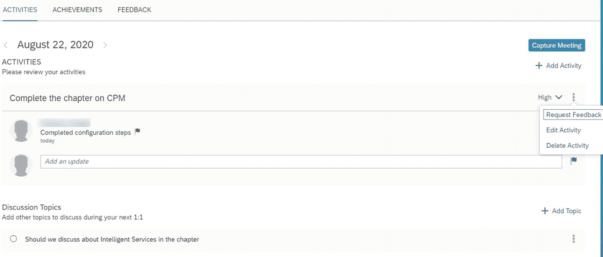

**图 13-11** CPM 中的活动

如图 13-11 所示，你可以通过点击 `Request Feedback` 请求对活动的反馈。在显示的界面上（见图 13-12），你可以输入你想要收集反馈的员工姓名。

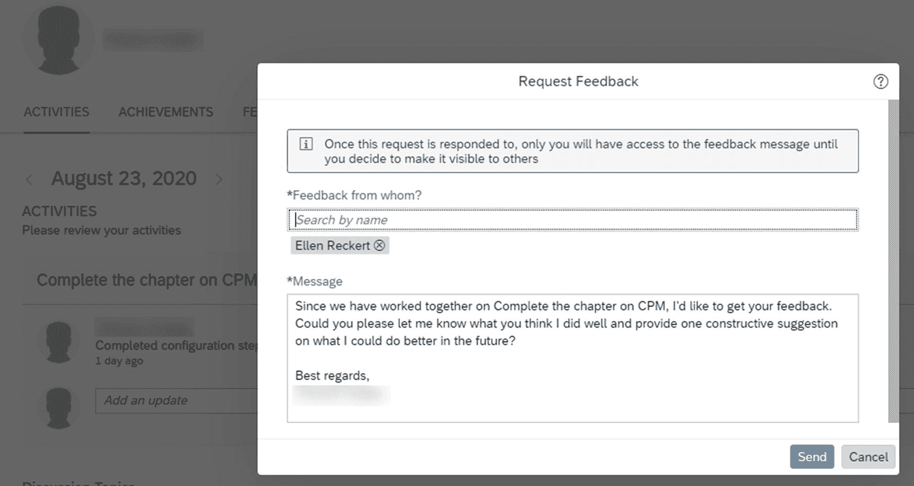

**图 13-12** 请求反馈

> **注意**
>
> 如果员工没有收到请求反馈的邮件通知，请检查邮件通知是否已激活，以及员工档案中的电子邮件地址是否正确。

收到反馈请求的员工将在其 `ToDo` 部分的 `Request Feedback` 磁贴中看到该请求。点击该磁贴，然后点击 `Provide Feedback` 即可向请求反馈的员工提供反馈。你所提供的反馈将对请求者可见。

> **注意**
>
> 收到提供反馈请求的员工可以通过点击 `Decline` 拒绝提供反馈。请求反馈的员工可以点击 `Feedback` 选项卡上的 `View Feedback Requests`，查看被请求人是否已拒绝提供反馈。

员工可以通过点击 `Feedback` 选项卡查看反馈（见图 13-11）。员工可以选择是否让经理看到该反馈（见图 13-13）。员工还可以选择删除反馈。请注意，员工收到的每条反馈都会显示一个 `Linked` 链接。点击此链接，将打开一个对话框，显示与此反馈关联的活动。

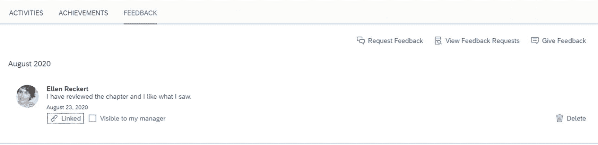

**图 13-13** 员工收到的反馈

> **提示**
>
> 如果反馈关联到某个活动，该特定活动中会显示一个 `Feedback` 链接。你可以点击该链接查看反馈。

> **注意**
>
> 你也可以直接在 `Feedback` 选项卡上请求反馈。当直接从 `Feedback` 选项卡请求反馈时，该反馈不会关联到任何活动。你可以点击 `Linked` 将反馈关联到一个活动或一个成就。

在 `Feedback` 选项卡上，点击 `View Feedback Requests` 会显示该员工发出的所有反馈请求。员工可以使用 `Give Feedback` 选项向其他员工提供反馈。其他员工可以在其 `CPM/Feedback` 选项卡上查看该反馈，并可以选择将反馈关联到一个活动或一项成就。

> **注意**
>
> 前提条件是，应为主页上接收反馈请求的人员启用 `ToDo` 磁贴。同时，请求反馈的员工应启用 `RBP` 功能才能请求反馈。

在 `Discussion Topics`（讨论主题）部分（见图 13-11），你可以添加打算在下次一对一会议中与经理讨论的主题。

> **注意**
>
> 经理对 CPM 的视图（见图 13-14）与员工（个人贡献者）的视图类似。在经理视图中，经理可以在同一屏幕上看到其直接下属。他们可以点击每位员工来查看该员工的 CPM 详情。要查看自己的 CPM，经理需要点击自己的姓名。

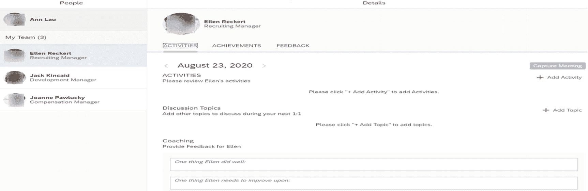

**图 13-14** 经理的 CPM 视图

经理可以为其员工创建活动和讨论主题，并可以为其员工请求反馈。经理没有能力隐藏其员工收到的反馈。员工（经理为其请求反馈的员工）可以在自己的 CPM 中查看该反馈，并可以将反馈关联到活动或成就。在经理视图中，请注意 `Activities` 选项卡上还有一个额外的 `Coaching`（辅导）部分。在此部分中，经理可以辅导其直接下属，指出他们做得好以及需要改进的地方。请注意，只有在配置步骤 `Continuous Performance Management` 中启用了 `Coaching` 选项时，辅导部分才会显示。点击 `Capture Meeting` 按钮将标记该员工已完成与经理的一对一会议。

> **注意**
>
> 在实例中启用 CPM 时，默认情况下 `Topics` 和 `Coaching` 也会启用。如果你不想使用这些功能，可以在实例中禁用它们。执行配置 `Continuous Performance Management`。在显示的配置页面上，取消选中 `Enable Discussion Topics` 和 `Enable Coaching` 选项。这两个开关都在 `Feature Configuration` 部分中。请记住，当你禁用 `Topics` 和 `Coaching` 时，`Topics` 和 `Coaching` 会在 `Activities` 部分中隐藏。如果在启用这些开关后又将其禁用，则所有当前数据和已记录的会议将仅显示活动数据。如果重新启用这些开关，已记录的数据将再次显示在 `Activities` 部分中。

## 成就

CPM 中的 `Achievements`（成就）选项卡（见图 13-15）列出了你在系统中记录的成就。你可以按时间或按目标标记成就。被标记为成就的活动会列在此选项卡中。（通常，当一项活动完成时，你可以将其标记为成就。）

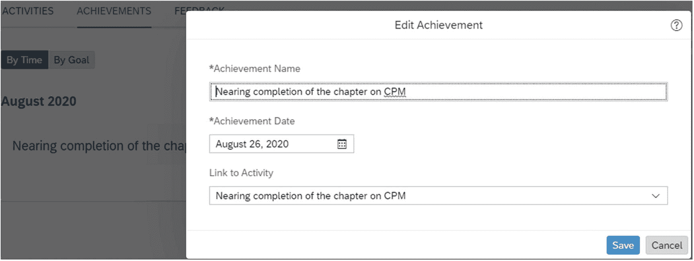

**图 13-15** CPM 中的成就选项卡

员工的经理将有权访问此选项卡，并可以查看该员工标记的所有成就。

> **注意**
>
> 如果有多个成就关联到同一个活动，你可以在同一个选项卡上查看所有成就。CPM 还会按时间顺序显示成就，并提供按日期筛选成就的功能。

### 将成就与 SuccessFactors 绩效管理集成

你可以在配置步骤 `Form Template Settings` 中将成就与 SuccessFactors 绩效管理集成。你可以在 `Admin Center` 或通过搜索框执行此配置步骤。在显示的页面上，滚动到页面底部，然后在 `Performance Goal` 部分的 `Enable Achievements` 选项卡和 `Performance Development Goal` 部分的 `Enable Achievements` 选项卡上选择相应选项（见图 13-16）。如果你希望在绩效管理中显示成就反馈，请选择 `Display Achievement Feedback for Performance Goal Achievements` 和 `Display Achievement Feedback for Development Goal Achievements` 选项。

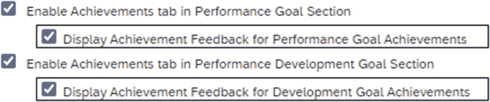

**图 13-16** 在绩效管理表单中集成成就

选择这些选项后，`Achievements` 选项卡将显示在绩效表单中。

> **注意**
>
> 前提条件是，绩效管理系统应为 PM12 Acceleration 版本。

### 将成就与目标管理集成

您可以将成就与 SuccessFactors 目标计划集成。通过将成就与目标计划集成，员工及其经理可以直接在员工的目标计划中查看与绩效目标相关联的成就和收到的反馈（如果有）。

要进行配置，请执行配置步骤 `Manage Templates`。（请注意，您可以通过在搜索栏中执行 `Manage Templates` 来访问配置屏幕。）在显示的页面上，单击 `Goal Plan` 选项卡。在显示的页面上，选择要与成就集成的目标计划。在显示的页面上，选择 `General Settings` 选项（参见图 13-17）。在显示的页面上，选择“在目标计划上显示连续绩效管理成就”选项。单击 `Save` 保存您的设置。

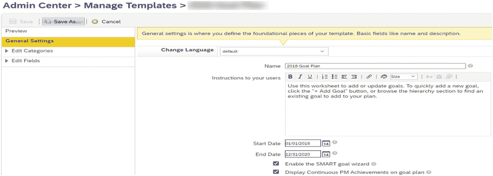

**图 13-17** – 在目标计划中集成成就

> **注意：** 目前，SuccessFactors 没有选项用于链接 CPM 中的多个目标计划。这已在产品路线图中，但 SuccessFactors 尚未公布其发布日期。`在目标计划上显示连续绩效管理成就` 开关（参见图 13-17）仅允许您从目标表单中查看链接到您目标的 CPM 成就。您无法从目标计划中编辑 CPM 成就。

### 将成就与发展目标集成

您可以将成就与您的 SuccessFactors 发展目标集成。通过将成就与发展目标集成，员工及其经理可以直接在员工的发展目标计划中查看与绩效目标相关联的成就和收到的反馈（如果有）。

要进行配置，请执行配置步骤 `Manage Templates`。在显示的页面上，单击 `Development` 选项卡。在显示的页面上，选择要与成就集成的发展目标。在显示的页面上，选择 `General Settings` 选项（参见图 13-18）。在显示的页面上，选择“在目标计划上显示连续绩效管理成就”。单击 `Save` 保存您的设置。

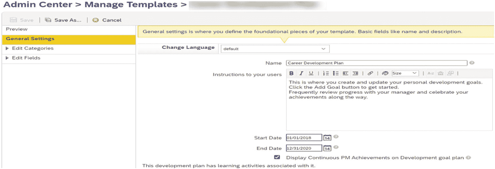

**图 13-18** – 在发展目标计划中集成成就

### 将成就与校准模板集成

您可以将成就与校准模板集成。将成就与校准模板关联，使经理能够直接在校准模板中查看其直接下属的成就。

要进行配置，请执行配置步骤 `Manage Calibration Templates`。在显示的页面上，选择需要与成就集成的校准模板。在显示的页面上，单击 `Data` 选项卡。在显示的页面上（参见图 13-19），滚动到页面底部。选择“允许访问持续绩效管理成就”选项。保存您的设置。

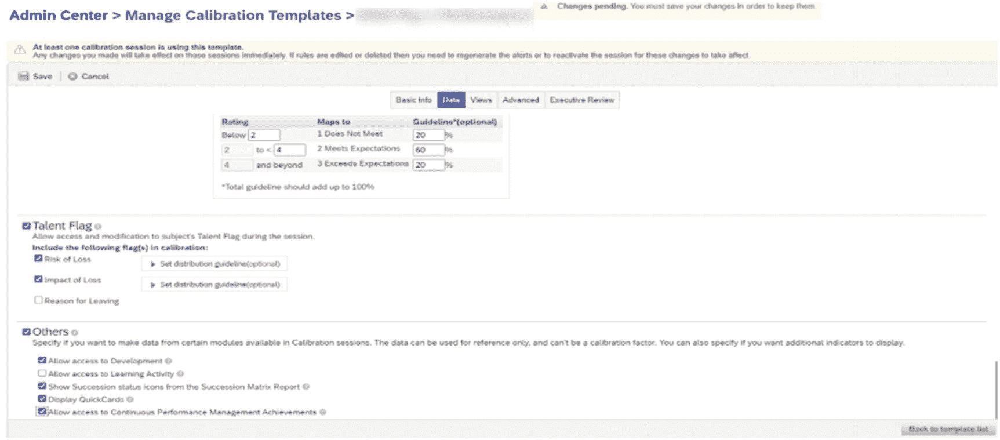

**图 13-19** – 将成就与校准模板集成

## 报告

在此情况下，我们将讨论如何为 CPM 创建即席报告。首先，我们将回顾访问报告功能需要哪些权限。

作为创建和运行 CPM 即席报告的先决条件，您需要被分配相应的权限。执行配置步骤 `Manage Permission Roles`。在显示的页面上，单击您想要为其分配创建/执行 CPM 即席报告权限的权限角色。在显示的页面上，单击 `Permission`。在 `User Permissions` 部分，单击 `Reports Permission`（参见图 13-20）。单击 `Create Report` 权限，并分配 `Continuous Performance Management` 和 `Continuous Performance Meetings`。向下滚动，单击 `Run Report` 权限，并分配 `Continuous Performance Management` 和 `Continuous Performance Meetings`。

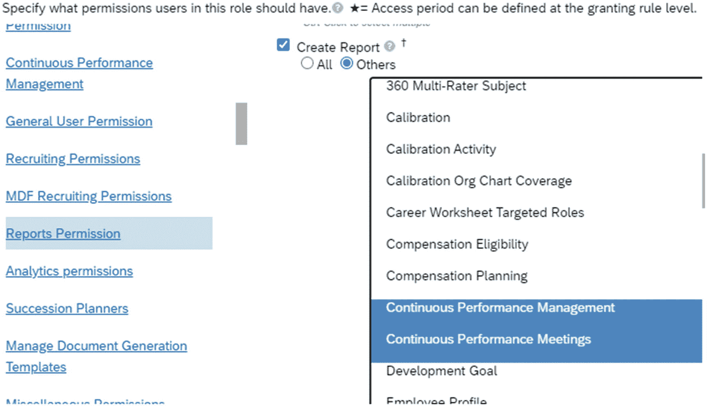

**图 13-20** – 分配创建/执行 CPM 即席报告的权限

要创建 CPM 的即席报告，您可以选择域 `Continuous Performance Management` 或 `Continuous Performance Meetings`。您可以使用域 `Continuous Performance Management` 来创建任何使用与活动、成就、辅导和主题相关数据的报告。您可以选择域 `Continuous Performance Meetings` 来报告与一对一会议相关的数据。

> **注意：** 当您创建 `Continuous Performance Management` 报告时，一次只能选择一个实体；否则，您将得到错误的报告。您可以使用实体 `Activity` 和 `Achievement` 来报告已转化为成就的活动。

> **提示：** 您可以通过执行配置步骤 `Manage Dashboards` 并选择选项 `Manage Standard Dashboards and YouCalc Files` 在系统中创建 YouCalc 文件。在显示的页面上，选择选项 `Build Tile` 并选择 `Continuous Performance Management` 作为域。

您可以创建基于 YouCalc 文件的磁贴。要创建磁贴，请执行配置步骤 `Manage Dashboards` 并选择选项 `Manage Tile-Based Dashboards`。在显示的页面上，单击 `Create New Dashboard`。作为访问 YouCalc 文件和创建磁贴的先决条件，您需要被分配相应的权限。执行配置步骤 `Manage Permission Roles`。在显示的页面上，单击您想要为其分配权限以访问 YouCalc 文件的权限角色。在显示的页面上，单击 `Permission`。在 `User Permissions` 部分，单击 `Reports Permission`。单击 `Analytics Tiles and Dashboards` 权限并选择 `All`。向下滚动到 `Administrator Permissions` 部分。单击 `Manage Dashboards/Reports` 权限，然后选择 `Analytics Tiles and Dashboards`。记得保存您的选择。

## 案例研究

在本节中，我们将回顾两个案例研究。在第一个案例研究中，我们将讨论如何将成就与薪酬集成。

### 案例 1

客户 A 已经实施了 CPM 和其他绩效应用程序，例如绩效管理、目标管理和发展目标。该客户目前正在实施薪酬管理，并希望将成就与薪酬集成。将成就与薪酬集成将帮助薪酬规划者直接在薪酬工作表中查看员工的成就。

#### 解决方案 1

要将成就与薪酬集成，请执行配置步骤 `Compensation Home`。在显示的页面上，选择您想要与成就集成的薪酬计划。在显示的页面上，单击 `Plan Setup` 选项卡。单击 `Plan Setup/Settings` 中的下拉菜单，然后选择 `Advanced Settings`。在显示的页面上（参见图 13-21），滚动到底部并选择“允许访问持续绩效管理成就视图”选项。单击 `Update Form Template` 保存您的设置。

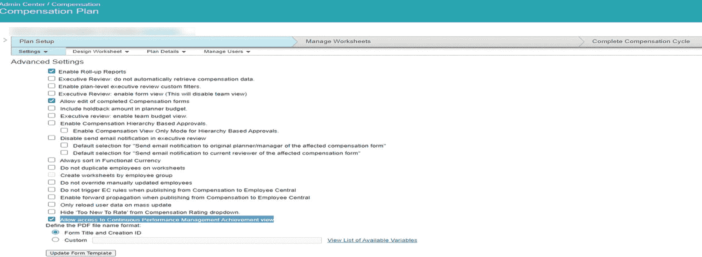

**图 13-21** – 将成就与薪酬集成

##### 在薪酬工作表中

在`薪酬工作表`中，薪酬规划师可以通过选择`打开成就`来查看相关成果。

### 案例 2

客户希望检视这样一个场景：员工和经理发起反馈请求并给出反馈。

#### 解决方案 2

我们将分别从员工和经理的角度来讨论这个案例。

##### 作为员工：请求反馈 / 提供反馈

当员工请求反馈时，他们是在为自己请求反馈（见图 13-22）。当员工提供反馈时，他们是为特定员工提供反馈（图 13-23）。

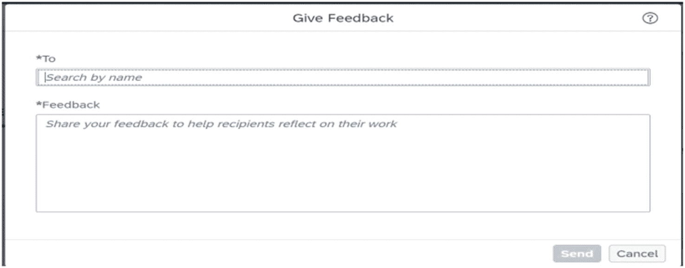

**图 13-23** 提供反馈

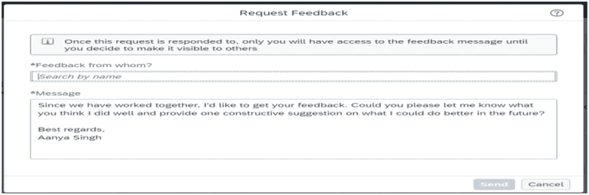

**图 13-22** 请求反馈

当员工请求反馈时，他们可以在`查看反馈请求`中查看反馈请求的状态。反馈请求发出后，将显示为`待定`状态。

当员工收到反馈请求时，他们可以在首页的`提供反馈`磁贴的`待办`部分看到该请求。点击该磁贴，显示的页面将出现`提供反馈`和`拒绝`按钮。员工可以通过点击`拒绝`来拒绝提供反馈。当员工拒绝提供反馈时，发起反馈请求的员工可以在`查看反馈请求`中看到状态显示为`已拒绝`。

收到反馈请求的员工可以通过点击`提供反馈`来给予反馈。这将显示一个新的对话框，员工（接收者）可以在其中输入反馈内容。记得点击`发送`。任何已提供的反馈都会对发起请求的员工可见。当员工提供反馈后，发起反馈请求的员工在点击`查看反馈请求`时会注意到状态已变为“已于`<<日期>>`回复”。员工可以选择“让我的经理可见”使反馈对经理可见。他们还可以将反馈关联到某项活动或成就。

当员工主动向另一名员工提供反馈（非被请求时），被反馈的员工将收到一条通知，告知有员工为其提供了反馈，同时会提供一个查看反馈的链接。该反馈将显示在`反馈`页面上，收到反馈的员工可以选择让经理可见，并将其关联到活动或成就。

## 作为经理：请求反馈 / 提供反馈

经理可以在`持续绩效管理/反馈`页面上向其下属发起反馈请求或为其提供反馈（见图 13-24）。

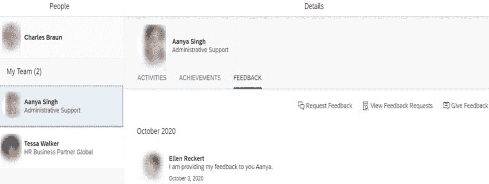

图 13-24 反馈页面，经理视图

在显示的页面上，经理可以通过点击其`我的团队`列表中的员工来请求反馈或提供反馈（见图 13-24）。

经理可以通过点击`请求反馈`来为其下属请求反馈。收到请求的人将在收件箱中收到通知，并在首页的`提供反馈`磁贴上看到该请求。一旦有人回复了经理的反馈请求，经理将收到一条通知，告知反馈已提供/已回复。

被请求反馈的员工对反馈请求毫不知情。系统不会向被请求反馈的员工发送任何通知，`查看反馈请求`也不会显示经理发起的请求。尽管如此，经理可以在其请求反馈的员工的`查看反馈请求`中查看该请求。

一旦反馈被提供，被请求反馈的员工可以在其`反馈`页面上查看该反馈。他们可以将反馈关联到成就或活动，也可以选择让经理可见。

经理可以在该员工的反馈页面上查看反馈。

经理可以通过点击其下属对应的`提供反馈`来为其提供反馈。任何提供的反馈都会显示在该员工的反馈页面上。员工也将收到一条通知，告知其经理已提供反馈。

## 结论

在本章中，我们回顾了持续绩效管理的概念、它所提供的灵活性，以及如何将其整合到年度评估流程中。我们讨论了如何将 CPM 中的成就与绩效管理、目标管理、发展目标和校准相结合。作为一个案例研究，我们看到了成就如何整合到薪酬工作表中，这有助于薪酬规划师直接在员工的薪酬工作表中查看成就。

CPM 是一个令人兴奋的人力资源流程，越来越多的组织正在采纳它，以便为员工提供持续的反馈，并灵活调整活动以适应业务和市场需求。
