# 14. 配置校准

## 校准概览

`校准`是一个用于以公正且一致的方式评估员工绩效的过程。经理们在校准会议上讨论员工绩效，以就绩效评级达成一致。可以制定指导方针，以便对每个绩效评级的定义保持一致，从而在讨论和评估绩效时使用共同的语言。其目的是帮助消除经理在讨论员工绩效和确定最终评级时可能存在的任何偏见。

`SAP SuccessFactors Calibration` 提供了一个客观评估员工绩效的框架。该工具为人力资源和高级管理人员提供了跨团队、部门和整个组织公正审查和调整绩效评级的方法。`校准`模块提供了一个可视化呈现员工数据的界面，可以通过图表、分组或列表格式查看。过滤和分组评级数据的功能有助于发现存在偏见的领域。这些视图比包含员工姓名和评级的单一维度电子表格（供经理评估）更有意义。

`校准`中使用的信息可能来自`绩效管理`、`人员档案`、`薪酬`或`继任`数据。在`绩效管理`中，可以校准总体绩效、潜力、能力和目标评级。可能进行校准的`继任`相关指标包括`流失风险`、`流失影响`和`离职原因`。可以使用薪酬模板的薪资、奖金、股票和可变薪酬组件来评估薪酬比率。可以从`人员档案`的`人才档案`部分校准总体潜力、绩效、能力、目标以及两个自定义评级。校准会议完成后，评级将在原始来源中更新。

`校准`不支持：

- `可变薪酬`或`360 度评估`数据

- 直接在薪酬表单上输入的评级

- 数据标准化

此外，`校准`不应用于管理现任者和继任计划。

在本章中，我们将启用并配置`校准`。我们将介绍创建校准会议的步骤，包括以下内容：

- 在`预配置`中启用`校准`。

- 配置`继任数据模型`。

- 为`校准`访问设置基于角色的权限。

- 配置数据源模板和路径图。

- 启用与校准相关的电子邮件通知。

- 配置校准模板。

- 配置校准设置。

- 配置`校准人才卡`。

- 将用户分配给`行政审阅者`角色。

- 强制对评级变更进行评论。

- 在`人员档案`中配置`校准历史记录组件`。

- `校准`主页磁贴。

- `校准`警报

- `文本替换`

那么，让我们开始吧！

## 在预配置中启用校准

为了使用`SAP SuccessFactors Calibration`模块，必须在`预配置`中启用一些简单的功能。

登录到`预配置`，点击“公司设置”链接。

搜索“校准”以找到名为“启用校准”的部分。找到后，勾选图 14-1 所示的复选框，以在您的实例中启用`校准`。

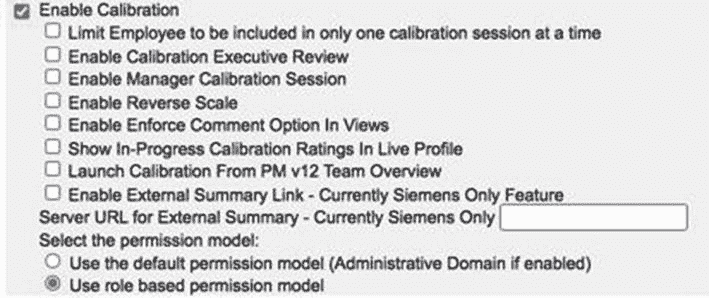

图 14-1 在公司设置中启用校准

`启用校准`内的其他设置可以在此处或实例内的`管理校准设置`中启用。有两个设置在此处启用会很有帮助：

1. `启用校准行政审阅`

2. `从 PM v12 团队概览启动校准`

如果您计划使用`行政审阅`（它为高管和人力资源总结跨会议的校准活动），请在此处启用它。这将在创建校准模板时提供对`行政审阅`选项卡的访问。

为了让经理能够在`绩效管理`的`团队概览`中创建自己的校准会议，请勾选“从 PM v12 团队概览启动校准”复选框。这会在配置校准设置时显示`经理模板`选项卡。

在`启用校准`中，有一个单选按钮用于标识所使用的权限模型。示例如图 14-2 所示。默认权限模型是旧版权限，但您应该使用基于角色的权限（RBP）。确保选中“使用基于角色的权限模型”。

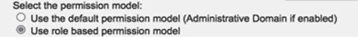

图 14-2 权限模型选择

在进入下一组要启用功能之前，请在“公司设置”中保存此部分。

## 校准报告权限

`校准`没有标准的报告或仪表板。任何校准报告都需要使用即席报告来完成。有三个与`校准`相关的域需要启用。

转到“公司设置”中的“分析和仪表板选项卡及杂项报告”部分。

确保选中“附加即席子域模式”和“在人员选择器中启用从用户开始”，然后启用以下内容：

- `校准`

- `校准组织图表覆盖范围`

- `校准活动`

保存该部分，然后退出“公司设置”。

## 在继任数据模型中配置校准

我们需要更新`继任数据模型`，以纳入一些与`校准`相关的元素。

在`继任管理`中，如图 14-3 所示，选择“导入/导出数据模型”。

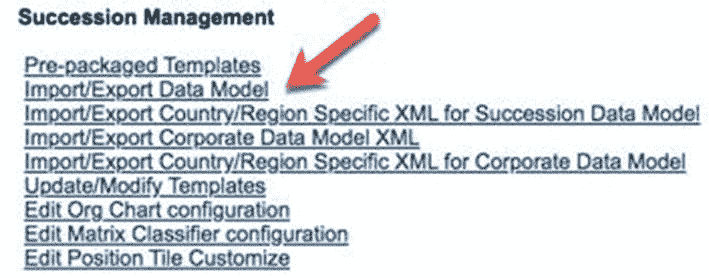

图 14-3 导入/导出数据模型的选项

当“导入/导出数据模型”屏幕显示后，您可以选择“导出文件”单选按钮，并点击`提交`按钮，如图 14-4 所示。

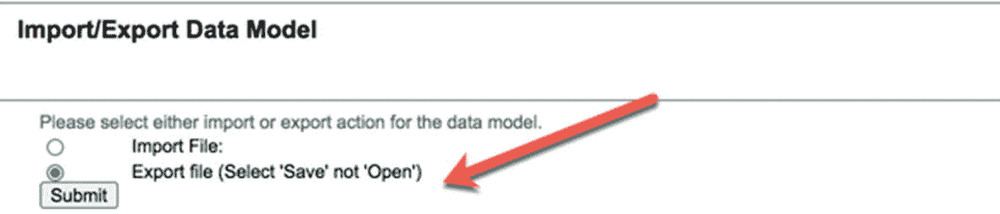

图 14-4 导出数据模型

现在我们已经下载了数据模型，在 XML 编辑器中打开它进行一些修改。我们需要检查用于`校准`的四个元素：

1. `评级元素`

2. `显示选项`

3. `过滤选项`

4. `校准历史记录组件`

我们将详细查看每个元素。

### 评级元素

您需要决定在会话中校准哪些评级元素。如果现有的绩效表单模板包含您希望校准的评级元素，则可以使用该模板。您可以创建一个新的绩效表单模板，以使用附加的评级类型，例如总体能力、总体目标和总体潜力。

数据模型必须包含将要校准的评级元素。您很可能会在数据模型中看到所有这些元素。评级元素包括：

- `sysOverallObjective`

- `sysOverallCompetency`

- `sysOverallPerformance`

- `sysOverallPotential`

- `sysOverallCustom01`

- `sysOverallCustom02`

以下代码片段展示了总体绩效评级背景元素的示例：

```
绩效历史记录
开始日期
结束日期
名称
描述
评级
总体绩效评级
最小量表评级
最大量表评级
来源
模块
```

确保您希望校准的所有评级类型都包含在数据模型中。

在校准会议的某些视图中可能会显示三个标准元素。如果您正在使用`SAP SuccessFactors Succession`，这些元素最常用于人才标志和矩阵网格报告：

- `riskOfLoss`

- `impactOfLoss`

- `reasonForLeaving`

#### 以下为这些元素的代码段示例：

```
风险降级
风险降级

影响程度
影响程度

离职原因
离职原因
```

### 显示选项

由于我们正在讨论数据模型中的标记字段，因此我们将稍作前跳，以便探讨校准会议中可用的显示选项。校准会议可以通过多种视图显示数据，我们稍后将了解这些视图。其中有一个显示选项功能对某一种视图特别有用。列表视图以类似表格的格式显示数据，每一行对应一名待校准的员工。如果该表格包含多列，则可能需要大量来回滚动才能查看某位员工的所有信息。"显示选项"图标允许用户向视图中添加或移除特定列。有些选项是硬编码的，会始终作为显示选项出现在校准会议中：

- 名

- 姓

- 计数

- 快速卡片

在配置校准模板时，可以启用"快速卡片"显示选项。稍后会详细介绍。

当您在校准会议中单击"显示选项"图标时，可以取消选择任何字段，这些列将不再显示在视图中。分箱视图和矩阵视图也包含"显示选项"图标。取消选择任何显示选项字段也会影响这些视图。

有些图标可以作为显示选项字段添加。在预置系统的矩阵网格分类器工具中为继任规划定义的任何显示选项字段，或在矩阵网格报告图标重新配置中设置的标记，也可以使用这些图标。在列表视图中，任何选中的图标都会出现在一个名为"属性"的新列中。在分箱视图和矩阵视图中，图标显示在员工姓名下方。在比较员工评级时，使这些图标对每位员工立即可见可能会很有用。

*如需了解配置这些矩阵网格图标的更多信息，请参阅第 2 卷第 5 章。*

校准会议的显示选项功能如图 14-5 所示。

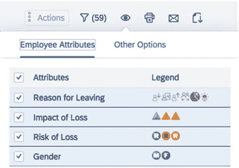

`图 14-5` 附加显示选项

将显示两个选项卡。"其他选项"选项卡包含四个标准字段，"员工属性"选项卡包含继任标记。

### 筛选选项

筛选选项用于在校准会议中缩小显示的员工名单范围。如果参与者人数众多，这是一种仅查看符合筛选条件的小群体的方法。在会议期间查看员工子集可能更易于管理。

在校准会议中，可作为筛选选项使用的标准字段包括：

- 经理

- 事业部

- 部门

- 地点

- 岗位代码

如果您的数据模型中还包含风险降级、影响程度和离职原因，这些字段也将成为筛选字段。

数据模型中可定义的 15 个自定义字段也可以作为筛选选项添加。

要进行设置，必须在数据模型中定义筛选条件。位于`<custom-filters>`标签下，添加`<filter-module-id="calibration">`标签。此标签应放置在默认筛选条件之后，如下面的代码段示例所示。您可以添加全部 15 个自定义元素，或选择任意元素，只要它们也被标识为默认筛选条件即可。

以下是一个包含默认筛选和校准筛选的代码段示例：

通过导入更新版本的数据模型，校准会议中的筛选选项现在将包含自定义校准筛选器中标识的字段。筛选器中自定义字段的排列顺序，将决定这些字段在校准会议中作为筛选字段出现的顺序。

以下内容旨在阐明筛选字段的顺序：

- 标准字段（经理、事业部、部门和地点）是首先显示的筛选条件。

- 标准筛选字段之后是数据模型`custom-filter`部分中标识的自定义字段。

- 标准字段（岗位代码、风险降级、影响程度和离职原因）是最后列出的筛选字段。

将自定义字段添加到数据模型的校准筛选器中，也将使这些字段在管理校准会议时可用。当为会议选择参与者和主体时，这些字段可用于搜索员工。

仅当您计划在人员档案中显示校准历史记录 Portlet 时，才需要对数据模型进行最后更新。

#### 校准历史记录 Portlet

该 Portlet 提供校准会议数据的快照以及评级。要使用校准历史记录 Portlet，必须将背景元素添加到数据模型中，如下面的代码段示例所示。

```
校准历史记录 Portlet
```

如果您还希望在员工记分卡中使用该 Portlet，则必须将校准历史记录 Portlet 添加到视图模板`employeeScoreCard`下。以下是一个代码段示例：

```
员工记分卡视图模板
此员工记分卡视图模板应仅包含 1 个编辑模板

员工记分卡编辑模板
员工记分卡编辑模板
```

完成修改后，保存文件，然后通过"导入/导出数据模型"将其导入。

我们来回顾一下在预置系统中设置校准需要完成哪些操作。必须在预置系统中启用校准以及（可选）报告组件。需要在数据模型中配置评级元素、用于显示选项的标记字段以及筛选选项。可选地，还需要将校准历史记录 Portlet 背景元素添加到数据模型中。

## 校准的实例设置

接下来，我们将探讨实例中所需的更新。我们将从基于角色的权限开始。

### 基于角色的校准权限

基于角色的权限（RBP）控制用户可以查看谁（目标人群）、可以访问哪些功能以及可以执行哪些操作。

为了在您的实例中设置校准，需要向某些权限角色添加特定的操作权限。需要设置三种类型的权限：

1. 管理：用于配置和管理校准

2. 最终用户：用于访问校准会议和校准历史记录 Portlet

3. 报告：用于报告校准相关数据

#### 校准权限指南

这些权限可被整合到现有角色中，例如系统管理员、HR 管理员或经理。这些角色需与目标人群配合使用，以确定用户在校准会话中可查看哪些员工，以及用户可对哪些员工执行校准相关任务。

设置校准功能需要管理员权限，而终端用户权限则用于访问校准会话。至少需要两个角色拥有校准相关权限：管理员角色和经理角色。如果您让 HR 经理担任会话主持人，则还需要额外一个角色来管理校准会话。

您需要决定哪些角色将执行校准相关的管理职能。这可以是一个或多个现有角色，也可以是一个新的校准管理员角色。权限可以细分，例如您的系统管理员可能只负责设置基于角色的权限并配置校准设置。而 HR/校准管理员或 HR 经理则可能拥有创建和管理会话、授予用户"执行摘要"权限、以及创建和运行校准报告的权限。请记住，要考虑这些角色的目标人群，这决定了用户在校准会话中可查看哪些员工，以及用户可对哪些员工执行校准相关任务。

有一组角色是特定于校准会话的，与基于角色的权限是分开的。这将在本章后面的部分讨论。

首先，让我们看看所需的基于角色的校准相关权限。我们从管理员角色开始，并指出可能也授予经理或 HR 经理角色的任何权限。

#### 管理校准权限

必须设置权限才能管理校准会话、设置和模板。在"管理权限角色"中，选择管理员角色以添加校准访问权限。

配置校准会话在您实例中工作方式的权限位于"管理员权限"下的"管理校准"中，如图 14-6 所示。

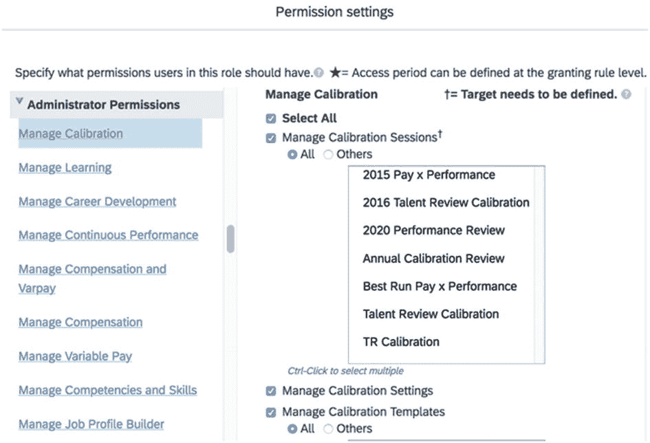

`图 14-6` 管理校准权限

点击`全选`，以允许该角色处理校准组件的设置和管理。

表 14-1 包含了每个校准管理功能的描述。如果您希望将校准管理任务拆分到多个权限角色中，请审阅这些功能。

`表 14-1` 校准管理功能

| 功能 | 描述 |
| --- | --- |
| 管理校准会话 | 用于设置和管理校准会话。 |
| 管理校准设置 | 用于配置校准会话内角色可执行的操作，并识别在创建校准会话时员工搜索中会显示的字段。此外，还可选择经理可以从“绩效”中的“团队概览”启动的校准模板，并为所有校准会话设置全局设置。 |
| 管理校准模板 | 用于创建校准会话所用的模板，识别评分数据来源以及会话期间数据的视图。 |
| 批量创建校准会话 | 用于通过电子表格导入创建多个校准会话。 |
| 管理执行审核的权限 | 用于识别可以访问校准模板“执行审核”页面的用户。 |
| OData API 校准导出 | 用于访问 `OData API` 校准导出功能。 |

关于校准权限有一个注意事项。访问校准会话的权限并非基于角色。当管理员创建一个校准会话时，用户被识别为会话的主持人、所有者和参与者。这使被选中的用户可以通过"首页"菜单列表中的"校准"标签页访问该会话。被识别为会话主持人的用户能够运行该会话，但不能创建额外的会话。对于任何需要创建会话的用户，应将他们分配到一个与拥有"管理校准会话"权限的权限角色相关联的权限组。

#### 报告权限

可以授予管理员和 HR 经理角色创建和运行临时校准报告的权限。这些权限位于"用户权限"➤ "报告权限"下。您可以启用`创建报告`和`运行报告`。应选择三个校准域：校准、校准活动和校准组织架构图覆盖范围。示例如图 14-7 所示。

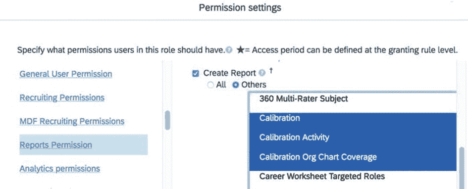

`图 14-7` 校准所需的报告权限

您可以决定以管理员身份创建报告，然后将报告分享给 HR 经理，供其为自己支持的团队运行。在这种情况下，授予 HR 经理角色`运行报告`的权限，但不授予`创建报告`权限。如果经理角色被授予运行临时校准报告的权限，则只会显示其目标人群的数据。

#### 校准标签页的终端用户权限

您可以授予管理员、HR 经理和经理角色访问“校准”的权限。选择要更新的角色后，点击`权限`。在“用户权限”下，您会看到“校准”，并选择这两个选项。“详细校准权限”需要一个目标人群，并标识在会话中可以查看哪些用户。“查看校准”标签页授予对“首页”菜单中的“校准”标签页的访问权限。这些权限如图 14-8 所示。

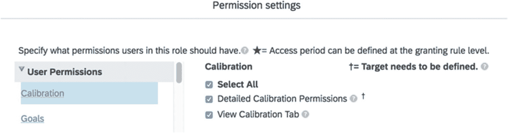

图 14-8 终端用户的校准权限

请确保您为所有员工设置了一个包含“一般用户权限”➤ “公司信息访问”➤ “用户搜索”的角色。没有此权限，用户将无法打开校准会话并搜索用户，如图 14-9 所示。

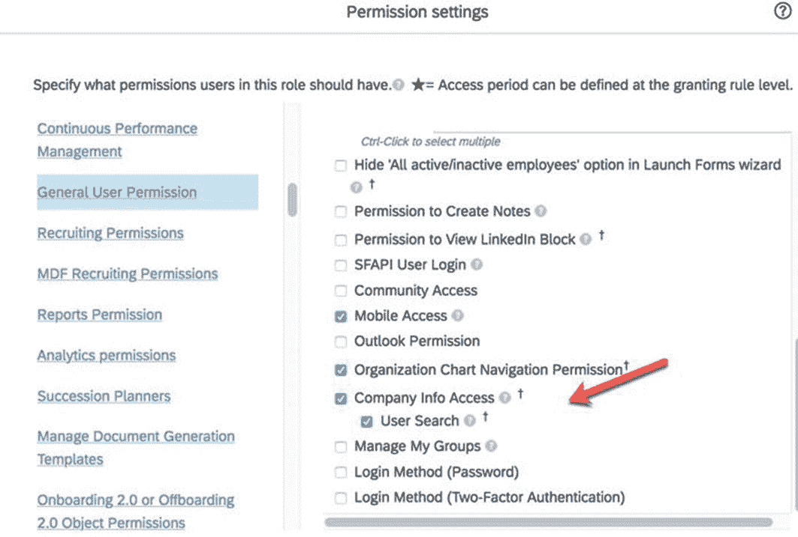

图 14-9 员工搜索的一般用户权限

## 基于角色的校准历史记录面板权限

如果您计划在人员档案中使用“校准历史记录”面板，请确保管理员角色可以管理员工档案，以便配置该面板。此基于角色的权限可以在角色权限下的“管理员权限”➤ “管理系统属性”中找到。

要在人员档案中包含“校准历史记录”面板，需要启用此背景元素。选择您要为其添加权限的 RBP 角色。通常，这会是管理员、HR 经理或经理角色。

在“用户权限”➤ “员工数据”下，转到“背景”部分找到“校准历史记录”面板。启用`查看`访问权限（如图 14-10 所示）并保存角色。

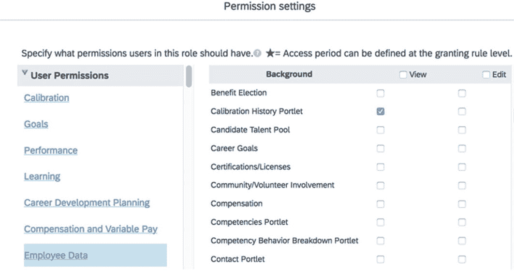

图 14-10 校准历史记录面板权限

此 Portlet 的权限未授予员工角色。我们现在已经创建了管理校准功能的权限，启用了校准报告，授予了对校准选项卡的访问权限，并允许访问校准历史记录 Portlet。在开始配置校准模板和校准设置之前，还需要执行一些额外任务。我们将从数据源开始。我们将使用绩效表单模板作为待校准评级的来源。

## 配置绩效表单模板和路线图

我们必须确保用于校准的绩效表单模板包含必要的组件。首先，必须在表单模板中为您希望校准的任何评级类型（整体绩效、整体潜力、整体目标或整体能力）配置手动评级。手动评级在校准会议中更新，并且还支持拖放功能，这是一种供协调人轻松更新评级的方法。您可以更新当前的绩效表单模板，也可以创建一个包含您要校准的所有评级类型的新模板。

绩效表单模板必须启用以下评级之一：
* 在“摘要”、“绩效潜力摘要”或“自定义加权评级摘要”部分中的整体绩效评级
* 在“目标能力摘要”部分中的整体目标评级
* 在“目标能力摘要”部分中的整体能力评级
* 在“绩效潜力摘要”部分中的整体绩效评级
* 在“绩效潜力摘要”部分中的整体潜力评级

在确定用于校准的绩效表单模板后，我们需要考虑关联的路线图。与表单模板关联的路线图需要有一个专门的步骤来进行校准。理想情况下，该步骤应紧跟在经理评估步骤之后。需要注意的是，添加此步骤时，步骤类型不能是迭代步骤或签名阶段步骤。通常，分配给此步骤的是 HR 经理角色，如图 14-11 所示。

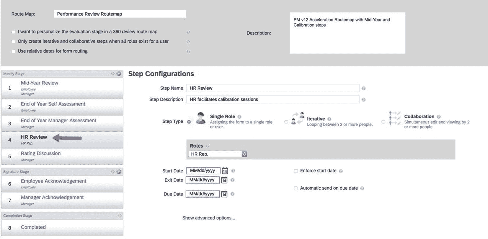

图 14-11 带有校准步骤的路线图

如果现有的绩效表单模板在经理评估步骤之后包含一个 HR 步骤，则该步骤可用作校准步骤，前提是该步骤不是迭代步骤或签名步骤。如果绩效表单模板包含自定义加权评级摘要部分，请确保校准步骤发生在触发加权评级计算的步骤之后。更新路线图以包含校准步骤并保存后，需要更新绩效表单模板。如果路线图添加了新的校准步骤，则需要在绩效表单模板的各个部分中为此步骤创建权限。

在搜索栏中键入并选择`管理模板`。选择您的绩效表单模板以添加针对新步骤的权限。HR 角色将需要针对校准步骤的表单模板部分的权限。如果路线图中已有将用于校准的步骤，则可能不需要更新该步骤的权限。除非您希望分配给校准步骤的角色能够在表单处于校准会议中时更新表单，否则您可以将校准步骤中针对 HR 角色的所有字段和部分设置为只读。如图 14-12 所示，摘要部分在 HR 审核步骤中被禁用。这是校准步骤，因此 HR 经理在表单处于校准会议中时无法编辑它。

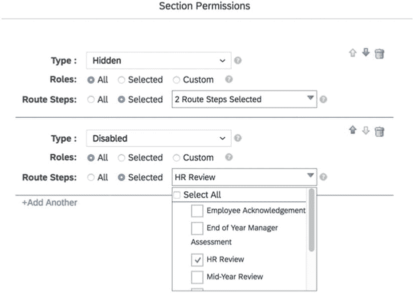

图 14-12 校准步骤的部分权限

保存已更新的模板，在开始设置校准之前，我们还会进行另一项操作。

## 电子邮件通知

在搜索栏中键入并选择`电子邮件通知模板设置`。在这里，可以启用特定于校准的电子邮件。可以在校准过程中的不同时间点发送通知。图 14-13 显示了可用于校准的电子邮件通知。

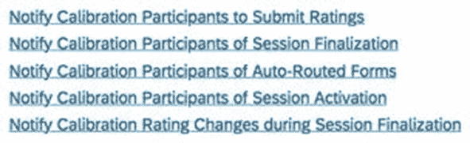

图 14-13 校准电子邮件通知

可通过`电子邮件通知模板`启用的四个校准电子邮件通知如表 14-2 所示。

表 14-2 校准电子邮件通知说明

| 电子邮件 | 说明 |
| --- | --- |
| 通知校准参与者提交评级 | 通知经理即将召开校准会议并提交评级，以便表单能够进入校准步骤。 |
| 通知校准参与者会议定稿 | 通知所有者和参与者校准会议已定稿。 |
| 通知校准参与者自动路由的表单 | 通知经理表单已由管理员或协调人自动路由，以使表单进入校准步骤。 |
| 通知校准参与者会议激活 | 向参与者通知即将召开的校准会议。 |

附加通知`在会议定稿期间通知校准评级更改`无法在此处启用。它在`管理校准模板`的高级选项卡中启用。您将在本章下一节中了解有关此通知的更多信息。

## 校准概念

在我们深入探讨之前，了解一些校准概念可能会有所帮助。校准可以从模板、视图、角色和会议的角度来理解：
* *校准模板：* 定义评级的数据源、设置、视图和执行审核图表。校准模板由校准会议引用，该会议继承所有模板设置。
* *校准视图：* 在校准模板中标识，并定义被评估者及其评级数据在校准会议中显示的各种方式。
* *校准会议：* 定义谁被校准（被评估者）以及由谁校准（参与者）。定义会议所有者和协调人、会议日期以及所使用的校准模板。
* *校准角色：* 在`管理校准设置`中设置，以定义每个角色在会议期间可以做什么（读取、写入、删除、定稿和导出）。

## 校准工具

现在，校准已启用，数据模型已在 Provisioning 中更新，基于角色的权限已授予，路线图和绩效表单模板已更新，并且校准电子邮件通知已开启，我们已准备好开始配置校准的模板、设置和选项。校准工具现在将在管理中心 ➤ 工具中可用，如图 14-14 所示。

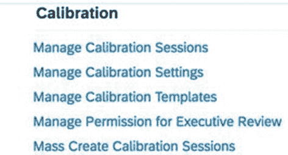

图 14-14 管理中心内的校准工具

我们将探讨如何管理校准模板和校准设置，以及如何授予执行审核访问权限。其余功能将在第 15 章中讨论。

## 管理校准模板

我们将从查看校准模板开始。校准模板定义了相关校准会话的审核周期、数据源和数据视图。该模板标明了需要进行校准的数据及其呈现方式。

一个校准模板可用于多个校准会话。您可以创建多个校准模板，但每个校准会话仅可关联一个模板。校准模板中的选择将应用于与该模板关联的所有会话。在搜索栏中输入并选择`管理校准模板`。系统将显示概览页面；在此页面中可以创建、编辑和删除校准模板。示例如图 14-15 所示。

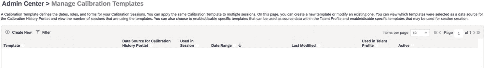

图 14-15 管理校准模板概览页面

各列标题说明如下：
- **模板：** 校准模板的名称。
- **校准历史记录 Portlet 的数据源：** 如果在`高级`选项卡中启用了`校准历史记录 Portlet`，则此列中会显示勾选标记。
- **用于会话中：** 显示使用该校准模板的校准会话数量。示例如图 14-16 所示。点击该数字将显示与该校准模板关联的校准会话名称。

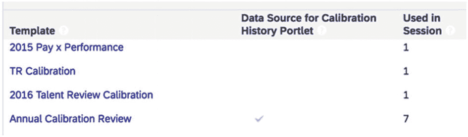

# 图 14-16 与校准模板关联的校准会话数量

- **日期范围：** 标识与模板关联的审核周期。
- **最后修改：** 标识模板的最后更新日期。
- **用于人才档案：** 如果该模板是`人才档案`的数据源，则显示绿色勾选标记。点击绿色勾选标记可禁用此选项。
- **启用：** 如果模板处于启用状态，则显示绿色勾选标记。只有启用的模板才能用于创建校准会话。点击绿色勾选标记可禁用此选项。

现在我们来创建一个校准模板。点击`新建`按钮以创建一个新的校准模板。如图 14-17 所示，共有五个选项卡用于设置模板。每个选项卡说明如下。

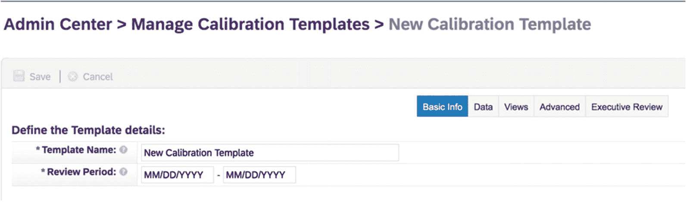

# 图 14-17 管理校准模板中的选项卡

## 基本信息选项卡

第一个选项卡`基本信息`用于命名校准模板并定义其审核周期。这两项均为必填项。该审核周期也将在校准模板的概览页面上显示为日期范围。

## 数据选项卡

`数据`选项卡用于确定需要进行校准的数据源。待校准的评级可能来自多个来源。虽然我们主要关注绩效评估评级作为数据源，但这里简要介绍所有数据源选项。

**绩效**

-   总体目标评级
-   总体能力评级
-   总体潜力评级
-   总体绩效评级

**薪酬**

-   工资选项卡：绩效加薪、晋升、一次性奖金、一次性奖金 2、额外奖金、额外奖金 2
-   奖金选项卡：总额和目标值
-   股票选项卡：股票、期权、股票单位、其他股票 1、其他股票 2、其他股票 3
-   最终比较比率
-   最终范围渗透率

**员工档案**

-   潜力
-   绩效
-   目标
-   自定义 01
-   自定义 02

**继任规划**

-   离职影响
-   离职原因
-   离职风险

图 14-18 显示了`数据`选项卡及可供选择的数据源。

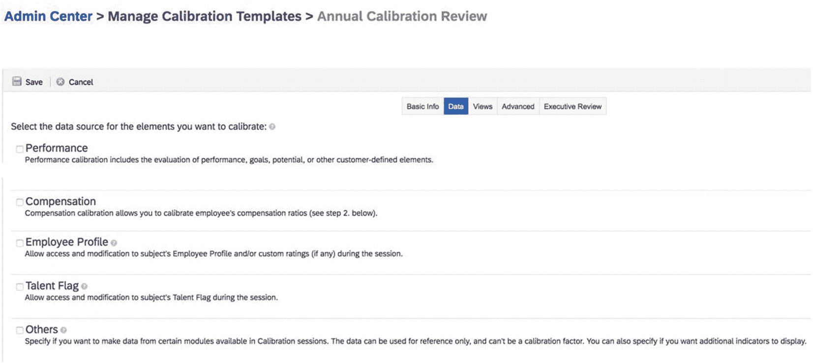

### 图 14-18 数据选项卡

### 选择数据源

选择数据源后，其对应的区域将展开以进行额外选择。可以选择多个数据源。

#### 绩效

勾选“绩效”复选框。该区域随即展开，用于选择校准所使用的绩效表单模板。选择后，需确定数据应在路线图的哪一步骤中使用。此步骤应为校准步骤。根据所选的绩效表单模板，该模板中的评级类型将显示出来。选择需要校准的评级。详细信息如图 14-19 所示。

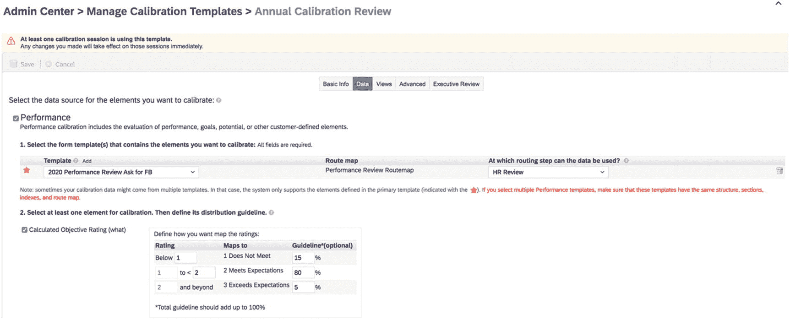

### 图 14-19 设置绩效数据源选项

您可以在该部分选择多个绩效表单模板。但所有模板必须使用相同的路线图和评级量表。可以校准计算得出的评级和手动覆盖的评级。如果绩效表单模板中使用了手动评级，这些评级将填充到校准会议中。如果表单模板包含计算得出的评级，则需要将这些评级映射到评级量表上的对应值。

在第 7 章中，我们讨论了“自定义加权评级”摘要部分。该摘要部分支持计算出的总体评级和手动总体评级。自 H1 2020 版本起新增的功能：如果绩效表单模板包含此部分，这些评级现在可用作校准会议中的评级。

可以对会议应用指南，以鼓励用户遵循推荐的评级分布。基于绩效模板的评级量表，为每个评分设置一个百分比。根据校准模板的高级设置，这些指南可以是可选的，也可以是强制性的。如果强制执行，则必须为每个评级设置百分比，如图 14-20 所示。

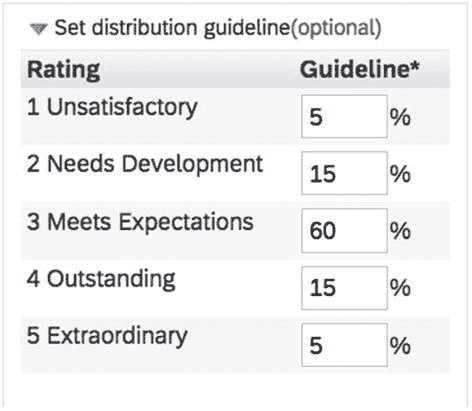

### 图 14-20 设置评级分布指南的百分比

百分比总和必须为 100%。您可以在校准会议期间强制执行指南，或者仅将其用作辅助评估校准对象的信息。

评级根据一系列规则被拉取到校准会议中：
-   可从绩效表单模板中读取的四个评级是：总体绩效、总体潜力、总体胜任力和总体目标。评级按以下顺序按部分读取：自定义加权评级部分、绩效潜力摘要部分、目标胜任力摘要部分和摘要部分。
-   绩效表单模板中的手动评级优先于计算得出的评级。
-   如果您不显示来自实时配置文件的进行中评级，则这些评级将不会被使用。

#### 薪酬

可以针对员工的薪酬比率进行校准。可以选择任何标准计划字段，以及最终的区间渗透率或最终的薪酬比率基准。

选择薪酬模板和可以使用数据的路线图步骤，如图 14-21 所示。与绩效表单模板一样，薪酬模板必须具有单个用户或协同修改步骤。模板的计划组件和区间分组将显示出来。

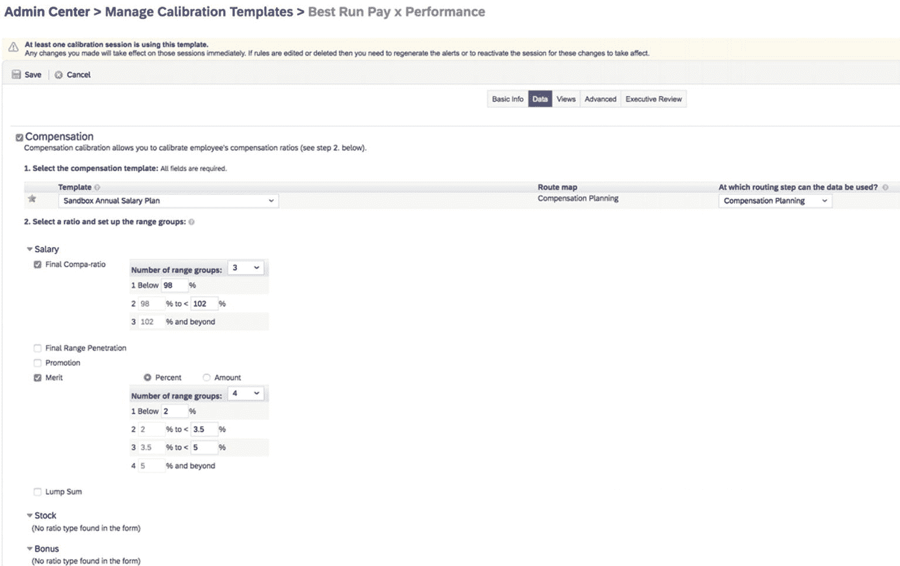

### 图 14-21 薪酬数据源

可供选择的计划组件和区间分组将因模板而异。如图 14-22 所示，该模板仅包含薪水和股票组件。可以选择薪水、股票和奖金字段。请注意，可变薪酬不能用于校准。

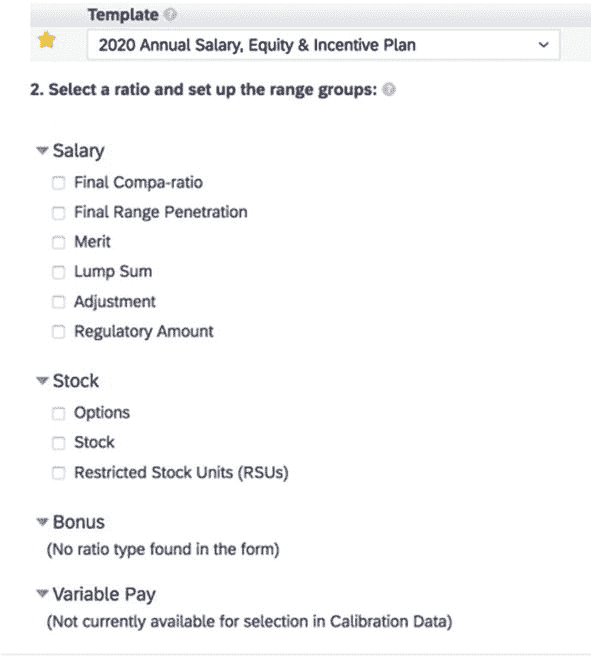

### 图 14-22 薪酬计划字段

任何标准计划字段都可以用作最终的区间渗透率或最终的薪酬比率基准。如图 14-23 所示，必须设置区间分组。

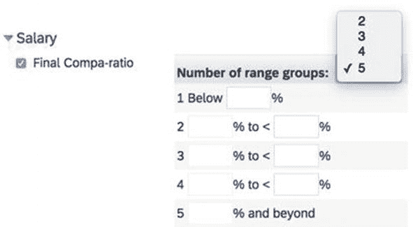

### 图 14-23 区间分组设置

选择元素后，设置区间分组的数量（二至五个），以及用于员工定位的百分比或金额。

#### 员工档案

启用此选项后，校准会议将使用员工档案中存储的、在“基本信息”选项卡定义的考核周期内有效的评级。如果考核周期内没有评级，会议将创建一个未评级的评级。

员工档案中的评级基于数据模型中配置的背景元素。可能的评级类型如下：
-   `SysOverallPerformance`
-   `SysOverallPotential`
-   `SysOverallCompetency`
-   `SysOverallObjective`
-   `SysOverallCustom01`
-   `SysOverallCustom02`

如图 14-24 所示，选择要校准的评级类型。可以设置评级指南。虽然支持小数评级，但必须将其映射为整数。

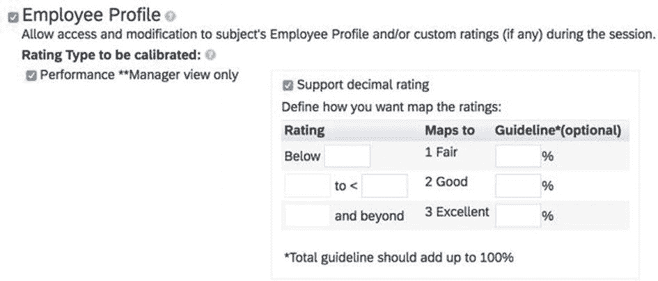

### 图 14-24 要校准的员工档案数据

要使用员工档案中的评级，请确保日期范围（开始和结束日期）包含在校准会议的日期范围内。评级值需要在评级量表的最小值和最大值之间。如果您的评级使用小数，请启用“支持十进制评级”选项。在会议中进行的评级更改在会议最终确定之前不会显示在员工档案中，除非模板配置为显示进行中的评级。

#### 人才标记

如果标准人才标记——离职风险、离职影响和离职原因——已在数据模型中定义，则它们可以包含在校准会议中。这些标记通常用于在九宫格上绘图。

如图 14-25 所示，选择标记后即可设置分布指南。

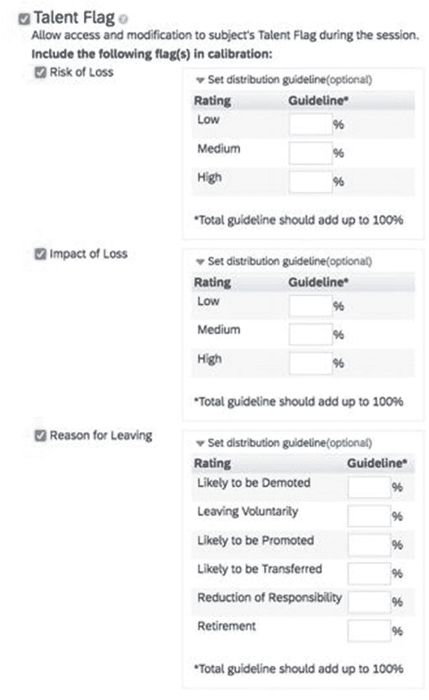

### 图 14-25 人才标记数据的分布指南

#### 其他

“数据”选项卡中的最后一个选项是“其他”。可以选择额外的信息来源作为校准会议中的参考。示例如图 14-26 所示。这些信息不能被校准。

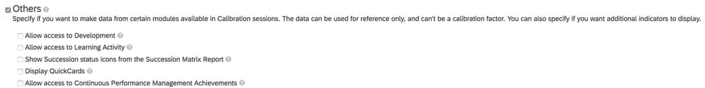

### 图 14-26 其他选项

在校准会议中，可以通过“更多”选项获取来自这些来源的数据。表 14-3 描述了每个数据源。

**表 14-3 其他选项说明**

| 数据源 | 描述 |
| --- | --- |
| 允许访问发展计划 | 弹窗显示员工的默认发展计划。 |
| 允许访问学习活动 | 弹窗显示员工的学习活动。 |
| 显示来自继任矩阵报告的继任状态图标 | 启用后，将显示一个“属性”列，其中包含每个员工的继任矩阵网格图标。 |
| 显示快速卡片 | 弹窗显示人才卡片。 |
| 允许访问持续性绩效管理成果 | 弹窗显示 CPM 成果选项卡。 |

保存您的选择后，继续操作“视图”选项卡。

# 视图选项卡

基于在`数据`选项卡中选择的数据源和评级要素，可以创建校准数据的多个视图，从而以不同方式查看会话中的评级数据。

`视图`选项卡，如图 14-27 所示，定义了校准数据在校准会话中的显示方式。可以配置多个数据视图，每个视图都提供一些不同的功能。

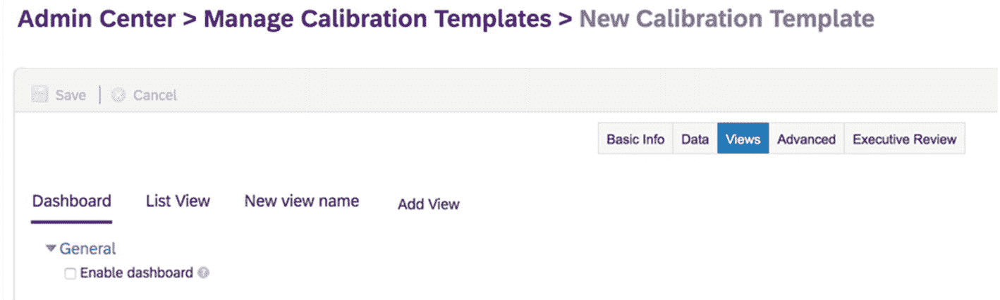

`图 14-27` 管理校准模板中的视图选项卡

视图类型包括`仪表板`、`列表视图`、`分组视图`、`矩阵网格`和`主管审阅`。接下来，我们将详细查看每种视图类型。

## 仪表板视图

`仪表板`视图以图表格式提供汇总数据。要使用此视图，应勾选“启用仪表板”框。启用后，打开校准会话时首先看到的是`仪表板`视图。除`列表视图`外，任何视图都可以汇总为图表。数据可以按性别分组，并显示总体性别摘要。图表可以按受评者数量或分布百分比显示。

## 列表视图

启用`列表视图`后，校准数据将以类似表格的格式显示。每个待校准的受评者占一行。在此，您可以更新评级、查看其他视图的评级、访问受评者数据、发表评论、比较受评者以及将受评者标记为已讨论。

`列表视图`选项如图 14-28 所示。

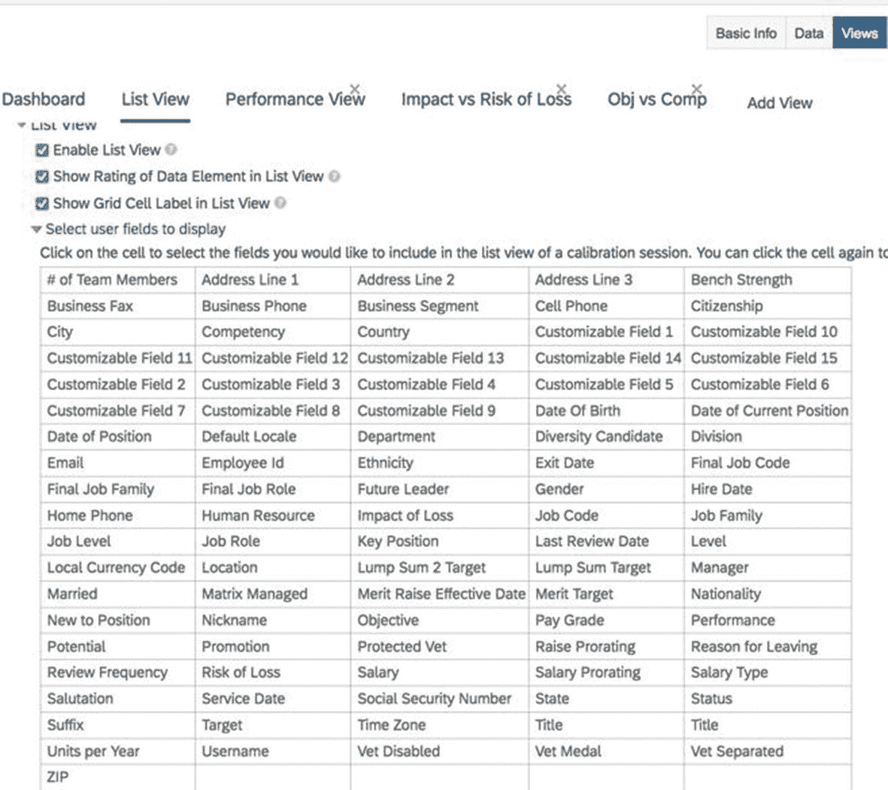

`图 14-28` 管理校准模板视图选项卡中的列表视图设置

如图 14-29 所示，在`列表视图`中有一些可启用的复选框。具体说明如下。

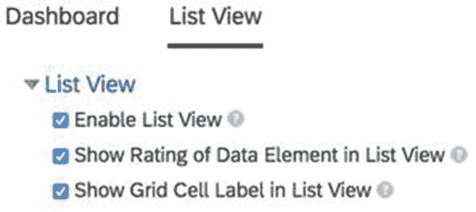

`图 14-29` 列表视图选项

- **启用列表视图：** 启用后，校准会话将显示`列表视图`。建议启用此选项。

- **在列表视图中显示数据元素的评级：** 启用后，在`数据`选项卡中选择进行校准的评级要素将在`列表视图`中显示为列。例如，在`数据`选项卡中，如果选定的绩效表单模板具有需要校准的总体评级、总体能力评级和总体目标评级，您将在`列表视图`中看到每个评级类型对应的列。建议启用此选项。

- **在列表视图中显示网格单元格标签：** 启用后，所有`矩阵视图`的评级将在`列表视图`选项卡中显示为列。例如，如果您为“总体目标评级 vs. 总体能力评级”创建了`矩阵视图`，您将在`列表视图`中看到一列，显示受评者的评级位于矩阵中的哪个位置。

选择任何其他要作为列显示在`列表视图`中的字段。所有可用字段如图 14-30 所示。点击某个字段即可将其包含在`列表视图中`。

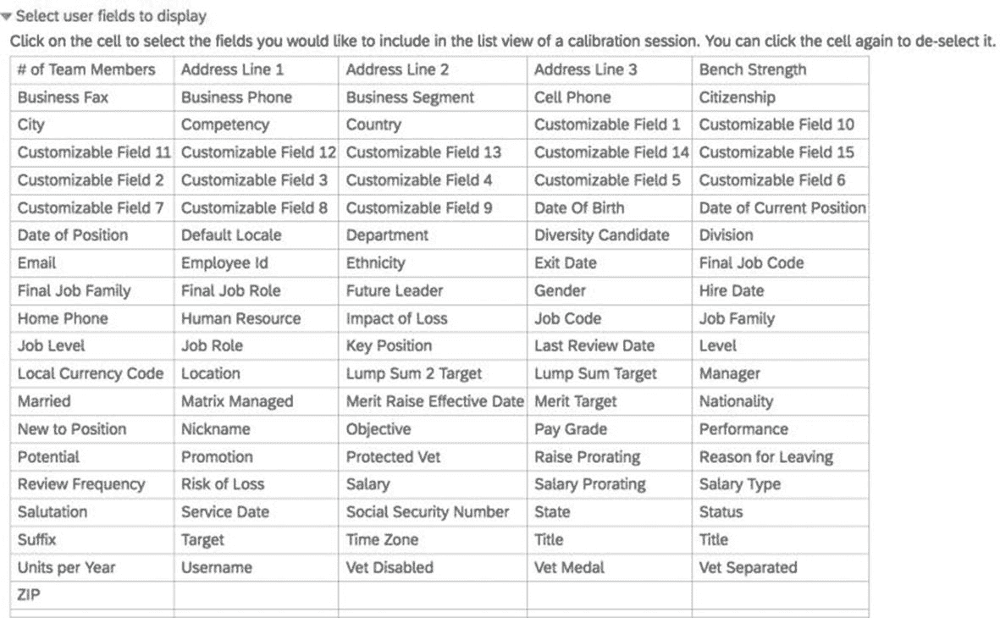

`图 14-30` 要在列表视图中作为列显示的字段

从数据模型中配置的标准用户字段中进行选择。当用户在校准会话中打开`列表视图`时，他们可以看到您选择显示的字段。为`列表视图`做出选择后，我们将继续介绍`分组视图`。

### 分组视图

`分组视图`基于一个正在校准的评级要素将员工归入不同的组别。

点击“新视图名称”选项卡以创建`分组视图`，如图 14-31 所示。

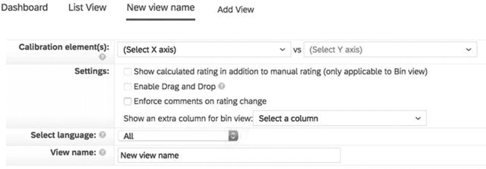

`图 14-31` 创建分组视图

选择要用于“X”轴的评级要素。可供选择的评级要素基于在`数据`选项卡中选择的数据源，如图 14-32 所示。

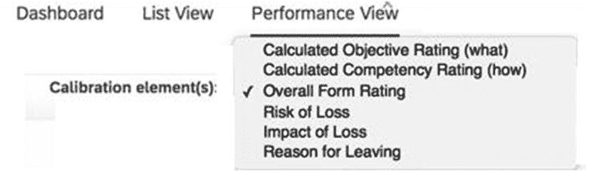

`图 14-32` 为分组视图选择评级要素

如果在模板摘要部分启用了手动评级，则计算出的评级将无法在校准会话的`分组视图`中使用。根据上图中的示例，显示的校准评级要素基于所选的绩效表单模板。该模板有两个计算评级和一个手动总体评级。此外，人才标志已启用，以便在会话期间进行访问和修改。

当数据源是包含自定义加权评级部分的绩效表单模板时，可以对手动评级或计算评级进行校准。但是，计算出的评级无法在`分组视图`中显示。

如果您也为“Y”轴选择了一个要素，那么这就不再是`分组视图`；而是变成了`网格（矩阵）视图`。

在为视图命名并确定要使用的校准评级要素后，还有一些其他设置。

有三个设置可以启用：

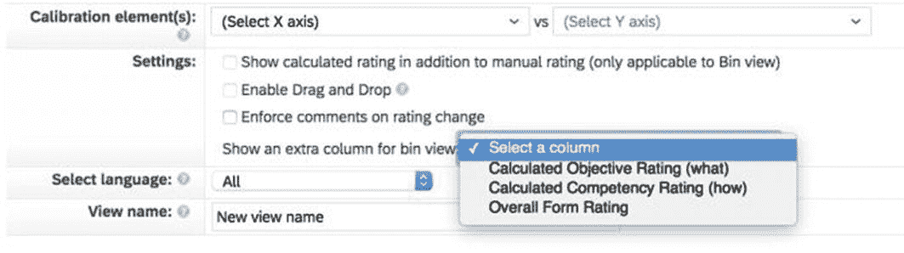

`图 14-33` 选择额外的评级列

- **显示除手动评级外的计算评级**（仅适用于分组视图）：启用后，视图除了显示手动评级外，还会显示计算评级。

- **启用拖放：** 此选项适用于手动绩效表单模板评级和员工档案评级。您不能拖放计算出的表单评级。如果只选择了计算评级，则拖放选项将被禁用。拖放也不适用于薪酬要素。

- **强制在评级更改时添加评论：** 在此视图中更改评级时，将弹出一个窗口，需要撰写评论以说明更改原因。

- **为分组视图显示额外列：** 可以选择一个额外的评级列显示在`分组视图`中，如图 14-33 所示。

最后，选择视图的语言和视图名称。点击“添加视图”选项卡以创建另一个校准视图。可以为任何其他单个评级要素创建其他视图。也可以创建使用`数据`选项卡中标识的任意两个评级要素的视图。这就是我们接下来将要学习的`矩阵视图`。

### 矩阵网格视图

`矩阵视图`将两个不同的评级来源相互对应，以矩阵形式放置受评者。这有时被称为“九宫格”。与`分组视图`类似，可以启用拖放，以及在评级更改时强制添加评论。您可以创建多个视图，使用不同的评级来源。

一旦您为“X”轴和“Y”轴选择了评级，屏幕就会展开，并出现其他选项。示例如图 14-34 所示。

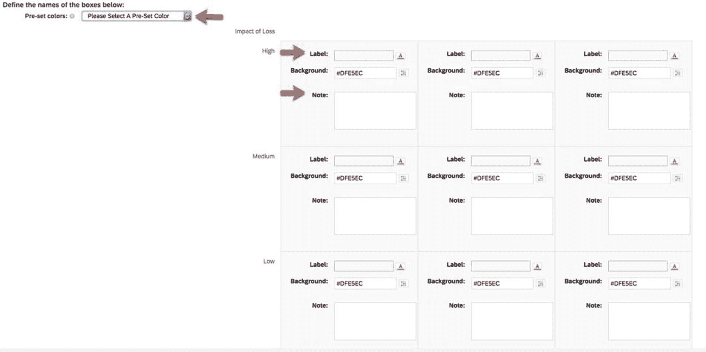

`图 14-34` 设计矩阵视图

定义矩阵网格单元格标签并选择预设颜色，如图 14-35 所示。选择一种默认颜色选项。您可以根据`继任`设置中设置的默认颜色来选择预设颜色。

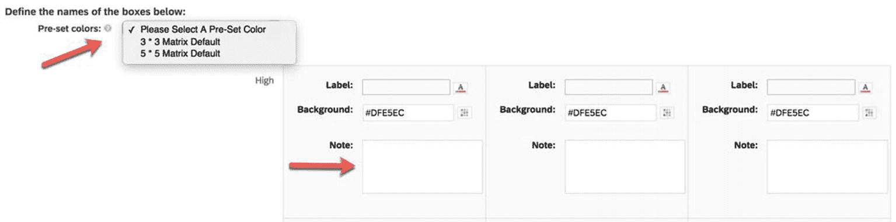

`图 14-35` 定义预设颜色

#### 自 2020 年上半年版本起，新增了为每个单元格添加注释的选项。这些*内联*注释有助于校准参与者更好地理解每个单元格代表的含义，旨在帮助避免无意识的偏见。

图 14-36 是一个应用了继任规划网格设置并使用了注释的示例。

```
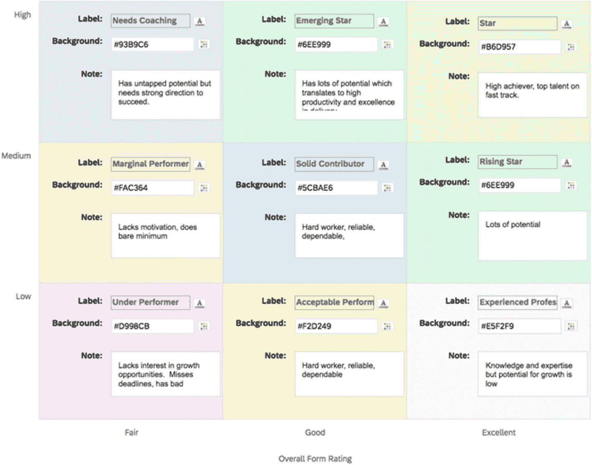
```

`图 14-36` 更新后的矩阵单元格颜色，带标签和内联注释

如果你打算使用与继任规划中矩阵网格报告相同的颜色代码，目前校准会议中“矩阵网格视图”的放置背景色会显示较浅的色调。

*有关矩阵网格报告配置的更多详细信息，请参阅第 2 卷第 5 章。*

创建完所有希望在校准会议中显示的视图后，请点击“`高级`”选项卡。

# 高级选项卡

“`高级`”选项卡用于启用某些功能，这些功能将应用于与该校准模板关联的所有校准会议。图 14-37 显示了“`高级`”选项卡。

```
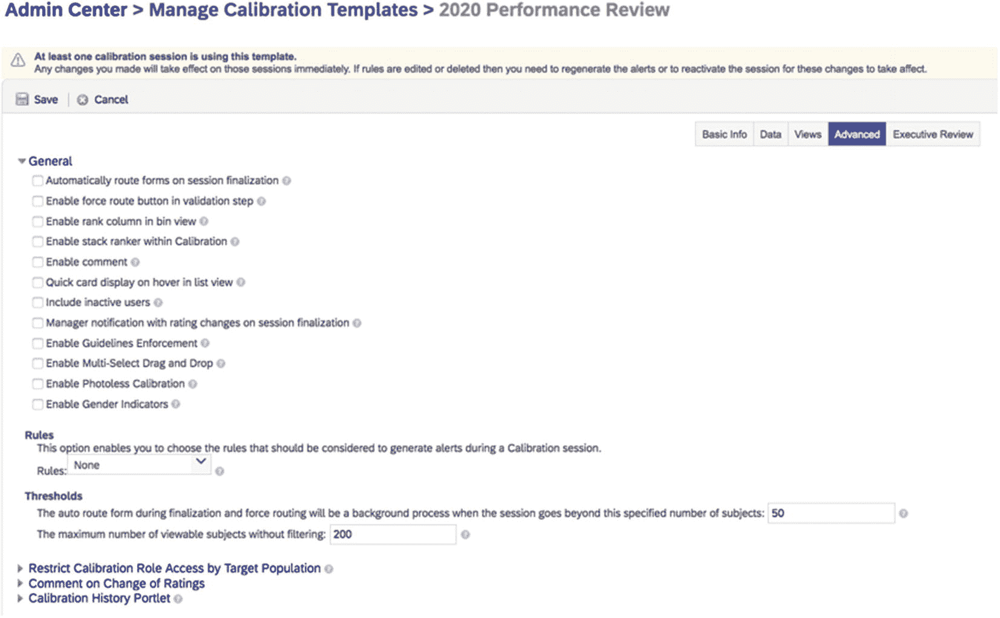
```

`图 14-37` 校准模板的高级选项

此选项卡中有四个部分，你可以在其中进行选择以启用模板的相应功能。我们将逐一介绍每个部分及其启用的功能。

## 常规选项

表 14-4 详细说明了校准模板可用的常规选项及其描述。请查看这些功能，并启用你希望用于与该模板关联的所有校准会议的选项。

`表 14-4` 常规选项说明

| 选项 | 说明 |
| --- | --- |
| `在会话最终确定时自动流转表单` | 当会话最终确定后，表单将自动流转到路线图的下一个步骤。推荐启用。 |

| `在验证步骤中启用强制流转按钮` | 在创建会话期间进行验证时，管理员可以将表单移至校准步骤。推荐启用。 |
| `在分箱视图中启用排名列` | 在“分箱视图”中，此选项允许对分箱内的员工进行排名。 |
| `在校准中启用堆叠排名器` | 选择员工以使用“`分析`”操作来比较最多十名员工。可在此弹出窗口中更新评级。 |
| `启用评论` | 任何具有“`写入`”权限的校准角色都可以在会话中为员工添加评论。 |
| `列表视图中悬停时快速显示卡片` | 鼠标悬停在会话中主题名称上时，会显示快速卡片。这是除员工姓名旁显示的快速卡片图标之外的额外功能。 |
| `包含非活跃用户` | 允许在校准会议中包含非活跃用户。将能够执行包含非活跃员工的搜索。 |
| `在会话最终确定时向经理发送评级变更通知` | 允许向在校准会议期间其员工评级发生变化的经理发送电子邮件。邮件包含旧的评级和校准后的新评级。在会话最终确定时发送。推荐启用。 |
| `启用指南强制执行` | 评级变更只有符合校准模板中设置的分布指南时，才能最终确定。 |
| `启用多选拖放` | 在“分箱视图”中，可以选择多个主题并将其移动到新的评级分箱。 |
| `启用无照片校准` | 在列表、分箱和矩阵视图中隐藏照片。有助于消除偏见。 |
| `启用性别指标` | 在列表、分箱和矩阵视图中显示性别比例。矩阵视图还会在每个单元格中显示性别分布。 |

进行校准会议时的一个挑战是做到公平、一致和客观。偏见可能会在不知不觉中潜入，校准参与者可能存在盲点，影响他们评估员工的方式。为了帮助避免偏见，可以使校准会议无照片化。所有校准会议视图中的主题都不会显示照片。无照片校准会议可以与`启用性别指标`结合使用。这些指标将仅在校准会议的列表、分箱和矩阵视图中显示性别比例。矩阵视图还将显示每个单元格的男/女比例。这些设置已在上表中注明。

还有两个额外的常规选项：“`规则`”和“`阈值`”。

### 规则

除非已创建业务规则来触发校准提醒，否则“`规则`”选项不会出现。图 14-38 显示了“`规则`”部分的一个示例。

```
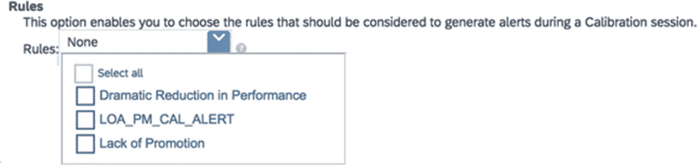
```

选择用于校准提醒的规则

在这里，任何与校准相关的业务规则都可以应用于该模板。我们将在本章末尾以及第 15 章中简要讨论如何创建校准提醒。业务规则定义了可能导致偏见的情景。

### 阈值

可以设置一个阈值，用于标识在最终确定期间强制流转和自动流转时，将触发后台流程的主题表单数量。建议指定的数量不超过 50。还可以为每个会话页面显示的主题数量设置阈值。必须使用筛选器来查看超过设置上限的主题。

### 按目标人群限制校准角色访问权限

校准会议允许促进者、所有者、参与者和执行审核者访问所有正在校准的主题的信息。任何选定校准角色的访问权限可以仅限于其目标人群中的主题。图 14-39 包含了按目标人群限制校准角色访问权限的选项。

```
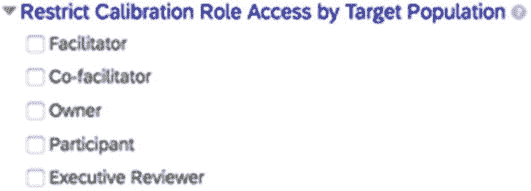
```

### 对评级变更的评论

此选项用于标识在更改评级时需要输入的字段。在校准会议期间，将显示一个弹出窗口，用户需要输入以下任一选项：

* `授权者`：批准评级变更的用户姓名。

* `原因代码`：评级变更原因的下拉列表。必须指定一个原因代码选择列表才能使用此选项。

* `评论`：在校准会议中更改评级时，必须输入评论。评论字段的字符限制为 4000 个字符。

图 14-40 显示了一个示例。

```
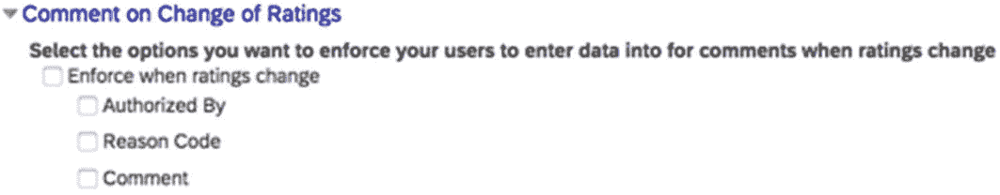
```

当选择了“`授权者`”和“`原因代码`”时，这些选项为必填项，评论字段则为可选项。

### 校准历史 Portlet

如果你已将校准历史 `Portlet` 背景元素添加到数据模型，并授予了查看此 `Portlet` 的权限，则可以在此处选择要显示的评级类型以及矩阵视图。图 14-41 显示了一个示例。

```
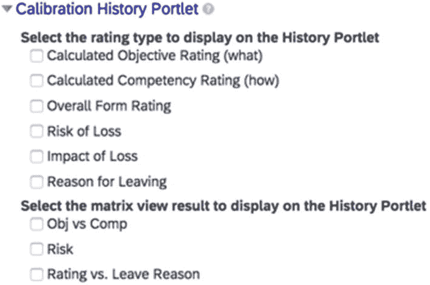
```

## 选项列表与高管审核选项卡

所列选项基于作为评级数据源的绩效表单模板。在`高级`选项卡中完成所有选择后，点击`高管审核`选项卡。

### 高管审核选项卡

仅当启用`高管审核`功能时，此选项卡才会可见。可在`配置`中启用此功能，使其在创建校准模板时可用。也可在`管理校准设置`中启用。`高管审核`功能提供与该模板关联的所有校准会议的汇总图表和会议详细信息。

如图 14-42 所示，`高管审核`选项卡标识了将显示在校准会议高管审核页面上的图表和数据。所有基于校准模板视图创建的图表均可被汇总。

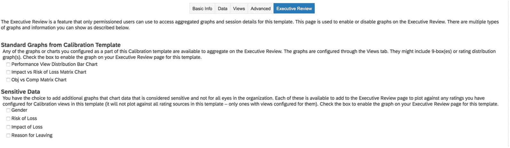

还可以选择添加敏感数据点，以针对已创建视图的评级进行绘制：

* 性别

* 流失风险

* 流失影响

* 离职原因

保存您的模板。如果在创建校准会议后对校准模板进行了任何更改，这些更改将在使用该模板的会议中生效。现在我们已经配置好了校准模板。接下来，我们将管理校准设置。要开始，请在操作搜索中输入并选择`管理校准设置`。

## 管理校准设置

校准设置适用于所有校准会议，无论使用何种校准模板。管理员使用这些设置来执行多项功能：

* 为会议审核员选择操作权限。

* 选择供经理从绩效模块的团队概览中启动的校准模板。

* 选择创建会议时搜索后显示的字段。

* 选择校准工具。

共有四个设置选项卡：

1. 权限

2. 经理模板（可选）

3. 搜索结果字段

4. 全局设置

现在我们将更深入地查看每个选项卡。

### 权限选项卡

`权限`选项卡标识了各种校准角色可以对进行中和已批准的会议执行的操作（`读取`、`写入`、`定稿`、`导出`和`删除`）。

如图 14-43 所示，需要为校准角色分配针对`进行中`和`已批准`校准会议的操作权限。

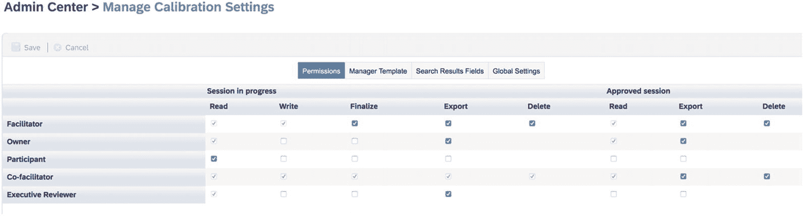

进行中的会议是指当前正在进行的会议，而已批准的会议则是已完成定稿的会议。授予这些角色的权限仅适用于校准功能。

让我们来看看会议中使用的校准角色：

* 引导者

* 共同引导者

* 校准对象

* 参与者

* 所有者

* 高管审核人

`引导者`通常是来自人力资源部门、能够保持公正的人员。引导者负责开展校准会议并引导讨论。引导者通常负责更新评级并完成会议的定稿。如果人力资源经理的 `RBP` 角色拥有`管理校准会议`权限，引导者也可以创建会议。

`共同引导者`作为引导者的后备。该角色将拥有与引导者角色被分配的相同权限。为引导者角色添加或移除的任何权限将自动更新给共同引导者角色。该角色是可选的，无需为此角色指定任何用户。

`校准对象`是指在会议中接受校准的员工。

`参与者`参与校准会议以做出评级决策。该角色通常分配给被校准员工的经理。

`所有者`是高级经理，其直接下属是校准会议的参与者。参与者的直接下属正在接受校准。

`高管审核人`是需要查看跨会议汇总数据的业务或人力资源高管。被分配此角色的用户可以直接访问会议以及高管审核摘要页面。

担任这些角色的个人将在创建会议时确定。这些角色与基于角色的权限无关。这些角色是校准功能所特有的。高管审核人在单独的功能中选择。

#### 操作权限

需要为每个校准角色设置`读取`、`写入`、`定稿`、`导出`和`删除`操作权限。进行中的会议与已定稿会议的权限可以不同，并且您必须明确地为角色分配操作。缺少权限将阻止角色执行相应操作。

任何被分配到具有`读取`权限的校准角色的用户都可以访问校准会议。这意味着，即使是在主页菜单中没有基于角色的权限访问校准功能的用户也可以访问该校准会议。

以下是关于校准会议权限的更多详细信息：

* `读取`权限允许角色查看校准会议，但不能对评级进行任何更新。

* `写入`权限允许在会议中更新评级。角色还需要此权限才能在校准会议中对员工发表评论。

*   `导出`权限允许角色从任何会议视图中下载会议。会议将下载为一个 Excel 文件，其中包含每个视图的单独选项卡。
*   `删除`权限允许角色删除校准会议。只有引导者和共同引导者角色拥有删除会议的选项。

授予的任何操作权限都会自动创建`读取`权限。如果您启用`定稿`权限，则会自动授予`读取`和`写入`操作。

完成校准会议角色权限选择后，点击`保存`并进入`经理模板`选项卡。

如果在`配置`中的`公司设置`中未启用，`经理模板`选项卡将不可见。要允许经理为其直接下属启动校准会议而无需返回`配置`，您可以转到`全局设置`选项卡并在那里启用该设置。您需要保存屏幕并返回主页。当您再次进入`管理校准设置`时，`经理模板`选项卡将变得可见。

## 经理模板选项卡

`经理模板`选项卡用于标识在团队概览中应为经理启动哪个校准模板，如图 14-44 所示。

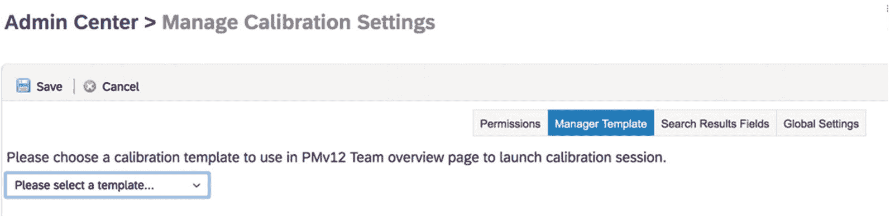

图 14-44 经理模板选项卡

点击下拉箭头，选择将在`Team Overview`页面上使用的校准模板。请记住，该校准模板与您在`Manage Calibration Templates`的`Data`选项卡中选择的绩效表单模板相关联。因此，当您启动校准会议时，系统将知道要访问哪个绩效表单模板。如果未选择校准模板，则`Team Overview`中的`Calibration`按钮将无法启用。为使此功能生效，还须为经理角色授予`Team Overview`的权限。做出选择后，点击`Save`并继续进入`Search Results Fields`选项卡。

## Search Results Fields 选项卡

在`Search Results Fields`选项卡中选择的设置用于`Managing Calibration Sessions`的`People`选项卡，这将在下一章中讨论。此选项卡用于确定员工搜索后要显示的字段。所选字段还确定了搜索后可添加到视图中的其他字段。图 14-45 显示了该选项卡。

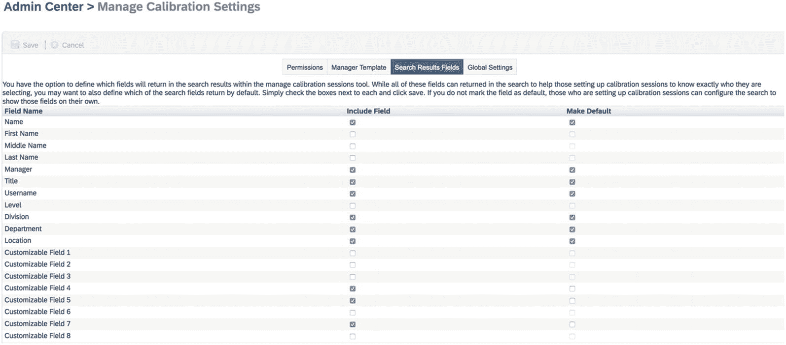

图 14-45 搜索结果字段选项卡

最右侧的列“Make Default”用于选择在创建会议时，每个员工在搜索结果中显示的字段，如图 14-46 所示。

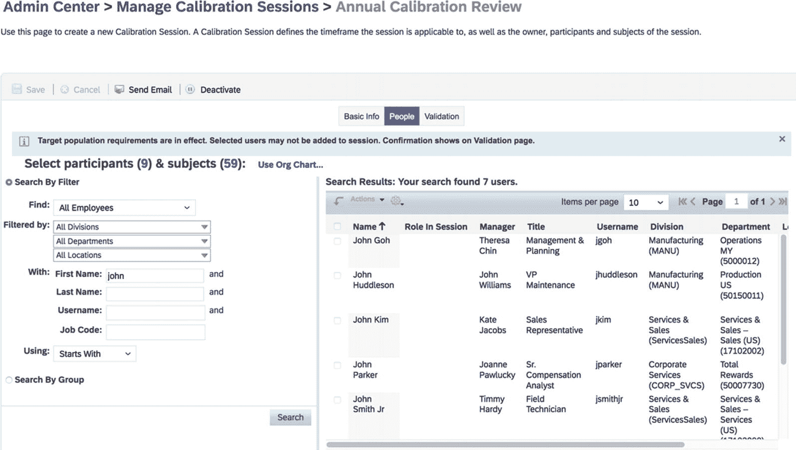

图 14-46 包含选定显示字段的搜索结果表

在上图所示的示例中，搜索结果中列出的字段是从“Make Default”列中选择的。

`Search Results Fields`选项卡中的“Include Field”列使您能够选择搜索后可以添加到视图中的其他字段。`Option`图标下的选择显示所有使用的默认字段以及其他 *include* 字段。示例如图 14-47 所示。

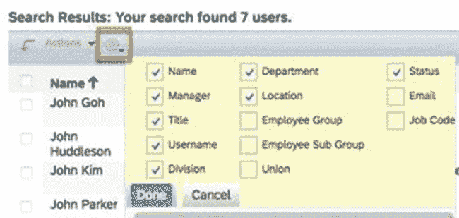

图 14-47 搜索结果内的显示选项

您可以取消选择任何默认字段并选择其他字段。点击`Done`，搜索结果表将包含您选择的字段。点击`Save`并继续进入`Global Settings`选项卡。

## Global Settings 全局设置

在`Global Settings`选项卡中做出的选择适用于所有校准模板、会议和角色。此选项卡用于选择`Calibration`在您实例中的行为方式。

图 14-48 显示了所有可能启用的设置选项。

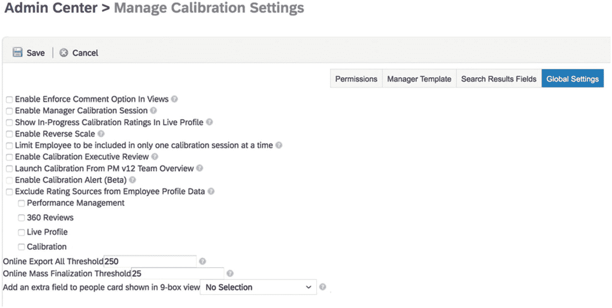

图 14-48 全局设置

前七个功能也可以在`Provisioning`的“Company Settings”中启用。如果其中某些功能已启用，则表示它们已在`Provisioning`中启用。

表 14-5 显示了每个全局设置的描述。

表 14-5 全局设置说明

| 权限 | 描述 |
| --- | --- |
| `Enable Enforce Comment Option in Views` | 当校准会议内更改评级时，保存前需要添加评论。此设置可在校准模板级别覆盖。 |
| `Enable Manager Calibration Session` | 允许经理在`Calibration`内创建会议。为经理访问`Calibration`时提供“Create New”按钮。 |
| `Show in-Progress Calibration Ratings in Live Profile` | 校准会议中尚未最终确定的评级会显示在`Employee Profile`中。 |
| `Enable Reverse Scale` | 如果您使用的评分量表以 1 为最高分，则应启用此设置。不建议在整个系统中对任何评分量表使用反向量表。 |
| `Limit Employee to be included in only one calibration session at a time` | 防止员工在使用相同日期范围和数据源的情况下，同时成为多个进行中、审批中或已批准的会议中的评估对象。 |
| `Enable Calibration Executive Review` | 在校准会议中创建一个`Executive Review`选项卡。一旦用户被指定为行政审阅者，他们将看到汇总的会议数据，而无需直接参与每个会议。 |
| `Launch Calibration from PM v12 Team Overview` | 使经理能够直接从 PM v12 表单的`Team Overview`选项卡创建会议。经理权限角色必须具有`Team Overview`的访问权限。只有拥有直接下属的经理才能在`Team Overview`页面上使用此功能。如果未启用，则`Manage Calibration Settings`中的`Manager Template`选项卡将不可见。 |
| `Enable Calibration V12 Org Chart` | 用支持显示矩阵报告并能按组织层级层次选择用户的 v12 `Org Chart`替换旧的`Org Chart`。 |
| `Enable Calibration Alert (Beta)` | 允许在存在偏见时显示警报。警报在`Configure Business Rules`中创建。目前显示为测试版功能。必须启用`Calibration`的`Fiori UI`。 |
| `Exclude Rating Sources from Employee Profile Data` | 如果校准会议的评级来源是`Employee Profile`，可以指定要排除的任何评级类型。 |
| `Online Export All Threshold` | 系统默认为 250。建议不要超过 1000；否则导出将作为离线任务执行。 |
| `Online Mass Finalization Threshold` | 表示可以批量最终确定的会议数量。超过此阈值将导致最终确定作为离线任务执行。 |
| `Add an extra field to people card shown in 9-box view` | 选择要显示在九宫格视图上的额外字段。字段可以是`Manager`、`Division`、`Department`、`Location`、`Job Code`，以及`Succession Data Model`中定义的`custom01`至`custom15`元素。 |

保存选择后，这些设置将应用于当前和新的校准会议及校准模板。我们现在已经配置了校准设置。接下来，我们将回顾一些额外的配置。

### 配置校准人才卡

`Calibration Talent Card`可以在校准会议的任何视图中为评估对象打开。管理角色配置人才卡所需的基于角色的权限位于`Administrator Permissions` ➤ `Manage Talent Card`下。权限为“Manage Talent Card Configuration”。

要配置`Calibration Talent Card`，请在搜索栏中输入并选择“Manage Talent Cards”。屏幕如图 14-49 所示。如果您希望进行自定义，请点击链接“Calibration Talent Card”。

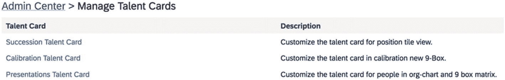

*图 14-49 管理人才卡视图*

您可以编辑`Calibration Talent Card`的各个部分。您可以添加标准部分，或创建自定义部分，如图 14-50 所示。

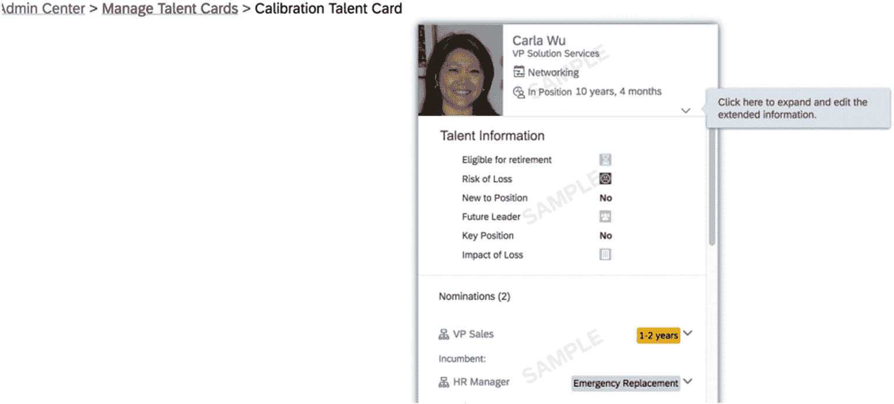

*图 14-50 校准快速卡*

任何新部分都将在校准会议的人才卡中可见。进行任何更新并保存该卡。

## 管理行政审阅的权限

创建校准会议后，您可以确定哪些用户应具有访问`Executive Review`页面的权限。该权限适用于所有使用特定校准模板的校准会议。

## 管理权限与校准历史

在搜索栏中输入并选择“管理执行审阅权限”。在此处，我们将用户分配给`Executive Reviewer`（执行审阅者）角色。见图 14-51。


**图 14-51**

管理执行审阅权限

任何被选中的用户都将有权访问与校准模板关联的所有会话数据。他们除了能查看`Executive Review`（执行审阅）页面外，还能访问所有会话。他们将看到汇总数据以及在主体层面完成的详细信息。此界面用于为`Executive Reviewer`（执行审阅者）角色创建新的用户权限，以及审阅和撤销任何现有权限。

界面中的`Create New Permissions`（创建新权限）部分如图 14-52 所示。


**图 14-52**

创建执行审阅用户权限

要创建新权限，请从活动校准模板的下拉列表中识别出校准模板，如图 14-53 所示。


**图 14-53**

选择执行权限的模板

执行姓名搜索以找到您希望授予`Executive Review`（执行审阅）权限的个人。每次只能选择一个姓名。选择姓名后，点击`Assign Permission`（分配权限）。该用户现在将拥有访问权限，并且您可以继续添加其他用户。

分配后，这些姓名将显示在`Reviewing Permissions Already Configured`（审阅已配置权限）部分中，如图 14-54 所示。


**图 14-54**

拥有执行审阅访问权限的用户

要移除任何现有执行审阅者的访问权限，请勾选其姓名旁的复选框，然后点击`Revoke Permission`（撤销权限）。

### 强制对评级变更添加评论

为了要求在更改评级时为主题添加评论，需要完成三个步骤。在校准模板的`Views`（视图）选项卡中设置强制对评级变更添加评论的选项。此选项仅在`Bin`（分组）视图中可用。还需要启用另外两个组件。所需设置的路径如下所示：

1. `Manage Calibration Settings`（管理校准设置） ➤ `Global Settings`（全局设置） ➤ `Enable Enforce Comment Option in Views`（在视图中启用强制评论选项）

2. `Manage Calibration Template`（管理校准模板） ➤ `[select template]`（[选择模板]） ➤ `Views`（视图）按钮 ➤ 选择除`Dashboard`（仪表板）或`List View`（列表视图）之外的视图选项卡 ➤ 选择`Enable comments on rating change`（启用评级变更评论）

3. `Manage Calibration Template`（管理校准模板） ➤ `[select template]`（[选择模板]） ➤ `Advanced`（高级）选项卡 ➤ `Comment on Change of Rating`（评级变更评论）（至少选择一项）：
   - `Authorized By`（授权人）
   - `Reason Code`（原因代码）
   - `Comment`（评论）

在图 14-55 所示的示例中，如果必须在评级变更时输入原因代码，则必须指定一个选择列表 ID。


**图 14-56**

添加校准历史 Portlet


**图 14-55**

强制评论选项

### 将校准历史 Portlet 添加到员工档案

我们已将`Calibration History Portlet`（校准历史 Portlet）背景元素添加到数据模型，并授予了管理员、经理和人力资源经理角色对此数据的权限。接下来，我们需要将此 Portlet 添加到`People Profile`（人员档案）。在搜索栏中输入并选择`Configure People Profile`（配置人员档案）。如图 15-56 所示，我们将添加`Calibration History`（校准历史）块。

在屏幕右侧，您将看到可用的块。找到`Calibration`（校准）块，然后将其拖放到具有类似块的现有部分。通常，这是一个员工不可见的部分。它可能位于包含`Succession`（继任）或晋升相关数据的部分中，这些数据只有经理或人力资源经理才能访问。

您可以为新的子部分和该块添加标签。该 Portlet 包含四个用户字段：`session name`（会话名称）、`session review period start`（会话审阅期开始日期）和`end dates`（结束日期），以及会话期间所做的任何`comments`（评论）。这些字段无法删除。您还可以向标准的`Calibration History`（校准历史）字段添加两个额外字段：`Facilitators`（主持人）和`Discussed`（已讨论）。示例如图 14-57 所示。


**图 14-57**

校准历史 Portlet 的标签和额外字段

`Facilitators`（主持人）字段将包含会话主持人以及任何共同主持人的姓名。`Discussed`（已讨论）字段将包含`Yes`（是）或`No`（否），以标识在校准会议期间被讨论的员工。完成更新后保存。

我们现在已将`Calibration History Portlet`（校准历史 Portlet）背景元素添加到数据模型，授予了查看它的角色权限，并配置了该 Portlet 以在`People Profile`（人员档案）中显示。

接下来，我们必须选择要包含在 Portlet 中的校准模板评级。

我们需要返回校准模板，以选择要显示在 Portlet 中的评级。在搜索栏中输入并选择`Manage Calibration Templates`（管理校准模板）。点击您要在 Portlet 中引用的模板。进入`Data`（数据）选项卡，如图 14-58 所示。滚动到屏幕底部，找到`Calibration History Portlet`（校准历史 Portlet）部分。


**图 14-59**

作为校准历史 Portlet 数据源的校准模板


**图 14-58**

校准历史 Portlet 选项

列出的评级选项基于在`Data`（数据）选项卡中选择的评级类型以及来自`Views`（视图）选项卡的任何`Matrix View`（矩阵视图）结果。选择您希望在 Portlet 中显示的评级类型。

保存模板后，返回校准模板的概览屏幕。您现在会看到该模板的`Data Source for Calibration History Portlet`（校准历史 Portlet 数据源）列中出现了一个复选框。示例如图 15-59 所示。该 Portlet 现在已可供使用。一旦校准会话最终确定，Portlet 将填充数据。

Portlet 的示例如图 14-60 所示。


图 14-60 员工档案中的校准历史 Portlet

## 校准首页磁贴

校准功能有两个标准首页磁贴：`Calibration (Manager)` 和 `Calibration (Specialist)`。这两个磁贴名称相同（均为“校准”），功能一致，并提供指向校准会话页面的直接链接。用户绝不会同时拥有这两个磁贴。启用后，经理将有权访问 `Calibration (Manager)` 磁贴，非经理人员将有权访问 `Calibration (Specialist)` 磁贴。

经理会在其首页的`我的团队`部分看到校准磁贴。非经理人员会在其首页的`我的专业领域`部分看到校准磁贴。

要查看磁贴，需通过基于角色的权限授予`校准`选项卡和`首页 v3 磁贴组`权限。对于没有`校准`选项卡访问权限的非经理人员，只有当他们被识别为校准会话的参与者时，才能看到校准磁贴。

要验证磁贴是否已启用，请在搜索栏中输入并选择`“管理首页”`。如果 `Calibration (Manager)` 磁贴位于`存储库`或`未使用`选项卡中，请单击`“移至”`列中的下拉箭头，选择`“默认”`，然后保存设置。示例如图 14-61 所示。


图 14-61 校准磁贴

将磁贴移至`默认`选项卡会将其放置在`我的团队`部分。接下来，找到 `“Calibration (Specialist)”` 磁贴。如果该磁贴位于`存储库`或`未使用`选项卡中，请单击`“移至”`列中的下拉箭头，选择`“默认”`，然后保存设置。该磁贴将出现在`我的专业领域`部分的`默认`选项卡中。也可以使用`“选择版块”`的下拉列表，将这些磁贴从任何选项卡移动到首页的不同部分。示例如图 14-62 所示。


图 14-62 将磁贴移至其他版块

### 团队校准摘要磁贴

有一个可供经理使用的标准摘要磁贴，名为 `Team Calibration Summary`。要查看此磁贴，会话的参与者必须是评估对象的经理。`Team Calibration Summary` 磁贴仅在会话的数据源来自绩效表单时才会显示。此磁贴可以隐藏或显示。同样在`管理首页`中，转到`待办事项设置`，如图 14-63 所示。


图 14-63 待办事项设置

标准磁贴列表将如图 14-64 所示显示。`Team Calibration Summary` 磁贴可以通过将切换开关移至`“否”`然后保存设置来隐藏。


图 14-64 启用作待办事项磁贴

创建校准会话时，在`基本信息`选项卡中，可以包含会话日期。此日期用于显示距离校准会话开始还有多少天。如果校准会话没有设置会话日期，磁贴将显示会话激活日期后 30 天的会话截止日期。

### 校准提醒

如果已启用`员工主数据`、`元数据框架`和`智能服务`，则可以设置校准提醒。校准提醒用于指出可能存在偏见影响某些评估对象评估的情况，或突出显示评估者可能存在盲点的场景。提醒消息会识别问题并提供可能的解决方案。创建校准类型的业务规则来定义可能触发校准提醒的潜在偏见场景。然后，将校准提醒业务规则链接到校准模板。

标准校准提醒如下：

- 评估对象曾休长假，这可能会影响其绩效评级，因为其没有完整的 12 个月工作可供评估。
- 与上一年度评级相比，评估对象本年度的绩效评级出现了显著下降。
- 评估对象前几年获得了非常有利的评级，但尚未获得晋升。

提醒消息需要通过 `管理数据` ➤ `新建` ➤ `提醒消息` 来创建。示例如图 14-65 所示。


图 14-65 创建提醒消息

`外部代码`、`生效状态本地化标题`和`本地化描述`为必填项。消息应指明问题并提供解决方案（`本地化描述`）。

接下来，必须配置提醒的业务规则并识别触发器。在搜索栏中输入并选择`“配置业务规则”`，然后单击`“创建新规则”`。示例如图 14-66 所示。创建业务规则时最多可以引用三个绩效表单模板。


图 14-66 创建校准提醒业务规则

使用`如果/那么`逻辑或`真/假`逻辑创建提醒场景。示例如图 14-67 所示。


图 14-67 在规则中引用提醒消息

定义系统在满足`“THEN”`或`“ELSE”`选项时的响应方式。此处必须引用上一步中创建的校准提醒消息。

规则创建后，必须将其链接到校准模板。在搜索栏中输入并选择`“管理校准模板”`。在`高级`选项卡中，从`规则`下拉列表中选择提醒规则。示例如图 14-68 所示。


图 14-68 将业务规则关联到校准模板

所有链接到此校准模板的会话都将使用这些提醒。

*要详细了解如何配置校准提醒规则，请参阅最新的 SAP SuccessFactors Calibration 实施指南。*

### 文本替换

在我们结束本章之前，还需简要介绍另一个主题。如果您希望重新标记校准中使用的标准术语“评估对象”和“参与者”，您可以使用`文本替换`。图 14-69 显示了所有可以更新的评估对象标签示例。由于这些短语在`文本替换`中未按字母顺序列出，请搜索`“subject”`并确保所有相关内容都将被更新。


图 14-69 文本替换

您也可以搜索`“participant”`来更改这些标签。

## 结语

希望本章能让您初步了解 SAP SuccessFactors 校准模块。我们详细介绍了在您的实例中设置校准所需的预配置（Provisioning）设置，并讨论了校准所需的基于角色的权限。我们回顾了校准角色，了解了设置校准模板的步骤，包括确定评级数据源以及配置数据展示方式的视图。我们还学习了启用校准各项功能的设置，配置了校准人才卡，以及如何将用户分配到执行评审人角色。我们掌握了如何为员工档案配置校准历史记录组件，看到了首页上可用的校准磁贴，并了解了如何利用校准提醒来指出偏差。我们还学习了如何使用文本替换功能来更新校准会议中的主题和参与者标签。下一章将演示如何创建和进行校准会议。
