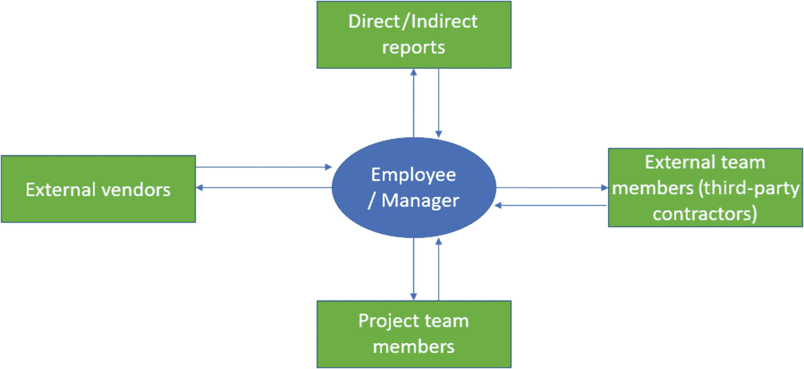

# 12. 360 度评估

`SuccessFactors`中的`360 度评估`模块使经理和员工能够在绩效评估过程中向其他利益相关者（包括内部和外部）征求反馈。使用`SuccessFactors 绩效与目标管理`进行的典型绩效评估包括直线经理和员工对目标的评估和评分。但这并不能提供关于员工绩效或发展需求的全面反馈，而这些反馈有助于经理在绩效校准或与员工的一对一会议中更好地支持员工。为了专门支持这种情况，组织利用`360 度评估`模块从员工直接或间接合作过的所有利益相关者那里获取反馈。

如图 12-1 所示，员工或代表员工的汇报经理可以向不同的利益相关者请求绩效反馈。从团队成员和其他利益相关者那里获取反馈，有助于员工和经理更准确地评估员工的绩效。这些利益相关者还可以就成功和失败案例提供公正无偏见的反馈，并帮助经理更好地理解员工的发展需求。

**图 12-1** 360 度评估流程概览