# 15. 校准会议

在上一章中，我们学习了如何在预配置（Provisioning）中启用校准。接着，我们进入实例，设置基于角色的权限，并回顾了配置校准模板的步骤。我们还讨论了校准设置，并了解了一些其他与校准相关的功能。现在，我们准备创建一个校准会议。

在开始之前，让我们回顾一下所学内容，以确保我们理解什么是校准会议。

# 校准会议管理

校准会议是一个论坛，管理者们在此聚集，讨论其员工的绩效，以达成公平、客观的绩效评级共识。该会议用于比较被校准人员的绩效评级、修改评级、添加评论以及审查特定校准周期的结果。

在上一章关于校准的内容中，我们创建了校准模板。该模板确定了待校准评级的数据源，指明了校准会议中使用的数据视图，并启用了一些通用功能。接着，我们配置了校准设置。这些设置定义了每个校准参与者角色可以执行的操作，确定了搜索结果字段，并启用了全局设置。如果管理者能够在绩效模块的“团队概览”中启动自己的校准会议，我们则指定了要使用的校准模板。这些功能和设置适用于每个校准模板和每个校准会议。

在本章中，我们将探讨创建校准会议的各种方法。我们将了解管理员如何使用`管理校准会议`工具创建一个或多个校准会议，以及如何使用`批量创建校准会议`工具创建多个会议。我们还将了解如何批量创建、审批和删除校准会议。

我们将逐步讲解管理者如何通过绩效模块内的`校准`标签页或`团队概览`标签页创建会议。在回顾了这些方法并设置好校准会议后，我们将逐步完成一个校准会议。最后，我们将回顾可用的校准报告。

## 管理校准会议

首先，我们将了解管理员如何管理校准会议。此基于角色的权限授予管理员角色以及任何负责创建或编辑校准会议的角色。在搜索栏中输入并选择`管理校准会议`。将显示一个会议概览屏幕。在此处，可以创建新的校准会议；也可以编辑、克隆、删除或导出现有会议。示例如图 15-1 所示。

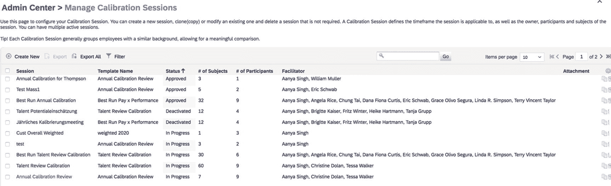

**图 15-1** 管理校准会议概览

### 校准会议概览屏幕

现在，让我们看看此概览页面为每个会议显示了哪些信息。所有状态的现有校准会议都会显示。列标题如图 15-2 所示。

**图 15-2** 校准会议列

每个会议的名称与其关联的校准模板、会议状态、主题和参与者人数以及主持人的姓名一同显示。

与校准会议各阶段相关的状态如下：
- **设置：** 会议已创建并验证，但尚未激活。
- **进行中：** 会议已激活；会议已开启但尚未最终确定。
- **审批中：** 介于`进行中`和`已批准`之间的阶段。已点击`最终确定`按钮，但最终确定尚未完成。
- **已批准：** 会议已最终确定，评级已获批准，会议已完成。
- **已停用：** `进行中`的会议已停止。此状态允许进行更改。必须重新激活会议才能恢复到`进行中`状态。

理解验证和激活的含义也很有帮助。会议创建后，必须进行验证。验证过程会检查以确保主题拥有表单，且这些表单处于校准步骤中。如果验证成功，则可以激活会议。激活会议使其可供主持人、所有者和参与者访问，以开始校准流程。

### 校准会议选项

可以创建新会议，可以克隆或删除现有会议，也可以导出会议。

`新建`、`导出`和`筛选`选项如图 15-3 所示。我们将逐一查看这些选项。

**图 15-3** 管理校准会议选项

#### 导出校准会议

要导出校准会议，请选择一个或多个会议，然后点击`导出`按钮。点击`导出全部`可导出所有校准会议。导出的数据包含在一个 Excel 工作簿中。每个主题都有一条记录，包含会议的基本信息，如图 15-4 中的示例所示。

**图 15-4** 校准会议导出

#### 筛选校准会议

可以使用`筛选`选项来避免在多个页面中滚动查找特定会议进行管理。这对于拥有大量校准会议的组织非常有用。可以按名称、状态、主持人或主题/参与者人数来筛选会议。示例如图 15-5 所示。

**图 15-5** 用于查找校准会议的高级筛选

应用筛选器以显示符合所选条件的会议。

### 搜索校准会议

当存在大量会议时，还有一个搜索选项可用于查找会议。在搜索框中输入部分校准会议名称，然后点击`执行`，即可快速找到会议。符合条件的所有会议都将显示出来。

现在，让我们创建一个新会议！

### 按角色划分的校准会议目标组

## 创建校准会议

在创建校准会议时，必须确定需要校准哪些员工和评级，以及由谁来校准。系统使用基于角色的权限来授予创建校准会议的权限。然而，每种角色使用不同的方式针对不同的目标群体创建会议。详情如表 15-1 所示。

| 会议类型 | 角色 | 目标群体 | 创建会议的位置 |
| --- | --- | --- | --- |
| 单一会议 | 管理员 | 所有员工 | `管理后台 ➤ 校准 ➤ 管理校准会议 ➤ 新建` |
| | 经理 | 直属下属 | `首页 ➤ 绩效 ➤ 团队概览 ➤ 校准` 按钮 |
| | | 直属下属及更下级 | `首页 ➤ 校准 ➤ 新建` |
| 批量会议 | 管理员 | 所有员工 | `管理后台 ➤ 校准 ➤ 批量创建校准会议` |

我们将首先探讨管理员如何创建单一校准会议。

可以通过点击`新建`按钮或克隆现有会议来创建新会议。克隆会议会创建现有会议的副本，您可以将其用作起点进行重命名和更新。在创建会议的过程中，您将指定会议适用的时间范围以及所使用的校准模板。您还需要指定用户来：
- 主持该会议（协调员）
- 作为后备人员（协同协调员）
- 拥有该会议（负责人）
- 提供输入（参与者）
- 接受校准（对象）
- 有权访问校准模板的所有会议数据（执行审阅者）

创建过程涉及三个标签页：`基本信息`、`人员`和`验证`。

### 基本信息标签页

`基本信息`标签页如图 15-6 所示。

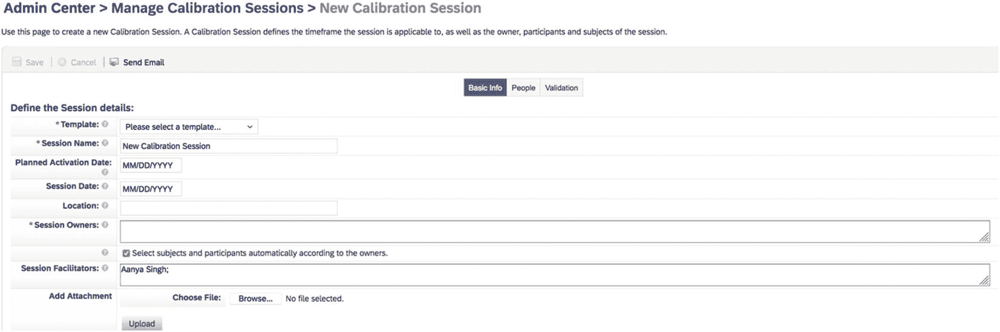

**图 15-6** 校准会议的基本信息标签页

`基本信息`标签页用于命名会议、选择与此会议关联的校准模板，以及指定会议负责人和协调员。必填字段为会议名称、关联的校准模板和会议负责人。

会议负责人应为管理层级超过两级的经理。默认设置为`根据负责人自动选择对象和参与者`。指定负责人后，该负责人的直属下属会自动成为校准会议的参与者。此外，这些参与者的直属下属会成为校准会议的对象。

此设置会将参与者和对象作为会议成员添加到`人员`标签页中。参与者将是负责人下一级的所有用户。对象将包括负责人下两级的所有用户。

管理员的用户名默认为协调员，但可以更改。添加的第二个用户名将成为协同协调员，但协同协调员并非必需。

可以上传一个附件，该附件将在校准会议中可见。评级描述或分布指南都是可用附件的示例。

`计划激活日期`是会议被激活并可使用的日期。`会议日期`是校准会议的起始日期，`地点`是会议将要举行的地方。这三个字段为可选字段。保存您所填入内容的标签页，然后进入`人员`标签页。

### 人员标签页

`人员`标签页用于添加或编辑会议的参与者和对象。`人员`标签页分为三个部分：`用户搜索`、`搜索结果`和`会议成员`。`用户搜索`部分用于查找要添加到校准会议的用户。搜索结果显示在中间面板中。负责人、参与者和对象显示在最右侧的`会议成员`面板中。如果在`基本信息`标签页中勾选了`根据负责人自动选择对象和参与者`选项，则`会议成员`面板将如图 15-7 所示自动填充。

**图 15-7** 管理校准会议的人员标签页

但是，您可以移除其中任何姓名，也可以添加其他姓名。要添加其他会议对象或参与者，您可以按筛选条件、群组或组织架构图搜索用户。

`按筛选条件搜索`是默认搜索方式。标准筛选条件包括`部门`、`分部`、`地点`、`姓名`、`用户名`和`岗位代码`。添加到数据模型中的自定义校准筛选条件也将作为筛选条件可用。示例如图 15-8 所示。

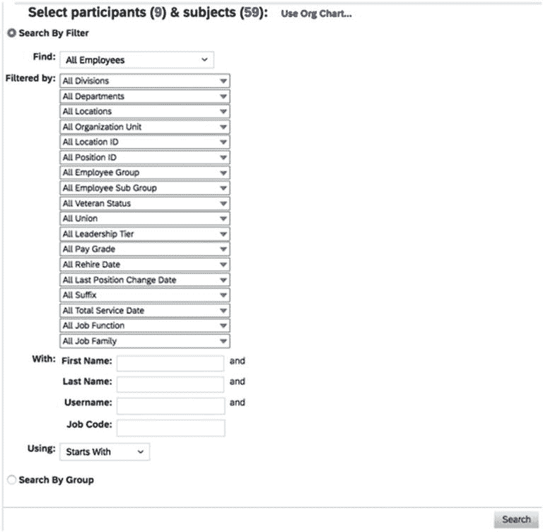

**图 15-8** 按筛选条件搜索

您可以回顾前一章，以了解校准筛选条件是如何定义的。

图 15-9 显示了`按群组搜索`选项，用于按群组查找员工。

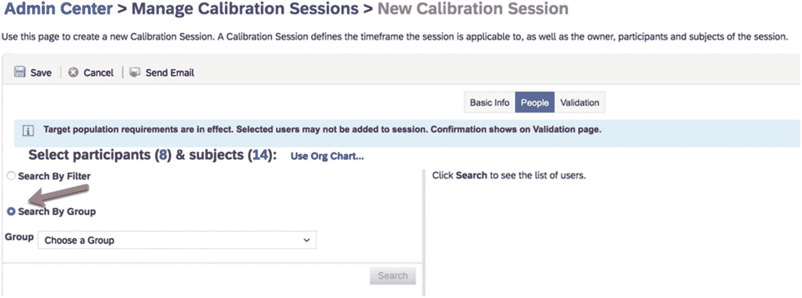

图 15-9 按群组搜索

如果您点击`按群组搜索`的单选按钮，您将能够使用任何现有群组来查找员工，如图 15-10 所示。您也可以创建新群组。

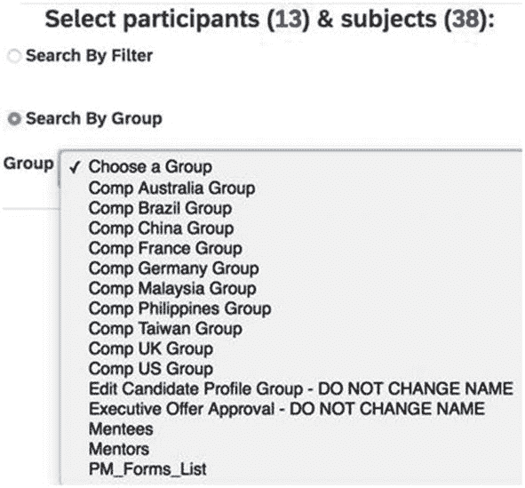

图 15-10 按群组搜索选项

根据在`管理校准设置`的`搜索结果字段`标签页中所做的选择，通过点击如图 15-11 所示的齿轮图标，可以获得额外的显示字段。选定的字段将作为附加列显示在屏幕的`搜索结果`部分，如下所示。任何默认的返回字段也可以取消选择。

图 15-11 搜索结果部分的显示字段

在`搜索结果`面板中，选择一个用户，然后点击`操作`下拉列表，将该姓名作为参与者或对象添加到标签页最右侧面板的会议成员列表中。图 15-12 显示了包含可用操作的搜索结果表。

图 15-12 搜索结果操作

最后一种搜索选项是按组织架构图搜索。点击`使用组织架构图...`链接，组织架构图将显示，如图 15-13 所示。

图 15-13 组织架构图搜索结果

如果您在`Basic Info`标签页中根据负责人选择了科目和参与者，显示的组织结构图将基于该负责人的组织结构。负责人与其直接下属一同显示。对于有多个负责人的评审会，组织结构层级将显示`Basic Info`标签页中列出的第一位负责人。要查看其他任意负责人的组织结构图，请在最右侧面板的评审会成员列表中点击另一位负责人的姓名。图 15-14 显示了所选负责人的组织结构图。

图 15-14 选择组织结构图搜索的负责人

您也可以搜索组织结构图中的任何人员，以查找要添加为参与者或科目的用户。

您可以在组织结构图中向下钻取到更低的层级。每位员工都会有一个`Take Action`链接。点击该链接将显示选项，如图 15-15 所示。

图 15-15 向评审会添加/从评审会中移除用户

`Take Action`选项允许将该员工作为`participant`、`subject`或`Not in Session`添加到评审会中。`Not in Session`选项将从校准评审会中移除该用户。管理员还可以将该用户的整个组织指定为评审会中的科目。

在`Session Members`面板中，如图 15-16 所示，可以选择要移除的名称。您可以选择一个、多个或所有名称将其从评审会中移除。

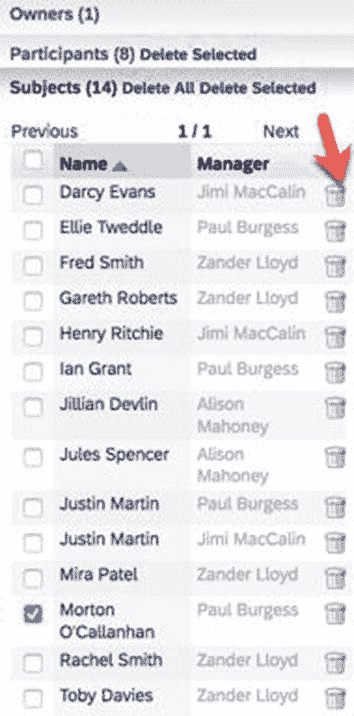

图 15-16 “人员”标签页中看到的评审会成员

如果您想为正在进行中的评审会添加或移除科目或参与者，请点击页面顶部的`Deactivate`按钮。停用后，评审会无法访问，数据也无法编辑。在更新后恢复评审会时，必须重新验证和激活评审会。

在`People`标签页中还有一个`Send Email`按钮。点击此按钮将显示一个用于创建电子邮件的界面，如图 15-17 所示。负责人和参与者的名称默认填入`Send to`地址，但可以修改这些条目。

图 15-17 “人员”标签页中的“发送电子邮件”选项

管理员可以发送包含任意主题和消息的电子邮件，收件人也可以更新。完成任何更改后，点击`Save`按钮，即可准备进入`Validation`标签页。

### 验证标签页

在`Basic Info`标签页中输入评审会信息，在`People`标签页中选择将参与校准评审会的人员，并保存评审会后，必须对评审会进行验证。必须完成此步骤，才能使评审会准备好进行校准。在`Validation`标签页中，系统会完成一系列检查，包括验证每个科目是否都有绩效表，并且每个表格是否都处于校准步骤。任何错误都会显示出来，并且必须在激活评审会之前解决。

常见的错误和警告消息如表 15-2 所示。

**表 15-2 验证错误和警告消息**

| 错误消息 | 原因 | 修正措施 |
|---|---|---|
| 科目没有表格 | 评审会中的科目没有绩效表。 | 为科目启动表格，或将科目从评审会中移除。 |
| 科目的表格尚未路由到校准步骤 | 科目存在表格，但这些表格尚未进入绩效路线图中的校准步骤。 | 将表格路由到校准步骤，或让用户手动提交到下一步骤。 |
| 科目已在其他评审会中 | 仅当启用了允许员工一次仅参与一个评审会的设置时，才会出现此问题。 | 将科目从评审会中移除，或更改全局设置。 |
| **警告消息** | **原因** | **解决方法** |
| 科目已在其他评审会中被选定 | 科目在其他评审会中；模板可能不同，但具有相同的日期范围和数据源。 | 使用具有不同数据范围或数据源的不同校准模板，或将用户从评审会中移除。 |
| 用户处于非活动状态 | 用户处于非活动状态。 | 将用户从评审会中移除，更改设置以允许非活动用户，或将用户更改为活动状态。 |

警告消息不会导致验证失败。

图 15-18 显示了一个验证失败的示例，原因是存在没有表格的科目，并且表格尚未路由到校准步骤。

图 15-18 验证错误

`Route Forms to Calibration`按钮会将表格移动到校准步骤。首先，如果启用了自动路由电子邮件通知，将显示一个弹出窗口。电子邮件会发送给表格被移动的员工的经理。电子邮件的示例如图 15-19 所示。

图 15-19 表格路由的电子邮件通知

电子邮件可以在发送前进行修改。当通知成功发送后，将显示一条消息。电子邮件发送后，表格的路由开始，如图 15-20 所示。

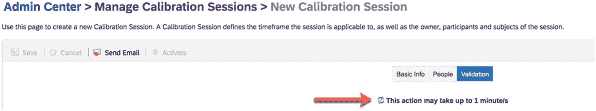

图 15-20 表格正被路由到校准步骤

如果没有问题，此时即可成功激活评审会。将出现一个绿色横幅，其中包含`Validation finished. No problems found.`。

如图 15-21 所示，一旦评审会通过验证，它就准备好被激活。

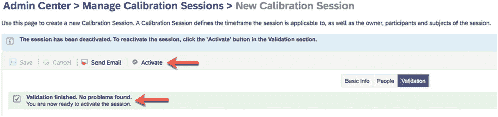

图 15-21 成功的评审会验证

#### 激活

验证通过后，点击`Activate`按钮。激活评审会即可使校准评审会开始。如图 15-22 所示，会显示一个确认弹出窗口以验证激活。激活后，可以发送电子邮件给引导者、负责人和评审会参与者。收件人、预填的电子邮件主题和消息可以在发送前修改。现在评审会状态为`In Progress`。

*图 15-22 验证评审会的顺序*

当只需创建少量评审会时，这种创建和激活校准评审会的方法是可行的。我们将会了解管理员可用于批量创建、验证和激活校准评审会的另一个工具。

## 批量创建校准会话

### 批量校准活动

逐一管理校准评审会非常耗费人力，尤其对于需要创建数百个校准评审会的组织而言。

管理员可以通过一个功能一次性创建多个校准会话。此外，这些会话还可以批量验证和激活。我们将研究实现此功能的工具。

在搜索栏中输入并选择 `“批量创建校准会话”`。如图 15-23 所示，在此处可以执行批量创建操作。使用此功能的前提是校准设置已配置完成且校准模板已创建。

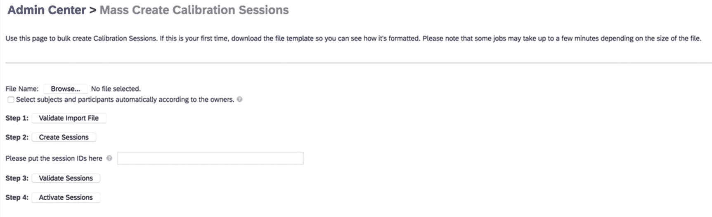

**图 15-23 批量创建校准会话**

在此界面上需要执行四个步骤：`验证导入文件`、`创建会话`、`验证会话`和`激活会话`。我们将逐步介绍每个步骤。

### 验证导入文件

首先，必须下载校准文件模板。该模板提供了用于创建校准会话的文件布局。点击屏幕顶部介绍文字中的 `“文件模板”`，打开 CSV 文件。下载后的模板如图 15-24 所示。

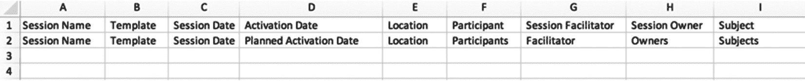

**图 15-24 校准文件模板**

文件中的列与通过 `管理校准会话` 手动创建会话时使用的字段相同。文件模板中的前两行标题行必须保持原样。第一行包含代表会话属性的列。第二行包含系统列名。为要创建的每个校准会话在文件中新建一行。与手动创建校准会话类似，需要相同的字段：会话名称、与该会话关联的校准模板以及会话所有者。

#### 必填项

文件中的必填项包括：

- **列 A – 会话名称**：为每个会话指定唯一名称。

- **列 B – 模板**：与该会话关联的校准模板。

- **列 G – 会话引导人**：如果引导人留空，系统默认将上传文件的人设为引导人。如需指定引导人和共同引导人，请在同一行中列出每个用户名，并用竖线分隔符 `“|”` 隔开。

- **列 H – 会话所有者**：输入会话所有者的用户名。如有多个所有者，请在同一单元格中列出，并用竖线分隔符隔开。

图 15-25 显示了一个包含两个引导人和多个所有者的示例。

**图 15-25 多个引导人和所有者的示例**

#### 可选项

`列 C`（会话日期）、`列 D`（激活日期）和 `列 E`（地点）为可选项，可留空。日期格式基于上传文件用户的本地化格式。上传时文件需使用 CSV 格式。

在 `批量创建校准会话` 界面上，有一个选项 `“根据所有者自动选择主题和参与者”`。这与通过 `管理校准会话` 创建会话时在 `基本信息` 选项卡中找到的选项相同。启用此选项后，所有向所有者汇报的管理人员将成为会话的参与者。向参与者汇报的个人贡献者将成为主题。启用此选项无需单独指定要包含在会话中的参与者和主题。因此，无需在 `参与者` 和 `主题` 列中添加任何条目。

要为批量创建会话复制此选项，请将 `参与者`（列 F）和 `主题`（列 I）列中的单元格留空。如果启用了主题和参与者的自动选择，文件中可以包含列出了参与者和主题的行。换句话说，当勾选 `“根据所有者自动选择主题和参与者”` 时，您可以包含没有参与者和主题的会话行，以及包含参与者和主题的会话行。

如果您要创建的会话不基于所有者的组织层级，则必须在文件的列 F 和列 I 中输入参与者和主题：

- **列 F – 参与者**：将所有参与者输入到一个单元格中，用竖线分隔符隔开。

- **列 I – 主题**：将所有主题输入到一个单元格中，用竖线分隔符隔开。

继续在文件中为要创建的每个唯一校准会话添加行。您可以使用不同的校准模板创建会话。

图 15-26 显示了 CSV 文件中填充了主题和参与者的行示例。

**图 15-26 批量创建上传文件**

文件填充并保存后，必须上传并进行验证，如图 15-27 所示。确保文件名已列出，如果文件中的任何条目包含所有者但没有参与者和主题，请勾选 `“根据所有者自动选择主题和参与者”` 旁的复选框。点击 `步骤 1` 按钮，即 `“验证导入文件”`。

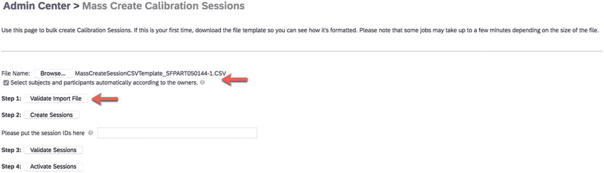

**图 15-27 选择文件并验证**

文件验证后，管理员将收到一封电子邮件。如果存在任何问题，邮件中将包含验证错误信息。图 15-28 显示了一个包含错误的导入示例。

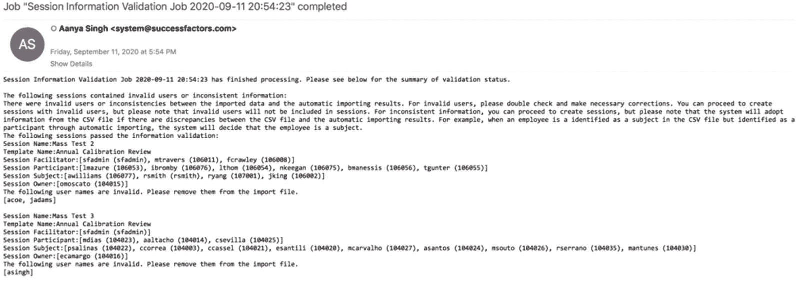

**图 15-28 包含错误的校准会话导入验证邮件**

如果存在任何错误，必须修正文件，然后重新保存、上传并再次验证。

### 创建会话

管理员需要返回 `批量创建校准会话` 工具来创建会话。文件验证通过后，即可创建会话。确保文件名已列出，然后点击 `步骤 2` 按钮，即 `“创建会话”`，如图 15-29 所示。

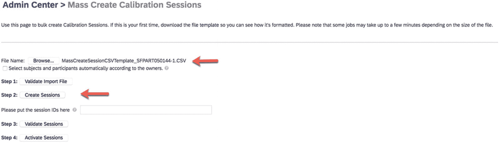

**图 15-29 批量创建校准会话**

管理员将收到一封电子邮件，如图 15-30 所示。会话已创建完成，每个会话都会显示一个会话 ID，在验证会话时需要引用该 ID。

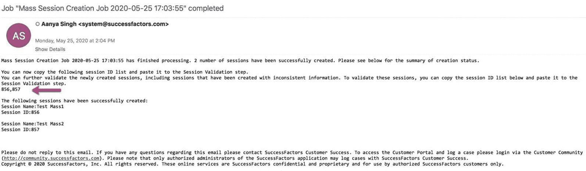

**图 15-30 批量创建的校准会议的电子邮件通知**

每个校准会议的状态现在为 `Setup`。

### 验证会议

管理员需要返回 `批量创建校准会议` 工具来验证会议。要成功验证，评估对象必须已创建绩效表单，并且该表单处于校准步骤中。只有状态为 `Setup` 或 `Deactivated` 的会议才能被验证。确保文件名与步骤 2 的电子邮件中的会议 ID 一同列出。点击步骤 3 按钮，`Validate Sessions`。示例如图 15-31 所示。

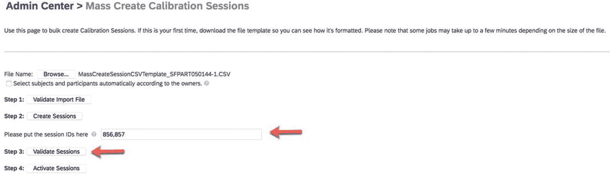

**图 15-31 验证会议**

管理员将收到一封关于会议状态的电子邮件。如果没有错误，如图 15-32 所示，会议即可激活。

**图 15-32 验证成功电子邮件**

### 激活会议

管理员需要返回 `批量创建校准会议` 工具来激活会议，如图 15-33 所示。确保文件名与步骤 2 的电子邮件中的会议 ID 一同列出。点击步骤 4 按钮，`Activate Sessions`。

**图 15-33 激活会议**

管理员在会议激活时收到的电子邮件通知示例如图 15-34 所示。

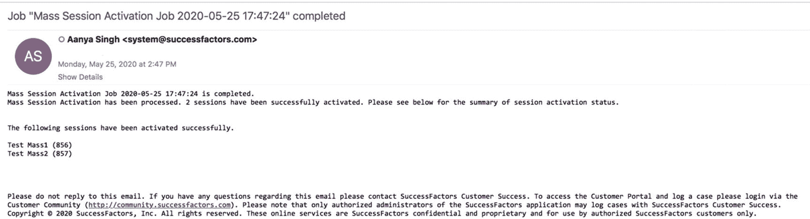

**图 15-34 激活电子邮件**

会议的状态变为 `In Progress`，校准会议可以开始了。可以执行的其他批量操作包括批量删除会议和批量批准会议。接下来我们将了解批量删除，而批量批准会议的讨论将留到我们完成一次校准会议之后再介绍。

### 批量删除会议

## 删除校准会议

在需要重新创建校准会议的情况下，必须先删除现有会议。可以批量删除会议。只要主持人或联合主持人拥有`Delete`权限，他们就可以删除会议。删除`In Progress`状态和`Approved`状态会议的权限在“管理校准设置”的“权限”选项卡中设置。

可以通过使用主菜单并选择`Calibration`来一次性删除多个会议。主持人有权限的所有会议将显示出来，如图 15-35 所示。

图 15-35：带有批量删除功能的校准会议

要批量删除会议，主持人可以选择任意或所有会议，然后点击屏幕右上角的垃圾桶图标。将显示一个确认页面，如图 15-36 所示。

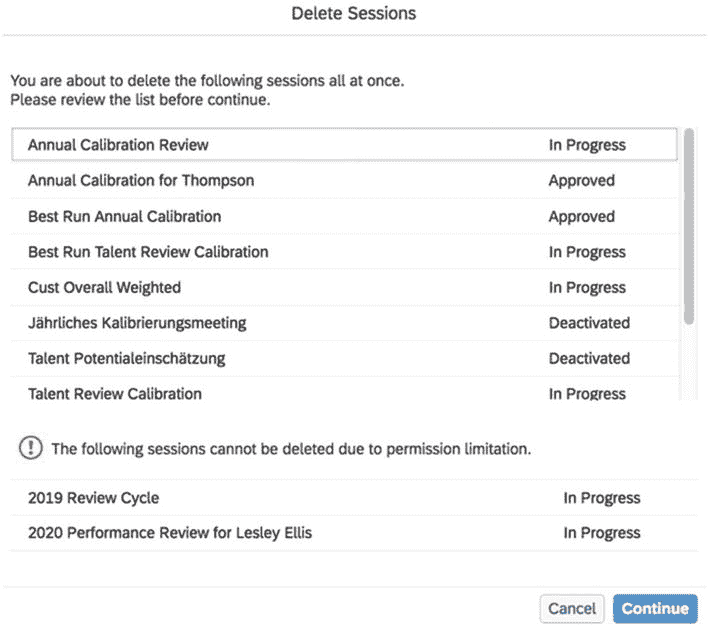
图 15-36：删除会议确认

任何因权限问题无法删除的会议都将如上图所示列出。确认后，这些会议将被删除并从会议列表中移除。

主持人也可以使用`Manage Calibration Sessions`来删除多个会议，如图 15-37 所示。但是，必须逐个选择并删除每个会议。

图 15-37：通过管理校准会议删除会议

至此，我们已经了解了如何创建单个校准会议、批量创建校准会议以及批量删除校准会议。接下来，我们将学习经理创建会议的方式。

### 经理创建会议

有一个选项允许高级经理为其自己的团队创建校准会议。要实现此功能，必须在“管理校准设置”的“全局设置”选项卡中启用`Enable Manager Calibration Session`。

经理需要从主菜单导航到校准页面。如图 15-38 所示，经理会在校准会议屏幕上看到一个`Create New`按钮，可以直接开始创建会议。

图 15-38：校准会议屏幕

经理必须选择与要校准的绩效表单关联的校准模板，命名会议，并确定要包含的层级数量，如图 15-39 所示。如果经理只有直接下属，则唯一的层级选项将是`Direct Reports`。

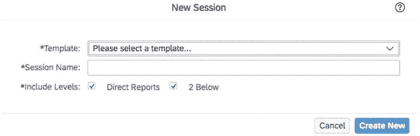
图 15-39：经理创建新会议

要创建会议，所有评估对象的绩效表单必须已启动并与校准模板关联，并且每个表单都必须处于校准步骤中。创建完成后，经理可以直接进入校准会议，如图 15-40 所示。

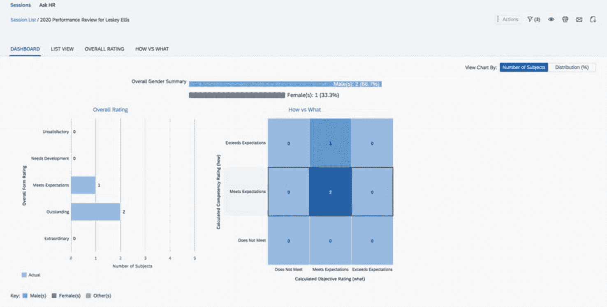
图 15-40：经理已创建会议

经理还可以通过返回到校准中的“会议”选项卡来删除他们创建的会议，如图 15-41 所示。

图 15-41：经理删除校准会议

经理选择该会议并点击垃圾桶图标。确认后，该会议将被删除。

### 经理在团队概览中创建校准会议

还有一个附加功能允许经理在绩效管理的“团队概览”页面上创建校准会议。此功能仅允许为经理的直接下属创建会议。使用此功能需要满足以下条件：

*   在`Performance Management Feature Settings`中启用`Enable Team Overview Access Permission`。
*   经理角色拥有“团队概览访问”权限。
*   在“管理校准设置”的“全局设置”选项卡中启用`Launch Calibration from PM v12 Team Overview`。
*   “管理校准设置”的“经理模板”选项卡标识了要在 PM v12 团队概览页面上使用的校准模板。
*   正在校准的 PM 表单在“管理校准模板”的“数据”选项卡中与该校准模板关联。

绩效表单必须处于校准步骤中，这与经理直接在校准中创建会议的过程相同。经理需要进入“绩效” ➤ “团队概览”。校准按钮将出现在屏幕的右上角，如图 15-42 所示。

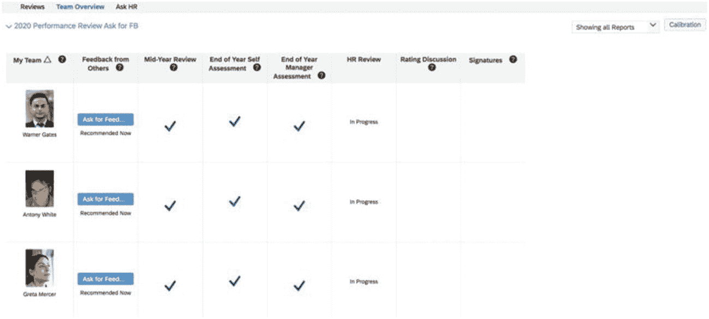
图 15-42：绩效管理中的团队概览

点击“Calibration”按钮将打开校准会话，如图 15-43 所示。

图 15-43：通过团队概览创建的校准会话

如果绩效表单尚未进入校准步骤，则会显示错误消息，如图 15-44 所示。

图 15-44：绩效表单未进入校准步骤时的错误消息

管理员需要返回绩效表单，完成审阅步骤并提交，然后才能创建校准会话。这也可以通过团队概览完成。

## 运行校准会话

我们已经了解了管理员和管理者创建和删除校准会话的方法。现在我们将逐步介绍校准会话的步骤。

如前所述，当管理员单独或批量创建会话时，可以在激活会话时选择发送电子邮件。参与者会收到通知，告知会话已激活，主持人现在可以主导会话。

主持人、所有者和参与者可以通过从主菜单导航到`Calibration`选项卡，或从其主页“我的团队”部分中的`Calibration`磁贴来访问会话。主页示例如图 15-45 所示。

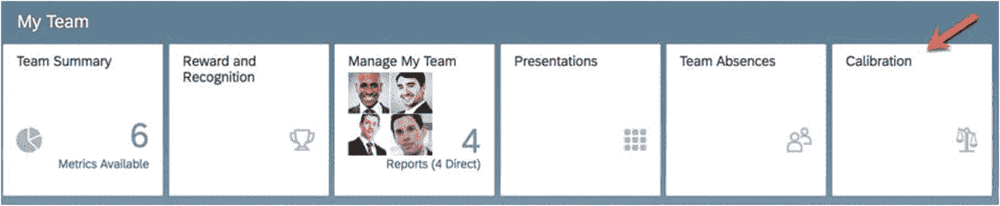
图 15-45：管理者的 Calibration 磁贴

如果非管理者参与校准会话，`Calibration`磁贴默认会显示在其主页的“我的专业领域”部分。示例如图 15-46 所示。

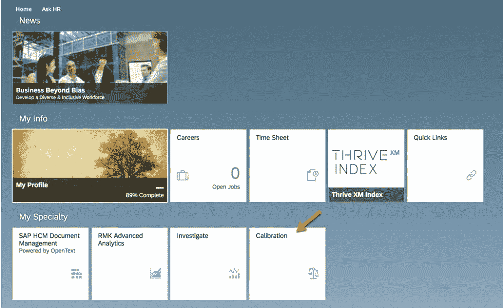
图 15-46：非管理者的 Calibration 磁贴

点击磁贴将直接进入`Calibration`概览页面。`Calibration`概览屏幕将显示用户在其中扮演角色的所有会话。示例如图 15-47 所示。

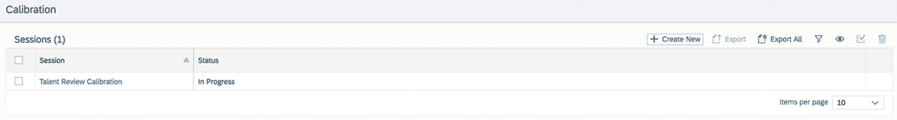
图 15-47：主持人、所有者和参与者的会话列表

对于参与者，很可能只有一个会话，而主持人可能有许多会话显示。分配给用户的校准角色将决定他们在会话中可以执行的操作。提醒一下，这些权限是在“管理校准设置”的“权限”选项卡中设置的。具有只读访问权限的参与者将无法在会话中进行任何更改。

主持人将主持会议、修改评分、添加评论，并在完成后将每个主题标记为已讨论。保存更改并确认参与者没有进一步更新后，主持人将结束会话。接下来的一系列会话视图将从主持人的角度展示。这意味着权限将包括读取、写入、导出、结束和删除。我们将深入探讨每个会话视图、每个视图中可以执行的操作，以及如何结束会话。

### 仪表盘视图

如果启用，仪表盘将是访问会话时的初始视图。示例如图 15-48 所示。

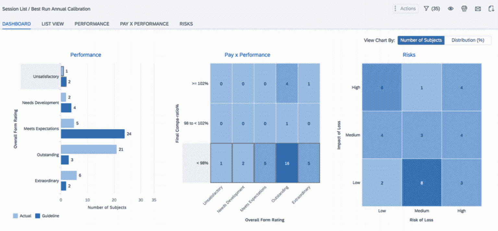
图 15-48：校准会话的仪表盘视图

仪表盘提供了多个摘要视图，用于监控校准会话的进度。

> **注意**：如果已在校准模板中启用了性别指示器，则会话结束后，页面顶部会显示总体性别摘要。

### 列表视图

## 校准工具栏选项

单击“列表视图”选项卡，以表格形式查看主题。会话的“列表视图”选项卡示例如图 15-49 所示。

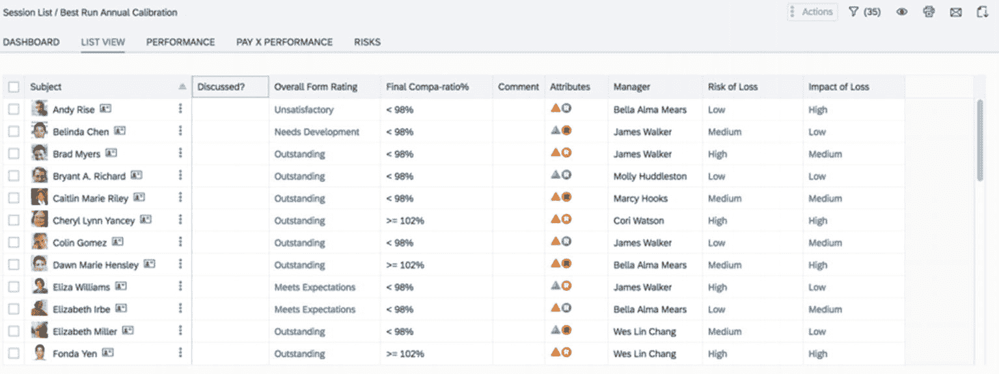

`图 15-49` 校准会话的列表视图

显示的一些列和可用的一些功能取决于在“管理校准模板”和“管理校准设置”中的选择。例如，“属性”列显示人才标志，每个员工都有一个快速卡片。

如图 15-50 所示的校准工具栏在每个视图中都可见。

`图 15-50` 校准工具栏

这些选项包括“操作”、“筛选选项”、“显示选项”、“打印”、“电子邮件”和“导出”。此外，矩阵视图具有标识未评分主题的选项。这些选项适用于所有视图类型。

### 操作

`操作`按钮在仪表盘视图中不显示，在查看已批准的会话时也不可用。`操作`按钮在选中一个主题之前处于非激活状态。在列表视图和回收站视图中，通过单击名称左侧的复选框来选择主题。对于矩阵视图，单击单元格内的主题以进行选择。对于这些视图，都可以选择多个主题。

对所选主题执行的操作如下：

*   将主题标记为已讨论或取消标记。
*   并排分析主题以查看或更新评分。
*   取消选择所有员工以清除已选主题。

操作如图 15-51 所示。

`图 15-51` 操作

### 标记为已讨论

在校准会话期间，主持人可以展示每个主题以供审阅。主题的评分会被更新或保持不变。主持人可以在进行会话时将主题标记为`discussed`，以跟踪哪些人已被校准。选中主题后，使用`操作`按钮，可以将其标记为已讨论。图 15-52 展示了选中三个主题并标记为已讨论的示例。

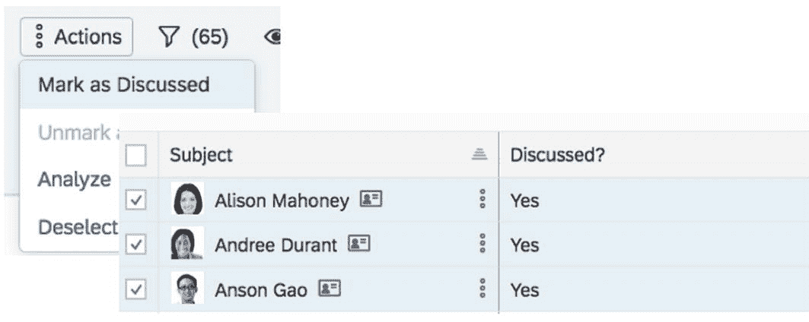

`图 15-52` 将主题标记为已讨论

在列表视图中，`已讨论？`列将填充为`是`，如上图所示。这标识了已被审阅的主题。在回收站视图中，标记为已讨论的主题名称会变灰。示例如图 15-53 所示。

`图 15-53` 回收站视图中的已讨论主题

在矩阵视图中，已讨论的主题将通过其名称旁边的绿色复选标记图标来标识。示例如图 15-54 所示。

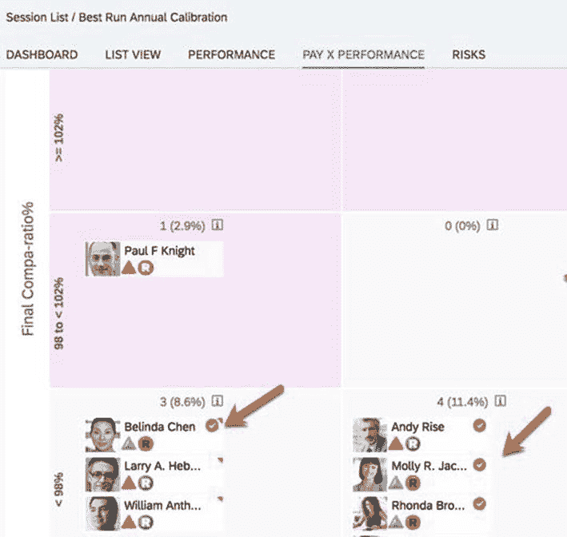

`图 15-54` 矩阵视图中的已讨论主题

在校准大量受试者时，这是一个有用的指示器。该指示器可以追踪哪些受试者的评分已被审查和/或更新。任何已讨论的受试者也可以更改为未讨论状态。选定后，任何已讨论的受试者都会激活“取消标记为已讨论”操作。此选项将移除选定受试者在所有视图上的已讨论指示器。

### 分析受试者

可以选定任何受试者执行 `Analyze` 操作。如图 15-55 所示，选定的受试者会在一个弹出窗口中并排显示，并附有其评分。这提供了评分的可视化比较，并且可以在此处调整评分。

`图 15-55 分析受试者`

未评分或根据您的评分标准标记为“太新而无法评分”的状态，由评分量表中第一个数值分数前面的空白方块标识。从 `Actions` 选项中做出任何更改后，单击 `Save` 按钮。

### 筛选选项

`Filter Options` 用于根据数据模型中设置的筛选选项列出受试者的子集。如前一章所述，存在标准筛选器，以及可设置为数据模型筛选器的 `custom01` 到 `custom15` 字段。点击校准工具栏上的筛选图标即可访问筛选字段。图 15-56 显示了可用的筛选选项。

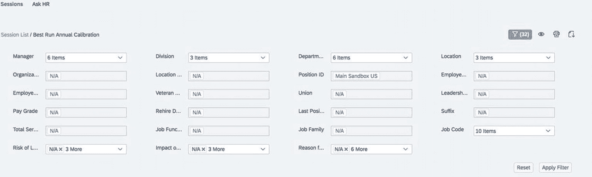

`图 15-56 筛选选项`

所有符合所应用筛选条件的员工都将显示出来。

### 显示选项

`Display Options` 由眼睛图标标识，用于向视图中添加数据或从视图中移除数据。显示选项有两个标签页。硬编码字段出现在 `Other Options` 标签页中。如图 15-57 所示，`First Name`、`Last Name` 和 `Count` 是硬编码字段，将始终显示在会话的显示选项中。如果启用了 `Quick card`，它也将出现在此标签页中。

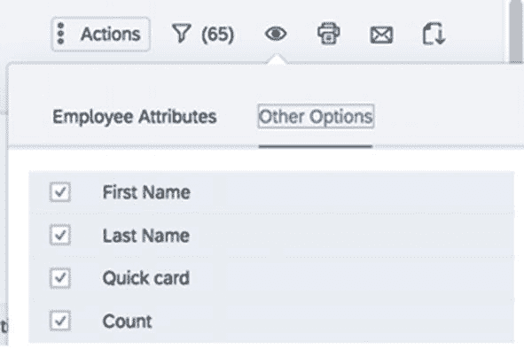

`图 15-57 显示选项 – 其他选项`

在 `Provisioning` 中的 `Matrix Grid Classifier` 工具中定义的，或在实例的 `Matrix Grid Report Icon Reconfiguration` 中设置的任何显示选项字段，都将用于显示选项的另一个标签页（`Employee Attributes`），如图 15-58 所示。

`图 15-58 员工属性显示选项`

取消选择任何字段后，`Submit` 按钮将变为可用状态，如图 15-59 所示。

`图 15-59 取消选择要显示的字段`

提交后，取消选择的字段将不再作为列显示在视图上。

### 打印

`Print` 图标用于将视图打印为 PDF，如图 15-60 所示。

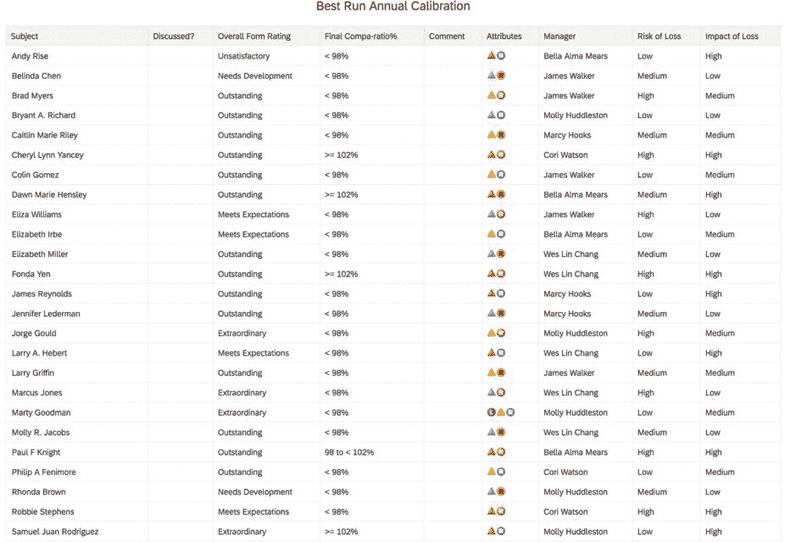

`图 15-60 列表视图的 PDF 版本`

每个视图（包括仪表板）都可以打印。

### 电子邮件

`Email` 图标会弹出一个窗口，用于撰写和发送电子邮件。如图 15-61 所示，`Send to` 字段中默认包含了所有者和参与者，但可以编辑。发送电子邮件需要填写主题和消息。该电子邮件不会发送会话详情，也不允许添加附件。

`图 15-61 发送电子邮件`

### 导出

`Export` 图标用于将会话中的数据下载到 Excel 中。每个会话视图对应一个工作表标签页。示例如图 15-62 所示。

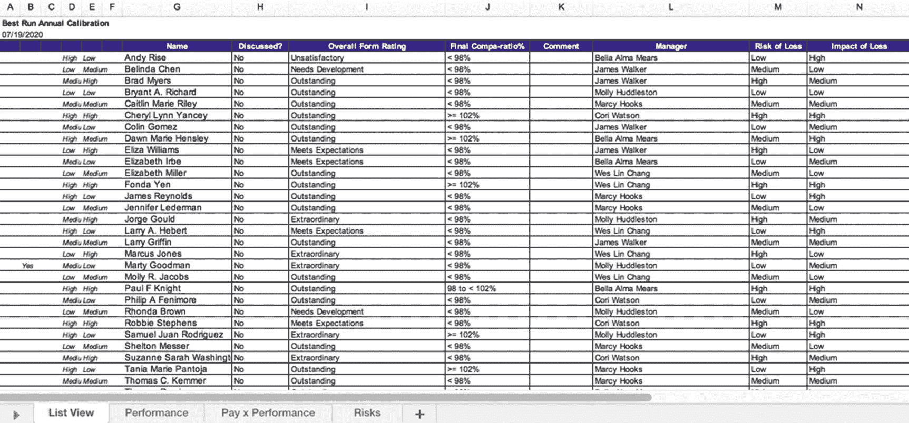

`图 15-62 导出会话`

至此，我们已经回顾了工具栏选项。现在，我们将探讨一些更多功能。

### 未评分

在 `Bin` 和 `Matrix Views` 中，有一个额外的工具栏选项。有一个带计数的图标，用于指示未评分的受试者数量。单击该图标将创建一个新的分类箱，并且分类箱上方也会显示一条消息。受试者将按评分类别显示在分类箱中，即“未评分”或“太新而无法评分”。这些受试者要么其绩效表没有评分，要么被评定为“太新而无法评分”，或者其评分在校准会话期间被移除了。示例如图 15-63 所示。

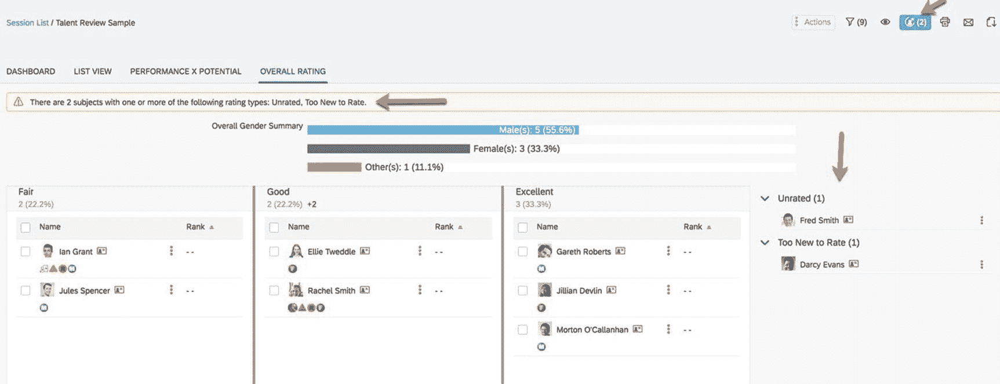

`图 15-63 未评分的受试者`

#### 更多选项

每个视图对每个受试者都有一个 `More` 图标。`List View` 上该图标的示例如图 15-64 所示。该图标代表 `More Options`。这些选项提供了指向可用于查看受试者数据的链接。

`图 15-64 更多选项`

##### 绩效表

根据绩效表模板权限，可能可以进入与校准模板关联的绩效表进行编辑。指向数据的其他链接基于在 `Manage Calibration Templates` 的 `Data` 标签页中选择的选项。

##### 校准人才卡

还可以选择查看 `Calibration Talent Card`，如图 15-65 所示。显示的板块基于 `Calibration Talent Card` 配置。

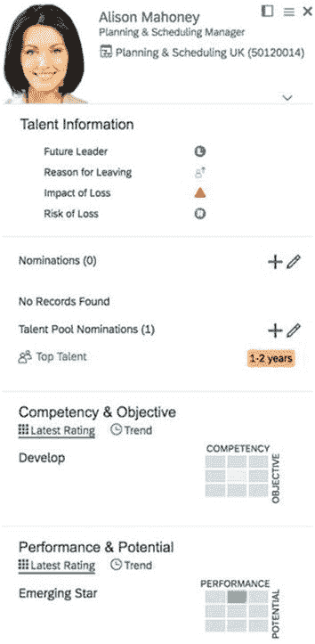

`图 15-65 校准人才卡`

##### 额外的员工数据访问

可通过链接访问 `Employee Profile`、`Development`、`Learning Activities` 和 `Achievements`，每个链接都会在一个弹出窗口中打开。指向 `Employee Profile` 的链接示例如图 15-66 所示。

`图 15-66 从校准会话访问员工档案`

这些链接有助于提供关于受试者的附加信息，以便就评分更改做出明智的决策。

##### 评论

除了员工数据链接之外，还有一个添加评论的选项。当校准会话进行中时，拥有 `Write` 权限的会话参与者可以添加、编辑、删除和查看评论。拥有 `Read` 权限的参与者只能查看现有评论。

单击 `Comment` 将弹出一个屏幕，可以在其中添加和查看评论，如图 15-67 所示。每条评论最多 4000 个字符。

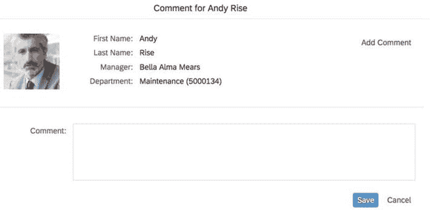

`图 15-67 为受试者添加评论`

输入并保存评论后，该员工的 `Comment` 列将显示一个评论气泡图标，如图 15-68 所示。

`图 15-68 受试者存在评论`

### 注释

点击评论图标将显示评论内容、来源及评论日期。只有评论创建者可以编辑或删除评论。示例如图 15-69 所示。

`图 15-69 评论视图`

评论在所有校准会话视图中均可见（除`Dashboard`外）。评论可显示在`Executive Review`中的`Subjects List`页面、`Calibration History Portlet`、`Employee Profile`、导出的会话中，并可包含在临时报表中。

### 快速卡片

查看主题详细信息的另一选项是通过其快速卡片。

点击图标将打开卡片。示例如图 15-70 所示。

`图 15-70 员工快速卡片视图`

### 评级更新

每种校准视图都有不同的评级更新方法。在`List View`中，评级通过下拉列表更新，如图 15-71 所示。

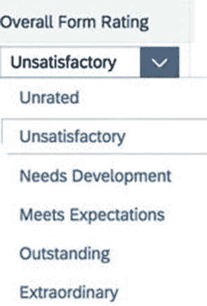

`图 15-71 在List View中更新评级`

如果在`Manage Calibration Settings`中启用了“`Enforce comments on rating change`”设置，则更新评级前会弹出一个窗口强制要求输入评论，如图 15-72 所示。

`图 15-72 评级变更评论`

至此，我们已经了解了`List View`的功能。点击下一选项卡可查看`Bin View`。只有在配置了校准元素的视图中才会出现`Bin View`。

### Bin View

`Bin View`用于对主题的一个评分源进行校准。显示的评分源在`Manage Calibration Templates`的`Views`选项卡中设置。如图 15-73 所示，主题被放置到代表其评级的容器（桶）中。

`图 15-73 校准会话的Bin View`

与`List View`类似，每个员工都提供快速卡片，并且`More`图标提供相同的选项以查看其他员工信息。

##### Bin View评级更新

评级通过选择主题并将其姓名拖拽至不同容器来更新。您可以移动一个主题，或从同一容器中选择多个主题并将其移动至另一容器。

主题可在容器内通过上下移动姓名进行排序。这将填充排名信息，如图 15-74 所示。

`图 15-74 在容器内对主题排序`

每个评级容器显示其包含的主题数量、主题占比，以及为满足分布指南需要增加或减少的主题数量。分布指南在`Manage Calibration Templates`中创建`Bin View`时设置。图 15-75 展示了带有必需主题数量的容器示例。

`图 15-75 带有分布指南的Bin View`

您可以向容器中添加超过允许数量的主题，因为验证将在您最终确定会话时才会进行。这意味着您可以保存更改，但在最终确定时，您必须做出符合指南的更新。

当容器中的主题数量恰好符合分布指南的预期时，容器顶部将不再显示加号或减号，如图 15-76 所示。

`图 15-76 符合分布指南的容器`

### Matrix View

`Matrix View`如图 15-77 所示，基于两个评级形成 9 宫格。主题根据两个评级的交叉点放置于网格中。在此视图中，您可以拖放主题至其他单元格，从而更新评级。

`图 15-77 校准会话的Matrix View`

`Matrix View`可根据选择的四个图标之一，以多种方式在网格单元格中显示主题，如图 15-78 所示。视图选项包括：“`Display Both Name and Photo`”、“`Display Only Name`”、“`Display Only Photo`”或“`Open Full Screen`”。自 H1 2020 版本起，`Matrix View`在全屏模式下将提供工具栏。

`图 15-78 Matrix View选项`

每个网格单元格都有一个信息图标。它标识评级交叉点的值。创建校准模板的`Matrix View`时添加的任何单元格注释也将显示。这些内联注释的目的是为校准参与者提供有关每个矩阵单元格代表的更多信息，并避免无意偏见。

示例如图 15-79 所示。

**图 15-79** 内联注释

每个网格单元格显示男女比例，如图 15-80 所示。

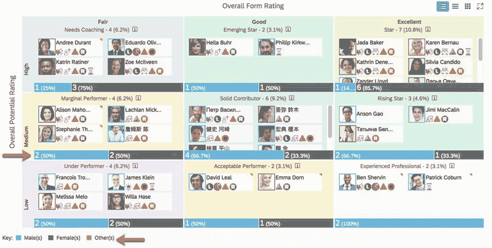

**图 15-80** 性别比例

与其他视图中的`More`图标类似，点击主题将显示选项，如图 15-81 所示。

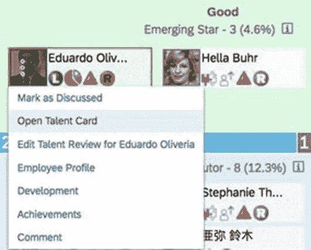

**图 15-81** `Matrix View`中的其他选项

### `Matrix View`评级更新

要更新任何评级，您可以将姓名拖拽至另一个单元格。如果某个轴的数据源来自薪酬模板，则无法使用拖放功能。使用任一视图，保存会话期间所做的任何更新。您还可以添加评论并将主题标记为已讨论。

校准会话在视图底部有三个按钮，如图 15-82 所示。这些按钮是`Finalize`、`Revert`和`Save`。

**图 15-82** 会话按钮

根据当前屏幕的状态，并非所有三个按钮都处于激活状态。例如，更新评级后，可以使用`Revert`和`Save`按钮。`Revert`仅对已做出但尚未保存的更改有效。

## 校准警报

校准警报用于指出可能因偏见影响某些受评者评估的情况，或突出评估者可能存在盲点的场景。

当保存一次校准会议时，如果任何受评者的评分满足任何校准警报业务规则中的触发条件，将显示一个`警报`弹出消息。该消息将包含所有被触发的警报。每条警报都会指出问题、识别所有受影响的受评者，并提供可能的解决方案。评估者可以重新审查这些受评者并修改评分。

当再次保存会议时，可以选择重新生成警报。示例如图 15-83 所示。这将允许业务规则被重新评估。

**图 15-83** 重新生成警报

当重新生成警报时，会弹出一个窗口，如图 15-84 所示。完成后，任何剩余的警报将显示出来。

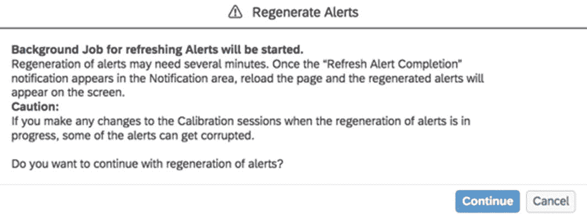

**图 15-84** 后台作业确认

重新生成后，某些受评者的警报可能已被移除或保留，而其他受评者则可能新增了警报。评估者应继续重新评估这些受评者。可以清除警报而不更改评分，但实质性的警报应予以处理。可以再次保存会议，并再次重新生成警报，以查看是否仍存在任何严重的偏见情况。一旦评估者认为他们已经做出所有必要的更改，协调人应保存会议并准备最终定稿。在查看完另一个校准视图后，我们将回顾最终定稿流程。

## 高管审阅视图

`高管审阅`供高级人力资源或业务高管使用，以查看校准会议的汇总视图。所有与某个校准模板关联的会议都将包含在此视图中，并且来自校准模板矩阵视图的图表将被聚合。高管审阅者无需参与任何会议即可访问此视图。任何被分配到此角色的人员都可以访问与该校准模板相关的会议。

当高管审阅者从`首页`菜单进入`校准`时，将显示`会议`选项卡以及一个名为`高管审阅`的附加选项卡，如图 15-85 所示。

**图 15-85** 高管审阅选项卡

如果高管审阅者被授予访问多个校准模板的权限，则每个模板都将列出。这意味着所有基于同一校准模板的会议都将成为显示数据的一部分。如果创建模板时`高管审阅者`角色的校准角色访问权限受到目标人群限制，则图表和筛选器将遵循该限制。

### 标准图表

当高管审阅者点击模板名称时，聚合数据将显示在屏幕的`标准图表`部分，如图 15-86 所示。

**图 15-86** 高管审阅中的标准图表

这些图表基于校准模板的矩阵视图。可以通过点击`查看图表依据`下显示的`受评者人数`或`分布(%)`按钮来更改图表视图。

页面右上角有一个筛选器图标。可以使用筛选选项查看数据，如图 15-87 所示。

**图 15-87** 标准图表筛选选项

#### 受评者列表

标准图表具有向下钻取功能，可提供此视图中聚合的员工的详细信息。这些详细信息显示在`受评者列表`中。单击任何图表上的数据点将创建一个`受评者列表`视图。示例如图 15-88 所示。列出的受评者基于在图表上选择的数据点。在以下示例中，显示了所有整体表单评分为`一般`的人员。

**图 15-88** 受评者列表

点击某个受评者的会议名称将带高管审阅者进入包含详细信息的特定校准会议。会议中的所有视图都将可用。如果会议尚未最终定稿，高管审阅者可以更新评分。

列表中每个受评者都可查看人才卡和指向`员工档案`的链接。

与校准会议内的视图类似，这里有筛选和显示选项。

`受评者列表`可以打印为 PDF 或导出为 Excel 文档。

在`受评者列表`页面，可以重新排序列或对列进行排序，并且可以调整列宽。也可以设置显示选项。所有这些调整都会被保存，并在`受评者列表`页面刷新后仍然有效。

#### 敏感数据图表

当高管审阅者返回到`标准图表`页面时，他们可以向下滚动到`敏感数据图表`部分，如图 15-89 所示。

**图 15-89** 高管审阅中的敏感数据图表

每个敏感数据点（`性别`、`流失风险`、`流失影响`和`离职原因`）都可以与模板视图中使用的任何评分源进行对照绘制图表。

从下拉列表中选择数据源后，图表将生成，如图 15-90 所示。

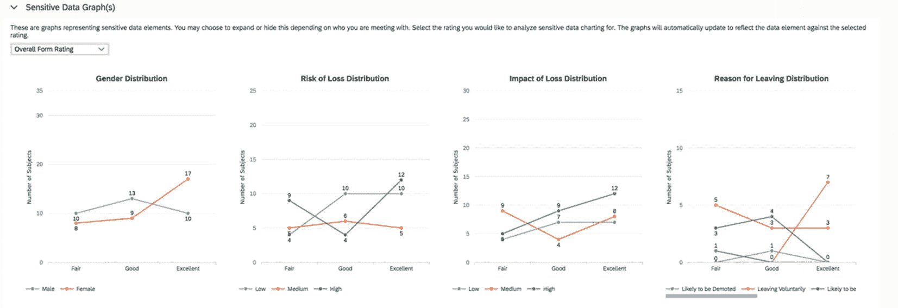

**图 15-90** 敏感数据图表

更改校准模板中的评分源将更新图表。示例如图 15-91 所示。

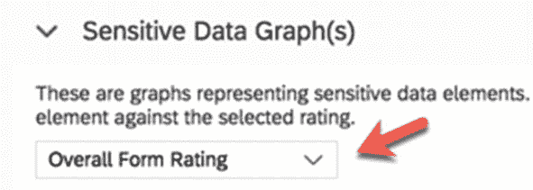

**图 15-91** 更改敏感数据图表评分源

现在我们已经看到了一个正在进行的校准会议。我们已经了解了视图可用的功能；并且学习了如何添加评论、分析受评者和更新评分。我们还了解了`高管审阅`选项卡的工作方式。接下来，我们将最终定稿我们的校准会议。

## 最终定稿会议

在讨论了所有受评者、审查了他们的评分并进行了任何更改后，可以最终定稿会议。最终定稿将关闭会议并将评分更改应用到绩效表单上。如果在`管理校准模板`的`高级`选项卡中启用，这还会将绩效表单移动到下一步。任何在`管理校准会议`的`权限`选项卡中被授予`最终定稿`权限的角色都可以执行此操作。

可以从任何会议视图（包括`仪表盘`）进行最终定稿。点击`最终定稿`按钮后，将进行会议验证。任何错误都会显示，并且必须纠正才能继续最终定稿。

如果实施了分布指南但未满足，将显示一条错误消息，如图 15-92 所示。

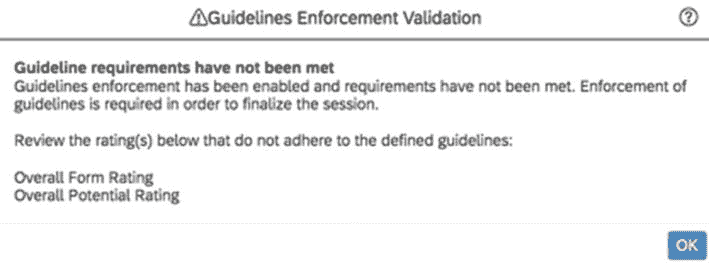

**图 15-92** 准则强制执行错误

在这种情况下，必须更新评级以符合分布准则。如果参与者希望覆盖准则，管理员必须在校准模板中禁用准则的强制执行。在校准设置或模板中做出的任何设置更改都将应用于实时会话。

纠正所有错误后，您可以尝试再次结束会话。如果没有错误，将出现确认弹出窗口，如图 15-93 所示。结束一旦开始，便无法撤销。结束会话会锁定所有评级并终止会话。如果启用了此功能，表单将连同更新的评级一起发送至绩效评估流程的下一步。一旦会话结束，它将被关闭且无法编辑。

**图 15-93** 结束会话确认

点击 `Yes` 按钮确认；将显示一个弹出窗口，如图 15-94 所示。会话结束，管理员可以向所有者和参与者发送通知。在发送前，可以修改通知收件人、主题和消息。

**图 15-94** 包含发送通知选项的结束确认

如果已发送电子邮件，如图 15-95 所示，弹出窗口将确认通知已成功发送。

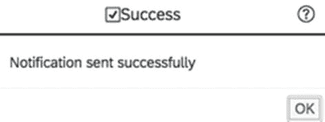

**图 15-95** 通知发送确认

所有者和参与者将收到一封电子邮件，通知他们校准现已完成，如图 15-96 所示。

**图 15-96** 结束会话通知

所有其员工评级发生变动的经理将收到一封电子邮件，其中显示原始评级和校准后的（最终）评级。如果在`管理校准模板`的`高级`选项卡中启用了此选项，则将发生此操作。图 15-97 显示了通知示例。

**图 15-97** 发送给评级发生变动的经理的电子邮件

如果出于某种原因需要在校准后更改评级，管理员可以在个人绩效表单上进行。该表单需要被路由回评级可编辑的步骤，进行更改，然后再将表单路由经过校准步骤。此操作在校准流程之外进行。

### 批量审批会话

在`管理校准会话`的`权限`选项卡中，被授予`Finalize`权限的任何角色也可以批量结束会话。

从校准会话概览页面，可以选择多个会话。单击右上角的 `Finalize` 图标，如图 15-98 所示。

**图 15-98** 批量结束会话

将显示一个确认弹出窗口，如图 15-99 所示。

**图 15-99** 确认结束会话

任何存在错误的会话将显示一个警告图标。单击该图标将显示问题的详细信息，如图 15-100 所示。

**图 15-100** 结束结果

如果启用了`通知校准参与者会话已结束`，则任何没有错误的会话都可以向会话的所有者和参与者生成电子邮件，如图 15-101 所示。

**图 15-101** 生成通知提示

在发送之前，可以修改收件人、主题和消息，如图 15-102 所示。

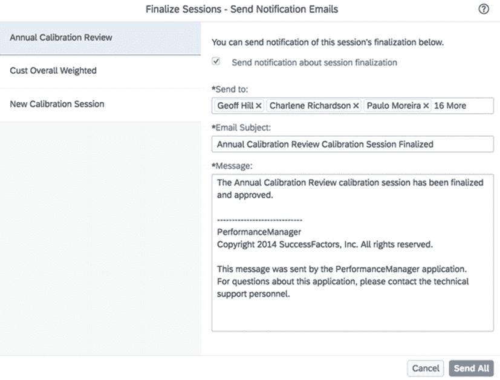

**图 15-102** 发送给所有者和参与者的电子邮件通知

如果启用了前述功能，还会在会话结束时向经理发送关于评级变动的电子邮件。已成功结束的会话现在将具有`已批准`状态。我们现在已经批量结束了会话，接下来将查看一些其他可用功能。

## 校准摘要磁贴

当我们开始校准会话时，我们看到主页上为在校准会话中具有角色的经理和用户提供了“校准”磁贴。在经理的主页上，还会有一个名为`团队校准摘要`的待办事项磁贴。示例如图 15-103 所示。

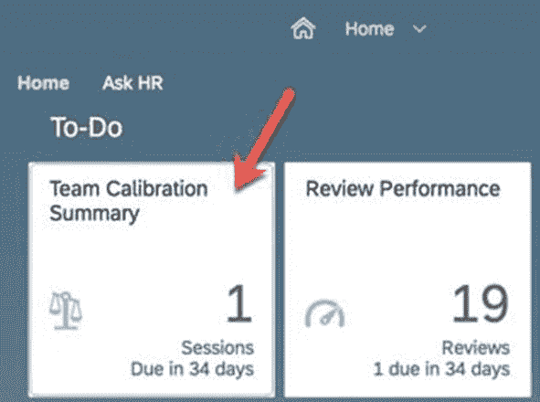

**图 15-103** 校准待办事项磁贴

要看到此磁贴，会话的参与者必须是评估对象的经理。`团队校准摘要`磁贴仅当会话的数据来源来自绩效表单时才会显示。单击该磁贴将显示一个审核摘要链接。示例如图 15-104 所示。

**图 15-104** 待办事项

单击链接后，经理将看到一系列屏幕，从概览页面开始。示例如图 15-105 所示。将有`摘要`、`参与者`和`评估对象`选项卡。

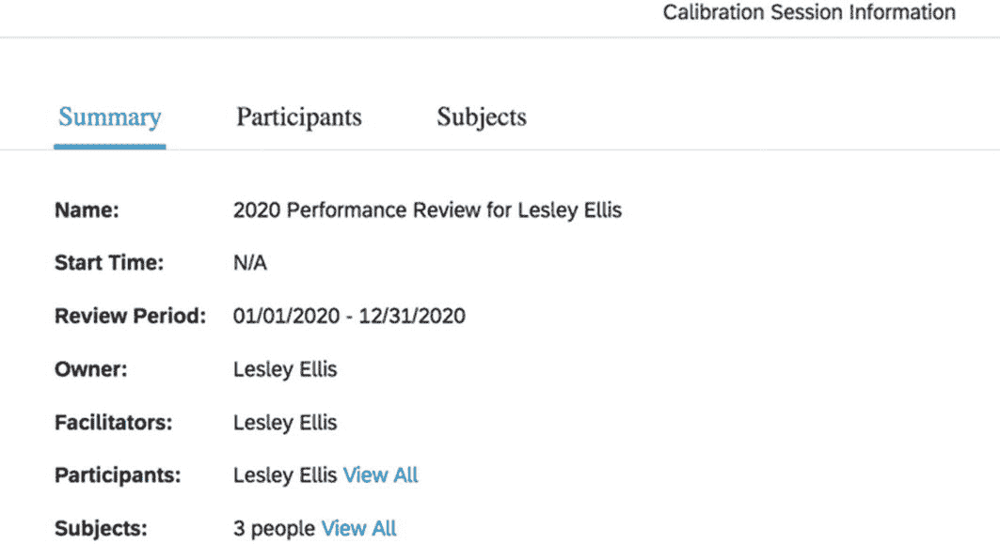

**图 15-105** 会话信息

在这些选项卡中的任何一个中，都会有前进和后退按钮。使用前进按钮进入`团队视图`，然后是`我团队的最新绩效`和`绩效历史`屏幕。示例如图 15-106 所示。

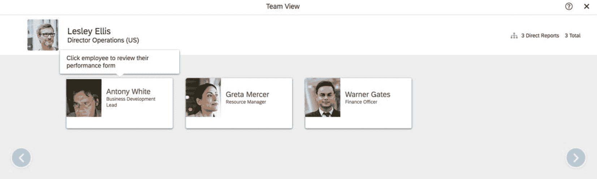

**图 15-106** 团队视图

单击姓名将显示用户的人才卡片，其中包含进入目标计划、发展计划、成就、活动或绩效表单的选项。示例如图 15-107 所示。

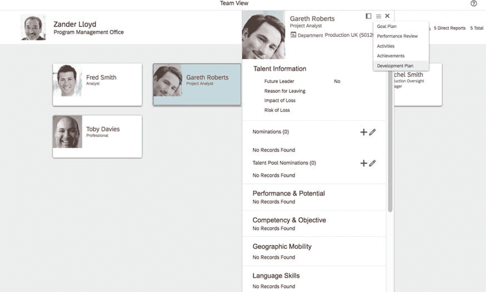

**图 15-107** 团队视图选项

还有一些与绩效相关的屏幕。团队的评级分配如图 15-108 所示。

**图 15-108** 团队的评级分配

移至最终屏幕后，也可查看团队的表现历史。示例如图 15-109 所示。

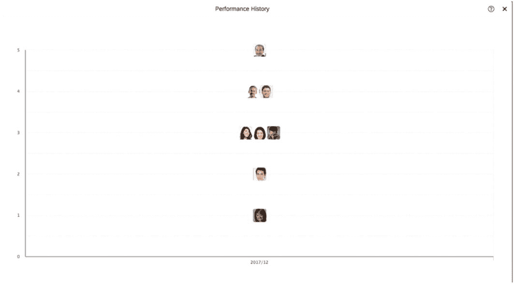

图 15-109 团队表现历史

点击任意姓名，将显示其评分。

## 校准历史记录组件

如果已配置，校准后的评分将在最终确定后显示在“员工档案”中，如图 15-110 所示。通常，此模块对经理和人力资源经理可见，而对员工不可见。

图 15-110 校准历史记录组件

将显示校准会议的名称、日期和评分。如果存在多次校准会议，也将一并显示。

### 报告

在校准会议期间及之后，可报告与校准相关的数据。没有可用于报告的标准化校准报告、仪表板或磁贴。相反，您需要创建自己的临时报告。
