# 在本章中，我们将回顾`SuccessFactors 360 评估`的功能，并讨论如何配置一份 360 评估反馈表单。此外，我们还将讨论如何与`职业发展规划（CDP）`和`学习管理系统（LMS）`进行集成。我们还提供了在配置 360 评估反馈模板时可以参看的`XML`代码片段。

## 360 评估反馈流程中的参与者

在开始配置之前，我们先来了解一些关于参与者的关键概念。在本节中，我们将定义`SuccessFactors 360 评估`反馈流程中的不同参与者。本章将始终提及以下参与者：

*   **被评估人（Subject）**：这是为其发起 360 评估反馈表单的员工。一份表单中只能有一个被评估人。
*   **发起人（Originator）**：这是生成表单的人。系统自动将此角色分配给生成表单的人。通常，此角色由 360 评估反馈表单管理员或人力资源部门的某人担任。
*   **流程负责人（Process Owner）**：这是将表单分发给参与者并启动流程评估阶段的人。此角色自动分配给点击表单上的分发按钮以将表单分发出去进行评估的人。一份表单只能有一个流程负责人。通常，流程负责人是发起人、被评估人或被评估人的经理。
*   **审批人（Approver）**：在审批阶段，审批人是审阅反馈、参与者选择并批准流程的人。通常，此角色分配给被评估人的经理或人力资源部门的某人。

> **注意**：任何分配给流程且属于路由图的角色都被视为审批人。

审批人有两个子类型。

*   **特权审批人（Privileged approver）**：此角色分配给在流程结束时管理和处理反馈数据的人。
*   **参与评估人（Participant reviewer）**：此角色分配给在评估阶段收到表单并提供关于被评估人反馈的人。参与评估人可以选择拒绝或参与评估流程。拒绝参与反馈流程的参与评估人不会纳入反馈结果。被评估人也可以是参与评估人；换言之，被评估人可以自我评估。流程可以有多个参与评估人。

现在您已了解每个参与者将在流程中扮演的角色，让我们开始在`Provisioning`中激活 360 功能来准备系统。

## 在 Provisioning 中激活 360 评估

在`SuccessFactors Provisioning`中，您需要激活以下开关。这些开关位于“公司设置”中。

> **提示**：在显示的页面上，您可以按`Ctrl+F`搜索这些设置。记得保存您的设置。

*   `360 多评价人`
*   `启用 360 高管评估页面`——需要`360 多评价人`和`基于角色的权限`
*   `图形报告（360）`——需要`360 多评价人`
*   `PM 和 360 的富文本编辑器`
*   `360 团队评价人`
*   `临时报告生成器：360 多评价人被评估人`

> **注意**：目前，我们不会激活名为“360 评估 – SAP Fiori 版本 [未准备就绪用于销售/生产] — 需要 360 多评价人”的开关。我们将在本章后面更详细地讨论`SAP Fiori`。

## 具名与匿名 360 流程

您可以将 360 评估反馈表单配置为匿名或具名流程。在`Provisioning`中，点击名为`表单模板管理`的配置步骤。在显示的页面上，点击您将使用的 360 评估反馈表单。在显示的页面的`编辑表单属性`部分，您可以选择“`匿名 360` 或 `360 显示参与者姓名`”。

在匿名流程中，表单用户将不会在表单的`评估摘要`部分看到评价人的姓名。但是，如果您希望参与者的姓名显示在表单的`评估摘要`部分，可以在特定 360 评估反馈表单模板的`表单模板设置`部分中启用名为“`在状态摘要中显示参与者（仅适用于匿名 360）`”的开关。在`表单模板设置`中，当您启用“`隐藏 360 文档完成通知和 360 文档拒绝通知的电子邮件发件人（仅适用于匿名 360）`”开关时，“发件人”字段将被隐藏，因此被评估人的经理无法看到发件人的姓名。

在具名流程中，参与者姓名在 360 评估反馈表单的`评估摘要`部分中可见。在本章后面，我们将讨论如何使 360 评估反馈表单对某些人匿名，而对另一些人具名。

有了这些背景知识，在下一节中，我们将回顾在配置 360 评估反馈表单模板之前需要配置的权限。

## 权限

在开始讨论 360 评估反馈表单的配置之前，让我们回顾一下访问`管理中心`相关配置步骤所需的权限（见表 12-1）。

### 表 12-1：为 360 评估反馈流程分配的权限

| 用户/管理员权限 | 权限名称 | 描述 |
| --- | --- | --- |
| 管理文档 | `更改 360 流程负责人` | 此权限允许访问管理工具，以更改已完成或进行中的 360 评估反馈表单的流程负责人。 |
| | `更改参与者类别` | 此权限允许访问管理工具，以更改已完成或进行中的 360 评估反馈表单的参与者类别。 |
| | `完成/拒绝 360 文档` | 此权限允许访问管理工具，以代表评价人完成或拒绝一份 360 评估反馈表单。 |
| | `恢复已完成的 360` | 此权限允许访问以恢复一份已完成的 360 评估反馈表单。 |
| 360 高管评估 | `360 高管评估` | 此权限允许访问以查看 360 高管评估页面。 |
| | `360 高管评估：添加审批人` | 拥有此 360 高管评估权限的角色可以添加审批人。 |
| | `360 高管评估：删除 360 表单` | 拥有此 360 高管评估权限的角色可以删除一份 360 评估表单。 |
| | `360 高管评估：导出为 XML（适用于已完成表单）` | 拥有此 360 高管评估权限的角色可以将已完成的表单导出为 XML 格式。 |
| | `360 高管评估：获取表单反馈` | 拥有此 360 高管评估权限的角色可以为“获取反馈”流程发送一份 360 评估反馈表单。 |
| | `360 高管评估：修改能力（添加/删除能力）` | 拥有此 360 高管评估权限的角色可以修改表单中的能力项。 |
| | `360 高管评估：修改参与者（添加/删除参与者）` | 拥有此 360 高管评估权限的角色可以修改表单中的参与者列表。 |
| | `360 高管评估：退回表单` | 拥有此 360 高管评估权限的角色可以将表单退回一步。此操作仅在签名步骤有效。 |
| | `360 高管评估：发送副本` | 拥有此 360 高管评估权限的角色可以将 360 评估反馈表单的副本发送给另一个用户。 |


## 360 度评估权限与配置指南

### 权限说明

#### 360 度高管评估：发送电子邮件提醒
拥有此`360 Executive Review`权限的角色可以向参与者列表发送电子邮件提醒。

#### 360 度高管评估：查看详细 360 度报告
拥有此`360 Executive Review`权限的角色可以查看已完成表单的详细`360 Review`报告。

#### 360 度高管评估：查看参与者评分（仅限已完成表单）
拥有此`360 Executive Review`权限的角色可以查看已完成表单中各个参与者的评分。

#### 一般用户权限
##### 创建表单的权限
拥有此权限的角色可以创建`360 Review`反馈表单。

### 管理表单模板
#### 表单模板
拥有此权限的角色可以创建和维护`360 Review`反馈表单模板。

### 计划批量创建表单（稍后启动表单）
拥有此权限的角色可以安排在稍后的日期/时间批量创建表单。

### 批量创建表单实例（立即启动表单）
拥有此权限的角色可以批量启动表单。

#### 路由图
拥有此权限的角色可以访问配置屏幕`Routing Maps`，以创建和维护用于`360 Review`反馈表单的路由图。

### 评分量表
拥有此权限的角色可以访问配置屏幕`Rating Scales`，以创建和维护用于`360 Review`反馈表单的评分量表。

> **注意：** 在本节中，我们仅讨论特定于`360 Review`反馈流程的权限。我们不会审查用户特定权限等。

> **注意：** 本节讨论的权限可以在管理中心的 `Admin Center` 中访问。执行`Manage Permission Roles`以访问这些权限。强烈建议在配置`360 Review`反馈表单之前，将这些权限分配给正确的角色。

在讨论了所需的权限之后，请记住将这些权限分配给所需的组。这将帮助我们准备好审查管理中心的 `Admin Center` 中可用的不同配置步骤。

## 管理中心相关配置步骤

现在我们已经拥有了进行配置所需的权限，让我们开始吧！与`360 Review`相关的配置屏幕可以在管理中心的 `Admin Center` 中的 `Company Processes and Cycles` 和 `360 Review` 部分找到（参见图 `12-2`）。表 `12-2` 从高层次描述了每个配置屏幕的功能。

**表 12-2** 360 度评估反馈表单的配置屏幕

| 配置屏幕 | 描述 |
|---|---|
| `Change 360 Process Owner` | 执行此配置屏幕以更改`360 Review`反馈表单的所有者。 |
| `Change Participant Category` | 执行此配置屏幕以更改`360 Review`反馈表单中的参与者类别。 |
| `Complete / Decline 360 Form` | 执行此配置屏幕以完成或拒绝分配给该用户的`360 Review`反馈表单。<br>**注意：** 执行此配置屏幕时，在登录页面上您将看到选项 `[Mass Decline/Complete 360 Documents](https://salesdemo.successfactors.eu/xi/ui/pm360/pages/mass_decline_forms.xhtml?pess_new_admin=true&_s.crb=4jvSN1icATY2ek4X6wSxw5v%252f8b1Y%252fBQ%252fZ45XLX2WQ5Q%25253d)`。您可以使用此配置选项导入一个包含您想要完成/拒绝的`360 Review`反馈表单文档 ID 的 CSV 文件。当您有多个`360 Review`反馈表单需要处理时，通常会使用此选项。 |
| `E-Mail Notification Templates Settings` | 执行此配置屏幕以访问与`360 Review`审查流程关联的电子邮件模板设置。在显示的页面上，搜索 `*360*` 以访问`360 Review`流程使用的所有电子邮件模板。在此配置屏幕上，您可以启用或禁用提供的电子邮件模板。如果需要，您可以通过配置显示电子邮件部分中的设置来更改电子邮件模板的内容。<br>**注意：** 此配置屏幕用于访问不同模块和平台使用的所有电子邮件模板。 |
| `Form Template Settings` | 使用此配置屏幕更改`360 Review`表单设置，以及下载现有反馈表单或导入新表单。 |
| `Launch 360 Review` | 在此配置屏幕上，您可以创建和启动`360 Review`表单。 |
| `Manage Route Maps` | 使用此配置屏幕创建和维护用于`360 Review`表单的路由图。 |
| `Manage Scheduled Review` | 在此配置屏幕上，您可以修改或取消`360 Review`反馈表单的启动。 |
| `Manage Templates` | 在此配置屏幕上，您可以更改`360 Review`反馈表单的配置并对其进行维护。 |
| `Rating Scales` | 在此配置屏幕上创建和维护`360 Review`表单中使用的评分量表。 |
| `Restore Completed 360` | 在此配置屏幕上，我们可以将已完成的`360 Review`反馈表单恢复给参与者或流程所有者进行评估。 |

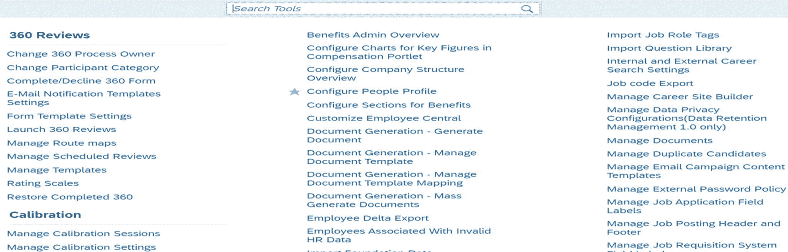

**图 12-2** 管理中心 `Admin Center` 中可用的`360 Review`配置步骤

在了解了这些不同的配置屏幕之后，下一节我们将讨论如何配置一个新的`360 Review`反馈表单。

## 配置 360 度评估反馈表单

我们将从配置一个新的`360 Review`反馈表单开始。在配置一个新表单之前，我们将配置将在`360 Review`反馈表单中使用的路由图。

### 配置路由图

我们可以通过执行配置屏幕 `Manage Route Maps` 来配置路由图。在显示的页面上，点击 `Getting Started`。在显示的页面上，点击 `Add New Route Map`。这将显示两个选项（参见图 `12-3`）。我们可以手动构建一个新的路由图，或者使用库中预置的路由图之一。

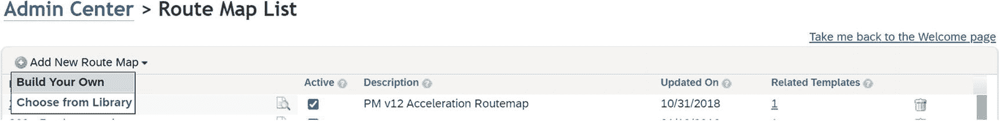

**图 12-3** 创建新的路由图

我们将在本节中讨论这两个选项。

### 使用库中的预置路由图构建新路由图

如图 `12-3` 所示，点击 `Choose from Library` 选项。这将显示 `SuccessStore` 中所有可用的路由图。`360 Review` 特定的路由图带有前缀 `"360"`（参见图 `12-4`）。

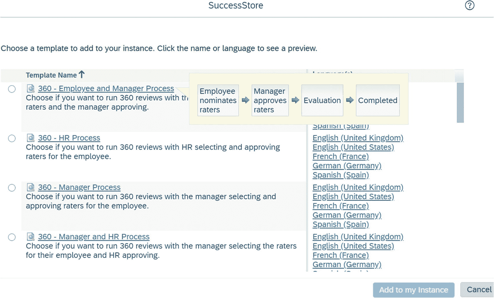

**图 12-4** 使用 `SuccessStore` 中可用的路由图

> **提示：** 在图 `12-4` 中，当您点击某个路由图名称时，系统将为您显示该路由图。您可以查看所有与`360 Review`相关的路由图，并选择最适合您业务需求的一个。如果您没有找到任何满足需求的路由图，您可以手动创建一个新的路由图。

> **注意：** `SuccessFactors` 在 `SuccessStore` 中提供了许多预配置的对象，客户和实施团队可以在配置期间利用这些对象。这些预配置的对象不同于快速部署解决方案 (`Rapid Deployment Solutions`, `RDS`) 中可用的对象。`SuccessStore` 中可用的对象帮助客户和实施团队在配置方面抢占先机。这些预置对象可以用作基线，并进一步配置以满足业务需求。


## 配置路线图与反馈表单

在本次讨论中，我们将选择预配置的路线图 **360 - 员工与经理流程**。点击该路线图旁边的单选按钮，然后点击“添加到我的实例”。这将显示一个新的对话框，您可以在其中输入路线图的名称。点击“保存”以保存您的设置。这将显示路线图，您可以在其中进行进一步修改（如有需要）（参见图 12-5）。

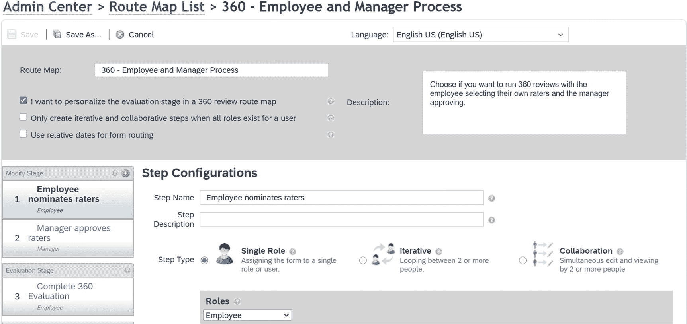

**图 12-5** 维护预交付的路线图

点击路线图中的每个流程步骤；您可以添加详细信息，例如步骤名称、步骤描述以及哪个角色将拥有该特定步骤。当您点击“显示高级选项”时，您可以维护诸如步骤介绍、鼠标悬停文本（如完成后的步骤名称、步骤模式等）之类的详细信息。步骤 ID 通常会预填充，但您可以更改它（例如，提供一个更具描述性的 ID）。

完成更改后，请记得保存。

了解了如何利用预配置的路线图后，我们将回顾如何为 360 评估流程手动创建一个新的路线图。

### 手动构建路线图

我们将手动创建一个新的路线图，其中经理将提名评估者并将其发送给 HR 进行审批，然后再将 360 评估表发送给员工进行评估。

如图 12-3 所示，点击“构建您自己的”。系统将创建一个新的路线图（参见图 12-6）。在显示的页面上，您可以为路线图输入新名称和描述。（请注意，默认情况下，系统会显示“路线图”并附带一个数字作为新路线图的名称。）

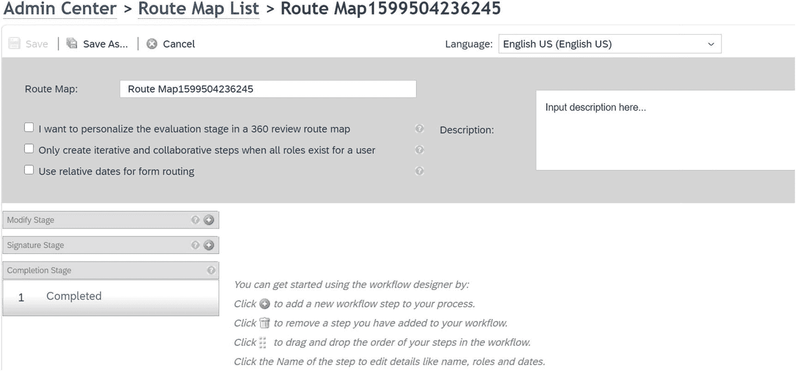

**图 12-6** 手动创建新路线图

在路线图名称下，您会注意到有三个选项。对于我们的路线图，我们将选择以下两个选项：

*   **我想在 360 评估路线图中个性化评估阶段**：选择此选项将允许您编辑评估阶段中评估者可以看到的内容。正是在评估阶段，评估者对员工进行评分和提供反馈。
*   **对表单路由使用相对日期**：选择此选项后，所有路线图日期将变为相对的。通过选择此选项，您可以定义相对于流程中另一个步骤之前/之后的天数。（请注意，您也可以为每个流程步骤输入实际日期。）

> **注意**
>
> 当您选择此选项时，系统将显示一条警告消息：“当相对日期复选框打开时，不允许对路线图中的步骤位置进行重新排序。”这意味着如果您需要重新排序步骤，则需要取消选择此选项以重新排序路线图步骤，然后在需要时再次选择此选项。

> **提示**
>
> 您可以点击每个选项旁边显示的问号（`?`）来了解其含义以及何时/何处可以使用它。

在“修改阶段”部分，点击 `+` 图标以创建一个新步骤。我们将此步骤命名为“直线经理提名评估者”。提供步骤描述。

在“步骤类型”（参见图 12-7）中，选择“单一角色”。在“角色”部分，选择“经理”作为负责此步骤的角色。

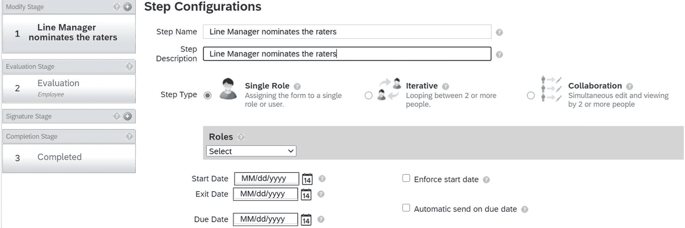

**图 12-7** 配置路线图中的步骤

现在，点击“修改阶段”中显示的 `+` 以创建路线图中的第二个步骤。我们将此步骤命名为“HR 代表批准评估者”。输入步骤描述。在“步骤类型”中，选择“单一角色”并选择“HR 代表”作为负责此步骤的角色。
点击“保存”以保存您的路线图。

在下一步中，我们将开始配置一个新的 360 评估反馈表单。我们将通过执行配置屏幕“管理模板”来配置表单。

#### 管理模板

在配置屏幕“管理模板”上，我们可以创建新表单，以及维护已配置的 360 评估反馈表单。在显示的页面（参见图 12-8）上，点击“360 多评估者”选项卡。在显示的页面上，点击“添加新模板”以创建一个新模板。这将显示 `SuccessStore` 中提供的预配置 360 评估反馈表单。点击模板旁边的单选按钮以选择该特定模板。对于我们的讨论，我们将选择名为“[PE 360 Multi-rater form](https://salesdemo.successfactors.eu/xi/ui/admin/pages/template/manageTemplates.xhtml?tab=goal&_s.crb=wFF78bV0cwQHLiORz1KpoU8UDaAdnWH9eQvTq1vB3qw%253d)”的模板。点击“添加到我的实例”以创建新表单。当您点击“添加到我的实例”时，系统将显示一个新的对话框。在该对话框中，您可以输入模板的新名称以符合您的业务需求。点击“保存”以保存您的设置。系统现在将显示模板供您配置。您可以在需要的地方进行更改。

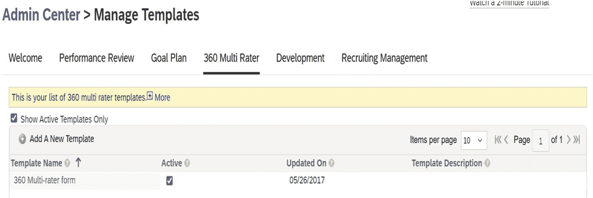

**图 12-8** 配置 360 评估反馈表单

在显示的页面上，点击“常规设置”。在“常规设置”中，您可以提供模板的名称和描述。在“常规设置”中，您可以配置“路线图”和“评分量表”设置。对于我们的讨论，我们将配置我们之前讨论过的路线图 **360 - 员工与经理流程**。如果您希望 360 评估流程的参与者保持匿名，您可以选择“在 360 报告功能中启用匿名”选项。

> **注意**
>
> “路线图”设置和“评分量表”设置都应在“常规设置”中预先配置。路线图是通过执行配置步骤“管理路线图”来配置的，而评分量表则是在“评分量表”屏幕上配置的。

完成“常规设置”部分的配置后，点击“编辑字段和部分”部分。

我们要回顾的第一个部分是“员工信息”。在 360 评估反馈表单中，“员工信息”部分将显示与员工相关的数据。在“管理模板 – 员工信息”部分，我们可以命名该部分的名称、输入该部分的描述，并选择员工数据的哪些详细信息（参见图 12-9）应显示在 360 评估反馈表单中。

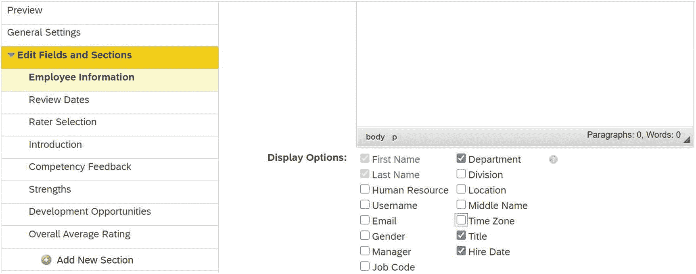

**图 12-9** 配置员工信息部分

点击“保存”以保存您的更改。

> **注意**
>
> 默认情况下，员工的名字和姓氏将显示在 360 评估反馈表单中。此设置无法更改。

在 360 评估反馈表单中，“评估日期”部分将显示您在启动表单时输入的日期。在“管理模板 - 评估日期”部分，您可以命名该部分，以及输入该部分的描述（参见图 12-10）。

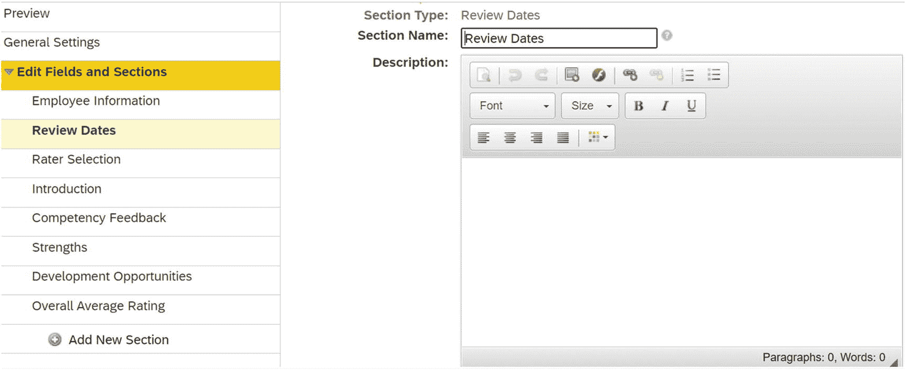

**图 12-10** 配置评估日期部分


在`Rater Selection`（评估者选择）部分，您可以配置将被分配到表单的不同评估者。您可以更改默认的节名称，并在需要时输入描述。此部分配置的评估者默认会被分配到 360 度评估反馈表单，并且您配置的评估者标签会显示在分配给评估者的角色旁边。

如图 12-11 所示，您可以将直接下属、经理、二级经理、矩阵经理、HR 人员以及这些参与者的多个层级作为指定角色添加到流程中。

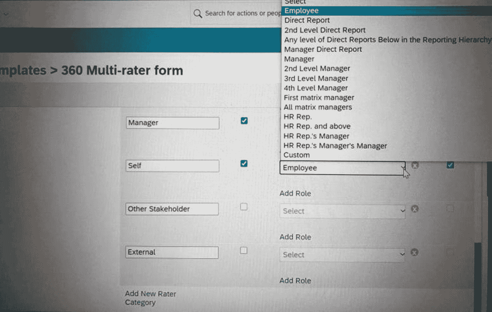

图 12-11 配置评估者选择部分

- 在`Rater Category Name`（评估者类别名称）列中，您可以输入分配给流程的角色的标签。此标签会显示给用户（员工/经理/HR），他们可以选择想要联系的参与者列表以获取反馈。
- 当您选择`Auto Include in Form`（自动包含在表单中）时，您定义的角色将在表单启动时自动包含在流程中。
- 在`Role`（角色）列中，您定义需要包含在流程中的角色。配置的角色会在表单发送给评估者进行反馈时自动分配给他们。此处配置的角色将帮助用户（员工/经理/HR）确定谁可以被选择以联系获取反馈。
- `Do not allow user to remove`（不允许用户移除）列用于确定用户是否有权从参与者列表中移除已定义的角色。如果您为定义的角色选择了此列，那么该角色将强制包含在 360 度评估反馈流程中。

在`Manage Templates – Introduction`（管理模板 – 介绍）部分（见图 12-12），您可以输入关于 360 度评估反馈表单以及流程中对参与者期望的一些介绍文本。

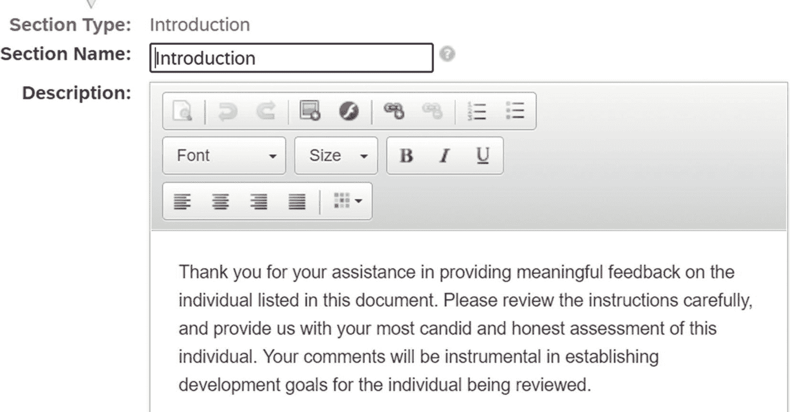

图 12-12 介绍部分

**提示**

在介绍部分，客户可以提供一份文档的链接，该文档详细说明了 360 度评估反馈流程的内容，以及该流程如何在企业范围内用于支持员工的发展愿景。

在`Manage Templates – Competency Feedback`（管理模板 – 能力反馈）部分，您可以配置要包含在 360 度评估反馈表单中的能力项。能力项可以设置为`Core`（核心）或`Job Specific`（特定岗位）。与配置其他部分类似，您可以输入节名称和该节的介绍。

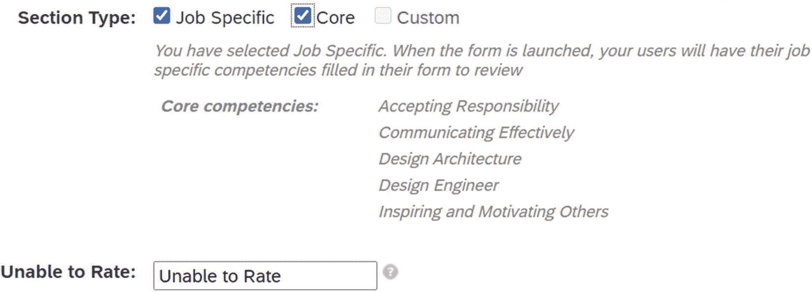

图 12-13 配置能力部分

- 在`Section Type`（节类型）中（见图 12-13），您可以选择是向表单添加`Job Specific`（特定岗位）、`Core`（核心）还是两种类型的能力项。

**注意**

`Core`（核心）和`Job Specific`（特定岗位）能力项应在系统中配置并可用，以便您在模板中使用。

**注意**

如果您选择`Job Specific`（特定岗位），则在表单启动时，系统会在表单中填充特定于岗位的能力项。能力项是作为`Job Profile Builder`（岗位档案生成器）配置的一部分添加的。更多信息请参见第 3 章。

- `Unable to Rate`（无法评级）字段是评定量表的一部分，但不包含在总体评分中。`Unable to Rate`等同于`N/A`。您可以使用系统默认的`Unable to Rate`，或将其更改为`N/A`或您想要显示的任何文本。`Unable to Rate`评级意味着参与者没有足够的信息，或者拒绝对该特定能力项进行评级。

点击`Unable to Rate`（无法评级）字段下方显示的`Show advanced options`（显示高级选项）。这将显示额外的配置选项（见图 12-14）。

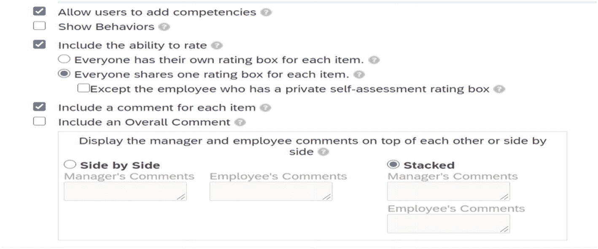

图 12-14 配置能力部分的进阶选项

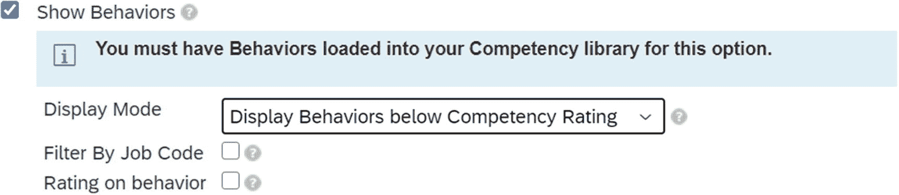

图 12-15 配置能力部分的行为描述

- `Allow users to add competencies`（允许用户添加能力项）：如果选择此选项，将允许用户能够从能力项列表中添加能力项到表单中。
- `Show Behaviors`（显示行为描述）：如果选择此选项，并且所选能力项关联了行为描述，则该行为描述将显示在表单中。

    如果选择此选项，系统将显示额外的选项（见图 12-15）。

- `Display Mode`（显示模式）：在显示模式下，您可以选择在能力评级的上方或下方显示行为描述。默认情况下，行为描述将显示在能力评级下方。
- `Filter By Job Code`（按岗位代码筛选）：如果您只想显示特定于岗位的行为描述，请选择此选项。
- `Rating on behavior`（对行为描述评级）：如果您想启用对与能力项关联的行为描述进行评级的选项，请选择此选项。
- `Include the ability to rate`（包含评级能力）：如果您希望评估者使用模板中配置的评定量表对能力项（以及启用时的行为描述）进行评级，请选择此选项。如果未选择此选项，则评估者将无法对能力项进行评级。

当您选择`Include the ability to rate`（包含评级能力）选项时，系统将显示额外的选项（见图 12-16）。

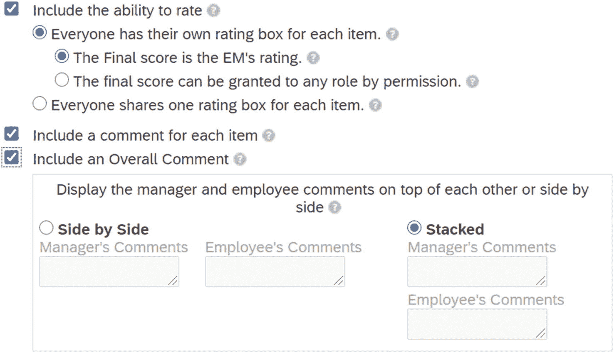

图 12-16 配置能力部分的评级与评论

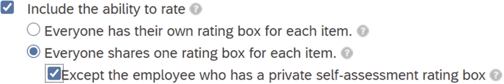

图 12-17 配置能力部分的单一评级框

- `Everyone has their own rating box for each item`（每个人在每个项目上都有自己的评级框）：如果选择此选项，每个评估者都将拥有自己的评级框。评估者的评级框将显示在员工自评评级框旁边。选择此选项后，系统将显示额外的选项。

    - `The Final score is the EM’s rating`（最终分数为员工经理的评级）：当选择此选项时，表单将显示评估者提供的评级。系统会将员工经理（角色：EM）提供的分数视为最终分数。
    - `The final score can be granted to any role by permission`（最终分数可通过权限授予任何角色）：当选择此选项时，您可以配置将哪个角色提供的评级视为最终分数。

**注意** 大家各自拥有对每个项目的评级框是 360 度评估反馈流程中的建议做法。这为经理和当事人（如果有权限）提供了审查其他评估者提供的反馈的机会。

- `Everyone shares one rating box for each item`（每个人在每个项目上共享一个评级框）：如果选择此选项，表单中只会显示一个评级框。哪些角色可以访问评级框可以在模板中进行权限设置。如果评级框由多个评估者共享，则最后输入的分数将被计为该能力项的最终分数。选择此选项后，系统将显示一个额外的选项（见图 12-17）。


好的，作为一名高级文档工程师和翻译员，我将遵循您的注意事项和示例，将给定的英文文本翻译成中文。


-   **除拥有私人自评评分框的员工外**： 如果您选择此选项，系统将为员工显示一个独立的评分框，员工可使用该框进行自我评估。
-   **为每个项目添加评论**： 如果选择此选项，每个能力项将显示一个评论框。
-   **添加总体评论**： 如果选择此选项，表单将显示一个章节评论框。
-   **并排或上下显示经理和员工评论**： 在此部分中，您可以配置评论框的显示方式。两个选项是并排显示或上下堆叠显示（参见图 12-16）。

我们将配置的最后一个部分是“摘要”部分。此部分提供表单中所有评估章节的汇总概述。摘要部分将提供每个评估部分的平均分数，以及在表单级别的总体分数。与前面的部分类似，在摘要部分中，您可以在需要时输入自定义名称，也可以使用系统默认值。您还可以选择提供该部分的描述。

此部分可配置的字段如下所示（参见图 12-18）：

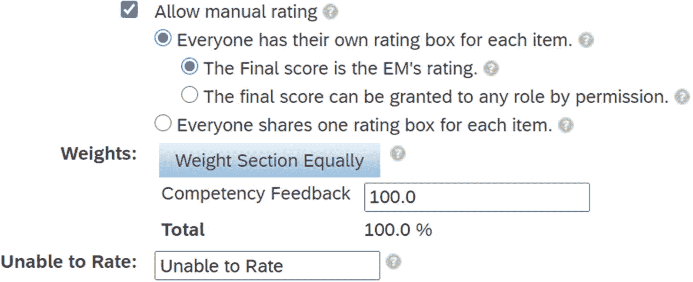

**图 12-18** 配置摘要部分

-   **允许手动评分**： 如果选择此选项，表单将提供一个手动输入总体得分的选项。此总体得分将覆盖系统生成的总体评分。但是，如果选择此选项，系统将把手动输入的评分视为最终分数。因此，即使您确定系统生成的评分为最终分数，您仍然需要手动输入一个可能与系统生成的总体得分相同的分数。

选择此选项后，系统将显示附加选项：
    1.  每个人都有自己的每个项目的评分框
    2.  每个人共享一个每个项目的评分框

勾选第一个选项将显示附加选项：
    -   (a) 最终评分是员工经理的评分
    -   (b) 最终评分可以通过权限授予任何角色

所有这些选项的行为与我们之前在能力部分讨论的类似。

-   **权重**： 如果您单击`权重平均分配`按钮，系统将自动平均分配每个评估部分的权重，使其总和为 100%。在我们的讨论中，我们只有一个评估部分：能力反馈。因此，系统为该部分提供了 100.0。

-   **无法评分**： 此行为与我们之前在能力部分讨论的类似。

> **提示**  
> 我们可以重新排列模板中不同部分的显示顺序。要将某个部分移动到不同的顺序，请将鼠标悬停在该部分名称上。系统将显示“三个垂直点”（参见图 12-22）。如果将鼠标移到这三个垂直点上，光标将变成一个方向十字。抓住它并将其移动到您希望该部分显示的位置。

您还有一个向模板`添加新部分`的选项。此新部分必须属于以下部分类型之一：附加评论、能力、年中、目标或签名（参见图 12-19）。新部分的配置将与我们之前在前面的部分中讨论的类似。

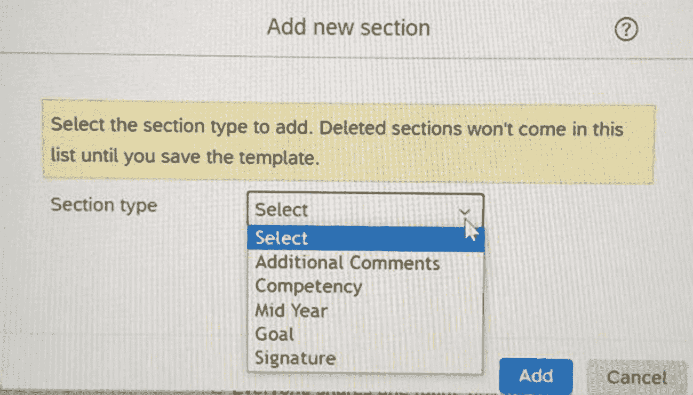

**图 12-19** 可用的部分类型

> **注意**  
> 我们通常添加一个新部分来捕获未在交付部分中捕获的评论或评分。例如，我们可能希望评估者对员工在工作特定能力或核心能力方面的表现进行评分。或者，我们可能会添加一个部分来捕获员工及其经理的签名，以完成 360 度评估反馈表。

就我们的讨论而言，我们将添加一个部分；类型为`目标`作为新部分。与其他部分类似，我们可以输入新的部分名称，并提供部分描述。

在部分类型中（参见图 12-20），您可以在目标和个与发展计划之间进行选择。

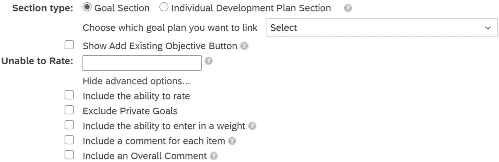

**图 12-20** 添加目标部分

如果我们选择`目标部分`，下拉菜单“选择您要链接的目标计划”将显示系统中处于活动状态的目标计划。

如果我们选择`个人发展计划部分`（参见图 12-21），下拉菜单将显示系统中可用的活跃发展计划。

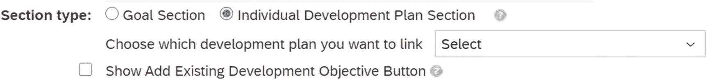

**图 12-21** 添加发展计划部分

如果您希望评估者能够对目标进行评分，请选择`包含评分功能`选项。如果您不希望私人目标显示在 360 度评估反馈表中，请选择`排除私人目标`选项。如果您希望将目标权重计入分数计算，请选择`包含输入权重功能`选项。如果您希望评估者为每个项目添加评论，请选择`为每个项目添加评论`选项。如果您希望评估者提供总体评论，请选择`添加总体评论`选项。保存您的更改。

> **提示**  
> 如果您需要评估者对目标和个人发展计划都进行评分，则创建两个不同的部分。一个部分可用于目标，第二个部分用于个人发展计划。

我们可以重新排列模板中不同部分的显示顺序。要将某个部分移动到不同的顺序，请将鼠标悬停在该部分名称上。系统将显示一个点状网格。如果将鼠标移到点上，光标将变成一个方向十字（参见图 12-22）。抓住它并将其移动到您希望该部分显示的位置。

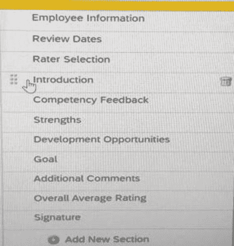

**图 12-22** 移动部分

**表单预览**  
您可以通过单击`预览`来预览您已配置的模板（参见图 12-23）。在配置期间或启动表单之前预览表单，将帮助您理解和直观地了解 360 度评估反馈表的外观。

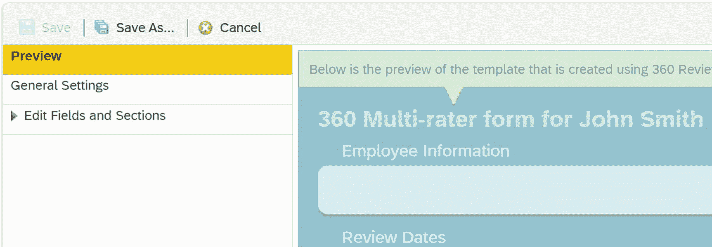

**图 12-23** 预览已配置的表单

### 表单模板设置

模板的管理设置也可以在`表单模板设置`部分中进行配置。您可以通过执行`表单模板设置`来访问配置屏幕。配置屏幕`表单模板设置`的登陆页面将显示系统中已配置并可用的所有表单。从显示的表单列表中，选择您要配置的 360 度评估反馈模板。登陆页面将显示可供配置的管理设置（参见图 12-24）。

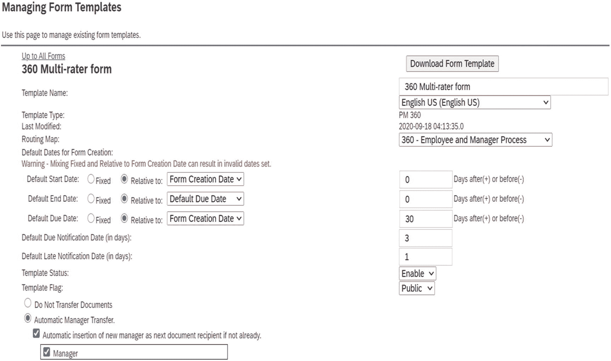

**图 12-24** 配置步骤：表单模板设置


## 访问表单模板设置

您可以在“管理模板”配置屏幕中，通过模板访问“表单模板设置”。在“管理模板 ➤ 表单模板”中显示的模板中，单击“常规设置”，滚动到该部分末尾。“高级设置”链接会将您带到“表单模板设置”配置屏幕。

在本节（参见表 12-3）中，我们将回顾 360 度评估反馈表单的特定管理设置。（注意：关于“表单模板设置”部分的详细讨论，请参阅第 6 章“绩效管理简介”及相关章节。）

### 表 12-3 表单模板设置管理设置

| 管理设置 | 描述 |
| --- | --- |
| **模板名称** | 这是表单启动时将显示的名称。您可以根据需要以不同语言配置模板名称。**注意：** 如果表单启动后模板名称发生更改，则新名称仅反映在名称更改后启动的表单上。任何正在进行的表单都不会显示新名称。 |
| **模板类型** | 这是一个只读字段。模板类型反映了为其配置模板的流程。 |
| **路由映射** | 此处显示我们之前配置的路由映射。如有需要，您可以更改路由映射。单击下拉菜单将显示系统中所有可用的已配置路由映射。 |
| **模板状态** | 此字段有两个值：`Enable` 和 `Disable`。如果模板处于活动状态，则其状态为 `Enable`。如果您不再使用该模板，请将状态更改为 `Disable`。 |
| **当旧经理是流程负责人时，将进行中的文档的自动流程负责人更改为新经理（仅适用于 360 度评估）** | 在 360 度评估反馈过程中，如果员工的经理发生变更，选择此选项将自动将进行中的表单转移给新经理。新经理也被标记为该流程的新流程负责人。**注意：** 您也可以在“更改 360 度流程负责人”配置屏幕上更改 360 度评估反馈表单的流程负责人。 |
| **当旧经理是流程负责人时，将已完成文档的自动流程负责人更改为新经理（仅适用于 360 度评估）** | 选择此选项将自动将完整的文档转移给新经理。新经理也被标记为该流程的新流程负责人。 |
| **将 360 度文档从旧经理的收件箱文件夹转移到新经理时，不要自动拒绝旧经理在评估中的参与者表单** | 选择此选项将允许将旧经理正在进行的参与者表单转移给新经理。**注意：** 当表单转移给新经理时，新经理可以联系旧经理（离线方式）并收集他们的意见/反馈，以评估正在进行的表单。 |
| **当转移处于评估阶段的 360 度文档时，将新经理添加为参与者（如果新经理是被移除的参与者，他们将被重新添加）** | 选择此选项将把新经理添加为进行中表单的参与者。 |
| **在 360 度临时报告中隐藏已删除用户的记录（注意：此配置后需要报告同步，以确保现有表单中的已删除用户不会显示在 360 度评估临时报告中。请前往 `Company Settings` 并在 `360 Multi-Rater Subject` 中运行同步）** | 选择此选项将在“报告中心”生成报告时隐藏已删除用户的记录。 |
| **详细 360 度报告权限控制：启用详细 360 度报告权限，适用于：** | 启用此选项将在 360 度评估反馈表单上显示“详细 360 度报告”链接。您可以仅为特定角色启用此选项。 |
| **在 360 度表单中为以下角色隐藏 `decline to participate` 按钮：** | 您可以启用此选项，仅为选定的角色隐藏 `decline to participate` 按钮。**注意：** 如果您选择了所有角色，则该按钮将不会显示在表单的所有角色中。 |
| **在 360 度评估开始后，为以下角色启用添加新参与者：** | 您可以启用此选项，为选定的角色提供 `add new participants` 的选项。 |
| **为以下角色启用 `Send Back`：** | 当您为选定的角色启用此选项时，他们将看到 `Send to Previous Step` 选项。当参与者单击该选项时，系统会将表单发回给路由映射中的先前参与者，以获取更多输入。 |
| **为以下角色启用发送提醒电子邮件：** | 启用此选项后，系统将发送提醒电子邮件以完成流程。**注意：** 要使用此选项，您应该启用配置屏幕 `E-Mail Notification Templates Settings` 上的 `Document Due Notification` 开关。要向外部参与者发送提醒电子邮件，应在同一配置屏幕上启用 `360 Document Evaluation Notification for External Participant` 开关。 |
| **在 360 度评估开始后，为以下角色启用移除参与者：** | 当为进行中的表单启用此选项时，选定的角色将能够从 360 度评估反馈流程中移除参与者。 |
| **从详细 360 度报告中启用差距分析视图** | 启用此选项后，系统将显示差距分析视图。**注意：** 差距分析允许您比较两组评分者之间的评分，并了解评分中的显著性。 |
| **从详细 360 度报告中启用排名视图** | 启用此选项后，系统将显示排名视图。**注意：** 排名视图使您能够在一个列表中查看所有类别的能力或行为。类别可以按从高到低或从低到高排序。 |
| **详细 360 度报告权限控制：启用详细 360 度报告权限，适用于** | 选中此选项后，为其启用（并授予权限）的角色将在 360 度评估反馈表单上看到“详细 360 度报告”链接。 |
| **详细 360 度报告权限控制：使用表单 XML** | 启用此选项后，在模板 XML 中，您可以授予在管理设置“启用详细 360 度报告权限，适用于”中未定义的角色权限。 |
| **在详细 360 度报告中按子项评分计算项目评分** | 启用此选项后，所有评分通过平均所有部分来计算。 |
| **以表单模板中设置的小数位数在详细 360 度报告中显示评分** | 小数位数由模板中的配置设置决定。 |
| **启用 360 度添加外部参与者部分** | 启用此选项后，外部参与者部分将显示在表单中。 |

## 电子邮件通知

在本节（参见表 12-5）中，我们将回顾需要在系统中激活的 360 度评估反馈表单特定的电子邮件通知。您可以通过执行配置屏幕 `E-Mail Notification Template Settings` 来访问该配置。

以下通知默认启用且无法禁用：

*   [360 度高管评审表变更通知](https://pmsalesdemo8.successfactors.com/acme?bplte_company=SFPART050339&fbacme_o=admin&_s.crb=GPg8QXNmsWhlhQzGFITh7TM1JomPz459jJcfH93LdXw%25253d&pess_old_admin=true&ap_param_action=sys_notification&nts_action=PERFORMANCE_360_SUPER_HR_MODIFIED_EMAIL)

*   [PM 360 度高管评审表批量路由通知](https://pmsalesdemo8.successfactors.com/acme?bplte_company=SFPART050339&fbacme_o=admin&_s.crb=GPg8QXNmsWhlhQzGFITh7TM1JomPz459jJcfH93LdXw%25253d&pess_old_admin=true&ap_param_action=sys_notification&nts_action=PERFORMANCE_360_SUPER_HR_MASS_ROUTE_EMAIL)

注意


在`<required-fields>`部分之后和`<default-item-comments-label>`部分之前添加了`<calibration-mode/>`。注意：请确保在 XML 模板中正确放置此代码，以获得校准功能。

```xml
<required-fields>
   ...
</required-fields>
<calibration-mode/>
<default-item-comments-label>
   ...
</default-item-comments-label>
```


好的，作为一名高级文档工程师和翻译员，我将遵循您提供的注意事项和示例，准确地将以下英文文本翻译成中文。


```markdown
# 说明：请针对与表格上显示的姓名相关的人，对以下陈述做出回应。请选择最能描述该个人的评分。]]>

1.0
1.5

*

```

在结束关于校准的讨论之前，有几点需要注意。

- 校准模式不支持开放式问题。
- 校准模式仅支持下拉式评分量表。
- 在校准模式下，无法编辑/更改项目级评论。

## 评审后阶段

在 360 度评审反馈过程中，有时被评审人或其经理会认为迄今为止收到的反馈不够充分，没有涉及正确类型的参与者，或者忽略（未包含）了一位关键的参与者，或者该参与者现在可以被包含到流程中。

在评估完成之后，但在开始完成或签名步骤之前，流程负责人可以执行以下操作：

- 在表格中添加更多的参与评审人
- 将表格退回给一个（或多个）参与者

在评审后阶段，拥有相应权限的角色可以添加新参与者或移除选定的参与者。当您点击`添加新参与者`时，系统会显示一个页面，您可以在其中添加新的参与者。您可以添加内部或外部参与者。同样，点击`移除选定的参与者`会将该参与者从流程中移除。

在经理评估阶段，被评审人的经理可以将表格退回给参与者，要求其对反馈（包括评论和/或评分）进行复核。当经理点击`召回`按钮（见图 12-27）时，表格将退还给参与者进行重新评估。经理还会看到一个可选的评论框，他们可以在其中输入评论以说明其关注点。

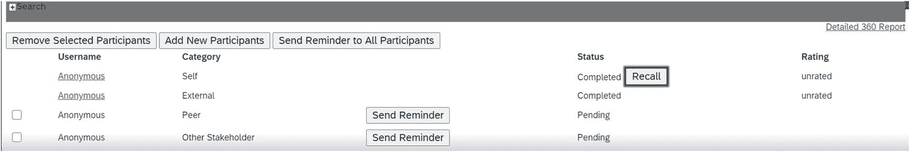

**图 12-27** 添加或移除参与者以及将表格退回给参与者

#### XML 配置

在本节中，我们将审查特定于 360 度评审反馈流程的 XML 配置。

> **注：** 我们在“绩效管理 XML 与翻译”一章中详细审查了 XML 配置。360 度评审反馈流程的 XML 标签与绩效表格中使用的标签类似。

### 添加自定义能力

为了能够向 360 度评审反馈表添加自定义能力，只能通过 XML 进行配置。如果您在配置屏幕`管理模板`上查看模板中的能力部分，您会注意到自定义复选框是灰色的（见图 12-28）。

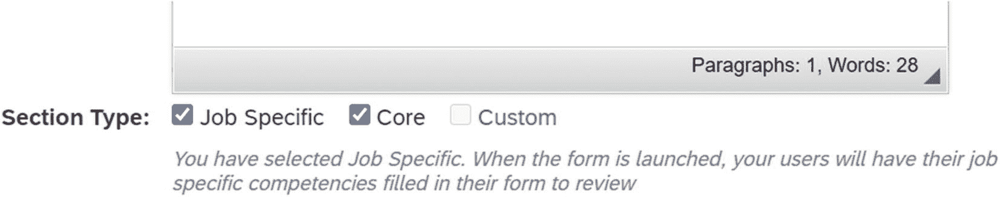

**图 12-28** 添加自定义能力的功能是灰色的。

在您配置 XML 后，自定义复选框将被启用。要配置 XML，请添加这段代码：

```
```

这段代码需要添加到 `<competency-sect>` 中。代码需要添加在 `</fm-sect-scale>` 之后和 `<meta-grp-label>` 之前。请参考以下代码，了解我们为之前配置的模板所编写的完整代码段：

```xml
说明：请针对与表格上显示的姓名相关的人，对以下陈述做出回应。请选择最能描述该个人的评分。

1.0
1.5

*

EM

*

E

100.0
```

将配置好的 XML 导入系统（关于如何更新绩效表格 XML 的更多信息，请参见第 10 章）。导入 XML 后，查看模板中的能力部分。您会注意到自定义复选框现已启用。

> **注：** 能力 ID `19901`（参见标签 `<fm-comp-id>`）指的是我们实例中使用的能力的 ID。此 ID 必须是有效的 ID；否则，系统将抛出错误“在您的一个能力部分中发现了无效的能力 ID。请打开文件并验证系统中是否存在该能力。”如果您的实例中存在职位资料构建器，您可以通过执行配置屏幕`管理职位资料内容`来获取能力 ID。更多信息请参见第 3 章。

### 让经理可见 360 度名称，对其他人匿名

360 度评审反馈的 XML 配置为表单中可维护的匿名级别提供了灵活性。在我们的讨论中，我们将让评分作者对经理可见，而对包括员工在内的所有其他评分者匿名。

添加以下代码：

```xml

*

*
EM
```

该代码需要添加到 XML 的 meta 部分，并且位于 `<meta-360-rollup-category-name>` 之前。请参考以下代码，查看我们如何添加特定代码（如前所述）：

```xml

*

*
EM
```

使用此代码，在评估和完成阶段（参见我们指明阶段的标签 `route-step`），经理将看到评分者及其评分，而对于所有其他角色，评分将被隐藏。

> **注：** 如果在 XML 中已经存在“自我”的 `meta-cat` 标签，请删除该代码，以便您可以将新代码添加到 XML 数据模型中。否则，系统将抛出错误，指出“自我”的 `meta-cat` 存在重复。

### 配置最小/最大评估者数量

在 XML 数据模型中，我们可以配置最小和最大评估者数量。如果表单中未遵守此设置，我们还可以配置警告或错误消息。在 `<rater-config>` 部分，我们可以配置最小值和最大值以及要计入的消息。

您可以参考以下代码并根据您的业务需求进行更改：

```xml
MM/dd/yyyy
```

在这段代码中，我们设定最小评估者数量应为 4。如果数量少于 4，则表单将显示一条警告消息。我们将最大评估者数量配置为 6。对此，我们配置了一条错误消息。

我们还可以配置每个参与者类别需要分配的最小和最大评估者数量。此配置在 meta 部分完成。请参考以下代码：

```xml
在这段代码中，我们配置了属于“直接下属”类别（以及“同事”、“经理”、“其他利益相关者”、“外部”等其他类别）的评估者最多为 20 人。我们没有配置所需的最小数量。
```

> **注：** 在配置屏幕`表单模板设置`上，点击您正在处理的模板。在显示的页面上，有一个名为`参与者阈值控制`的配置开关。通过此开关，您可以控制在参与者级别还是项目级别排除响应。当您选择`参与者级别`开关时，您可以排除整个表单的响应。当您选择`项目级别`开关时，您可以排除表单中某些部分的响应。您可以参考 KBA 2087236《参与者阈值控制 - 360 度评审》以获取如何在模板设置中添加阈值控制的具体示例。

### 与职业发展规划集成

我们可以在 XML 数据模型中配置与职业发展规划的集成（见图 12-29）。在标签 `<sf-360>` 中，将选项 `embed-cdp-goals` 设置为 `"true"`。请参考提供的代码：

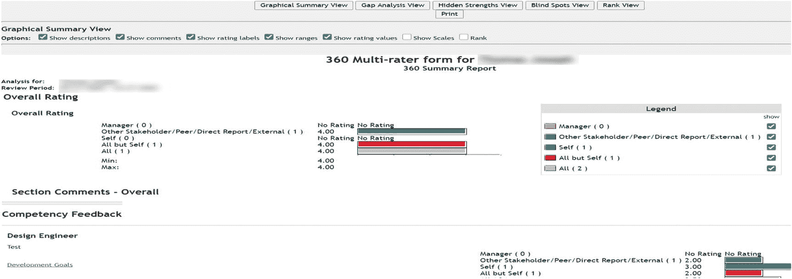

**图 12-29** 包含发展目标链接的详细 360 度评审报告

```


如图 12-29 所示，当您点击 `Development Goals`（发展目标）时，将弹出一个显示 `Add Development Goal`（添加发展目标）按钮的窗口（见图 12-30）。点击此按钮后，将显示默认的 `CDP`，您可以在其中为员工创建发展目标。

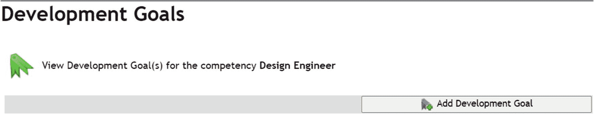

图 12-30
添加发展目标

**注意**

`Detailed 360 report`（详细 360 反馈报告）的链接显示在表单的 `Evaluation Summary`（评估摘要）部分中（图 12-31）。

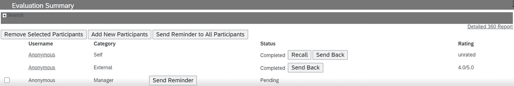

图 12-31
包含 `Detailed 360 report`（详细 360 反馈报告）链接的 `Evaluation Summary`（评估摘要）部分

要使此集成正常工作，请确保完全满足以下前提条件：

*   实例中应已配置 1 个 `CDP` 计划且该计划可用。
*   如果实例中存在多个 `CDP` 计划，请确保其中一个为默认计划。

**注意**

如果实例中存在多个 `CDP` 计划，您无法指定使用哪一个 `CDP` 计划。因此，前提条件之一是必须将其中一个标记为默认计划。

在配置此集成之前，请考虑以下几点：

*   将 `CDP` 与 `360 Review feedback review`（360 度反馈评审）集成，允许参与者查看或为员工添加发展目标。
*   此集成不允许配置访问 `CDP` 的权限。因此，如果配置了该集成，任何有权访问 `Detailed 360 report`（详细 360 反馈报告）的参与者都可以访问员工的 `CDP`。
*   `CDP integration`（CDP 集成）在 `Detailed 360 report`（详细 360 反馈报告）中访问。此集成仅在 `Graphical Summary View`（图形摘要视图）、`Gap Analysis View`（差距分析视图）和 `Rank View`（排名视图）中可用。在 `Hidden Strengths View`（隐藏优势视图）或 `Blind Spot View`（盲点视图）中不可用。

## 与学习的集成

我们可以将 `SuccessFactors Learning` 与 `360 Review feedback`（360 度反馈）集成。要进行配置，您需要访问 `Provisioning`（配置）。

在 `Provisioning`（配置）中，点击 `Form Template Administration`（表单模板管理）。在显示的页面上，点击您想要与 `LMS` 集成的 `360 Review feedback`（360 度反馈）模板。在显示的页面上，滚动到 `Edit Form Attributes`（编辑表单属性）部分。在该部分中，点击 `Enable Learning Integration`（启用学习集成）开关（图 12-32）。请记住保存您的配置更改。

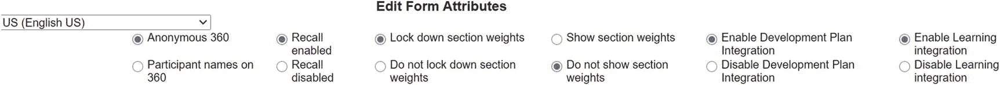

图 12-32
`Enable Learning Integration`（启用学习集成）

此集成起作用需满足以下条件：

*   必须在环境中启用并可用 `LMS`。
*   参与者和主体必须拥有访问 `LMS` 的权限。

如果启用了此集成，`Assign Learning`（分配学习）链接将出现在各能力描述下方。

**提示**

作为练习，请检查您是否可以在 XML 数据模型中启用/禁用此集成。如有需要，可参考“与职业发展规划集成”一节中提供的代码。

## SAP Fiori 版本

`360 Review feedback`（360 度反馈）表单提供 `SAP Fiori` 版本。该版本已正式发布 (GA)，但功能受限。`Fiori` 版本由 `SAP UI5` 技术支持，并提供直观的用户体验。您可以通过安装 `Upgrade Center`（升级中心）中提供的新 UI 来升级到 `SAP Fiori` 版本。您可以通过在搜索框中执行配置屏幕 `Upgrade Center`（升级中心）来访问它。在显示的页面上，可选升级中有一个名为 `360 Review – SAP Fiori Version (Beta)`（360 度反馈 – SAP Fiori 版本（Beta））的选项。点击此选项，在显示的页面上（见图 12-33），您将看到升级到 `SAP Fiori` 版本的选项。

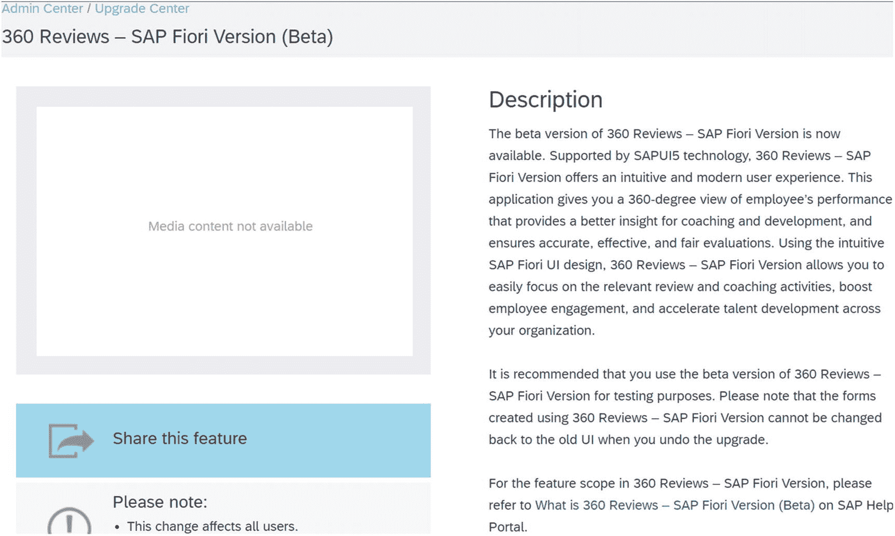

图 12-33
升级到 `SAP Fiori` 版本（beta）

**注意**

要升级到 `SAP Fiori` 版本，前提条件是系统中必须已启用并可用 `360 Review`（360 度反馈）。任何使用旧解决方案配置的模板都需要更新为 `SAP Fiori` 解决方案。您可以在配置屏幕 `Manage Templates`（管理模板）中进行更新。进行中和已完成的表单不受升级影响。

升级后，您有最多 30 天的时间可以回退到旧解决方案。

如果您回退到旧解决方案，需要注意以下几点：

*   任何使用 `SAP Fiori` 版本创建的模板将被系统锁定，无法供将来使用。
*   任何使用 `SAP Fiori` 版本的表单可以继续使用。但是，这些基于 `SAP Fiori` 的表单无法回退到旧解决方案。

**提示**

升级后，如果您发现与 `OData API` 相关的功能未更新，可以刷新缓存。您可以通过执行配置屏幕 `OData API Metadata Refresh And Export`（OData API 元数据刷新和导出）来访问缓存。

目前，`SAP Fiori` 版本不支持旧解决方案中可用的所有功能。从高层面上看，以下功能目前（截至 `H1’2020 版本`）在 `SAP Fiori` 版本中不可用：

*   发展目标部分
*   发展目标部分中的学习活动
*   打印功能
*   `EZ rater`（简易评分器）
*   在路线图中添加修改器的功能
*   绩效表单历史记录
*   `360 Review feedback`（360 度反馈）表单历史记录

强烈建议您审视自己的业务需求，了解哪些功能可用，并决定是否要升级。

在最后几个部分中，我们回顾了 `360 Review feedback`（360 度反馈）表单的配置。掌握了这些知识后，在下一节中，我们将讨论 `360 Review feedback`（360 度反馈）表单的部署。

## 部署

在本节中，我们将讨论如何启动表单、内部用户如何访问 `360 Review feedback`（360 度反馈）表单，以及外部用户如何访问该表单。我们将从启动表单开始回顾。

### 启动表单

负责启动表单的人员（通常是管理员、经理或人力资源团队）可以通过在 `Admin Center`（管理中心）或搜索框中执行 `Launch Forms`（启动表单）来启动表单。

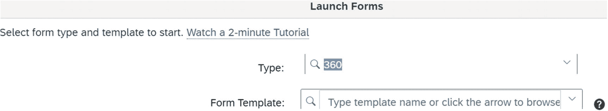

图 12-34
启动表单

*   在显示的页面上（见图 12-34），对于 `Type`（类型）字段，选择 `360`。在 `Form Template`（表单模板）字段中，选择您要用于该表单的模板。点击 `Next`（下一步）。
*   在显示的页面上，如果您计划立即启动表单，可以选择“现在”；或者您也可以选择 `Later`（稍后）并安排到以后的日期。点击 `Next`（下一步）。
*   在显示的页面上，您可以输入要创建表单的评审周期。点击 `Next`（下一步）。
*   在显示的页面上，您可以选择要为其创建表单的人群。点击 `Next`（下一步）。
*   显示的页面是审核页面，您可以在其中审核之前页面中输入的信息。在此页面上，如果需要，您可以单击选项向员工（表单的主体）发送通知。

**注意** 只有当您启用了 [文档创建通知](https://salesdemo.successfactors.eu/acme?bplte_company=SFPART042888&fbacme_o=admin&_s.crb=35m%25252fgA42MPLw0wH3H4uXqb3ufIycpdiOVmYvMcArOb8%25253d&pess_old_admin=true&ap_param_action=sys_notification&nts_action=DocumentCreation) 通知时，员工（表单的主体）才会收到通知。您可以通过执行 `E-Mail Notifications Template Settings`（电子邮件通知模板设置）来访问此通知。

*   点击 `Launch`（启动）以启动表单。

**提示**


## 启动并访问 360 度评估反馈表单

您可以通过执行 `Launch 360 Review` 来启动 360 度评估反馈表单。执行配置步骤 `Launch Forms` 时，此配置步骤也会将您带到同一页面。`Launch 360 Review` 的着陆页将在“类型”（Type）字段中默认显示“360”（见图 12-34）。

在接下来的部分中，我们将回顾员工和经理如何访问该表单。

### 访问表单

您（外部评估人除外）可以通过单击主页下拉菜单中的 `Performance Management` 来访问该表单（见图 12-35）。这将带您进入绩效管理收件箱，您将在其中看到分配给您的表单。

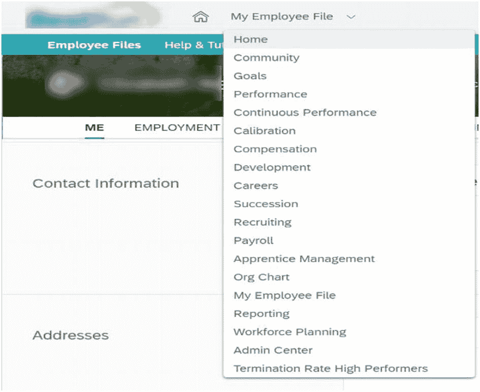

图 12-35：访问 360 度评估反馈表单

**注意**：`Performance Management` 选项在您的实例中可能标签不同。要访问 360 度评估反馈表单，您需要进入绩效管理应用程序的收件箱。

**提示**：如果您在表单启动时收到了通知（请参阅“启动表单”部分），则该通知将包含您可以点击以访问表单的 URL。

在下一节中，我们将回顾评估对象及其经理如何访问表单的用户体验。

### 作为评估对象审核表单

员工（评估对象）可以在绩效管理收件箱中访问 360 度评估反馈表单。通过单击收件箱中显示的链接，员工可以访问表单（见图 12-36），并且员工可以查看已分配的评估人、分配能力、添加新目标以及添加新的评估人。如果员工和经理同意，员工可以删除部分已分配的评估人。

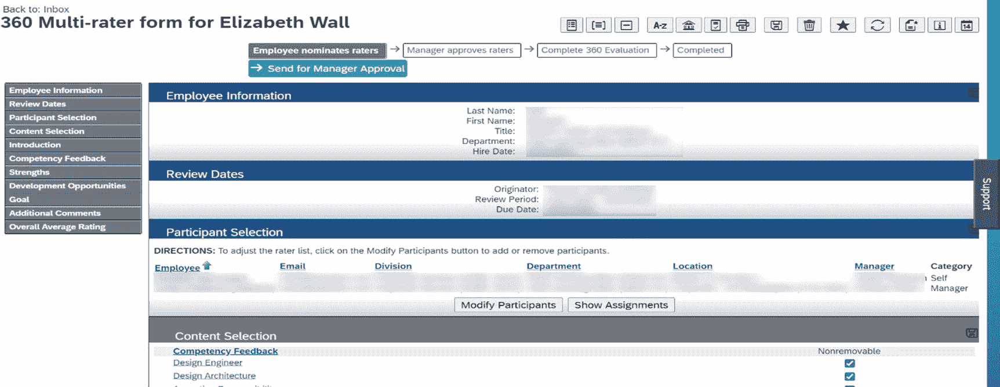

图 12-36：评估对象看到的 360 度评估反馈表单

**注意**：员工可以通过单击 `Modify Participants` 来添加新的评估人（见图 12-36）。当您单击 `Show Assignments` 时，您可以快速查看已分配的能力、目标等。要添加外部评估人，您需要添加评估人的电子邮件以及名和姓。添加外部评估人后，您需要选择外部评估人的类别。通常，类别将是 `External Rater` 或 `Other Stakeholder`。

请记住保存您的更改。根据配置的路线图，您可能需要将其发送给经理，以便在完成评估之前批准评估人。

### 作为评估对象的经理审核表单

与其他内部用户类似，评估对象的经理可以从绩效管理收件箱访问该表单。如果配置了通知，经理将收到系统通知，要求他们批准员工分配的评估人。该通知将包含经理可以点击以访问表单的 URL。单击链接将带您进入绩效管理收件箱。

**提示**：需要配置用于通知经理（以及路线图中定义的其他角色）的通知是 `Document Routing Notification`。

经理将在主页的“待办事项”部分看到一个名为 `Review Performance` 的磁贴。经理可以单击 `Manager approves raters` 链接（见图 12-37），这将直接带经理进入表单。经理可以查看并批准评估人以开始评估。所有评估人都将收到系统通知。

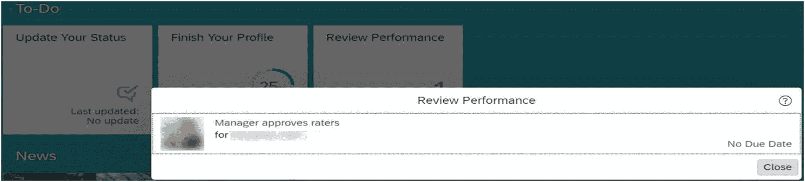

图 12-37：批准评估人的待办事项磁贴

### 作为外部评估人提供反馈/评分

外部评估人将收到一封系统通知（图 12-38），要求他们就评估对象提供意见。

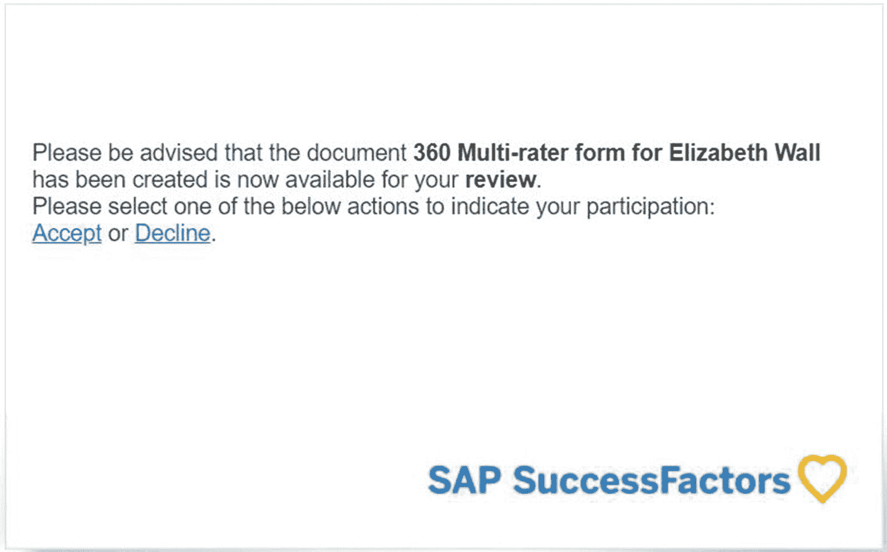

图 12-38：向外部评估人发送电子邮件

外部评估人可以通过单击相应的链接来接受或拒绝该请求。

**注意**：通知中提供的深层链接不可配置。

单击 `Accept` 将把评估人带到表单，他们可以在其中提供评分和评论。

**注意**：当请求外部评估人在 360 度评估反馈表单中提供意见时，可能会遇到来自 IT 部门及其他方面与 SSO 和安全性相关的阻力。外部评估人将能够绕过已配置的 SSO，并拥有与内部评估人相同的用户体验。当外部评估人登录实例时，他们将无法访问系统中的任何其他功能。

### 作为内部评估人提供反馈/评分

所有内部评估人都可以从绩效管理收件箱访问 360 度评估反馈。当内部评估人访问表单时，系统将显示 `Decline to Participate` 选项（图 12-39）。

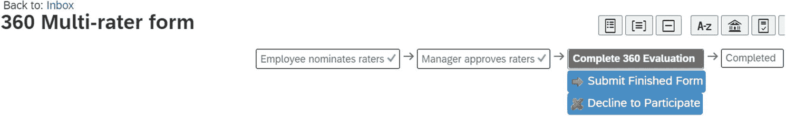

图 12-39：内部评估人看到的 360 度评估反馈表单

如果内部评估人同意参与，他们可以填写评估人信息、提供评论，并单击 `Submit Finished Form`。

### 评估对象/经理对表单评分

员工和经理可以从绩效管理收件箱访问该表单以提供评分（员工进行自我评估，或经理对评估对象进行评估）。

### 完成流程

当所有评估人完成评分后，表单将移至完成状态。流程完成后，评估人将收到一份系统生成的通知（见图 12-40），告知他们流程已完成，并且可以在绩效管理收件箱的“已完成”文件夹中访问已完成的表单。（只有内部评估人会收到此通知。）

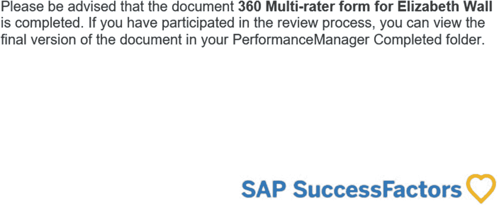

图 12-40：发送给评估人的完成通知

当评估人单击该表单时，他们可以查看由不同评估人提供的评分。评估人的姓名将被隐藏，系统将显示标签 `Anonymous`（见图 12-41）。

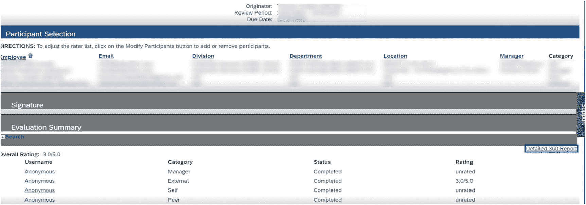

图 12-41：已完成的表单视图

当您单击 `Detailed 360 Report` 时（见图 12-41），系统将显示一份详细报告，突出显示每个评估人为各项能力提供的评分，以及整体部分评分（见图 12-42）。

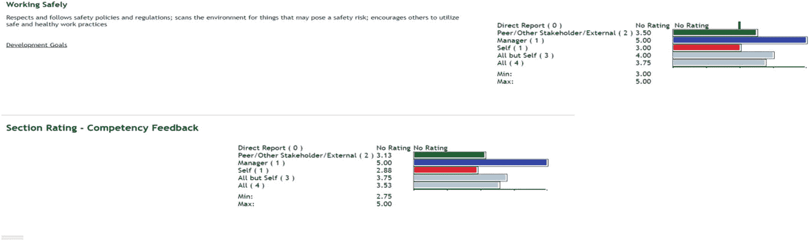

图 12-42：包含评分的详细报告


## 360 度评估反馈流程

您可以点击`图形摘要视图`、`差距分析视图`、`隐藏优势视图`、`盲点视图`和`排名视图`，以不同风格查看报告，并突出显示特定数据点。图 12-43 展示了`自我`（被评估对象/员工）所提供的评分以及所有其他人员的评分（这是所有其他评估者针对每项能力的平均评分）。以绿色显示的差距表明，评估者给予该员工的评分高于其自评分数。

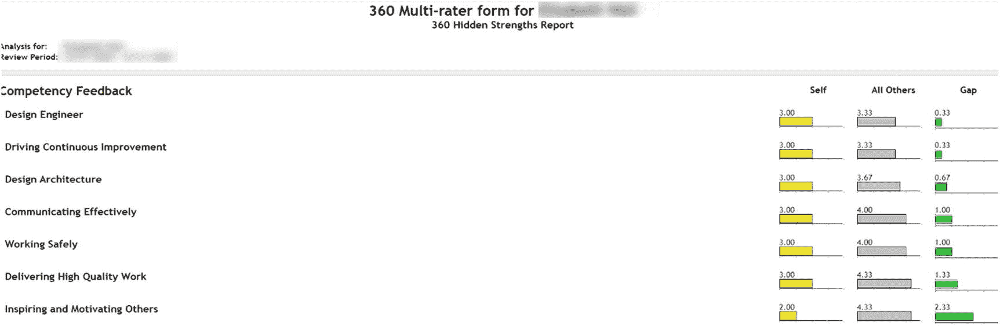

**图 12-43** 隐藏优势报告

## 案例研究

在一个项目中，客户希望了解针对 360 度评估反馈流程的报告功能。在本案例研究中，我们将创建一个测试报告，以了解在`SuccessFactors` 360 度评估反馈流程中可以报告哪些内容。

在`报告中心`，依次点击`新建`、`报表-表格`和`单一域`。在“您希望从哪些数据开始？”字段中，选择`360 度多评估者主体`（参见图 12-44）。

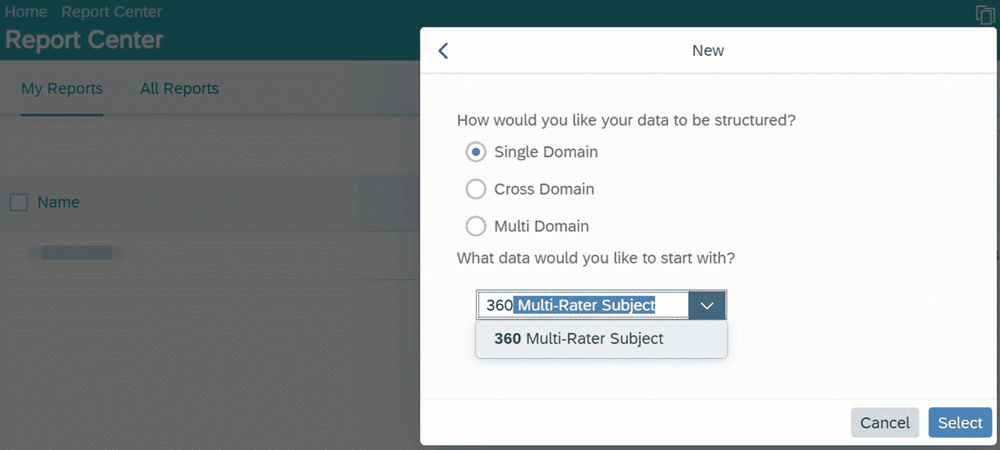

**图 12-44** 创建报告

在报告中，于`数据集`选项中点击`选择模板`，然后选择您要报告的一个或多个模板（图 12-45）。

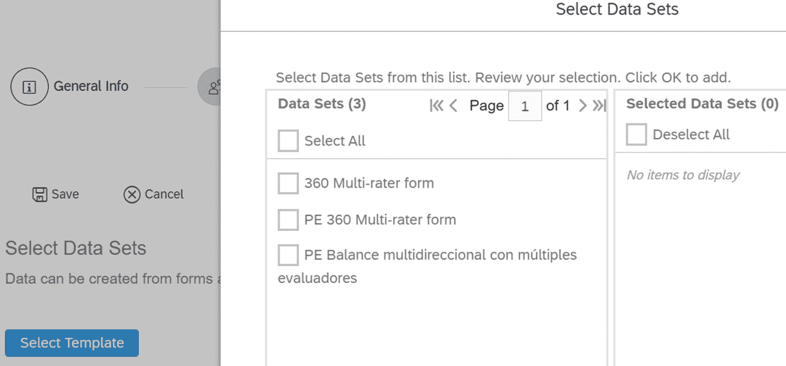

**图 12-45** 选择要报告的模板

在列选项中，选择您希望在报告中显示的列。您还可以为报告添加过滤器。点击`保存`并生成报告。

## 结论

在本章中，我们讨论了 360 度评估反馈流程的功能。我们讨论了如何在`Provisioning`中激活该功能。然后，我们回顾了需要分配哪些权限才能访问`AdminCenter`中提供的不同 360 度评估反馈配置步骤。接着，我们探讨了需要完成的各项不同配置。在配置模板时，我们了解了如何向模板添加章节。利用`XML`，我们学习了如何添加自定义能力，以及如何与`CDP`和`LMS`集成。最后，我们探讨了如何升级到`SAP Fiori`版本，以及该版本目前缺少哪些功能。在下一章中，我们将讨论持续绩效管理（`CPM`）以及如何在您的绩效流程中利用`CPM`。

# 13. 持续绩效管理

持续绩效管理（`CPM`）是一套定期进行的绩效反馈流程。例如，在传统的年度绩效管理流程中，反馈通常只在年中一次和年末一次进行。年度评估流程的缺点在于，它在当今变化的商业环境中效率低下。管理者和员工都认为年度流程过于刻板，几乎不会带来积极成果。员工觉得有必要与管理者定期沟通，以获得关于既定目标和目的（Goals and Objectives）的反馈。管理者则认为需要一个敏捷的评估流程，以便能够根据不断变化的业务需求调整既定的目标和目的。这就是为什么越来越多的公司转向`CPM`的原因——它既敏捷，又为管理者和员工提供了定期会面沟通的机会。

如图 13-1 所示，在`CPM`中，员工与其管理者共同确定和定义目标（Objectives）和目的（Goals）。可以决定短期里程碑，然后员工将朝着这些目标努力。根据双方约定，管理者和员工可以定期进行检查面谈（Check-ins）。通常这些检查面谈每一到三个月进行一次，但也可以是临时安排，甚至更加频繁。在检查面谈之前，员工可以就本次检查面谈想要完成的内容草拟一份议程，并与管理者分享。在检查面谈期间，应鼓励管理者和员工坚持议程，并尽量避免在谈话中讨论常规业务活动。

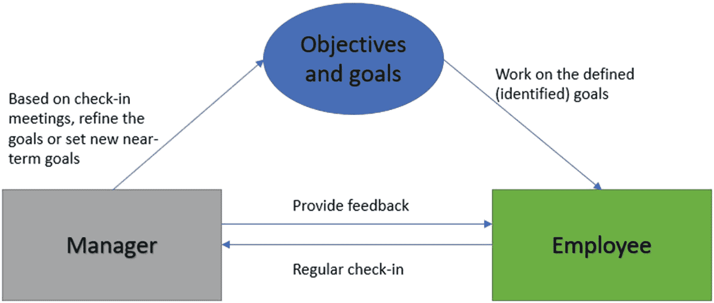

**图 13-1** 持续绩效管理

> **注：** 在图 13-1 中，目标和目的可以同时包括业务目标和发展目标。

检查面谈会议的典型议程包括以下内容：

- 回顾已定义的目标和目的。
- 确定是否需要调整已识别的目标和目的；这可能包括审视已定义的目标是否仍然是优先事项。员工和管理者都应愿意根据需要添加/删除目标。
- 追踪员工相对于目标的进展，并列出具体成就。
- 讨论员工是否需要任何支持。支持可能包括辅导或学习机会，或是更频繁的检查面谈。
- 在检查面谈期间，管理者和员工应保持沟通顺畅且透明。
- 员工应有机会讨论他们可能存在的任何疑虑或优先事项。
- 应鼓励管理者和员工投入一些时间关注员工的个人发展。这一讨论将帮助管理者评估既定目标是否仍然相关，或者是否需要进行任何调整。
- 检查面谈会议应产出切实可行的行动项，以便员工和管理者在下次约定会议之前据此执行。

随着劳动力队伍的持续演变，人力体验管理的趋势表明，员工更倾向于就其绩效获得定期反馈。与难以提供定期反馈机会的传统年度绩效评估流程相比，`CPM`恰好契合了这种需求。

在本章中，我们将讨论`SuccessFactors`如何支持持续绩效管理流程，包括如何在系统中激活`CPM`，以及如何将`CPM`与`SuccessFactors`的`目标`、`绩效管理`、`校准`和`发展`应用集成。

## 激活持续绩效管理

在`管理中心`激活`CPM`之前，您需要完成以下先决条件：

- 在`Provisioning`中，您需要启用开关`启用持续绩效管理`，该开关要求启用`启用通用对象`、`基于角色的权限`（这将禁用管理域）和`启用附件管理器`。
> **注：** 在激活此开关之前，您需要在`Provisioning`中激活`启用通用对象`和`启用附件管理器`开关。

- 员工和管理者应具有访问其汇报管理者或员工的`名字`、`中间名`、`姓氏`、`职位`和`管理者`数据字段的权限。

您可以通过执行名为`绩效管理功能设置`的配置，在`管理中心`中激活`CPM`（参见图 13-2）。

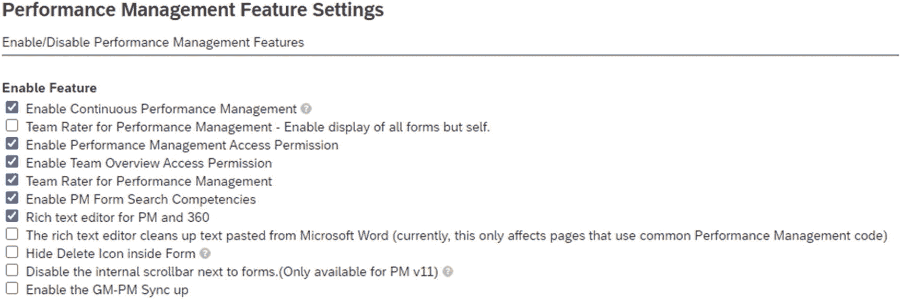

**图 13-2** 激活 CPM


在显示的页面上，选择配置开关`Enable Continuous Performance Management`。  
请注意，如果你无权访问配置步骤`Performance Management Feature Settings`，你可以在`Permission Settings` ➤ `Administrator Permissions` ➤ `Manage System Properties` ➤ `Performance Management Feature Settings`中分配所需权限。

## 权限设置

根据角色不同，你需要为经理、员工和 CPM 管理员分配相应的权限。需要配置的权限可通过`Permission Settings` ➤ `User Permissions`以及`Permission Settings` ➤ `Administrator Permissions`访问。

> **注意**  
> 在本节中，我们仅审查与 CPM 相关的权限。我们不会审查其他权限，例如`Employee Data`、`Company System`、`Logo Settings`等。

需要分配的权限涵盖在以下各节中。

## 持续绩效管理用户权限

以下是此类别中可用的权限设置：

*   **访问持续绩效管理**：此权限设置将授予对 CPM 的访问权限。

    > **注意**  
    > CPM 的访问权限由分配的目标人群驱动。因此，员工的目标人群应包含`Self`，经理的目标人群应包含`Self`和`Direct Reports`。

*   **访问持续反馈**：此权限将授予对组织内所有员工持续反馈的访问权限。

    > **注意**  
    > 此权限应授予需要获取所有员工持续反馈数据的人员。直线经理和员工不应被授予此权限。

*   **提供持续反馈**：此权限将授予向你的直接下属以及其他被分配接收持续反馈的人员提供持续反馈的权限。

*   **向他人请求反馈**：此权限将授予向其他人请求反馈的权限。

    > **注意**  
    > 你请求反馈的人员应包含在目标人群中。如果你寻求反馈的人员不在你的目标人群中，你将无法通过 CPM 联系该人员并请求反馈。  
    > 此权限应与设置“`Limit about whom feedback can be requested`”一起授予。

*   **限制可被请求反馈的人员范围**：此权限将限制可被联系以提供反馈的人员范围。

    > **注意**  
    > 此权限应与权限“`Request feedback from others`”一起授予。

## 持续绩效管理

以下是此类别中可用的权限设置（见图 13-3）：

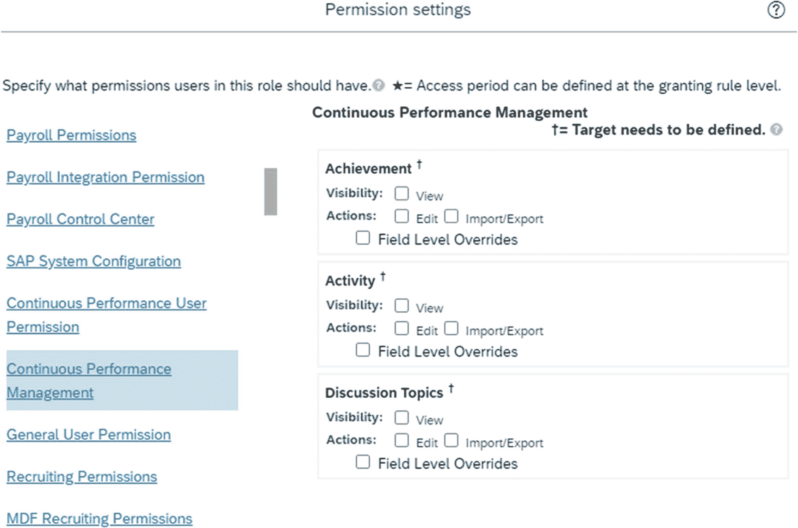

**图 13-3** CPM 相关权限类别

*   **成就**：此权限允许你创建、查看和编辑成就。
*   **活动**：此权限允许你创建、查看和编辑活动。
*   **讨论主题**：此权限允许你创建、查看和编辑讨论主题。

## 管理持续绩效

权限类别`Manage Continuous Performance`可通过`Permission Settings` ➤ `Administrator Permissions`访问。以下是此类别中可用的权限设置：

*   **访问管理配置页面**：此权限应仅分配给 CPM 管理员。此权限授予对 CPM 配置页面的访问权限。
*   **对所有持续绩效管理数据的管理访问权限**：此权限允许你将 CPM 中添加的成就链接到绩效管理中的目标。

> **注意**  
> 你可以通过点击`Home`下拉菜单中显示的选项`Continuous Performance`来访问 CPM。

## 移动应用

如果你的实例中启用了`Mobility`，你可以在移动设备上访问 CPM。你可以通过执行`Enable Mobile Features`来启用在移动设备上访问 CPM。在显示的配置页面上，在`Modules`中的`Talent`部分，选择选项`Goal Management`、`Performance Review`和`Continuous Performance`。

移动设备支持以下 CPM 功能：

*   活动
*   成就
*   反馈流程
*   辅导
*   记录一对一会议
*   查看会议历史
*   其他主题

> **注意**  
> `SuccessFactors`移动应用可在 iOS（8 版及更新版本）或 Android（4 版及更新版本）上访问。

在下一节中，我们将讨论如何配置 CPM。

## 持续绩效管理配置

你可以通过在搜索栏中执行配置步骤`Continuous Performance Management`来访问 CPM 配置页面。显示的页面（见图 13-4）包含不同的部分。我们将逐一审查每个部分。

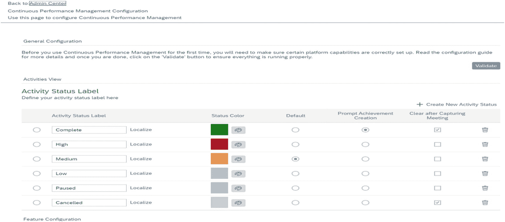

**图 13-4** CPM 配置

*   **常规配置**：此部分中显示的`Validate`按钮会执行配置和权限检查，以确保所需的配置已完成且有效。

检查工具执行以下操作：

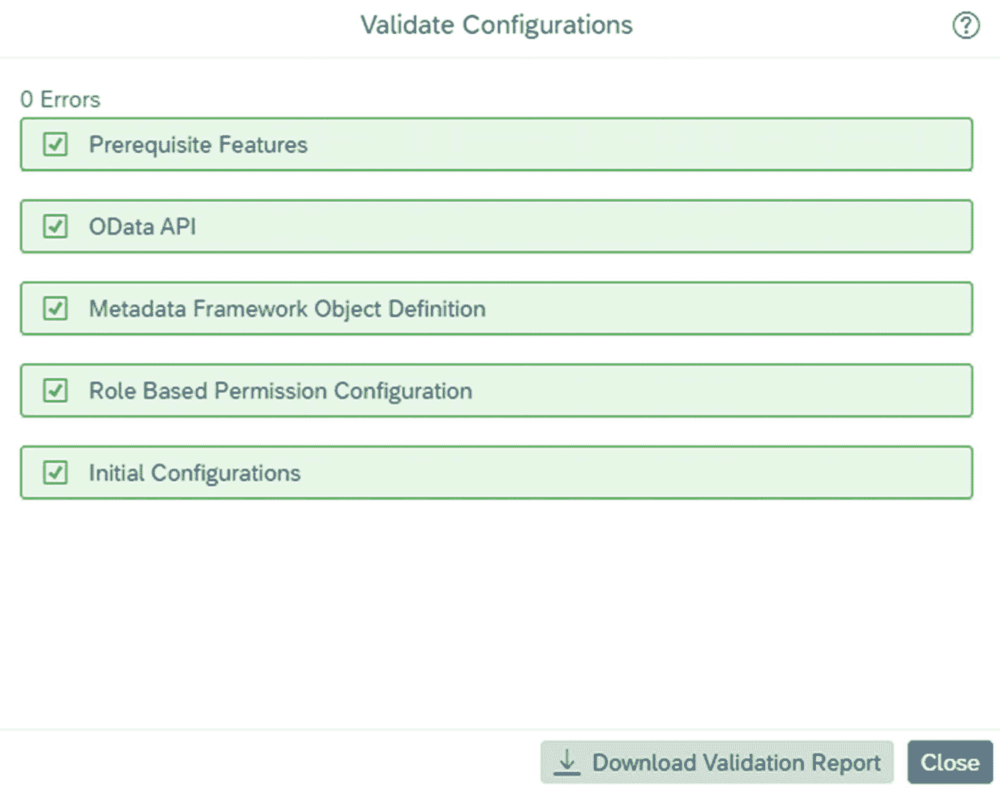

**图 13-5** CPM 配置检查

1.  验证实例中是否提供了 CPM 所需的以下实体：
    *   `ActivityStatus(high)`
    *   `ActivityStatus(medium)`
    *   `ActivityStatus(low)`
    *   `ActivityStatus(paused)`
    *   `ActivityStatus(complete)`
    *   `ActivityStatus(cancelled)`
    *   `OtherTopicStatus(Open)`
    *   `OtherTopicStatus(Closed)`
    *   `FeedbackFlag(Red)`
    *   `CPMNotificationConfig(CPM_1ON1_EMP_TODO_NOTIFICATION)`
    *   `CPMNotificationConfig(CPM_1ON1_MANAGER_TODO_NOTIFICATION)`
    *   `CPMNotificationConfig(CPM_ACTIVITY_REMINDER_NOTIFICATION)`
    *   `CPMNotificationConfig(CPM_ACHIEVEMENT_REMINDER_NOTIFICATION`
2.  验证实例中是否提供了 CPM 所需的`Metadata Framework`（MDF）实体。
3.  验证实例中是否分配了所需的权限。具体来说，它会验证以下权限设置：
    *   `Access to Continuous Performance Management`
    *   `Access to Administrative Configuration page`
    *   `Company Info Access`
    *   `User Search`
    *   `Admin access to OData API`
    *   `Read/Write Permission on Metadata Framework`
4.  验证`Provisioning`中需要激活的不同开关是否已完成。如图 13-5 所示，它验证先决条件（主要是在`Provisioning`中激活开关）是否已完成。
5.  检查实例中是否提供了 CPM 所需的 OData API。

> **注意** 你可以通过执行配置步骤`OData API Data Dictionary`来查看实例中可用的所有 OData API 列表。

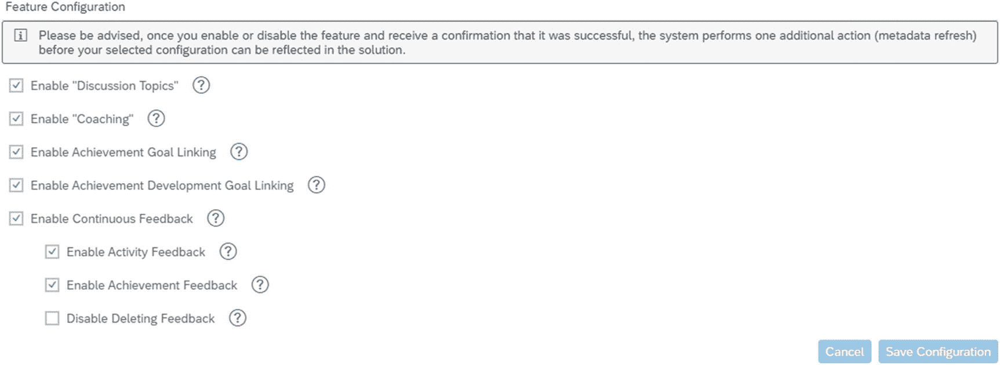

**图 13-6** 在 CPM 中配置功能

*   **活动视图**：在本节中，我们将创建在 CPM 中使用的不同活动。我们可以定义在创建活动时哪个状态将是默认状态。我们还可以定义将触发创建成就的状态。如图 13-4 所示，我们已定义一旦活动标记为完成，它将在 CPM 中创建一个成就。


### 功能配置

在本节中（见图 13-6），我们可以勾选/取消勾选 CPM 中可用的不同选项。例如，如果您不希望系统中提供删除反馈的功能，可以取消勾选“禁用删除反馈”选项。

**提示：**  
1) 如果将鼠标悬停在问号图标上，您将看到该特定选项的说明。  
2) 勾选/取消勾选某个选项后，如果更改未在系统中生效，请执行以下操作：运行 `config OData API Metadata Refresh and Export`。在显示的页面上，点击 `Refresh`。这将刷新缓存并使实例同步更改。

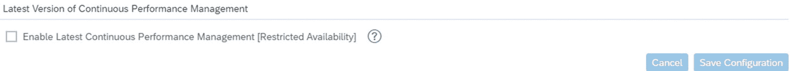

**图 13-7** 启用最新版本的 CPM

### 最新版本的持续绩效管理

如果您有兴趣升级到 CPM 的最新版本，可以启用此选项（见图 13-7）。最新版本尚未全面上市，但自 2020 年 6 月起已可用。

启用此选项后，以下选项将可用：

- **会议纪要**：这是一个新功能。
- **讨论话题**：此功能是新增的，它取代了 CPM 当前可用的“其他话题”功能。启用此选项后，系统会自动将“其他话题”中的数据转换为“讨论话题”。
- **活动视图**。
- **会议视图**。
- **成就视图**：您将获得一个重新设计的视图。

在最新版本中，以下选项被禁用：

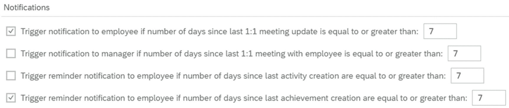

**图 13-8** 在 CPM 中启用通知

- 活动反馈
- 辅导
- 成就目标关联
- 成就发展目标关联
- 持续反馈
- 成就反馈

**注意：** 如果您要启用 CPM 的最新版本，SuccessFactors 建议您同时启用 Fiori 3 主题和页眉。

### 通知

此处（见图 13-8）您可以为员工和经理勾选/取消勾选实例中可用的不同通知和提醒选项。天数的值应大于或等于 1。不接受负数或小数。提醒将显示在主页的 `ToDo` 磁贴中。

**注意：** 如果您激活了这些作业中的任何一个，则需要在 Provisioning 中配置一个计划作业。作业类型将是 `CPM Notification Job`。

您也可以配置通过电子邮件发送提醒。如果您想为“更新活动”、“成就”或“其他话题”配置提醒通知，可以在配置步骤 `E-Mail Notification Templates Settings` 中进行设置。（注意：您可以通过在搜索栏中输入 `E-Mail Notification Templates Settings` 来访问配置屏幕进行电子邮件配置。）这将确保员工或经理收到提醒邮件。执行配置步骤 `Email Template Notification` 后，在显示的页面上，搜索通知 `Update Status Reminder Notification`。选中该通知并点击 `Save Notification Settings` 以保存更改。员工将通过电子邮件以及 SuccessFactors 主页上的 `ToDo` 磁贴收到通知。系统将每四天生成一次提醒，直到活动在 CPM 中更新为止。

**提示：** 您可以更新通知中的已交付文本（图 13-9）以适应您的业务需求。


**图 13-9** 更新状态提醒通知页面

如果您想配置向经理发送的提醒通知，以便在他们未在规定天数内与直属下属进行一对一会议时发出提醒，可以在配置步骤 `E-Mail Notification Templates Settings` 中进行设置。执行配置步骤 `E-Mail Template Notification` 后，在显示的页面上，搜索通知 `Conduct 1:1 Meeting Reminder Notification`。选中该通知并记得保存您的设置。您也可以更新通知中的默认文本以满足需求。

我们可以创建一封发送给员工的电子邮件通知，在他们收到反馈或收到对反馈请求的回复时进行通知。与其他通知类似，执行配置步骤 `E-Mail Notification Templates Settings`。在显示的页面上，搜索通知 `Continuous Feedback Received Notification`。选中该通知并记得保存您的设置。您也可以更新通知中的默认文本以满足需求。

**注意：** 此通知的一个前提条件是实例中应启用智能服务 (IS)。

我们可以创建一封发送给员工的电子邮件通知，在他们收到其他员工的反馈请求时提醒他们提供反馈。与其他通知类似，执行配置步骤 `E-Mail Notification Templates Settings`。在显示的页面上，搜索通知 `Continuous Feedback Request Notification`。选中该通知并记得保存您的设置。您也可以更新通知中的默认文本以满足需求。

**注意：** 此通知的一个前提条件是实例中应启用智能服务 (IS)。

我们可以创建一封发送给员工的电子邮件通知，在他们的汇报经理在 CPM 中进行更新或添加评论时进行通知。与其他通知类似，执行配置步骤 `E-Mail Notification Templates Settings`。在显示的页面上，搜索通知 `Activity Update Creation Notification`。选中该通知并记得保存您的设置。您也可以更新通知中的默认文本以满足需求。

**注意：** 与我们之前见过的通知类似，此通知由智能服务触发。要配置此活动，请执行配置步骤 `Intelligent Services Center`。请注意，您可以通过在搜索栏中执行 `Intelligent Services Center (ISC)` 来访问配置屏幕。在显示的页面上，点击 `Continuous Performance Management Activity`。

在显示的页面上（见图 13-10），选择活动“Notify employee about activity update”，并根据需要进行更改。（默认情况下，此流程足以触发电子邮件通知。）点击 `Actions`，然后点击 `Save Flow` 以保存流程规则。


**图 13-10** 配置用于活动更新创建通知的智能服务

每当经理在 CPM 中进行更新或添加评论时，员工将收到一封电子邮件通知。经理所做的更改在 CPM 中也会直接对员工可见。

### 活动

员工正在处理的任务可作为活动在 CPM 中跟踪。活动可能与分配给员工的目标或目的相关，也可能不相关。您可以请求对活动进行反馈。CPM 中的所有活动都会关联一个状态。（注意：请参阅“持续绩效管理配置”部分，其中我们讨论了活动中的状态。）当活动移至 `Completed` 状态时，您可以为该特定活动创建一项成就。

**注意：** 仅当您使用默认目标计划或默认发展目标计划时，活动才能链接到目标。


如图 13-11 所示，你可以通过点击 `Add Activity` 创建活动。在显示的界面上，输入活动名称。默认情况下，状态设置为 `Medium`。你可以点击下拉菜单选择合适的状态来更改状态。每当活动有更新时，你可以在字段中输入内容，然后点击 `OK` 保存条目。


**图 13-11** CPM 中的活动

如图 13-11 所示，你可以通过点击 `Request Feedback` 请求对活动的反馈。在显示的界面上（见图 13-12），你可以输入你想要收集反馈的员工姓名。


**图 13-12** 请求反馈

> **注意**  
> 如果员工没有收到请求反馈的邮件通知，请检查邮件通知是否已激活，以及员工档案中的电子邮件地址是否正确。

收到反馈请求的员工将在其 `ToDo` 部分的 `Request Feedback` 磁贴中看到该请求。点击该磁贴，然后点击 `Provide Feedback` 即可向请求反馈的员工提供反馈。你所提供的反馈将对请求者可见。

> **注意**  
> 收到提供反馈请求的员工可以通过点击 `Decline` 拒绝提供反馈。请求反馈的员工可以点击 `Feedback` 选项卡上的 `View Feedback Requests`，查看被请求人是否已拒绝提供反馈。

员工可以通过点击 `Feedback` 选项卡查看反馈（见图 13-11）。员工可以选择是否让经理看到该反馈（见图 13-13）。员工还可以选择删除反馈。请注意，员工收到的每条反馈都会显示一个 `Linked` 链接。点击此链接，将打开一个对话框，显示与此反馈关联的活动。


**图 13-13** 员工收到的反馈

> **提示**  
> 如果反馈关联到某个活动，该特定活动中会显示一个 `Feedback` 链接。你可以点击该链接查看反馈。

> **注意**  
> 你也可以直接在 `Feedback` 选项卡上请求反馈。当直接从 `Feedback` 选项卡请求反馈时，该反馈不会关联到任何活动。你可以点击 `Linked` 将反馈关联到一个活动或一个成就。

在 `Feedback` 选项卡上，点击 `View Feedback Requests` 会显示该员工发出的所有反馈请求。员工可以使用 `Give Feedback` 选项向其他员工提供反馈。其他员工可以在其 `CPM/Feedback` 选项卡上查看该反馈，并可以选择将反馈关联到一个活动或一项成就。

> **注意**  
> 前提条件是，应为主页上接收反馈请求的人员启用 `ToDo` 磁贴。同时，请求反馈的员工应启用 `RBP` 功能才能请求反馈。

在 `Discussion Topics`（讨论主题）部分（见图 13-11），你可以添加打算在下次一对一会议中与经理讨论的主题。

> **注意**  
> 经理对 CPM 的视图（见图 13-14）与员工（个人贡献者）的视图类似。在经理视图中，经理可以在同一屏幕上看到其直接下属。他们可以点击每位员工来查看该员工的 CPM 详情。要查看自己的 CPM，经理需要点击自己的姓名。


**图 13-14** 经理的 CPM 视图

经理可以为其员工创建活动和讨论主题，并可以为其员工请求反馈。经理没有能力隐藏其员工收到的反馈。员工（经理为其请求反馈的员工）可以在自己的 CPM 中查看该反馈，并可以将反馈关联到活动或成就。在经理视图中，请注意 `Activities` 选项卡上还有一个额外的 `Coaching`（辅导）部分。在此部分中，经理可以辅导其直接下属，指出他们做得好以及需要改进的地方。请注意，只有在配置步骤 `Continuous Performance Management` 中启用了 `Coaching` 选项时，辅导部分才会显示。点击 `Capture Meeting` 按钮将标记该员工已完成与经理的一对一会议。

> **注意**  
> 在实例中启用 CPM 时，默认情况下 `Topics` 和 `Coaching` 也会启用。如果你不想使用这些功能，可以在实例中禁用它们。执行配置 `Continuous Performance Management`。在显示的配置页面上，取消选中 `Enable Discussion Topics` 和 `Enable Coaching` 选项。这两个开关都在 `Feature Configuration` 部分中。请记住，当你禁用 `Topics` 和 `Coaching` 时，`Topics` 和 `Coaching` 会在 `Activities` 部分中隐藏。如果在启用这些开关后又将其禁用，则所有当前数据和已记录的会议将仅显示活动数据。如果重新启用这些开关，已记录的数据将再次显示在 `Activities` 部分中。

#### 成就

CPM 中的 `Achievements`（成就）选项卡（见图 13-15）列出了你在系统中记录的成就。你可以按时间或按目标标记成就。被标记为成就的活动会列在此选项卡中。（通常，当一项活动完成时，你可以将其标记为成就。）


**图 13-15** CPM 中的成就选项卡

员工的经理将有权访问此选项卡，并可以查看该员工标记的所有成就。

> **注意**  
> 如果有多个成就关联到同一个活动，你可以在同一个选项卡上查看所有成就。CPM 还会按时间顺序显示成就，并提供按日期筛选成就的功能。

##### 将成就与 SuccessFactors 绩效管理集成

你可以在配置步骤 `Form Template Settings` 中将成就与 SuccessFactors 绩效管理集成。你可以在 `Admin Center` 或通过搜索框执行此配置步骤。在显示的页面上，滚动到页面底部，然后在 `Performance Goal` 部分的 `Enable Achievements` 选项卡和 `Performance Development Goal` 部分的 `Enable Achievements` 选项卡上选择相应选项（见图 13-16）。如果你希望在绩效管理中显示成就反馈，请选择 `Display Achievement Feedback for Performance Goal Achievements` 和 `Display Achievement Feedback for Development Goal Achievements` 选项。


**图 13-16** 在绩效管理表单中集成成就

选择这些选项后，`Achievements` 选项卡将显示在绩效表单中。

> **注意**  
> 前提条件是，绩效管理系统应为 PM12 Acceleration 版本。


##### 将成就与目标管理集成

您可以将成就与 SuccessFactors 目标计划集成。通过将成就与目标计划集成，员工及其经理可以直接在员工的目标计划中查看与绩效目标相关联的成就和收到的反馈（如果有）。

要进行配置，请执行配置步骤 `Manage Templates`。（请注意，您可以通过在搜索栏中执行 `Manage Templates` 来访问配置屏幕。）在显示的页面上，单击 `Goal Plan` 选项卡。在显示的页面上，选择要与成就集成的目标计划。在显示的页面上，选择 `General Settings` 选项（参见图 13-17）。在显示的页面上，选择“在目标计划上显示连续绩效管理成就”选项。单击 `Save` 保存您的设置。


**图 13-17** – 在目标计划中集成成就

> **注意：** 目前，SuccessFactors 没有选项用于链接 CPM 中的多个目标计划。这已在产品路线图中，但 SuccessFactors 尚未公布其发布日期。`在目标计划上显示连续绩效管理成就` 开关（参见图 13-17）仅允许您从目标表单中查看链接到您目标的 CPM 成就。您无法从目标计划中编辑 CPM 成就。

##### 将成就与发展目标集成

您可以将成就与您的 SuccessFactors 发展目标集成。通过将成就与发展目标集成，员工及其经理可以直接在员工的发展目标计划中查看与绩效目标相关联的成就和收到的反馈（如果有）。

要进行配置，请执行配置步骤 `Manage Templates`。在显示的页面上，单击 `Development` 选项卡。在显示的页面上，选择要与成就集成的发展目标。在显示的页面上，选择 `General Settings` 选项（参见图 13-18）。在显示的页面上，选择“在目标计划上显示连续绩效管理成就”。单击 `Save` 保存您的设置。


**图 13-18** – 在发展目标计划中集成成就

##### 将成就与校准模板集成

您可以将成就与校准模板集成。将成就与校准模板关联，使经理能够直接在校准模板中查看其直接下属的成就。

要进行配置，请执行配置步骤 `Manage Calibration Templates`。在显示的页面上，选择需要与成就集成的校准模板。在显示的页面上，单击 `Data` 选项卡。在显示的页面上（参见图 13-19），滚动到页面底部。选择“允许访问持续绩效管理成就”选项。保存您的设置。


**图 13-19** – 将成就与校准模板集成

#### 报告

在此情况下，我们将讨论如何为 CPM 创建即席报告。首先，我们将回顾访问报告功能需要哪些权限。

作为创建和运行 CPM 即席报告的先决条件，您需要被分配相应的权限。执行配置步骤 `Manage Permission Roles`。在显示的页面上，单击您想要为其分配创建/执行 CPM 即席报告权限的权限角色。在显示的页面上，单击 `Permission`。在 `User Permissions` 部分，单击 `Reports Permission`（参见图 13-20）。单击 `Create Report` 权限，并分配 `Continuous Performance Management` 和 `Continuous Performance Meetings`。向下滚动，单击 `Run Report` 权限，并分配 `Continuous Performance Management` 和 `Continuous Performance Meetings`。


**图 13-20** – 分配创建/执行 CPM 即席报告的权限

要创建 CPM 的即席报告，您可以选择域 `Continuous Performance Management` 或 `Continuous Performance Meetings`。您可以使用域 `Continuous Performance Management` 来创建任何使用与活动、成就、辅导和主题相关数据的报告。您可以选择域 `Continuous Performance Meetings` 来报告与一对一会议相关的数据。

> **注意：** 当您创建 `Continuous Performance Management` 报告时，一次只能选择一个实体；否则，您将得到错误的报告。您可以使用实体 `Activity` 和 `Achievement` 来报告已转化为成就的活动。

> **提示：** 您可以通过执行配置步骤 `Manage Dashboards` 并选择选项 `Manage Standard Dashboards and YouCalc Files` 在系统中创建 YouCalc 文件。在显示的页面上，选择选项 `Build Tile` 并选择 `Continuous Performance Management` 作为域。

您可以创建基于 YouCalc 文件的磁贴。要创建磁贴，请执行配置步骤 `Manage Dashboards` 并选择选项 `Manage Tile-Based Dashboards`。在显示的页面上，单击 `Create New Dashboard`。作为访问 YouCalc 文件和创建磁贴的先决条件，您需要被分配相应的权限。执行配置步骤 `Manage Permission Roles`。在显示的页面上，单击您想要为其分配权限以访问 YouCalc 文件的权限角色。在显示的页面上，单击 `Permission`。在 `User Permissions` 部分，单击 `Reports Permission`。单击 `Analytics Tiles and Dashboards` 权限并选择 `All`。向下滚动到 `Administrator Permissions` 部分。单击 `Manage Dashboards/Reports` 权限，然后选择 `Analytics Tiles and Dashboards`。记得保存您的选择。

## 案例研究

在本节中，我们将回顾两个案例研究。在第一个案例研究中，我们将讨论如何将成就与薪酬集成。

### 案例 1

客户 A 已经实施了 CPM 和其他绩效应用程序，例如绩效管理、目标管理和发展目标。该客户目前正在实施薪酬管理，并希望将成就与薪酬集成。将成就与薪酬集成将帮助薪酬规划者直接在薪酬工作表中查看员工的成就。

#### 解决方案 1

要将成就与薪酬集成，请执行配置步骤 `Compensation Home`。在显示的页面上，选择您想要与成就集成的薪酬计划。在显示的页面上，单击 `Plan Setup` 选项卡。单击 `Plan Setup/Settings` 中的下拉菜单，然后选择 `Advanced Settings`。在显示的页面上（参见图 13-21），滚动到底部并选择“允许访问持续绩效管理成就视图”选项。单击 `Update Form Template` 保存您的设置。


**图 13-21** – 将成就与薪酬集成


##### 在薪酬工作表中

在`薪酬工作表`中，薪酬规划师可以通过选择`打开成就`来查看相关成果。

### 案例 2

客户希望检视这样一个场景：员工和经理发起反馈请求并给出反馈。

#### 解决方案 2

我们将分别从员工和经理的角度来讨论这个案例。

##### 作为员工：请求反馈 / 提供反馈

当员工请求反馈时，他们是在为自己请求反馈（见图 13-22）。当员工提供反馈时，他们是为特定员工提供反馈（图 13-23）。


**图 13-23** 提供反馈


**图 13-22** 请求反馈

当员工请求反馈时，他们可以在`查看反馈请求`中查看反馈请求的状态。反馈请求发出后，将显示为`待定`状态。

当员工收到反馈请求时，他们可以在首页的`提供反馈`磁贴的`待办`部分看到该请求。点击该磁贴，显示的页面将出现`提供反馈`和`拒绝`按钮。员工可以通过点击`拒绝`来拒绝提供反馈。当员工拒绝提供反馈时，发起反馈请求的员工可以在`查看反馈请求`中看到状态显示为`已拒绝`。

收到反馈请求的员工可以通过点击`提供反馈`来给予反馈。这将显示一个新的对话框，员工（接收者）可以在其中输入反馈内容。记得点击`发送`。任何已提供的反馈都会对发起请求的员工可见。当员工提供反馈后，发起反馈请求的员工在点击`查看反馈请求`时会注意到状态已变为“已于`<<日期>>`回复”。员工可以选择“让我的经理可见”使反馈对经理可见。他们还可以将反馈关联到某项活动或成就。

当员工主动向另一名员工提供反馈（非被请求时），被反馈的员工将收到一条通知，告知有员工为其提供了反馈，同时会提供一个查看反馈的链接。该反馈将显示在`反馈`页面上，收到反馈的员工可以选择让经理可见，并将其关联到活动或成就。

##### 作为经理：请求反馈 / 提供反馈

经理可以在`持续绩效管理/反馈`页面上向其下属发起反馈请求或为其提供反馈（见图 13-24）。


**图 13-24** 反馈页面，经理视图

在显示的页面上，经理可以通过点击其`我的团队`列表中的员工来请求反馈或提供反馈（见图 13-24）。

经理可以通过点击`请求反馈`来为其下属请求反馈。收到请求的人将在收件箱中收到通知，并在首页的`提供反馈`磁贴上看到该请求。一旦有人回复了经理的反馈请求，经理将收到一条通知，告知反馈已提供/已回复。

被请求反馈的员工对反馈请求毫不知情。系统不会向被请求反馈的员工发送任何通知，`查看反馈请求`也不会显示经理发起的请求。尽管如此，经理可以在其请求反馈的员工的`查看反馈请求`中查看该请求。

一旦反馈被提供，被请求反馈的员工可以在其`反馈`页面上查看该反馈。他们可以将反馈关联到成就或活动，也可以选择让经理可见。

经理可以在该员工的反馈页面上查看反馈。

经理可以通过点击其下属对应的`提供反馈`来为其提供反馈。任何提供的反馈都会显示在该员工的反馈页面上。员工也将收到一条通知，告知其经理已提供反馈。

## 结论

在本章中，我们回顾了持续绩效管理的概念、它所提供的灵活性，以及如何将其整合到年度评估流程中。我们讨论了如何将 CPM 中的成就与绩效管理、目标管理、发展目标和校准相结合。作为一个案例研究，我们看到了成就如何整合到薪酬工作表中，这有助于薪酬规划师直接在员工的薪酬工作表中查看成就。

CPM 是一个令人兴奋的人力资源流程，越来越多的组织正在采纳它，以便为员工提供持续的反馈，并灵活调整活动以适应业务和市场需求。

# 14. 配置校准


## 校准概览

`校准`是一个用于以公正且一致的方式评估员工绩效的过程。经理们在校准会议上讨论员工绩效，以就绩效评级达成一致。可以制定指导方针，以便对每个绩效评级的定义保持一致，从而在讨论和评估绩效时使用共同的语言。其目的是帮助消除经理在讨论员工绩效和确定最终评级时可能存在的任何偏见。

`SAP SuccessFactors Calibration` 提供了一个客观评估员工绩效的框架。该工具为人力资源和高级管理人员提供了跨团队、部门和整个组织公正审查和调整绩效评级的方法。`校准`模块提供了一个可视化呈现员工数据的界面，可以通过图表、分组或列表格式查看。过滤和分组评级数据的功能有助于发现存在偏见的领域。这些视图比包含员工姓名和评级的单一维度电子表格（供经理评估）更有意义。

`校准`中使用的信息可能来自`绩效管理`、`人员档案`、`薪酬`或`继任`数据。在`绩效管理`中，可以校准总体绩效、潜力、能力和目标评级。可能进行校准的`继任`相关指标包括`流失风险`、`流失影响`和`离职原因`。可以使用薪酬模板的薪资、奖金、股票和可变薪酬组件来评估薪酬比率。可以从`人员档案`的`人才档案`部分校准总体潜力、绩效、能力、目标以及两个自定义评级。校准会议完成后，评级将在原始来源中更新。

`校准`不支持：

- `可变薪酬`或`360 度评估`数据
- 直接在薪酬表单上输入的评级
- 数据标准化

此外，`校准`不应用于管理现任者和继任计划。

在本章中，我们将启用并配置`校准`。我们将介绍创建校准会议的步骤，包括以下内容：

- 在`预配置`中启用`校准`。
- 配置`继任数据模型`。
- 为`校准`访问设置基于角色的权限。
- 配置数据源模板和路径图。
- 启用与校准相关的电子邮件通知。
- 配置校准模板。
- 配置校准设置。
- 配置`校准人才卡`。
- 将用户分配给`行政审阅者`角色。
- 强制对评级变更进行评论。
- 在`人员档案`中配置`校准历史记录组件`。
- `校准`主页磁贴。
- `校准`警报
- `文本替换`

那么，让我们开始吧！

## 在预配置中启用校准

为了使用`SAP SuccessFactors Calibration`模块，必须在`预配置`中启用一些简单的功能。

登录到`预配置`，点击“公司设置”链接。

搜索“校准”以找到名为“启用校准”的部分。找到后，勾选图 14-1 所示的复选框，以在您的实例中启用`校准`。


*图 14-1 在公司设置中启用校准*

`启用校准`内的其他设置可以在此处或实例内的`管理校准设置`中启用。有两个设置在此处启用会很有帮助：

1. `启用校准行政审阅`
2. `从 PM v12 团队概览启动校准`

如果您计划使用`行政审阅`（它为高管和人力资源总结跨会议的校准活动），请在此处启用它。这将在创建校准模板时提供对`行政审阅`选项卡的访问。

为了让经理能够在`绩效管理`的`团队概览`中创建自己的校准会议，请勾选“从 PM v12 团队概览启动校准”复选框。这会在配置校准设置时显示`经理模板`选项卡。

在`启用校准`中，有一个单选按钮用于标识所使用的权限模型。示例如图 14-2 所示。默认权限模型是旧版权限，但您应该使用基于角色的权限（RBP）。确保选中“使用基于角色的权限模型”。


*图 14-2 权限模型选择*

在进入下一组要启用功能之前，请在“公司设置”中保存此部分。

## 校准报告权限

`校准`没有标准的报告或仪表板。任何校准报告都需要使用即席报告来完成。有三个与`校准`相关的域需要启用。

转到“公司设置”中的“分析和仪表板选项卡及杂项报告”部分。

确保选中“附加即席子域模式”和“在人员选择器中启用从用户开始”，然后启用以下内容：

- `校准`
- `校准组织图表覆盖范围`
- `校准活动`

保存该部分，然后退出“公司设置”。

## 在继任数据模型中配置校准

我们需要更新`继任数据模型`，以纳入一些与`校准`相关的元素。

在`继任管理`中，如图 14-3 所示，选择“导入/导出数据模型”。


*图 14-3 导入/导出数据模型的选项*

当“导入/导出数据模型”屏幕显示后，您可以选择“导出文件”单选按钮，并点击`提交`按钮，如图 14-4 所示。


*图 14-4 导出数据模型*

现在我们已经下载了数据模型，在 XML 编辑器中打开它进行一些修改。我们需要检查用于`校准`的四个元素：

1. `评级元素`
2. `显示选项`
3. `过滤选项`
4. `校准历史记录组件`

我们将详细查看每个元素。

### 评级元素

您需要决定在会话中校准哪些评级元素。如果现有的绩效表单模板包含您希望校准的评级元素，则可以使用该模板。您可以创建一个新的绩效表单模板，以使用附加的评级类型，例如总体能力、总体目标和总体潜力。

数据模型必须包含将要校准的评级元素。您很可能会在数据模型中看到所有这些元素。评级元素包括：

- `sysOverallObjective`
- `sysOverallCompetency`
- `sysOverallPerformance`
- `sysOverallPotential`
- `sysOverallCustom01`
- `sysOverallCustom02`

以下代码片段展示了总体绩效评级背景元素的示例：

```
绩效历史记录
开始日期
结束日期
名称
描述
评级
总体绩效评级
最小量表评级
最大量表评级
来源
模块
```

确保您希望校准的所有评级类型都包含在数据模型中。

在校准会议的某些视图中可能会显示三个标准元素。如果您正在使用`SAP SuccessFactors Succession`，这些元素最常用于人才标志和矩阵网格报告：

- `riskOfLoss`
- `impactOfLoss`
- `reasonForLeaving`


#### 以下为这些元素的代码段示例：

```
风险降级
风险降级

影响程度
影响程度

离职原因
离职原因
```

#### 显示选项

由于我们正在讨论数据模型中的标记字段，因此我们将稍作前跳，以便探讨校准会议中可用的显示选项。校准会议可以通过多种视图显示数据，我们稍后将了解这些视图。其中有一个显示选项功能对某一种视图特别有用。列表视图以类似表格的格式显示数据，每一行对应一名待校准的员工。如果该表格包含多列，则可能需要大量来回滚动才能查看某位员工的所有信息。"显示选项"图标允许用户向视图中添加或移除特定列。有些选项是硬编码的，会始终作为显示选项出现在校准会议中：

- 名
- 姓
- 计数
- 快速卡片

在配置校准模板时，可以启用"快速卡片"显示选项。稍后会详细介绍。

当您在校准会议中单击"显示选项"图标时，可以取消选择任何字段，这些列将不再显示在视图中。分箱视图和矩阵视图也包含"显示选项"图标。取消选择任何显示选项字段也会影响这些视图。

有些图标可以作为显示选项字段添加。在预置系统的矩阵网格分类器工具中为继任规划定义的任何显示选项字段，或在矩阵网格报告图标重新配置中设置的标记，也可以使用这些图标。在列表视图中，任何选中的图标都会出现在一个名为"属性"的新列中。在分箱视图和矩阵视图中，图标显示在员工姓名下方。在比较员工评级时，使这些图标对每位员工立即可见可能会很有用。

*如需了解配置这些矩阵网格图标的更多信息，请参阅第 2 卷第 5 章。*

校准会议的显示选项功能如图 14-5 所示。


*图 14-5* 附加显示选项

将显示两个选项卡。"其他选项"选项卡包含四个标准字段，"员工属性"选项卡包含继任标记。

#### 筛选选项

筛选选项用于在校准会议中缩小显示的员工名单范围。如果参与者人数众多，这是一种仅查看符合筛选条件的小群体的方法。在会议期间查看员工子集可能更易于管理。

在校准会议中，可作为筛选选项使用的标准字段包括：

- 经理
- 事业部
- 部门
- 地点
- 岗位代码

如果您的数据模型中还包含风险降级、影响程度和离职原因，这些字段也将成为筛选字段。

数据模型中可定义的 15 个自定义字段也可以作为筛选选项添加。

要进行设置，必须在数据模型中定义筛选条件。位于 `<custom-filters>` 标签下，添加 `<filter-module-id="calibration">` 标签。此标签应放置在默认筛选条件之后，如下面的代码段示例所示。您可以添加全部 15 个自定义元素，或选择任意元素，只要它们也被标识为默认筛选条件即可。

以下是一个包含默认筛选和校准筛选的代码段示例：

通过导入更新版本的数据模型，校准会议中的筛选选项现在将包含自定义校准筛选器中标识的字段。筛选器中自定义字段的排列顺序，将决定这些字段在校准会议中作为筛选字段出现的顺序。

以下内容旨在阐明筛选字段的顺序：

- 标准字段（经理、事业部、部门和地点）是首先显示的筛选条件。
- 标准筛选字段之后是数据模型 `custom-filter` 部分中标识的自定义字段。
- 标准字段（岗位代码、风险降级、影响程度和离职原因）是最后列出的筛选字段。

将自定义字段添加到数据模型的校准筛选器中，也将使这些字段在管理校准会议时可用。当为会议选择参与者和主体时，这些字段可用于搜索员工。

仅当您计划在人员档案中显示校准历史记录 Portlet 时，才需要对数据模型进行最后更新。

### 校准历史记录 Portlet

该 Portlet 提供校准会议数据的快照以及评级。要使用校准历史记录 Portlet，必须将背景元素添加到数据模型中，如下面的代码段示例所示。

```
校准历史记录 Portlet
```

如果您还希望在员工记分卡中使用该 Portlet，则必须将校准历史记录 Portlet 添加到视图模板 `employeeScoreCard` 下。以下是一个代码段示例：

```
员工记分卡视图模板
此员工记分卡视图模板应仅包含 1 个编辑模板

员工记分卡编辑模板
员工记分卡编辑模板
```

完成修改后，保存文件，然后通过"导入/导出数据模型"将其导入。

我们来回顾一下在预置系统中设置校准需要完成哪些操作。必须在预置系统中启用校准以及（可选）报告组件。需要在数据模型中配置评级元素、用于显示选项的标记字段以及筛选选项。可选地，还需要将校准历史记录 Portlet 背景元素添加到数据模型中。

### 校准的实例设置

接下来，我们将探讨实例中所需的更新。我们将从基于角色的权限开始。

#### 基于角色的校准权限

基于角色的权限（RBP）控制用户可以查看谁（目标人群）、可以访问哪些功能以及可以执行哪些操作。

为了在您的实例中设置校准，需要向某些权限角色添加特定的操作权限。需要设置三种类型的权限：

1. 管理：用于配置和管理校准
2. 最终用户：用于访问校准会议和校准历史记录 Portlet
3. 报告：用于报告校准相关数据


## 校准权限指南

这些权限可被整合到现有角色中，例如系统管理员、HR 管理员或经理。这些角色需与目标人群配合使用，以确定用户在校准会话中可查看哪些员工，以及用户可对哪些员工执行校准相关任务。

设置校准功能需要管理员权限，而终端用户权限则用于访问校准会话。至少需要两个角色拥有校准相关权限：管理员角色和经理角色。如果您让 HR 经理担任会话主持人，则还需要额外一个角色来管理校准会话。

您需要决定哪些角色将执行校准相关的管理职能。这可以是一个或多个现有角色，也可以是一个新的校准管理员角色。权限可以细分，例如您的系统管理员可能只负责设置基于角色的权限并配置校准设置。而 HR/校准管理员或 HR 经理则可能拥有创建和管理会话、授予用户“执行摘要”权限、以及创建和运行校准报告的权限。请记住，要考虑这些角色的目标人群，这决定了用户在校准会话中可查看哪些员工，以及用户可对哪些员工执行校准相关任务。

有一组角色是特定于校准会话的，与基于角色的权限是分开的。这将在本章后面的部分讨论。

首先，让我们看看所需的基于角色的校准相关权限。我们从管理员角色开始，并指出可能也授予经理或 HR 经理角色的任何权限。

### 管理校准权限

必须设置权限才能管理校准会话、设置和模板。在“管理权限角色”中，选择管理员角色以添加校准访问权限。

配置校准会话在您实例中工作方式的权限位于“管理员权限”下的“管理校准”中，如图 14-6 所示。


**图 14-6** 管理校准权限

点击`全选`，以允许该角色处理校准组件的设置和管理。

表 14-1 包含了每个校准管理功能的描述。如果您希望将校准管理任务拆分到多个权限角色中，请审阅这些功能。

**表 14-1** 校准管理功能

| 功能 | 描述 |
| --- | --- |
| 管理校准会话 | 用于设置和管理校准会话。 |
| 管理校准设置 | 用于配置校准会话内角色可执行的操作，并识别在创建校准会话时员工搜索中会显示的字段。此外，还可选择经理可以从“绩效”中的“团队概览”启动的校准模板，并为所有校准会话设置全局设置。 |
| 管理校准模板 | 用于创建校准会话所用的模板，识别评分数据来源以及会话期间数据的视图。 |
| 批量创建校准会话 | 用于通过电子表格导入创建多个校准会话。 |
| 管理执行审核的权限 | 用于识别可以访问校准模板“执行审核”页面的用户。 |
| OData API 校准导出 | 用于访问 OData API 校准导出功能。 |

关于校准权限有一个注意事项。访问校准会话的权限并非基于角色。当管理员创建一个校准会话时，用户被识别为会话的主持人、所有者和参与者。这使被选中的用户可以通过“首页”菜单列表中的“校准”标签页访问该会话。被识别为会话主持人的用户能够运行该会话，但不能创建额外的会话。对于任何需要创建会话的用户，应将他们分配到一个与拥有“管理校准会话”权限的权限角色相关联的权限组。

### 报告权限

可以授予管理员和 HR 经理角色创建和运行临时校准报告的权限。这些权限位于“用户权限”➤ “报告权限”下。您可以启用`创建报告`和`运行报告`。应选择三个校准域：校准、校准活动和校准组织架构图覆盖范围。示例如图 14-7 所示。


**图 14-7** 校准所需的报告权限

您可以决定以管理员身份创建报告，然后将报告分享给 HR 经理，供其为自己支持的团队运行。在这种情况下，授予 HR 经理角色`运行报告`的权限，但不授予`创建报告`权限。如果经理角色被授予运行临时校准报告的权限，则只会显示其目标人群的数据。

### 校准标签页的终端用户权限

您可以授予管理员、HR 经理和经理角色访问“校准”的权限。选择要更新的角色后，点击`权限`。在“用户权限”下，您会看到“校准”，并选择这两个选项。“详细校准权限”需要一个目标人群，并标识在会话中可以查看哪些用户。“查看校准”标签页授予对“首页”菜单中的“校准”标签页的访问权限。这些权限如图 14-8 所示。


**图 14-8** 终端用户的校准权限

请确保您为所有员工设置了一个包含“一般用户权限”➤ “公司信息访问”➤ “用户搜索”的角色。没有此权限，用户将无法打开校准会话并搜索用户，如图 14-9 所示。


**图 14-9** 员工搜索的一般用户权限

### 基于角色的校准历史记录面板权限

如果您计划在人员档案中使用“校准历史记录”面板，请确保管理员角色可以管理员工档案，以便配置该面板。此基于角色的权限可以在角色权限下的“管理员权限”➤ “管理系统属性”中找到。

要在人员档案中包含“校准历史记录”面板，需要启用此背景元素。选择您要为其添加权限的 RBP 角色。通常，这会是管理员、HR 经理或经理角色。

在“用户权限”➤ “员工数据”下，转到“背景”部分找到“校准历史记录”面板。启用`查看`访问权限（如图 14-10 所示）并保存角色。


**图 14-10** 校准历史记录面板权限


#### 此 Portlet 的权限

此 Portlet 的权限未授予员工角色。我们现在已经创建了管理校准功能的权限，启用了校准报告，授予了对校准选项卡的访问权限，并允许访问校准历史记录 Portlet。在开始配置校准模板和校准设置之前，还需要执行一些额外任务。我们将从数据源开始。我们将使用绩效表单模板作为待校准评级的来源。

## 配置绩效表单模板和路线图

我们必须确保用于校准的绩效表单模板包含必要的组件。首先，必须在表单模板中为您希望校准的任何评级类型（整体绩效、整体潜力、整体目标或整体能力）配置手动评级。手动评级在校准会议中更新，并且还支持拖放功能，这是一种供协调人轻松更新评级的方法。您可以更新当前的绩效表单模板，也可以创建一个包含您要校准的所有评级类型的新模板。

绩效表单模板必须启用以下评级之一：

*   在“摘要”、“绩效潜力摘要”或“自定义加权评级摘要”部分中的整体绩效评级
*   在“目标能力摘要”部分中的整体目标评级
*   在“目标能力摘要”部分中的整体能力评级
*   在“绩效潜力摘要”部分中的整体绩效评级
*   在“绩效潜力摘要”部分中的整体潜力评级

在确定用于校准的绩效表单模板后，我们需要考虑关联的路线图。与表单模板关联的路线图需要有一个专门的步骤来进行校准。理想情况下，该步骤应紧跟在经理评估步骤之后。需要注意的是，添加此步骤时，步骤类型不能是迭代步骤或签名阶段步骤。通常，分配给此步骤的是 HR 经理角色，如图 14-11 所示。


**图 14-11** 带有校准步骤的路线图

如果现有的绩效表单模板在经理评估步骤之后包含一个 HR 步骤，则该步骤可用作校准步骤，前提是该步骤不是迭代步骤或签名步骤。如果绩效表单模板包含自定义加权评级摘要部分，请确保校准步骤发生在触发加权评级计算的步骤之后。更新路线图以包含校准步骤并保存后，需要更新绩效表单模板。如果路线图添加了新的校准步骤，则需要在绩效表单模板的各个部分中为此步骤创建权限。

在搜索栏中键入并选择`管理模板`。选择您的绩效表单模板以添加针对新步骤的权限。HR 角色将需要针对校准步骤的表单模板部分的权限。如果路线图中已有将用于校准的步骤，则可能不需要更新该步骤的权限。除非您希望分配给校准步骤的角色能够在表单处于校准会议中时更新表单，否则您可以将校准步骤中针对 HR 角色的所有字段和部分设置为只读。如图 14-12 所示，摘要部分在 HR 审核步骤中被禁用。这是校准步骤，因此 HR 经理在表单处于校准会议中时无法编辑它。


**图 14-12** 校准步骤的部分权限

保存已更新的模板，在开始设置校准之前，我们还会进行另一项操作。

## 电子邮件通知

在搜索栏中键入并选择`电子邮件通知模板设置`。在这里，可以启用特定于校准的电子邮件。可以在校准过程中的不同时间点发送通知。图 14-13 显示了可用于校准的电子邮件通知。


**图 14-13** 校准电子邮件通知

可通过`电子邮件通知模板`启用的四个校准电子邮件通知如表 14-2 所示。

**表 14-2** 校准电子邮件通知说明

| 电子邮件 | 说明 |
| --- | --- |
| 通知校准参与者提交评级 | 通知经理即将召开校准会议并提交评级，以便表单能够进入校准步骤。 |
| 通知校准参与者会议定稿 | 通知所有者和参与者校准会议已定稿。 |
| 通知校准参与者自动路由的表单 | 通知经理表单已由管理员或协调人自动路由，以使表单进入校准步骤。 |
| 通知校准参与者会议激活 | 向参与者通知即将召开的校准会议。 |

附加通知`在会议定稿期间通知校准评级更改`无法在此处启用。它在`管理校准模板`的高级选项卡中启用。您将在本章下一节中了解有关此通知的更多信息。

## 校准概念

在我们深入探讨之前，了解一些校准概念可能会有所帮助。校准可以从模板、视图、角色和会议的角度来理解：

*   *校准模板：* 定义评级的数据源、设置、视图和执行审核图表。校准模板由校准会议引用，该会议继承所有模板设置。
*   *校准视图：* 在校准模板中标识，并定义被评估者及其评级数据在校准会议中显示的各种方式。
*   *校准会议：* 定义谁被校准（被评估者）以及由谁校准（参与者）。定义会议所有者和协调人、会议日期以及所使用的校准模板。
*   *校准角色：* 在`管理校准设置`中设置，以定义每个角色在会议期间可以做什么（读取、写入、删除、定稿和导出）。

## 校准工具

现在，校准已启用，数据模型已在 Provisioning 中更新，基于角色的权限已授予，路线图和绩效表单模板已更新，并且校准电子邮件通知已开启，我们已准备好开始配置校准的模板、设置和选项。校准工具现在将在管理中心 ➤ 工具中可用，如图 14-14 所示。


**图 14-14** 管理中心内的校准工具

我们将探讨如何管理校准模板和校准设置，以及如何授予执行审核访问权限。其余功能将在第 15 章中讨论。


## 管理校准模板

我们将从查看校准模板开始。校准模板定义了相关校准会话的审核周期、数据源和数据视图。该模板标明了需要进行校准的数据及其呈现方式。

一个校准模板可用于多个校准会话。您可以创建多个校准模板，但每个校准会话仅可关联一个模板。校准模板中的选择将应用于与该模板关联的所有会话。在搜索栏中输入并选择`管理校准模板`。系统将显示概览页面；在此页面中可以创建、编辑和删除校准模板。示例如图 14-15 所示。


**图 14-15** 管理校准模板概览页面

各列标题说明如下：

- **模板：** 校准模板的名称。
- **校准历史记录 Portlet 的数据源：** 如果在`高级`选项卡中启用了`校准历史记录 Portlet`，则此列中会显示勾选标记。
- **用于会话中：** 显示使用该校准模板的校准会话数量。示例如图 14-16 所示。点击该数字将显示与该校准模板关联的校准会话名称。


**图 14-16** 与校准模板关联的校准会话数量

- **日期范围：** 标识与模板关联的审核周期。
- **最后修改：** 标识模板的最后更新日期。
- **用于人才档案：** 如果该模板是`人才档案`的数据源，则显示绿色勾选标记。点击绿色勾选标记可禁用此选项。
- **启用：** 如果模板处于启用状态，则显示绿色勾选标记。只有启用的模板才能用于创建校准会话。点击绿色勾选标记可禁用此选项。

现在我们来创建一个校准模板。点击`新建`按钮以创建一个新的校准模板。如图 14-17 所示，共有五个选项卡用于设置模板。每个选项卡说明如下。


**图 14-17** 管理校准模板中的选项卡

### 基本信息选项卡

第一个选项卡`基本信息`用于命名校准模板并定义其审核周期。这两项均为必填项。该审核周期也将在校准模板的概览页面上显示为日期范围。

### 数据选项卡

`数据`选项卡用于确定需要进行校准的数据源。待校准的评级可能来自多个来源。虽然我们主要关注绩效评估评级作为数据源，但这里简要介绍所有数据源选项。

**绩效**
- 总体目标评级
- 总体能力评级
- 总体潜力评级
- 总体绩效评级

**薪酬**
- 工资选项卡：绩效加薪、晋升、一次性奖金、一次性奖金 2、额外奖金、额外奖金 2
- 奖金选项卡：总额和目标值
- 股票选项卡：股票、期权、股票单位、其他股票 1、其他股票 2、其他股票 3
- 最终比较比率
- 最终范围渗透率

**员工档案**
- 潜力
- 绩效
- 目标
- 自定义 01
- 自定义 02

**继任规划**
- 离职影响
- 离职原因
- 离职风险

图 14-18 显示了`数据`选项卡及可供选择的数据源。


**图 14-18** 数据选项卡


#### 选择数据源后，其对应的区域将展开以进行额外选择。可以选择多个数据源。

#### 绩效

勾选“绩效”复选框。该区域随即展开，用于选择校准所使用的绩效表单模板。选择后，需确定数据应在路线图的哪一步骤中使用。此步骤应为校准步骤。根据所选的绩效表单模板，该模板中的评级类型将显示出来。选择需要校准的评级。详细信息如图 14-19 所示。


**图 14-19** 设置绩效数据源选项

您可以在该部分选择多个绩效表单模板。但所有模板必须使用相同的路线图和评级量表。可以校准计算得出的评级和手动覆盖的评级。如果绩效表单模板中使用了手动评级，这些评级将填充到校准会议中。如果表单模板包含计算得出的评级，则需要将这些评级映射到评级量表上的对应值。

在第 7 章中，我们讨论了“自定义加权评级”摘要部分。该摘要部分支持计算出的总体评级和手动总体评级。自 H1 2020 版本起新增的功能：如果绩效表单模板包含此部分，这些评级现在可用作校准会议中的评级。

可以对会议应用指南，以鼓励用户遵循推荐的评级分布。基于绩效模板的评级量表，为每个评分设置一个百分比。根据校准模板的高级设置，这些指南可以是可选的，也可以是强制性的。如果强制执行，则必须为每个评级设置百分比，如图 14-20 所示。


**图 14-20** 设置评级分布指南的百分比

百分比总和必须为 100%。您可以在校准会议期间强制执行指南，或者仅将其用作辅助评估校准对象的信息。

评级根据一系列规则被拉取到校准会议中：

-   可从绩效表单模板中读取的四个评级是：总体绩效、总体潜力、总体胜任力和总体目标。评级按以下顺序按部分读取：自定义加权评级部分、绩效潜力摘要部分、目标胜任力摘要部分和摘要部分。
-   绩效表单模板中的手动评级优先于计算得出的评级。
-   如果您不显示来自实时配置文件的进行中评级，则这些评级将不会被使用。

#### 薪酬

可以针对员工的薪酬比率进行校准。可以选择任何标准计划字段，以及最终的区间渗透率或最终的薪酬比率基准。

选择薪酬模板和可以使用数据的路线图步骤，如图 14-21 所示。与绩效表单模板一样，薪酬模板必须具有单个用户或协同修改步骤。模板的计划组件和区间分组将显示出来。


**图 14-21** 薪酬数据源

可供选择的计划组件和区间分组将因模板而异。如图 14-22 所示，该模板仅包含薪水和股票组件。可以选择薪水、股票和奖金字段。请注意，可变薪酬不能用于校准。


**图 14-22** 薪酬计划字段

任何标准计划字段都可以用作最终的区间渗透率或最终的薪酬比率基准。如图 14-23 所示，必须设置区间分组。


**图 14-23** 区间分组设置

选择元素后，设置区间分组的数量（二至五个），以及用于员工定位的百分比或金额。

#### 员工档案

启用此选项后，校准会议将使用员工档案中存储的、在“基本信息”选项卡定义的考核周期内有效的评级。如果考核周期内没有评级，会议将创建一个未评级的评级。

员工档案中的评级基于数据模型中配置的背景元素。可能的评级类型如下：

-   `SysOverallPerformance`
-   `SysOverallPotential`
-   `SysOverallCompetency`
-   `SysOverallObjective`
-   `SysOverallCustom01`
-   `SysOverallCustom02`

如图 14-24 所示，选择要校准的评级类型。可以设置评级指南。虽然支持小数评级，但必须将其映射为整数。


**图 14-24** 要校准的员工档案数据

要使用员工档案中的评级，请确保日期范围（开始和结束日期）包含在校准会议的日期范围内。评级值需要在评级量表的最小值和最大值之间。如果您的评级使用小数，请启用“支持十进制评级”选项。在会议中进行的评级更改在会议最终确定之前不会显示在员工档案中，除非模板配置为显示进行中的评级。

#### 人才标记

如果标准人才标记——离职风险、离职影响和离职原因——已在数据模型中定义，则它们可以包含在校准会议中。这些标记通常用于在九宫格上绘图。

如图 14-25 所示，选择标记后即可设置分布指南。


**图 14-25** 人才标记数据的分布指南

#### 其他

“数据”选项卡中的最后一个选项是“其他”。可以选择额外的信息来源作为校准会议中的参考。示例如图 14-26 所示。这些信息不能被校准。


**图 14-26** 其他选项

在校准会议中，可以通过“更多”选项获取来自这些来源的数据。表 14-3 描述了每个数据源。

**表 14-3** 其他选项说明

| 数据源 | 描述 |
| --- | --- |
| 允许访问发展计划 | 弹窗显示员工的默认发展计划。 |
| 允许访问学习活动 | 弹窗显示员工的学习活动。 |
| 显示来自继任矩阵报告的继任状态图标 | 启用后，将显示一个“属性”列，其中包含每个员工的继任矩阵网格图标。 |
| 显示快速卡片 | 弹窗显示人才卡片。 |
| 允许访问持续性绩效管理成果 | 弹窗显示 CPM 成果选项卡。 |

保存您的选择后，继续操作“视图”选项卡。


好的，作为高级文档工程师和翻译员，我将严格按照您提供的注意事项和示例格式，将给定的英文文本翻译成中文。


### 视图选项卡

基于在`数据`选项卡中选择的数据源和评级要素，可以创建校准数据的多个视图，从而以不同方式查看会话中的评级数据。

`视图`选项卡，如图 14-27 所示，定义了校准数据在校准会话中的显示方式。可以配置多个数据视图，每个视图都提供一些不同的功能。


**图 14-27** 管理校准模板中的视图选项卡

视图类型包括`仪表板`、`列表视图`、`分组视图`、`矩阵网格`和`主管审阅`。接下来，我们将详细查看每种视图类型。

#### 仪表板视图

`仪表板`视图以图表格式提供汇总数据。要使用此视图，应勾选“启用仪表板”框。启用后，打开校准会话时首先看到的是`仪表板`视图。除`列表视图`外，任何视图都可以汇总为图表。数据可以按性别分组，并显示总体性别摘要。图表可以按受评者数量或分布百分比显示。

### 列表视图

启用`列表视图`后，校准数据将以类似表格的格式显示。每个待校准的受评者占一行。在此，您可以更新评级、查看其他视图的评级、访问受评者数据、发表评论、比较受评者以及将受评者标记为已讨论。

`列表视图`选项如图 14-28 所示。


**图 14-28** 管理校准模板视图选项卡中的列表视图设置

如图 14-29 所示，在`列表视图`中有一些可启用的复选框。具体说明如下。


**图 14-29** 列表视图选项

- **启用列表视图：** 启用后，校准会话将显示`列表视图`。建议启用此选项。
- **在列表视图中显示数据元素的评级：** 启用后，在`数据`选项卡中选择进行校准的评级要素将在`列表视图`中显示为列。例如，在`数据`选项卡中，如果选定的绩效表单模板具有需要校准的总体评级、总体能力评级和总体目标评级，您将在`列表视图`中看到每个评级类型对应的列。建议启用此选项。
- **在列表视图中显示网格单元格标签：** 启用后，所有`矩阵视图`的评级将在`列表视图`选项卡中显示为列。例如，如果您为“总体目标评级 vs. 总体能力评级”创建了`矩阵视图`，您将在`列表视图`中看到一列，显示受评者的评级位于矩阵中的哪个位置。

选择任何其他要作为列显示在`列表视图`中的字段。所有可用字段如图 14-30 所示。点击某个字段即可将其包含在`列表视图中`。


**图 14-30** 要在列表视图中作为列显示的字段

从数据模型中配置的标准用户字段中进行选择。当用户在校准会话中打开`列表视图`时，他们可以看到您选择显示的字段。为`列表视图`做出选择后，我们将继续介绍`分组视图`。

#### 分组视图

`分组视图`基于一个正在校准的评级要素将员工归入不同的组别。

点击“新视图名称”选项卡以创建`分组视图`，如图 14-31 所示。


**图 14-31** 创建分组视图

选择要用于“X”轴的评级要素。可供选择的评级要素基于在`数据`选项卡中选择的数据源，如图 14-32 所示。


**图 14-32** 为分组视图选择评级要素

如果在模板摘要部分启用了手动评级，则计算出的评级将无法在校准会话的`分组视图`中使用。根据上图中的示例，显示的校准评级要素基于所选的绩效表单模板。该模板有两个计算评级和一个手动总体评级。此外，人才标志已启用，以便在会话期间进行访问和修改。

当数据源是包含自定义加权评级部分的绩效表单模板时，可以对手动评级或计算评级进行校准。但是，计算出的评级无法在`分组视图`中显示。

如果您也为“Y”轴选择了一个要素，那么这就不再是`分组视图`；而是变成了`网格（矩阵）视图`。

在为视图命名并确定要使用的校准评级要素后，还有一些其他设置。

有三个设置可以启用：


**图 14-33** 选择额外的评级列

- **显示除手动评级外的计算评级**（仅适用于分组视图）：启用后，视图除了显示手动评级外，还会显示计算评级。
- **启用拖放：** 此选项适用于手动绩效表单模板评级和员工档案评级。您不能拖放计算出的表单评级。如果只选择了计算评级，则拖放选项将被禁用。拖放也不适用于薪酬要素。
- **强制在评级更改时添加评论：** 在此视图中更改评级时，将弹出一个窗口，需要撰写评论以说明更改原因。
- **为分组视图显示额外列：** 可以选择一个额外的评级列显示在`分组视图`中，如图 14-33 所示。

最后，选择视图的语言和视图名称。点击“添加视图”选项卡以创建另一个校准视图。可以为任何其他单个评级要素创建其他视图。也可以创建使用`数据`选项卡中标识的任意两个评级要素的视图。这就是我们接下来将要学习的`矩阵视图`。

#### 矩阵网格视图

`矩阵视图`将两个不同的评级来源相互对应，以矩阵形式放置受评者。这有时被称为“九宫格”。与`分组视图`类似，可以启用拖放，以及在评级更改时强制添加评论。您可以创建多个视图，使用不同的评级来源。

一旦您为“X”轴和“Y”轴选择了评级，屏幕就会展开，并出现其他选项。示例如图 14-34 所示。


**图 14-34** 设计矩阵视图

定义矩阵网格单元格标签并选择预设颜色，如图 14-35 所示。选择一种默认颜色选项。您可以根据`继任`设置中设置的默认颜色来选择预设颜色。


**图 14-35** 定义预设颜色


##### 自 2020 年上半年版本起，新增了为每个单元格添加注释的选项。这些*内联*注释有助于校准参与者更好地理解每个单元格代表的含义，旨在帮助避免无意识的偏见。

图 14-36 是一个应用了继任规划网格设置并使用了注释的示例。

```

```

**图 14-36**  
更新后的矩阵单元格颜色，带标签和内联注释

如果你打算使用与继任规划中矩阵网格报告相同的颜色代码，目前校准会议中“矩阵网格视图”的放置背景色会显示较浅的色调。

*有关矩阵网格报告配置的更多详细信息，请参阅第 2 卷第 5 章。*

创建完所有希望在校准会议中显示的视图后，请点击“`高级`”选项卡。

### 高级选项卡

“`高级`”选项卡用于启用某些功能，这些功能将应用于与该校准模板关联的所有校准会议。图 14-37 显示了“`高级`”选项卡。

```

```

**图 14-37**  
校准模板的高级选项

此选项卡中有四个部分，你可以在其中进行选择以启用模板的相应功能。我们将逐一介绍每个部分及其启用的功能。

#### 常规选项

表 14-4 详细说明了校准模板可用的常规选项及其描述。请查看这些功能，并启用你希望用于与该模板关联的所有校准会议的选项。

**表 14-4**  
常规选项说明

| 选项 | 说明 |
| --- | --- |
| `在会话最终确定时自动流转表单` | 当会话最终确定后，表单将自动流转到路线图的下一个步骤。推荐启用。 |
| `在验证步骤中启用强制流转按钮` | 在创建会话期间进行验证时，管理员可以将表单移至校准步骤。推荐启用。 |
| `在分箱视图中启用排名列` | 在“分箱视图”中，此选项允许对分箱内的员工进行排名。 |
| `在校准中启用堆叠排名器` | 选择员工以使用“`分析`”操作来比较最多十名员工。可在此弹出窗口中更新评级。 |
| `启用评论` | 任何具有“`写入`”权限的校准角色都可以在会话中为员工添加评论。 |
| `列表视图中悬停时快速显示卡片` | 鼠标悬停在会话中主题名称上时，会显示快速卡片。这是除员工姓名旁显示的快速卡片图标之外的额外功能。 |
| `包含非活跃用户` | 允许在校准会议中包含非活跃用户。将能够执行包含非活跃员工的搜索。 |
| `在会话最终确定时向经理发送评级变更通知` | 允许向在校准会议期间其员工评级发生变化的经理发送电子邮件。邮件包含旧的评级和校准后的新评级。在会话最终确定时发送。推荐启用。 |
| `启用指南强制执行` | 评级变更只有符合校准模板中设置的分布指南时，才能最终确定。 |
| `启用多选拖放` | 在“分箱视图”中，可以选择多个主题并将其移动到新的评级分箱。 |
| `启用无照片校准` | 在列表、分箱和矩阵视图中隐藏照片。有助于消除偏见。 |
| `启用性别指标` | 在列表、分箱和矩阵视图中显示性别比例。矩阵视图还会在每个单元格中显示性别分布。 |

进行校准会议时的一个挑战是做到公平、一致和客观。偏见可能会在不知不觉中潜入，校准参与者可能存在盲点，影响他们评估员工的方式。为了帮助避免偏见，可以使校准会议无照片化。所有校准会议视图中的主题都不会显示照片。无照片校准会议可以与启用性别指标结合使用。这些指标将仅在校准会议的列表、分箱和矩阵视图中显示性别比例。矩阵视图还将显示每个单元格的男/女比例。这些设置已在上表中注明。

还有两个额外的常规选项：“`规则`”和“`阈值`”。

#### 规则

除非已创建业务规则来触发校准提醒，否则“`规则`”选项不会出现。图 14-38 显示了“`规则`”部分的一个示例。

```

```

**图 14-38**  
选择用于校准提醒的规则

在这里，任何与校准相关的业务规则都可以应用于该模板。我们将在本章末尾以及第 15 章中简要讨论如何创建校准提醒。业务规则定义了可能导致偏见的情景。

#### 阈值

可以设置一个阈值，用于标识在最终确定期间强制流转和自动流转时，将触发后台流程的主题表单数量。建议指定的数量不超过 50。还可以为每个会话页面显示的主题数量设置阈值。必须使用筛选器来查看超过设置上限的主题。

#### 按目标人群限制校准角色访问权限

校准会议允许促进者、所有者、参与者和执行审核者访问所有正在校准的主题的信息。任何选定校准角色的访问权限可以仅限于其目标人群中的主题。图 14-39 包含了按目标人群限制校准角色访问权限的选项。

```

```

**图 14-39**  
限制角色访问权限

#### 对评级变更的评论

此选项用于标识在更改评级时需要输入的字段。在校准会议期间，将显示一个弹出窗口，用户需要输入以下任一选项：

* ``授权者``：批准评级变更的用户姓名。
* ``原因代码``：评级变更原因的下拉列表。必须指定一个原因代码选择列表才能使用此选项。
* ``评论``：在校准会议中更改评级时，必须输入评论。评论字段的字符限制为 4000 个字符。

图 14-40 显示了一个示例。

```

```

**图 14-40**  
评级变更评论强制执行

当选择了“`授权者`”和“`原因代码`”时，这些选项为必填项，评论字段则为可选项。

#### 校准历史 Portlet

如果你已将校准历史 Portlet 背景元素添加到数据模型，并授予了查看此 Portlet 的权限，则可以在此处选择要显示的评级类型以及矩阵视图。图 14-41 显示了一个示例。

```

```

**图 14-41**  
显示校准历史 Portlet 时的选项


## 选项列表与高管审核选项卡

所列选项基于作为评级数据源的绩效表单模板。在`高级`选项卡中完成所有选择后，点击`高管审核`选项卡。

### 高管审核选项卡

仅当启用`高管审核`功能时，此选项卡才会可见。可在`配置`中启用此功能，使其在创建校准模板时可用。也可在`管理校准设置`中启用。`高管审核`功能提供与该模板关联的所有校准会议的汇总图表和会议详细信息。

如图 14-42 所示，`高管审核`选项卡标识了将显示在校准会议高管审核页面上的图表和数据。所有基于校准模板视图创建的图表均可被汇总。


**图 14-42** 高管审核选项卡

还可以选择添加敏感数据点，以针对已创建视图的评级进行绘制：

*   性别
*   流失风险
*   流失影响
*   离职原因

保存您的模板。如果在创建校准会议后对校准模板进行了任何更改，这些更改将在使用该模板的会议中生效。现在我们已经配置好了校准模板。接下来，我们将管理校准设置。要开始，请在操作搜索中输入并选择`管理校准设置`。

## 管理校准设置

校准设置适用于所有校准会议，无论使用何种校准模板。管理员使用这些设置来执行多项功能：

*   为会议审核员选择操作权限。
*   选择供经理从绩效模块的团队概览中启动的校准模板。
*   选择创建会议时搜索后显示的字段。
*   选择校准工具。

共有四个设置选项卡：

1.  权限
2.  经理模板（可选）
3.  搜索结果字段
4.  全局设置

现在我们将更深入地查看每个选项卡。

### 权限选项卡

`权限`选项卡标识了各种校准角色可以对进行中和已批准的会议执行的操作（`读取`、`写入`、`定稿`、`导出`和`删除`）。

如图 14-43 所示，需要为校准角色分配针对`进行中`和`已批准`校准会议的操作权限。


**图 14-43** 校准角色权限

进行中的会议是指当前正在进行的会议，而已批准的会议则是已完成定稿的会议。授予这些角色的权限仅适用于校准功能。

让我们来看看会议中使用的校准角色：

*   引导者
*   共同引导者
*   校准对象
*   参与者
*   所有者
*   高管审核人

`引导者`通常是来自人力资源部门、能够保持公正的人员。引导者负责开展校准会议并引导讨论。引导者通常负责更新评级并完成会议的定稿。如果人力资源经理的 RBP 角色拥有`管理校准会议`权限，引导者也可以创建会议。

`共同引导者`作为引导者的后备。该角色将拥有与引导者角色被分配的相同权限。为引导者角色添加或移除的任何权限将自动更新给共同引导者角色。该角色是可选的，无需为此角色指定任何用户。

`校准对象`是指在会议中接受校准的员工。

`参与者`参与校准会议以做出评级决策。该角色通常分配给被校准员工的经理。

`所有者`是高级经理，其直接下属是校准会议的参与者。参与者的直接下属正在接受校准。

`高管审核人`是需要查看跨会议汇总数据的业务或人力资源高管。被分配此角色的用户可以直接访问会议以及高管审核摘要页面。

担任这些角色的个人将在创建会议时确定。这些角色与基于角色的权限无关。这些角色是校准功能所特有的。高管审核人在单独的功能中选择。

#### 操作权限

需要为每个校准角色设置`读取`、`写入`、`定稿`、`导出`和`删除`操作权限。进行中的会议与已定稿会议的权限可以不同，并且您必须明确地为角色分配操作。缺少权限将阻止角色执行相应操作。

任何被分配到具有`读取`权限的校准角色的用户都可以访问校准会议。这意味着，即使是在主页菜单中没有基于角色的权限访问校准功能的用户也可以访问该校准会议。

以下是关于校准会议权限的更多详细信息：

*   `读取`权限允许角色查看校准会议，但不能对评级进行任何更新。
*   `写入`权限允许在会议中更新评级。角色还需要此权限才能在校准会议中对员工发表评论。
*   `导出`权限允许角色从任何会议视图中下载会议。会议将下载为一个 Excel 文件，其中包含每个视图的单独选项卡。
*   `删除`权限允许角色删除校准会议。只有引导者和共同引导者角色拥有删除会议的选项。

授予的任何操作权限都会自动创建`读取`权限。如果您启用`定稿`权限，则会自动授予`读取`和`写入`操作。

完成校准会议角色权限选择后，点击`保存`并进入`经理模板`选项卡。

如果在`配置`中的`公司设置`中未启用，`经理模板`选项卡将不可见。要允许经理为其直接下属启动校准会议而无需返回`配置`，您可以转到`全局设置`选项卡并在那里启用该设置。您需要保存屏幕并返回主页。当您再次进入`管理校准设置`时，`经理模板`选项卡将变得可见。

### 经理模板选项卡

`经理模板`选项卡用于标识在团队概览中应为经理启动哪个校准模板，如图 14-44 所示。


**图 14-44** 经理模板选项卡


点击下拉箭头，选择将在`Team Overview`页面上使用的校准模板。请记住，该校准模板与您在`Manage Calibration Templates`的`Data`选项卡中选择的绩效表单模板相关联。因此，当您启动校准会议时，系统将知道要访问哪个绩效表单模板。如果未选择校准模板，则`Team Overview`中的`Calibration`按钮将无法启用。为使此功能生效，还须为经理角色授予`Team Overview`的权限。做出选择后，点击“Save”并继续进入`Search Results Fields`选项卡。

## `Search Results Fields` 选项卡

在`Search Results Fields`选项卡中选择的设置用于`Managing Calibration Sessions`的`People`选项卡，这将在下一章中讨论。此选项卡用于确定员工搜索后要显示的字段。所选字段还确定了搜索后可添加到视图中的其他字段。图 14-45 显示了该选项卡。


*图 14-45 搜索结果字段选项卡*

最右侧的列“Make Default”用于选择在创建会议时，每个员工在搜索结果中显示的字段，如图 14-46 所示。


*图 14-46 包含选定显示字段的搜索结果表*

在上图所示的示例中，搜索结果中列出的字段是从“Make Default”列中选择的。

`Search Results Fields`选项卡中的“Include Field”列使您能够选择搜索后可以添加到视图中的其他字段。`Option`图标下的选择显示所有使用的默认字段以及其他 *include* 字段。示例如图 14-47 所示。


*图 14-47 搜索结果内的显示选项*

您可以取消选择任何默认字段并选择其他字段。点击“Done”，搜索结果表将包含您选择的字段。点击“Save”并继续进入`Global Settings`选项卡。

## `Global Settings` 全局设置

在`Global Settings`选项卡中做出的选择适用于所有校准模板、会议和角色。此选项卡用于选择`Calibration`在您实例中的行为方式。

图 14-48 显示了所有可能启用的设置选项。


*图 14-48 全局设置*

前七个功能也可以在`Provisioning`的“Company Settings”中启用。如果其中某些功能已启用，则表示它们已在`Provisioning`中启用。

表 14-5 显示了每个全局设置的描述。

*表 14-5 全局设置说明*

| 权限 | 描述 |
| --- | --- |
| `Enable Enforce Comment Option in Views` | 当校准会议内更改评级时，保存前需要添加评论。此设置可在校准模板级别覆盖。 |
| `Enable Manager Calibration Session` | 允许经理在`Calibration`内创建会议。为经理访问`Calibration`时提供“Create New”按钮。 |
| `Show in-Progress Calibration Ratings in Live Profile` | 校准会议中尚未最终确定的评级会显示在`Employee Profile`中。 |
| `Enable Reverse Scale` | 如果您使用的评分量表以 1 为最高分，则应启用此设置。不建议在整个系统中对任何评分量表使用反向量表。 |
| `Limit Employee to be included in only one calibration session at a time` | 防止员工在使用相同日期范围和数据源的情况下，同时成为多个进行中、审批中或已批准的会议中的评估对象。 |
| `Enable Calibration Executive Review` | 在校准会议中创建一个`Executive Review`选项卡。一旦用户被指定为行政审阅者，他们将看到汇总的会议数据，而无需直接参与每个会议。 |
| `Launch Calibration from PM v12 Team Overview` | 使经理能够直接从 PM v12 表单的`Team Overview`选项卡创建会议。经理权限角色必须具有`Team Overview`的访问权限。只有拥有直接下属的经理才能在`Team Overview`页面上使用此功能。如果未启用，则`Manage Calibration Settings`中的`Manager Template`选项卡将不可见。 |
| `Enable Calibration V12 Org Chart` | 用支持显示矩阵报告并能按组织层级层次选择用户的 v12 `Org Chart`替换旧的`Org Chart`。 |
| `Enable Calibration Alert (Beta)` | 允许在存在偏见时显示警报。警报在`Configure Business Rules`中创建。目前显示为测试版功能。必须启用`Calibration`的`Fiori UI`。 |
| `Exclude Rating Sources from Employee Profile Data` | 如果校准会议的评级来源是`Employee Profile`，可以指定要排除的任何评级类型。 |
| `Online Export All Threshold` | 系统默认为 250。建议不要超过 1000；否则导出将作为离线任务执行。 |
| `Online Mass Finalization Threshold` | 表示可以批量最终确定的会议数量。超过此阈值将导致最终确定作为离线任务执行。 |
| `Add an extra field to people card shown in 9-box view` | 选择要显示在九宫格视图上的额外字段。字段可以是`Manager`、`Division`、`Department`、`Location`、`Job Code`，以及`Succession Data Model`中定义的`custom01`至`custom15`元素。 |

保存选择后，这些设置将应用于当前和新的校准会议及校准模板。我们现在已经配置了校准设置。接下来，我们将回顾一些额外的配置。

### 配置校准人才卡

`Calibration Talent Card`可以在校准会议的任何视图中为评估对象打开。管理角色配置人才卡所需的基于角色的权限位于`Administrator Permissions` ➤ `Manage Talent Card`下。权限为“Manage Talent Card Configuration”。

要配置`Calibration Talent Card`，请在搜索栏中输入并选择“Manage Talent Cards”。屏幕如图 14-49 所示。如果您希望进行自定义，请点击链接“Calibration Talent Card”。


*图 14-49 管理人才卡视图*

您可以编辑`Calibration Talent Card`的各个部分。您可以添加标准部分，或创建自定义部分，如图 14-50 所示。


*图 14-50 校准快速卡*

任何新部分都将在校准会议的人才卡中可见。进行任何更新并保存该卡。

### 管理行政审阅的权限

创建校准会议后，您可以确定哪些用户应具有访问`Executive Review`页面的权限。该权限适用于所有使用特定校准模板的校准会议。


## 管理权限与校准历史

在搜索栏中输入并选择“管理执行审阅权限”。在此处，我们将用户分配给`Executive Reviewer`（执行审阅者）角色。见图 14-51。


**图 14-51**  
管理执行审阅权限

任何被选中的用户都将有权访问与校准模板关联的所有会话数据。他们除了能查看`Executive Review`（执行审阅）页面外，还能访问所有会话。他们将看到汇总数据以及在主体层面完成的详细信息。此界面用于为`Executive Reviewer`（执行审阅者）角色创建新的用户权限，以及审阅和撤销任何现有权限。

界面中的`Create New Permissions`（创建新权限）部分如图 14-52 所示。


**图 14-52**  
创建执行审阅用户权限

要创建新权限，请从活动校准模板的下拉列表中识别出校准模板，如图 14-53 所示。


**图 14-53**  
选择执行权限的模板

执行姓名搜索以找到您希望授予`Executive Review`（执行审阅）权限的个人。每次只能选择一个姓名。选择姓名后，点击`Assign Permission`（分配权限）。该用户现在将拥有访问权限，并且您可以继续添加其他用户。

分配后，这些姓名将显示在`Reviewing Permissions Already Configured`（审阅已配置权限）部分中，如图 14-54 所示。


**图 14-54**  
拥有执行审阅访问权限的用户

要移除任何现有执行审阅者的访问权限，请勾选其姓名旁的复选框，然后点击`Revoke Permission`（撤销权限）。

### 强制对评级变更添加评论

为了要求在更改评级时为主题添加评论，需要完成三个步骤。在校准模板的`Views`（视图）选项卡中设置强制对评级变更添加评论的选项。此选项仅在`Bin`（分组）视图中可用。还需要启用另外两个组件。所需设置的路径如下所示：

1. `Manage Calibration Settings`（管理校准设置） ➤ `Global Settings`（全局设置） ➤ `Enable Enforce Comment Option in Views`（在视图中启用强制评论选项）

2. `Manage Calibration Template`（管理校准模板） ➤ `[select template]`（[选择模板]） ➤ `Views`（视图）按钮 ➤ 选择除`Dashboard`（仪表板）或`List View`（列表视图）之外的视图选项卡 ➤ 选择`Enable comments on rating change`（启用评级变更评论）

3. `Manage Calibration Template`（管理校准模板） ➤ `[select template]`（[选择模板]） ➤ `Advanced`（高级）选项卡 ➤ `Comment on Change of Rating`（评级变更评论）（至少选择一项）：

   - `Authorized By`（授权人）
   - `Reason Code`（原因代码）
   - `Comment`（评论）

在图 14-55 所示的示例中，如果必须在评级变更时输入原因代码，则必须指定一个选择列表 ID。


**图 14-56**  
添加校准历史 Portlet


**图 14-55**  
强制评论选项

### 将校准历史 Portlet 添加到员工档案

我们已将`Calibration History Portlet`（校准历史 Portlet）背景元素添加到数据模型，并授予了管理员、经理和人力资源经理角色对此数据的权限。接下来，我们需要将此 Portlet 添加到`People Profile`（人员档案）。在搜索栏中输入并选择`Configure People Profile`（配置人员档案）。如图 15-56 所示，我们将添加`Calibration History`（校准历史）块。

在屏幕右侧，您将看到可用的块。找到`Calibration`（校准）块，然后将其拖放到具有类似块的现有部分。通常，这是一个员工不可见的部分。它可能位于包含`Succession`（继任）或晋升相关数据的部分中，这些数据只有经理或人力资源经理才能访问。

您可以为新的子部分和该块添加标签。该 Portlet 包含四个用户字段：`session name`（会话名称）、`session review period start`（会话审阅期开始日期）和`end dates`（结束日期），以及会话期间所做的任何`comments`（评论）。这些字段无法删除。您还可以向标准的`Calibration History`（校准历史）字段添加两个额外字段：`Facilitators`（主持人）和`Discussed`（已讨论）。示例如图 14-57 所示。


**图 14-57**  
校准历史 Portlet 的标签和额外字段

`Facilitators`（主持人）字段将包含会话主持人以及任何共同主持人的姓名。`Discussed`（已讨论）字段将包含`Yes`（是）或`No`（否），以标识在校准会议期间被讨论的员工。完成更新后保存。

我们现在已将`Calibration History Portlet`（校准历史 Portlet）背景元素添加到数据模型，授予了查看它的角色权限，并配置了该 Portlet 以在`People Profile`（人员档案）中显示。

接下来，我们必须选择要包含在 Portlet 中的校准模板评级。

我们需要返回校准模板，以选择要显示在 Portlet 中的评级。在搜索栏中输入并选择`Manage Calibration Templates`（管理校准模板）。点击您要在 Portlet 中引用的模板。进入`Data`（数据）选项卡，如图 14-58 所示。滚动到屏幕底部，找到`Calibration History Portlet`（校准历史 Portlet）部分。


**图 14-59**  
作为校准历史 Portlet 数据源的校准模板


**图 14-58**  
校准历史 Portlet 选项

列出的评级选项基于在`Data`（数据）选项卡中选择的评级类型以及来自`Views`（视图）选项卡的任何`Matrix View`（矩阵视图）结果。选择您希望在 Portlet 中显示的评级类型。

保存模板后，返回校准模板的概览屏幕。您现在会看到该模板的`Data Source for Calibration History Portlet`（校准历史 Portlet 数据源）列中出现了一个复选框。示例如图 15-59 所示。该 Portlet 现在已可供使用。一旦校准会话最终确定，Portlet 将填充数据。

Portlet 的示例如图 14-60 所示。


**图 14-60**  
员工档案中的校准历史 Portlet


## 校准首页磁贴

校准功能有两个标准首页磁贴：`Calibration (Manager)` 和 `Calibration (Specialist)`。这两个磁贴名称相同（均为“校准”），功能一致，并提供指向校准会话页面的直接链接。用户绝不会同时拥有这两个磁贴。启用后，经理将有权访问 `Calibration (Manager)` 磁贴，非经理人员将有权访问 `Calibration (Specialist)` 磁贴。

经理会在其首页的`我的团队`部分看到校准磁贴。非经理人员会在其首页的`我的专业领域`部分看到校准磁贴。

要查看磁贴，需通过基于角色的权限授予`校准`选项卡和`首页 v3 磁贴组`权限。对于没有`校准`选项卡访问权限的非经理人员，只有当他们被识别为校准会话的参与者时，才能看到校准磁贴。

要验证磁贴是否已启用，请在搜索栏中输入并选择`“管理首页”`。如果 `Calibration (Manager)` 磁贴位于`存储库`或`未使用`选项卡中，请单击`“移至”`列中的下拉箭头，选择`“默认”`，然后保存设置。示例如图 14-61 所示。


图 14-61  
校准磁贴

将磁贴移至`默认`选项卡会将其放置在`我的团队`部分。接下来，找到 `“Calibration (Specialist)”` 磁贴。如果该磁贴位于`存储库`或`未使用`选项卡中，请单击`“移至”`列中的下拉箭头，选择`“默认”`，然后保存设置。该磁贴将出现在`我的专业领域`部分的`默认`选项卡中。也可以使用`“选择版块”`的下拉列表，将这些磁贴从任何选项卡移动到首页的不同部分。示例如图 14-62 所示。


图 14-62  
将磁贴移至其他版块

### 团队校准摘要磁贴

有一个可供经理使用的标准摘要磁贴，名为 `Team Calibration Summary`。要查看此磁贴，会话的参与者必须是评估对象的经理。`Team Calibration Summary` 磁贴仅在会话的数据源来自绩效表单时才会显示。此磁贴可以隐藏或显示。同样在`管理首页`中，转到`待办事项设置`，如图 14-63 所示。


图 14-63  
待办事项设置

标准磁贴列表将如图 14-64 所示显示。`Team Calibration Summary` 磁贴可以通过将切换开关移至`“否”`然后保存设置来隐藏。


图 14-64  
启用作待办事项磁贴

创建校准会话时，在`基本信息`选项卡中，可以包含会话日期。此日期用于显示距离校准会话开始还有多少天。如果校准会话没有设置会话日期，磁贴将显示会话激活日期后 30 天的会话截止日期。

### 校准提醒

如果已启用`员工主数据`、`元数据框架`和`智能服务`，则可以设置校准提醒。校准提醒用于指出可能存在偏见影响某些评估对象评估的情况，或突出显示评估者可能存在盲点的场景。提醒消息会识别问题并提供可能的解决方案。创建校准类型的业务规则来定义可能触发校准提醒的潜在偏见场景。然后，将校准提醒业务规则链接到校准模板。

标准校准提醒如下：

-   评估对象曾休长假，这可能会影响其绩效评级，因为其没有完整的 12 个月工作可供评估。
-   与上一年度评级相比，评估对象本年度的绩效评级出现了显著下降。
-   评估对象前几年获得了非常有利的评级，但尚未获得晋升。

提醒消息需要通过 `管理数据` ➤ `新建` ➤ `提醒消息` 来创建。示例如图 14-65 所示。


图 14-65  
创建提醒消息

`外部代码`、`生效状态本地化标题`和`本地化描述`为必填项。消息应指明问题并提供解决方案（`本地化描述`）。

接下来，必须配置提醒的业务规则并识别触发器。在搜索栏中输入并选择`“配置业务规则”`，然后单击`“创建新规则”`。示例如图 14-66 所示。创建业务规则时最多可以引用三个绩效表单模板。


图 14-66  
创建校准提醒业务规则

使用`如果/那么`逻辑或`真/假`逻辑创建提醒场景。示例如图 14-67 所示。


图 14-67  
在规则中引用提醒消息

定义系统在满足`“THEN”`或`“ELSE”`选项时的响应方式。此处必须引用上一步中创建的校准提醒消息。

规则创建后，必须将其链接到校准模板。在搜索栏中输入并选择`“管理校准模板”`。在`高级`选项卡中，从`规则`下拉列表中选择提醒规则。示例如图 14-68 所示。


图 14-68  
将业务规则关联到校准模板

所有链接到此校准模板的会话都将使用这些提醒。  
*要详细了解如何配置校准提醒规则，请参阅最新的 SAP SuccessFactors Calibration 实施指南。*

### 文本替换

在我们结束本章之前，还需简要介绍另一个主题。如果您希望重新标记校准中使用的标准术语“评估对象”和“参与者”，您可以使用`文本替换`。图 14-69 显示了所有可以更新的评估对象标签示例。由于这些短语在`文本替换`中未按字母顺序列出，请搜索`“subject”`并确保所有相关内容都将被更新。


图 14-69  
文本替换

您也可以搜索`“participant”`来更改这些标签。


## 结语

希望本章能让您初步了解 SAP SuccessFactors 校准模块。我们详细介绍了在您的实例中设置校准所需的预配置（Provisioning）设置，并讨论了校准所需的基于角色的权限。我们回顾了校准角色，了解了设置校准模板的步骤，包括确定评级数据源以及配置数据展示方式的视图。我们还学习了启用校准各项功能的设置，配置了校准人才卡，以及如何将用户分配到执行评审人角色。我们掌握了如何为员工档案配置校准历史记录组件，看到了首页上可用的校准磁贴，并了解了如何利用校准提醒来指出偏差。我们还学习了如何使用文本替换功能来更新校准会议中的主题和参与者标签。下一章将演示如何创建和进行校准会议。

# 15. 校准会议

在上一章中，我们学习了如何在预配置（Provisioning）中启用校准。接着，我们进入实例，设置基于角色的权限，并回顾了配置校准模板的步骤。我们还讨论了校准设置，并了解了一些其他与校准相关的功能。现在，我们准备创建一个校准会议。

在开始之前，让我们回顾一下所学内容，以确保我们理解什么是校准会议。

校准会议是一个论坛，管理者们在此聚集，讨论其员工的绩效，以达成公平、客观的绩效评级共识。该会议用于比较被校准人员的绩效评级、修改评级、添加评论以及审查特定校准周期的结果。

在上一章关于校准的内容中，我们创建了校准模板。该模板确定了待校准评级的数据源，指明了校准会议中使用的数据视图，并启用了一些通用功能。接着，我们配置了校准设置。这些设置定义了每个校准参与者角色可以执行的操作，确定了搜索结果字段，并启用了全局设置。如果管理者能够在绩效模块的“团队概览”中启动自己的校准会议，我们则指定了要使用的校准模板。这些功能和设置适用于每个校准模板和每个校准会议。

在本章中，我们将探讨创建校准会议的各种方法。我们将了解管理员如何使用 `管理校准会议` 工具创建一个或多个校准会议，以及如何使用 `批量创建校准会议` 工具创建多个会议。我们还将了解如何批量创建、审批和删除校准会议。

我们将逐步讲解管理者如何通过绩效模块内的 `校准` 标签页或 `团队概览` 标签页创建会议。在回顾了这些方法并设置好校准会议后，我们将逐步完成一个校准会议。最后，我们将回顾可用的校准报告。

## 管理校准会议

首先，我们将了解管理员如何管理校准会议。此基于角色的权限授予管理员角色以及任何负责创建或编辑校准会议的角色。在搜索栏中输入并选择 `管理校准会议`。将显示一个会议概览屏幕。在此处，可以创建新的校准会议；也可以编辑、克隆、删除或导出现有会议。示例如图 15-1 所示。


**图 15-1** 管理校准会议概览

### 校准会议概览屏幕

现在，让我们看看此概览页面为每个会议显示了哪些信息。所有状态的现有校准会议都会显示。列标题如图 15-2 所示。


**图 15-2** 校准会议列

每个会议的名称与其关联的校准模板、会议状态、主题和参与者人数以及主持人的姓名一同显示。

与校准会议各阶段相关的状态如下：

-   **设置：** 会议已创建并验证，但尚未激活。
-   **进行中：** 会议已激活；会议已开启但尚未最终确定。
-   **审批中：** 介于 `进行中` 和 `已批准` 之间的阶段。已点击 `最终确定` 按钮，但最终确定尚未完成。
-   **已批准：** 会议已最终确定，评级已获批准，会议已完成。
-   **已停用：** `进行中` 的会议已停止。此状态允许进行更改。必须重新激活会议才能恢复到 `进行中` 状态。

理解验证和激活的含义也很有帮助。会议创建后，必须进行验证。验证过程会检查以确保主题拥有表单，且这些表单处于校准步骤中。如果验证成功，则可以激活会议。激活会议使其可供主持人、所有者和参与者访问，以开始校准流程。

### 校准会议选项

可以创建新会议，可以克隆或删除现有会议，也可以导出会议。

`新建`、`导出` 和 `筛选` 选项如图 15-3 所示。我们将逐一查看这些选项。


**图 15-3** 管理校准会议选项

#### 导出校准会议

要导出校准会议，请选择一个或多个会议，然后点击 `导出` 按钮。点击 `导出全部` 可导出所有校准会议。导出的数据包含在一个 Excel 工作簿中。每个主题都有一条记录，包含会议的基本信息，如图 15-4 中的示例所示。


**图 15-4** 校准会议导出

#### 筛选校准会议

可以使用 `筛选` 选项来避免在多个页面中滚动查找特定会议进行管理。这对于拥有大量校准会议的组织非常有用。可以按名称、状态、主持人或主题/参与者人数来筛选会议。示例如图 15-5 所示。


**图 15-5** 用于查找校准会议的高级筛选

应用筛选器以显示符合所选条件的会议。

### 搜索校准会议

当存在大量会议时，还有一个搜索选项可用于查找会议。在搜索框中输入部分校准会议名称，然后点击 `执行`，即可快速找到会议。符合条件的所有会议都将显示出来。

现在，让我们创建一个新会议！

### 按角色划分的校准会议目标组


## 创建校准会议

在创建校准会议时，必须确定需要校准哪些员工和评级，以及由谁来校准。系统使用基于角色的权限来授予创建校准会议的权限。然而，每种角色使用不同的方式针对不同的目标群体创建会议。详情如表 15-1 所示。

| 会议类型 | 角色 | 目标群体 | 创建会议的位置 |
| --- | --- | --- | --- |
| 单一会议 | 管理员 | 所有员工 | `管理后台 ➤ 校准 ➤ 管理校准会议 ➤ 新建` |
| | 经理 | 直属下属 | `首页 ➤ 绩效 ➤ 团队概览 ➤ 校准` 按钮 |
| | | 直属下属及更下级 | `首页 ➤ 校准 ➤ 新建` |
| 批量会议 | 管理员 | 所有员工 | `管理后台 ➤ 校准 ➤ 批量创建校准会议` |

我们将首先探讨管理员如何创建单一校准会议。

可以通过点击`新建`按钮或克隆现有会议来创建新会议。克隆会议会创建现有会议的副本，您可以将其用作起点进行重命名和更新。在创建会议的过程中，您将指定会议适用的时间范围以及所使用的校准模板。您还需要指定用户来：

-   主持该会议（协调员）
-   作为后备人员（协同协调员）
-   拥有该会议（负责人）
-   提供输入（参与者）
-   接受校准（对象）
-   有权访问校准模板的所有会议数据（执行审阅者）

创建过程涉及三个标签页：`基本信息`、`人员`和`验证`。

### 基本信息标签页

`基本信息`标签页如图 15-6 所示。


**图 15-6** 校准会议的基本信息标签页

`基本信息`标签页用于命名会议、选择与此会议关联的校准模板，以及指定会议负责人和协调员。必填字段为会议名称、关联的校准模板和会议负责人。

会议负责人应为管理层级超过两级的经理。默认设置为`根据负责人自动选择对象和参与者`。指定负责人后，该负责人的直属下属会自动成为校准会议的参与者。此外，这些参与者的直属下属会成为校准会议的对象。

此设置会将参与者和对象作为会议成员添加到`人员`标签页中。参与者将是负责人下一级的所有用户。对象将包括负责人下两级的所有用户。

管理员的用户名默认为协调员，但可以更改。添加的第二个用户名将成为协同协调员，但协同协调员并非必需。

可以上传一个附件，该附件将在校准会议中可见。评级描述或分布指南都是可用附件的示例。

`计划激活日期`是会议被激活并可使用的日期。`会议日期`是校准会议的起始日期，`地点`是会议将要举行的地方。这三个字段为可选字段。保存您所填入内容的标签页，然后进入`人员`标签页。

### 人员标签页

`人员`标签页用于添加或编辑会议的参与者和对象。`人员`标签页分为三个部分：`用户搜索`、`搜索结果`和`会议成员`。`用户搜索`部分用于查找要添加到校准会议的用户。搜索结果显示在中间面板中。负责人、参与者和对象显示在最右侧的`会议成员`面板中。如果在`基本信息`标签页中勾选了`根据负责人自动选择对象和参与者`选项，则`会议成员`面板将如图 15-7 所示自动填充。


**图 15-7** 管理校准会议的人员标签页

但是，您可以移除其中任何姓名，也可以添加其他姓名。要添加其他会议对象或参与者，您可以按筛选条件、群组或组织架构图搜索用户。

`按筛选条件搜索`是默认搜索方式。标准筛选条件包括`部门`、`分部`、`地点`、`姓名`、`用户名`和`岗位代码`。添加到数据模型中的自定义校准筛选条件也将作为筛选条件可用。示例如图 15-8 所示。


**图 15-8** 按筛选条件搜索

您可以回顾前一章，以了解校准筛选条件是如何定义的。

图 15-9 显示了`按群组搜索`选项，用于按群组查找员工。


**图 15-9** 按群组搜索

如果您点击`按群组搜索`的单选按钮，您将能够使用任何现有群组来查找员工，如图 15-10 所示。您也可以创建新群组。


**图 15-10** 按群组搜索选项

根据在`管理校准设置`的`搜索结果字段`标签页中所做的选择，通过点击如图 15-11 所示的齿轮图标，可以获得额外的显示字段。选定的字段将作为附加列显示在屏幕的`搜索结果`部分，如下所示。任何默认的返回字段也可以取消选择。


**图 15-11** 搜索结果部分的显示字段

在`搜索结果`面板中，选择一个用户，然后点击`操作`下拉列表，将该姓名作为参与者或对象添加到标签页最右侧面板的会议成员列表中。图 15-12 显示了包含可用操作的搜索结果表。


**图 15-12** 搜索结果操作

最后一种搜索选项是按组织架构图搜索。点击`使用组织架构图...`链接，组织架构图将显示，如图 15-13 所示。


**图 15-13** 组织架构图搜索结果


如果您在`Basic Info`标签页中根据负责人选择了科目和参与者，显示的组织结构图将基于该负责人的组织结构。负责人与其直接下属一同显示。对于有多个负责人的评审会，组织结构层级将显示`Basic Info`标签页中列出的第一位负责人。要查看其他任意负责人的组织结构图，请在最右侧面板的评审会成员列表中点击另一位负责人的姓名。图 15-14 显示了所选负责人的组织结构图。


*图 15-14 选择组织结构图搜索的负责人*

您也可以搜索组织结构图中的任何人员，以查找要添加为参与者或科目的用户。

您可以在组织结构图中向下钻取到更低的层级。每位员工都会有一个`Take Action`链接。点击该链接将显示选项，如图 15-15 所示。


*图 15-15 向评审会添加/从评审会中移除用户*

`Take Action`选项允许将该员工作为`participant`、`subject`或`Not in Session`添加到评审会中。`Not in Session`选项将从校准评审会中移除该用户。管理员还可以将该用户的整个组织指定为评审会中的科目。

在`Session Members`面板中，如图 15-16 所示，可以选择要移除的名称。您可以选择一个、多个或所有名称将其从评审会中移除。


*图 15-16 “人员”标签页中看到的评审会成员*

如果您想为正在进行中的评审会添加或移除科目或参与者，请点击页面顶部的`Deactivate`按钮。停用后，评审会无法访问，数据也无法编辑。在更新后恢复评审会时，必须重新验证和激活评审会。

在`People`标签页中还有一个`Send Email`按钮。点击此按钮将显示一个用于创建电子邮件的界面，如图 15-17 所示。负责人和参与者的名称默认填入`Send to`地址，但可以修改这些条目。


*图 15-17 “人员”标签页中的“发送电子邮件”选项*

管理员可以发送包含任意主题和消息的电子邮件，收件人也可以更新。完成任何更改后，点击`Save`按钮，即可准备进入`Validation`标签页。

### 验证标签页

在`Basic Info`标签页中输入评审会信息，在`People`标签页中选择将参与校准评审会的人员，并保存评审会后，必须对评审会进行验证。必须完成此步骤，才能使评审会准备好进行校准。在`Validation`标签页中，系统会完成一系列检查，包括验证每个科目是否都有绩效表，并且每个表格是否都处于校准步骤。任何错误都会显示出来，并且必须在激活评审会之前解决。

常见的错误和警告消息如表 15-2 所示。

*表 15-2 验证错误和警告消息*

| 错误消息 | 原因 | 修正措施 |
| --- | --- | --- |
| 科目没有表格 | 评审会中的科目没有绩效表。 | 为科目启动表格，或将科目从评审会中移除。 |
| 科目的表格尚未路由到校准步骤 | 科目存在表格，但这些表格尚未进入绩效路线图中的校准步骤。 | 将表格路由到校准步骤，或让用户手动提交到下一步骤。 |
| 科目已在其他评审会中 | 仅当启用了允许员工一次仅参与一个评审会的设置时，才会出现此问题。 | 将科目从评审会中移除，或更改全局设置。 |
| **警告消息** | **原因** | **解决方法** |
| 科目已在其他评审会中被选定 | 科目在其他评审会中；模板可能不同，但具有相同的日期范围和数据源。 | 使用具有不同数据范围或数据源的不同校准模板，或将用户从评审会中移除。 |
| 用户处于非活动状态 | 用户处于非活动状态。 | 将用户从评审会中移除，更改设置以允许非活动用户，或将用户更改为活动状态。 |

警告消息不会导致验证失败。

图 15-18 显示了一个验证失败的示例，原因是存在没有表格的科目，并且表格尚未路由到校准步骤。


*图 15-18 验证错误*

`Route Forms to Calibration`按钮会将表格移动到校准步骤。首先，如果启用了自动路由电子邮件通知，将显示一个弹出窗口。电子邮件会发送给表格被移动的员工的经理。电子邮件的示例如图 15-19 所示。


*图 15-19 表格路由的电子邮件通知*

电子邮件可以在发送前进行修改。当通知成功发送后，将显示一条消息。电子邮件发送后，表格的路由开始，如图 15-20 所示。


*图 15-20 表格正被路由到校准步骤*

如果没有问题，此时即可成功激活评审会。将出现一个绿色横幅，其中包含`Validation finished. No problems found.`。

如图 15-21 所示，一旦评审会通过验证，它就准备好被激活。


*图 15-21 成功的评审会验证*

#### 激活

验证通过后，点击`Activate`按钮。激活评审会即可使校准评审会开始。如图 15-22 所示，会显示一个确认弹出窗口以验证激活。激活后，可以发送电子邮件给引导者、负责人和评审会参与者。收件人、预填的电子邮件主题和消息可以在发送前修改。现在评审会状态为`In Progress`。


*图 15-22 验证评审会的顺序*

当只需创建少量评审会时，这种创建和激活校准评审会的方法是可行的。我们将会了解管理员可用于批量创建、验证和激活校准评审会的另一个工具。

### 批量校准活动

逐一管理校准评审会非常耗费人力，尤其对于需要创建数百个校准评审会的组织而言。


## 批量创建校准会话

管理员可以通过一个功能一次性创建多个校准会话。此外，这些会话还可以批量验证和激活。我们将研究实现此功能的工具。

在搜索栏中输入并选择 `“批量创建校准会话”`。如图 15-23 所示，在此处可以执行批量创建操作。使用此功能的前提是校准设置已配置完成且校准模板已创建。


**图 15-23**  
批量创建校准会话

在此界面上需要执行四个步骤：`验证导入文件`、`创建会话`、`验证会话`和`激活会话`。我们将逐步介绍每个步骤。

### 验证导入文件

首先，必须下载校准文件模板。该模板提供了用于创建校准会话的文件布局。点击屏幕顶部介绍文字中的 `“文件模板”`，打开 CSV 文件。下载后的模板如图 15-24 所示。


**图 15-24**  
校准文件模板

文件中的列与通过 `管理校准会话` 手动创建会话时使用的字段相同。文件模板中的前两行标题行必须保持原样。第一行包含代表会话属性的列。第二行包含系统列名。为要创建的每个校准会话在文件中新建一行。与手动创建校准会话类似，需要相同的字段：会话名称、与该会话关联的校准模板以及会话所有者。

#### 必填项

文件中的必填项包括：

- **列 A – 会话名称**：为每个会话指定唯一名称。
- **列 B – 模板**：与该会话关联的校准模板。
- **列 G – 会话引导人**：如果引导人留空，系统默认将上传文件的人设为引导人。如需指定引导人和共同引导人，请在同一行中列出每个用户名，并用竖线分隔符 `“|”` 隔开。
- **列 H – 会话所有者**：输入会话所有者的用户名。如有多个所有者，请在同一单元格中列出，并用竖线分隔符隔开。

图 15-25 显示了一个包含两个引导人和多个所有者的示例。


**图 15-25**  
多个引导人和所有者的示例

#### 可选项

`列 C`（会话日期）、`列 D`（激活日期）和 `列 E`（地点）为可选项，可留空。日期格式基于上传文件用户的本地化格式。上传时文件需使用 CSV 格式。

在 `批量创建校准会话` 界面上，有一个选项 `“根据所有者自动选择主题和参与者”`。这与通过 `管理校准会话` 创建会话时在 `基本信息` 选项卡中找到的选项相同。启用此选项后，所有向所有者汇报的管理人员将成为会话的参与者。向参与者汇报的个人贡献者将成为主题。启用此选项无需单独指定要包含在会话中的参与者和主题。因此，无需在 `参与者` 和 `主题` 列中添加任何条目。

要为批量创建会话复制此选项，请将 `参与者`（列 F）和 `主题`（列 I）列中的单元格留空。如果启用了主题和参与者的自动选择，文件中可以包含列出了参与者和主题的行。换句话说，当勾选 `“根据所有者自动选择主题和参与者”` 时，您可以包含没有参与者和主题的会话行，以及包含参与者和主题的会话行。

如果您要创建的会话不基于所有者的组织层级，则必须在文件的列 F 和列 I 中输入参与者和主题：

- **列 F – 参与者**：将所有参与者输入到一个单元格中，用竖线分隔符隔开。
- **列 I – 主题**：将所有主题输入到一个单元格中，用竖线分隔符隔开。

继续在文件中为要创建的每个唯一校准会话添加行。您可以使用不同的校准模板创建会话。

图 15-26 显示了 CSV 文件中填充了主题和参与者的行示例。


**图 15-26**  
批量创建上传文件

文件填充并保存后，必须上传并进行验证，如图 15-27 所示。确保文件名已列出，如果文件中的任何条目包含所有者但没有参与者和主题，请勾选 `“根据所有者自动选择主题和参与者”` 旁的复选框。点击 `步骤 1` 按钮，即 `“验证导入文件”`。


**图 15-27**  
选择文件并验证

文件验证后，管理员将收到一封电子邮件。如果存在任何问题，邮件中将包含验证错误信息。图 15-28 显示了一个包含错误的导入示例。


**图 15-28**  
包含错误的校准会话导入验证邮件

如果存在任何错误，必须修正文件，然后重新保存、上传并再次验证。

### 创建会话

管理员需要返回 `批量创建校准会话` 工具来创建会话。文件验证通过后，即可创建会话。确保文件名已列出，然后点击 `步骤 2` 按钮，即 `“创建会话”`，如图 15-29 所示。


**图 15-29**  
批量创建校准会话

管理员将收到一封电子邮件，如图 15-30 所示。会话已创建完成，每个会话都会显示一个会话 ID，在验证会话时需要引用该 ID。


图 15-30：批量创建的校准会议的电子邮件通知

每个校准会议的状态现在为`Setup`。

### 验证会议

管理员需要返回“批量创建校准会议”工具来验证会议。要成功验证，评估对象必须已创建绩效表单，并且该表单处于校准步骤中。只有状态为`Setup`或`Deactivated`的会议才能被验证。确保文件名与步骤 2 的电子邮件中的会议 ID 一同列出。点击步骤 3 按钮，`Validate Sessions`。示例如图 15-31 所示。


图 15-31：验证会议

管理员将收到一封关于会议状态的电子邮件。如果没有错误，如图 15-32 所示，会议即可激活。


图 15-32：验证成功电子邮件

### 激活会议

管理员需要返回“批量创建校准会议”工具来激活会议，如图 15-33 所示。确保文件名与步骤 2 的电子邮件中的会议 ID 一同列出。点击步骤 4 按钮，`Activate Sessions`。


图 15-33：激活会议

管理员在会议激活时收到的电子邮件通知示例如图 15-34 所示。


图 15-34：激活电子邮件

会议的状态变为`In Progress`，校准会议可以开始了。可以执行的其他批量操作包括批量删除会议和批量批准会议。接下来我们将了解批量删除，而批量批准会议的讨论将留到我们完成一次校准会议之后再介绍。

### 批量删除会议

在需要重新创建校准会议的情况下，必须先删除现有会议。可以批量删除会议。只要主持人或联合主持人拥有`Delete`权限，他们就可以删除会议。删除`In Progress`状态和`Approved`状态会议的权限在“管理校准设置”的“权限”选项卡中设置。

可以通过使用主菜单并选择`Calibration`来一次性删除多个会议。主持人有权限的所有会议将显示出来，如图 15-35 所示。


图 15-35：带有批量删除功能的校准会议

要批量删除会议，主持人可以选择任意或所有会议，然后点击屏幕右上角的垃圾桶图标。将显示一个确认页面，如图 15-36 所示。


图 15-36：删除会议确认

任何因权限问题无法删除的会议都将如上图所示列出。确认后，这些会议将被删除并从会议列表中移除。

主持人也可以使用`Manage Calibration Sessions`来删除多个会议，如图 15-37 所示。但是，必须逐个选择并删除每个会议。


图 15-37：通过管理校准会议删除会议

至此，我们已经了解了如何创建单个校准会议、批量创建校准会议以及批量删除校准会议。接下来，我们将学习经理创建会议的方式。

### 经理创建会议

有一个选项允许高级经理为其自己的团队创建校准会议。要实现此功能，必须在“管理校准设置”的“全局设置”选项卡中启用`Enable Manager Calibration Session`。

经理需要从主菜单导航到校准页面。如图 15-38 所示，经理会在校准会议屏幕上看到一个`Create New`按钮，可以直接开始创建会议。


图 15-38：校准会议屏幕

经理必须选择与要校准的绩效表单关联的校准模板，命名会议，并确定要包含的层级数量，如图 15-39 所示。如果经理只有直接下属，则唯一的层级选项将是`Direct Reports`。


图 15-39：经理创建新会议

要创建会议，所有评估对象的绩效表单必须已启动并与校准模板关联，并且每个表单都必须处于校准步骤中。

创建完成后，经理可以直接进入校准会议，如图 15-40 所示。


图 15-40：经理已创建会议

经理还可以通过返回到校准中的“会议”选项卡来删除他们创建的会议，如图 15-41 所示。


图 15-41：经理删除校准会议

经理选择该会议并点击垃圾桶图标。确认后，该会议将被删除。

### 经理在团队概览中创建校准会议

还有一个附加功能允许经理在绩效管理的“团队概览”页面上创建校准会议。此功能仅允许为经理的直接下属创建会议。

使用此功能需要满足以下条件：

*   在`Performance Management Feature Settings`中启用`Enable Team Overview Access Permission`。
*   经理角色拥有“团队概览访问”权限。
*   在“管理校准设置”的“全局设置”选项卡中启用`Launch Calibration from PM v12 Team Overview`。
*   “管理校准设置”的“经理模板”选项卡标识了要在 PM v12 团队概览页面上使用的校准模板。
*   正在校准的 PM 表单在“管理校准模板”的“数据”选项卡中与该校准模板关联。

绩效表单必须处于校准步骤中，这与经理直接在校准中创建会议的过程相同。经理需要进入“绩效” ➤ “团队概览”。校准按钮将出现在屏幕的右上角，如图 15-42 所示。


图 15-42：绩效管理中的团队概览


点击“Calibration”按钮将打开校准会话，如图 15-43 所示。


**图 15-43** 通过团队概览创建的校准会话

如果绩效表单尚未进入校准步骤，则会显示错误消息，如图 15-44 所示。


**图 15-44** 绩效表单未进入校准步骤时的错误消息

管理员需要返回绩效表单，完成审阅步骤并提交，然后才能创建校准会话。这也可以通过团队概览完成。

## 运行校准会话

我们已经了解了管理员和管理者创建和删除校准会话的方法。现在我们将逐步介绍校准会话的步骤。

如前所述，当管理员单独或批量创建会话时，可以在激活会话时选择发送电子邮件。参与者会收到通知，告知会话已激活，主持人现在可以主导会话。

主持人、所有者和参与者可以通过从主菜单导航到 Calibration 选项卡，或从其主页“我的团队”部分中的 Calibration 磁贴来访问会话。主页示例如图 15-45 所示。


**图 15-45** 管理者的 Calibration 磁贴

如果非管理者参与校准会话，Calibration 磁贴默认会显示在其主页的“我的专业领域”部分。示例如图 15-46 所示。


**图 15-46** 非管理者的 Calibration 磁贴

点击磁贴将直接进入 Calibration 概览页面。Calibration 概览屏幕将显示用户在其中扮演角色的所有会话。示例如图 15-47 所示。


**图 15-47** 主持人、所有者和参与者的会话列表

对于参与者，很可能只有一个会话，而主持人可能有许多会话显示。

分配给用户的校准角色将决定他们在会话中可以执行的操作。提醒一下，这些权限是在“管理校准设置”的“权限”选项卡中设置的。

具有只读访问权限的参与者将无法在会话中进行任何更改。

主持人将主持会议、修改评分、添加评论，并在完成后将每个主题标记为已讨论。保存更改并确认参与者没有进一步更新后，主持人将结束会话。

接下来的一系列会话视图将从主持人的角度展示。这意味着权限将包括读取、写入、导出、结束和删除。我们将深入探讨每个会话视图、每个视图中可以执行的操作，以及如何结束会话。

### 仪表盘视图

如果启用，仪表盘将是访问会话时的初始视图。示例如图 15-48 所示。


**图 15-48** 校准会话的仪表盘视图

仪表盘提供了多个摘要视图，用于监控校准会话的进度。

> **注意**：如果已在校准模板中启用了性别指示器，则会话结束后，页面顶部会显示总体性别摘要。

### 列表视图

单击“列表视图”选项卡，以表格形式查看主题。会话的“列表视图”选项卡示例如图 15-49 所示。


**图 15-49** 校准会话的列表视图

显示的一些列和可用的一些功能取决于在“管理校准模板”和“管理校准设置”中的选择。例如，“属性”列显示人才标志，每个员工都有一个快速卡片。

如图 15-50 所示的校准工具栏在每个视图中都可见。


**图 15-50** 校准工具栏

这些选项包括“操作”、“筛选选项”、“显示选项”、“打印”、“电子邮件”和“导出”。此外，矩阵视图具有标识未评分主题的选项。这些选项适用于所有视图类型。

#### 操作

`操作`按钮在仪表盘视图中不显示，在查看已批准的会话时也不可用。`操作`按钮在选中一个主题之前处于非激活状态。在列表视图和回收站视图中，通过单击名称左侧的复选框来选择主题。对于矩阵视图，单击单元格内的主题以进行选择。对于这些视图，都可以选择多个主题。

对所选主题执行的操作如下：

*   将主题标记为已讨论或取消标记。
*   并排分析主题以查看或更新评分。
*   取消选择所有员工以清除已选主题。

操作如图 15-51 所示。


**图 15-51** 操作

#### 标记为已讨论

在校准会话期间，主持人可以展示每个主题以供审阅。主题的评分会被更新或保持不变。主持人可以在进行会话时将主题标记为`discussed`，以跟踪哪些人已被校准。选中主题后，使用`操作`按钮，可以将其标记为已讨论。图 15-52 展示了选中三个主题并标记为已讨论的示例。


**图 15-52** 将主题标记为已讨论

在列表视图中，`已讨论？`列将填充为`是`，如上图所示。这标识了已被审阅的主题。在回收站视图中，标记为已讨论的主题名称会变灰。示例如图 15-53 所示。


**图 15-53** 回收站视图中的已讨论主题

在矩阵视图中，已讨论的主题将通过其名称旁边的绿色复选标记图标来标识。示例如图 15-54 所示。


**图 15-54** 矩阵视图中的已讨论主题


在校准大量受试者时，这是一个有用的指示器。该指示器可以追踪哪些受试者的评分已被审查和/或更新。任何已讨论的受试者也可以更改为未讨论状态。选定后，任何已讨论的受试者都会激活“取消标记为已讨论”操作。此选项将移除选定受试者在所有视图上的已讨论指示器。

#### 分析受试者

可以选定任何受试者执行 `Analyze` 操作。如图 15-55 所示，选定的受试者会在一个弹出窗口中并排显示，并附有其评分。这提供了评分的可视化比较，并且可以在此处调整评分。


*图 15-55 分析受试者*

未评分或根据您的评分标准标记为“太新而无法评分”的状态，由评分量表中第一个数值分数前面的空白方块标识。从 `Actions` 选项中做出任何更改后，单击 `Save` 按钮。

#### 筛选选项

`Filter Options` 用于根据数据模型中设置的筛选选项列出受试者的子集。如前一章所述，存在标准筛选器，以及可设置为数据模型筛选器的 `custom01` 到 `custom15` 字段。点击校准工具栏上的筛选图标即可访问筛选字段。图 15-56 显示了可用的筛选选项。


*图 15-56 筛选选项*

所有符合所应用筛选条件的员工都将显示出来。

#### 显示选项

`Display Options` 由眼睛图标标识，用于向视图中添加数据或从视图中移除数据。显示选项有两个标签页。硬编码字段出现在 `Other Options` 标签页中。如图 15-57 所示，`First Name`、`Last Name` 和 `Count` 是硬编码字段，将始终显示在会话的显示选项中。如果启用了 `Quick card`，它也将出现在此标签页中。


*图 15-57 显示选项 – 其他选项*

在 `Provisioning` 中的 `Matrix Grid Classifier` 工具中定义的，或在实例的 `Matrix Grid Report Icon Reconfiguration` 中设置的任何显示选项字段，都将用于显示选项的另一个标签页（`Employee Attributes`），如图 15-58 所示。


*图 15-58 员工属性显示选项*

取消选择任何字段后，`Submit` 按钮将变为可用状态，如图 15-59 所示。


*图 15-59 取消选择要显示的字段*

提交后，取消选择的字段将不再作为列显示在视图上。

#### 打印

`Print` 图标用于将视图打印为 PDF，如图 15-60 所示。


*图 15-60 列表视图的 PDF 版本*

每个视图（包括仪表板）都可以打印。

#### 电子邮件

`Email` 图标会弹出一个窗口，用于撰写和发送电子邮件。如图 15-61 所示，`Send to` 字段中默认包含了所有者和参与者，但可以编辑。发送电子邮件需要填写主题和消息。该电子邮件不会发送会话详情，也不允许添加附件。


*图 15-61 发送电子邮件*

#### 导出

`Export` 图标用于将会话中的数据下载到 Excel 中。每个会话视图对应一个工作表标签页。示例如图 15-62 所示。


*图 15-62 导出会话*

至此，我们已经回顾了工具栏选项。现在，我们将探讨一些更多功能。

#### 未评分

在 `Bin` 和 `Matrix Views` 中，有一个额外的工具栏选项。有一个带计数的图标，用于指示未评分的受试者数量。单击该图标将创建一个新的分类箱，并且分类箱上方也会显示一条消息。受试者将按评分类别显示在分类箱中，即“未评分”或“太新而无法评分”。这些受试者要么其绩效表没有评分，要么被评定为“太新而无法评分”，或者其评分在校准会话期间被移除了。示例如图 15-63 所示。


*图 15-63 未评分的受试者*

#### 更多选项

每个视图对每个受试者都有一个 `More` 图标。`List View` 上该图标的示例如图 15-64 所示。该图标代表 `More Options`。这些选项提供了指向可用于查看受试者数据的链接。


*图 15-64 更多选项*

##### 绩效表
根据绩效表模板权限，可能可以进入与校准模板关联的绩效表进行编辑。指向数据的其他链接基于在 `Manage Calibration Templates` 的 `Data` 标签页中选择的选项。

##### 校准人才卡

还可以选择查看 `Calibration Talent Card`，如图 15-65 所示。显示的板块基于 `Calibration Talent Card` 配置。


*图 15-65 校准人才卡*

##### 额外的员工数据访问

可通过链接访问 `Employee Profile`、`Development`、`Learning Activities` 和 `Achievements`，每个链接都会在一个弹出窗口中打开。指向 `Employee Profile` 的链接示例如图 15-66 所示。


*图 15-66 从校准会话访问员工档案*

这些链接有助于提供关于受试者的附加信息，以便就评分更改做出明智的决策。

##### 评论

除了员工数据链接之外，还有一个添加评论的选项。当校准会话进行中时，拥有 `Write` 权限的会话参与者可以添加、编辑、删除和查看评论。拥有 `Read` 权限的参与者只能查看现有评论。

单击 `Comment` 将弹出一个屏幕，可以在其中添加和查看评论，如图 15-67 所示。每条评论最多 4000 个字符。


*图 15-67 为受试者添加评论*

输入并保存评论后，该员工的 `Comment` 列将显示一个评论气泡图标，如图 15-68 所示。


*图 15-68 受试者存在评论*


### 注释

点击评论图标将显示评论内容、来源及评论日期。只有评论创建者可以编辑或删除评论。示例如图 15-69 所示。


**图 15-69** 评论视图

评论在所有校准会话视图中均可见（除`Dashboard`外）。评论可显示在`Executive Review`中的`Subjects List`页面、`Calibration History Portlet`、`Employee Profile`、导出的会话中，并可包含在临时报表中。

### 快速卡片

查看主题详细信息的另一选项是通过其快速卡片。

点击图标将打开卡片。示例如图 15-70 所示。


**图 15-70** 员工快速卡片视图

### 评级更新

每种校准视图都有不同的评级更新方法。在`List View`中，评级通过下拉列表更新，如图 15-71 所示。


**图 15-71** 在`List View`中更新评级

如果在`Manage Calibration Settings`中启用了“`Enforce comments on rating change`”设置，则更新评级前会弹出一个窗口强制要求输入评论，如图 15-72 所示。


**图 15-72** 评级变更评论

至此，我们已经了解了`List View`的功能。点击下一选项卡可查看`Bin View`。只有在配置了校准元素的视图中才会出现`Bin View`。

### `Bin View`

`Bin View`用于对主题的一个评分源进行校准。显示的评分源在`Manage Calibration Templates`的`Views`选项卡中设置。如图 15-73 所示，主题被放置到代表其评级的容器（桶）中。


**图 15-73** 校准会话的`Bin View`

与`List View`类似，每个员工都提供快速卡片，并且`More`图标提供相同的选项以查看其他员工信息。

#### `Bin View`评级更新

评级通过选择主题并将其姓名拖拽至不同容器来更新。您可以移动一个主题，或从同一容器中选择多个主题并将其移动至另一容器。

主题可在容器内通过上下移动姓名进行排序。这将填充排名信息，如图 15-74 所示。


**图 15-74** 在容器内对主题排序

每个评级容器显示其包含的主题数量、主题占比，以及为满足分布指南需要增加或减少的主题数量。分布指南在`Manage Calibration Templates`中创建`Bin View`时设置。图 15-75 展示了带有必需主题数量的容器示例。


**图 15-75** 带有分布指南的`Bin View`

您可以向容器中添加超过允许数量的主题，因为验证将在您最终确定会话时才会进行。这意味着您可以保存更改，但在最终确定时，您必须做出符合指南的更新。

当容器中的主题数量恰好符合分布指南的预期时，容器顶部将不再显示加号或减号，如图 15-76 所示。


**图 15-76** 符合分布指南的容器

### `Matrix View`

`Matrix View`如图 15-77 所示，基于两个评级形成 9 宫格。主题根据两个评级的交叉点放置于网格中。在此视图中，您可以拖放主题至其他单元格，从而更新评级。


**图 15-77** 校准会话的`Matrix View`

`Matrix View`可根据选择的四个图标之一，以多种方式在网格单元格中显示主题，如图 15-78 所示。视图选项包括：“`Display Both Name and Photo`”、“`Display Only Name`”、“`Display Only Photo`”或“`Open Full Screen`”。自 H1 2020 版本起，`Matrix View`在全屏模式下将提供工具栏。


**图 15-78** `Matrix View`选项

每个网格单元格都有一个信息图标。它标识评级交叉点的值。创建校准模板的`Matrix View`时添加的任何单元格注释也将显示。这些内联注释的目的是为校准参与者提供有关每个矩阵单元格代表的更多信息，并避免无意偏见。

示例如图 15-79 所示。


**图 15-79** 内联注释

每个网格单元格显示男女比例，如图 15-80 所示。


**图 15-80** 性别比例

与其他视图中的“`More`”图标类似，点击主题将显示选项，如图 15-81 所示。


**图 15-81** `Matrix View`中的其他选项

#### `Matrix View`评级更新

要更新任何评级，您可以将姓名拖拽至另一个单元格。如果某个轴的数据源来自薪酬模板，则无法使用拖放功能。使用任一视图，保存会话期间所做的任何更新。您还可以添加评论并将主题标记为已讨论。

校准会话在视图底部有三个按钮，如图 15-82 所示。这些按钮是“`Finalize`”、“`Revert`”和“`Save`”。


**图 15-82** 会话按钮

根据当前屏幕的状态，并非所有三个按钮都处于激活状态。例如，更新评级后，可以使用“`Revert`”和“`Save`”按钮。“`Revert`”仅对已做出但尚未保存的更改有效。


## 校准警报

校准警报用于指出可能因偏见影响某些受评者评估的情况，或突出评估者可能存在盲点的场景。

当保存一次校准会议时，如果任何受评者的评分满足任何校准警报业务规则中的触发条件，将显示一个`警报`弹出消息。该消息将包含所有被触发的警报。每条警报都会指出问题、识别所有受影响的受评者，并提供可能的解决方案。评估者可以重新审查这些受评者并修改评分。

当再次保存会议时，可以选择重新生成警报。示例如图 15-83 所示。这将允许业务规则被重新评估。


**图 15-83** 重新生成警报

当重新生成警报时，会弹出一个窗口，如图 15-84 所示。完成后，任何剩余的警报将显示出来。


**图 15-84** 后台作业确认

重新生成后，某些受评者的警报可能已被移除或保留，而其他受评者则可能新增了警报。评估者应继续重新评估这些受评者。可以清除警报而不更改评分，但实质性的警报应予以处理。可以再次保存会议，并再次重新生成警报，以查看是否仍存在任何严重的偏见情况。一旦评估者认为他们已经做出所有必要的更改，协调人应保存会议并准备最终定稿。在查看完另一个校准视图后，我们将回顾最终定稿流程。

## 高管审阅视图

`高管审阅`供高级人力资源或业务高管使用，以查看校准会议的汇总视图。所有与某个校准模板关联的会议都将包含在此视图中，并且来自校准模板矩阵视图的图表将被聚合。高管审阅者无需参与任何会议即可访问此视图。任何被分配到此角色的人员都可以访问与该校准模板相关的会议。

当高管审阅者从`首页`菜单进入`校准`时，将显示`会议`选项卡以及一个名为`高管审阅`的附加选项卡，如图 15-85 所示。


**图 15-85** 高管审阅选项卡

如果高管审阅者被授予访问多个校准模板的权限，则每个模板都将列出。这意味着所有基于同一校准模板的会议都将成为显示数据的一部分。如果创建模板时`高管审阅者`角色的校准角色访问权限受到目标人群限制，则图表和筛选器将遵循该限制。

### 标准图表

当高管审阅者点击模板名称时，聚合数据将显示在屏幕的`标准图表`部分，如图 15-86 所示。


**图 15-86** 高管审阅中的标准图表

这些图表基于校准模板的矩阵视图。可以通过点击`查看图表依据`下显示的`受评者人数`或`分布(%)`按钮来更改图表视图。

页面右上角有一个筛选器图标。可以使用筛选选项查看数据，如图 15-87 所示。


**图 15-87** 标准图表筛选选项

#### 受评者列表

标准图表具有向下钻取功能，可提供此视图中聚合的员工的详细信息。这些详细信息显示在`受评者列表`中。单击任何图表上的数据点将创建一个`受评者列表`视图。示例如图 15-88 所示。列出的受评者基于在图表上选择的数据点。在以下示例中，显示了所有整体表单评分为`一般`的人员。


**图 15-88** 受评者列表

点击某个受评者的会议名称将带高管审阅者进入包含详细信息的特定校准会议。会议中的所有视图都将可用。如果会议尚未最终定稿，高管审阅者可以更新评分。

列表中每个受评者都可查看人才卡和指向`员工档案`的链接。

与校准会议内的视图类似，这里有筛选和显示选项。

`受评者列表`可以打印为 PDF 或导出为 Excel 文档。

在`受评者列表`页面，可以重新排序列或对列进行排序，并且可以调整列宽。也可以设置显示选项。所有这些调整都会被保存，并在`受评者列表`页面刷新后仍然有效。

#### 敏感数据图表

当高管审阅者返回到`标准图表`页面时，他们可以向下滚动到`敏感数据图表`部分，如图 15-89 所示。


**图 15-89** 高管审阅中的敏感数据图表

每个敏感数据点（`性别`、`流失风险`、`流失影响`和`离职原因`）都可以与模板视图中使用的任何评分源进行对照绘制图表。

从下拉列表中选择数据源后，图表将生成，如图 15-90 所示。


**图 15-90** 敏感数据图表

更改校准模板中的评分源将更新图表。示例如图 15-91 所示。


**图 15-91** 更改敏感数据图表评分源

现在我们已经看到了一个正在进行的校准会议。我们已经了解了视图可用的功能；并且学习了如何添加评论、分析受评者和更新评分。我们还了解了`高管审阅`选项卡的工作方式。接下来，我们将最终定稿我们的校准会议。

## 最终定稿会议

在讨论了所有受评者、审查了他们的评分并进行了任何更改后，可以最终定稿会议。最终定稿将关闭会议并将评分更改应用到绩效表单上。如果在`管理校准模板`的`高级`选项卡中启用，这还会将绩效表单移动到下一步。任何在`管理校准会议`的`权限`选项卡中被授予`最终定稿`权限的角色都可以执行此操作。

可以从任何会议视图（包括`仪表盘`）进行最终定稿。点击`最终定稿`按钮后，将进行会议验证。任何错误都会显示，并且必须纠正才能继续最终定稿。

如果实施了分布指南但未满足，将显示一条错误消息，如图 15-92 所示。


**图 15-92** 准则强制执行错误

在这种情况下，必须更新评级以符合分布准则。如果参与者希望覆盖准则，管理员必须在校准模板中禁用准则的强制执行。在校准设置或模板中做出的任何设置更改都将应用于实时会话。

纠正所有错误后，您可以尝试再次结束会话。如果没有错误，将出现确认弹出窗口，如图 15-93 所示。结束一旦开始，便无法撤销。结束会话会锁定所有评级并终止会话。如果启用了此功能，表单将连同更新的评级一起发送至绩效评估流程的下一步。一旦会话结束，它将被关闭且无法编辑。


**图 15-93** 结束会话确认

点击 `Yes` 按钮确认；将显示一个弹出窗口，如图 15-94 所示。会话结束，管理员可以向所有者和参与者发送通知。在发送前，可以修改通知收件人、主题和消息。


**图 15-94** 包含发送通知选项的结束确认

如果已发送电子邮件，如图 15-95 所示，弹出窗口将确认通知已成功发送。


**图 15-95** 通知发送确认

所有者和参与者将收到一封电子邮件，通知他们校准现已完成，如图 15-96 所示。


**图 15-96** 结束会话通知

所有其员工评级发生变动的经理将收到一封电子邮件，其中显示原始评级和校准后的（最终）评级。如果在`管理校准模板`的`高级`选项卡中启用了此选项，则将发生此操作。图 15-97 显示了通知示例。


**图 15-97** 发送给评级发生变动的经理的电子邮件

如果出于某种原因需要在校准后更改评级，管理员可以在个人绩效表单上进行。该表单需要被路由回评级可编辑的步骤，进行更改，然后再将表单路由经过校准步骤。此操作在校准流程之外进行。

### 批量审批会话

在`管理校准会话`的`权限`选项卡中，被授予`Finalize`权限的任何角色也可以批量结束会话。

从校准会话概览页面，可以选择多个会话。单击右上角的 `Finalize` 图标，如图 15-98 所示。


**图 15-98** 批量结束会话

将显示一个确认弹出窗口，如图 15-99 所示。


**图 15-99** 确认结束会话

任何存在错误的会话将显示一个警告图标。单击该图标将显示问题的详细信息，如图 15-100 所示。


**图 15-100** 结束结果

如果启用了`通知校准参与者会话已结束`，则任何没有错误的会话都可以向会话的所有者和参与者生成电子邮件，如图 15-101 所示。


**图 15-101** 生成通知提示

在发送之前，可以修改收件人、主题和消息，如图 15-102 所示。


**图 15-102** 发送给所有者和参与者的电子邮件通知

如果启用了前述功能，还会在会话结束时向经理发送关于评级变动的电子邮件。已成功结束的会话现在将具有`已批准`状态。我们现在已经批量结束了会话，接下来将查看一些其他可用功能。

## 校准摘要磁贴

当我们开始校准会话时，我们看到主页上为在校准会话中具有角色的经理和用户提供了“校准”磁贴。在经理的主页上，还会有一个名为`团队校准摘要`的待办事项磁贴。示例如图 15-103 所示。


**图 15-103** 校准待办事项磁贴

要看到此磁贴，会话的参与者必须是评估对象的经理。`团队校准摘要`磁贴仅当会话的数据来源来自绩效表单时才会显示。单击该磁贴将显示一个审核摘要链接。示例如图 15-104 所示。


**图 15-104** 待办事项

单击链接后，经理将看到一系列屏幕，从概览页面开始。示例如图 15-105 所示。将有`摘要`、`参与者`和`评估对象`选项卡。


**图 15-105** 会话信息

在这些选项卡中的任何一个中，都会有前进和后退按钮。使用前进按钮进入`团队视图`，然后是`我团队的最新绩效`和`绩效历史`屏幕。示例如图 15-106 所示。


**图 15-106** 团队视图

单击姓名将显示用户的人才卡片，其中包含进入目标计划、发展计划、成就、活动或绩效表单的选项。示例如图 15-107 所示。


**图 15-107** 团队视图选项

还有一些与绩效相关的屏幕。团队的评级分配如图 15-108 所示。


**图 15-108** 团队的评级分配


移至最终屏幕后，也可查看团队的表现历史。示例如图 15-109 所示。


图 15-109 团队表现历史

点击任意姓名，将显示其评分。

## 校准历史记录组件

如果已配置，校准后的评分将在最终确定后显示在“员工档案”中，如图 15-110 所示。通常，此模块对经理和人力资源经理可见，而对员工不可见。


图 15-110 校准历史记录组件

将显示校准会议的名称、日期和评分。如果存在多次校准会议，也将一并显示。

#### 报告

在校准会议期间及之后，可报告与校准相关的数据。没有可用于报告的标准化校准报告、仪表板或磁贴。相反，您需要创建自己的临时报告。

创建临时表时可用的域包括 `Calibration`、`Calibration Activity` 和 `Calibration Org Chart Coverage`。具体描述如下：

- **校准报告：** 包含校准模板和会议的相关信息，以及协调人、参与者、评估对象和评分的详细信息。可报告旧评分和新评分。
- **校准活动报告：** 包含与 `Calibration` 域相同的字段，但仅报告评分发生变化的员工。
- **校准组织架构覆盖范围报告：** 包含与 `Calibration` 和 `Calibration Activity` 域类似的字段，但不包含评分和变更活动。

临时报告使用的数据包括：会议激活时的评分快照、在已激活会议中更改并保存的评分，以及会议最终确定时的评分。这与会议中始终显示最新评分的情况有所不同。

提醒一下，要创建和运行校准报告，必须授予基于角色的权限。

## 结论

我们希望本章能让您全面了解 SAP SuccessFactors 校准模块的主要特性和功能。我们演示了如何单独或批量创建校准会议。我们学习了经理如何通过“校准”选项卡或“绩效”选项卡中的“团队概览”来创建会议。我们逐步完成了校准会议，并了解了每个视图的功能。我们最终确定了会议，并看到了报告校准活动的选项。希望您能理解此模块的优势，以及 SAP SuccessFactors 校准如何提供一个高效的系统，让您能够查看来自多个来源的评分数据，以公平地调整评分，并将这些数据更新回其原始来源。

16. 结论


我们衷心希望您喜欢这第一本书，其中涵盖了 SAP SuccessFactors 的人才管理模块和功能！现在，让我们稍作停顿，回顾一下我们一路学来的内容，以便理解目前已涵盖的模块是如何协同工作，提供一套全面的人才管理解决方案，为组织及其员工创造真正的价值。

在第一章中，我们概述了本书的内容，并介绍了贯穿全书的关键概念，例如实例、`Provisioning`、基于角色的权限、搜索栏和用户数据文件（`UDF`）。第二章从人才档案开始，深入探讨了 SAP SuccessFactors 的各个模块和功能。我们研究了人才档案中可显示的各种标准门户组件和信息块，以及如何配置自定义门户组件。我们还逐步讲解了如何配置 XML 以及如何进行数据导入和导出，最后以一个案例研究作为收尾。总的来说，这部分内容教会您如何存储、组织和显示与人才相关的员工数据，以供 SuccessFactors 人才管理的各个模块使用。

第三章我们学习了职务档案构建器。您学会了如何配置职务档案以满足组织的特定需求。此外，您还学会了如何用能力等与职务相关的数据填充已配置好的档案，以构建职务目录。总的来说，这部分内容教会您如何存储、组织和显示与人才管理相关的职务数据，这些数据可用于 SuccessFactors 人才管理的各个模块。

在第四章中，我们开始探讨目标管理模块。我们从基本配置入手，展示了如何从 `SuccessStore` 下载一个示例目标计划，然后进行在线配置。接着，我们讲解了如何在 XML 中进行更详细的配置，并以最终用户的身份进行了功能演练。第五章则深入探讨了该模块的替代功能。我们分享了如何大规模管理目标计划，并介绍了目标执行、团体目标、团队目标和战略举措等概念。总的来说，这些章节指导您如何配置系统，以便您的组织能够在单个员工层面有效地记录和追踪目标执行情况，同时仍然与高层业务目标保持关联。

第六章 至 第十三章 深入探讨了绩效管理模块。在第六章 至 第十章中，您学习了如何配置绩效管理表单，以及如何通过引入目标、能力和发展目标，将这些表单集成到人才管理的其他领域。在第十一章 和 第十二章中，您了解了请求反馈、获取反馈、添加修改者和添加签署者功能以及 360 度评估表单如何能够提供来自多种来源（而不仅仅是管理者）的反馈。第十三章探讨了一种在过去几年中开始变得更加普遍的绩效选项：持续绩效管理。您学习了如何设置系统，以便管理者和员工能够进行持续的、由系统跟踪和辅助的对话。此外，这些对话还可以直接关联到目标计划中的目标。这些章节的关键收获是，了解系统如何通过正式的评估周期或其他非正式方式，从各种来源大规模地追踪员工绩效。

第十四章 和 第十五章 涵盖了校准功能。在这些章节中，您学习了校准如何能够关联到绩效表单或其他人才数据源，使协作者能够为一组个体决定最终的绩效评级、九宫格定位以及其他人才字段值。您不仅学会了如何决定需要集体评定的字段，还学会了如何让不同的参与者参与进来，并可能将校准会话与路线图的不同阶段联系起来。简而言之，这些章节展示了系统如何通过让特定的评估人员群体参与进来，在整个人才套件范围内做出重要的人才管理决策，从而公平地评估员工群体。

在第二卷中，我们将探讨各种员工发展功能以及继任管理模块。这些内容将向您展示 SAP SuccessFactors 如何让您轻松识别在绩效评估过程中确定的核心人才，并培养他们以填补关键职位。

我们希望这次回顾让您有机会从我们在各章中阐述的细节中抽身出来，认识到这些功能和模块协同实现的那些高层级业务流程。看到这个产品在正确实施和使用后，能够帮助员工和组织协作设定和追踪业务及发展目标，同时提供有益的职业发展机会，助力企业和员工共同取得成功，这令人倍感充实。在下一卷的结尾，我们将简要讨论如何通过实施一个全面可用的系统来实现这种潜在的业务价值。


# 索引

## 答

### 添加/删除修改人或签署人
- 操作
- 附加修改人
- 额外签署人
- 确认
- 注意事项
- 取消选择
- 名称搜索
- 新增步骤
- 绩效收件箱
- 选择阶段
- 签署表单
- 团队概览
- 待办事项
- 查看修改人/签署人

### 备选目标管理
- 概念/功能
- 自定义计算
- 配置
- 查看目标评分，最终用户
- 目标执行/对齐图
- 配置
- 配置权限
- 电子邮件配置
- 最终用户权限
- 字段
- 会议议程屏幕
- 前提条件
- 预配置设置
- 设置
- 特定字段
- 状态报告
- 使用

#### 目标计划状态
- 配置
- 使用

### 团队目标
- 分配最终用户权限
- 配置团队目标
- 配置前提条件
- 使用

#### 举措
- 分配最终用户权限
- 配置
- 配置前提条件
- 使用，最终用户

### 团队目标
- 分配最终用户权限
- 配置
- 配置前提条件
- 使用，最终用户

#### 管理目标
- 分配
- Beta 版导入目标
- 导入目标
- 最终用户
- 旧版
- 批量导入
- 批量更新工具
- 员工间转移
- 分配权限
- 目标转移
- 预配置

### “请求反馈”功能
- 高级模板设置
- 日期范围
- 电子邮件通知
- 常规设置
- 路线图设置
- 团队概览
- 电子邮件
- 外部人员
- 回复
- 请求
- 响应
- 选定的收件人
- 支持信息面板
- 查看
- 用途

## B

#### 背景元素
- 数据字段
- 导入/导出数据
- 集成中心
- XML

### Beta 版导入目标

### 业务配置 UI（`BCUI`）

## C

### 校准
- 管理员功能
- 高级选项卡
- 提醒
- 基本信息选项卡
- 分箱视图
- 评论，评分
- 评论
- 概念
- 仪表板视图
- 数据选项卡
- 显示选项
- 电子邮件通知
- 员工档案
- 在预配置中启用
- 最终用户权限
- 高管评审
- 高管评审选项卡
- 筛选选项
- 常规选项
- 规则
- 阈值
- 全局设置
- 历史记录组件
- 历史记录组件基于角色的权限
- 主页磁贴
- 实例设置
- 列表视图
- 经理模板选项卡
- 矩阵网格视图
- 其他选项
- 绩效
- 绩效表单模板
- 权限
- 操作权限
- 权限选项卡
- 校准主题
- 共同引导员
- 高管评审员
- 引导员
- 会议所有者
- 评分元素
- RBP
- 报告权限
- 限制
- 搜索结果字段选项卡
- 设置
- 继任数据模型
- 摘要磁贴
- 人才卡
- 人才标记
- 模板
- 文本替换
- 工具
- 视图选项卡

### 校准会议
- 操作
- 激活
- 激活
- 提醒
- 分析主题
- 分箱视图，评分更新
- 评论
- 创建
- 创建类型和目标
- 仪表板视图
- 显示选项
- 电子邮件图标
- 员工数据访问
- 高管评审视图
- 导出
- 导出图标
- 筛选
- 完成
- 筛选选项
- 历史记录组件
- 信息选项卡
- 列表视图
- 管理
- 经理创建
- 标记主题
- 批量批准
- 批量创建
- 批量删除
- 矩阵视图
- 矩阵视图，评分更新
- 更多选项
- 可选条目
- 概览页面
- 人员选项卡
- 绩效表单
- 打印图标
- 快速卡
- 评分更新
- 报告
- 必需条目
- 运行中
- 搜索
- 敏感数据图表
- 标准图表
- 主题列表
- 摘要磁贴
- 人才卡
- 未评级
- 验证
- 验证导入文件
- 验证选项卡

### 校准主题

### 职业发展规划（`CDP`）
- 配置集成
- 发展目标
- 学习
- 摘要部分

### 共同引导员

### 薪酬与可变薪酬（`CMP`/`VarPay`）
- 薪酬信息
- 薪酬比率

### 能力部分
- 岗位特定
- PM 表单

### 配置选择列表

### 持续绩效管理（`CPM`）
- 成就
- 校准模板
- 薪酬
- 发展目标
- 目标管理
- SuccessFactors 绩效管理
- 选项卡
- 激活
- 活动
- 捕获会议按钮
- 创建
- 反馈页面
- 反馈选项卡
- 提供反馈
- 经理视图
- 请求反馈
- 待办事项磁贴
- 主题/辅导
- 年度流程
- 签到
- 配置
- 活动视图
- 检查
- 检查工具
- 电子邮件通知
- 启用版本
- 功能
- ISC
- 通知
- 更新状态提醒通知
- 定义
- 管理
- 移动应用
- 权限设置
- 类别
- 用户权限
- 报告
- 即席报告
- 创建
- YouCalc 文件
- 员工队伍

### 自定义块

### 自定义加权评分部分
- 业务规则
- PM 表单
- 评分
- 触发规则
- 用途

## D

### 文档类型定义（`DTD`）

## E

### 可编辑部分，绩效表单
- 附加评论部分
- 能力部分
- 自定义部分
- 目标部分
- 法律审查
- 拼写检查
- 写作助手

### 员工主数据（`EC`）

### 员工信息部分
- 自定义字段
- 显示字段顺序，更改


#### 重命名字段

### 继任数据模型

`update view data`

### EZ-Rater 图表

`section config tag`

`section element tag`

## F

### 引导师

### 家庭

#### 定义

#### 编辑技巧

#### 角色

#### 技能

#### SuccessStore

#### UI 创建

`<fm-element>` 标签

`<fm-sect-config>` 标签

`<fm-sect-intro>` 标签

`<fm-sect-name>` 标签

## G

### 目标执行/对齐图表

#### 配置

#### 配置权限

#### 邮件配置

#### 最终用户权限

#### 字段

#### 会议议程界面

#### 前提条件

#### 预配置设置

#### 设置

#### 特定字段

#### 状态报告

#### 使用

### 获取反馈

#### “请求编辑路由”

#### 按钮权限

#### 复选框

#### 注意事项

#### 邮件通知

#### 传输中文件夹

#### 评估

### 反馈提供者

#### 反馈类型

#### 表单模板高级设置

#### 获取评论/获取编辑

#### 私有目标

#### 目标项评分/评论

#### 撤回表单

#### 请求

#### 路由步骤操作

#### 分区/字段权限

### 反馈提供者

#### 项评分

#### 评分选项

#### 选择用户

#### 团队概览

### 全局唯一标识符 (GUID)

### 目标管理 (GM)

#### 基本配置

#### 配置与管理

#### 预配置设置

#### 邮件通知

#### 员工创建/对齐目标

#### 启用移动功能

#### 终端用户权限

#### 员工角色创建

#### 经理角色/HR 角色创建

#### 目标库

#### en_US 区域设置

#### 导入/导出

#### SAP SuccessFactors

#### 经理创建/级联目标

#### 实际应用

#### SAP SuccessFactors

#### 模板

### SeeGoal 模板

#### XML 配置

### SeeXML 配置，目标计划

### 目标管理模块

#### 目标分区

#### 隐藏目标选项卡

#### 项评论

#### 项评分标签

#### 项/分区评论标签

#### “他人评分”选项卡

### 绩效表单

#### 只读字段

#### 用户计划

### 目标模板

#### 自定义字段类型/配置选项

#### 编辑字段

#### 常规设置

#### 管理模板

#### 计划编辑器

#### 计划标准字段与选项

### 团队目标

#### 分配最终用户权限

#### 配置团队目标

#### 配置前提条件

#### 使用

## H

### 页眉字段

### 高级业务流程

### 人力资源信息系统 (HRIS)

## I

### 导入扩展用户信息

#### 背景信息导入数据

#### 导入模板以导入数据

#### 指定附加文件选项

### 智能服务 (IS)

### 智能服务中心 (ISC)

## J, K

### 职位描述管理器 (JDM)

### 职位档案生成器 (JPB)

#### 确认设置

#### 激活

#### 能力

#### 创建能力类型

#### 定义

#### 维护

#### 类型

#### 配置预置

#### 评级技能

#### 设置安全权限

#### 技能档案

#### 可见性设置

#### 创建职位档案

#### 定义

#### 系列

#### 参见系列，JPB

#### JDM

#### 管理职位

#### MDF

#### 对象

#### 关联

#### 导入/导出

#### 档案内容类型

#### 基于角色的权限

#### SuccessFactors 人才模块

#### 系统

#### 工作流

#### 在待办事项磁贴中显示

#### 创建动态组

#### 字段编辑事务

#### 职位变更

#### 职位模板

#### 添加分区

#### 配置

#### 职位系列

#### 管理模板

## L

### 学习管理系统 (LMS)

## M, N

### 管理业务配置

#### 背景元素

#### 搜索框

### 管理计划任务

### 管理 360 度评估模板

#### 能力分区

#### 日期分区

#### 员工信息

#### 常规设置

#### 目标分区

#### 引言分区

#### 移动分区

#### 计划分区

#### 评估人选择分区

#### 摘要分区

### “消息键”方法论

### 元数据框架 (MDF)

## O

### 目标能力摘要分区

#### 优势

#### 注意事项

#### 字段权限集

#### 指南

#### 矩阵网格

#### 矩阵评分量表

#### OCOC

#### 选项

### 绩效管理表单

#### 评分

#### 设置

`<obj-plan-template>` 标签

### 员工入职 (ONB)

### 总体目标能力 (OCOC) 评分

## P

### 人员选择器

### 人员档案

#### 添加区块

#### 背景元素

#### 区块布局

#### 区块大小

#### 配置

#### 创建

#### 表格视图

#### 重复条目标题

#### 分配权限

#### 区块

#### 配置常规设置

#### 编辑/查看权限

#### 权限工作簿

#### 分区/子分区

#### 用户权限

### 绩效表单

#### 临时报告

#### 已完成

#### 已完成步骤

#### 仪表盘/磁贴

#### 下钻

#### 可编辑分区

#### 附加评论分区

#### 能力分区

#### 自定义分区

#### 目标分区

#### 法律审查

#### 拼写检查

#### 写作助手

#### 邮件通知

#### 收件箱

#### 经理视图

#### 差距分析面板

#### 支持信息面板

#### 团队排序器面板

#### 绩效历史 Portlet

#### 面板

#### 必填字段

#### 支持信息

#### 评分选项卡

#### 报告中心

#### 报告

#### 路由图

#### 签名步骤

#### 提交

#### 摘要分区

#### 团队排序器面板

#### 计算出的总体评分

#### 无评论选项的确认界面

#### 评分视图

#### 用户

#### 视图

#### 仅查看

### 绩效表单模板设置


#### 排版后的文本

`additional comments section`

`adding text`

`PM form`

`basic rules`

`competency section`

`behaviors`

`custom competencies`

`decisions`

`features`

`library`

`permissions`

`PM form`

`rating`

`types`

`customized weighted rating section`

`business rule`

`PM form`

`ratings`

`trigger rule`

`uses`

`custom section`

`development goals section`

`advanced options`

`PM form`

`employee information section`

`additional fields`

`PM form`

`read-only section`

`goal section`

`advanced setting`

`auto-populate`

`auto-sync`

`decisions`

`features`

`options`

`PM form`

`rating scale`

`introduction section`

`mid-year section`

`objective competency summary section`

`benefits`

`consideration`

`field permissions set`

`guidelines`

`matrix grid`

`matrix rating scales`

`OCOC`

`options`

`PM form`

`ratings`

`settings`

`performance potential summary section`

`fields permissions set`

*vs.* `objective competency section`

`options`

`Performance-Potential matrix grid`

`PM form`

`ratings`

`uses`

`permissions`

`action`

`custom element`

`field`

`required field`

`section`

`types`

`review dates section`

`section permissions`

`signature section`

`summary section`

`adjusted calculated rating`

`decisions`

`options`

`overall form rating`

`ratings`

`rating scale`

`section permission`

`section rating calculation`

`template sections`

`weight section`

`write permissions`

## `绩效管理 (PM)`

`add/remove word`

`advanced options`

`advanced options permissions`

`buttons`

`pods`

`rating tab`

`automated process`

`company dictionary`

`decisions`

`feature settings`

`form template`

`add`

`advanced settings`

`components`

`copy`

`default dates`

`general settings`

`import words`

`initial steps`

`legal scan library`

`provisioning`

`rating scale`

`build`

`copy`

`create`

`options`

`role-based permissions`

`route maps`

`advanced options`

`build`

`copy`

`creation`

`manage`

`options`

`stages`

`SuccessStore`

`spell check`

`stage steps`

`advanced options`

`completion`

`signature`

`step dates`

## `绩效管理，XML 和事务`

`accessing XML`

`adding sections`

`add/rearrange section`

`form template`

`inactive form template`

`move sections`

`"Ask for Feedback" functionality`

`attachment`

`button permissions`

`employee information`

参见 `Employee information section`

`EZ-Rater graph visibility`

参见 `EZ-Rater graph`

`form label, export`

`goal tab permissions`

`introductory text`

`manage templates`

`message key insertion`

`meta section`

`rating options`

`rating scale`

`review data section`

`route maps/rating scales`

`route set id`

`sections`

`custom`

`introduction tag`

`name tag`

`signature`

`summary`

## `绩效管理表单`

`add step`

`ad hoc reporting`

`admin function`

`Auto Route Step Due Doc`

`CSV upload`

`customizable settings`

`custom notification, template`

`dashboards`

`delete`

`doc ID`

`email notifications`

`employee folder, search`

`form ID, search`

`form template, search`

`hide document visibility`

`import overall scores`

`introductory texts, edit`

`job schedule`

`launch date`

`launch form`

`one-time launch`

`people profile`

`permissions`

参见 `Role-based permissions (RBPs)`

`recurring schedule`

`remove step`

`restore`

`restore document visibility`

`review period options`

`route a form`

`route map modify`

`select employee`

`Set Email Send Option`

`set route map dates`

`standard reports`

`step due date`

`step type/permissions`

`subject user, search`

`summary section`

`To-Do tile`

`tokens`

`user`

`use relative dates, route map`

## `绩效管理模块`

`Personal information`

`Picklist values`

`Provisioning`

`Q`

`Quick card`

`R`

`Recruiting (RCM/RMK)`

`Role-based permissions (RBPs)`

`employee`

`HR managers`

`manager`

`S`

`SAP Fiori version`

`displayed page`

`functionalities`

`upgrading beta`

`SAP SuccessFactors`

`Search bar`

`Step due date`

`Step exit date`

`Step start date`

`SuccessFactors Recruiting Management (RCM)`

`Succession data model`

`Succession Management (SCM)`

`SuccessStore route maps`

`Synchronize Business Configuration`

`T`

`Talent Block`

`Talent Data Settings`

`Talent Management modules`

`Talent Profile`

`Team goals`

`assigning end user permissions`

`configure`

`prerequisites for configuration`

`use, end user`

`Team Ranker Pod`

`calculated overall rating`

`confirmation screen with no comment option`

`view of ratings`

`Text Replacement`

## `360 度评估`

`accessing form`

`Admin Center configuration`

`anonymous/named process`

`calibration`

`email notification`

`external rater`

`feedback form, configure`

`library`

`manually build route map`

`route map`

`feedback/ratings`

`form template settings`

`launching forms`

`manage templates`

`competency section`

`dates section`

`Employee Information`

`General Settings`

`goal section`

`introduction section`

`move section`

`plan section`

`rater selection section`

`summary section`

`Multi-Rater Subject`

`participants`

`post review process`

`provisioning`

`ratings, completing process`

`stakeholders`

`subject, manager`

`typical performance`

`XML configuration`

`CDP`

参见 `Career Development Planning (CDP)`

`custom competency, add`

`manager/anonymous`

`minimum/maximum number, raters`

`To-Do tile`

`example`

`general settings`

`home page`

`rename`

`setting first step dates`

`show/hide`

`supplemental`

## `U, V, W`

`Unrated rating`

`User data file (UDF)`

## `X, Y, Z`

`XML configuration, goal plan`

`<add-wizard> element`

`categories`

`downloading/editing/uploading`

`field definition`

`field permission elements`

`form layout`

`mobile fields`

`<obj-library> element`

`<obj-plan-desc> element`

`<obj-plan-id>`

`<obj-plan-numbering> element`

`obj-plan-start/obj-plan-due element`

`<obj-plan-template>`

`<obj-plan-type> element`

`<plan-layout> element`

`permission elements`

`switches element`

`<text-replacement>`

## `XML 配置，360 度评估`

`CDP`

参见 `Career Development Planning (CDP)`

`custom competency, add`

`manager/anonymous`

`minimum/maximum number, raters`
