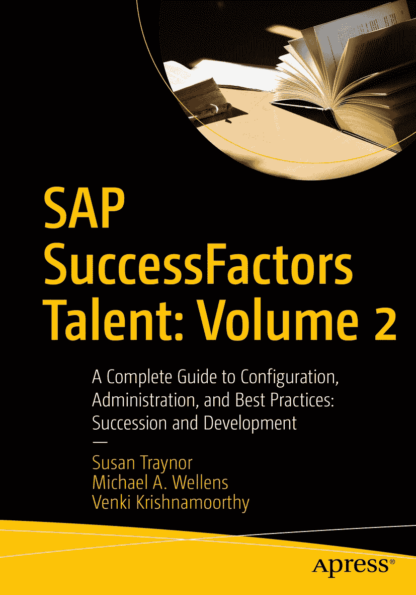

ISBN 978-1-4842-6994-7  
e-ISBN 978-1-4842-6995-4  
[`doi.org/10.1007/978-1-4842-6995-4`](https://doi.org/10.1007/978-1-4842-6995-4)  

© Susan Traynor, Michael A. Wellens 和 Venki Krishnamoorthy 2021  
本作品受版权保护。全部权利均由出版社独家许可，涵盖材料的全部或部分内容，特别是翻译权、重印权、插图复用权、朗诵权、广播权、微缩胶片或其他任何物理形式的复制权，以及电子改编、计算机软件或现有或未来开发的任何类似或不同方法的信息传输或存储检索权。在本出版物中使用通用描述性名称、注册商标、商标、服务标志等，即使未作明确声明，也不意味着这些名称不受相关保护法律法规的约束，因此可自由使用。出版社、作者和编辑可合理假设，本书中的建议和信息在出版之日被认为是真实准确的。出版社、作者或编辑对本书所载材料，或可能存在的任何错误或遗漏，不提供任何明示或暗示的担保。出版社在已出版地图和机构隶属关系中的管辖权主张方面保持中立。

本 Apress 印记由注册公司 APress Media, LLC（Springer Nature 的一部分）出版。

注册公司地址为：1 New York Plaza, New York, NY 10004, U.S.A.

*谨以感激之情献给 Jeffrey S. Kob 和 Randall M. Kob*  
*以及*  
*感谢 Sheila McGovern 给予 Michael 跃入 SAP SuccessFactors 世界的机会。*  
*以及*  
*献给 Venki 的母亲 Thiripurasundari，她是他的导师和挚友。心怀感激地献上此书。*

