# 1. 发展计划

职业发展规划是一个持续的过程，用于帮助个人评估其优势、劣势、技能、兴趣和优先事项，以规划其职业成长并为未来的机会做好准备。职业发展计划用于设定可行的目标，帮助个人确定其发展方向以及实现目标所需的步骤。它是员工用于记录在当前角色中成长和为未来角色做准备所需的短期和长期可行目标的蓝图。该计划可基于员工实现个人及职业成长所需的技能、能力、教育、培训或行为。计划可能包括实现这些目标所需的步骤或活动以及时间框架。设定个人和职业发展目标为员工提供了通往未来成功的路线图。

SAP SuccessFactors 在职业发展规划（CDP）模块中提供了一套工具，员工可用其管理个人和职业发展目标、进行职业规划、查看职业发展路径以及参与导师计划。

在本章中，我们将逐步介绍如何设置职业发展规划。我们首先在 Provisioning 中开启该模块并分配配置权限。然后，我们将演示如何使用在线编辑器创建和修改发展计划模板。我们将了解角色能力如何与发展目标及学习活动结合使用。接着，我们通过示例代码详细说明编辑由该在线编辑器生成的 XML 的细节。我们还将了解发展计划如何与绩效管理、校准、持续绩效管理、继任和职业工作表集成。最后，我们将以最终用户的身份端到端地体验发展计划流程。在本章之后，我们将深入探讨 CDP 的其他功能：职业工作表、职业发展路径和导师制。

## 目标计划 vs. 发展计划

在本章的学习过程中，我们会发现目标计划和发展计划具有相似的模板、权限和功能。在开始之前，我们将回顾这两种计划类型的共性与差异。最佳实践是仅维护一个目标计划模板和一个发展计划模板。

发展计划在许多方面与目标计划类似：

- 结构相似，具有相同的外观和感受

- 计划访问权限基于角色

- 使用计划模板 XML 来标识权限角色可以查看和操作的内容

- 可链接到持续绩效管理（CPM）中的活动和成就

- 可出现在绩效评估表中

- 可配置为从其他目标计划复制目标

发展计划在以下方面与目标计划不同：

- 无法访问目标库。

- 发展目标可链接到能力。

- 发展目标可链接到学习活动。

- 发展目标可链接到职业工作表中的能力。

- 发展计划是持续性的，不受年限限制。

- 不能级联或对齐发展目标。

- 发展计划通常是私密的，仅员工及其经理层级可访问。

## 发展计划的基本配置

在本节中，我们将涵盖从头到尾配置基本发展计划所需的所有步骤。结果将是一个简单的计划，用户可访问该计划来创建和管理发展目标。正如第 1 卷第 4 章中讨论的目标计划，这种类型的计划是在与真实客户进行首次迭代评审时的良好开端。

我们将使用发展计划 V12，这是最新的 UI 版本，并利用了 Fiori 设计标准。并且，要使用当前版本的职业工作表（v12）和职业发展路径（v2），此最新版本是必需的。

### Provisioning 配置前提条件

在配置发展目标计划之前，需要在 Provisioning 中执行一些初步步骤。

### 启用职业发展计划

我们将从编辑配置设置开始，使职业发展计划屏幕和权限在 SAP SuccessFactors 中可用。登录到配置界面，选择相应的公司 ID。然后进入公司设置进行更新。要使用职业发展计划模块及其功能，必须启用一些底层功能。

我们首先确认以下列出设置已启用：

- 版本 12 用户界面框架 (Revolution)

- 启用通用对象

- 启用附件管理器

- 基于角色的权限

- JDM v2.0/技能管理

- SuccessFactors 2.1 能力库

- LMS（可选）

确认后，我们将启用相关功能，使职业发展计划模块可用。在公司设置的“目标框架”部分，找到“职业与发展计划”，如图 1-1 所示。

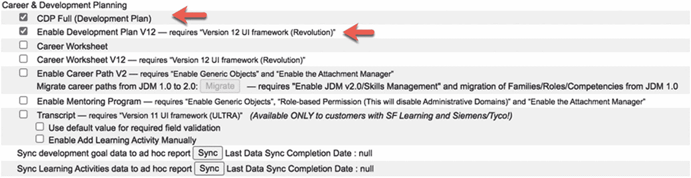

图 1-1

职业与发展计划权限

我们建议启用 `CDP Full (Development Plan)` 以访问职业发展计划的完整版本，其中包括发展计划、职业工作表和职业路径。即使你不使用职业工作表和职业路径，`CDP Full` 也允许进行发展计划自定义，并链接到 SAP SuccessFactors 学习模块。

表 1-1 详细说明了目标框架中可用的职业与发展计划选项。

表 1-1

职业与发展计划设置

| 选项 | 说明 |
| --- | --- |
| `CDP Full (Development Plan)` | 启用具有学习活动集成功能的开发目标 V11。 |
| `Enable Development Plan V12` | 启用开发目标 V12，还必须启用 `CDP Full`。 |
| `Career Worksheet` | 启用职业工作表 V11，还必须启用 `CDP Full`。 |
| `Career Worksheet V12` | 启用职业工作表 V12，还必须启用 `CDP Full`。 |
| `Enable Career Path V2` | 启用职业路径 V2，还必须启用 `Career Worksheet V12`。 |
| `Enable Mentoring Program` | 启用导师计划。 |
| `Transcript` | 仅在与 SAP SuccessFactors 学习模块集成时启用。 |
| `Use default value for required field validation` | 请勿使用。 |
| `Enable Add Learning Activity Manually` | 允许用户手动为开发目标添加学习活动；同时还需启用 `Transcript`。 |

我们将在后续章节中介绍职业工作表、职业路径和导师计划的权限及功能。

### 启用学习活动

SAP SuccessFactors 学习模块 (LMS) 可与 CDP 集成。可以配置发展计划，允许用户向开发目标添加学习活动，并跟踪为达成目标所进行的操作和培训。启用后，用户可以直接从 LMS 学习目录中添加学习活动。用户也可以手动向开发目标添加自定义学习活动。

为了与学习模块集成，目标框架中“职业与发展计划”部分内的以下功能可以启用，如图 1-2 所示。

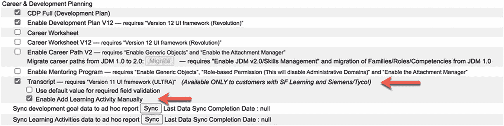

图 1-2

用于 CDP 集成的 LMS 相关权限

要允许向开发目标手动添加学习活动，请启用以下选项：

- `Transcript`

- `Enable Add Learning Activity Manually`

### 启用开发目标复制

在目标框架下还有一个设置，如果你希望允许用户从其他发展计划复制开发目标，可以启用它。这与目标计划中的功能相同。为此，请启用 `TGM/CDP Goal Transfer Wizard`，如图 1-3 所示。由于发展计划可能跨越数年，此功能可能不太实用。

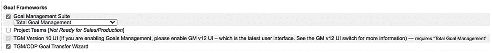

图 1-3

从其他计划复制开发目标的选项

### 启用开发目标的即席报表

为了作为管理员或用户对职业发展数据进行即席报表，请在**公司设置**中启用以下选项：

- 分析与仪表板选项卡及杂项报表 ➤ 其他即席子域架构配置 ➤ 开发目标

- 分析与仪表板选项卡及杂项报表 ➤ 在人员选择器中启用“从用户开始包含” ➤ 开发目标

### 启用学习活动的即席报表

如果你将开发目标链接到学习活动，并希望对学习活动数据进行即席报表，请启用以下选项：

- 分析与仪表板选项卡及杂项报表 ➤ 其他即席子域架构配置 ➤ 学习活动

- 分析与仪表板选项卡及杂项报表 ➤ 在人员选择器中启用“从用户开始包含” ➤ 学习活动

### 配置更新摘要

以下是我们已启用的功能摘要。

发展计划：

- 目标框架 ➤ 职业与发展计划 ➤ `CDP Full (Development Plan)`

- 目标框架 ➤ 职业与发展计划 ➤ `Development Plan V12`

链接到学习活动的开发目标（可选）：

- 目标框架 ➤ 职业与发展计划 ➤ `Transcript`

- 目标框架 ➤ 职业与发展计划 ➤ `Enable Add Learning Activity Manually`

从其他发展计划复制开发目标（可选）：

- 目标框架 ➤ `TGM/CDP Goal Transfer Wizard`

开发目标即席报表（可选）：

- 分析与仪表板选项卡及杂项报表 ➤ 其他即席子域架构配置 ➤ 开发目标

- 分析与仪表板选项卡及杂项报表 ➤ 在人员选择器中启用“从用户开始包含” ➤ 开发目标

学习活动即席报表（可选）：

- 分析与仪表板选项卡及杂项报表 ➤ 其他即席子域架构配置 ➤ 学习活动

- 分析与仪表板选项卡及杂项报表 ➤ 在人员选择器中启用“从用户开始包含” ➤ 学习活动

# 保存新功能后的操作

保存新功能后，退出公司设置，返回配置主屏幕，然后注销。

## 分配配置和管理职业发展计划的权限

现在，我们将进入实例，分配基于角色的权限，使您能够配置和管理职业发展计划模块。发展计划的权限设置方式与目标计划权限类似。有关如何分配权限的问题，请参阅第一卷第 4 章中详细说明编辑权限角色步骤的内容。

要分配管理员角色权限，请前往操作搜索栏，输入并选择 `Manage Permission Roles`。找到您要修改的管理员角色，将其打开，然后单击 `Permission...`。在左侧的“管理员权限”下，单击 `Manage Career Development`；然后勾选 `Development Admin` 旁边的复选框，如图 1-4 所示。


现在，管理员角色可以管理职业发展计划的功能。

表 1-2 描述了可用的 `Manage Career Development` 权限。

### 表 1-2：管理职业发展权限摘要

| 权限 | 描述 |
| --- | --- |
| `Development Admin` | 管理所有发展计划设置。 |
| `Manage Career Path` | 定义和管理职业路径。 |
| `Configure Career Path Node` | 定义职业路径内节点上显示的内容；仅适用于职业路径 V2。 |
| `Manage Suggested Roles` | 配置建议角色设置。 |
| `Manage Mentoring Programs` | 管理辅导计划。 |
| `Admin Career Development Plan Export Data` | 通过数据主体信息导出职业发展计划数据。 |

此外，授予管理员权限，使其能够使用以下路径运行全公司范围的发展报告：
- `用户权限` ➤ `报告权限` ➤ `创建报告` ➤ `发展目标`
- `用户权限` ➤ `报告权限` ➤ `运行报告` ➤ `发展目标`

如果使用学习活动并希望对其进行报告，请同时添加以下访问权限：
- `用户权限` ➤ `报告权限` ➤ `创建报告` ➤ `学习活动`
- `用户权限` ➤ `报告权限` ➤ `运行报告` ➤ `学习活动`

如果计划使用标准发展计划或自定义磁贴/仪表板，则还需要这些权限。可以通过以下路径找到它们：
- `用户权限` ➤ `报告权限` ➤ `分析磁贴和仪表板`

## 发展目标管理的主要配置

现在我们已经激活了职业发展计划模块，并且拥有所需屏幕的权限来进行配置，让我们开始吧！本节将引导您完成配置简单发展计划的基本步骤，并介绍修改主要模板和管理流程的屏幕。

### 发展模板配置

在这里，我们将了解如何创建和发展模板。职业发展计划中的发展计划模板配置，大部分依赖于目标管理中所用的相同模板配置选项。任何差异都会注明。

发展模板通常被称为发展或职业发展计划。与每年创建的目标计划不同，发展计划可能跨越多年。建议在您的实例中使用一个发展计划。在使用职业工作表时，这一点尤其重要，因为它只能链接到单个职业发展计划模板。我们将在下一章详细介绍此功能。

在我们的示例中，我们将使用 `Manage Templates` 在线编辑器屏幕。发展计划模板的某些功能无法在在线编辑器中编辑，必须直接在发展计划模板的基础 XML 中进行编辑，然后通过 Provisioning 上传到系统中。我们将在本章后面介绍此过程。首先，请按照以下步骤操作。

在搜索栏中，输入并选择 `Manage Templates`。屏幕上将出现多个标签页，代表各种模板类型。单击 `Development` 标签页以查看任何发展模板，如图 1-5 所示。


让我们来看看此屏幕上的功能。列标题与“目标计划”标签页中的相同。

- **仅显示有效模板：** 勾选后，无效模板将不会显示在列表中。员工或绩效表单也将无法访问无效计划。
- **添加新模板：** 从 SuccessStore 下载模板，作为构建计划时的起点。
- **默认模板：** 确定哪个计划是默认计划。这是用户访问“发展”时看到的发展计划。
- **排序顺序：** 对于有效计划，显示计划在用户下拉列表中的列出顺序。
- **有效：** 可供使用。如果允许，用户将有权访问该计划。
- **更新于：** 模板上次修改的时间。
- **日期范围：** 计划的时间框架。

现在让我们创建一个模板。发展计划无法从头开始创建。它必须从 SuccessStore 中的模板创建，或从现有发展计划复制。


1.  单击 `Add A New Template`。在弹出的窗口中，从 SuccessStore 选择一个发展计划模板。这将是一个供您编辑的入门模板。选择一个计划，然后单击 `Add to my Instance`，如图 1-6 所示。


2.  系统将提示您命名模板，如图 1-7 所示。为您的模板输入一个名称，例如 `Career Development Plan`，然后单击 `Save`。

命名并保存后，在线编辑器将出现，如图 1-8 所示，显示模板的预览页面。


在开始编辑模板之前，让我们回顾一下其各个部分：
- **预览：** 仅查看。提供计划向用户呈现方式的概览。字段的布局并非表单在屏幕上显示方式的 100% 真实呈现。
- **常规设置：** 用于编辑计划的顶部区域：计划名称、简介和计划日期。
- **编辑类别：** 用于创建、编辑和删除发展目标类别。可以重新排序和重新命名。
- **编辑字段：** 用于创建、编辑和删除发展目标计划字段。

现在，我们来逐步了解修改模板的步骤。请注意，此过程与编辑目标计划完全相同。


1.  点击左侧面板上的“常规设置”。屏幕将更新为如图 1-9 所示的常规设置页面。首先，请确保你在屏幕顶部的“更改语言”下拉菜单中选择了默认语言。如果你正在执行全局部署，可以从下拉菜单中选择一种语言来提供所需的翻译。

    > **注意**
    > 我们建议始终使用在线编辑器每个页面上的默认语言来配置表单。这将自动为你系统中处于活动状态的其他语言填充值（如果你需要编辑可用语言，可以在“公司设置”下的“配置”中激活它们）。如果你仅使用美国英语 (`en_US`) 并填写所有美国英语的默认值，则根本无需更改语言。

2.  根据需要，使用 `名称` 字段更改你的发展计划的标题。
3.  在“给用户的说明”字段中输入你希望提供的任何说明。

    > **注意**
    > 我们发现一些客户喜欢提供指向技术帮助文档和政策文档的链接，以便为创建发展目标提供背景信息。

4.  输入开始和结束日期。

    > **注意**
    > 发展目标与绩效目标不同，通常跨越多年，因此不要使用日历年或财年作为计划的开始和结束日期。

5.  如果需要，请勾选“在发展目标计划上显示连续绩效管理成就”旁边的复选框。这将在发展目标计划中添加一列，显示与该目标相关的任何 CPM 成就。

    > **注意**
    > 我们建议使用此功能，因为它有助于提醒用户他们的成就。你必须已实施连续绩效管理 (CPM) 才能使此功能生效。更多详细信息，请参阅第 1 卷第 13 章。

现在，我们将继续讲解模板的“编辑类别”部分：
1.  点击“编辑类别”。这将展开该部分以显示你下载的模板附带的标准类别。与目标计划模板不同，这里只有一个标准类别。但是，你可以根据需要添加其他类别。
    1.  要添加类别，请点击“添加新类别”，该类别将出现在列表中。
2.  要编辑类别的名称，请点击该类别，并在右侧出现的字段中（在选择语言后）输入类别的新名称。
3.  要删除类别，请点击垃圾桶图标。

    > **注意**
    > 我们不建议在最终用户开始使用表单后删除类别，因为这可能会损坏数据！

接下来，我们将审查模板的“编辑字段”部分。

# 配置发展计划

点击“编辑字段”。该区域将展开，显示你从`SuccessStore`下载的模板中包含的字段，如图 1-10 所示。你可以将鼠标悬停在一个字段上并点击垃圾桶图标来删除它。你可以拖放字段来更改它们出现在发展目标计划中的顺序。

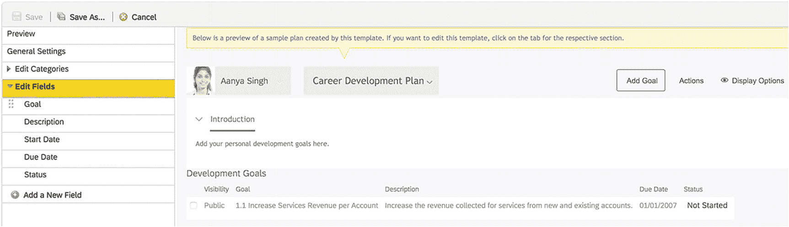

图 1-10 — 编辑字段

点击现有字段进行编辑。编辑字段时，请编辑标签（请务必先选择你需要的语言）并指明该字段是否为必填项。如果你希望此字段显示在“人员资料”模块中，也请勾选相应的复选框。有关此模块的更多信息，请参阅第 1 卷第 2 章；要参考标准字段和选项以及自定义字段和类型的表格，请参阅第 1 卷第 4 章。当你向计划添加新字段时，出现的唯一选项是能力、目的和自定义字段，如图 1-11 所示。

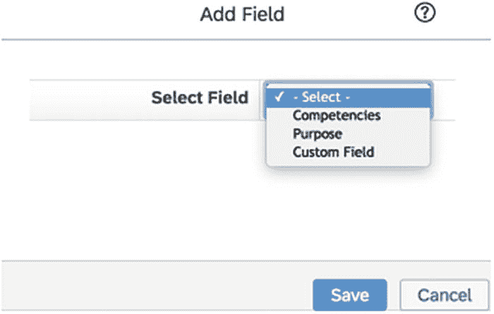

图 1-11 — 向发展计划添加字段

请参考表 1-3，了解可能添加到模板中的、特定于发展目标的其他字段。

表 1-3 — 要添加到计划中的发展字段

| 技术字段名 | 字段类型 | 描述 | 配置选项 |
| --- | --- | --- | --- |
| `competency` | 能力 | 用于将发展目标与你能力库中的一个或多个能力相关联。只能关联在当前登录区域设置中已定义的能力。如果某个能力仅以英语定义，并且用户使用其他语言登录系统，则该能力无法用于关联。 | 标签， 必填字段， 在人员资料模块中显示 |
| `purpose` | 枚举 | 下拉列表，列出“当前角色”、“未来角色”或“通用技能集”等选项。 | 标签， 必填字段， 在人员资料模块中显示 |

要向计划添加其他字段，请点击“添加新字段”。向计划添加字段的示例如图 1-12 所示。

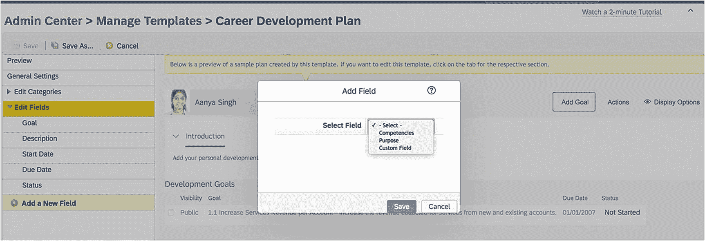

图 1-12 — 向发展目标计划添加字段

在上面的示例中，除了自定义字段外，还可以添加一些标准字段。如果你计划允许用户将发展目标与能力关联起来，则需要一个能力库，并且必须将`competency`字段添加到计划中。能力可以识别和传达关于执行某项工作所期望的行为的信息。能力很重要，因为它们可以用于绩效管理、职业发展、薪酬、继任管理、360 度调查、招聘和劳动力规划。能力被映射到职位角色，并且可以作为员工发展路径的一部分。

这是可选的、添加到发展计划的字段。但是，如果你计划实施职业工作表，则能力库是必需的。我们建议你使用`SuccessFactors` 2.1 能力库，因为它包含相关的导语、调优和行为。可以修改此库，或者你也可以创建自己的能力库进行导入。

你可以添加的另一个标准字段是`purpose`。它使用如图 1-13 所示的列表。

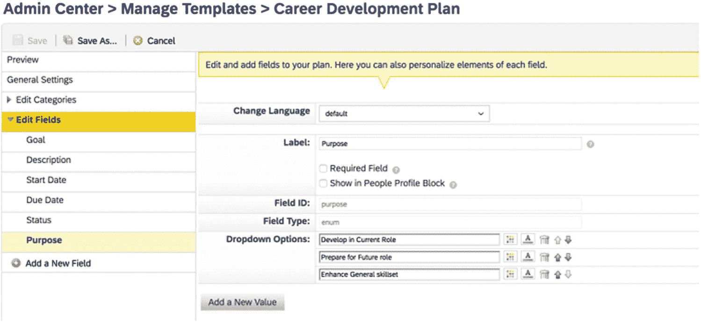

图 1-13 — 带有下拉选项的“目的”字段视图

对于`purpose`，你可以添加或删除下拉选项，更改排序顺序，重命名标签，或更改每个标签的文本和背景颜色。点击“添加新值”可以为该字段创建一个新值。

发展与目标计划类似，也可以使用自定义字段。最好在此处添加自定义字段，而不是直接将其添加到发展计划 XML 中。

命名自定义字段、提供自定义字段 ID 和标签、并指明字段类型后，保存你的更新。

其余标准字段（同样可用于目标计划）在尝试添加新字段时可能不会显示。因此，这些字段需要添加到我们即将介绍的发展计划模板 XML 中。

恭喜！你现在已经配置好了自己的发展计划！该模板可以使用多种可添加、移除和配置的字段来记录发展目标数据，以满足组织的需求。我们还向你展示了哪些字段可用于与胜任力及持续绩效管理进行集成。

## 电子邮件通知

第一卷第四章中讨论的目标电子邮件通知同样适用于发展目标。这些通知可用于目标的创建、删除、修改以及目标评论，如图 1-14 所示。请参考第一卷第四章回顾目标计划通知描述列表及其启用流程。

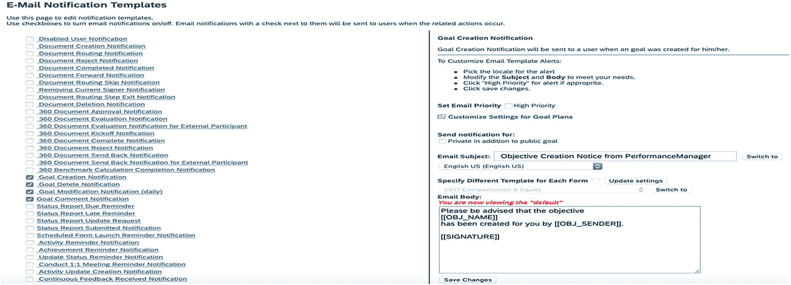

图 1-14 “电子邮件通知模板” 界面

可以控制哪些目标计划发送通知。这意味着你可以开启任意目标计划的通知，但仅针对特定目标计划发送。你可能希望当目标添加到用户的目标计划时发送通知，但发展目标添加到其发展计划时不发送。当某个通知启用后，点击其名称，你会在屏幕右侧看到通知详情。你将看到一个链接`Customize Settings for Goal Plans`，如图 1-15 所示。

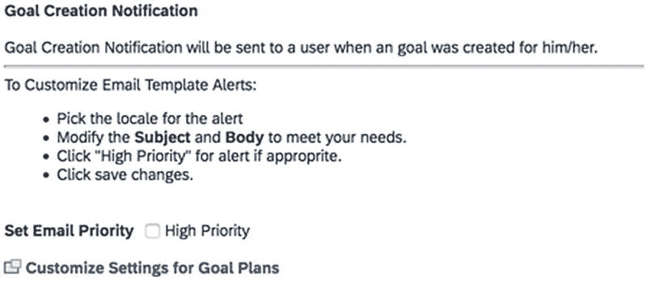

图 1-15 定制目标计划设置

点击该链接可查看该通知可用的所有活跃目标计划和发展计划。取消勾选计划以禁用其通知。任何仍处于勾选状态的计划都将生成一封电子邮件。示例如图 1-16 所示。

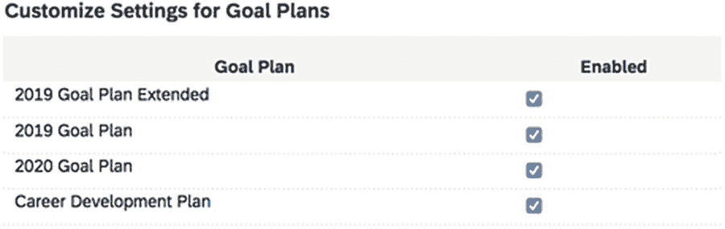

图 1-16 为电子邮件通知选择目标计划

## 启用移动端职业发展规划

发展计划可在移动应用（iOS 和 Android）上访问。与移动端目标计划类似，移动端发展目标计划可以被查看和编辑。也可以添加发展目标。

注意：由于移动应用本身较为简单，我们不会介绍如何使用该应用。你可以前往`Apple App Store`或`Android Market`搜索`SuccessFactors`下载该应用。下载完成后，你可以点击右上角的`Demo`浏览应用。如果你希望将应用与实例上的特定用户关联以使用真实数据，你需要完成屏幕上的注册流程。要查看支持和不支持的功能列表，请参考`SAP`说明 #2475032。

要启用移动端功能，请遵循以下步骤：

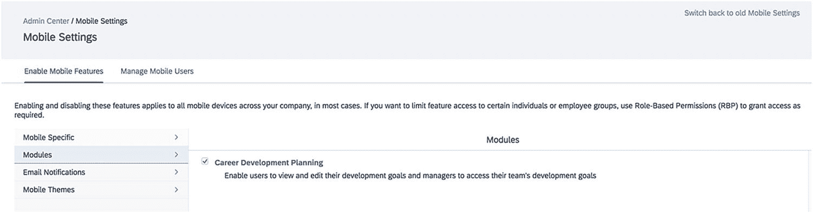

图 1-17 在移动端设置中激活职业发展规划

1. 在搜索栏中输入并选择`Enable Mobile Features`。将显示`移动端设置`界面。

2. 点击左侧的`模块`。然后点击`职业发展规划`旁边的复选框，如图 1-17 所示。更改将立即生效。

现在，我们已经创建了一个发展计划，并了解了如何启用电子邮件通知以及如何为发展目标开启移动端功能。

## 为最终用户分配发展计划权限

在我们通过编辑计划模板 XML 进一步配置发展计划之前，我们可以先在测试实例中向最终用户（例如，仅一个测试用户）分配权限，以便我们能够看到 XML 配置的结果并根据需要进行故障排除。

为最终用户设置基于角色的权限，其步骤与为管理员角色设置相同。最终用户权限与目标计划权限类似。你可以参考第一卷第四章回顾关于最终用户角色和目标角色的讨论。

有两种权限类型控制对职业发展计划的访问：

1. 访问`发展`模块中的`发展计划`标签页

2. 访问针对特定目标人群的发展计划模板

我们现在将修改员工、经理和人力资源经理角色的基于角色的权限。我们将为`职业发展`设置权限，以确定每个角色可以访问哪些用户的计划。这些角色需要针对特定发展计划拥有`职业发展计划（CDP）访问权限`和`目标计划权限`。这样每个角色才能访问`职业发展`标签页并获得访问特定发展计划的权限。这些权限角色之间的区别在于这些角色上定义的授权人群和目标人群，这将决定他们可以看到谁的计划。我们还将为经理和人力资源经理角色指出额外的权限。

### 访问发展标签页

在`管理权限角色`中，打开你想要编辑的角色。在设置的`用户权限`部分，点击弹出窗口左侧的`职业发展规划`，然后点击`职业发展计划（CDP）访问权限`旁边的复选框。这将授予该角色访问`发展`标签页的权限。该权限如图 1-18 所示。

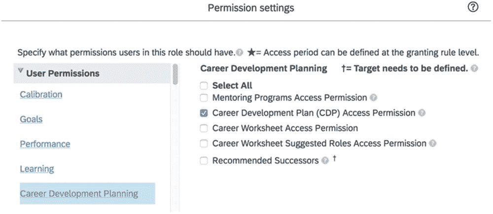

图 1-18 访问发展标签页

### 访问发展计划

接下来，授予权限以便角色可以访问特定的发展计划。同样在`用户权限`下，点击左侧的`目标`。在这里，你需要授予对`目标计划权限`下的`职业发展计划`的访问权限，如图 1-19 所示。

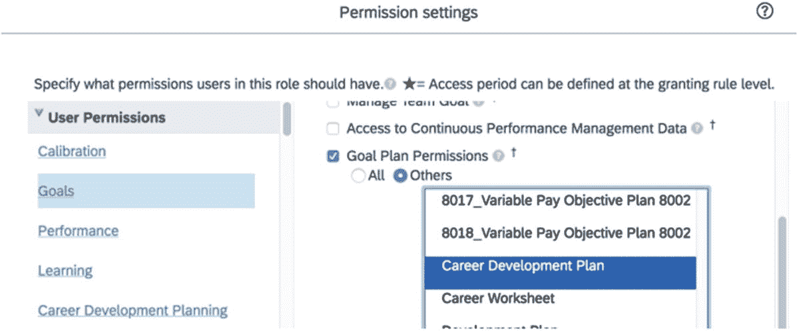

图 1-19 职业发展计划访问权限

如果用户拥有学习访问权限，则可以在发展目标中添加学习活动。这需要额外的一项目标计划权限以允许用户访问并查看和添加学习活动到发展目标中。该角色将需要访问`学习活动列表/详细信息视图`模板，如图 1-20 所示。

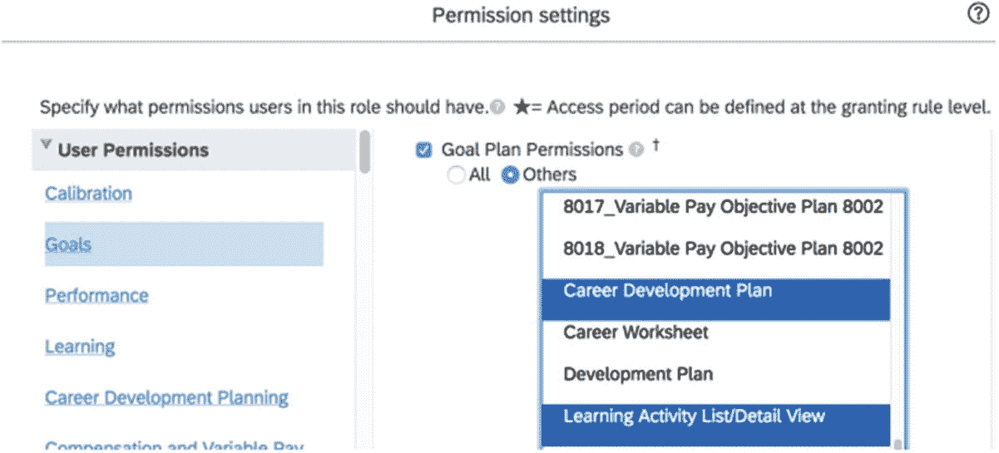

图 1-20 学习活动列表/详细信息视图权限

如果该角色已经拥有 CPM 权限，并且你希望在发展计划上显示 CPM 成就，请在`目标`下添加`访问持续绩效管理数据`。发展计划、`学习活动列表/详细信息视图`模板以及 CPM 数据访问的权限如图 1-21 所示。

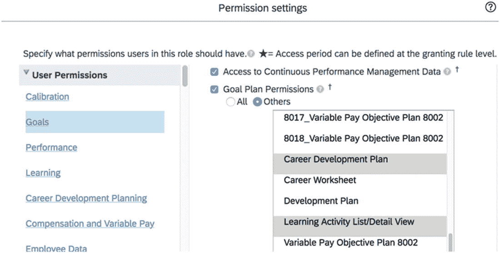

图 1-21 发展计划和 CPM 访问权限

## 基于角色的学习权限

如果用户能够将学习活动添加到其发展计划中，他们将需要访问`Learning Activity List/Detail View`模板 XML 中定义的学习活动内容。我们尚未讨论此模板，但需要为与职业发展权限相同的角色（员工、经理和 HR 经理角色）更新基于角色的权限。只有当用户在`Learning Activity List/Detail View`模板 XML 中定义了学习访问权限时，他们才能添加或查看与某个发展目标关联的学习活动。

## 经理和 HR 经理报告的角色权限

为了允许经理和 HR 经理运行关于发展计划及相关学习活动数据的报告，权限角色需要增加以下内容：

-   `用户权限 ➤ 报告权限 ➤ 创建报告 ➤ 发展目标`
-   `用户权限 ➤ 报告权限 ➤ 运行报告 ➤ 发展目标`

如果使用学习活动并希望针对其生成报告，请添加以下内容：

-   `用户权限 ➤ 报告权限 ➤ 创建报告 ➤ 学习活动`
-   `用户权限 ➤ 报告权限 ➤ 运行报告 ➤ 学习活动`

如果计划使用标准发展计划或自定义磁贴/仪表板，则这些权限也是必需的。它们可以通过以下路径找到：

-   `用户权限 ➤ 报告权限 ➤ 分析磁贴和仪表板`

## 查看他人计划的角色权限

需要将允许访问任何人计划的基于角色的权限，添加到用于员工搜索的权限角色中，该角色允许`组织架构导航权限`、`公司信息访问权限`和`用户搜索`，如图 1-22 所示。我们将在本章下一节讨论在发展规划模板 XML 中定义的相应权限。

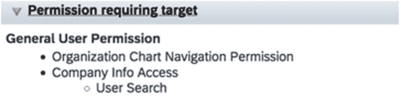

图 1-22 允许用户搜索的权限

此权限授予“所有人”，目标人群为“所有人”，如图 1-23 所示。

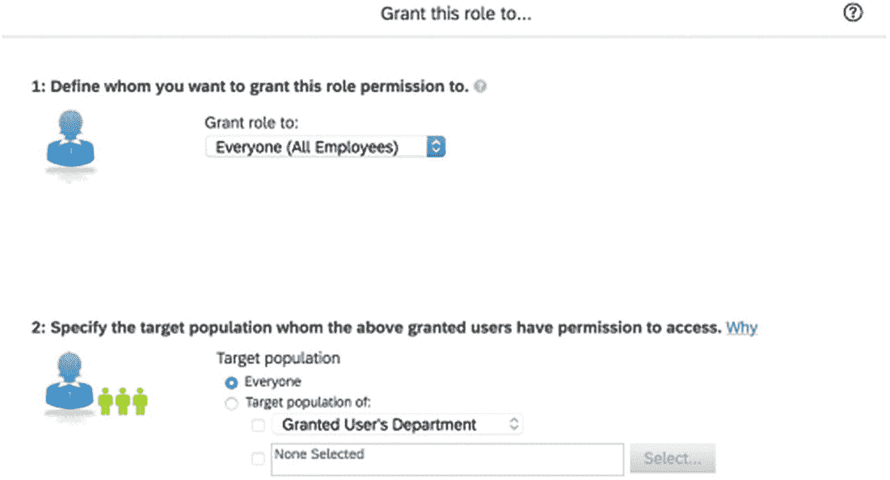

图 1-23 姓名搜索的目标人群

如果您添加对“发展”选项卡（`职业发展计划 (CDP) 访问权限`）和发展计划（`目标计划权限 ➤ 职业发展计划`）的访问权限，这将允许任何用户查看任何人的发展目标计划及其内容。

这些是员工、经理和 HR 经理角色所需的权限。区别在于目标人群。员工通常被授予“自己”的访问权限，这意味着他们只能查看和编辑自己的发展目标计划。经理通常可以访问其直接下属，您还可以选择经理希望向下访问多少个层级。HR 经理角色则可以访问他们的 HR 报告。

需要重申的是，发展目标计划权限必须指定一个目标人群。这意味着，您需要识别该角色有权访问的计划（目标计划权限），然后识别他们可以查看谁的计划（目标人群）。

表 1-4 标识了哪些用户被授予了查看目标人群的权限。

表 1-4 角色与目标人群

| 角色 | 授予权限的权限组或用户 | 目标人群 |
| --- | --- | --- |
| 员工 | 员工 | 被授予用户（自己） |
| 经理 | 经理 | 被授予用户的直接下属；指定级别并排除自己 |
| HR 经理 | HR 经理 | 被授予用户的 HR 报告；指定级别并排除自己 |

## 需要 XML 配置的基本发展计划功能

我们现在已经构建了一个基本的发展计划，并授予了员工、经理和 HR 经理权限角色的访问权限。现在我们可以查看发展规划模板 XML 配置。

正如我们刚才所看到的，基于角色的权限定义了用户可以访问哪种类型的计划以及可以查看哪些用户的计划。正如我们接下来将要看到的，对发展计划内容和操作的访问受到发展规划模板 XML 中定义的权限的限制。

模板权限标识了哪些角色可以执行某些任务，例如创建发展目标、删除发展目标和编辑发展目标。字段权限标识了一个角色可以查看或编辑哪些发展目标计划字段。对发展计划内容和操作的访问受到发展规划模板 XML 中定义的权限的限制。

## 下载、编辑和上传 XML

当您使用本章前面部分所示的在线工具创建发展计划模板时，会自动生成一个 XML。有些修改无法在在线工具中完成，因此我们需要编辑 XML。您可以导出职业发展计划模板 XML，以更新那些无法通过 UI 中的`管理模板`进行的字段，特别是与属性和权限相关的字段。您还可以添加实例中基本模板不可用的标准字段。这还需要为这些字段授予“读取”和“写入”权限，并将这些字段添加到计划布局中，以便它们能显示在计划上。

在我们进行编辑之前，我们需要从 Provisioning 下载发展计划模板 XML。计划模板位于`管理计划模板`下，如图 1-24 所示。在这里，您可以找到指向各种模板的链接。我们将处理发展计划模板。

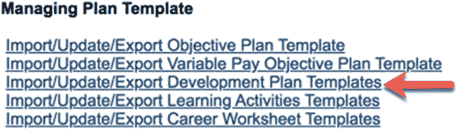

图 1-24 Provisioning 中的计划模板

点击链接“导入/更新/导出发展计划模板”。在 图 1-25 中，您将看到一个可以下载和上传发展计划模板 XML 的界面。

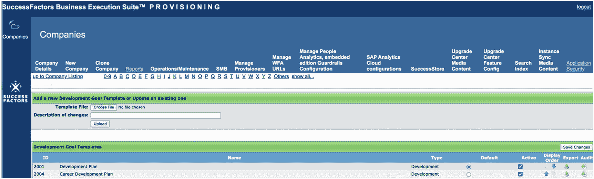

图 1-25 发展计划模板界面

在这里，您会看到您实例中的职业发展计划模板。找到您在实例中创建的发展计划模板。如下图所示，点击导出列下方的图标。您的网页浏览器会将文件下载到您的本地机器上。我们将进行任何必要的编辑，然后上传修改后的 XML。

现在让我们查看一下 XML，以更好地理解其内容和运作方式。发展目标计划与目标计划类似，但存在以下差异：

-   发展计划是持续进行的，不限于一年周期。
-   发展目标模板 ID 必须介于 2001 到 2999 之间。
-   `obj-plan-type` 应为“Development”。
-   发展目标可以与能力关联。
-   学习活动可以与发展目标关联，使用学习目录或自定义活动。
-   您不能将目标库包含在发展计划中。
-   您不能级联和对齐发展目标。

## 发展计划模板 XML

发展计划模板使用了与目标计划模板相同的大部分模板配置选项。在本节中，我们简要介绍与目标计划 XML 中相同的部分。请参考第 1 卷第 4 章，了解标准字段和选项以及自定义字段类型和配置选项。特别适用于发展计划的配置选项将详细说明。

### 模板属性更新

`<obj-plan-template>`标签是 XML 结构中最高级别的标签。它定义了一系列可以开启、关闭或调整的选项，用于启用/禁用功能或进行调整。这些选项与目标计划 XML 中的选项相同。

以下是一个示例代码片段：

```
请参考第 4 卷第 4 章 4 中的表 4-4，其中详细说明了`<obj-plan-template>`属性。
```

有两个值得注意的属性涉及隐私：

1. `new-obj-share-status-public`：当为`true`时，所有目标默认为公开。
2. `use-text-for-privacy`：当为`true`时，在计划图标的“可见性”列中显示文本（private, public）；当为`false`时，使用图标（眼镜）来指示目标是否为私密。目标计划和发展计划中的“可见性”列可能包含图标或文本。

表 1-5 包含部分发展计划模板 XML，其中某些功能已标注并附有简要说明。我们稍后将深入探讨。

表 1-5 对象元素说明

| 元素 | 说明 | 代码 |
| --- | --- | --- |

# 发展目标计划元素与配置

这些元素的示例代码片段如下所示：

```
Development
Career Development Plan

5/29/20 6:54 PM
01/01/2020
12/31/2023
```

## 开关

`switches`元素用于开启或关闭发展目标计划的功能。默认值为`off`，这意味着如果您不想使用默认值，则只需将开关插入模板。特定于发展计划模板的开关如表 1-6 所示。

**表 1-6 发展计划开关**

| 开关 | 说明 |
| --- | --- |
| `show-competency-browser` | 在发展目标上添加能力项。 |
| `continuouspm-integration` | 在计划上显示与发展目标相关的 CPM 成就。 |
| `development-scorecard-show-all-goals` | 在计分卡中包含发展目标。 |

开关在 XML 中应添加在“`<obj-plan-due>`”或“`<obj-plan-numbering>`”（如果使用）之后。

开关的示例代码片段如下所示：

我们来更详细地查看每个开关，了解其控制内容。

此开关仅当您的开发计划包含能力项时适用。此开关允许用户将能力项添加到发展目标中，如图 1-26 所示。虽然可以从指定的能力库中为发展目标添加能力项，但此开关会在能力浏览器中启用一个“添加能力项”链接，该浏览器包含所有能力项。

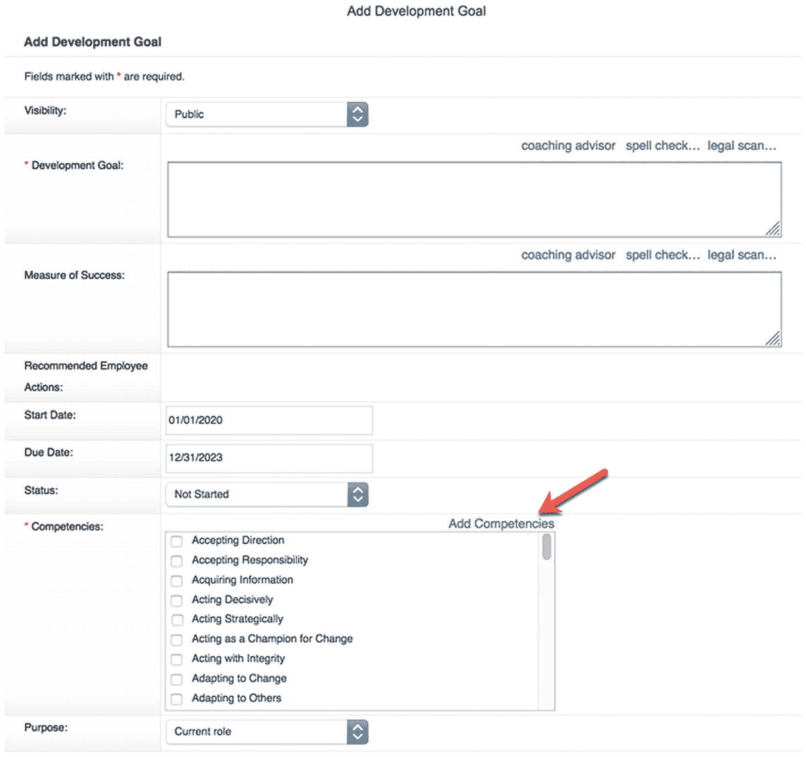
图 1-26 允许为发展目标额外添加能力项的开关

此开关允许“持续绩效管理（CPM）”列显示在发展目标计划中，该列指示与某个发展目标关联的成就数量。这与目标计划上的功能相同。除了在 XML 中添加此选项外，您还可以在实例中的发展计划模板中勾选“在发展目标计划上显示持续绩效管理成就”复选框。

无论采用哪种方法，都会在发展计划上启用成就显示。在 XML 中设置开关，将在模板中勾选复选框。同样，在模板中勾选复选框，也将在 XML 中创建开关。无论哪种情况，在设置此开关之前，请确保您的实例正在使用 CPM 数据。

此开关用于在人员档案中包含发展计划门户部件。设置此开关后，将在人员档案的发展计划门户部件中显示用户的所有发展目标。开启此开关后，员工将无法在门户部件中隐藏其发展计划中的任何目标。同时，员工也将无法直接从其发展计划中手动向门户部件添加发展目标。此开关仅在以下条件下生效：在继任数据模型中配置了发展计划门户部件，在人员档案中配置了该门户部件，并且设置了基于角色的权限来查看该门户部件。我们将在本章后面更详细地介绍这一点。

## 将能力项链接到发展目标：能力过滤器

要在发展目标计划中使用能力项，需要对 XML 进行一些补充：

- 在计划上创建一个能力字段（如果在实例中创建模板时未添加该字段）。
- 确定哪些能力项可以使用。
- 可选地允许能力浏览器从任何可用的能力库中添加额外能力项。

要允许用户将能力项链接到发展目标，必须在发展计划 XML 中添加一个能力字段。在创建发展目标计划模板时，我们已看到该字段可以在模板中添加。但是，我们仍然需要在 XML 中添加权限。使用该字段时，还需要在 XML 中指定一个能力库。这定义了用户可以从哪个能力库中选择能力项来添加到发展目标中。

使用`<competency-filters>`标签来定义发展计划可引用的能力项来源（类型）。有效的类型包括角色、表单、类别和库。该标签与“排除”和“包含”值一起使用。“排除”类型用于指定要排除的能力类型。“包含”类型则通过匹配来指定类型（表单、角色、类别、库）。这用于确定可以使用哪个特定的角色、表单、类别或库。

在以下示例代码段中，只有来自特定库的特定类别中的能力项才能被添加到发展目标中。用户只能选择这些能力项添加到他们的发展目标中：

```
default-category id="Goals">
Development Goals
Development Goals
```

`<competency-filters>`标签位于`<default-category>`之后，`<field-definition>`之前。

为了允许用户向发展目标添加学习活动，需要引用学习活动模板。模板 ID 应为`4201`，代码片段如下所示：

```
This should follow text replacements and appear before the default
category ID as seen in the code segment sample that follows:
```

### 发展计划字段

`field-definition`元素定义了发展计划模板中的字段。目标计划中可用的标准字段（除能力字段外）同样适用于发展目标计划。表 1-7 显示了发展计划中可能使用的字段。

**表 1-7** 标准发展目标计划字段

| 字段 | 描述 |
| --- | --- |
| `Name` | 发展目标名称。 |
| `Description` | 发展目标的描述。 |
| `Metric` | 衡量发展目标的方式。 |
| `Start` | 目标的开始日期。默认值为`<obj-date-start>`。 |
| `Due` | 目标的完成日期。默认值为`<obj-date-due>`。 |
| `State` | 目标的状态。 |
| `Done` | 完成百分比。 |
| `Weight` | 通常是一个百分比；如果发展计划用于绩效管理表单，该值会自动填充。 |
| `Category` | 可标识发展目标的类型。 |
| `Tasks` | 与发展目标相关的操作表：一个目标可以有多个操作。 |
| `Milestones` | 实现发展目标的里程碑表：一个目标可以有多个里程碑。 |
| `Competency` | 将发展目标与能力关联；一个目标可以关联多个能力。 |

请注意，当我们从`SuccessStore`下载模板时，其中几个字段并未出现在计划中。要使用这些字段（`Metric`、`Tasks`、`Milestones`、`Weight`、`Done`），需要将它们添加到 XML 中。

`State`字段通常用作发展目标的状态字段。它被定义为一个以颜色显示的文本值，通常呈现为下拉列表，每个值都关联了背景色和字体颜色。列表中的最后一个值表示发展目标的完成。当目标完成后，不能再向该目标添加学习活动。

以下代码片段展示了如何创建状态定义：

```
Status
Status
Status
Status

Not Started
Not Started

On Track
On Track

At Risk
At Risk

Behind
Behind

Completed
Completed
```

在添加或编辑目标时，`Status`字段将显示为下拉列表，如图 1-27 所示。


**图 1-27** 状态字段选项

# 能力

如前文所述，可以将发展目标与员工正在努力发展的一个或多个能力关联起来。为此，需要在实例中或在此处的 XML 中的发展计划模板内添加一个字段类型为 `competencies` 的字段定义。此外，还需要指定在向发展计划中的发展目标添加能力时要引用的能力库。

一个计划中只能添加一个能力字段，但一个发展目标可以关联多个能力。

示例代码如下：
```
Competencies
Competencies
Competencies
Competencies
```

向发展目标添加能力时，默认显示为带复选框的列表，如图 1-28 所示。该列表允许选择多个能力。

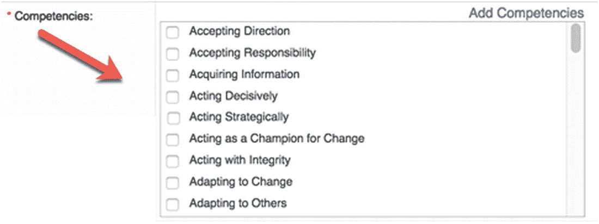

**图 1-28** 向发展目标添加能力

也可以只允许向一个发展目标添加一个能力。

在 `field-definition` 块中添加 `<field-format>` 标签：
```
use-competencies-single
```

整合此标签的能力字段代码片段如下所示：

# 能力

`Competencies`

`use-competencies-single`

这将使“能力”字段变为一个下拉列表，仅允许选择一个值，如图 1-29 所示。

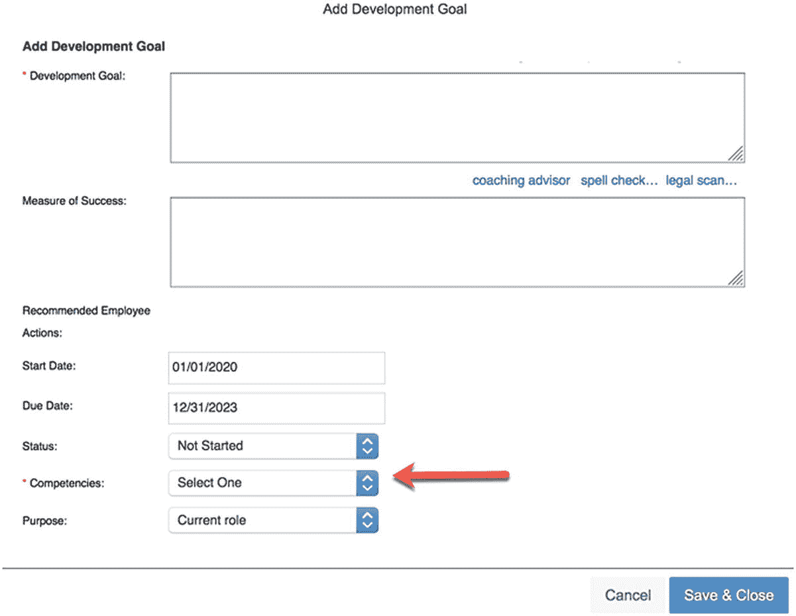

*图 1-29 — 为发展目标添加单项能力*

在此字段中也可以使用行为，而非能力。然而，要实现此功能，您的能力必须包含行为。如果您使用的是 SuccessFactors 2.1 能力库，则其中已包含行为。您也可以通过“管理职位档案内容”向能力中添加行为。若要使用行为，请按如下方式设置 `field-format` 标签：

```
use-behaviors
```

使用此标签时，系统仅向用户显示包含行为的能力。用户在创建发展目标时，可以在能力下选择具体的行为。随后，能力字段将列出所选的行为。请注意，单项选择选项不适用于行为。

包含这些标签的字段定义如下代码片段所示：

```
Competencies
Competencies
Competencies
use-competencies-single
Competencies
```

如果在 Provisioning 中启用了写作助手，并且能力库包含与能力相关的简介提示，则您可以对任何文本区字段使用辅导顾问。辅导顾问的内容基于能力简介提示，由 `"field-show-coaching-advisor" = "true"` 定义。

以下是一个代码片段示例：

```
Measure of Success
Measure of Success
Measure of Success
Measure of Success
```

以下是通过在线编辑器中的“管理模板”添加的自定义字段示例：

```
Recommended Employee Actions
Recommended Employee Actions
Recommended Employee Actions
Recommended Employee Actions
```

需要说明的是，与目标计划类似，无法在表格字段中添加自定义字段。至此，我们已经了解了发展目标计划中可用的字段。接下来，我们将讨论内容权限。

# 内容权限

内容权限控制发展目标计划中各字段的可见性以及用户允许执行的操作。操作权限控制用户可在发展计划上执行的操作。“查看”和“写入”权限控制指定角色在创建或编辑发展目标时可以查看和写入哪些字段。发展计划同时支持公开目标和私有目标，因此您可以根据组织的需求，为这两种类型的目标配置不同的角色权限。

## 操作权限

如表 1-8 所示，描述了用户可在发展计划上执行的操作。

**表 1-8 — 发展模板 XML 中的操作**

| 操作 | 描述 |
| --- | --- |
| `Private-access` | 访问私有目标的权限。 |
| `Create` | 创建发展目标的权限。 |
| `Delete` | 删除发展目标的权限。 |
| `Move` | 在发展计划中上下移动发展目标的权限。 |
| `Share` | 将私有目标设为公开的权限。 |

典型的操作权限如下：
- 员工和经理可以创建、删除和移动发展目标。
- 将目标设为私有。
- 经理的经理和 HR 经理层级可以进入员工的发展目标计划进行查看。

由于不支持发展目标的级联和对齐，您可以从模板中移除所有级联和取消对齐的操作，包括 `cascade-push`、`cascade-pull`、`cascade-align`、`unalign-parent` 和 `unalign-child`。接下来，您需要确定哪些角色可以执行这些操作，并相应更新模板。实例中基于角色的权限定义了哪些角色可以访问发展计划，但如果没有发展计划 XML 中的权限，计划数据将不可见。

在创建或编辑目标时，用户可以将其设为私有。`private-access` 权限标识了哪些角色可以在目标计划上看到私有目标。使用 `private-access` 操作来标识可以查看私有目标的角色，如下面的代码片段示例所示：

此操作权限将允许用户将目标标记为私有，从而限制只有被授权的角色才能在计划中看到这些目标。在此示例中，只有员工、其经理层级和 HR 经理才能看到员工计划中的私有目标。发展计划通常被视为员工与其经理之间的私密内容，因此所有目标都可能是私有的。因此，您可能需要完全移除计划中的“可见性”列。

移除该列需要四个步骤：
1. 从模板中移除“共享”权限。
2. 移除 `private-access` 权限。
3. 将属性 `new-obj-share-status-public` 更改为 `"false"`，或从模板中移除该属性。
4. 将属性 `use-text-for-privacy` 更改为 `"false"`。

图 1-30 显示了没有“可见性”列的计划。

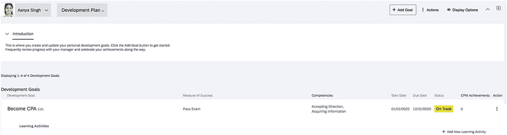
*图 1-30 — 不包含“可见性”列的计划*

至此，我们已确定哪些角色可以执行哪些操作。接下来，我们将探讨发展目标字段的权限。

## 查看/写入字段权限

“查看/写入”权限控制在创建或编辑发展目标时，角色可以查看和写入哪些字段。

每个目标计划字段都需要分配权限。权限包括：
- **无：** 角色对该字段没有访问权限。
- **读取：** 角色可以读取该字段。
- **写入：** 角色可以读取和写入该字段。

在发展计划模板 XML 中，使用 `"Read"` 和 `"Write"` 字段权限类型来标识哪些角色可以访问哪些发展计划内容。`"Read"` 和 `"Write"` 字段权限定义了角色在创建或更新目标时是否可以查看或写入。字段权限按 XML 源码顺序进行扫描。识别发展计划中使用的字段，并确定哪些角色可以读取或写入这些字段。

以下代码片段示例展示了员工及其经理能够写入发展目标计划中的某些字段：

如果您的发展目标计划允许用户添加学习活动（我们将在本章后面讨论），则也可以向 XML 添加条件式权限。由 `“<condition>”` 标签标识，必须满足某个条件，角色才能看到计划上的某个字段。

在下面的代码片段中，只有当目标状态为“已完成”时，经理才能读取发展目标的用途：

目标计划通常可供其他人查看，但用户的发展计划极不可能供组织内的任何人查看。

然而，根据组织的透明度，您可能决定允许用户查看任何人的发展计划。发展计划模板 XML 需要授予所有角色 (`"*"`) 读取发展目标计划中字段的权限，如下面的示例代码片段所示。

# 用户搜索角色的权限更新

此权限需要对本章前面讨论过、基于角色的用户搜索权限进行一些更新。与目标计划类似，发展计划的布局需要在模板的`plan-layout`部分中进行定义。这将决定发展计划中发展目标字段的排序。

如果你打算在绩效表单上展示发展目标，请使用 XML 中的`form-layout`部分来指明哪些发展目标字段会出现在绩效表单的发展计划部分。有关如何配置这些部分的更多信息，请参考第 1 卷，第 4 章。

修改完发展计划模板 XML 后，请在 Provisioning 中保存并导入。

# 学习活动 XML

学习活动存储在发展目标的上下文中。该模板可以支持来自 LMS 的目录学习和手动学习。

为了与发展计划一起使用，需要修改学习活动模板 XML。在 Provisioning 中，找到如图 1-31 所示的“管理计划模板”。

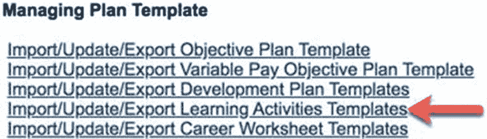
**图 1-31** 链接到学习活动模板

点击该链接查看“学习活动列表/详细视图”模板，如图 1-32 所示。

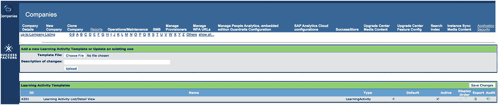
**图 1-32** 学习活动模板屏幕

导出模板以便进行修改。打开 XML，我们就可以开始了。

你可以使用以下参数创建一个指向 LMS 目录中学习活动的深层链接：

```
learning-activity-deep-link=true
```

以下代码段示例展示了此参数的放置位置：

模板 ID 应为“4201”，并带有`obj-plan-type` “LearningActivity”。你一次只能激活一个学习活动模板。示例如下所示：

```
LearningActivity
Learning Activity List/Detail View

5/23/19 5:39 PM
```

为了使发展目标能够拥有学习活动，需要在发展计划模板 XML 中引用学习模板 ID，正如本章前面所讨论的那样。

可以向学习活动模板 XML 添加一个开关，以控制手动添加学习记录时的弹出界面：

```
Fancy Pod
```

“on” 启用了名称、状态和描述字段的炫酷布局，如图 1-33 所示。

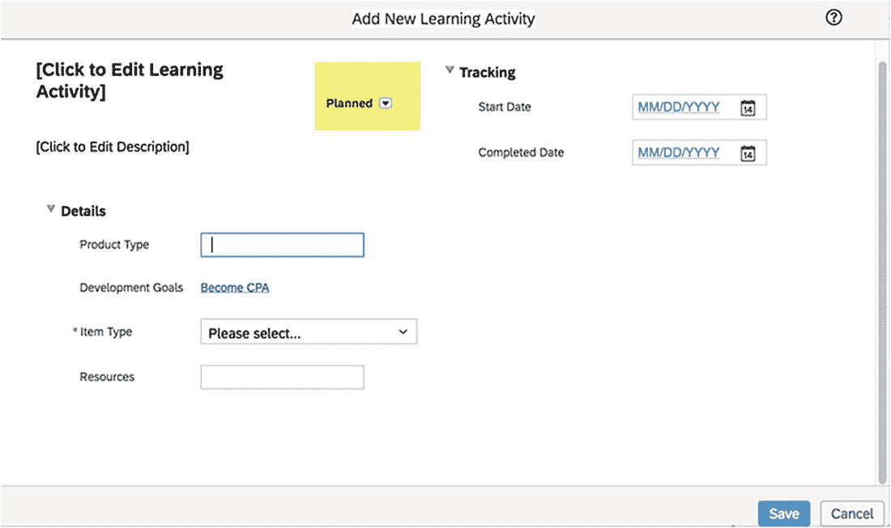
**图 1-33** 使用炫酷 Pod 添加学习活动的视图

包含此开关会禁用“炫酷”Pod 布局。取而代之的是，将显示名称、状态和描述字段的标准布局。图 1-34 展示了当炫酷 Pod 被禁用时，“添加新学习活动”弹出窗口的外观。

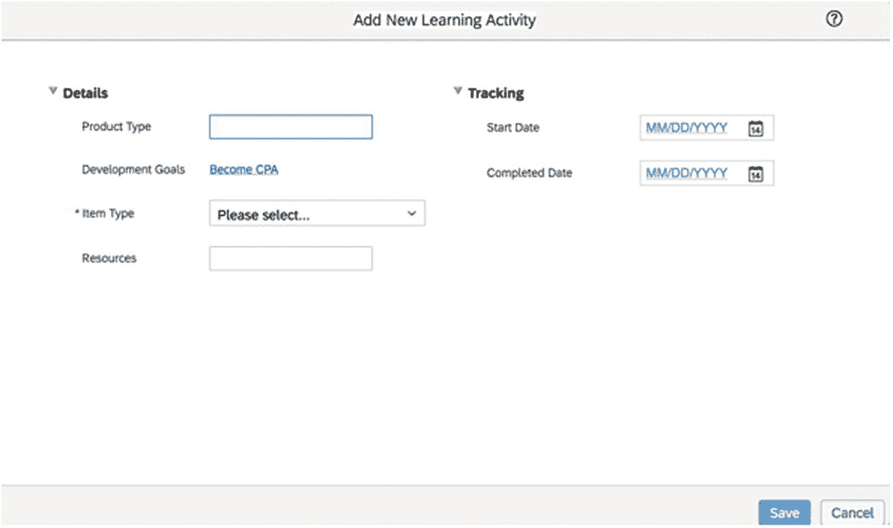
**图 1-34** 使用标准布局添加新学习活动

`Private-access`、`cascade-pull`、`cascade-push` 和 `cascade-align` 操作未被使用，可以从“学习活动列表/视图详情”模板 XML 中移除。

对于目录学习，需要以下字段：

*   `assigned`: 学习活动的所有者
*   `completed_date`: 学习活动完成日期
*   `name`: 学习活动名称
*   `description`: 学习活动描述
*   `status`: 学习活动的状态
*   `guid`: 学习活动的唯一 ID
*   `type`: 产品类型，保留字段，只能为文本
*   `dev-goals`: 与目标关联的学习活动；必须具有“写入”权限

默认状态为：

*   已计划

# 发展目标状态值

-   `Locked`（已锁定）
-   `Deleted`（已删除）
-   `Failed`（未达成）
-   `Completed`（已完成）

当发展目标完成时，所有关联的学习活动将被设置为“Completed”（已完成）或“Locked”（已锁定）。条件权限也可能被添加到 XML 中。通过标签 `<condition>` 进行标识，必须满足某个条件，才能允许某个角色查看计划中的字段。

角色可以根据条件读取字段，如下面的代码片段所示：

以下是自定义学习类型的代码片段示例：

```
Item Type
Item TypeItem Type
Item Type

External Course
External Course

Project
Project

On-the-Job Training (OJT)
On-the-Job-Training (OJT)

Job Rotation
Job Rotation

E-Learning/Webinars
E-Learning/Webinars

Conference / Seminar
Conference/Seminar

Assignment
Assignment

Self-Learning
Self-Learning

Others
Others
```

`plan-layout` 定义了学习活动字段在发展目标中的显示方式。`form-layout`、`pdf-layout` 和 `details-layouts` 部分不被使用。以下是计划布局的一个示例：

在创建学习活动时应显示的所有字段都需要授予“读取”和“写入”权限。字段的定义和权限授予方式与目标和发展计划模板类似。能够读取发展计划中发展目标字段的角色，应对学习活动字段拥有相同的“读取”权限。否则，用户在查看发展计划时，将看不到学习活动的任何字段。您可以决定，经理可以向下属的发展计划添加发展目标，但只能读取学习活动字段。这意味着发展计划 XML 应为经理设置“写入”权限，而学习活动 XML 应设置“读取”权限。您需要仔细规划每个角色应能执行的操作以及应看到的内容，因为您必须正确配置模板 XML 中的权限和基于角色的权限。

## 在员工个人资料中显示发展目标门户的配置

本章前面提到过发展模板 XML 中的一个开关，它允许发展目标以门户组件的形式显示在员工个人资料中。还需要在继任数据模型中进行额外配置，以添加“发展目标门户”背景元素。

登录 Provisioning 并转到“公司设置”。找到“继任管理”部分，单击“导入/导出数据模型”链接，如图 1-35 所示。

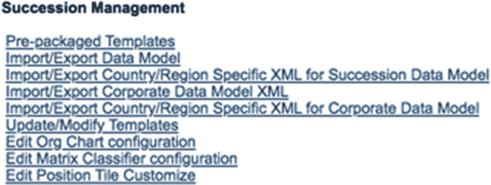

**图 1-35** 继任管理访问入口

在“导入/导出数据模型”屏幕上（如图 1-36 所示），下载数据模型以进行修改。

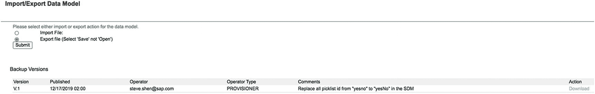

**图 1-36** 导入/导出数据模型

添加背景元素 `sysScoreCardDevelopmentObjectivesPortlet`，如下代码片段所示：

```
Development Goals Portlet
Development Goals Portlet

Development Goal
Development Goal
```

同时，将背景元素门户组件添加到 `view-template for employeeScoreCard` 中，如下代码片段所示：

```
View Template for Employee Scorecard
This view Template for Employee Scorecard should have only 1 edit template

Edit Template for Employee Scorecard
Edit Template for Employee Scorecard
```

完成更新后，保存并导入继任数据模型。

> **注意：** 背景元素的名称是“发展目标门户”（Development Objective Portlet），但在我们的示例中，我们在标签中使用了“Goal”来代替“Objective”。我们将使用其标准名称来引用背景元素门户组件，但在我们的实例中它将显示为“Development Goals Portlet”（发展目标门户）。

## 在员工个人资料中配置发展门户

返回实例中，需要在员工个人资料中配置此门户组件。转到“配置员工个人资料”以添加发展目标门户。

找到该区块并将其拖到您希望其显示的章节，如图 1-37 所示。

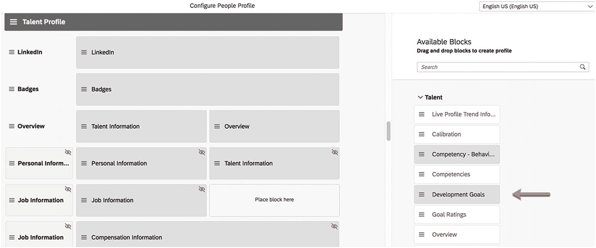

**图 1-37** 在员工个人资料中添加发展计划区块

为子章节添加标签，并添加区块标题和描述，如图 1-38 所示。也可以创建本地化标签。

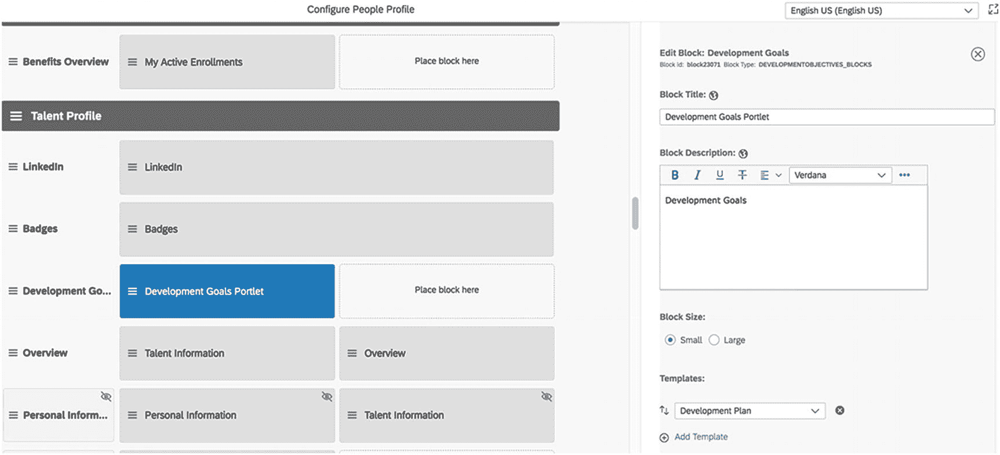

**图 1-38** 标识发展计划模板

添加区块后保存个人资料。需要授予基于角色的权限才能在员工个人资料中访问这些数据。在搜索栏中输入并选择“管理权限角色”。

对于每个应有权访问门户组件的角色，点击“权限”按钮，找到“用户权限”部分，并选择“员工数据”。在“背景”部分中授予对“发展目标门户”的“查看”访问权限，如图 1-39 所示。

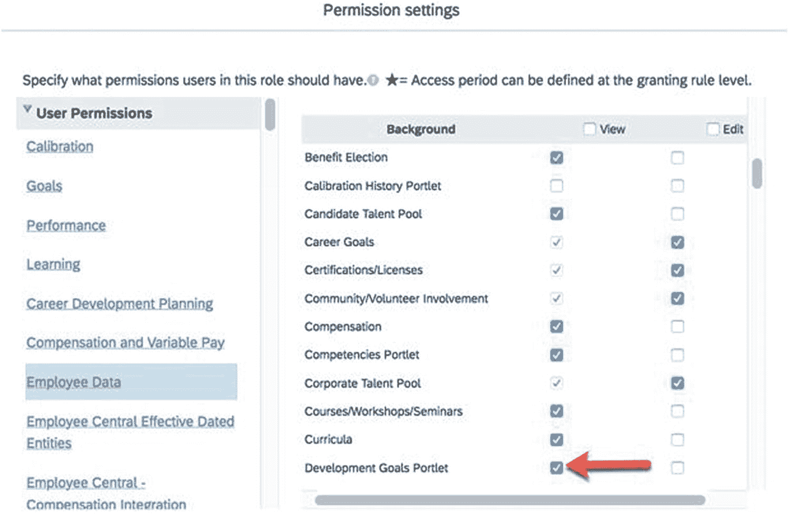

**图 1-39** 访问发展目标门户的权限

我们在本章前面了解过在开发计划 XML 中设置开关，如下所示：

```xml
<switch name="developmentObjectivePortlet" value="true">
```

当此开关开启时，用户的所有发展目标将显示在员工个人资料中的发展目标门户内。如果未使用此开关，默认设置允许用户选择要在其个人资料门户中添加哪些发展目标。在这种情况下，还需要为此门户组件授予“编辑”权限。示例如图 1-40 所示。

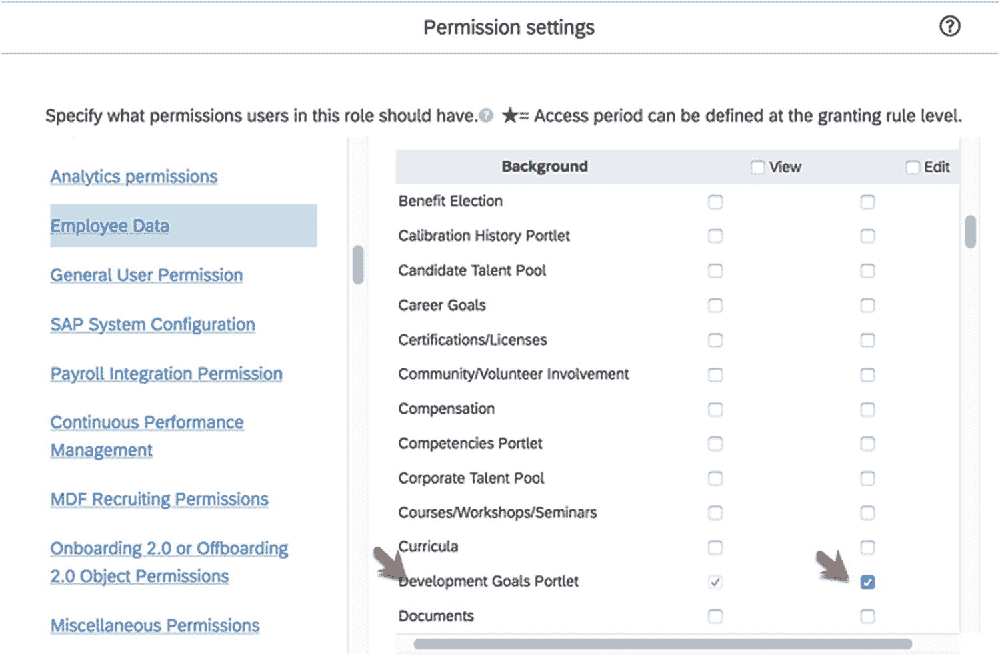

**图 1-40**

当我们以员工身份逐步完成发展计划时，我们将看到其具体工作方式。

## 导入发展目标

有一个发展目标导入工具，可用于批量上传员工发展目标。其工作方式与目标导入相同，但使用的是不同的屏幕和不同的模板。如果您已导入员工目标，则可能已授予管理员权限角色执行此任务的权限；该权限适用于两者。在管理员角色的基于角色的权限中，转到“管理员权限”部分。找到“管理目标”并添加“导入目标”。

可能存在您正从其他发展目标跟踪系统迁移到 SAP SuccessFactors 职业发展系统的情况。在这种情况下，您可能希望将其他系统中的发展目标复制到用户的新发展计划中。导入的另一个用途是为选定的用户分配部门级或公司级的发展目标。

要开始此过程，请在搜索栏中输入并选择“导入发展目标”，将显示导入屏幕，如图 1-41 所示。

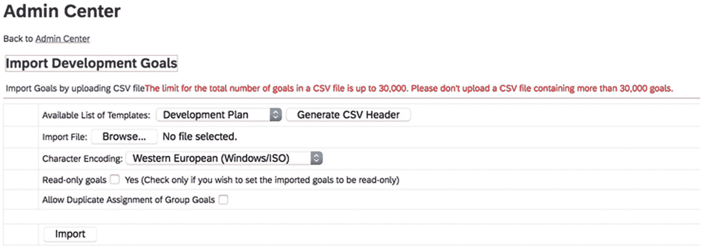

**图 1-41** 导入发展目标屏幕

从可用模板列表中，选择用于您发展计划的发展计划模板，然后单击“生成 CSV 标头”。导入模板将包含您发展计划特有的字段。当您下载 CSV 标头文件时，`OBJ_PLAN_ID` 和 `OBJ_PLAN_NAME` 将包含您的发展计划名称和 ID。

打开模板以查看其布局。示例如图 1-42 所示。

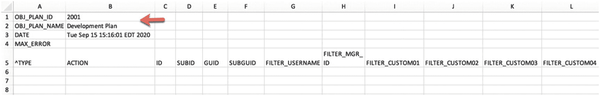

**图 1-42** 发展计划导入模板

前四行不可修改，它们用于标识发展计划。第 5 行包含发展目标计划字段的标题。标题行定义了每个发展目标字段所需的值。如果存在您不填充的标准发展目标计划字段，则可以删除这些列。您需要为每个要导入的发展目标创建一行。

# 发展目标导入指南

## 基本要求

`^TYPE`（A列）字段始终为必填项。每一行的`^TYPE`列都应为`"OBJECTIVE"`。`ACTION`（B列）字段始终为必填项。每一行的`ACTION`列都应为`"OBJECTIVE"`。有效的操作类型为`"ADD"`、`"DELETE"`和`"UPDATE"`。如需向员工的目标计划添加目标，请使用`"ADD"`。创建发展目标时所需的任何字段都必须在文件中填写。

## 导入文件字段说明

有关发展目标计划字段的说明，请参考表 1-9。

**表 1-9** 发展计划导入字段

| 字段 | 说明 | 值 |
| --- | --- | --- |
| `^TYPE` | 上传时使用的计划类型。 | `OBJECTIVE`。 |
| `ACTION` | 对目标执行的操作。 | `ADD`、`DELETE`或`UPDATE`。 |
| `ID` | 导入目标时系统生成。 | 对于`ADD`操作，请留空。 |
| `SUBID` | 不支持。 | 留空。 |
| `GUID` | 更新或删除目标时用作参考的标识符。 | 可以是任何您想要的值，前提是每个目标的`GUID`都是唯一的。 |
| `FILTER_USERNAME` | 您要为其添加目标的员工的用户名。可以通过输入多个用户名来批量分配目标。 | 可以使用分号分隔的多个用户名。若要分配给所有人：`ALL`。 |
| `FILTER_CUSTOM01-15` | 用作筛选条件的自定义字段（数据模型“默认”模块内的自定义筛选器）。 | 如果不需要，可以删除这些列。 |
| `FILTER_DEPT` | 根据用户名的部门进行筛选。 | 列出一个部门，该部门中的每个人都将获得该目标。 |
| `FILTER_DIV` | 根据用户名的分部进行筛选。 | 列出一个分部，该分部中的每个人都将获得该目标。 |
| `FILTER_JOBCODE` | 不支持。 | 留空或删除该列。 |
| `FILTER_LOC` | 根据用户名的工作地点进行筛选。 | 列出一个地点，该地点中的每个人都将获得该目标。 |
| `OBJECTIVE_CATEGORY` | 来自目标模板的默认类别ID。 | `Goals`。 |
| `OBJECTIVE_PARENTID` | 未使用。 | 留空。 |
| `OBJECTIVE_PUBLIC` | 表示目标是否公开。 | 公开目标使用`1`或`Y`，私有目标使用`0`或`N`。 |
| `OBJECTIVE_name` | 发展目标的名称。 | 使用您希望在计划中看到的发展目标名称。 |
| `OBJECTIVE_metric` | 如果计划中使用，则为发展目标衡量标准。 | 如果在模板中定义为文本或文本域，则可以使用任何文本。 |
| `OBJECTIVE_start` | 如果计划中使用，则为发展目标的开始日期。 | 如果填写，日期必须采用`MM/DD/YYYY`格式。 |
| `OBJECTIVE_due` | 如果计划中使用，则为发展目标的截止日期。 | 如果填写，日期必须采用`MM/DD/YYYY`格式。 |
| `OBJECTIVE_state` | 如果计划中使用，则为发展目标的状态。 | 如果状态是下拉列表，请使用该状态的枚举值。 |
| `OBJECTIVE_competency` | 如果发展目标关联了能力项。 | 在JPB中，找到能力项以获取其GUID；用逗号分隔列出每个能力项的GUID。 |
| `OBJECTIVE_purpose` | 如果计划中使用，则为发展目标的目的。 | 如果目的是下拉列表，请使用该状态的枚举值。 |

任何`FILTER`列都可用于根据列中输入的值批量分配目标。`FILTER_USERNAME`、`FILTER_MGR_ID`、`FILTER_DEPT`、`FILTER_DIV`和`FILTER_LOC`是默认列。用户名筛选器是唯一支持单行多条目（以分号分隔）的筛选器。用作筛选器的自定义字段必须在数据模型的`<custom-filters>`下定义。如果您不希望使用这些筛选器中的任何一个来批量分配目标，则可以从文件中删除这些列。

包含`"OBJECTIVE"`的字段标题与发展目标计划上的字段相对应。示例如图 1-43 所示。

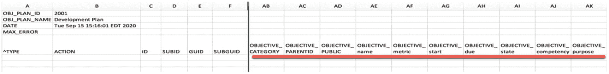

**图 1-43** 发展目标导入标题

如果您的发展计划包含能力项，并且希望导入包含能力项的发展目标，则需要在文件中引用该能力项。此引用是能力项的`GUID`。

要查找能力项GUID，请在搜索栏中输入并选择“管理职位档案内容”。然后选择“能力项”，您将看到与每个能力项关联的`GUID`。示例如图 1-44 所示。

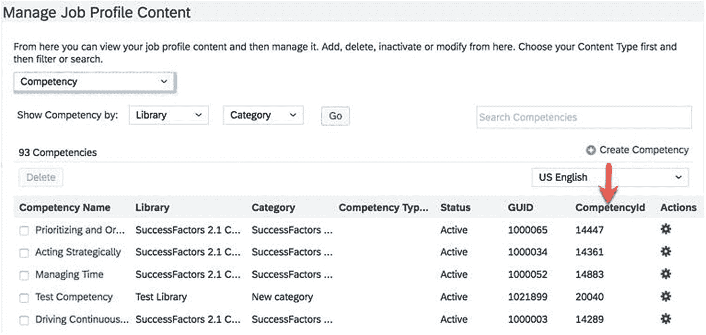

**图 1-44** 管理能力项职位档案内容

对于具有多个能力项的发展目标，请在`OBJECTIVE_competency`字段中填入每个能力项ID，并用逗号分隔。如图 1-45 所示，请确保单元格格式为文本，以便使用逗号分隔符。

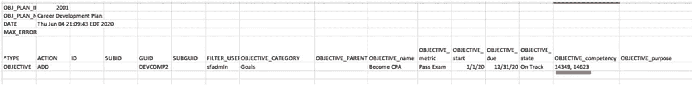

**图 1-45** 导入文件中的能力项列

使用CSV文件格式，并以Unicode (UTF-8)字符编码导入文件，如图 1-46 所示。

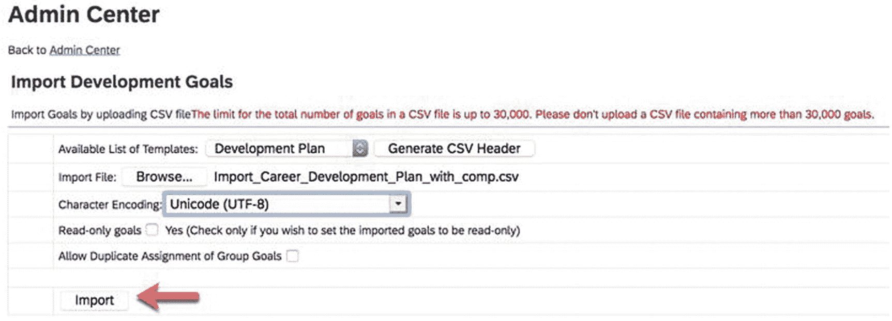

**图 1-46** 发展目标导入

上传完成后，管理员将收到一封包含导入状态的电子邮件。示例如图 1-47 所示。

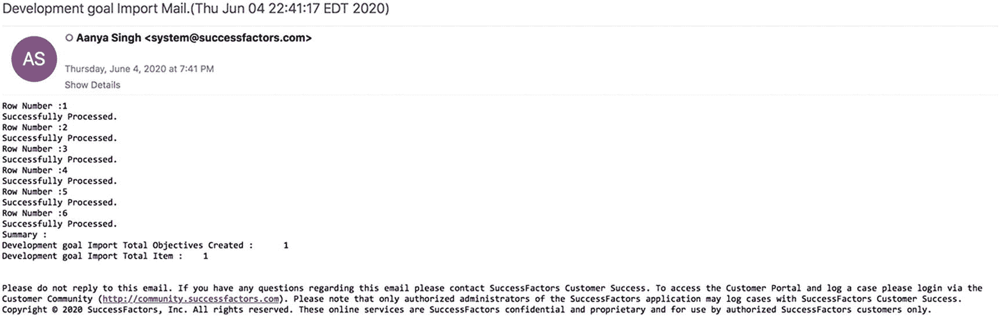

**图 1-47** 发展目标导入状态邮件

该文件将显示导入过程中检测到的任何错误。请更正文件并重新导入。

导入成功后，用户的发展计划将包含新上传的发展目标及其关联的能力项，如图 1-48 所示。

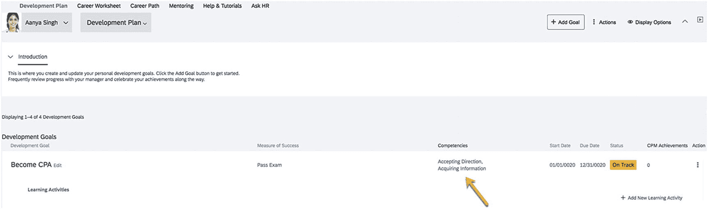

**图 1-48** 通过导入添加的发展目标

## 发展目标的更新或删除

为了批量更新或删除用户发展计划中的任何现有目标，需要系统生成的目标ID。使用发展计划模板创建一个临时报告，并将发展目标ID字段包含在输出中，如图 1-49 所示。

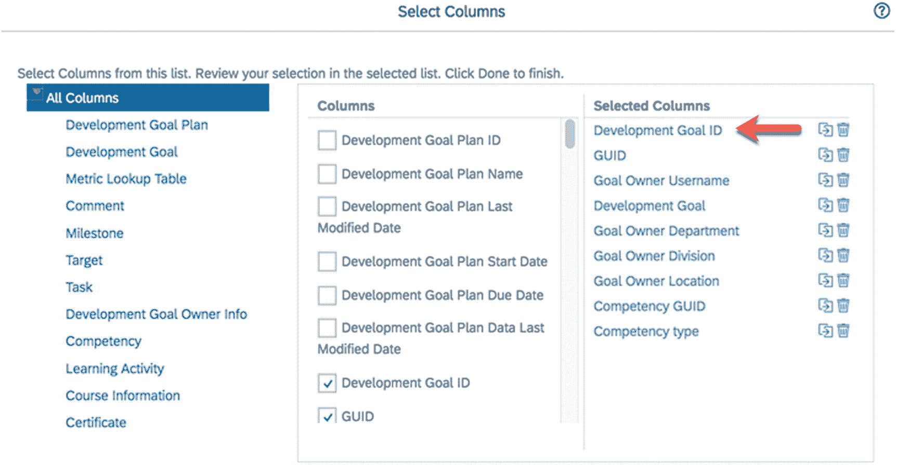

**图 1-49** 临时创建中的发展目标ID

如图 1-50 所示，要更新任何现有目标，请在`^TYPE`列使用`"OBJECTIVE"`，在`ACTION`列使用`"UPDATE"`。在C列使用来自临时报告的发展目标ID。仅填充要更改的发展目标的相关字段。

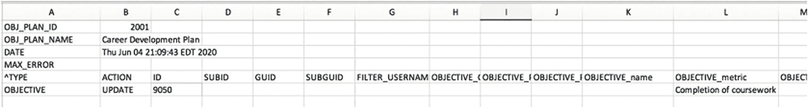

**图 1-50** 发展目标更新字段

要删除任何现有目标，请在`^TYPE`字段中使用`"OBJECTIVE"`，在`ACTION`字段中使用`"DELETE"`，并在C列中输入目标ID。其他字段留空。示例如图 1-51 所示。

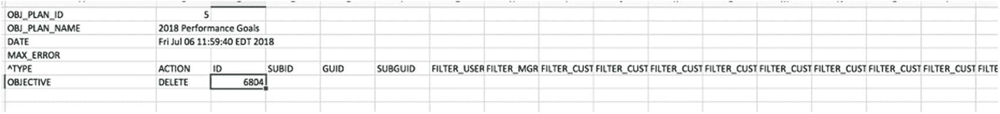

**图 1-51** 删除发展目标的字段

## 导入带有学习活动的发展目标

如前所述，要导入带有学习活动的发展目标，您需要在`Provisioning`中启用`Transcript`功能。在导入文件中，您可以添加、删除和更新自定义学习活动；但无法添加目录学习活动。

# 在为用户导入新的发展目标时，无法同时包含学习活动。相反，需要进行两次导入。首先，载入新的发展目标。添加发展目标后，获取其 GUID。然后，您就可以载入与该发展目标关联的学习活动了。下载文件的新表头模板。在这里，我们只需填充学习活动专属字段。此外，还需要标识发展目标的用户以及要添加学习活动的发展目标。对于每一行，将`^TYPE`设置为`"LEARNING"`，并将`ACTION`设置为`"ADD"`。包括发展目标的 GUID、必需的学习字段以及其他学习活动字段。

文件示例如图 1-52 所示。

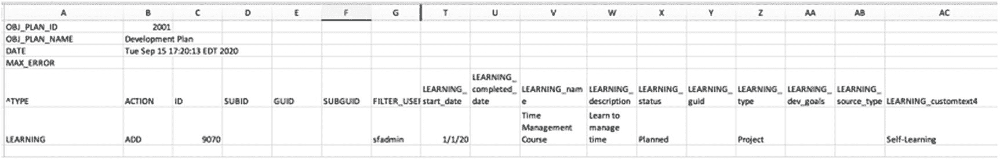

图 1-52 包含学习活动的发展计划导入文件

按照相同的发展目标流程操作。包含学习活动的更新后发展目标示例如图 1-53 所示。

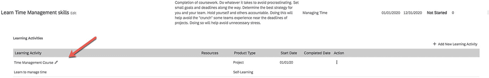

图 1-53 在导入文件中添加学习活动

> **注意：** 要了解更多关于导入学习活动的信息，请参阅 SAP 说明 #2472229。

# 从员工角度使用职业发展

我们已经讨论了如何在`Provisioning`和实例中设置职业发展。我们回顾了基于角色的权限，并了解了如何批量导入发展目标、配置`Development Goals Portlet`以及配置学习活动。

现在，我们将演示一个员工使用`Development Plan`的场景。

员工可以从如图 1-54 所示的首页菜单列表中访问`Development`模块。

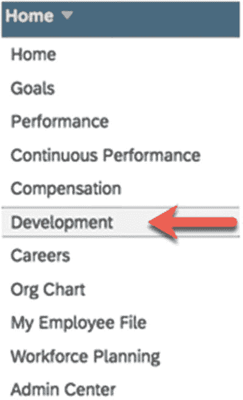

图 1-54 带有发展选项卡的首页菜单

将显示`Development Plan`。示例如图 1-55 所示。

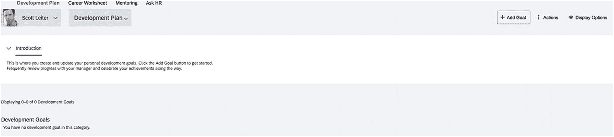

图 1-55 空白的发展计划

在添加任何目标之前，用户会看到一个空白的计划，其中包含一个介绍（如果已配置）以及计划顶部的一些选项。发展计划的界面风格与目标计划相同。模板配置将决定计划中可用的布局、权限和操作。有关更多详细信息，请参考第 1 卷第 4 章。

我们首先审查屏幕右上角部分可用的选项。用户可以添加新的发展目标，如图 1-56 所示。与目标计划不同，这里没有可供参考的目标库。


图 1-56 添加目标

用户将能够打印该计划，如图 1-57 的“操作”菜单所示。


图 1-57 打印操作

如图 1-58 所示，`Display Options`功能允许用户选择要在计划中显示的目标计划字段。可以隐藏某些字段，以使计划看起来更简洁。

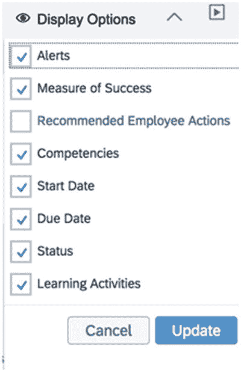

图 1-58 发展计划显示选项

用户可以添加发展目标，如图 1-59 所示。弹出窗口将显示模板中配置的所有字段。必须填写所有必填字段才能保存该目标。

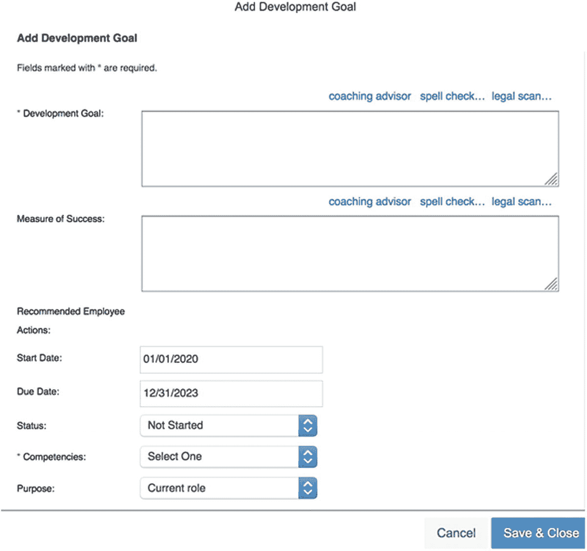

图 1-59 向计划添加发展目标

如果发展计划配置为允许向发展目标添加能力，则此选项也会出现。示例如图 1-60 所示。


图 1-60 向发展目标添加能力

根据默认的能力字段配置，用户可以选择多项能力附加到发展目标上。

还有`"Add Competencies"`选项，允许用户从能力库中添加更多能力，如图 1-61 所示。


图 1-61 从能力库向发展目标添加能力

如果已配置，用户将在该字段看到`"Coaching Advisor"`，如图 1-62 所示。


图 1-62 辅导顾问

如图 1-63 所示，将出现一个弹出窗口，允许用户选择要查看的能力集。


图 1-63 为辅导顾问选择能力

选择能力集后，会显示相应的能力。在此示例中，如图 1-64 所示，显示的是与用户工作角色关联的能力。


图 1-64 工作角色能力

然后，用户可以深入查看某个能力以了解辅导建议。示例如图 1-65 所示。在选择一个能力预览后，用户向下滚动以查看相应的辅导建议。


图 1-65 辅导建议

用户可以通过点击`"Place Text"`按钮添加辅导建议，如图 1-66 所示。


图 1-66 选择要添加到发展目标的文本

系统将显示一条确认消息，表明该文本已添加到发展目标的字段中，如图 1-67 所示。


图 1-67 确认消息

随后，用户关闭弹出窗口，文本将显示在目标计划字段中，如图 1-68 所示。


图 1-68 为发展目标添加辅导建议

用户可以编辑添加到发展目标中的辅导建议措辞。更新后的发展目标如图 1-69 所示。


图 1-69 添加辅导建议后的发展目标

## 发展规划中的 CPM 成果

如果发展目标与持续绩效管理（CPM）成果相关联，用户可引用发展规划来链接到某项活动或成果。如图 1-70 所示，用户可以将发展目标关联到 CPM 活动和成果。


图 1-70 将发展目标关联到 CPM 活动或成果

如果用户已将发展目标附加到 CPM 成果，则“CPM 成果”列将显示一个计数。示例如图 1-71 所示。


# 图 1-71
## 发展目标上的 CPM 成果详情
点击“CPM 成果”列中的数字将显示成果详情，如图 1-72 所示。


**图 1-72**
CPM 成果详情

根据发展规划模板 XML 中配置的操作权限，用户可以编辑或删除目标、添加学习活动，或将目标添加到其个人资料中的“发展目标 Portlet”中。这些选项将显示在“操作”列下，如图 1-73 所示。


**图 1-73**
发展目标的可用操作

## 关联到发展目标的学习活动
如果将学习活动配置为发展规划的一部分，用户将能够添加学习活动。示例如图 1-74 所示。


**图 1-74**
为发展目标添加学习活动

如果将 LMS 目录配置为可在发展规划中供用户使用，则用户可以前往 LMS 目录查找课程。示例如图 1-75 所示。


**图 1-75**
在 LMS 目录中搜索课程

用户可能可以选择向发展目标添加自定义学习活动，如图 1-76 所示。


**图 1-76**
向发展目标添加学习活动

自定义学习活动的布局基于学习活动模板 XML。一个发展目标可以添加多个学习活动。用户可以根据发展规划模板 XML 中配置的权限来编辑、查看或删除目标。用户可以通过“操作”或点击铅笔图标进行编辑来删除自定义学习活动。详情如图 1-77 所示。


**图 1-77**
删除学习活动

## 档案中的发展目标
根据`发展计划 Portlet`的配置，用户可以向其档案添加发展目标，否则系统会自动将其添加到该 Portlet 中。操作选项如图 1-78 所示。在以下示例中，用户可以选择一个要添加到 Portlet 中的发展目标。


**图 1-78**
向发展计划 Portlet 添加发展目标

如前所述，当在开发计划模板 XML 中添加了开关后，用户将无法选择在档案的`发展目标 Portlet`中显示哪些发展目标。添加到其计划中的所有发展目标都将自动添加到其档案的 Portlet 中。“在记分卡中添加发展目标”选项将不再显示为发展目标的可用操作。

图 1-79 显示了出现在`员工档案`中的 Portlet 示例。


**图 1-79**
发展目标 Portlet

如果未设置开关，并且用户可以直接在此 Portlet 中添加发展目标，`发展目标 Portlet`不支持添加自定义学习活动或按能力进行搜索。

## 查看他人的发展计划
如果发展计划模板 XML 为所有角色授予了目标计划字段的读取权限，则在基于角色的权限允许下，用户将能够查看他人的计划。当用户查看自己的发展计划时，他们可以执行姓名搜索来查找其他用户，以便查看其计划。

在此示例中，如图 1-80 所示，用户可以进入自己的发展计划，执行姓名搜索，并查看他人计划的内容。


**图 1-80**
员工查看其他用户的发展计划

## 从管理者角度使用职业发展
管理者将能够通过姓名搜索访问其直接下属的目标计划，如图 1-81 所示。


**图 1-81**
管理者搜索直接下属

发展计划模板 XML 的权限决定了管理者能看到什么以及可以执行哪些操作。可以允许管理者创建、编辑和删除目标。权限可能只允许他们编辑某些字段，或者不允许他们添加学习活动。如果管理者权限角色可以访问所有层级，那么上级管理者也将能够访问该目标计划。

如果`HR 经理`角色已更新为允许其访问所支持的任何用户，那么他们将能够访问这些用户的计划。根据 XML 中的权限，`HR 经理`可能能够编辑、删除或添加发展目标，或者可能只有“读取”权限，并且对其可以查看的字段有限制。

现在，我们已经回顾了发展目标计划的配置，并逐步了解了发展计划的工作原理。接下来，我们将简要介绍报告选项。

## 报告：标准报告
发展目标报告可在“经典视图”下的“标准报告”中找到。选择“发展目标”，如图 1-82 所示。


**图 1-82**
经典视图中的发展目标列表

在这里，您将找到唯一的标准发展计划相关报告。现在点击“目标”，如图 1-83 所示。


**图 1-83**
目标列表

许多标准的`目标管理`报告可用于发展目标报告。在报告的筛选选项中，选择您想要报告的发展计划。使用`目标搜索`报告来报告学习活动。选择包含学习活动的发展目标计划，并确保您的导出选项包含活动级别数据。但是，当启用`成绩单`功能时，经典报告不支持报告学习活动。

## 报告：即席报告
即席报告可以包含学习活动、能力以及发展目标计划数据。在创建即席报告时，使用`发展目标`域，如图 1-84 所示。


**图 1-84**
使用发展目标域创建即席报告

如果为发展目标数据授予了即席创建权限，那么`HR 经理`或管理者可以为其目标群体创建或运行发展计划即席报告。

作为管理员，您可以创建即席报告，这些报告将对`HR 经理`和管理者可用，以便他们可以为其目标群体运行发展报告。在通过向导创建即席报告时，在`人员`选项卡中，选择“已登录用户”以及管理者应该有权访问的层级数。示例如图 1-85 所示。


**图 1-85**
选择报告类型

当管理者运行此报告时，结果将仅显示其团队中的员工。如图 1-86 所示，有许多字段可以用于报告。


**图 1-86**
发展计划字段

为管理者提供即席报告，使他们能够轻松查看哪些员工创建了发展目标，并跟踪目标的进展情况。

> **注：** 要了解有关即席报告的更多信息，请参阅 SAP 说明 #2536445。

## 发展计划的其他用途
有许多接触点可以利用发展计划目标数据。我们已经看到可以添加到`员工档案`中的`发展计划 Portlet`，并了解了 CPM 成就如何与发展目标关联并显示在用户的发展计划上。我们将回顾其他一些集成领域。

### 与绩效管理表单的集成

# 绩效表单与开发计划

## 绩效表单中的发展目标
绩效表单可以配置为包含发展目标。包含后将在绩效表单上创建一个发展计划部分。发展目标不进行评级，但为了规划目的，将此部分纳入绩效表单可能会有所帮助。用户可以在其绩效表单上添加发展目标，该目标也将流入其发展计划。示例如图 1-87 所示。


`图 1-87`
包含发展目标部分的绩效表单

请回看第 1 卷第 7 章，以了解将发展目标纳入绩效评估模板所需的设置。

## 开发计划与 360 度评估的集成
`360度评估表`可生成包含开发目标引用和链接的报告。在表单中启用此功能后，链接将使用默认的开发计划。该链接适用于`排名视图`和`摘要视图`，但`盲点`、`隐藏优势`和`差距分析视图`不支持此功能。更多信息请参阅第 1 卷第[12](https://doi.org/10.1007/978-1-4842-6995-4_12)章。

## 开发计划与校准的集成
在校准会议中，可以查看员工的开发计划。如图 1-88 所示的`列表视图`中，点击员工的“更多”图标即可显示可用选项。


`图 1-88`
在校准会议中链接到开发计划

点击“发展”将弹出一个窗口，显示校准对象的开发计划。请参阅第 1 卷第[14](https://doi.org/10.1007/978-1-4842-6995-4_14)章了解如何启用此选项。

## 职业发展计划与继任管理的集成
在`继任管理`模块中，可在`继任者`卡片中查看开发计划，如图 1-89 所示。


`图 1-89`
从继任者卡片链接到开发计划

有关`继任者`卡片配置的更多信息，请参阅第 6 章。

## 与职业工作表中能力关联的开发目标
只要您的开发目标计划使用了能力，您就可以将开发目标添加到员工职业工作表的工作角色能力中，如图 1-90 所示。


`图 1-90`
开发目标与职业工作表上的能力关联

添加到工作表能力上的开发目标随后会作为开发目标出现在用户的计划中，并关联相应能力。您将在第 2 章和第 3 章中了解更多关于此功能的信息。

# 结论

希望您喜欢我们关于开发计划创建的旅程。现在您应该知道如何在`配置`中激活`职业发展计划`，设置配置和管理开发计划的权限，创建基本的开发计划模板，以及直接编辑计划模板的`XML`。我们还了解了如何以经理和员工的身份使用开发计划，如何将能力与开发目标关联，以及如何创建自定义学习活动。我们看到了如何使用`LMS`目录来创建与开发目标关联的学习活动。我们还了解了开发计划如何与其他绩效管理领域（包括`持续绩效管理`、`校准`、`人员档案`和`继任管理`）集成。我们回顾了可用于开发计划报告的标准报告，并了解了如何为开发计划创建临时报告。在下一章中，我们将进入`职业发展计划`的另一项功能，该功能利用开发目标来帮助规划未来的角色。
