# 2. 配置职业工作表

在上一章中，我们简要介绍了 SAP SuccessFactors 职业发展模块中的功能。当在`配置`中启用`完整版 CDP`时，即可使用`开发计划`、`职业工作表`、`职业路径`和导师指导功能。

在本章中，我们将首先了解什么是职业工作表及其相互依赖关系，然后重点介绍`职业工作表`的管理任务。我们将启用`职业工作表`，并为这一职业规划工具创建必要的配置和权限。我们将学习如何创建职业路径，并探索建议工作角色的设置。我们将审视为工作角色能力添加预期评级的流程。我们将了解如何创建`角色就绪评估`表单。我们将探讨工作角色能力与开发目标的结合使用，以及它们如何与职业工作表互动。我们还将学习评估员工未来角色就绪度所需的条件。最后，我们将简要介绍`职业探索器`。此新功能目前仅在`早期采用者关怀`（EAC）计划中可用。

## 什么是职业工作表？

`职业工作表`是一种工具，通过查看工作角色、建议角色和职业路径，为用户提供职业发展机会的概览。该工具有助于员工主动规划并为未来角色做好准备。它是一个查看工作角色及其所需能力的载体。员工可以瞄准想要成长的工作角色，并集中精力为这些未来角色做准备。`职业工作表`易于实施和管理，可以提升员工的敬业度和保留率。

`职业工作表`高度依赖于已映射能力的工作角色。能力可以通过`职位档案构建器`或传统的`系列与角色`功能映射到工作角色。一个工作角色可能拥有多种能力，而对于`职业工作表`，每种能力都必须有一个预期评级。每种能力的预期评级指明了掌握该能力所需达到的分数。

职业工作表通过将员工已评级的能力与未来角色所需的能力进行对比，计算出员工对某个角色的就绪度。能力评级可能来自最近完成的`绩效管理`或`360 度评估`表单，也可能来自员工从工作表上启动的角色就绪表单。基于实际评级与预期评级的对比计算，就绪度仪表盘会显示员工具备担任未来角色能力的百分比。

工作表还会识别能力差距，突出显示员工需要改进的发展领域。基于这些差距，员工可以创建旨在掌握新角色所需能力的开发目标。

图 2-1 展示了一个职业工作表示例。

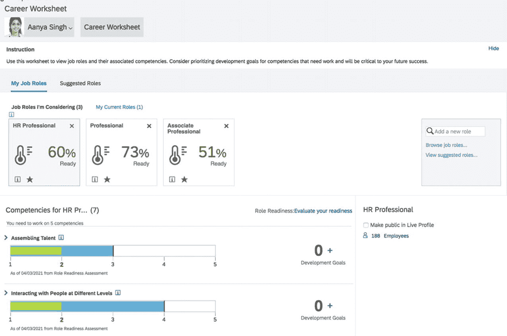

**图 2-1** 职业工作表示例

在职业工作表上，员工可以浏览工作角色、查看建议角色或查看职业路径。无论采用哪种方法，员工都能看到职位描述以及与该工作角色关联的能力。这让他们可以一窥工作职责和技能，从而判断这是否是他们想要争取的角色。

在接下来的篇幅中，我们将逐步介绍需要在`公司设置`中启用的选项。接下来，我们将为管理员角色设置基于角色的权限。我们还将学习如何创建职业路径、向`人员档案`添加`职业目标`模块、创建角色就绪表单，以及为能力添加预期评级。

## 配置设置

为了使用`职业工作表`和`职业路径`，需要先在`配置`中启用一些设置。为了让`职业工作表`正常运行，我们首先需要检查一些`公司设置`方面的前提条件。

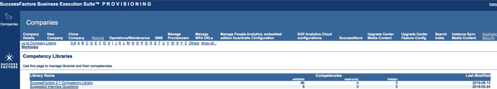

**图 2-2** 配置中的能力库

1.  由于职业工作表依赖于映射到岗位角色的能力，因此必须建立一个能力库。您可以使用如图 2-2 所示的 SuccessFactors 2.1 能力库，也可以创建自定义能力库。

接下来，我们将进入公司设置，验证某些设置是否已启用。

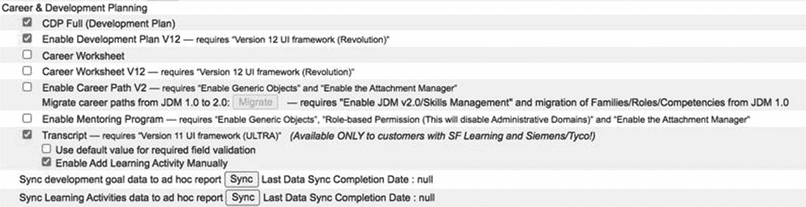

**图 2-3** 公司设置中的职业与发展规划功能

1.  发展计划设置应该已经启用。在公司设置中，找到“目标框架”部分进行验证。

2.  在“职业与发展规划”下，“CDP 完整版（发展计划）”和“发展计划 V12”应已启用。如果您在发展计划中使用了学习活动，则“成绩单”也应已启用。

发展计划设置如图 2-3 所示。

1.  验证“启用附件管理器”、“启用通用对象”、“版本 12 UI 框架（革命性）”和“JDM v.2/技能管理”也已启用。

2.  检查“员工目录”是否已启用。如果已启用，这可能会帮助您决定职业工作表模板 XML 中的一项设置，我们将在本章后面讨论该内容。

## 需要启用的公司设置

现在，我们准备在职业发展模块中启用职业工作表和职业路径。以下是公司设置中启用两者的路径：

*   目标框架 ➤ 我的目标选项卡

*   目标框架 ➤ 职业与发展规划 ➤ 职业工作表 V12

*   目标框架 ➤ 职业与发展规划 ➤ 职业工作表

*   目标框架 ➤ 职业与发展规划 ➤ 启用职业路径 V2

*   目标框架 ➤ 职业与发展规划 ➤ 启用职业路径

启用“职业工作表 V12”也将同时启用“职业工作表”。同样，启用“职业路径 V2”将同时启用“职业路径”。我们还需要在公司设置的目标框架部分找到并启用“我的目标选项卡”。

如果您在实例中使用临时报告，则有一些有限的职业工作表报告功能。若要允许报告用户在职业工作表上针对的岗位角色，请前往“分析和仪表板选项卡与杂项报告”并启用以下选项：

*   附加的临时子域架构配置 ➤ 职业工作表目标角色

*   在人员选择器中启用`包含从用户开始` ➤ 职业工作表目标角色

一旦这些设置更新并保存后，退出公司设置。接下来，我们需要前往配置中的另一个区域下载职业工作表模板。

## 职业工作表 XML

由于职业工作表模板在实例中不可用，我们需要下载模板 XML 以进行更新，例如选择要开启的功能、更改标签以及设置操作和字段权限。完成更新后，该文件将被重新导入配置中。

转到“管理计划模板”，如图 2-4 所示。这里可以找到目标和发展目标计划模板，最近在第一章中讨论过。

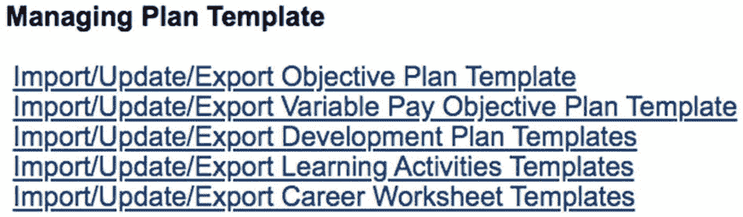

**图 2-4** 配置中的计划模板

找到并点击“导入/更新/导出职业工作表模板”链接。在这里，您将找到入门级职业工作表模板 XML。

如图 2-5 所示，显示下载和上传职业工作表模板 XML 的屏幕。您需要导出模板 XML。您的 Web 浏览器会将文件下载到本地机器。

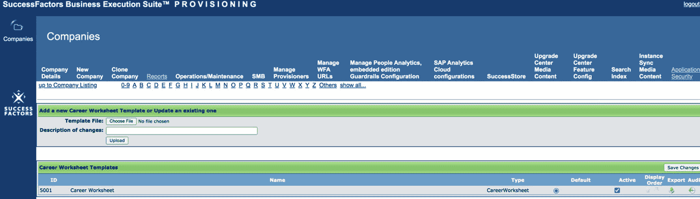

**图 2-5** 导出和导入职业工作表模板 XML 的屏幕

虽然不太可能，但如果此处没有显示职业工作表模板，请前往包含入门级模板示例的 CDP 实施指南。该指南包含一个职业工作表模板 XML，您可以将其复制到 XML 编辑器中。然后，您可以更新文件并将 XML 导入配置。另一种获取入门级模板的方法是从销售演示系统的配置中导出职业工作表模板 XML，然后将其导入到您的环境配置中。

现在模板已下载，让我们在 XML 编辑器中打开它，查看职业工作表的组件，并了解哪些选项可以修改。

以下是可在职业工作表模板 XML 中更新的元素：

*   删除字段（特别是 `gap_graph`）

*   字段标签

*   功能和字段权限

*   评级量表 ID

*   用户可选择的目标角色数量限制

*   开关

在我们深入讨论之前，以下是使用职业工作表时需要注意的一些要点：

*   只能有一个活动的职业工作表模板。

*   职业工作表模板上的字段 ID 不可修改。

*   职业工作表模板 XML 中不能使用类别。

*   无法在职业工作表模板 XML 中创建自定义字段。

*   职业工作表模板 XML 上不能授予“写入”权限。

*   职业工作表中仅显示已完成表单的评级。

*   发展目标可用于在职业工作表中为能力添加目标，并提供与某项能力相关的发展目标数量。

*   职业工作表只能链接到一个职业发展规划模板。

*   职业工作表使用默认发展计划来列出与某项能力相关的发展目标。

*   发展目标权限基于发展目标计划 XML 上的操作和角色权限。

查看 XML 的第一个部分。`<obj-plan-template>` 标签是 XML 结构中的最高级别标签。它定义了一系列可以打开或关闭的选项。这与您在目标和发展计划模板 XML 中找到的标签相同，但有一个特定于工作表的属性可以修改。

以下是一个示例代码片段：

```
<obj-plan-template cws-people-role="true" ... >
```

在该标签内，`cws-people-role` 属性默认设置为 `true`。此设置允许在职业工作表上显示一个指示器，显示拥有目标角色的员工数量。如果在公司设置中启用了员工目录，工作表中将有一个链接显示拥有该目标角色的员工姓名。

如果您不希望在工作表上显示岗位角色持有者的姓名，请将 `cws-people-role` 设置为 `false`。您仍将看到员工数量，但不会看到岗位角色持有者的姓名。

`<obj-plan-template>` 标签不应有其他属性更改。

与目标和发展计划模板 XML 一样，该标签后面跟随一系列元素。职业工作表模板的模板 ID 必须在 5001–5099 范围内，通常为 5001。计划类型必须为 `CareerWorksheet`。您可能希望进行的唯一更改是计划开始日期 `<obj_plan_start>` 和截止日期 `<obj_plan_due>`。

以下是一个示例代码片段：

```
CareerWorksheet
职业工作表

5/23/19 5:38 PM
01/01/2019
12/31/2021
```

由于开发计划通常持续数年，建议使用与开发目标计划相同的开始日期和截止日期。`Career Worksheet` 模板 XML 中可以添加一些额外的标签。

如果你为职位能力定义了行为标准，可以在职业工作表的计算中使用行为就绪评级。以下是需要使用的行为标签：

```
<behavior-tag>
```

当行为就绪状态不参与计算且不在职业工作表中显示时，行为标签示例如下：

```
<behavior-tag-example>
```

该标签应跟在 `<*text-replacement*>` 标签之后，并位于字段定义标签之前。

## 角色就绪计算的数据来源

职位的能力评级是职业工作表的核心驱动因素，用于衡量员工胜任下一个角色的准备程度。评级的数据源必须为职业工作表明确定义，才能计算目标角色的就绪情况。员工当前能力评级的默认来源是已完成的绩效评估表或 360 评估表。不过，你也可以指定一个或多个特定表单作为现有能力评级的来源。此外，职业工作表内还提供一项选项，允许员工选择一个目标角色，然后启动用于评估用户目标角色能力的 `Role Readiness Assessment` 表单。

无论哪种情况，如果使用表单中的评级，都应在职业工作表模板 XML 中添加 `<*assessment-filter*>` 过滤器来标识评级来源。必须引用表单模板 ID。你可以在“表单模板管理”下的“Provisioning”中找到表单 ID，如图 2-6 所示。

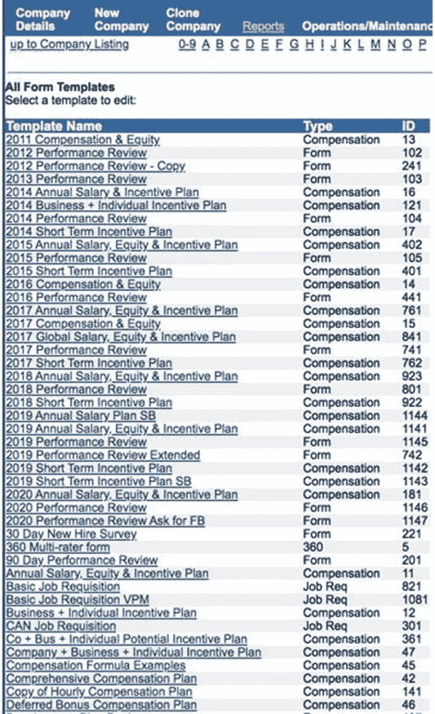

**图 2-6** 带 ID 的表单模板

若要使用多个能力评级来源，表单 ID 应以逗号分隔列出。当包含多个表单时，系统将使用最近完成的表单中的评级：

```
5,1146,1147
```

对于表单使用的每种语言，你需要一个单独的 `<*include-form-ids*>` 过滤器 ID。以下代码片段展示了同时使用多个表单评级并支持多种语言的情况：

```
5,1146,1147
5,1146,1147
5,1146,1147
```

如果你计划允许用户使用 `Role Readiness Assessment` 表单进行自我评估，请使用表单模板 ID 包含 `<*self-assessment*>` 标签。我们尚未讨论角色就绪模板，但如果在 Provisioning 中启用了职业工作表，你将在表单模板管理中看到标准的 `Role Readiness Assessment` 模板，就像表单评级来源的 ID 一样。

用于引用 `Role Readiness Assessment` 表单 ID 的代码示例如下：

```
<reference-code>
```

通常，`Role Readiness Assessment` 表单是为目标角色启动的。但现在也允许用户为其当前角色启动该表单。这通过过滤器 `<*current-self-assessment*>` 标识。它将引用与 `<self-assessment>` 过滤器相同的表单 ID。

当添加以下代码片段中的过滤器时，“我的当前角色”子选项卡将提供一个链接，用于根据员工的当前职位评估就绪程度：

```
<filter-segment>
```

这些标签的正确顺序包含在以下代码示例中：

```
<tag-order-example>
```

## 开关

在 XML 中的这些元素之后，可以添加一系列开关。开关用于开启或关闭功能。职业工作表模板中可能使用的开关如表 2-1 所示。

**表 2-1** 职业工作表 XML 开关汇总

| 开关 | 描述 | 默认值 |
| --- | --- | --- |
| `cws-dispoption-competency-desc` | 显示每个角色的能力描述。设置为“on”。 | 关闭 |
| `disable-jpb-profile-in-cws` | 设置为“off”以查看角色的职位简介描述。 | 开启 |
| `hide-position-count` | 隐藏角色的空缺职位数量。仅当在 Provisioning 中启用真实职位层级时适用。 | 关闭 |
| `new-role-readiness-calculation` | 定义角色就绪度的计算方式：求和或平均。当设置为“on”时，就绪度基于平均值计算。 | 关闭 |
| `show-self-assessment-in-current-role-tab` | 允许员工在其职业工作表中为当前角色启动角色就绪评估表单。 | 关闭 |

职业工作表模板 XML 中的开关代码示例如下：

```
<switch-code-example>
```

现在我们将详细查看每个开关及其控制的功能。

### `cws-dispoption-competency-desc`

此开关控制是否显示目标角色能力的详细信息。如果希望开启开关以查看能力描述，你需要为每个能力创建描述。你可以手动为每个能力添加描述，或使用包含描述的能力批量上传功能。这可以通过“管理工作简介内容导入/导出”来完成，本章稍后将对此进行说明。

当开关设置为“on”时，可通过将鼠标悬停在职业工作表上的信息图标上来查看每个能力的描述。

### `disable-jpb-profile-in-cws`

当启用“职位简介生成器”并定义了职位简介时，使用此开关。当此开关设置为“off”时，将显示目标角色的职位简介详情。

### `hide-position-count`

此开关显示目标角色有多少个空缺职位。默认情况下，空缺职位数量会显示。空缺职位与继任计划中的职位关联，而非招聘管理中的职位申请。然而，空缺职位计数仅适用于传统职位提名方法，并且需要在 Provisioning 中启用真实职位层级。MDF 职位不支持此功能。

要隐藏空缺职位数量，应将开关值设置为“on”。如果未设置开关且未使用传统职位提名方法，空缺职位数量将显示为 0。

### `new-role-readiness-calculation`

此开关用于定义如何计算角色的就绪度。就绪度可以按“就绪能力求和”或“能力就绪度平均值”来计算。当此开关设置为“yes”时，就绪度计算是比例值（平均值）。如果未定义开关，默认值为“off”，即使用求和作为计算类型。

## 就绪度计算类型

既然我们刚刚介绍了用于标识角色就绪计算类型的开关，让我们深入探讨一下。求和与平均都使用员工最新的能力评级，这些评级可能来自绩效评估表、360 评估的平均评级、一个或多个指定表单，或 `Role Readiness Assessment` 表单。

我们将介绍这两种就绪度计算类型，以便你决定使用哪一种。先从求和开始。

### 求和

系统首先检查员工针对目标角色各项能力的就绪评级。如果员工当前的能力评级等于或高于预期评级，则员工对该目标角色的能力“已就绪”。如果员工不具备目标角色所需的能力，则员工对该能力“未就绪”。然后，就绪度按 (员工已就绪的能力数量)/(所需能力总数)% 计算。

### 平均

就绪度基于对员工在目标角色各项能力上的就绪程度进行计算。然后计算这些评级的平均值以确定整体就绪度。计算使用 XML 中定义的评定量表：

- 如果某项能力的评级达到或超过预期能力评级，则该能力的就绪度为 100%。
- 如果员工在当前目标角色的能力评级低于预期评级，则能力准备度的计算公式如下：
  （当前评级 – 评级量表最低评级）/（预期能力评级 – 评级量表最低评级）%。
- 如果某项能力没有预期评级，或者员工没有该能力的评级，则该能力的准备度为 0。

接下来，将所有百分比相加，再除以目标角色的能力总数，得出角色准备度百分比。

这种方法可能不是最准确的，因为如果某项能力没有预期评级，或者员工没有该能力的评级，平均值计算将会出现偏差。

在 2019 年第四季度发布之前，如果员工想为其当前角色启动角色准备度评估表单，需要在绩效管理中完成。现在，员工可以直接在其职业工作表中为当前角色启动角色准备度评估表单。开启该开关后，将在“我的当前角色”选项卡中创建一个用于评估准备度的链接。

此开关必须与 `<current-self-assessment>` 标签结合使用，该标签用于标识要启动的角色准备度评估表单。

既然我们已经审查了职业工作表的可用开关，接下来让我们看一个额外的选项。

在开关之后，您可以限制用户可以考虑的目标角色数量。这是通过 `<max-per-category>` 属性在 `<category-config>` 中完成的，并紧随开关之后，如下面的示例代码片段所示：

# 职业工作表模板的权限

如果员工尝试添加的目标角色超过允许的最大数量，则会显示一条错误消息，除非用户删除一些现有的目标角色，否则无法继续添加。

出于性能考虑，最好将员工可以选择作为未来角色的数量限制在 20 个以内。

## XML

对职业工作表以及特定职业工作表计划的访问权限由实例中的基于角色的权限控制。在职业工作表中查看、添加或删除目标工作角色的权限，以及职业工作表中某些字段的读取权限，均在职业工作表模板 XML 中进行控制。

让我们来审查职业工作表模板 XML 的权限和字段定义部分。我们将从查看应用于“我正在考虑的工作角色”子选项卡的操作/角色开始，如图 2-7 所示。

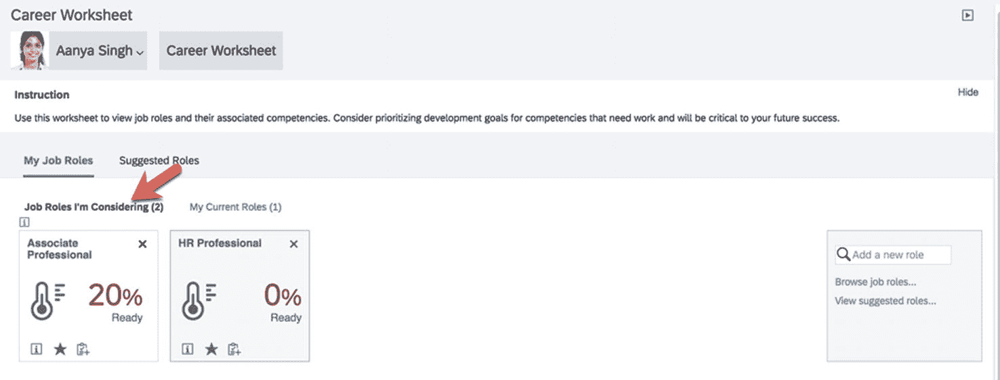

图 2-7 职业工作表的“我正在考虑的工作角色”视图

操作权限定义了角色在职业工作表中可以执行的功能。操作描述如下：

- `Private-access` 授予查看职业工作表“我正在考虑的工作角色”部分中目标角色的权限。
- `Create` 授予添加目标角色的权限，并且需要此权限才能访问“建议角色”选项卡。
- `Delete` 授予从“我正在考虑的工作角色”子选项卡中删除任何选定目标角色的权限。

如下面的示例代码片段所示，员工、其经理层级以及 HR 经理可以查看目标角色。只有员工及其经理可以添加目标角色，并且只有员工可以删除目标角色：

在图 2-8 所示的示例中，有一个选项允许员工使其目标角色在人员档案中可见。


图 2-8 使目标角色在人员档案中可见的复选框

必须至少为员工角色启用共享权限。`Share` 权限如下面的示例代码片段所示：

如果没有角色被授予 `share` 访问权限，则职业工作表上不会显示“在个人档案中公开”链接。下面的示例代码片段展示了这一点：

在本章后面，我们将审查在人员档案中配置“职业目标”块的额外步骤。

`Move` 权限在工作表中不适用，因此您可以将其从模板 XML 中移除。

在“我正在考虑的角色”子选项卡中有一些标准字段，我们将对其进行审查。表 2-2 详细列出了模板中用于定义目标工作角色详细权限的字段。如前所述，XML 标识了哪些角色可以查看、添加或删除用户的目标工作角色。除了准备度仪表盘外，所有字段都是必需的。这些字段对于工作表的设计功能至关重要，不应被移除。

表 2-2 “我正在考虑的工作角色”子选项卡中允许的字段

| 字段 | 描述 |
| --- | --- |
| `competency_name` | 与工作角色关联的能力名称。 |
| `last_rated_form` | 上次对能力进行评级的绩效（或 360）表单名称。 |
| `last_rated_date` | 上次能力评级的日期。 |
| `last_rating` | 工作角色上某项能力的最新评级。 |
| `gap_graph` | 预期能力评级与实际评级的对比表示。可以从 XML 中移除。 |
| `development_goals` | 与该能力关联的发展目标（如果有）。 |
| `readiness_meter` | 目标工作角色的准备度百分比。 |

我们已经提到了角色准备度评估表单，如果使用该表单，则会对 `last_rating` 字段进行额外更新。用于计算角色准备度的职业工作表评级量表必须与角色准备度评估表单中使用的评级量表相同。如果评级量表不匹配，准备度仪表盘将不会显示。

下面的示例代码片段显示了评级量表 `id` 字段，该字段需要与角色准备度表单关联的 PM 模板中使用的评级量表 `id` 完全相同：

```
Last Rating
#.#

Performance Rating Scale
```

角色准备度评估模板 XML 必须在能力部分引用相同的评级量表，如下面的代码片段所示：

```
```

我们将在本章后面查看角色准备度评估表单模板 XML。

## 职业工作表 XML 上的模板字段

我们现在已经查看了职业工作表的字段。通过查看职业工作表的部分内容以及这些字段的使用位置，事情会更清晰。请参考表 2-2 回顾模板字段。图 2-9 显示了这些字段在工作表上的位置。

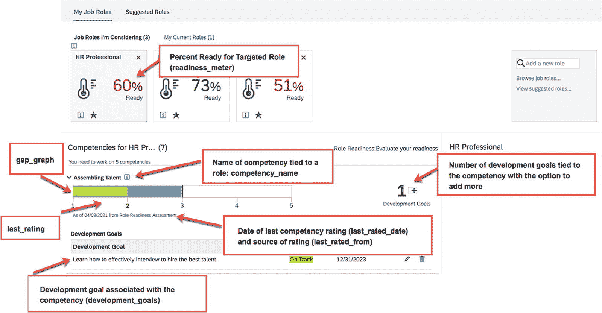

图 2-9 职业工作表模板字段及其来源概览

除了在 XML 中定义模板字段外，您还需要确定哪个（些）角色具有这些字段的可见性。`Write` 权限在工作表中不受支持，因此您只需要定义 `Read` 权限。标准模板权限可能已经非常接近您的需求。只需根据您组织的特定权限进行任何修改即可。

以下是一些需要考虑的事项：

# 职业工作表字段的基于角色的权限

基于角色的职业工作表权限不适用于目标人群。如果用户有权访问职业工作表，则该用户将能够根据“用户搜索”权限搜索其他员工。这意味着用户在自己的职业工作表中可以通过名称搜索来访问其他员工的工作表。为防止这种情况，请在“职业工作表”模板 XML 中，仅向应能查看员工职业工作表的角色授予“读取”权限。

“读取”权限只应授予那些应能查看任何员工职业工作表的角色，例如员工本人、经理和人力资源经理。

以下示例代码列出了应用于这些字段的权限：

由于继任规划人员通常与他们提名的继任者没有任何关系，因此建议允许所有角色（`*`）对 `“readiness_meter”` 字段具有可见性。如下所示为一个示例代码片段：

如下面的示例代码片段所示，任何人都不应能写入任何职业工作表的字段：

## 为目标职位角色能力添加发展目标

如果您允许用户为目标职位角色或当前职位角色能力添加发展目标，则 `“development_goal”` 字段必须包含在具有“读取”权限的字段定义中。发展计划也必须定义了能力字段。

在“职业工作表”模板 XML 中包含 `development_goal` 字段还会启用每个角色能力所显示的发展目标数量，如图 2-10 所示。

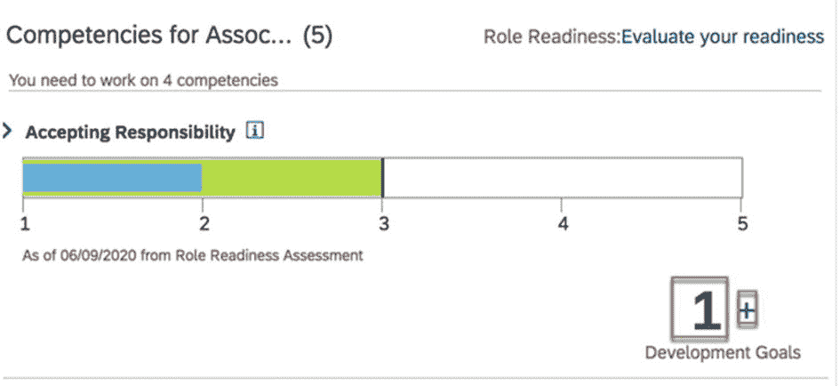

图 2-10：为能力添加发展目标

加号图标允许员工为能力添加发展目标。员工可以创建一个与需要加强的能力相关联的发展目标。为此，发展计划模板必须包含具有创建目标能力权限的能力字段。在工作表上为能力添加的任何发展目标随后都会与该能力一起显示在发展计划上。

默认情况下，用户对发展目标的“读取”和“写入”权限是从发展计划模板配置中继承的。您必须确保所有可以查看用户职业工作表的角色，在发展计划 XML 中也具有发展目标字段的“读取”权限。没有此权限，角色将无法在职业工作表上看到发展目标。

也可以将发展目标链接到职业工作表上的行为，而不是使用能力。为此，必须将发展计划配置为在能力字段中使用行为。请参阅第 1 章了解更多信息。

由于一个发展目标可以链接到多个能力，因此同一个发展目标在职业工作表中可能会被多次计算。并且同一个发展目标可以在多个职位角色中体现。

完成“职业工作表”模板 XML 更新后，请保存文件并在“配置”中的“管理计划模板”➤ “导入/更新/导出职业工作表模板”下导入该文件。

## 配置“共享”权限和数据模型

我们讨论了“职业工作表”模板 XML 中的“共享”权限，该权限允许用户将目标角色标识为“人员配置文件”中的职业兴趣。为此，需要在“继任数据模型”中进行更新。我们需要在数据模型中添加 `“preferredNextMove”` 背景元素。返回“配置”以下载数据模型。

在“继任管理”下，点击“导入/导出数据模型”链接，如图 2-11 所示。

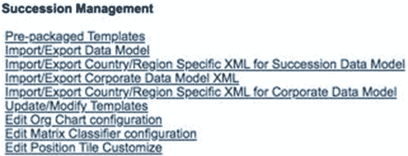

图 2-11：配置公司设置中数据模型的位置

下载数据模型文件，如图 2-12 所示。

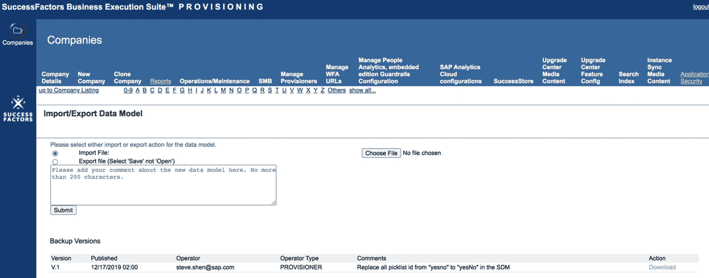

图 2-12：导入/导出数据模型界面

在 XML 编辑器中打开该文件，查看 `“preferredNextMove”` 背景元素是否正在使用。如果它已存在于数据模型中，它可能包含几个不会从工作表填充到配置文件中的字段。

该背景元素的一个示例代码片段如下所示：

```
首选下一步行动
首选下一步行动

职位名称
职位名称

级别
级别

职能
职能

时间框架
时间框架

备注
备注
```

背景元素内需要定义一个“职位名称”数据字段。这是从职业工作表填充到“人员配置文件”中职业兴趣块的唯一字段。如果背景元素中包含其他字段，则在单击职业工作表上的复选框时，这些字段不会填充。这些字段在该块中将显示为空。额外的字段只有在用户在配置文件中添加时才会填充。但是，如果您允许用户更新配置文件中的该块，则可以在背景元素中包含额外的字段。就我们的目的而言，我们只使用职位名称字段。

无论哪种情况，都要确保职位名称是必填字段。如果此背景元素在数据模型中但未被使用，您可以删除任何其他数据字段，如代码片段示例所示。如果它不在数据模型中，您需要添加它，并且可以使用这个相同的版本。

该背景元素的一个示例代码片段如下所示：

```
首选下一步行动
首选下一步行动

职位名称
职位名称
```

数据模型中还需要包含一个针对该背景元素的 `<element-template>`。一个示例代码元素如下所示：

```
首选下一步行动
首选下一步行动
职业目标.
```

如前所述，在讨论“职业工作表”模板 XML 中的操作权限时，必须至少为员工角色启用共享权限，以便将目标角色添加到其配置文件中。

完成添加后，导入更新后的数据模型 XML。进入实例后，我们将审查此背景元素的基于角色的权限以及需要进行的“人员配置文件”更新。

## 总结

我们现在已经在“配置”中启用了职业工作表和发展路径。我们已对“职业工作表”模板 XML 进行了更新，以定义功能、数据源、评分计算类型以及工作表中字段的操作权限。我们还更新了“继任数据模型”XML，以便在“人员配置文件”中显示目标角色。我们现在已准备好进入实例来设置基于角色的权限。

# 职业工作表和职业发展路径的基于角色的权限

除了在`职业工作表`模板 XML 中设置的操作和读取权限外，还需要基于角色的权限，以授予用户访问职业发展模块中`职业工作表`选项卡以及职业工作表计划的权限。如果您决定使用职业发展路径、建议角色和角色就绪评估表单，这些功能同样需要基于角色的权限。我们的讨论将假设所有这些功能都会被使用，因为这样才能赋予`职业工作表`全部功能。

我们将从授予管理员配置和管理`职业工作表`各项功能的权限开始。在第 1 章中，我们讨论了负责管理所有职业发展相关功能的管理员角色。这可以是处理所有绩效管理事务的 HR 管理员角色，也可以是专门用于管理职业发展的管理员权限角色。您也可以考虑允许 HR 经理创建和管理职业发展路径。我们将在本章后面讨论 HR 经理角色的权限。

## 分配配置和管理职业工作表的权限

前往`管理权限角色`，选择您要添加这些权限的管理员角色。在权限设置的`管理员权限`部分，找到`管理职业发展`，如图 2-13 所示。

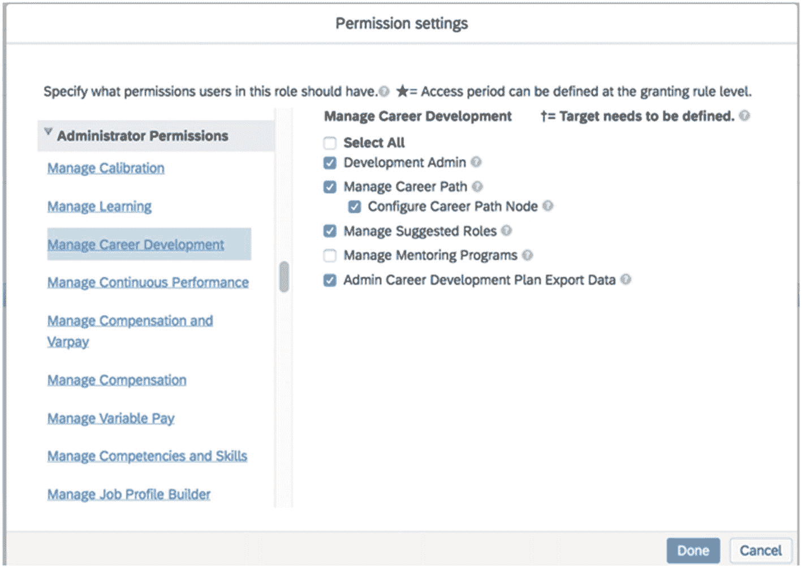

`图 2-13` 管理职业发展权限

根据上一章的讨论，`发展管理员`应该已经启用。现在我们正在添加`管理职业发展路径`、`配置职业发展路径节点`和`管理建议角色`的权限。

表 2-3 包含了`管理职业发展`权限。高亮显示的权限应添加到管理员角色中。

`表 2-3` 管理职业发展权限

| 权限 | 描述 |
|---|---|
| `发展管理员` | 管理所有发展计划设置。 |
| `管理职业发展路径` | 定义和管理职业发展路径。 |
| `配置职业发展路径节点` | 定义职业发展路径中节点显示的内容，仅适用于职业发展路径 V2。 |
| `管理建议角色` | 配置建议角色设置。 |
| `管理导师计划` | 管理导师计划。 |
| `管理员职业发展计划数据导出` | 导出职业发展计划数据。 |

我们需要添加在`职业发展计划`中的`用户权限`部分下找到的权限。图 2-14 显示了此部分的权限。

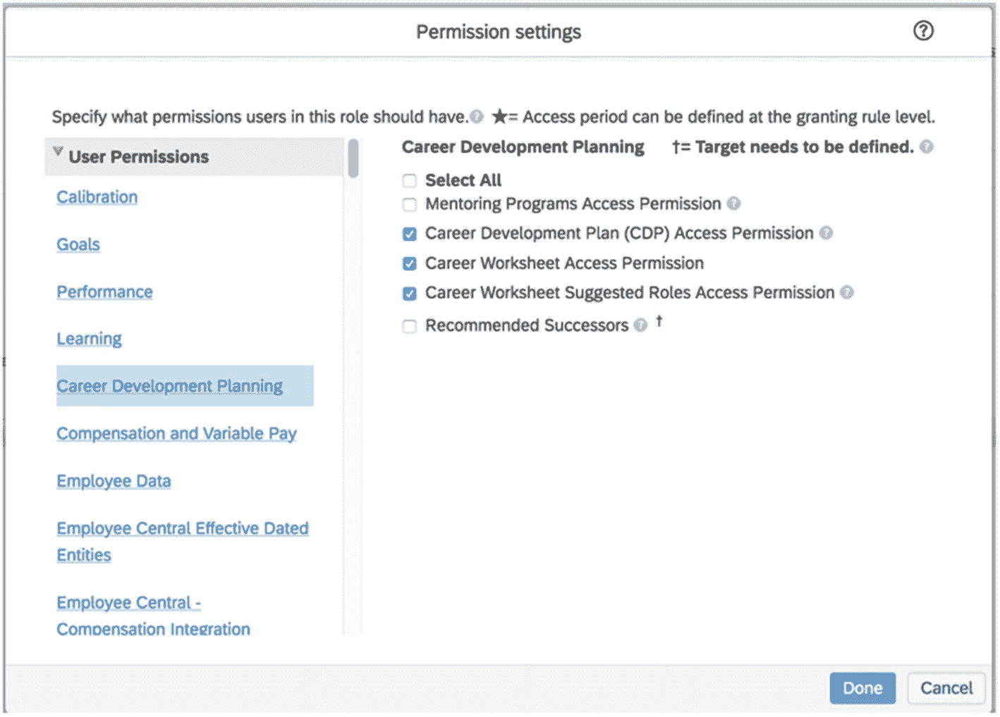

`图 2-14` 职业发展计划权限

管理员角色应该已经拥有`职业发展计划 (CDP) 访问权限`。现在我们将向该角色添加`职业工作表访问权限`和`职业工作表建议角色访问权限`。

表 2-4 突出显示了在`用户权限` ➤ `职业发展计划`内需要授予的额外权限。

`表 2-4` 职业发展计划用户权限摘要

| 权限 | 描述 |
|---|---|
| `导师计划访问权限` | 访问发展模块中的“导师”选项卡。 |
| `职业发展计划 (CDP) 访问权限` | 访问发展模块。 |
| `职业工作表访问权限` | 访问发展模块中的“职业工作表”选项卡。 |
| `职业工作表建议角色访问权限` | 访问发展模块职业工作表中的“建议角色”。 |
| `推荐继任者` | 允许访问继任组织图中的“推荐继任者”部分。 |

如果管理员将要创建或运行关于职业工作表相关数据的临时报告，则需要创建和运行这些报告的权限。

前往位于`用户权限`部分的`报告权限`，并启用以下选项：
- `创建报告` ➤ `职业工作表目标角色`
- `运行报告` ➤ `职业工作表目标角色`

该角色还需要访问`CDP 仪表板`。同样在`报告权限`下，找到`分析磁贴和仪表板`，启用`CDP 仪表板`。

图 2-15 显示了需要添加的报告访问权限。

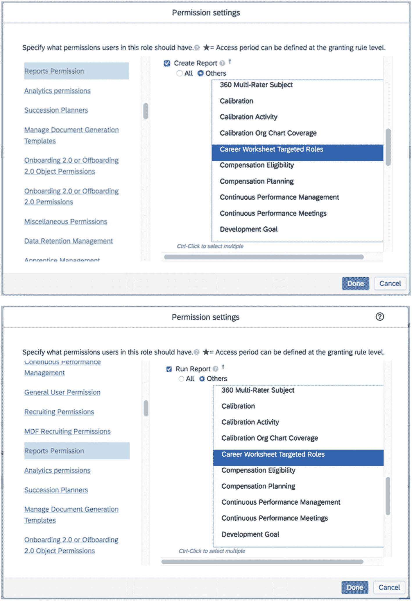

`图 2-15` 创建和运行临时报告权限

管理员还需要拥有创建和查看职业发展路径的权限。在`用户权限`部分下，前往`杂项权限`。滚动查找名为`职业发展路径`的权限，如图 2-16 所示。

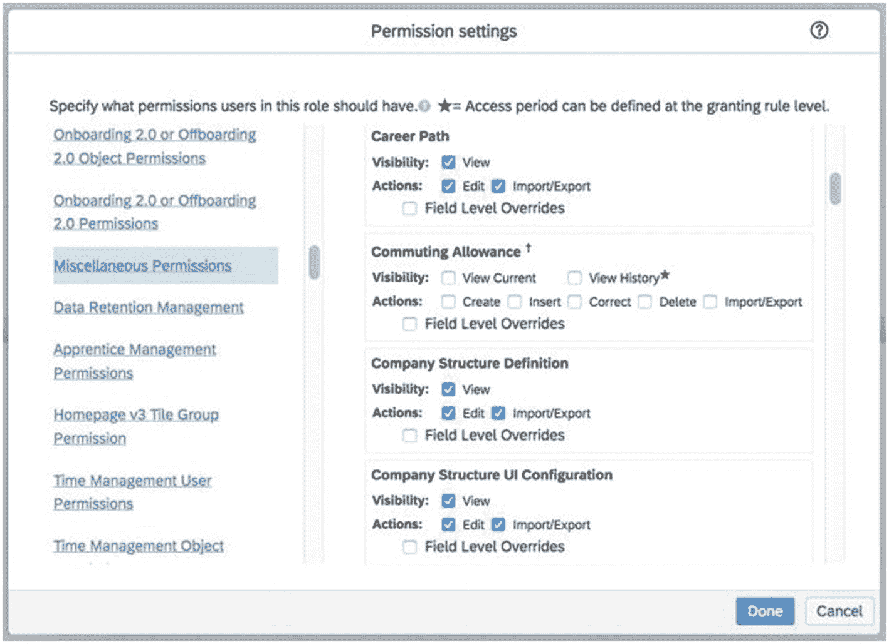

`图 2-16` 用于查看和编辑职业发展路径的杂项权限

对于`职业发展路径`，启用`查看`选项以设置可见性。启用`编辑`和`导入/导出操作`选项。

最后，添加`职业工作表`目标计划权限，如图 2-17 所示。

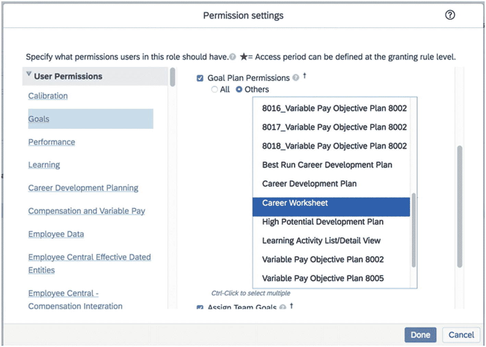

`图 2-17` 职业工作表的权限目标

在关于配置的讨论中，我们提到了添加一个目标角色以显示在人材画像的职业目标板块中的选项。我们在`职业工作表`模板 XML 中添加了`共享`权限。我们还向数据模型添加了`nextPreferredMove`背景字段。

为了让管理员创建用于人材画像的职业目标板块，必须在权限角色中启用该背景字段。如图 2-18 所示，前往位于`用户权限`部分的`员工数据`。向下滚动，在数据模型中找到背景字段`preferredNextMove`，并授予`编辑`权限。

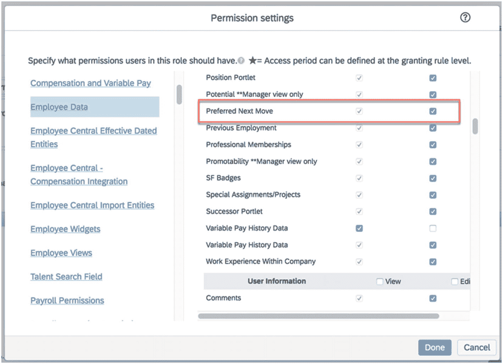

`图 2-18` 首选下一步行动背景字段的权限

现在，我们已经授予了管理员权限角色访问权限，以管理`职业工作表`的各项功能。保存该权限角色。

## 职业工作表设置

现在，我们将逐步介绍管理员将为`职业工作表`启用的所有功能。

### 更新人材画像

如果您当前没有使用板块来表示职业目标，请前往`配置人材画像`来添加该板块，如图 2-19 所示。

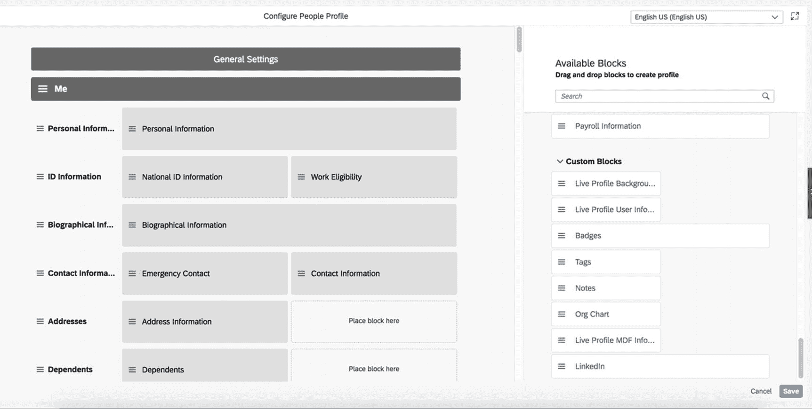

`图 2-19` 配置人材画像 添加新板块

找到一个您想放置该板块的区域。您可以将该板块添加到一个现有的、包含类似类型板块的区域中。通常，这是一个对员工、经理和 HR 经理可见的人才资料区域。在屏幕右侧的`自定义板块`下，选择`实时画像背景信息`，并将其拖拽到一个区域内的新板块中。

为板块命名并添加描述。如图 2-20 所示，该区域和板块被标记为`职业目标`。

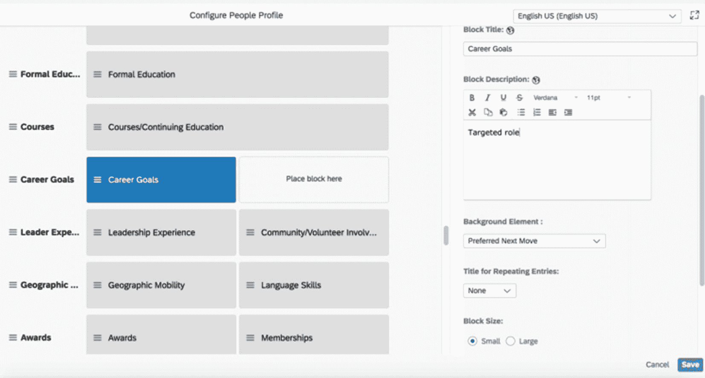

`图 2-20` 添加并标记职业目标板块

在描述部分下方，有一个背景字段下拉列表。选择背景字段`preferredNextMove`，如图 2-21 所示。

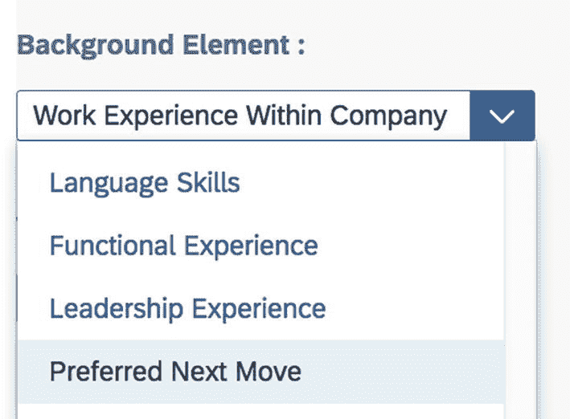

`图 2-21` 背景元素的选择

保存区块，接下来我们将进行管理员在准备使用职业工作表之前需要执行的任务。

## 角色能力预期评分

职业工作表的一个关键组成部分是岗位角色能力；它是职业工作表的支柱，因为就绪程度基于某个角色的能力。为了按预期使用职业工作表，所有岗位角色都需要已映射的能力。链接到岗位角色的每项能力还必须有一个预期评分。预期评分将与员工的实际能力评分进行对比，以此确定该员工对该角色的就绪程度。

使用`职位档案构建器 (JPB)`确保每个岗位角色都有能力项。我们还需要验证每个岗位角色能力是否都有预期评分。如果你未使用`JPB`，可以使用`族系与角色`。

管理员可以手动为岗位角色添加预期评分。为此，请前往`职位档案内容 -> 族系与角色 -> 能力`，如图 2-22 所示。

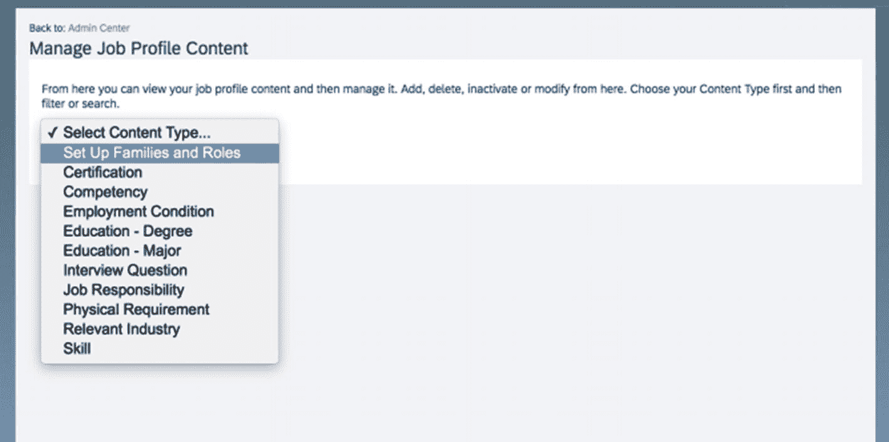
`图 2-22` 使用职位档案构建器访问族系与角色

前往`管理职位档案内容 -> 设置族系与角色`。

进入`角色`选项卡，选择一个角色进行编辑，如图 2-23 所示。

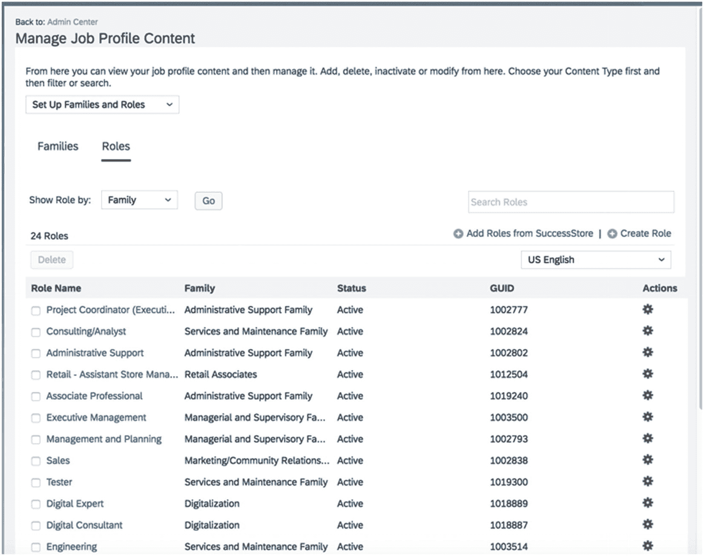
`图 2-23` 管理职位档案内容中的角色视图

选择一个角色，并进入该角色的`已映射能力`选项卡，如图 2-24 所示。如果需要，首先将能力映射到该岗位角色。

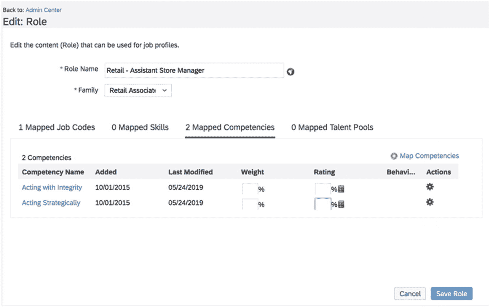
`图 2-24` 岗位角色的已映射能力

我们需要关注`评分`列。点击某项能力的计算器图标。将弹出一个弹出窗口，如图 2-25 所示。

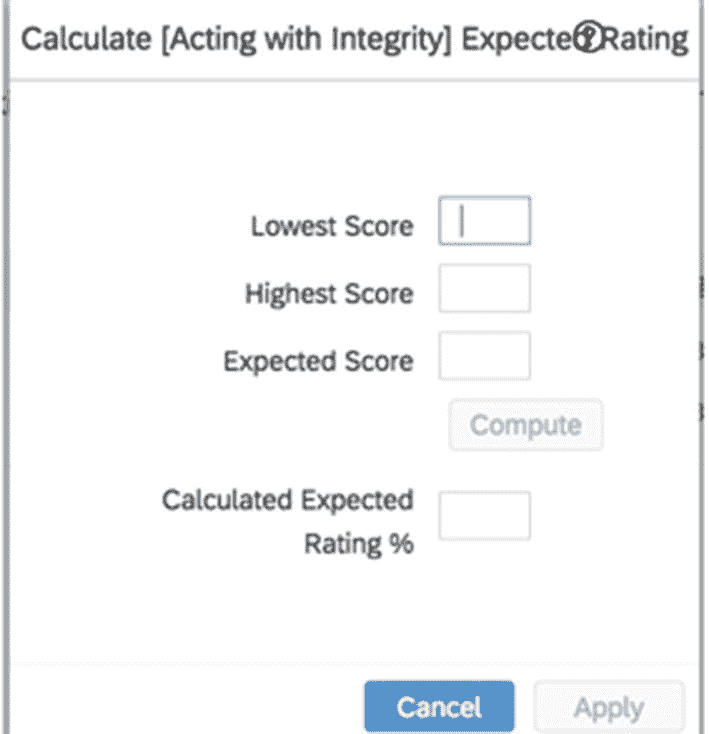
`图 2-25` 预期评分计算器

根据你在职业工作表模板`XML`和`角色就绪评估`模板中确定的评分标准，你将输入评分标准中的最低分数、最高分数，以及该能力的预期评分分数。预期分数应是对能力熟练度可接受的评分。你可能需要与组织内的薪酬或人才管理部门人员协商来确定这些评分。

输入三个分数后，`计算`按钮将变为可用，如图 2-26 所示。

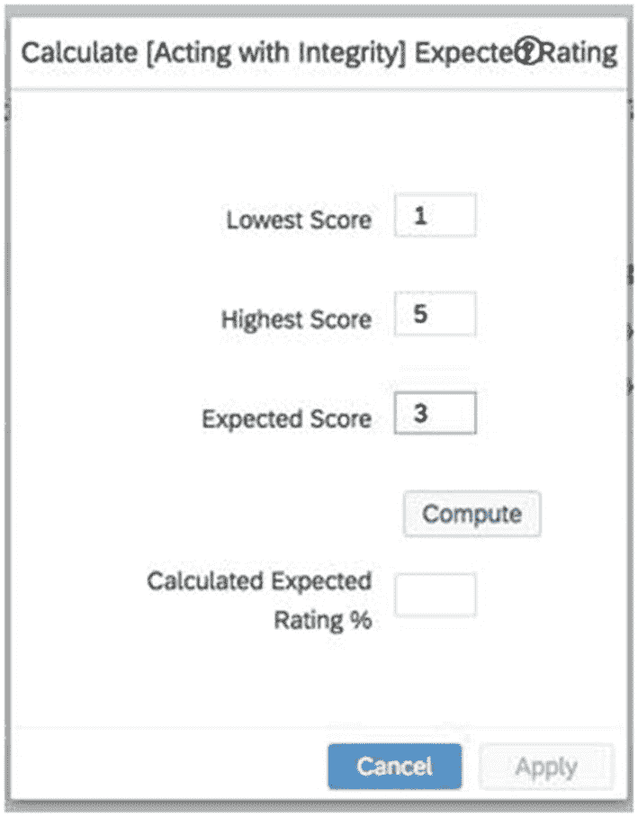
`图 2-26` 输入分数后计算按钮变为可用

随后将显示计算出的预期评分百分比。用于计算此能力预期评分的系统硬编码公式为 `(x – 1)/(评分标准 – 1) = 预期评分百分比`，其中 `x` 是职业工作表中某项能力的预期评分。

点击`应用`按钮，如图 2-27 所示。

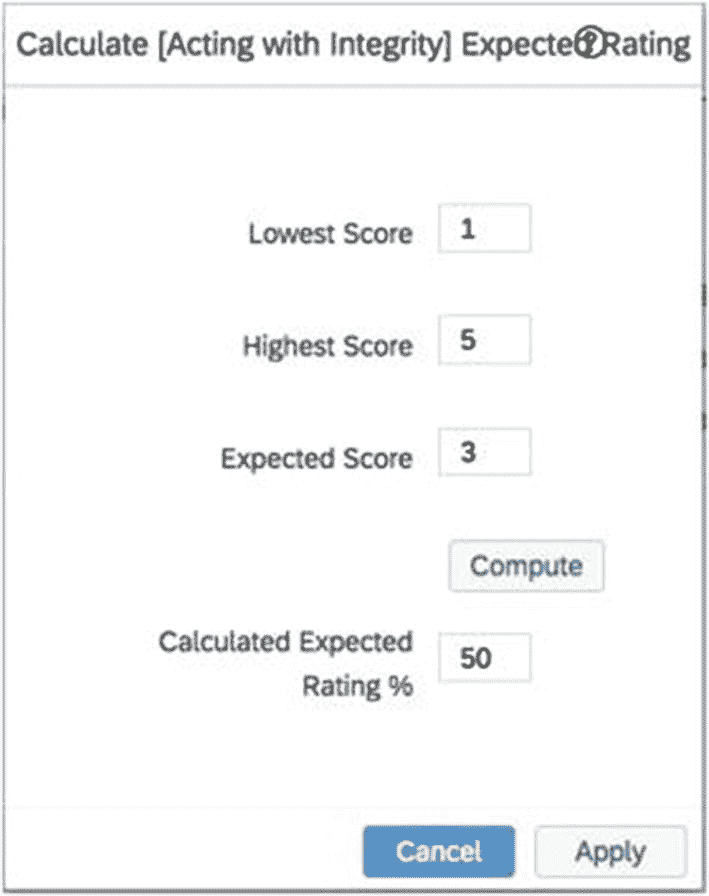
`图 2-27` 应用能力评分

现在，该能力的计算评分字段已填充完成，如图 2-28 所示。

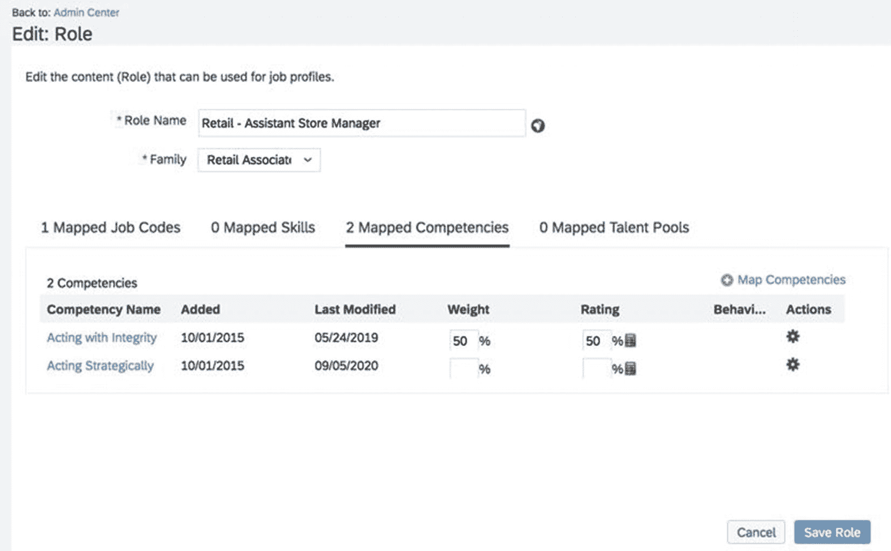
`图 2-28` 带有评分百分比的能力项

对映射到该角色的每项能力执行相同操作。你还可以为每项能力提供一个权重。完成后，点击`保存角色`按钮，如图 2-29 所示。

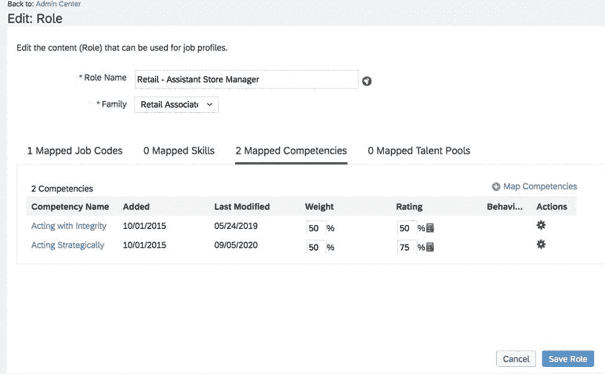
`图 2-29` 保存角色以使评分生效

需要对每个岗位角色上的每项能力都执行此操作。为了简化流程，你可以使用导入功能批量更新岗位角色能力。

## 批量更新岗位角色能力

假设你的岗位角色已有映射的能力，我们只需要为每个岗位角色上的每项能力添加权重（可选）和预期评分。这通过`角色-映射能力`模板完成。

在搜索栏中输入并选择`管理职位档案内容导入/导出`。我们将下载`角色-映射能力`模板，如图 2-30 所示。

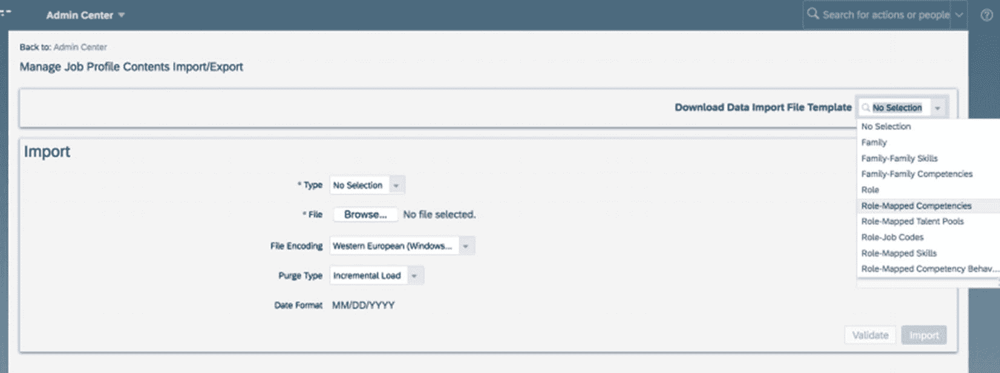
`图 2-30` 下载角色-映射能力文件

当提示时，你希望模板包含现有数据，如图 2-31 所示。

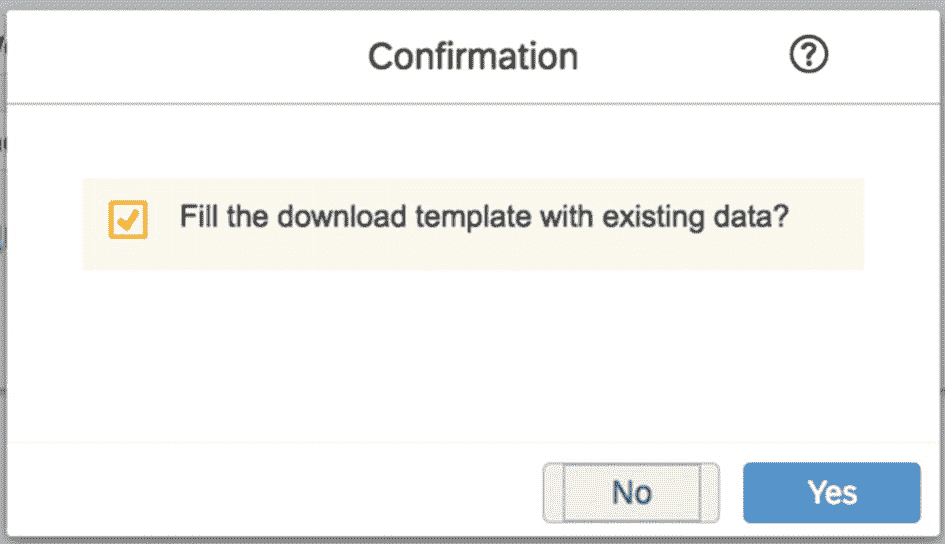
`图 2-31` 确认下载时包含数据

将出现一条消息，指示你前往`监控作业`以检索下载的文件。该消息如图 2-32 所示。


`图 2-32` 包含查找文件说明的弹出窗口

在搜索栏中输入并选择`监控作业`以查看已运行的作业。示例如图 2-33 所示。

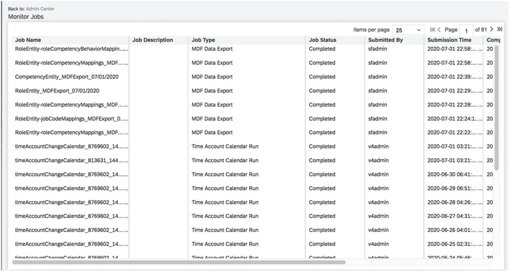
`图 2-33` 已运行的作业

使用屏幕底部的滚动条向右移动，以查看`下载状态`列，如图 2-34 所示。

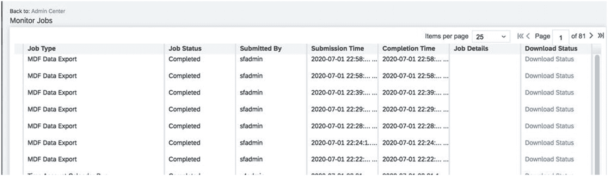
`图 2-34` 带有下载状态的监控作业视图

点击`下载状态`，将提示保存或打开该文件。示例如图 2-35 所示。

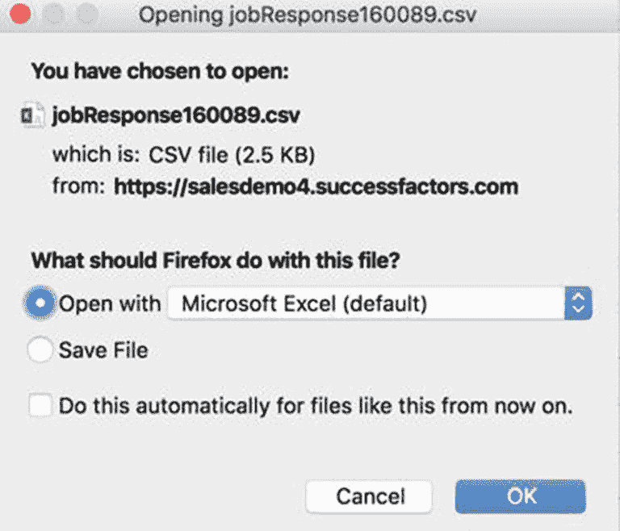
`图 2-35` 打开或保存文件的弹出屏幕

这是我们需要更新的文件。打开后，你将看到有多个语言列；这些是不同语言的标签。图 2-36 显示了该文件的布局。

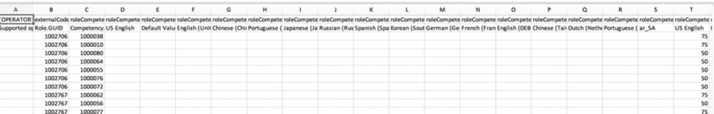
`图 2-36` 角色-映射能力文件

为了使文件更易于管理，你可以删除实例中未使用的任何语言列。在图 2-37 所示的示例中，`默认值`和`US_ 英语`是仅保留的语言列。

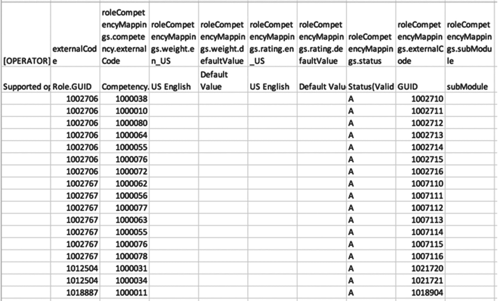
`图 2-37` 删除无关语言列后的角色-映射能力文件

为了给每个岗位角色能力添加预期评分百分比，我们将在以下列中添加值：

*   `roleCompetencyMappings.rating.en_US`
*   `roleCompetencyMappings.rating.defaultValue`

请使用以下计算公式来确定需要填入这些列中的预期评级百分比值：
`(x – 1)/(评级量表 – 1) = 预期评级百分比`，其中 `x` 是`职业工作表`中某项能力的预期评级。

在计算角色准备度时不使用权重，但你可以添加权重以备将来使用。要针对每个职务角色为每项能力添加权重，你需要填入以下列：

- `roleCompetencyMappings.weight.en_US`
- `roleCompetencyMappings.weight.defaultValue`

如果你使用任何其他语言，则需要为每种区域设置包含一列。

你可以为某些能力添加权重，而不为其他能力添加。所有能力都需要提供预期评级百分比。你看到的数字是百分比，而不是基于前述计算得出的评级。示例文件如图 2-38 所示。

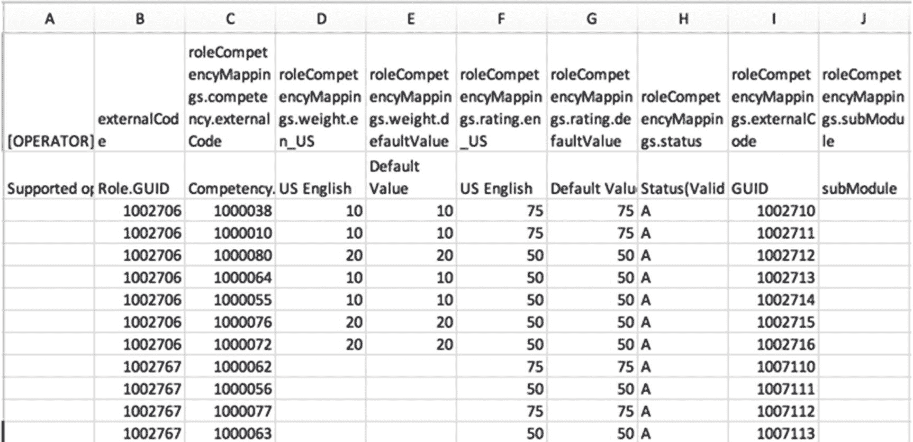
`图 2-38` 包含权重和评级的角色映射能力文件

# 导入模板与管理职业路径

## 导入模板

要导入模板，你需要包含以下列：

- `externalCode`
- `roleCompetencyMappings.competency.externalCode`
- `roleCompetencyMappings.weight.en_US`
- `roleCompetencyMappings.weight.defaultValue`
- `roleCompetencyMappings.weight.en_DEBUG`
- `roleCompetencyMappings.rating.en_US`
- `roleCompetencyMappings.rating.defaultValue`
- `roleCompetencyMappings.rating.en_DEBUG`
- `roleCompetencyMappings.status`
- `roleCompetencyMappings.externalCode`
- `roleCompetencyMappings.subModule`

从`管理职务档案内容导入/导出`导入文件，如图 2-39 所示。首先，运行以进行验证；如果成功，则执行导入。务必在`文件编码`字段中选择“Unicode (UTF-8)”。

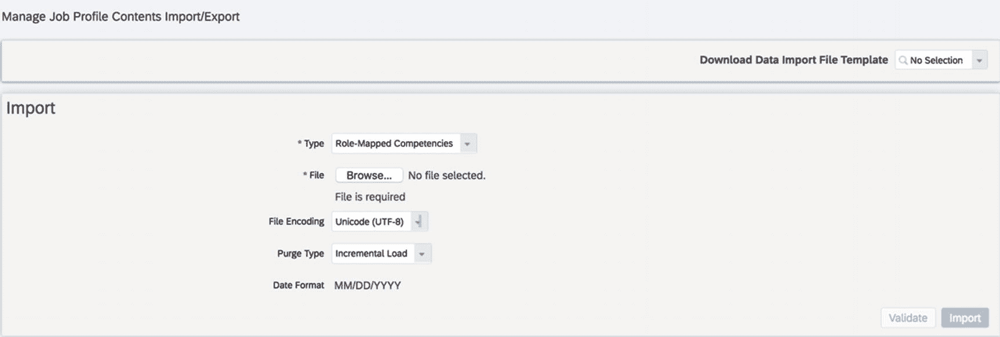

图 2-39：导入更新后的角色映射能力文件

我们现在已经了解了这个文件以及需要添加的内容。但文件中并未包含职务角色名称和能力名称。这将使得确定你要为哪个职务角色/能力映射添加字段变得棘手。因此，我们将退一步，以便你可以创建一个文件作为参考，来识别你正在处理的角色和能力。返回`管理职务档案内容导入/导出`。我们将下载包含数据的`角色`模板，以获取角色映射能力文件中使用的职务角色名称和关联的外部代码。接下来，我们还需要下载包含数据的`能力`模板，以查看能力名称及其关联的外部代码。在更新`角色映射能力`文件时，你可以将这两个文件合并作为参考。更多详细信息，请参考第 1 卷第 3 章。

## 管理职业路径

使用职业路径可以提供职务晋升的可视化表示，使员工能够了解哪些角色是通向下一职位的基础。一个职业路径由一组相似的工作组成，这些工作经过映射以显示从入门级到管理职位的晋升路径。

你可以设置多个职业路径。创建的职业路径适用于整个实例。例如，你可以创建特定于部门（如财务、销售和人力资源）的路径。并且你可以限制员工可以查看哪些职业路径。职业工作表可能包含指向职业路径的链接，以便员工可以查看各种路径，找到他们渴望的角色。他们可以在职业工作表中选择任何角色，以查看在该角色中取得成功所需的能力以及他们自身的准备程度。

如图 2-40 所示，工作表中有一个链接，可以查看任何目标角色的职业路径。

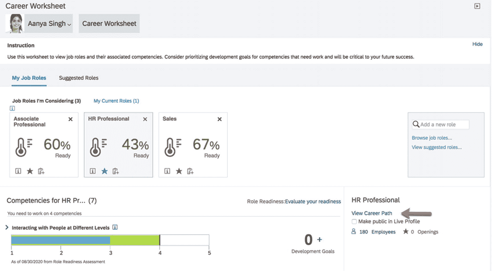

图 2-40：访问目标角色的职业路径

该角色的职业路径将显示，目标角色会被突出显示，如图 2-41 所示。

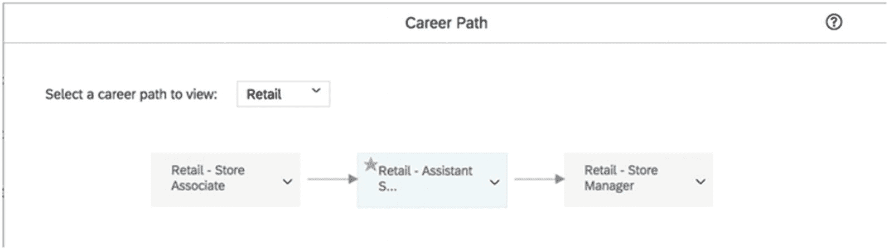

图 2-41：目标角色的职业路径

管理员需要为职业工作表中引用的职务角色创建职业路径。

管理员将在`发展`模块中拥有一个`职业路径`选项卡，如图 2-42 所示。职业路径在此处进行管理。此选项卡仅对在其基于角色的权限中拥有`管理职业路径`权限的角色可见。

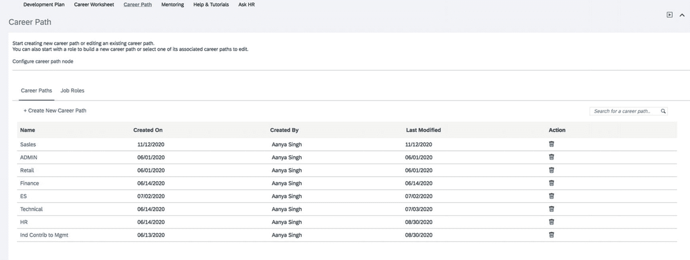

图 2-42：管理职业路径

`管理职业路径`界面包含两个选项卡：`职业路径`和`职务角色`。访问`管理职业路径`的权限将授予对这两个选项卡的访问权，这两个选项卡不能单独授权。

`职业路径`选项卡用于配置职业路径节点，以及创建、编辑和删除职业路径。单击介绍文本下方的`配置职业路径节点`链接。在此处确定要在角色节点上显示的元素。该选项卡如图 2-43 所示。

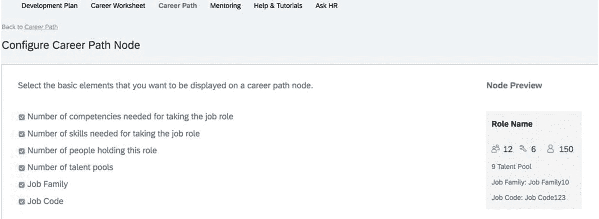

图 2-43：配置职业路径节点

使用此界面来决定职业路径内每个角色（节点）应显示哪些信息。图 2-44 标明了你可以选择的选项。

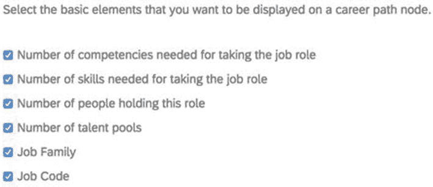

图 2-44：职业路径节点选项

决定了节点要显示的元素后，你可以查看节点预览，它会根据你的选择显示节点的大致外观。图 2-45 使用了所有元素。

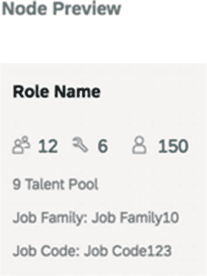

图 2-45：职业路径节点预览

所做的选择将反映在你创建的每条路径的职业节点上。保存选择并返回到`职业路径`界面。

单击`创建新的职业路径`。将弹出一个弹出窗口，如图 2-46 所示。

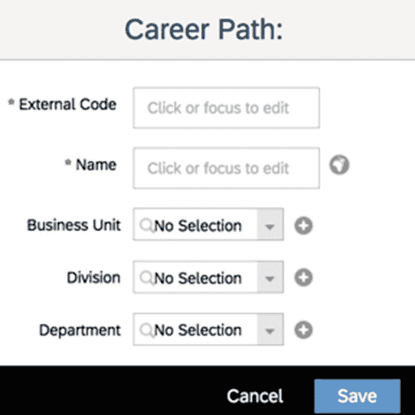

图 2-46：创建职业路径

你需要为你的职业路径起一个有意义的名称。`外部代码`和`名称`字段为必填项；`业务单元`、`部门`和`分部`为选填项。选填字段可用于限制员工对特定职业路径的访问权限。

图 2-47 显示了一个仅使用必填字段的职业路径示例。

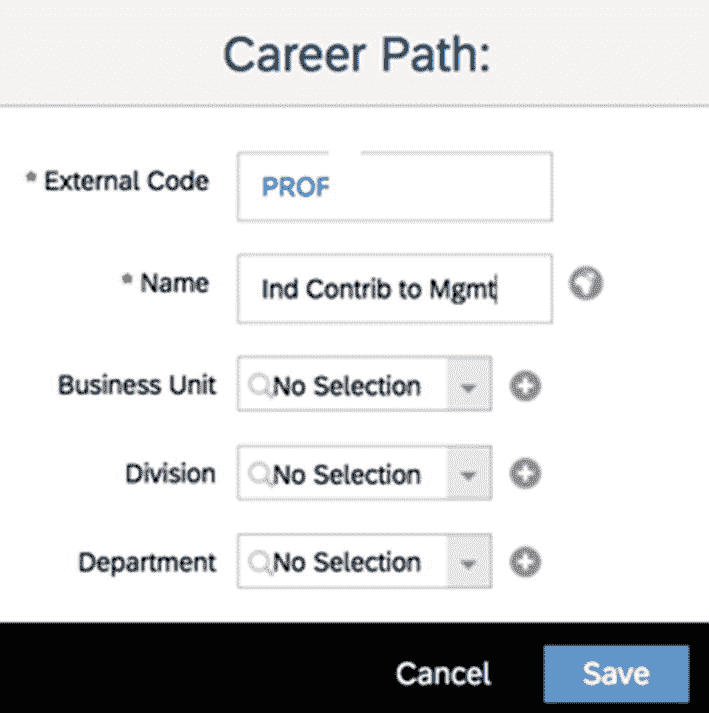

图 2-47：使用必填字段创建职业路径

保存后，将显示一个界面，你将在其中构建职业路径，如图 2-48 所示。

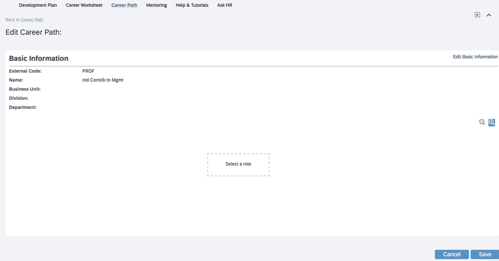

图 2-48：构建职业路径

单击屏幕中央的`选择一个角色`开始构建路径，如图 2-49 所示。将弹出一个窗口，显示你可以选择的角色。默认显示为列表视图，角色按系列/角色名称顺序排列。

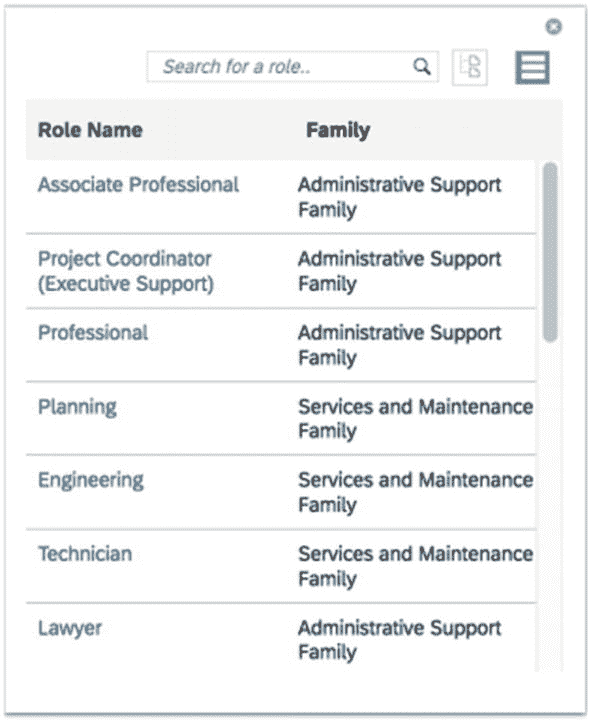

图 2-49：为职业路径选择角色


图 2-49：可添加到职业发展路径的角色

您可以将角色视图切换为树状视图，如图 2-50 所示。

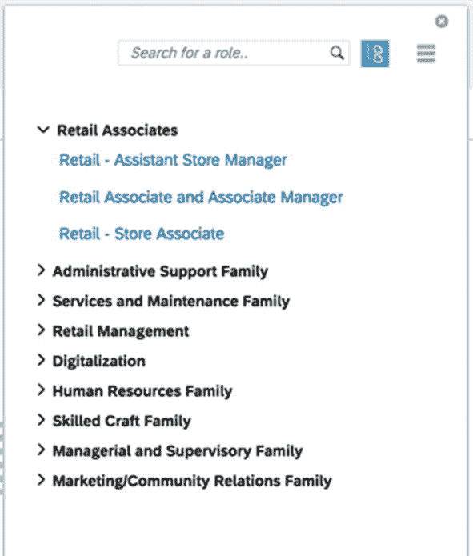

图 2-50：职位的树状视图

选择一个角色，它就会出现在职业发展路径屏幕上，如图 2-51 所示。

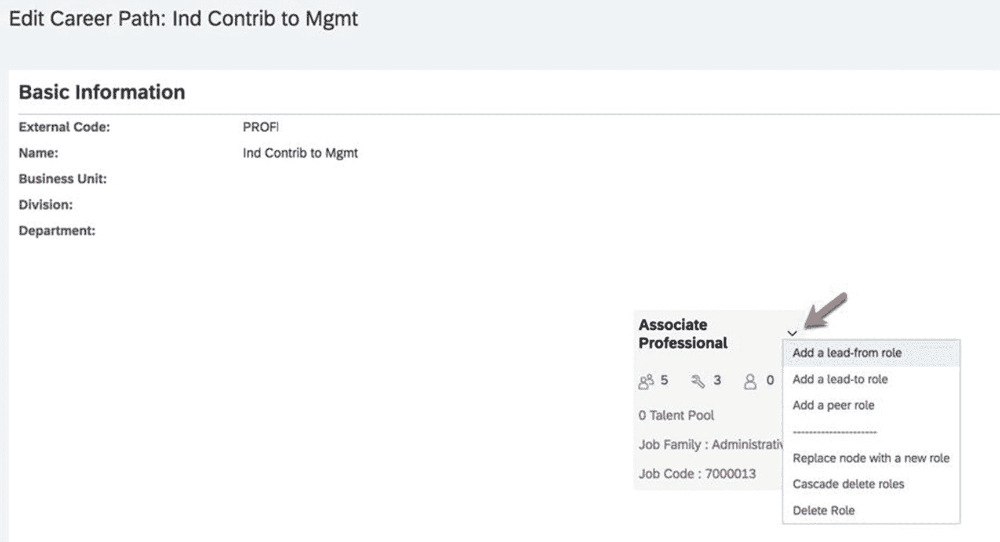

图 2-51：向职业发展路径添加职位

职业发展路径节点提供以下几种操作：

- 添加领先角色，为当前角色添加一个前置角色。
- 添加后继角色，为当前角色添加一个后置角色。
- 添加同级角色，在当前角色上方添加一个横向角色——每个节点最多可有两个横向角色。
- 用新角色替换当前节点。删除一个节点后，您可以选择一个替换节点。
- 级联删除角色。移除当前角色及其所有后续角色。
- 删除角色。移除一个角色，并将领先角色与后继角色相连接。

节点将根据所选操作出现在路径中。在下面的图 2-52 示例中，正在向路径添加一个后继角色。

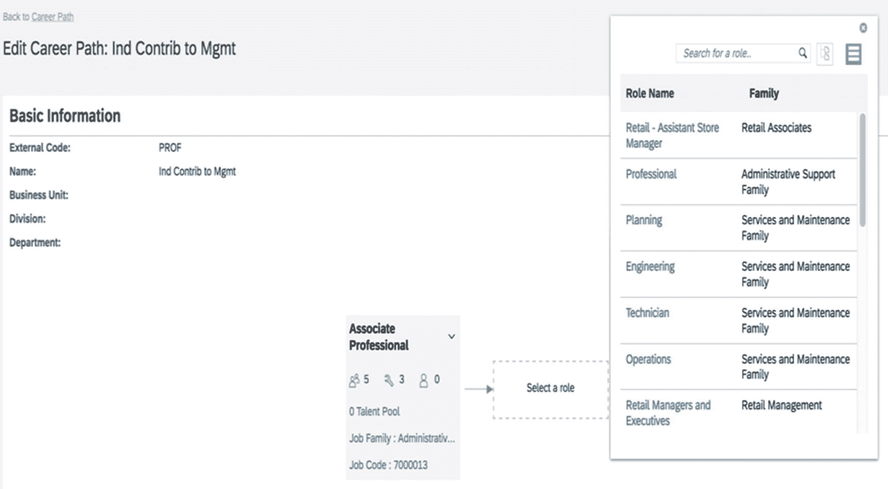

图 2-52：添加后继角色

图 2-53 展示了添加同级角色。这会将一个角色放置在路径中的同一级别上。


图 2-53：添加同级角色

继续添加角色，直到您的路径创建完成。保存路径，如图 2-54 所示。


图 2-54：保存新构建的职业发展路径

返回职业发展路径页面，即可看到您新添加的职业发展路径已列出。您可以继续创建路径，也可以编辑和删除路径。要编辑路径，请点击路径名称。在这里，您可以修改路径或编辑基本信息，如图 2-55 所示。


图 2-55：编辑职业发展路径的基本信息

点击“编辑基本信息”即可添加筛选器，如图 2-56 所示。您可以添加业务单位、部门，从而将职业发展路径的访问权限限制为仅属于这些部门的员工。


图 2-56：编辑职业发展路径

返回职业发展路径主屏幕，您可以转到“职位”选项卡，如图 2-57 所示。


图 2-57：职位选项卡

此视图让您能够查看某个角色属于多少条职业发展路径。点击角色名称，相应的职业发展路径便会显示。您选中的角色将在路径中高亮显示，如图 2-58 所示。


图 2-58：职业发展路径中选中的角色

在此屏幕上，您可以点击屏幕右下方的“编辑职业发展路径”按钮来编辑该路径。这将带您返回可编辑职业发展路径基本信息或路径本身的屏幕，如图 2-59 所示。


图 2-59：可编辑职业发展路径的屏幕

您需要执行以上步骤来创建每一条职业发展路径。

## 导入职业发展路径 V2

如果您的组织规模非常大，需要构建大量职业发展路径，手动逐一创建将非常耗时。为避免此手动流程，可以导入职业发展路径。

我们将引用两个文件：

-   **职业发展路径**：包含外部代码和特定于区域设置的翻译。

-   **职业发展路径-职业发展路径详情**：包含与职位相关的职业发展路径外部代码。

在搜索栏中键入并选中“导入和导出数据”，然后选择“下载模板”作为要执行的操作。使用“选择通用对象”下拉列表，选择“职业发展路径”。然后下载模板，如图 2-60 所示。


图 2-60：下载职业发展路径

这将生成一个压缩文件。

打开压缩文件，您会看到两个与职业发展路径相关的文件，如图 2-61 所示。


图 2-61：下载的职业发展路径文件

如图 2-62 所示，职业发展路径模板包含与手动创建职业发展路径时相同的字段：外部代码、职业发展路径名称、业务单位、部门和分部。此外，还会包含针对您实例中启用的语言对应的职业发展路径名称的特定于区域设置的翻译列。


图 2-62：职业发展路径模板

您可以删除实例中未使用语言的外部名称列，如图 2-63 所示。在此示例中，仅保留 `externalName` 列 `en_US`。


图 2-63：删除多余语言列后的职业发展路径模板

构建职业发展路径文件时，您只需填写必填的“外部代码”和“名称”字段。每条路径还需要一个唯一的外部代码。您可以使用任何对您有意义的命名约定。

保存包含您正在创建的所有职业发展路径的文件。图 2-64 是创建三个新职业发展路径的示例。


图 2-64：包含路径名称的职业发展路径文件

在搜索栏中键入并选中“导入和导出数据”，以导入新创建的职业发展路径文件。请确保使用 UTF-8 文件编码类型。首先验证文件以进行导入。转到“监控任务”查看结果。下载并打开“下载状态”列中的文件，如图 2-65 所示。


图 2-65：验证导入结果

如果没有任何错误，职业发展路径文件即可准备导入。

在搜索栏中输入并选择“导入和导出数据”，然后导入职业发展路径文件。再次进入“监控作业”以检查导入状态，并确保导入成功，如图 2-66 所示。


图 2-66：职业发展路径导入结果

如果成功，当您返回“发展”模块中的“职业发展路径”时，将看到新创建的职业发展路径。

接下来，您需要为每条职业发展路径构建职业节点。您需要包含的每个工作角色的 `GUID`。可通过“管理职位档案内容导入/导出数据”并下载“角色”数据来查找角色 `GUID`，如图 2-67 所示。


图 2-67：下载角色模板

下载文件后，前往“监控作业”下载该文件。此文件将在构建职业发展路径详细信息文件时用作参考。在职业发展路径详细信息文件中需要用到的是外部角色 `GUID` 列，如图 2-68 所示。


图 2-68：角色 `GUID`

在构建职业发展路径详细信息文件时，您需要为路径中的每个角色准备一条记录。该记录将包括职业发展路径外部代码、要添加到路径中的工作角色的角色 `GUID`、路径中下一个角色的角色 `GUID`，以及所添加的角色是否为同级角色（`“TRUE”` 或 `“FALSE”`）。示例文件如图 2-69 所示。


图 2-69：职业发展路径详细信息文件

您需要参考角色文件中的角色 `GUID` 来规划职业发展路径，以识别每个角色及其导向的下一个角色。路径的构建将基于 `Career Path-Career Path Details`（职业发展路径-职业发展路径详细信息）文件的 `nextRole` 列中列出的角色 `GUID`，以及 `isPeerRole` 列的值。

### 职业发展路径-职业发展路径详细信息文件布局

该文件用于映射角色之间的“导向”和“被导向”关联。

该文件的各列说明如下：

- **OPERATOR**（A 列）：对于新的职业发展路径，此行空白。其他值为 `Clear`、`Delimit` 和 `Delete`。

- **externalCode**（B 列）：包含职业发展路径名称。这是您在职业发展路径文件的 B 列中指定的名称。

## 职业发展路径详细信息字段

- `careerPathDetails.externalCode`（C 列）：对于新的职业发展路径，您可以在此处分配一个唯一的外部代码。如果您要更新现有职业发展路径中的详细信息，则需要从职业发展路径详细信息文件的导出中找到该代码。

- `careerPathDetails.role.externalCode`（D 列）：应包含您要添加到路径中的角色的角色 GUID。

- `nextRole.externalCode`（E 列）：应包含路径中下一个角色的角色 GUID。

- `careerPathDetails.isPeerRole`（F 列）：标识该角色是否为同级角色（`TRUE` 或 `FALSE`）。

在映射“导向”和“被导向”角色时，使用 `careerPathDetails.role.externalCode` 和 `careerPathDetails.nextRole.externalCode` 来关联路径中的下一个角色。通过在 D 列中标识一个角色并在 E 列中标识下一个角色，系统将知道下一个角色是否已在路径中。如果是，您添加的角色是“导向”角色，而不是“被导向”角色。

在映射同级角色时，`careerPathDetails.role.externalCode` 和 `careerPathDetails.nextRole.externalCode` 可能包含这两个角色中的任意一个，因为 `careerPathDetails.isPeerRole` = `“TRUE”` 定义了该映射是否为同级角色映射。

路径构建完成后，保存文件，并在“导入和导出数据”中使用通用对象类型 `“Career Path-Career Path Details”`（职业发展路径-职业发展路径详细信息）对其进行验证。在“监控作业”中检查结果后，如果验证成功，请返回“导入和导出数据”并导入该文件。导入完成后，您可以返回“发展”模块中的“职业发展路径”选项卡，职业发展路径即构建完成。

现在，您已创建了员工可以在其职业工作表中引用的职业发展路径。

## 建议角色

职业工作表的另一个功能是让员工查看建议角色。工作表中有一个名为“建议角色”的选项卡，如图 2-70 所示。员工将在此处看到基于管理员配置而为他们建议的角色。“建议角色”选项卡仅对员工可见，其经理或人力资源经理无法看到。


**图 2-70** 建议角色

建议角色可以基于职业发展路径或一组定义的标准。建议角色可以是能力、目标角色、职业发展路径和同级所选角色的组合。建议角色基于管理员完成的配置。请前往**工具** ➤ **管理建议角色**，如图 2-71 所示。


**图 2-71** 配置建议角色

基于此屏幕所选标准的算法将为用户创建建议角色，以便用户在其职业工作表上选择目标角色。

有一系列复选框用于标识建议角色所使用的标准。必须为每个启用的标准分配一个权重百分比。权重总和必须为 100，且只能是 0 到 100 之间的整数。

可选择的标准包括：

- 职业发展路径中的接近度
- 能力
- 工作族
- 空缺职位
- 团队内的受欢迎程度

每个标准的描述和评分如表 2-5 所示。

**表 2-5** 建议角色标准与评分

| 标准 | 描述 | 评分 |
| --- | --- | --- |
| 职业发展路径中的接近度* | 角色在职业发展路径中越接近，分配的分数越高。 | 对于职业发展路径中的每个角色，将接近度计算为 `1/(当前角色与路径中每个角色之间的角色数量)`。 |
| 与目标角色关联的能力 | 基于使用职业工作表就绪度计算得出的匹配分数。与预期的能力评级进行比较。 | 使用职业工作表角色就绪度百分比。从百分比转换。例如，`70%` 的就绪度百分比将对应 `0.7` 的分数。 |
| 工作族 | 如果该角色与用户角色属于同一工作族。 | `0` = 角色与用户角色属于不同工作族。`1` = 角色与用户角色属于同一工作族。 |
| 空缺职位 | 仅适用于传统职位。 | `0` = 无空缺职位。`1` = 有空缺职位。 |
| 团队内的受欢迎程度 | 具有相同经理且选择了相同目标角色的员工。 | 分数基于以下计算：选择了相同目标角色的同级人数 / 同级总人数。 |

截至撰写本文时，使用邻近因素存在一个限制。它仅适用于使用职位描述管理器（`JDM1.0`）的实例。针对职位档案构建器（`JPB`或`JDM2.0`）的代码增强发布日期尚未公布。使用所选因素，系统会为每个角色计算一个分数，然后进行加权。角色将按照分数从高到低的顺序显示在“建议角色”选项卡中。最多可显示 60 个角色。

在“建议角色”配置页面底部，有三个筛选选项：**能力**、**职务族**和**相关行业**。当用户查看其建议角色时，这些筛选器将可用，并允许他们筛选掉与其职业兴趣不符的角色。`相关行业` 是一个筛选器，仅当您使用职位档案构建器并将“相关行业”作为一部分添加到职位档案模板中时才可用。

## 角色就绪度评估表

在深入了解角色就绪度评估表的机制之前，我们先讨论一下该表是什么以及它如何融入职业工作表。角色就绪度评估表由员工从职业工作表中启动，用于评估员工在所选未来角色所需能力方面的熟练程度。该表用于帮助员工规划其职业发展，并确定未来角色所需的发展领域。

角色就绪度评估模板是一个绩效管理模板，因此它使用评分量表和路线图。如果启用了职业工作表，则应在配置（Provisioning）中找到标准的角色就绪度评估模板。它可以在“表单模板管理”下找到。该模板不应使用总体绩效评分，并且只应包含针对职位角色能力的单独评分。

模板的能力部分如图 2-72 所示。


*图 2-72：角色就绪度评估模板*

检查模板的高级设置，确保未启用“仅为在 {日期} 至 {日期} 之间没有现有表单且结束日期为空的用户创建”，如图 2-73 所示。


*图 2-73：高级设置*

该模板使用一个非常简单的路线图，仅包含员工和管理者角色。员工启动表单，对目标角色的能力进行自我评分。自我评分后，表单将路由给管理者，其主页上会出现一个“绩效待办事项”，管理者可以像访问其他绩效管理表单一样访问此表单。管理者将对表单上的每项能力进行评分。管理者的能力评分将用于与预期评分进行比较，以确定角色就绪度。然后表单返回给员工，由员工将其设置为“已完成”。路线图中的最后一步使员工能够知道他们随后可以在其职业工作表中检查角色就绪度。示例路线图见图 2-74。


*图 2-74：角色就绪度评估模板的路线图*

管理员还可以为职业工作表配置一个附加功能，接下来将对此进行讨论。

## 为职业工作表创建指向“我的当前角色”的深层链接

可以将深层链接添加到用户主页上的“快速链接”磁贴中。

要进行此设置，请在搜索中键入并选择“管理主页”，找到“快速链接”磁贴，如图 2-75 所示。


*图 2-75：管理主页*

点击“管理链接”以添加 URL，如图 2-76 所示。


*图 2-76：管理链接*

为标签提供一个名称，然后输入基础 URL，后跟 `sf/careerworksheet?currentrole=true`。要找到您的基础 URL，请查看登录页面的 URL。示例如下：

```
https://performancemanager4.successfactors.com/login#/companyEntry
```

移除 `login#/companyEntry`，并添加 `/sf/careerworksheet?currentrole=true`，如下例所示：

```
https://performancemanager4.successfactors.com/sf/careerworksheet?currentrole=true
```

将该链接设为默认链接并保存。

现在，新的深层链接将显示在主页的“快速链接”磁贴中。该链接会将员工引导至其职业工作表中的“我的当前角色”选项卡，如图 2-77 所示。


图 2-77：主页上的快速链接磁贴

## 总结

现在，我们已经回顾了配置中所需的职业工作表和职业路径设置。我们已经修改了职业工作表模板 XML。我们已经查看了管理员基于角色的权限。我们已经学习了如何创建职业路径以及如何配置建议角色。我们已经查看了职位档案构建器，以将预期评分映射到职位角色能力。我们讨论了角色就绪度评估表以及如何设置它。职业工作表现已准备就绪，可供使用。在下一章中，我们将设置基于用户角色的权限，并从用户的角度逐步了解职业工作表。现在，让我们来看一下职业工作表的集成。

## 职业工作表与继任组织图中的建议继任者集成

职业工作表与继任管理模块集成。来自职业工作表的就绪度计算结果用于在 v12 继任组织图中显示十位潜在继任者，如图 2-78 所示。


图 2-78：建议继任者

继任者的就绪度基于目标职位的职位角色能力和潜在继任者的能力评分。为此，需要满足以下条件：

-   职业工作表模板 XML 中的就绪度计算开关需要设置为“开”。
-   必须使用 `JDM 2.0`。
-   职业工作表模板 XML 中，所有角色 `“*”` 对 `readiness_meter` 具有“读取”权限。
-   定义了职位角色能力，并且用户与职位角色相关联。
-   继任规划者的权限角色具有“建议继任者”权限。

如果用户对角色所需的任何能力没有能力评分，则他们不会列为可能的继任者。

### 职业探索器

`Career Explorer` 是一项新功能，它基于组织中与其相似人员的职业路径，向员工推荐职业发展机会。它使用基于 SAP Leonardo 机器学习技术的“人员连接”来检索和分析员工中心数据。`Career Explorer` 目前仅适用于早期采用者关怀 (EAC) 计划的成员。要申请，您至少必须使用 SAP SuccessFactors Employee Central 以及使用职务代码、职位分类和能力的职位档案构建器。您必须拥有继任管理和职业发展规划，并且至少有 1000 条员工与职位角色配对记录。我们将在下一章简要介绍其功能。

# 结论

`Career Worksheet` 已启用，`Career Worksheet` 模板 XML 已配置，并且管理 `Career Worksheet` 功能的权限已授予。管理员已创建职业发展路径，确定了建议角色的标准，并配置了 `Role Readiness Assessment` 模板。

在下一章中，我们将设置员工、经理和 HR 经理角色访问 `Career Worksheet` 及其组件所需的基于角色的权限。然后，我们将逐步介绍员工及其经理在访问 `Career Worksheet` 时可使用的功能。
