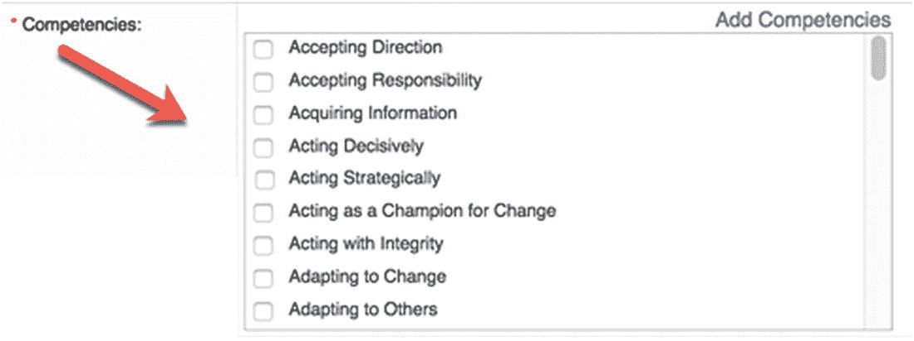

# 能力

如前文所述，可以将发展目标与员工正在努力发展的一个或多个能力关联起来。为此，需要在实例中或在此处的 XML 中的发展计划模板内添加一个字段类型为 `competencies` 的字段定义。此外，还需要指定在向发展计划中的发展目标添加能力时要引用的能力库。

一个计划中只能添加一个能力字段，但一个发展目标可以关联多个能力。

示例代码如下：
```
Competencies
Competencies
Competencies
Competencies
```

向发展目标添加能力时，默认显示为带复选框的列表，如图 1-28 所示。该列表允许选择多个能力。



**图 1-28** 向发展目标添加能力

也可以只允许向一个发展目标添加一个能力。

在 `field-definition` 块中添加 `<field-format>` 标签：
```
use-competencies-single
```

整合此标签的能力字段代码片段如下所示：