# 使用 `Career Worksheet`

在第 2 章中，我们启用并配置了 `Career Worksheet`。我们授予了管理员权限，并学习了如何创建职业路径。我们了解了如何选择建议角色的设置。我们查看了为职位角色能力添加期望评级的流程，并查看了 `Role Readiness Assessment` 表单。现在，我们准备了解员工及其经理如何使用 `Career Worksheet`。

我们将深入了解员工如何使用 `Career Worksheet` 来探索组织内的职位角色。我们还将看到职业路径如何为员工提供组织内职业角色晋升的概览。我们还将学习如何评估员工对未来角色的准备情况。

在本章中，我们将逐步介绍职业工作表中的选项卡。我们将了解在选择目标角色时，准备度计量表如何工作。我们将讨论每个选项卡中的组件，以及如何浏览职业路径、查看建议角色和启动 `Role Readiness Assessment` 表单。我们将查看员工、其经理及其 HR 经理可用的功能。我们还将简要介绍新的 `Career Explorer`。

以下是上一章中的一些要点提醒：

-   `Career Worksheet` 依赖于职位角色及其职位角色定义、已映射的能力以及预期能力熟练度评级。
-   必须通过使用 `Job Profile Builder` 或通过传统的系列和角色将能力映射到职位角色。我们建议使用支持职位描述描述的 JDM v2.0。如果您未使用带有 MDF 职位提名的 EC（该提名在职位对象上具有职位代码），则必须在用户数据文件 (UDF) 中分配职位代码，这些代码将在您的角色/职位代码映射中使用。有关如何将职位代码映射到角色以及如何将能力分配给角色的更多信息，请参阅第 1 卷第 3 章。您也可以将行为映射到能力。
-   如果您希望用户将职业发展目标与目标职位角色的能力相关联，则发展目标计划必须包含一个能力字段。
-   `Career Worksheet` 中使用的能力评级可能来自已完成的绩效或 360 评估表，或来自 `Role Readiness Assessment` 表单。

> **注意**
>
> 有关升级到 `Job Profile Builder` 的信息，请参阅 SAP 说明 #2383059。有关升级到 `Career Path` V2 的更多信息，请参阅 SAP 说明 #2485992。

## 用户角色的基于角色的权限

在开始之前，我们需要为员工、经理和 HR 经理角色设置基于角色的权限。这些角色权限之间的任何差异都将被高亮显示。

### `Career Worksheet` 权限

授予基于角色的权限，以便角色可以访问“发展”下的 `Career Worksheet` 选项卡。

在 `Career Development Planning` 中，员工、经理和 HR 经理角色的访问权限存在差异。员工角色将需要访问职业工作表和建议角色。建议角色仅对员工可访问；经理无法查看其直接下属的建议角色。即使有权限，经理和 HR 经理也无法访问建议角色。

在搜索栏中键入并选择“管理权限角色”。让我们从员工角色开始。打开该角色，单击“权限”，并使用以下路径授予权限：

-   `用户权限` ➤ `职业发展计划` ➤ `职业工作表访问权限`
-   `用户权限` ➤ `职业发展计划` ➤ `职业工作表建议角色访问权限`

权限如图 3-1 所示。确保已授予 `Career Development Plan` (CDP) 访问权限。这可提供从 `Home` 菜单访问 `Development` 选项卡的权限。

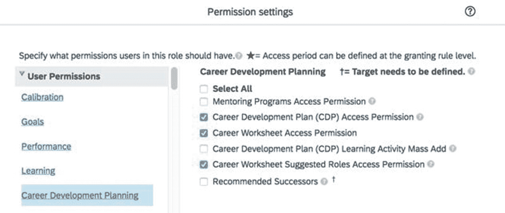

图 3-1 – 职业发展计划权限

保存该角色。对于经理和 HR 经理角色，使用以下路径授予权限：

-   `用户权限` ➤ `职业发展计划` ➤ `职业工作表访问权限`

在上一章中，我们学习了如何配置职业路径。如果 HR 经理角色将创建和管理职业路径，则需要额外的权限。HR 角色所需的基于角色的权限位于 `管理员权限` ➤ `管理职业发展` 中。如图 3-2 所示，授予“管理职业路径”的访问权限。配置职业路径节点是可选的。

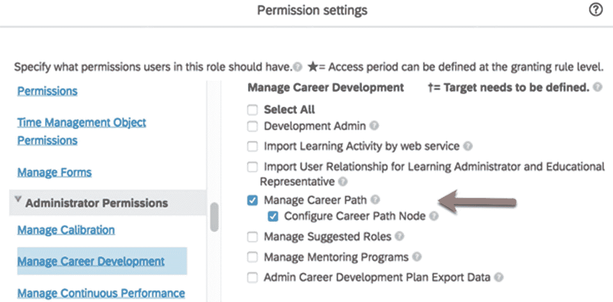

图 3-2 – 管理职业路径权限

> **注意**
>
> 仅当使用 `Career Path` V2 时，职业路径节点才可用。使用职业路径节点可为角色提供附加信息，例如职位代码、职位族、该角色中的员工数以及角色能力数。

### 职业工作表模板访问权限

授予对 `Career Worksheet` 模板的权限，以便该角色可以访问职业工作表计划。权限由目标群体定义。由于员工角色可以访问“自己”，员工将只能看到自己的计划。当经理角色拥有模板权限时，他们可以查看其直接下属的职业工作计划。类似地，当 HR 经理角色拥有此访问权限时，目标群体将是 HR 经理所支持的所有员工。

使用以下路径为员工、经理和 HR 经理角色授予权限：

-   `用户权限` ➤ `目标` ➤ `目标计划权限` ➤ `其他` ➤ `Career Worksheet`

访问职业工作表计划的权限设置如图 3-3 所示。

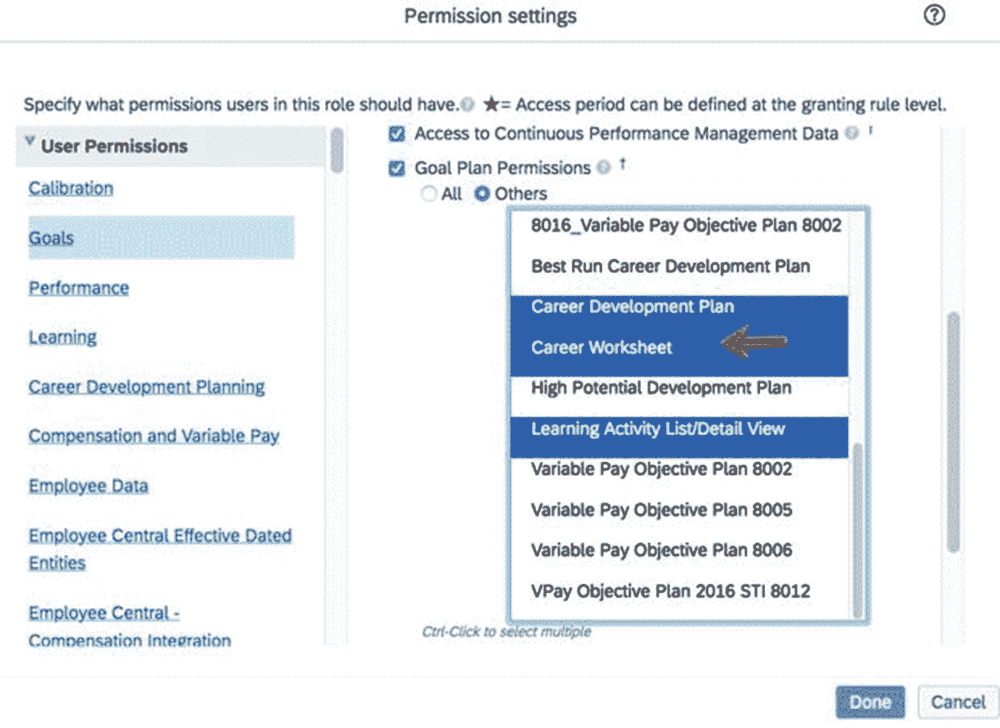

**图 3-3** – 用于职业工作表的目标计划权限

这是对先前授予的 `Career Development Plan` 访问权限以及在发展计划中使用学习活动时的 `Learning Activity List/Detail View` 的补充。

### 职业路径权限

所有角色都需要职业路径的访问权限。如果 HR 经理角色将创建职业路径，则权限会有所不同。

对于员工和经理角色，在 `用户权限` 部分中，转到 `杂项权限` ➤ `职业路径` ➤ `查看可见性`。权限如图 3-4 所示。

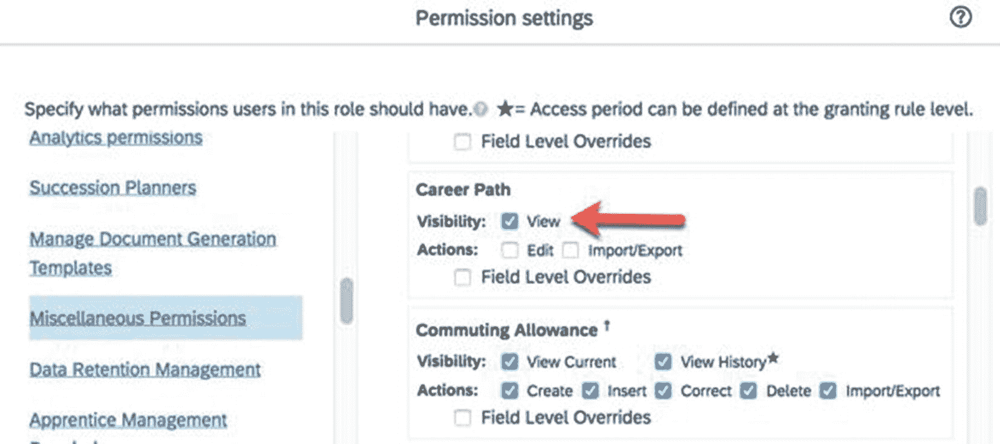

**图 3-4** – 职业路径权限

HR 经理角色若需创建职业发展路径，则需要具备职业发展路径的“查看”和“编辑”权限。关于此权限的说明：拥有“查看”和“编辑”权限的角色将能访问所有职业发展路径。`字段级覆盖`选项用于选择在职业发展路径定义中显示或隐藏哪些基本信息元素。

覆盖字段如图 3-5 所示。

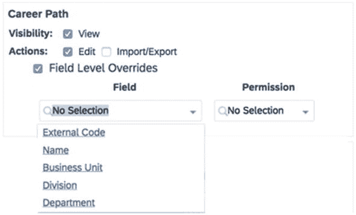

**图 3-5** 职业发展路径覆盖字段

权限类型为“无访问权限”或“只读”，如图 3-6 所示。

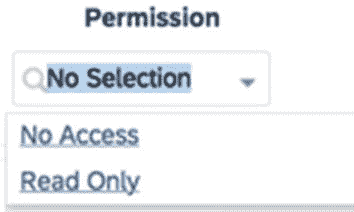

**图 3-6** 覆盖权限

当某个字段被选择为“*无访问权限*”时，该字段将被隐藏。如果选择“只读”，则该角色在创建或编辑职业发展路径时将无法使用此字段。

如果您希望限制用户对特定职业发展路径的访问，可以在权限角色的 `编辑授权` 部分进行设置，如图 3-7 所示。

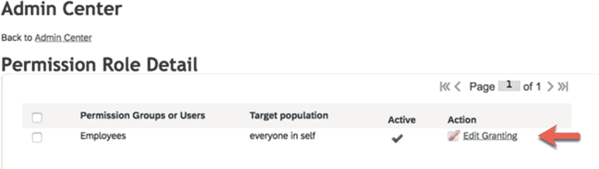

**图 3-7** 限制访问

在 `编辑授权` 内的步骤 3 中，“为其他对象指定目标群体”，如图 3-8 所示，向下滚动找到 `Career Path`。

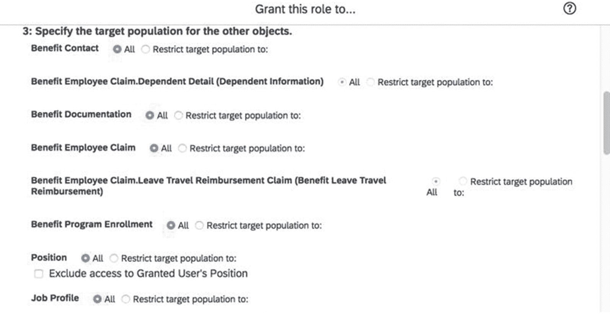

**图 3-8** 指定职业发展路径目标群体

有一个选项可以将目标群体限制为选定的职业发展路径。在下拉菜单中选择限制条件。这些选项在下拉列表中可见，如图 3-9 所示。

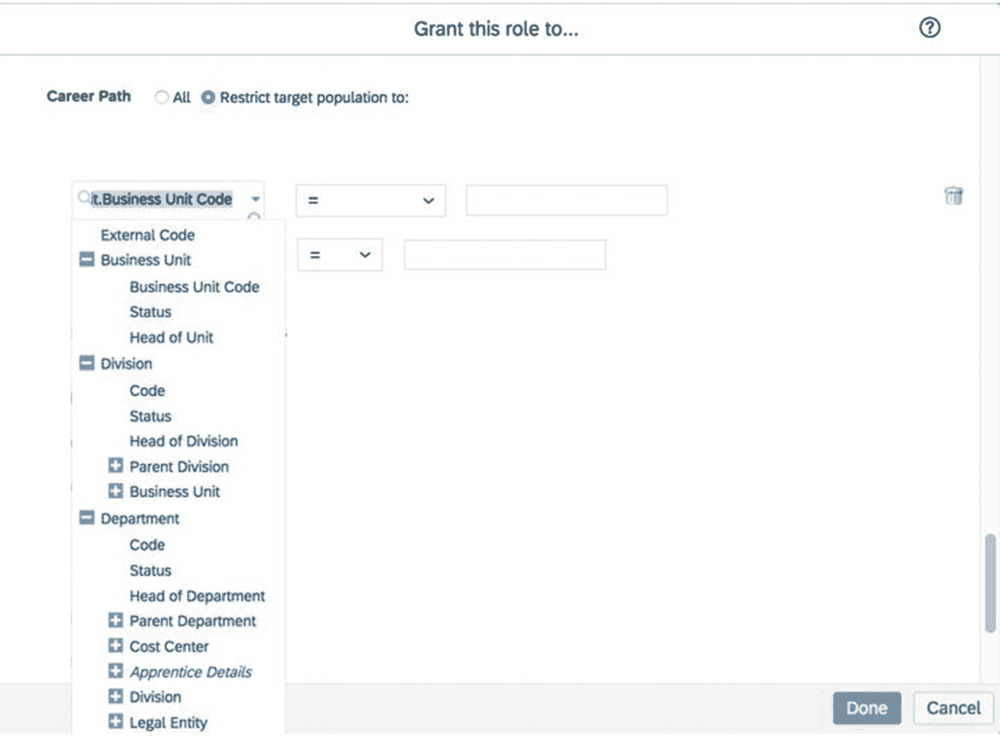

**图 3-9** 限制选项

访问权限可以按外部编码、业务单元、部门或分部进行限制。这些与创建职业发展路径时看到的筛选条件相同，如图 3-10 所示。

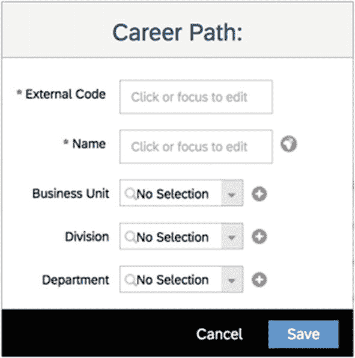

**图 3-10** 用于限制的职业发展路径字段

接下来，选择用于标识角色被限制访问的职业发展路径的条件和值，如图 3-11 所示。

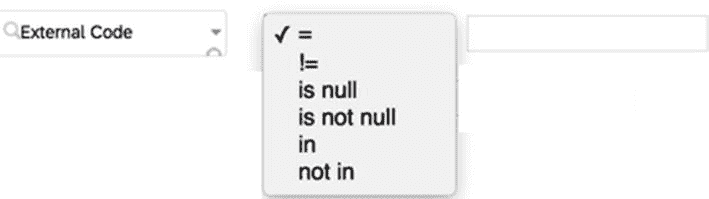

**图 3-11** 用于限制的值

### 角色就绪度的员工权限

员工和经理角色需要在权限设置的 `用户权限` 部分下的 `绩效` 中具备 `绩效管理访问权限`，如图 3-12 所示。这将允许访问 `角色就绪度评估` 表单。很可能此权限已被授予。

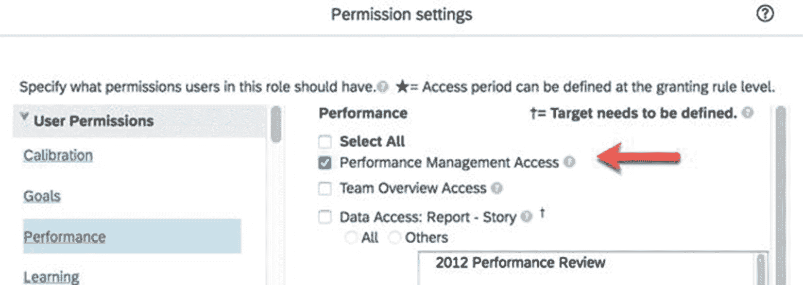

**图 3-12** 绩效管理访问权限

员工角色还需要能够启动 `角色就绪度评估` 表单，因此在 `通用用户权限` 下授予 `创建表单` 的权限，并选择 `角色就绪度评估`，如图 3-13 所示。

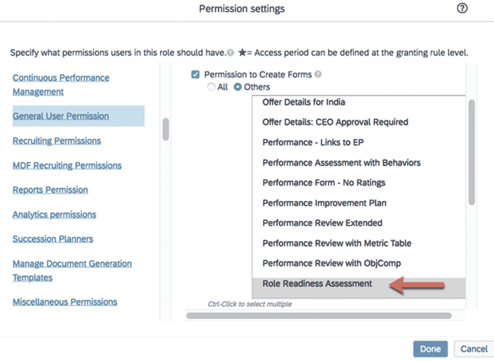

**图 3-13** 创建角色就绪度评估表单的权限

经理和 HR 经理角色不需要创建 `角色就绪度评估` 表单的权限，因为只有员工可以从他们的职业工作表中启动此表单。

### 经理和 HR 经理角色的报告权限

如果经理和 HR 经理将要创建或运行关于 `职业工作表` 目标角色数据的即席报告，则需要创建和运行这些报告的权限。

对于这些角色，请转到 `用户权限` 部分中的 `报告权限`，并启用以下项：

-   `创建报告` ➤ `职业工作表目标角色`
-   `运行报告` ➤ `职业工作表目标角色`

这些角色还需要访问 `CDP 仪表板`。同样在 `报告权限` 下的 `分析磁贴和仪表板` 中，启用 `CDP 仪表板`。这些权限将允许经理访问其直接下属的报告。HR 经理角色将能够访问其支持的所有员工。

基于角色的权限汇总于表 3-1。

**表 3-1** 各角色所需权限

| 权限/角色 | 员工角色 | 经理角色 | HR 经理角色 |
| --- | --- | --- | --- |
| `职业发展规划 ➤ 职业工作表访问权限` | X | X | X |
| `职业发展规划 ➤ 职业工作表建议角色访问权限` | X | | |
| `管理职业发展 ➤ 管理职业路径` | | | X 可选 |
| `创建表单权限 ➤ 角色就绪度评估` | X | | |
| `绩效管理访问权限` | X | X | |
| `杂项权限 ➤ 职业路径` | X | X | X |
| `目标 ➤ 目标计划权限 ➤ 职业工作表` | X | X | X |
| `报告权限 ➤ 创建报告 ➤ 职业工作表目标角色` | | X | X |
| `报告权限 ➤ 运行报告 ➤ 职业工作表目标角色` | | X | X |
| `报告权限 ➤ 分析磁贴和仪表板 ➤ CDP 仪表板` | | X | X |

现在，我们已经为员工、经理和 HR 经理权限角色授予了 `职业工作表` 的访问权限。接下来，我们将了解 `职业工作表` 中的功能。

### 员工可用的职业工作表功能

员工在 `职业工作表` 中可用的特性和功能包括：

-   浏览工作角色
-   查看建议的角色
-   浏览角色时查看工作简介
-   添加目标角色
-   查看目标角色所需的胜任力
-   查看所有包含目标角色某项胜任力的角色
-   启动 `角色就绪度评估` 表单
-   查看目标角色的职业发展路径
-   查看当前角色的职业发展路径
-   使目标角色在员工资料中可见
-   为目标角色胜任力添加发展目标
-   为当前角色胜任力添加发展目标
-   查看目标角色中的员工姓名
-   查看每个目标角色的就绪度指示器
-   查看目标角色已满足的胜任力
-   查看目标角色的差距分析

### 使用职业工作表

现在我们已经了解了员工可以使用哪些功能，让我们开始吧！

`职业工作表` 包含在 `职业发展` 模块中。员工可以通过点击主页主菜单的下拉菜单并选择 `发展` 来访问 `职业工作表`。默认视图是“发展计划”，如图 3-14 所示。点击选项卡切换到“职业工作表”。

**图 3-14** 从主页菜单查看发展模块

`职业工作表`，如图 3-15 所示，由两个选项卡组成：`我的工作角色` 和 `建议的角色`。下图显示了 `我的工作角色` 选项卡的视图。

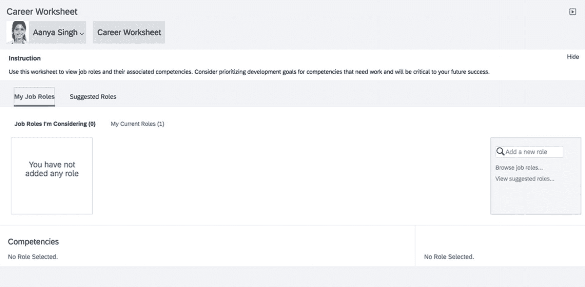

**图 3-15** 员工首次查看职业工作表的视图

## 我的工作角色

我们将逐一浏览工作表中的每个选项卡。我们会查看每个选项卡中显示的内容及其工作方式。首先，我们来看一下 `我的工作角色` 选项卡。

`我的工作角色` 包含两个子选项卡：`我正在考虑的工作角色` 和 `我的当前角色`。每个选项卡的标签都包含一个工作角色数量计数。

`我正在考虑的工作角色` 将显示员工选为目标角色的每个工作角色。这可以看作是潜在的未来角色。在员工选中目标角色之前，这里不会显示任何工作角色。在这种情况下，该选项卡会显示“您尚未添加任何角色”，如图 3-15 所示。

一旦选中了目标角色，员工将看到他们为胜任该角色所做的准备程度。准备程度基于对目标角色工作角色能力的掌握情况，并通过准备程度仪表盘显示。`准备程度仪表盘`会显示员工准备程度的具体百分比。

在我们查看此屏幕上的可用功能、如何浏览工作角色、查看建议角色或职业路径以及选择目标角色之前，让我们先切换到`我的当前角色`子选项卡。这将让我们有机会熟悉每个子选项卡中的一些组件。一旦我们了解了基础知识，我们将返回到`我正在考虑的工作角色`。

## 我的当前角色选项卡

点击`我的当前角色`以查看与员工当前工作角色相关的信息。屏幕显示如图 3-16 所示。

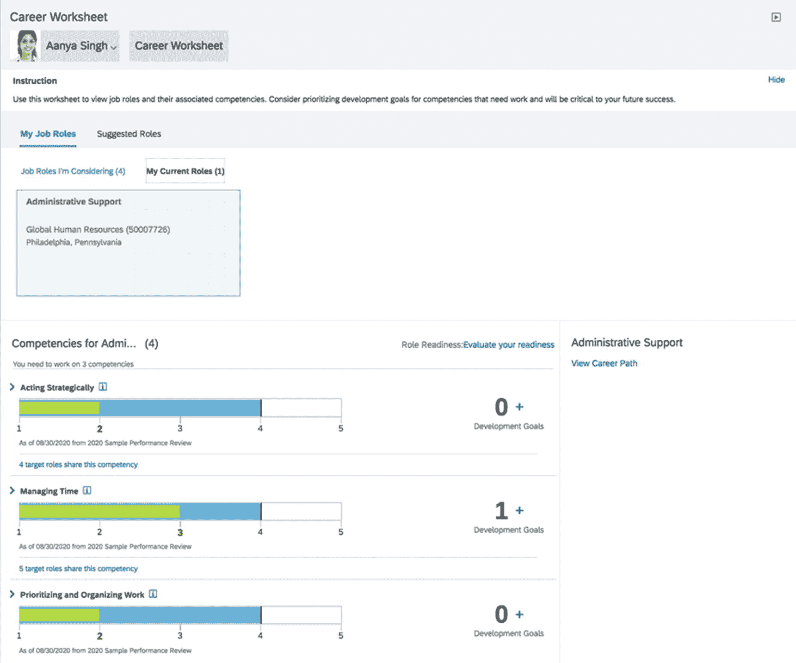

*图 3-16 我的当前角色选项卡*

`我的当前角色`包含基于职位代码字段与员工关联的工作角色。当前的职位名称列在工作角色能力上方的方框中。提醒一下，一个职位代码只能映射到一个工作角色，但您可以有多个职位代码映射到同一个工作角色。工作角色具有已映射的能力及期望评级。我们将重点关注工作角色的这些期望评级。我们在前一章讨论了定义期望能力的方法。第 1 卷，第 3 章描述了将职位代码映射到工作角色的过程，如有任何问题，您可以参考该章节。

在此子选项卡中，您可以看到员工当前工作角色的工作角色能力以及任何相关的`发展目标`。如果员工已完成对工作角色能力进行评级的绩效评估，工作表将使用评估表中的能力评级，并显示与实际评级对比的期望能力评级。

如果这听起来还不清楚，我们稍后会讲到。我们通过先查看当前工作角色来为理解`我正在考虑的工作角色`选项卡奠定基础。

此页面结构使得所有工作角色能力都会列出，并且将包括映射到该工作角色的任何`核心能力`。员工未达到或超过期望评级的能力将首先显示。这些能力将出现在标题“您需要改进 n 项能力”下，其中`n`是能力的数量，如图 3-17 所示。

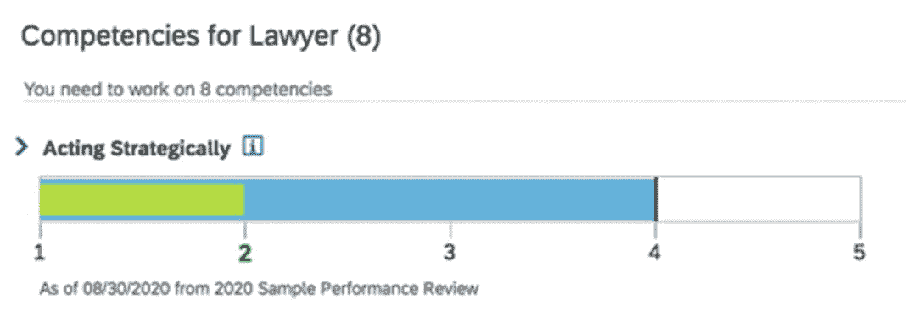

*图 3-17 能力未达标的当前角色*

员工能力评级达到或超过期望评级的工作角色能力将显示在标题“您已达标 n 项能力”下，如图 3-18 所示。这些能力将紧随未达标的能力之后。

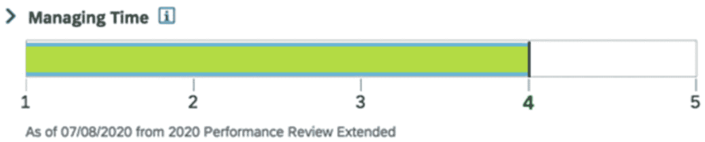

*图 3-18 实际评级达到或超过期望的工作角色能力视图*

图 3-19 显示了某项能力的详细信息。

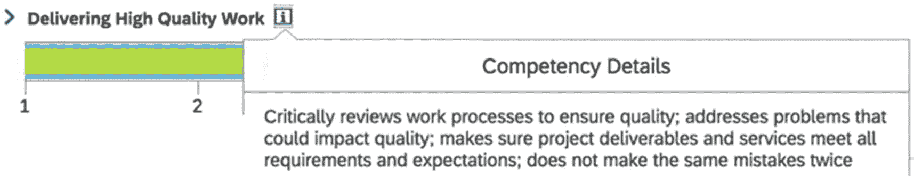

*图 3-19 能力详细信息*

点击能力名称右侧的信息图标可查看能力详细信息。

能力详细信息来自能力描述，如图 3-20 所示。可以通过路径`管理工作档案内容 -> 能力 -> 能力名称`找到。

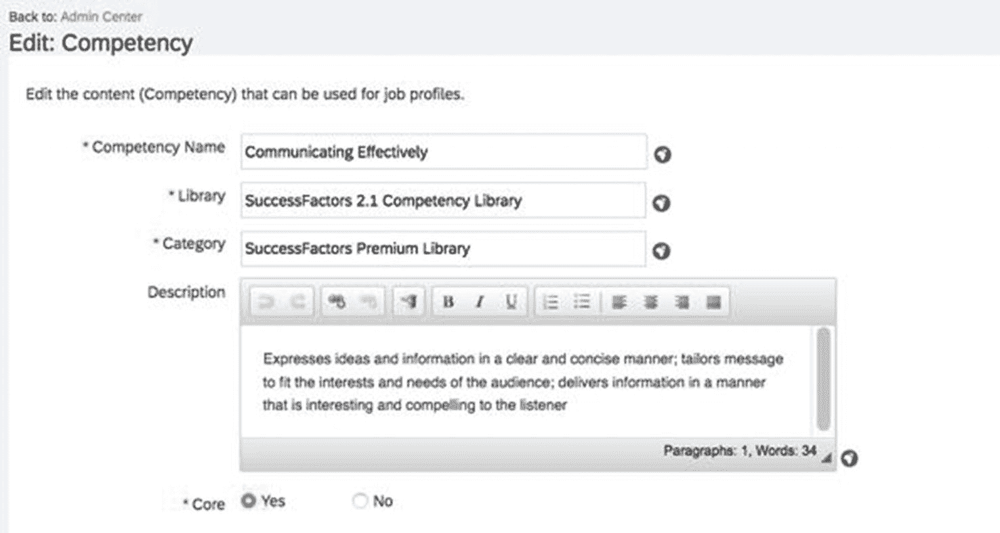

*图 3-20 能力描述*

回到`我的工作角色`，每个能力下方都有一个差距图。这是员工能力掌握程度与期望能力评级之间差距的可视化表示。该图表标识了员工对该能力的最后一次记录评级与期望评级之间的差异。它使用了`职业工作表`模板 XML 和提供评级的绩效模板中标识的评级量表。我们在前一章中查看了这两个模板，并指出必须使用相同的评级量表，差距图和准备程度仪表盘才能正常工作。

将鼠标悬停在图表上可查看实际评级与期望评级的对比，如图 3-21 所示。

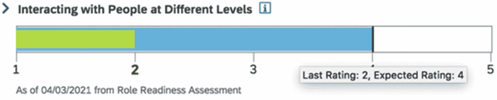

*图 3-21 带有评级的差距图*

图表上看到的期望评级来自工作角色能力期望评级，如图 3-22 所示。请参阅前一章以了解期望能力评级的设置。

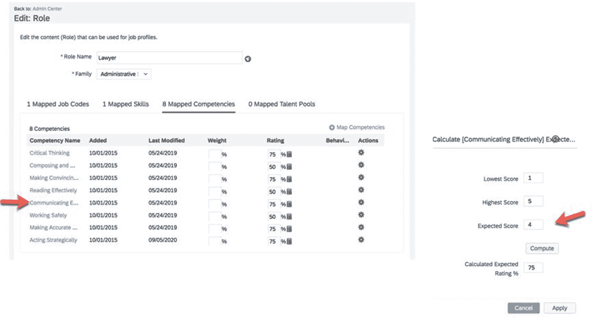

*图 3-22 工作角色能力期望分数*

每项员工评级达到或超过期望的能力，将显示绿线（上次评级）覆盖蓝线（期望评级），如图 3-23 所示。如前所述，这些能力会在所有未达标的能力之后显示。

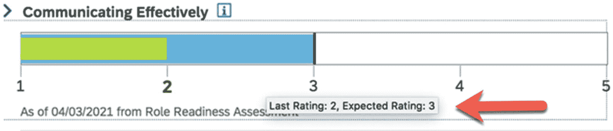

*图 3-23 实际能力评级超过期望能力评级*

实际评级的日期和来源显示在图表下方，如图 3-24 所示。在此示例中，于`09/14/20`完成的`2020 年绩效评估征求反馈`表单是能力评级的来源。

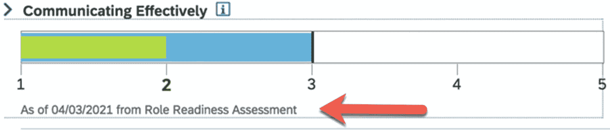

*图 3-24 实际能力评级的日期和来源*

提醒一下，系统会使用已完成的绩效表单中最新的评级。

如果有任何与该能力相关的发展目标，它们将反映在差距图右侧的发展目标计数中。要查看发展目标的详细信息，请展开该能力，如图 3-25 所示。在此，您可以编辑或删除该能力。此处所做的任何更改都将反映在员工的发展计划中。

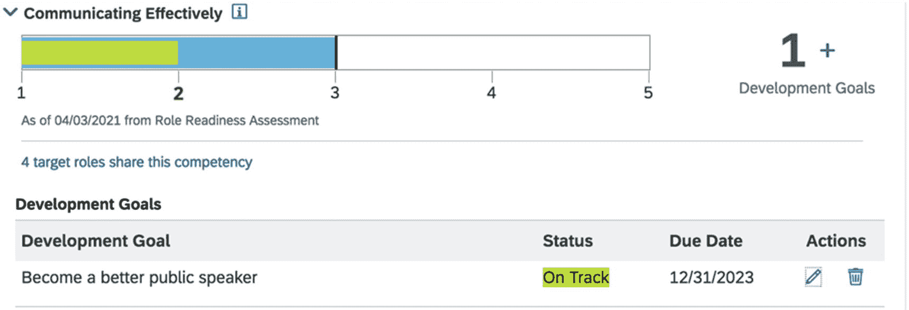

*图 3-25 与工作角色能力相关的发展目标*

点击加号，如图 3-26 所示，可为该能力添加发展目标。

*图 3-26 能力项的发展目标计数*

添加目标将增加该能力项的发展目标计数，并且该目标会连同关联的能力项一同被添加至发展目标计划中，如图 3-27 所示。

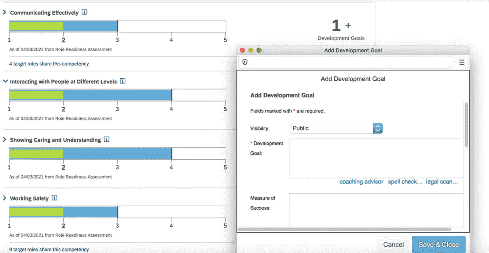

*图 3-27 为能力项添加发展目标*

现在，发展目标已与工作表上的能力项相关联，如图 3-28 所示。

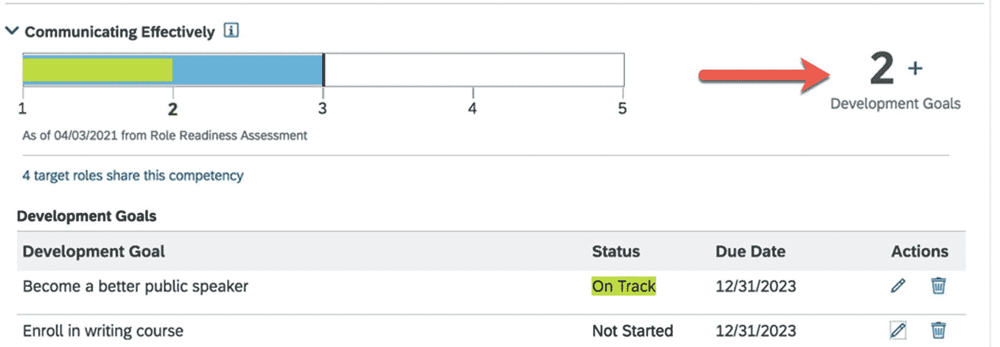

*图 3-28 为职位角色能力项新增的发展目标*

该发展目标已添加至发展计划，并关联了相应的能力项，如图 3-29 所示。

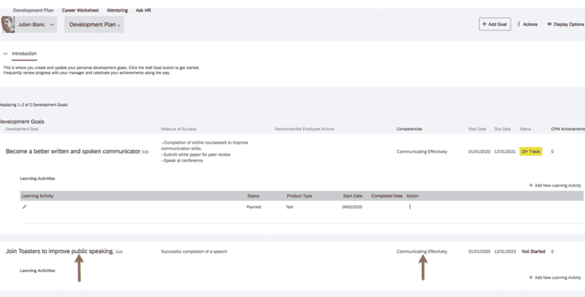

*图 3-29 包含新发展目标与关联能力项的发展计划*

现在，我们应该已经熟悉差距图如何工作、衡量的是什么，以及“我的当前角色”中如何显示职位角色能力项。这与“我正在考虑的职位角色”选项卡使用的布局相同，但后者还包含一些我们接下来将要探索的附加功能。

## 我正在考虑的职位角色

在员工选择未来角色之前，“`我正在考虑的职位角色`”子选项卡不会包含任何角色或能力项，如图 3-30 所示。如前所述，未来角色也称为目标角色，这两个术语可以互换使用。

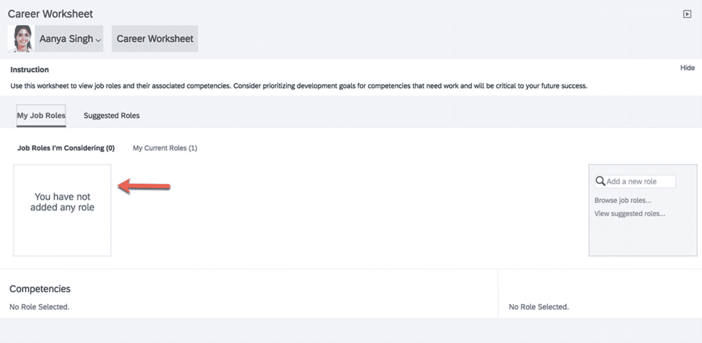

*图 3-30 未包含任何角色的“我正在考虑的职位角色”选项卡*

一旦选择了某个职位角色，它就会显示在此子选项卡中，并且与该角色关联的能力项也会包含在内。最初，员工可以通过两种方式选择目标角色：浏览职位角色或查看建议角色。选择角色后，还会通过目标角色的职业发展路径提供额外选项。我们将详细研究每种方法。

### 浏览职位角色

员工可以点击“`浏览职位角色...`”链接来查看所有职位角色，如图 3-31 所示。

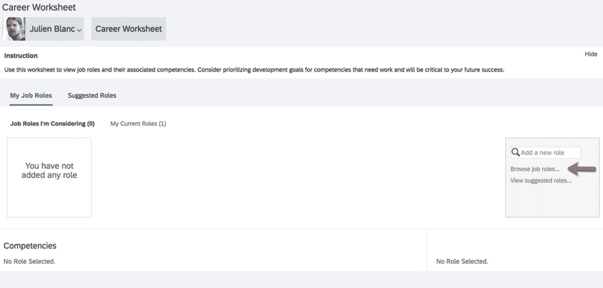

*图 3-31 浏览职位角色*

将弹出一个窗口，按职务族显示所有职位角色。员工可以展开任意职务族以查看其下的角色。示例如图 3-32 所示。

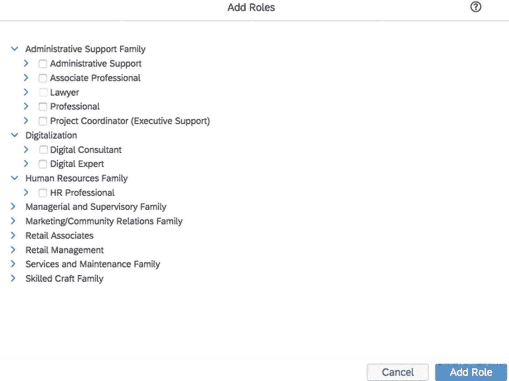

## 3.32 按职务族浏览职位角色

点击某个职位角色的展开图标，可以查看职位描述。这基于该职位角色的职务简介。示例如图 3-33 所示。

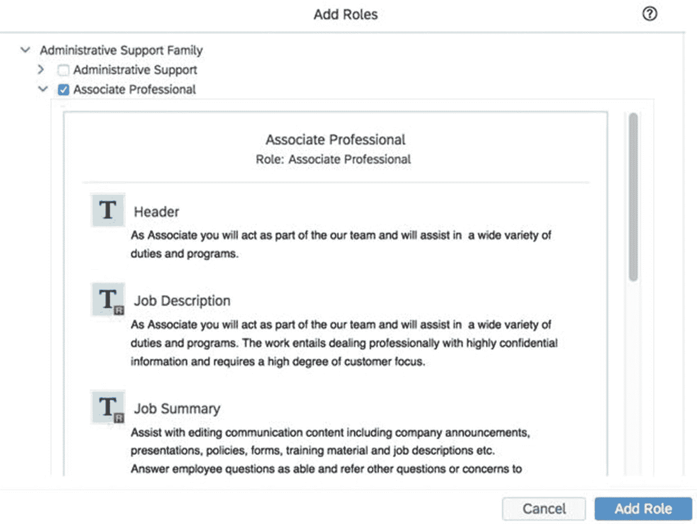

## 3.33 职务简介

选择一个角色并点击“`添加角色`”。可以选择任意数量的角色作为目标角色。但是，可以在“`职业工作表 XML`”中设置一个属性来限制所选角色的数量。一旦达到限制，员工将无法选择更多角色，如图 3-34 所示。

## 3.34 已达到最大角色数量的提示消息

请回顾前一章，了解如何在“`职业工作表 XML`”中设置此限制。

“`我正在考虑的职位角色`”屏幕将显示新选择的角色，如图 3-35 所示。

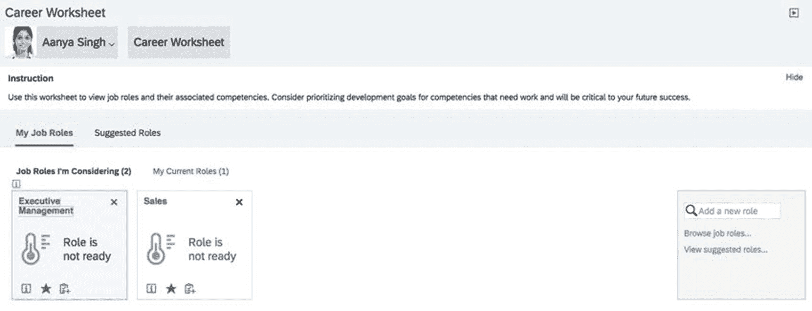

**图 3-35** “我正在考虑的职位角色”子选项卡中的目标角色

在此子选项卡中选择目标角色的另一种方法是使用`查看建议角色...`。

### 建议角色

访问建议角色有两种方式。在“我正在考虑的职位角色”中，您可以点击`查看建议角色...`。另一种选择是点击`建议角色`选项卡。这两种选项均在图 3-36 中高亮显示。

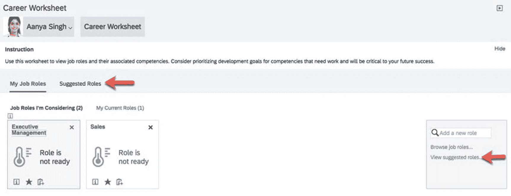

**图 3-36** 查看建议角色的选项

`建议角色`选项卡的权限并非基于角色。换句话说，您无法选择哪些被许可的角色可以查看此选项卡。但是，此选项卡仅在员工查看其职业工作表时可用。如果为经理或人力资源经理角色设置的基于角色的权限授予了对建议角色的访问权限，那么在查看员工的职业工作表时，这两种角色也不会看到此选项。

我们已在上一章中讨论过建议角色的配置。建议角色可以基于系统管理员创建的职业路径，或者基于一组标准的算法。

图 3-37 显示了员工在其职业工作表的“建议角色”选项卡中可能看到的内容示例。

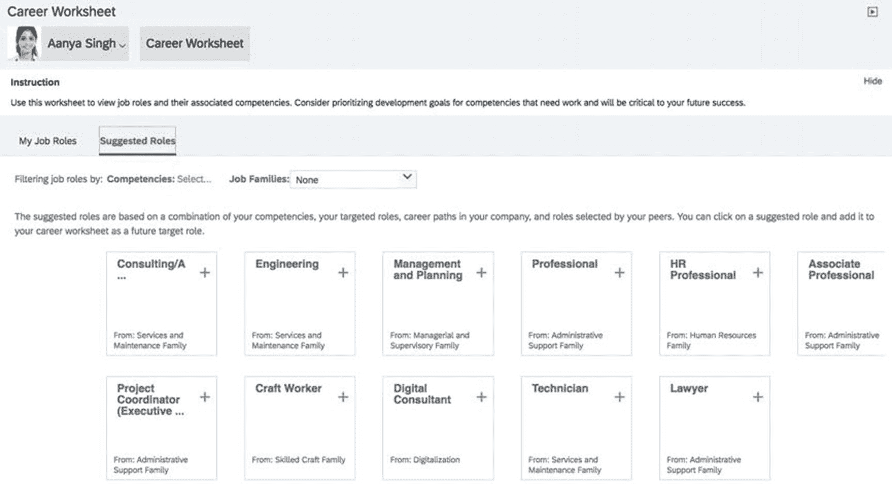

**图 3-37** 建议角色

员工可以使用`能力`或`职务族`筛选器来缩小角色范围，如图 3-38 所示。

**图 3-38** 建议角色筛选器

员工可以根据这些建议角色的能力选择查看建议角色，如图 3-39 所示。

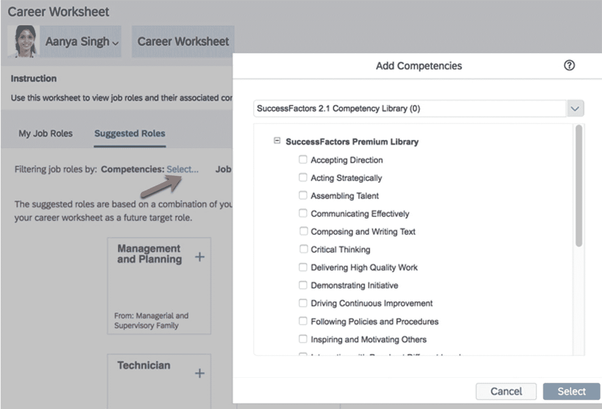

**图 3-39** 基于建议角色能力进行筛选

员工可以按建议角色的任何职务族进行筛选，如图 3-40 所示。

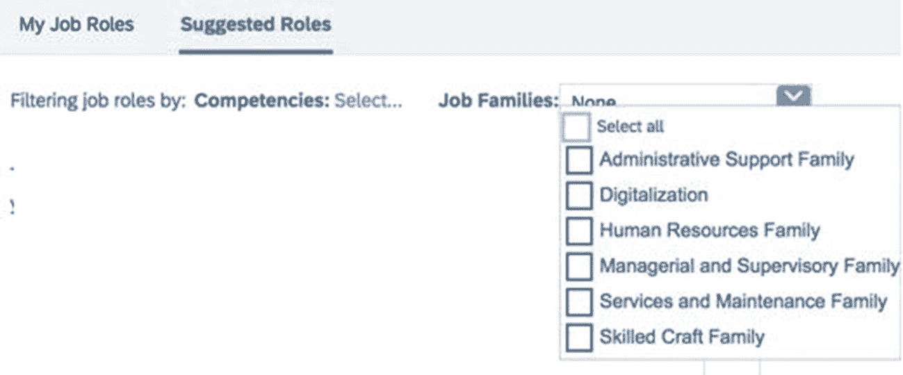

**图 3-40** 按职务族查看建议职位角色

`职务族`筛选器的示例如图 3-41 所示。根据所选筛选器，仅显示四个建议角色。

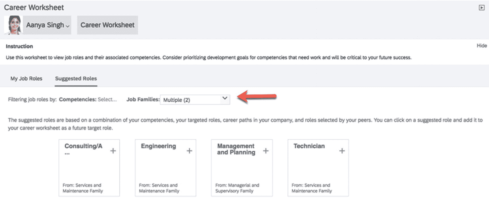

**图 3-41** 基于职务族筛选器的建议角色

员工可能看不到任何建议角色。图 3-42 显示了一个示例。

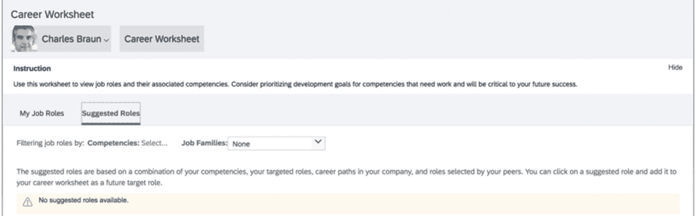

**图 3-42** 无可用建议角色

如果员工尚未选择任何目标角色，没有带有能力评分的已完成绩效表格，或者不符合任何建议角色的条件，则可能出现这种情况。通常，一旦员工选择一个角色并返回此页面，建议角色就会显示出来。

可以通过点击每个角色旁边的加号来选择任意或全部建议角色。将显示一条确认消息，如图 3-43 所示。此外，该角色的添加图标将变为非激活状态。

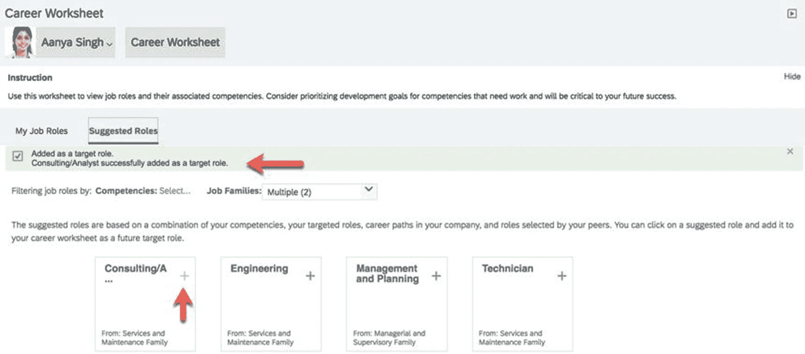

**图 3-43** 建议角色已添加消息

目标角色现在显示在“我正在考虑的职位角色”子选项卡中，如图 3-44 所示。

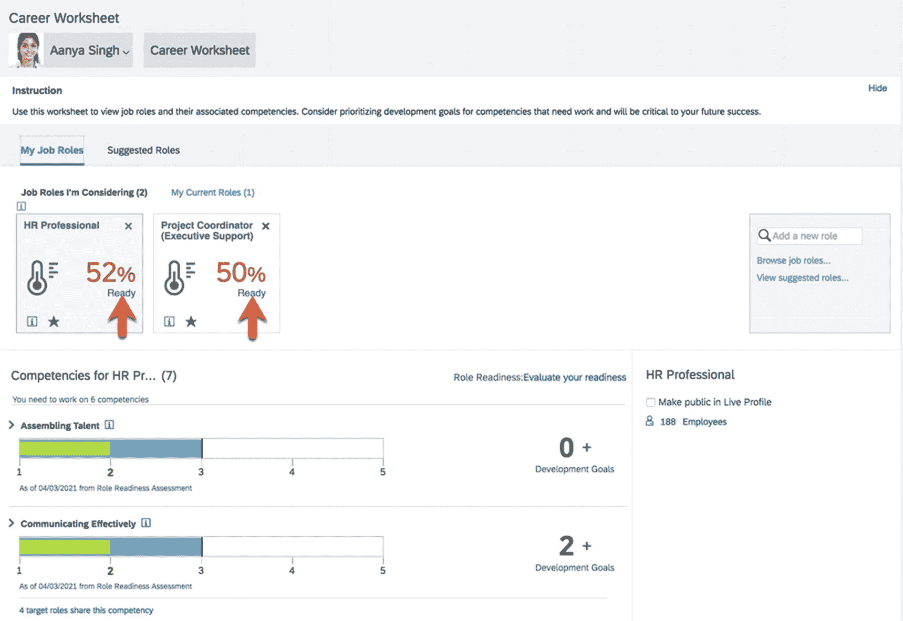

**图 3-44** “我正在考虑的职位角色”子选项卡中的目标角色

该职位角色所需的能力也将一并列出。如果员工当前的职位角色包含任何相同的能力，则可能会显示差距图；如果员工有针对这些能力的发展目标，则发展目标及其计数也会列出。

您会注意到，准备度仪表显示了这些目标角色的准备度百分比。这是因为员工当前的职位角色包含一些与目标角色相同的能力。员工当前角色的能力评分被用来计算准备度百分比。您还会注意到，五个能力中只有两个有差距图。这是因为员工当前角色只拥有其中两种能力，并且有相应的评分。我们将在本章后面看到，使用“角色准备度评估”表单是一种填充其他能力的方法，因为这种方式会基于目标角色的能力对员工进行评分。

对于目标角色的每项能力，都会显示同样关联了该能力的角色数量，如图 3-45 所示。在“家族与角色”中映射到某项能力的所有职位角色都将作为具备该能力的角色包含在差距图部分。

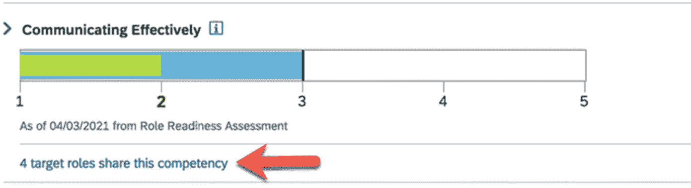

**图 3-45** 共享该能力的其他角色

点击链接可查看同样具备此项能力的目标角色名称。示例如图 3-46 所示。

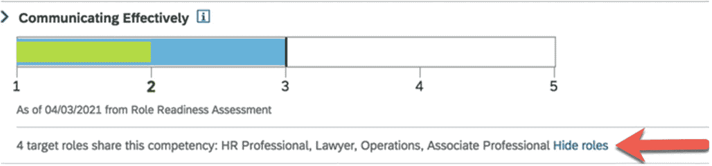

**图 3-46** 具备该能力的其他职位角色

### 职业路径

现在员工已选择了目标角色，还可以查看职业路径。员工可以查看目标角色的职业路径。示例如图 3-47 所示。

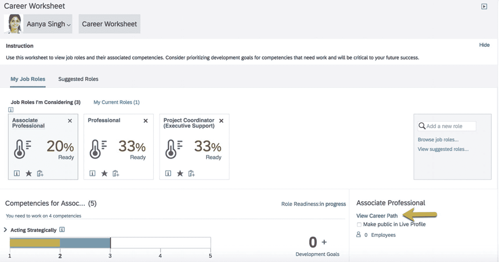

**图 3-47** 查看目标角色职业路径的选项

职业路径将显示出来。示例如图 3-48 所示。

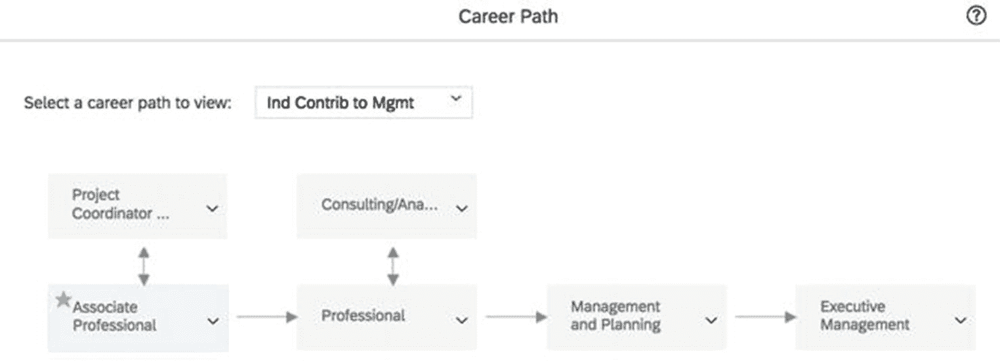

**图 3-48** 目标角色的职业路径

目标角色将带有星标，并以不同颜色（通常为蓝色）显示。

如果员工当前的角色也在该职业路径中，它也会被加上星标。如果员工选择了多个目标角色，也可以在此页面查看这些角色的职业路径。点击`选择要查看的职业路径：`下拉列表，可查看其他目标角色的路径名称，如图 3-49 所示。

**图 3-49** 选择查看其他职业路径的选项

点击职业路径中的任意角色，即可查看其职位简介，如图 3-50 所示。

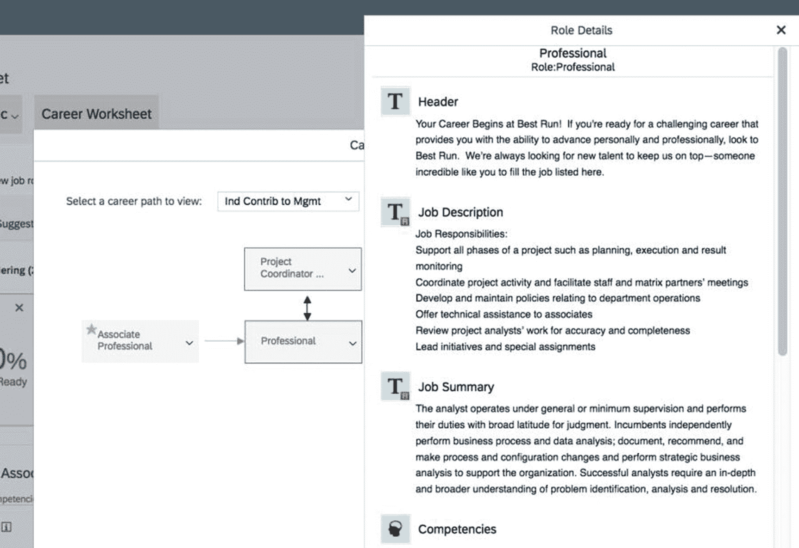

**图 3-50** 目标角色职位简介

还可以从职业路径中添加另一个目标角色。点击某个角色的向下箭头，如图 3-51 所示。

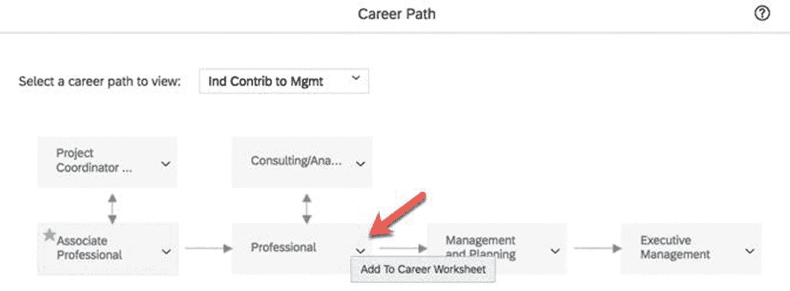

**图 3-51** 添加目标角色

也可以从职业工作表中删除现有的目标角色。点击下拉图标可查看删除选项。示例如图 3-52 所示。

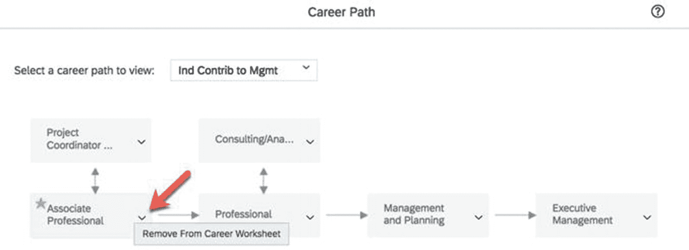

**图 3-52** 取消选择目标角色

此处所做的更改将反映在“我考虑的工作角色”子选项卡中。

如果目标角色不属于某个职业路径，则不会有查看该职业路径的选项，如图 3-53 所示。

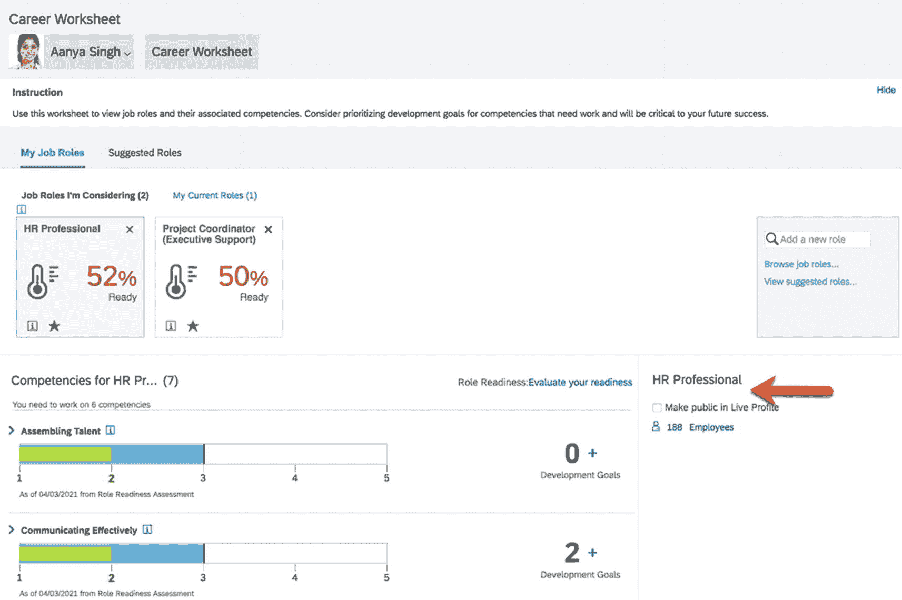

**图 3-53** 无可查看职业路径的目标角色

既然已经选择了目标角色，我们来更详细地了解它们。

## 目标角色功能

每个目标角色都会有一个准备度指示器，包含三个图标：“角色详情”、“将此设为目标角色默认项”和“添加新的学习活动”。示例如图 3-54 所示。

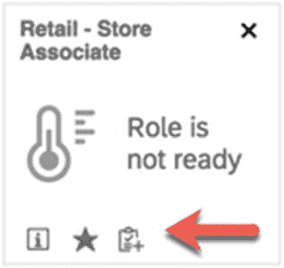

**图 3-54** 准备度指示器图标

#### 角色详情

将鼠标悬停在任何目标角色的信息图标上，即可查看职务简介，如图 3-55 所示。

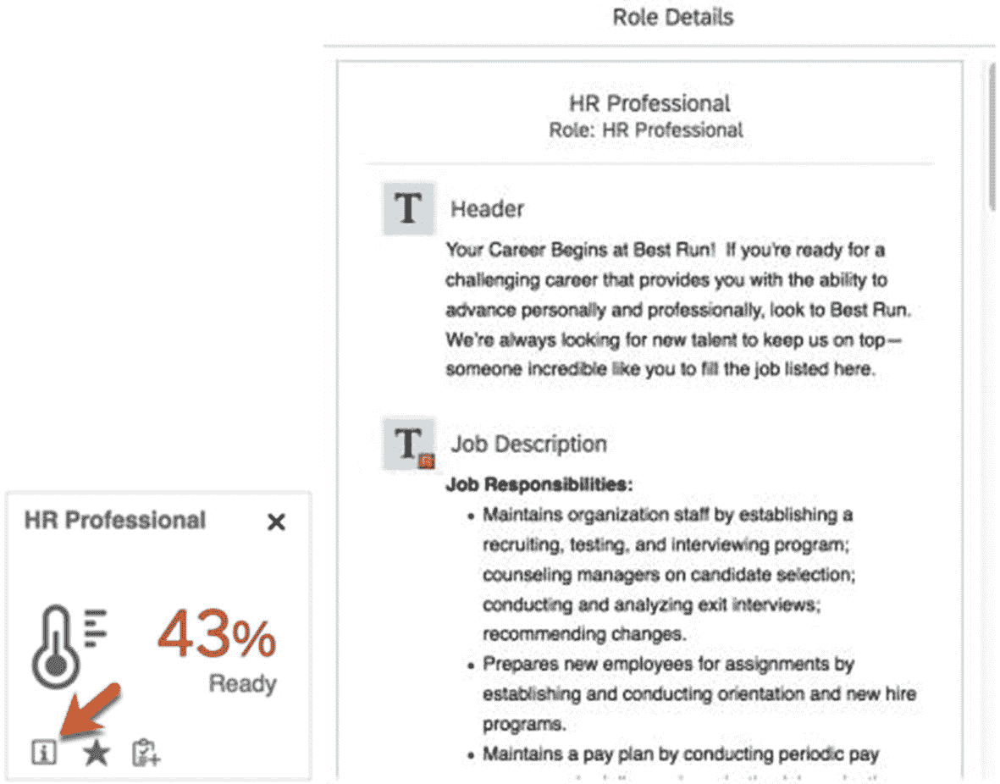

**图 3-55** 目标角色职务简介

#### 默认角色

点击任意目标角色的星形图标可将其设为默认角色，如图 3-56 所示。当该目标角色成为默认目标角色时，星形图标将改变颜色。

**图 3-56** 点击星形图标将该角色设为默认目标角色

#### 添加学习活动

当启用`LMS`时，将显示“添加新的学习活动”图标，如图 3-57 所示。

**图 3-57** 添加新的学习活动图标

如果`LMS`与`发展`模块集成，并且您允许用户为发展目标添加学习活动，则员工可以将学习活动分配至其`LMS 待办事项列表`。

如图 3-58 所示，员工可以在学习目录中查找活动，或通过能力搜索活动。请注意，当用户从`LMS`中完成的学习项目获得能力评等时，准备度指示器会相应更新。

**图 3-58** 启用 LMS 时的学习活动选项

您可能已开启`LMS`，但未在`发展`模块中使用。在这种情况下，您会看到此图标，但它不会链接到任何内容。`职业工作表`模板`XML`中没有隐藏此图标的选项。

### 目标角色选项

要从“我考虑的工作角色”子选项卡中删除目标角色，请点击目标角色右上角的“X”图标，如图 3-59 所示。

**图 3-59** 删除目标角色

这将从“我考虑的工作角色”子选项卡中移除该目标角色。

## 准备度指示器

如前文所述，映射到工作角色的能力是职业工作表上所列能力的唯一来源。员工对某个角色的准备度是通过将员工的已评能力与目标角色的预期能力评等进行对比来确定的。图表始终使用最新的能力评等，无论其来源如何。

`准备度指示器`会根据情况显示百分比、`0%` 或 `角色未就绪`。如果用户拥有包含目标角色任何能力的已完成绩效表单，则目标角色的`准备度指示器`将显示百分比。但如果员工针对目标角色的能力评等非常低，以至于将准备度计算为`0%`，则百分比可能为 `0%`。员工可能只具备目标角色所需的一项能力，因此准备度也会计算为`0%`。

在图 3-60 所示的示例中，员工仅具备目标角色的一项能力，且评等低于预期评等。

**图 3-60** 目标角色准备度为 0%

如果员工对目标角色中的任何能力均无评等，则准备度指示器将显示 `角色未就绪`，如图 3-61 所示。

**图 3-61** 无匹配能力的目标角色

## 员工档案中的职业目标

员工可以将任意或所有目标角色添加到其 `人员档案` 的 `职业目标` 区块中。方法是点击目标角色上的复选框 `在动态档案中公开`，如图 3-62 所示。

**图 3-62** 将目标角色添加到档案

当员工查看其档案时，该角色将显示出来，如图 3-63 所示。

**图 3-63** 档案中的目标角色

根据权限设置，员工可以在其档案中查看目标角色或编辑目标。其他角色在查看员工档案时也可能被授予查看此区块的权限。

回到职业工作表的“我考虑的工作角色”子选项卡，员工可以看到目标角色中的员工人数，如图 3-64 所示。

**图 3-64** 目标角色中的员工人数

点击该数字可查看与该角色关联的员工姓名，如图 3-65 所示。

**图 3-65** 担任该目标角色的员工姓名

## 角色准备度评估

除了根据员工现有角色当前已评定的能力来评估其转入目标角色的准备度外，还可以仅根据目标角色的能力进行评估。此方法使用 `角色准备度评估` 表单。员工突出显示一个目标角色，然后点击链接启动 `角色准备度评估` 表单。示例如图 3-66 所示。

**图 3-66** 启动角色准备度评估

## 发起“岗位胜任度评估”表的好处

发起`岗位胜任度评估`表的好处在于，员工及其直属经理将根据目标岗位所需的能力标准来评估胜任程度，而非依赖当前的能力评级——后者可能并不适用于新岗位。此外，员工可能缺乏目标岗位所需的能力，因此胜任度计算结果可能产生偏差。

只有员工角色才能在职业工作表中发起`岗位胜任度评估`表。经理或人力资源经理无法发起该表，且代理功能不允许用户代表员工发起表单。

使用`岗位胜任度评估`表时，每项能力的差距图评级基于经理的评级和预期能力评级。

在“我考虑的工作岗位”子标签页中，针对任何目标岗位都有一个“评估你的胜任度”链接。点击该链接可直接打开`岗位胜任度评估`表，跳过常规的表单创建步骤。该表已配置为自动填充目标岗位的能力项。示例如图 3-67 所示。

**图 3-67** 从职业工作表发起`岗位胜任度评估`表

员工需对每个目标岗位的能力进行自我评分。填写完成后，表单将流转至其经理处进行评分。

经理将在其“绩效收件箱”中收到`岗位胜任度评估`表。经理需根据其对员工掌握每项能力程度的判断提供评分，如图 3-68 所示。

**图 3-68** 经理对目标岗位能力进行评分

表单将返回给员工，供其查看经理评分并设置表单为已完成状态。员工可通过其“绩效收件箱”或返回其职业工作表访问该表单。针对该目标岗位，将显示“岗位胜任度评估进行中”链接，如图 3-69 所示。

**图 3-69** 表单进行中

点击该链接将引导员工进入表单并将其设置为已完成状态，如图 3-70 所示。

**图 3-70** 设置为已完成的表单视图

已完成的表单将出现在员工和经理的“绩效已完成”文件夹中。当员工返回工作表时，“胜任度仪表盘”将根据评分显示百分比，如图 3-71 所示。

**图 3-71** 评估完成后更新的`胜任度仪表盘`

如果其他目标岗位包含刚评分的相同能力项，这些岗位的`胜任度仪表盘`现在可能显示不同百分比。请参考前一章节中的“岗位能力预期评级”部分，了解如何确定这一数值。

当目标岗位显示“评估你的胜任度”时，可以再次生成该表单。也可为任何其他目标岗位发起表单。重新发起并完成另一份`岗位胜任度评估`表后，将根据每个目标岗位的新评分重新计算胜任度仪表盘和差距图。还可以添加更多待考虑岗位，并针对这些新岗位运行表单。

用户可以根据需要多次重新发起该表单。他们可以对其选择的任何目标岗位重新运行评估。

## 当前岗位的岗位胜任度评估

员工也可以从“我的当前岗位”发起`岗位胜任度评估`表，如图 3-72 所示。

**图 3-72** 为当前岗位发起`岗位胜任度评估`

这将使用当前岗位的能力项发起表单，如图 3-73 所示。

**图 3-73** 当前岗位的`岗位胜任度评估`表

该表单将经历与为目标岗位发起表单时相同的步骤。

如图 3-74 所示，完成评估后，当前岗位将在每个差距图中显示更新的能力评分，并显示表单名称和表单完成日期。

**图 3-74** 基于`岗位胜任度评估`更新的差距图

请注意，当前岗位没有`胜任度仪表盘`，但每个能力项都会有差距图。这对员工很有用，他们可以围绕这些能力项制定发展目标。

如果有任何目标岗位使用了这些相同的能力项，其`胜任度仪表盘`和差距图将在“我考虑的工作岗位”子标签页中更新。示例如图 3-75 所示。

**图 3-75** 基于已完成的`岗位胜任度评估`更新的目标岗位差距图

当前岗位已评分的能力项，以及表单名称和完成日期，也会反映在包含这些能力项的任何目标岗位中。需要留意的是：如果你未针对某个目标岗位运行`岗位胜任度评估`表，则该目标岗位的胜任度评级可能源于不同日期、不同来源的评分。

## 职业工作表中“我的当前岗位”的深层链接

在 2020 年上半年版本发布之前，如果员工想查看职业工作表中的当前岗位，他们必须进入“发展”模块，打开“职业工作表”，并将“我的工作角色”子标签页从“我考虑的工作岗位”切换为“我的当前岗位”，如图 3-76 所示。

**图 3-76** 在`职业工作表`中查看当前岗位

现在，员工可以从专用主页的“快速链接”磁贴直接进入“职业工作表”中的“我的当前岗位”子标签页，如图 3-77 所示。

**图 3-77** 主页上的“快速链接”

用户会点击“快速链接”磁贴，查看所有可用链接，如图 3-78 所示，这将直接跳转到他们在“职业工作表”中的当前角色。

**图 3-79：** 链接到当前角色

**图 3-78：** 快速链接到当前角色

点击“我的当前角色职业工作表”链接会将员工直接带到他们的职业工作表，如图 3-79 所示。

## 经理视角的职业工作表

现在我们已经了解了员工在职业工作表中可以执行的操作，让我们来看看经理的视角。

根据职业工作表模板 XML 和基于角色的权限配置，经理和 HR 经理角色可以访问员工的职业工作表。

任一角色都需要进入他们自己的职业工作表，并进行姓名搜索来访问员工的计划。经理可以查看目标角色的职业路径、浏览角色，以及查看目标角色中的员工，如图 3-80 所示。

**图 3-80：** 经理视角的员工“我正在考虑的工作角色”子标签页

经理还可以访问员工的“我的当前角色”子标签页，如图 3-81 所示。

**图 3-81：** 经理视角的员工当前角色

根据权限，经理将能够查看正在考虑的角色、当前角色，以及差距图表和准备就绪度量。他们还可以查看角色的职业路径、浏览工作角色，以及添加待考虑的工作。但是，经理看不到员工的“建议角色”标签页，也无法启动“角色准备就绪评估”表单。

经理和 HR 经理对员工职业工作表的访问可能包括以下内容：

*   浏览工作角色。

*   查看带有准备就绪度量和差距分析的目标角色。

*   添加目标角色。

*   查看职业路径并添加角色。

*   为目标角色或当前角色上的能力添加发展目标。

经理和 HR 经理没有以下权限：

*   查看“建议角色”标签页。

*   删除目标角色。

*   查看建议角色。

*   启动角色准备就绪评估（代表员工）。

如果允许，HR 经理还可以创建职业路径。

现在我们已经了解了员工、他们的经理和他们的 HR 经理在职业工作表中可以做什么。接下来，我们将简要介绍报告选项。

## 职业工作表报告

职业工作表的即席报告功能非常有限。目标角色是职业工作表中唯一可报告的部分。该报告可以显示员工在其职业工作表中选择的所有目标角色。但是，它也会显示当前角色，并且无法区分当前角色和目标角色。

### 即席报告

要创建职业工作表目标角色的即席报告，报告类型为“表格”，如图 3-82 所示。

**图 3-82：** 创建即席报告的报告类型

要选择的域是“职业工作表目标角色”，如图 3-83 所示。

**图 3-83：** 数据源

向导会引导您完成创建报告的步骤。首先，命名报告，并选择要包含的人员。在“数据集”选项卡中，要选择的模板是“职业工作表”，如图 3-84 所示。

**图 3-84：** 要选择的模板

从“列”选项卡中，选择要显示的字段，如图 3-85 所示。

**图 3-85：** 报告的输出字段

选择字段和任何筛选条件后，运行报告。该报告将显示员工的当前角色以及目标角色，如图 3-86 所示。

**图 3-86：** 报告结果

## 仪表板

还有一个标准的 CDP 仪表板可以启用。它允许经理查看其团队中员工的目标角色以及每个角色的能力准备就绪情况。

可以从 SuccessStore 添加该仪表板。在搜索栏中输入并选择“管理仪表板”。如图 3-87 所示，点击“管理标准仪表板和 YouCalc 文件”。

**图 3-87：** 管理仪表板

点击“从 SuccessStore 添加”，如图 3-88 所示。

**图 3-88：** 在“管理仪表板”中添加标准 CDP 仪表板

滚动列表，找到“CDP 仪表板”，然后点击“添加到实例”，如图 3-89 所示。

**图 3-89：** 在“管理仪表板”中添加标准 CDP 仪表板

正如本章开头基于角色的权限中提到的，请确保经理和 HR 角色有权访问此仪表板。在经理和 HR 经理角色的基于角色的权限中，添加“报告权限” ➤ “分析工具和仪表板” ➤ “其他” ➤ “CDP 仪表板”，如图 3-90 所示。

**图 3-90：** 访问 CDP 仪表板的权限

当仪表板由经理生成时，仪表板概览会显示目标角色计数，如图 3-91 所示。

**图 3-91：** 仪表板上的目标角色计数

经理可以深入查看任何角色，以了解每位员工的准备就绪情况，如图 3-92 所示。

**图 3-92：** 目标角色的深入查看

### 职业探索器

职业发展的一个新组件是`职业探索器`。它利用机器学习算法，根据用户“与我相似”的特征来推荐未来职位。`职业探索器`基于组织中与员工情况相似人群的职业路径来推荐职业机会。这使得员工能够发现传统职业路径之外可能的未来角色，并将这些角色设定为自身职业发展的目标。

员工可以查看曾担任其职位或具有相似技能、过往职位、教育背景的用户的职业路径，从而帮助自己确定下一步发展。这提供了有别于使用预定义职业路径决定下一角色的个性化指导。

`职业探索器`如图 3-93 所示。

**图 3-93** 职业探索器

员工可使用`职业探索器`查看量身定制的未来职位以供考虑。每个角色都可以查看其能力、技能和其他职位简介详情。员工可以选择一个未来角色，该角色将添加到其职业工作表中。在工作表上，员工会看到目标角色所需具备的能力，这有助于他们识别能力差距和需要发展的领域。

需要说明的是，`职业探索器`仅在 2020 年上半年的早期采用者关怀（EAC）计划中可用。

## 总结

我们已为`职业工作表`授予用户权限。我们了解了员工如何根据 HR 管理员做出的配置决策来使用`职业工作表`的功能。员工可以利用此工具探索职业路径、查看未来可能期望获得的职位、发现达到这些职位所需技能和能力的差距，并通过发展目标战略性地规划如何弥补这些不足。我们还了解了经理和人力资源经理如何访问员工的职业工作表并针对其目标职位生成报告。我们简要了解了`职业探索器`及其如何与`职业工作表`集成。
