# 4. 导师制

导师制是帮助员工个人成长和职业发展的宝贵工具。导师制在提供指导、建议和榜样作用的有经验员工与初级员工之间建立了一种关系。导师可以分享自身职业见解，帮助受指导者设定发展目标、识别兴趣领域，并提供建立人际网络的机会。

SAP SuccessFactors 中的导师解决方案分为两部分。导师管理员将使用`管理导师计划`工具，在`发展`模块之外创建、维护和跟踪导师计划。管理员将创建导师计划、确定参与者、定义匹配导师和受指导者的标准、邀请用户参与、分配和重新分配匹配关系，以及更改计划状态。我们将详细讨论这些功能。该模块与`发展`模块协同工作，以支持员工的发展。

## 导师流程概述

一旦管理员创建了导师计划，就会向选定的员工发送电子邮件邀请，邀请他们加入。邮件包含一个链接，该链接将受邀者引导至`职业发展`模块中一个名为`导师制`的新标签页。所有基于用户的导师任务都在此执行，包括注册导师计划、确定偏好以寻找最佳匹配、接受和拒绝请求，以及结束导师关系。我们将以导师和受指导者的身份体验导师计划的示例。

当计划建立且导师和受指导者匹配成功后，管理员可以更改导师关系、修改导师的可用性、跟踪和报告计划，以及关闭计划。

加入时，导师和受指导者需要明确他们在导师关系中寻求什么。导师/受指导者匹配是通过识别偏好，然后为受指导者找到满足这些需求的导师来完成的。所创建计划类型决定了谁可以加入、如何进行匹配，以及是否需要批准参与。

电子邮件通知在导师计划中使用非常频繁。用户在计划期间可能会收到 24 种导师制通知。这些电子邮件会提示用户在`导师制`概览页面中采取行动。在本章末尾，我们将介绍这些邮件、它们的内容以及触发条件。

在本章中，我们将涵盖以下主题：

- Provisioning 中的导师设置

- 基于角色的权限

- 管理导师计划

- 创建自定义导师计划

- 使用匹配计划

- 作为参与者使用导师制

- 电子邮件通知

- 临时报告

### Provisioning 设置

让我们从使用导师制所需的 Provisioning 功能开始。

如果您正在使用`职业发展`，这些功能应已在 Provisioning 中启用：

- 元数据框架（MDF）

- 通用对象

- 附件管理器

- CDP 完整版（发展计划）

- 基于角色的权限

### 导师制设置

要使用导师制，请在`公司设置`中，找到`目标框架`下的`职业与发展规划`部分，勾选`启用导师计划`旁边的复选框，如图 4-1 所示。

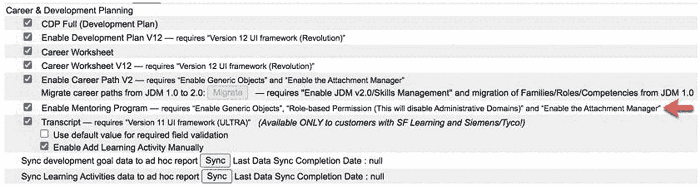

**图 4-1** 在公司设置中启用导师计划

### 其他可启用选项

根据您的组织情况，您还可以启用其他选项：

- 如果您希望通过使用动态员工组来识别导师参与者，则应启用`动态组 V2（我的组）`。

- `SAP Jam`可以与导师制集成以创建 SAP 组。如果您希望使用此功能，则必须在`公司设置`中也启用`SAP Jam 集成`。

- 对于`临时导师制报告`，请确保已启用“临时报告生成器”，然后启用：
  - “其他临时子域架构配置”下的“导师计划”
  - 在人员选择器中“启用从用户开始包含”下的“导师计划”

保存所做的更新。

根据您在导师计划中选择使用的功能，在 Provisioning 中可能还需要执行其他任务。这些项涉及自定义程序和自定义选择列表。我们将在本章后面解释这两项。

一旦在 Provisioning 中启用导师制，就需要在用户界面中设置权限。

### 基于角色的权限

`Mentoring`功能通过 API 调用为导师计划参与者填充数据。数据访问由基于角色的权限控制。管理员、所有者和计划参与者所需的权限将根据他们对计划所需的访问级别而有所不同。这些权限包括用于管理计划的管理员功能，以及允许访问计划的用户功能。此外，`Mentoring`功能使用了元数据框架（`MDF`），这要求所有角色都拥有基本的“读取”和“写入”权限。现在，我们将了解`Mentoring`功能所需的角色以及每个角色所需的权限。

## 导师计划管理员角色

您可以决定为人才组中的某个个人创建一个新角色来管理导师计划。在这种情况下，请将该用户分配到一个与此权限角色关联的导师计划权限组。在非常大的组织中，您可能有多个导师计划管理员。您也可以决定将导师计划权限添加到一个现有的 HR 管理员角色中。

## 导师计划参与者角色

如果您组织中的所有成员都有资格参与导师计划，则可以将导师计划权限添加到员工角色中。如果只有组织的某些部门参与，则可以为这些用户创建一个权限组。然后将新的权限组分配到一个新的导师计划权限角色。

在搜索栏中键入并选择“管理权限角色”。选择要更新的角色。表 4-1 包含了导师计划管理员角色和导师计划用户角色所需的权限。导师和学员拥有相同的权限，因此这些权限不需要单独的权限角色。您可以将权限添加到一个现有的员工权限角色中。或者，正如刚才提到的，如果有一组特定的员工将使用导师计划，您可以确定这些用户来创建一个权限组，然后将他们分配给一个导师计划用户角色。

### 表 4-1 管理和参与导师计划所需的基于角色的权限

| 用户权限部分 | 权限 | 管理员角色 | 导师/学员角色 |
| --- | --- | --- | --- |
| **常规用户权限** | `公司信息访问 ➤ 用户搜索` | `X` | `X` |
| | `社区访问` | `X` | `X` |
| **员工数据** | `姓氏, 名字 ➤ 查看` | `X` | `X` |
| **职业发展计划** | `导师计划访问权限` | `X` | `X` |
| **报告权限** | `为导师计划创建/运行临时报告` | | `X` |
| **管理员权限部分** | | | |
| **元数据框架** | `访问非安全对象` | `X` | `X` |
| **管理集成工具** | `允许管理员通过基本身份验证访问 OData API` | `X` | |
| **管理职业发展** | `管理导师计划` | `X` | |
| **管理用户** | `管理员工动态组` | `X` (可选) | |

如前所述，`Mentoring`功能包含与 SAP Jam 的集成。启用后，导师计划管理员可以在建立导师计划时创建 SAP Jam（社区）群组。这为参与者提供了一个额外的协作、培训和讨论平台。要利用此集成，请确保所有参与导师计划的用户都已启用了基于角色的 SAP Jam 访问权限。

### 选择列表

创建导师计划时，导师计划管理员会设计一个注册表单。注册表单包含一系列导师和学员必须回答的问题才能参与。这些问题用于确定他们在导师关系中寻求的偏好。根据回答和匹配规则，系统会推荐导师/学员配对。问题的答案可以是自由格式文本，也可以基于选择列表中的值。以下列出了可用于回答问题的标准选择列表：

*   能力
*   部门
*   事业部
*   地点
*   性别
*   职位族
*   职位角色
*   职位代码
*   职位级别
*   职位名称
*   技能

也可以创建自定义选择列表。无论哪种情况，标准选择列表和自定义选择列表都必须在数据模型中定义，并授予“读取”权限。

既然我们已经在 Provisioning 中启用了`Mentoring`功能，并设置了基于角色的管理员和导师计划用户权限，那么让我们进一步讨论可以创建的计划类型以及创建它们的步骤。

## 导师计划类型

可以创建三种类型的导师计划：

1.  **公开报名：** 这些计划对所有员工或特定群组开放。计划没有固定的日期，包括结束日期。用户可以注册为导师、学员或两者兼有。可以选择要求导师的参与必须由其经理或导师计划管理员批准。学员必须在注册时选择导师；但是，导师可以拒绝。
2.  **受监督：** 导师计划管理员选择参与计划的导师和学员。管理员必须根据预定义日期手动发送邀请。学员只能在导师注册期结束后才能注册。学员可以指出导师偏好，但不会通知导师批准或拒绝学员。一个匹配程序会为每位学员确定最佳匹配。管理员可以更改任何匹配，然后才会将匹配确认信息发送给导师和学员。
3.  **不受监督：** 不受监督的导师类型是基于邀请的。导师计划管理员选择参与计划的导师和学员，邀请系统会根据导师和学员的注册日期自动生成。管理员也可以手动触发邀请邮件。在注册期间，学员必须选择一位导师。导师会收到请求通知，并可以批准或拒绝该提议。管理员也可以分配或解除分配关系。

表 4-2 突出显示了不同计划类型的一些功能差异。本章稍后将详细讨论这些功能。

### 表 4-2 每种计划类型可用的功能

| 操作/计划类型 | 受监督 | 不受监督 | 公开报名 |
| --- | --- | --- | --- |
| 自动发送邀请 | | `X` | |
| 使用匹配程序识别推荐匹配 | `X` | | |
| 使用计划日期 | `X` | `X` | |
| 导师需批准参与 | | | `X` |
| 计划需要邀请才能参与 | `X` | `X` | |
| 计划对任何有导师计划访问权限的人开放 | | | `X` |
| 可以以学员、导师或两者身份加入计划 | | | `X` |
| 学员可以选择导师 | `X` | `X` | `X` |
| 当学员选择导师时，导师会收到一封电子邮件 | | `X` | `X` |
| 管理员可以分配和重新分配任何匹配 | `X` | `X` | `X` |
| 导师可以拒绝学员请求 | | `X` | `X` |
| 导师可以更改其可用性 | `X` | `X` | `X` |
| 仅在单独的导师和学员注册期内注册 | `X` | | |

#### 自定义项目

到目前为止，我们已经了解了三种可用的标准导师计划类型。此外，还可以创建最多三种自定义计划类型。它们具有与标准计划相同的特性和功能，但使用自定义标签。自定义计划提供了灵活性，可以用您自己的标签替换计划中使用的所有导师相关术语。您可能希望将一个计划称为“辅导计划”而不是导师计划。通过创建自定义标签，自定义计划内的屏幕以及电子邮件通知都将使用您的标签。

系统级别的`文本替换`工具会用自定义值覆盖默认文本。在这里，所有导师相关的术语都可以替换为其他标签。这将影响所有标准导师计划的所有标签。计划级别的替换文本用于创建自定义导师计划，其标签仅针对这些计划。最多可以创建三个自定义计划，每个计划都有自己的标签。使用自定义标签创建文本替换包。我们很快就会介绍这个过程。

## 导师管理功能

现在我们将学习如何创建、跟踪和更新导师计划。在搜索栏中输入并选择“管理导师计划”。导师计划概览屏幕将如图 4-2 所示显示。

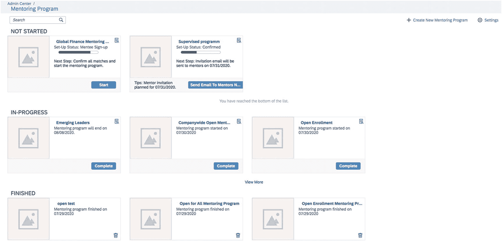

**图 4-2** 管理导师计划概览页面

所有导师管理任务都在此执行。我们将回顾此页面上的功能以创建和管理导师计划，但首先让我们了解一些在创建任何计划之前可能设置的可选配置。

## 导师计划设置

位于屏幕右上角，点击“设置”链接到导师计划配置。在此处完成的配置将应用于所有导师计划。可以定义两种类型的配置：自定义选择列表和文本替换。

图 4-3 显示了自定义选择列表配置的默认选项卡。

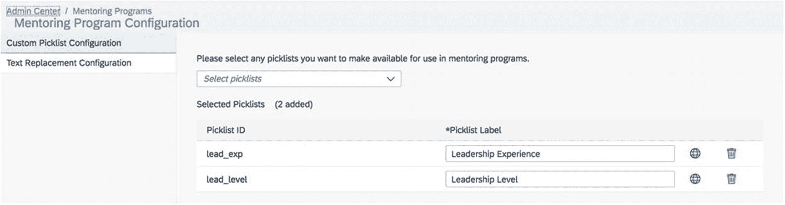

**图 4-3** 导师计划设置

### 自定义选择列表

除了标准选择列表外，管理员还可以在注册问题中使用自定义选择列表。当管理员在创建计划注册表单时选择问题类别时，此处标识的任何自定义选择列表都将可用。这样，在注册过程中回答偏好问题时，就可以使用自定义选择列表的值。

在`自定义选择列表配置`选项卡的下拉列表中，管理员可以标识在设计注册表单时要提供的任何额外选择列表。选择选择列表后，创建选择列表标签。图 4-4 显示了一个示例。这是在创建计划期间选择问题类别时将显示的选择列表名称。

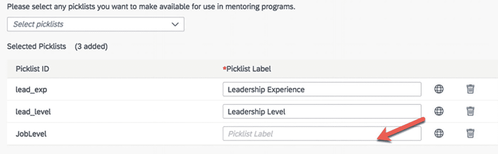

`图 4-4` 添加自定义选择列表

选择列表标签可以本地化，如图 4-5 所示。

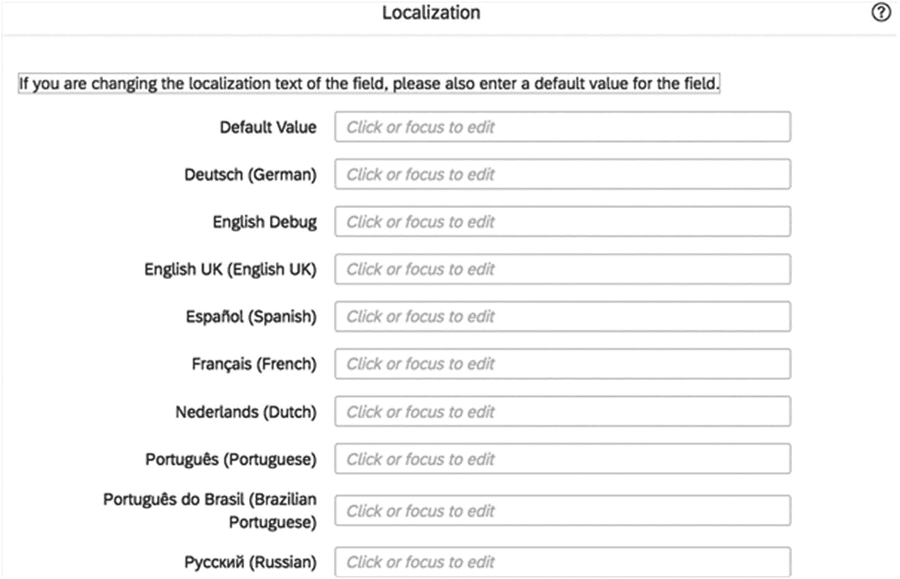

`图 4-5` 本地化自定义选择列表名称

所有用于问题的选择列表都将在设计注册表单时出现在问题类别选择中。在问题类别的下拉列表中，自定义选择列表将按字母顺序显示在标准选择列表之后。

## 自定义计划

点击“设置”中的另一个选项卡。在此选项卡中，管理员将标识最多三个自定义计划的文本替换包。图 4-6 显示了一个示例。

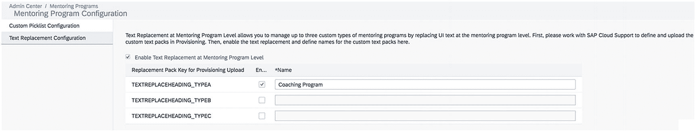

`图 4-6` 用于标识自定义导师计划的文本替换配置选项卡

如果您不打算使用任何自定义计划，则此选项卡中无需输入任何内容。您可以跳过以下详细介绍创建自定义语言包步骤的部分。如果您计划使用自定义计划，请在使用`文本替换配置`选项卡之前定义替换文本。

让我们回到配置中的公司设置。应启用语言包以及“启用管理语言工具”。需要为您使用的每种语言启用语言包。

一旦启用了“管理语言”工具，“管理语言”将在公司设置中可用，如图 4-7 所示。

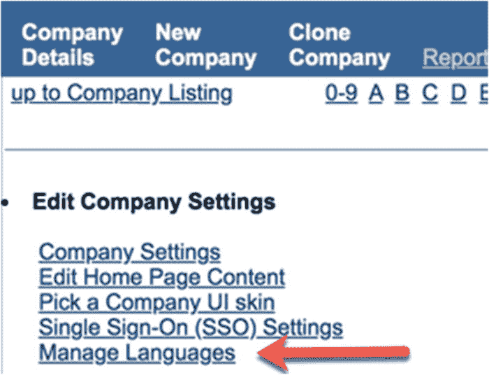

`图 4-7` 在配置中访问“管理语言”

在“管理语言”中，下载默认活动语言的默认标签，如图 4-8 所示。

`图 4-8` 下载标准默认标签

该文件用作查找导师计划中使用的所有标签的参考。如果默认活动语言的自定义区域设置不存在，则创建一个。如果存在，您将向其中添加条目。无论哪种情况，请下载自定义标签文件。新创建的文件只包含一个标题行。我们将使用包含新自定义计划标签的新键来填充它。

使用记事本或任何 UTF-8 编辑器打开默认的`.csv`文件。

按键（A 列）对文件进行排序，以查找所有以`DEVELOPMENT_MENT.`开头的键。这些将是所有与导师相关的标签，如图 4-9 所示。

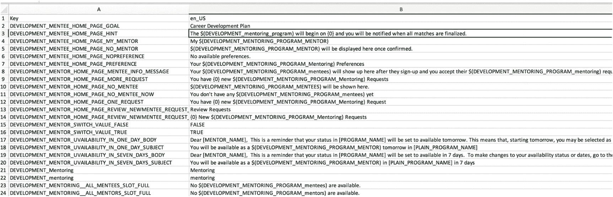

`图 4-9` 默认标签文件中的导师相关标签

我们需要为自定义导师计划类型创建带有自定义标签的自定义键。首先，将所有与导师相关的键从默认文件复制到空的自定义文件或现有的自定义文件中。自定义文件将只包含两列：键和语言。在创建文件时，我们将在 B 列中使用`en_US`。

检查每个键的标签（B 列），找出任何包含导师相关单词或短语的标签。您可以删除自定义文件中不需要新标签的任何键。一种更费力的方法是进入实例，打开系统语言的调试版本，并查看每个导师屏幕以了解所使用的键和标签。记录所有需要自定义标签的键，并确保这些键将出现在您的自定义文本文件中。

对三个自定义计划的引用必须标识为`TYPEA`、`TYPEB`或`TYPEC`。例如，如果您正在创建一个辅导计划，此自定义计划的所有标签的键中应包含`TYPEA`。如果另一个导师计划是针对学习小组的，则该计划的所有标签的键中应包含`TYPEB`。其他新计划将使用`TYPEC`的标签。

对于您的第一个自定义计划，请使用`TYPEA`。现在，您的自定义文件上应该拥有所有需要新文本的键。您需要将`_TEXTREPLACEHEADING_TYPEA`附加到自定义文件中的每个键上。

如图 4-10 所示，A 列包含了所有常规的 `DEVELOPMENT_MENTORING` 键，并附带了替换文本键（`_TEXTREPLACEHEADING_TYPEA`）。这些键标识了将在您的第一个自定义程序（`TYPEA`）中使用的所有标签。

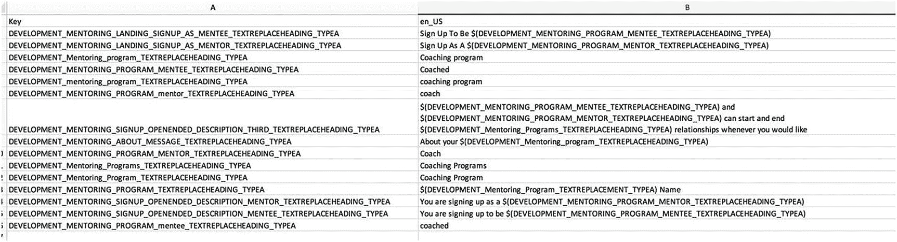

`图 4-10` 用于创建自定义标签的示例文件

对于替换某个单词或短语（例如 mentor、mentee 或 mentoring）的键，请在 B 列中提供新的自定义标签。对于需要引用新单词的键，也请使用 `_TEXTREPLACEHEADING_TYPEA` 创建新的键。标签应引用这些新单词键。

在前图所示的文件中，辅导计划键（`DEVELOPMENT_Mentoring_program`）现在在文件上有一个自定义键，名为 `DEVELOPMENT__Mentoring_program_TEXTREPLACEHEADING_TYPEA`，其标签为“Coaching Program”。任何引用“mentoring”计划的键都需要创建一个包含 `_TEXTREPLACEHEADING_TYPEA` 的新键名，并且标签需要引用 `DEVELOPMENT__Mentoring_program_TEXTREPLACEHEADING_TYPEA`，以便将“mentoring program”替换为“coaching program”。

文件构建完成后，上传自定义标签文件。要使自定义文本替换功能在其他系统语言中生效，请针对这些语言重复相同的过程。

现在，辅导管理员可以返回实例，在“管理辅导计划”中进入“设置”，以选择要使用的文本替换包。如图 4-11 所示，启用并命名所创建的每种类型。

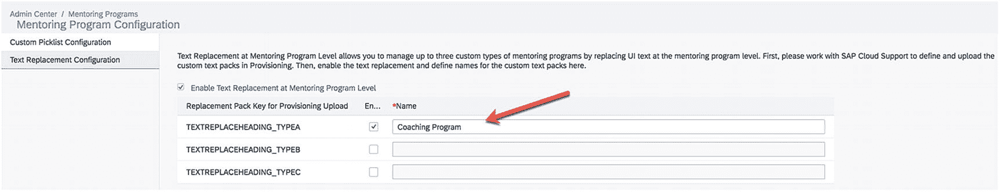

`图 4-11` 为自定义辅导计划确定要使用的自定义语言文本包

在我们演示的示例中，只创建了一个自定义计划。请注意，替换包的键名与添加到自定义文件 `TEXTREPLACEHEADING_TYPEA` 中键的后缀名称相同。当创建任意标准类型的新计划时，管理员将选择“计划文本替换选项”，并指定要使用的替换包名称。当我们实际创建一个计划时，这一点会更清晰。

## 管理员计划概览页面

更新计划设置后，返回计划概览页面。辅导计划按状态分组。计划将显示在概览页面的“未开始”、“进行中”和“已完成”部分。概览页面的示例如图 4-12 所示。

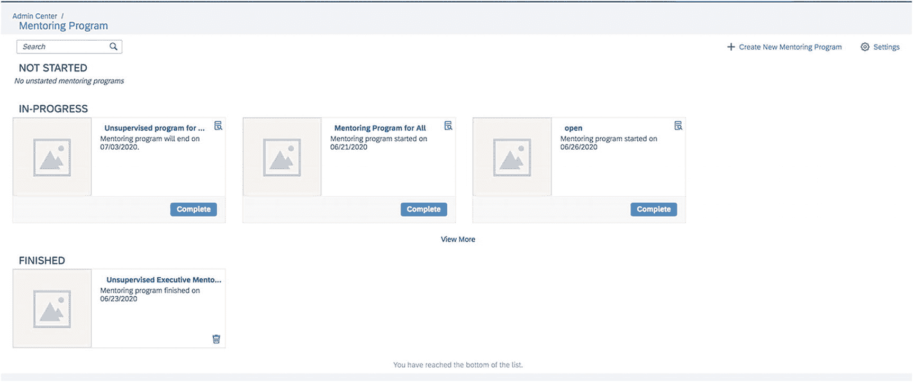

`图 4-12` 辅导计划概览

计划状态描述如下：

- **未开始：** 计划注册仍在进行中；仍需输入信息。

- **进行中：** 计划已开始，对于开放式计划，它们保持开放直到手动关闭。受监督和不受监督的计划会运行至结束日期。在此阶段无法删除。管理员需要先将状态设置为 `Complete`。

- **已完成：** 计划已达到结束日期，不再活跃。只有已完成的计划才能被删除。

单击现有计划将显示“详细信息”选项卡，这是默认选项卡。根据计划类型和状态，还可能有“导师”、“学员”、“问题”和“匹配”选项卡。示例如图 4-13 所示。

`图 4-13` 辅导计划中的选项卡

现在我们已经浏览了概览页面并了解了设置，接下来让我们看看用于创建辅导计划的屏幕。

### 创建新辅导计划

从概览页面，管理员需点击“创建新辅导计划”。如图 4-14 所示，弹窗将显示计划类型。管理员选择要创建的计划类型后，系统会依次显示一系列引导页面，用于定义计划的参数。根据计划类型的不同，详情页面中的字段和参与者页面会存在一些差异。选择类型后，管理员需点击“继续”按钮开始创建辅导计划。

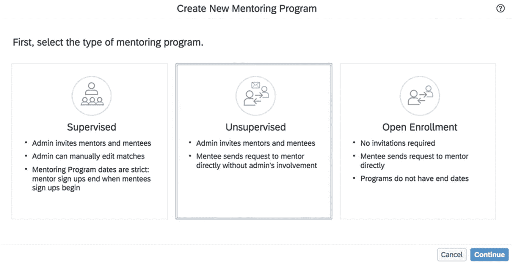

`图 4-14` 创建辅导计划时选择计划类型

所选的计划类型决定了目标受众、是否发送邀请以及是否设置计划日期。你需要在“详细信息”选项卡中标识这些标签。

表 4-3 列出了管理员在创建辅导计划时会用到的页面。根据辅导计划类型的不同，这些页面会存在一些差异。

### 表 4-3 计划页面

| 计划创建页面 | 描述 | 受监督 | 非受监督 | 公开报名 |
| :--- | :--- | :--- | :--- | :--- |
| 辅导计划详细信息 | 用于命名和定义计划及其设置，并在适用时设置日期。 | X | X | X |
| 导师 | 选择被邀请作为导师参与计划的员工。 | X | X | |
| 学员 | 选择被邀请作为学员参与计划的员工。 | X | X | |
| 注册表单 | 定义参与者报名时需要完成的问题。同时定义匹配规则。 | X | X | X |
| 摘要 | 包含用于创建表单的每个页面的内容，为管理员在启动前提供进行任何更新的机会。 | X | X | X |
| 电子邮件模板 | 标准的导师和学员邀请电子邮件通知会显示在摘要页面上，以便管理员进行自定义修改。 | X | X | |

在创建任何类型的辅导计划时，都会显示“辅导计划详细信息”页面。针对每种计划类型，所显示的字段仅存在细微差异。例如，图 4-15 展示了受监督辅导计划的详细信息页面。

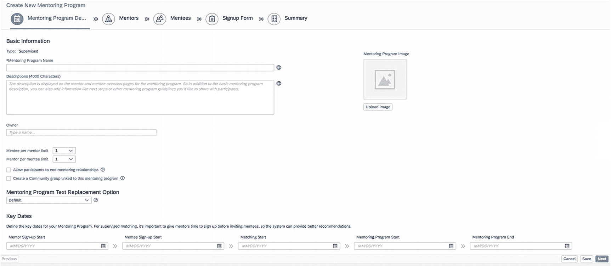

### 图 4-15 受监督辅导计划的详细信息页面

详细信息页面上所有可能的字段均列于表 4-4 中。表中包含了每个字段的描述以及会显示该字段的计划类型。

### 表 4-4 详细信息选项卡字段

| 字段 | 描述 | 受监督 | 非受监督 | 公开报名 |
| :--- | :--- | :--- | :--- | :--- |
| 上传图片 | 可为你的计划上传图片。 | X | X | X |
| 辅导计划名称 | 辅导计划的名称，将显示在电子邮件、管理员辅导工具以及参与者的辅导界面上。必填字段。支持本地化。 | X | X | X |
| 描述 | 对参与者可见，显示在其参与的每个计划的计划页面上。也可使用此字段包含任何有用的信息，例如后续步骤或计划指南。支持本地化。 | X | X | X |
| 所有者 | 被指定的所有者可在管理员创建计划后对其进行管理。在流程中的任何时候，管理员都可以移除或更改所有者。 | X | X | X |
| 导师学员上限 | 定义每位导师最多可带的学员数量；上限为 20 人。计划创建后，管理员可调整此限额。当导师注册时，只要限额大于 1，他们也可以调整此数量。 | X | X | X |
| 学员导师上限 | 定义每位学员最多可拥有的导师数量；上限为 20 人。计划创建后，管理员可调整此限额。当导师注册时，只要限额大于 1，他们也可以调整此数量。 | X | X | X |
| 允许参与者结束辅导关系 | 此选项在公开报名计划中启用；否则参与者无法自行结束关系，需由管理员介入。可对受监督和非受监督计划启用。 | X | X | X |
| 创建与此辅导计划关联的社区群组 | 将社区群组与计划关联。辅导管理员和所有者被邀请加入该群组并担任管理员。导师和学员匹配后，他们也会被加入该群组。辅导计划的导师和学员概览页面会显示 SAP Jam 群组动态。 | X | X | X |
| 导师审批方式 ➤ 需要导师审批（由辅导计划管理员或经理审批） | 仅适用于公开报名计划。如果勾选，辅导计划管理员或经理必须批准导师参与计划。 | | | X |
| 管理员或所有者审批导师 | 选择此选项时，需包含文本以注明注册请求中必须包含的文件。导师提交注册请求并上传管理员或所有者必须批准的文件。导师状态将为“待定”，直至获得批准。 | | | X |
| 经理审批导师 | 当用户注册为导师时，系统会向其经理发送邮件以批准其参与。导师状态将为“待定”，直至获得批准。 | | | X |
| 目标参与者 | 为限制参与范围，请选择一个目标群体。除非指定了特定群组，否则任何拥有辅导访问权限的角色均有资格参与。 | | | X |
| 辅导计划文本替换选项 | 如果创建的是非辅导的自定义计划，并且需要自定义文本，请选择文本替换包。 | X | X | X |
| 导师注册开始日期 | 必填字段。导师可为其被邀请参与的计划进行注册的起始日期。不能是当前日期。 | X | X | |
| 学员注册开始日期 | 必填字段。学员可为其被邀请参与的计划进行注册的起始日期。不能早于或等于导师注册开始日期。 | X | X | |
| 匹配开始日期 | 必填字段。匹配计划开始的日期，此后不再允许参与者注册。 | X | | |
| 辅导计划开始日期 | 必填字段。辅导计划的第一天。 | X | X | |
| 辅导计划结束日期 | 必填字段。计划的最后一天。 | X | X | |

我们已在章节前面学习了如何创建自定义计划。现在我们将了解如何引用它们。如图 4-16 所示，选择其中一种辅导计划类型。

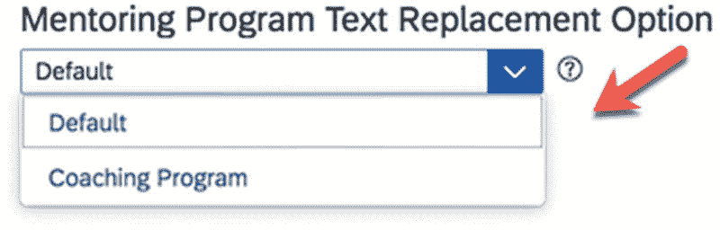

### 图 4-16 自定义计划的选择

通过从“辅导计划文本替换选项”列表中选择新定义的文本包，计划将使用这些标签，而非系统默认标签。这些标签适用于辅导界面以及系统生成的辅导邮件。你可以使用新标签创建公开报名、受监督或非受监督计划，而无需更改标准计划的标签。

自定义计划创建完成后，当用户进入“辅导”功能进行注册时，他们将看到这个新计划，并且该计划将包含新的标签，如图 4-17 所示。

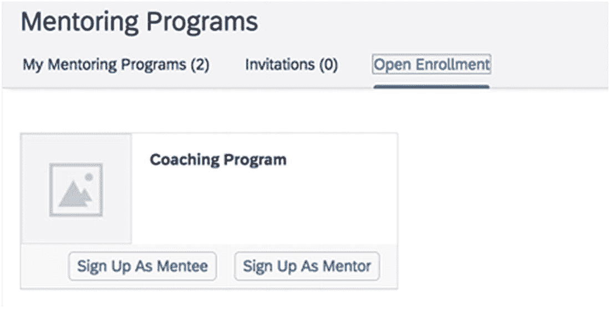

### 图 4-17 使用自定义标签的公开报名计划

所有之前对导师、学员或导师计划的引用现在都将引用新标签。

现在回到“详细信息”页面。根据您正在创建的导师计划类型，填写“导师计划详细信息”页面，保存，然后继续到下一个界面。

正如我们在表 4-4 中之前所见，`Mentors`和`Mentees`页面包含在监督式和未监督式导师计划中。这些界面不适用于开放注册计划，因为此类计划对所有人开放，员工可以注册为导师、学员，或两者兼备。

`Mentors`和`Mentees`页面用于确定哪些员工将被邀请参与导师计划。

`Mentors`页面如图 4-18 所示。

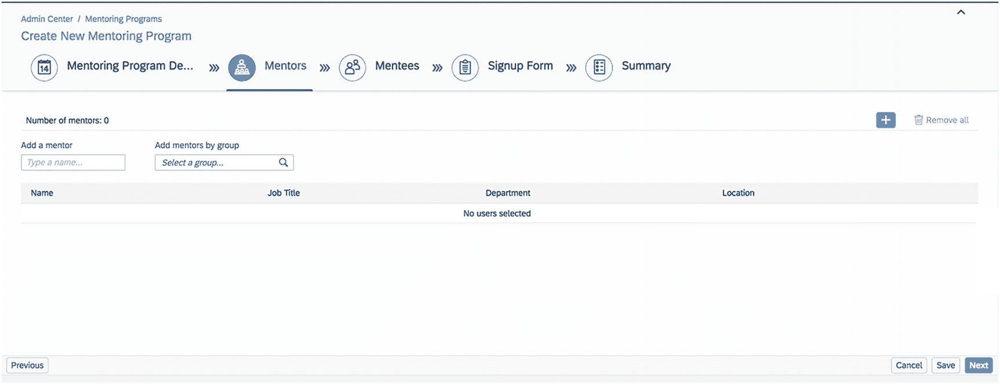

### 图 4-18 用于确定受邀导师的`Mentors`页面

在`Mentors`和`Mentees`页面上，使用名称搜索来选择个人或已设置好的任何组。

对于监督式和未监督式计划，`Mentees`页面与`Mentors`页面看起来相同，并且遵循相同的逻辑。在此，管理员将选择那些将收到邀请以学员身份加入导师计划的员工。

所有类型的导师计划都包含“报名表”页面。此页面用于创建参与者在报名时需要回答的问题。匹配规则也将在此处定义。在匹配过程中，系统将根据这些规则进行推荐匹配。

界面示例如图 4-19 所示。

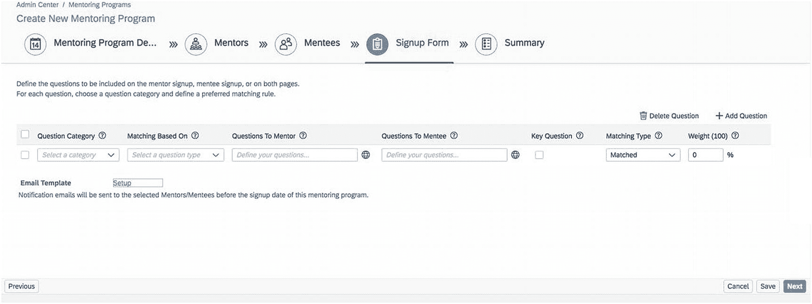

### 图 4-19 用于创建问题的报名表

`Signup Form`界面上显示的字段如表 4-5 所示。在创建表单时，请审阅这些描述，以指导您创建问题和匹配规则。

### 表 4-5 报名表创建页面上的问题字段

| 报名表字段 | 描述 |
| :--- | :--- |
| `Question Category` | 如果问题是从选择列表中回答的，请确定要使用的选择列表。另一种选项是自由格式文本。使用此选项时，没有“匹配依据”字段和匹配类型。如果您不使用问题，请选择一个类别以用于员工资料匹配。为了让导师能够与学员匹配，所有问题不能都是自由格式文本。 |
| `Matching Based On` | 偏好、资料、学员偏好或导师偏好。• 基于偏好匹配：导师和学员根据他们对问题的回答进行匹配。• 学员偏好：使用此匹配类型，问题仅针对学员。导师不会在他们的报名表上看到该问题。匹配基于学员的回答和导师的员工资料。• 导师偏好：使用此匹配类型，问题仅针对导师。学员不会在他们的报名表上看到该问题。匹配基于导师的回答和学员的员工资料。• 资料：此匹配类型不使用问题。匹配基于导师和学员的员工资料进行。 |

# 指导计划配置

## 问题字段

| 字段 | 说明 |
| :--- | :--- |
| `Questions to Mentor` | 提供一个要问导师的问题。这是一个文本字段，可以本地化。此问题仅在导师注册计划时可见。 |
| `Questions to Mentee` | 提供一个要问学员的问题。这是一个文本字段，可以本地化。此问题仅在学员注册计划时可见。 |
| `Key Question` | 如果一个问题被标记为“关键”，并且导师和学员对该问题的回答不匹配，那么他们将不会被匹配。 |
| `Matching Type` | 选项为“已匹配”或“不匹配”。匹配的进行方式取决于参与者的回答或匹配的员工资料。 |
| `Weight` | 如果每个问题的权重留空，则问题权重均等。否则，应输入 1-100 的整数。权重总和必须为 100。 |
| `Email Template Setup: Mentor invitation and Mentee invitation` | 仅对监督式和未监督式计划可见。管理员可以修改所发送的电子邮件邀请的标准文本。 |

每个问题必须填写的字段如图 4-20 所示。

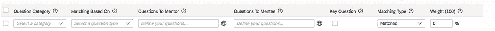

### 图 4-20：报名表页面上问题的字段

根据所选的问题类别，某些字段将会变灰。表 4-6 指出了哪些字段可用于每个文本问题和选择列表。由于选择列表有四种匹配选项，因此需要填写的字段会有所不同。

### 表 4-6：根据问题类别要填写的字段

| 问题类别 | 匹配依据 | 给导师的问题 | 给学员的问题 | 关键问题 | 匹配类型 | 权重 |
| :--- | :--- | :--- | :--- | :--- | :--- | :--- |
| 自由格式文本 | N/A | X | X | N/A | N/A | N/A |
| 选择列表 | 偏好 | X | X | X | X | X |
| 选择列表 | 资料 | N/A | N/A | X | X | N/A |
| 选择列表 | 学员偏好 | N/A | X | X | X | X |
| 选择列表 | 导师偏好 | X | N/A | X | X | X |

使用“问题类别”字段来识别问题中使用的选择列表，这样当导师和学员回答问题时会显示相应的值。选择列表后，确定匹配标准。“匹配依据”偏好将决定该问题在报名表上会显示哪些字段。

请注意，使用自由文本问题时，回答限制为 128 个字符。此外，这些答案不用于匹配，也不用于匹配算法。这些答案主要是信息性的，因为当在导师/学员的导师偏好中查看潜在人选时可能会看到这些回答。

导师和学员将在注册过程中回答问题。推荐的导师由所使用的问题以及每个问题的匹配规则共同定义。

匹配顺序的规则包括：

*   学员选择一个首选的导师，除非该导师已达到允许的最大学员人数。
*   学员选择多个首选导师，则与匹配分数最高的导师进行匹配。
*   如果学员的首选导师不可用，则学员将与匹配分数最高的导师进行匹配。
*   如果学员未选择首选导师，则学员将与匹配分数最高的导师进行匹配。

监督式计划使用不同的方法来计算匹配。映射程序将在本章后面讨论。

对于监督式和未监督式计划，管理员将可以选择更新发给导师和学员的电子邮件邀请。电子邮件模板如图 4-21 所示。要修改电子邮件模板，请点击“设置”。在此，管理员可以修改导师和学员邀请的主题和电子邮件正文。

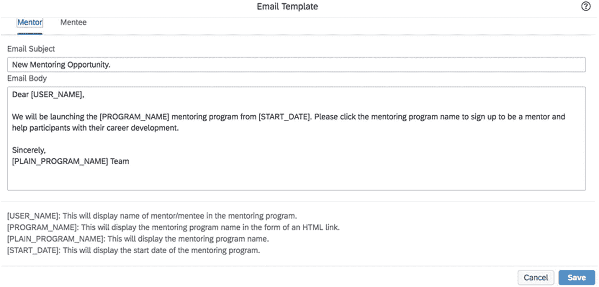

### 图 4-21：用于编辑的电子邮件通知

在创建问题并在适用情况下修改电子邮件邀请后，管理员将前往“摘要”界面。在创建过程中使用的每个界面的内容都将显示在“摘要”页面上。图 4-22 展示了一个监督式导师计划“摘要”页面的示例。

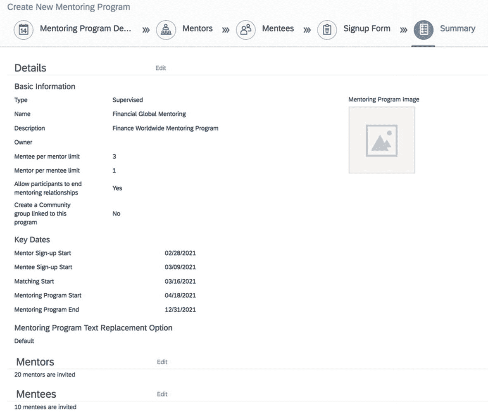

### 图 4-22：监督式计划的摘要页面

进行任何更新后，程序可以被删除、保存或启动。如果保存表单但未启动，程序设置状态为`Draft`，并保留在概览页面的`Not Started`存储桶中。如果启动，邀请将发出，报名随即开始。让我们快速回顾一下程序创建过程，并重点说明基于程序类型的一些差异。

## 开放报名计划

创建过程包含三个界面：`Mentoring Program Details`、`Signup Form` 和 `Summary`。此类计划不使用日期，也不邀请导师或被指导者。该计划对任何人开放，可作为导师、被指导者或两者兼任。如果您不希望计划对所有人开放，也可指定一个群组。开放报名的一个独特之处在于，管理员可以选择让导师的参与需经经理或管理员批准。

如果您将计划配置为需要经理批准，则必须使用主页磁贴。请前往 `Manage Home Page` ➤ `To-Do Settings` ➤ `Show/Hide To-Do Tiles`，如图 4-23 所示。

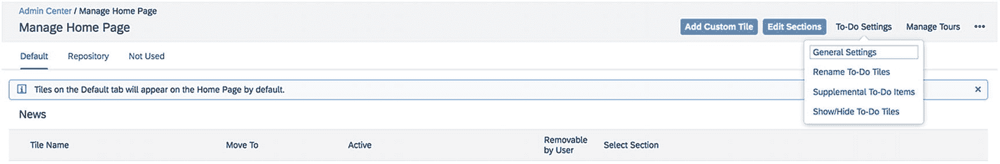

### 图 4-23：显示/隐藏待办事项磁贴

必须启用`Approve Requests`待办事项磁贴，如图 4-24 所示。

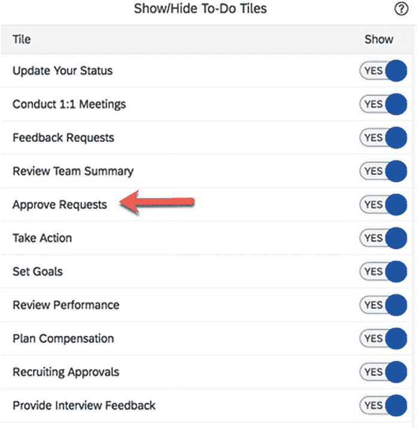

### 图 4-24：启用“批准请求”待办事项磁贴

配置完成后，当员工需要经理批准才能以导师身份参与开放报名计划时，经理的主页上将出现一个待办事项磁贴，他们可以在该磁贴上批准或拒绝请求。

所有计划细节设置完毕后，即可启动计划。此时，该计划将出现在概览页面的`In-Progress`部分。

在开放报名启动过程中，管理员可以发送加入计划的邀请。与监督型和非监督型计划不同，这里没有邀请邮件。相反，管理员需要创建一封邮件，并包含一个指向该计划的深层链接。要查找深层链接，请前往概览页面找到该计划。点击计划名称，查看`Details`选项卡。向下滚动即可看到深层链接，如图 4-25 所示。

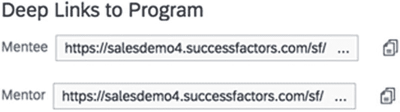

### 图 4-25：开放报名计划内的深层链接

导师和被指导者的链接不同，因为需要回答的问题基于各自的视角，并且在指导流程中需要执行不同的步骤。但是，如果您打算允许任何人成为导师或被指导者，可以将两个链接都放在邮件中。

收到邮件通知后，导师和被指导者即可前往报名页面进行注册。如果导师加入需要管理员批准，管理员需要进入计划并接受或拒绝请求，如图 4-26 所示。

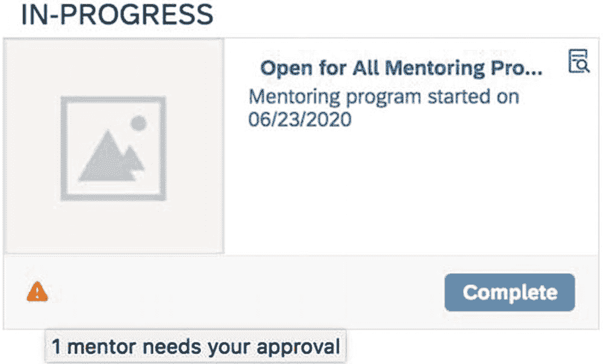

### 图 4-26：向指导管理员发送的导师参与请求通知

拒绝请求将向导师发送一封邮件，并将该计划从导师的`My Mentoring Programs`选项卡中移除。批准则会使导师可供匹配，并移除其待处理状态。

在报名期间的任何时候，管理员都可以返回计划进行更改，例如添加问题、更改日期或更改所有者。此时他们将看到`Mentors`、`Mentees`和`Matches`选项卡。管理员可以查看谁已加入、谁有导师，还可以分配或重新分配匹配。该计划将持续开放，直到管理员关闭它。对于监督型和非监督型计划也是如此。

## 创建监督型和非监督型指导计划

管理员遵循与创建开放报名指导计划相同的初始步骤。表 4-7 展示了一些功能及其在两种计划类型之间的区别。

### 表 4-7：计划类型比较

| 功能 | 监督型计划 | 非监督型计划 |
| :--- | :--- | :--- |
| 明确的开始和结束日期，严格规定导师和被指导者何时可以报名。一旦被指导者开始报名，导师报名即关闭。 | 日期更灵活，因此被指导者可以在导师报名进行中时报名。 |
| 手动将计划推进到下一步。 | 基于日期，系统自动将计划推进到下一步，也可选择手动推进。 |
| 邀请邮件必须由管理员手动发起。 | 邀请邮件根据计划定义的开始日期自动发送，或可手动完成。 |
| 被指导者邀请发出后，已受邀的导师将无法再报名。 | 对于导师和被指导者，报名期在计划结束前一天结束。 |
| 使用匹配开始日期。 | 不使用匹配开始日期。 |
| 可在匹配前编辑问题。 | 只要计划尚未结束，即可编辑问题。 |

| 根据配置和偏好进行匹配，但管理员可以编辑匹配。 | 提供匹配指导，但由被指导者直接联系导师。 |
| --- | --- |
| 被指导者在报名时不必选择导师。如果他们确实选择了导师，在匹配程序运行之前不会向该导师发送邮件。 | 被指导者报名时，必须选择一位导师。请求会立即发送给该导师。 |
| 无需导师批准。匹配程序结束后，导师和被指导者将通过邮件收到他们的匹配结果。 | 导师必须批准被指导者的请求才能完成匹配。如果不批准，管理员可以手动进行匹配。 |
| 导师和被指导者可在报名期间退出，但之后不能决定重新报名。 | 导师和被指导者可在报名期间退出，但之后不能决定重新报名。 |
| 管理员可以在计划启动后添加、编辑和删除报名表单问题，以及修改匹配规则。 | 管理员可以在计划启动后添加、编辑和删除报名表单问题，以及修改匹配规则。 |
| 被指导者报名开始日期不能与导师开始日期相同或早于导师开始日期。 | 被指导者报名开始日期不能与导师开始日期相同或早于导师开始日期。 |
| 导师开始日期不能是当前日期。 | 导师开始日期不能是当前日期。 |
| 匹配触发计划从`Not Started`转变为`In-Progress`。 | 无匹配程序。 |
| 在匹配程序运行之前，管理员不会在计划中看到`Matches`选项卡。 | 在导师收到邀请后，管理员将看到`Matches`选项卡。 |
| 在匹配程序运行之前，管理员无法分配或重新分配导师和被指导者。 | 一旦有导师和被指导者注册了计划，管理员即可进行分配和重新分配。 |
| 计划在匹配程序完成且管理员进行任何重新分配之前，不会显示为`In-Progress`。 | 一旦被指导者完成报名且管理员进行任何匹配重新分配后，计划即显示为`In-Progress`。 |

## 监督型指导计划

监督型指导计划使用明确的开始和结束日期，并且管理员必须通过点击计划上的按钮手动发送邀请，如图 4-27 所示。

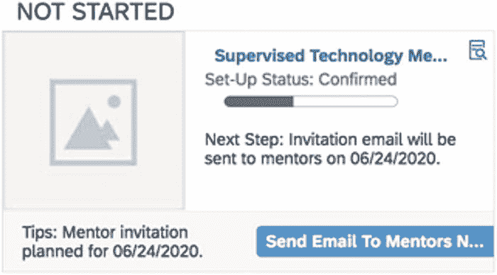

**图 4-27：** 管理员指导概览页面上的监督型计划

确认后，邮件将发送给在项目创建期间被识别为导师的所有员工。在报名期间的任何时候，管理员都可以返回项目进行更改，例如添加问题、更改日期或更改负责人。但是，导师开始日期不能更改，也不能再添加导师。

一旦学员开始日期到来，管理员必须返回概览页面，在计划的学员开始日期发送学员邀请。如果管理员在指定的学员开始日期之前发送邮件，则不能再有导师注册。同样，在报名期间，管理员仍可进行项目更改。然而，一旦学员邀请发出，学员开始日期就不能更改，也不能再添加学员。

管理员等待导师和学员注册或退出项目。学员和导师的加入时间没有重叠。对于受监督的项目，匹配将根据配置的匹配开始日期开始。在匹配程序运行之前，管理员不会在项目中看到“匹配”选项卡。管理员将看到所有已加入或退出的导师和学员，并可查看他们的偏好。

学员注册完成后，管理员将手动启动匹配程序，如图 4-28 所示。

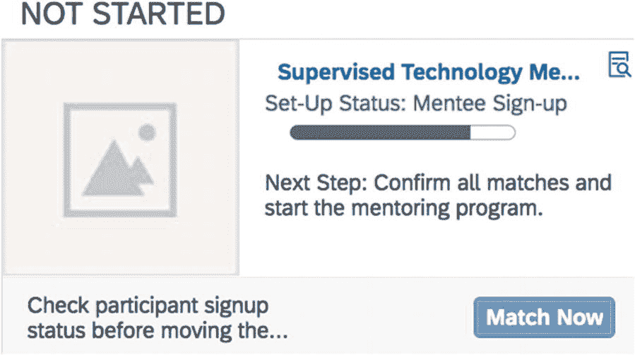

图 4-28 设置为运行匹配程序的受监督项目

在管理员查看匹配结果并手动进行任何调整之前，项目不会进入“进行中”状态。一旦匹配最终确定，管理员将启动项目。邮件将发送给导师和学员，通知他们各自的辅导伙伴。

## 非受监督辅导项目

对于非受监督的项目，系统将根据项目创建时确定的开始日期自动发送项目邀请。但是，管理员可以在系统发送日期之前手动发送邀请。学员注册也采用相同的流程。根据创建项目时确定的开始日期，学员邀请将被发出，或者管理员可以手动发送邀请。

在此期间，管理员可以进行项目更改，并查看已加入、退出或未回复的导师和学员。“匹配”选项卡也将可见，因此管理员可以看到学员所做的导师选择。管理员还可以进行任何匹配重新分配。一旦管理员审查了匹配结果并做出了最终更改，项目将进入“进行中”状态。任何导师发生变更的人都会收到电子邮件通知。

项目现已全面运行。受监督和非受监督的辅导项目将持续运行，直到其结束日期或由管理员终止。如果配置允许，导师和学员也可以结束他们的辅导关系。

## 管理项目

我们之前已经简要介绍了通知开始发出后管理员可以执行的操作。现在我们将更深入地了解这些功能。如前所述，管理员或负责人使用“管理辅导项目”工具从项目概览屏幕进行所有项目管理。除创建项目外，负责人可以执行所有项目管理功能。

项目创建后，辅导管理员可以对项目进行更改、查看导师和学员、查看匹配结果以及分配和重新分配匹配。这将根据辅导项目的不同而在不同时间进行。

对于所有项目类型，辅导管理员可以在流程的任何步骤查看项目。根据项目状态，管理员可以修改问题、更改导师/学员限制、将导师标记为不可用或进行匹配。

对于受监督的项目，问题和匹配规则可以在匹配程序运行之前修改。对于开放注册和非受监督的项目，可以在项目结束之前进行更改。

一旦学员和导师成为项目的一部分，管理员可以更改辅导关系，并为未分配的学员分配导师。

如果管理员在启动后添加问题，则这些问题适用于添加问题后注册的人员。现有参与者如果编辑他们的偏好，将会看到新问题。

管理员删除问题后，后续注册的人员将看不到已删除的问题。已经注册的人员也不会再看到该问题。

所有项目类型都支持手动匹配功能。在回顾手动匹配功能后，我们将介绍受监督项目使用的匹配程序。

## 管理员匹配

对于开放注册和非受监督的辅导项目，一旦项目邀请发出，管理员将在项目中看到“匹配”选项卡。此选项卡在受监督项目中不可见，直到匹配程序运行后才会显示。“匹配”选项卡有两个子选项卡：“已匹配”和“未匹配”。“已匹配”选项卡包含基于导师批准学员请求的分配。没有推荐匹配或请求被拒绝的学员将出现在“未匹配”选项卡中。图 4-29 显示了“未匹配”选项卡。

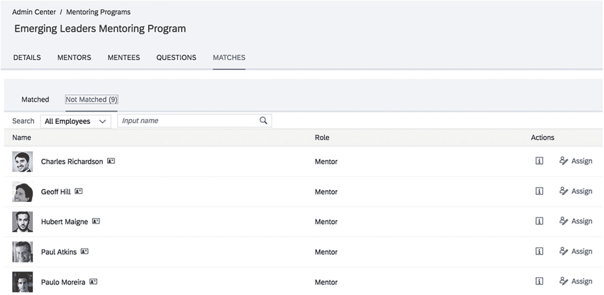

图 4-29 未匹配或未分配的导师和学员

在图 4-30 中，管理员为一名学员选择了一位新导师。这是基于可用导师进行的。如果允许导师有多名学员且尚未达到上限，他们也将作为可能的导师出现。

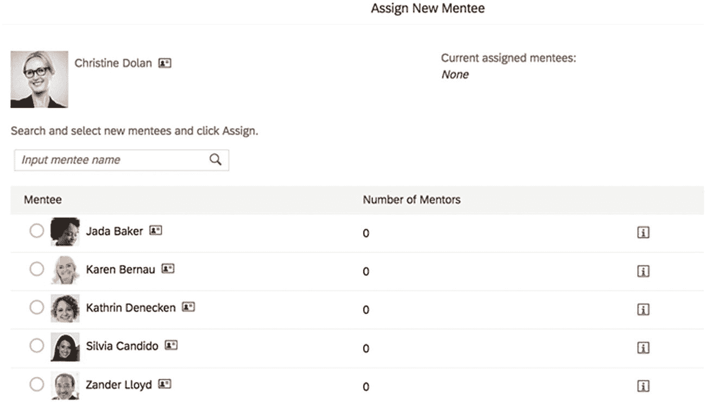

图 4-30 管理员分配导师

辅导管理员也可以在“已匹配”选项卡中更改现有的辅导关系。这是通过从导师列表中删除学员来实现的。当学员出现在“未匹配”选项卡中时，管理员可以进行新的匹配。

一旦管理员将项目移至“进行中”状态，任何导师的变更都将触发电子邮件通知。如果管理员删除一个关系，学员将收到电子邮件通知。如果建立了新的辅导关系，则会向导师和学员发送电子邮件通知。

受监督项目具有一个映射项目功能，该功能在其他两种辅导项目类型中不可用。以下将对此进行详细说明。

## 监督制项目的匹配程序

导师与学员之间的匹配基于注册表单问题所设定的规则。匹配规则决定了推荐匹配结果。匹配程序首先通过关键问题的匹配规则进行筛选，若不满足规则，则导师与学员不被视为匹配。若基于某个关键问题的规则存在匹配，系统则会继续根据附加问题的匹配规则进行匹配。对于非关键问题，系统会对比偏好或员工档案来计算匹配分数。

技能与能力类问题基于所选列表值的匹配数量进行匹配。匹配值数量除以学员的总值数量即为匹配分数，范围是 0–100。其余的标准选项列表和自定义选项列表问题采用 0 或 100 的分数。导师与学员之间至少需要有一个值匹配，该问题才能获得 100 分。

所有匹配分数累加后得到导师的最终分数。如果各问题权重不同，则权重也将纳入最终匹配分数的计算。

系统最多为每位学员推荐十位导师。匹配采用星级制，共分四个匹配等级：

1.  首选匹配（四星）：基于注册时选择的优先导师
2.  优秀匹配（三星）：匹配分数达到 75%或以上
3.  良好匹配（两星）：匹配分数在 50%–74.99%之间
4.  一般匹配（一星）：匹配分数在 49.99%或以下

一旦匹配程序完成，管理员可以点击项目名称查看项目详情。

只有在匹配程序运行之后，`Matches`（匹配结果）选项卡才会显示。该选项卡最多可列出 200 个匹配结果。图 4-31 展示了`Matched`（已匹配）选项卡的示例。

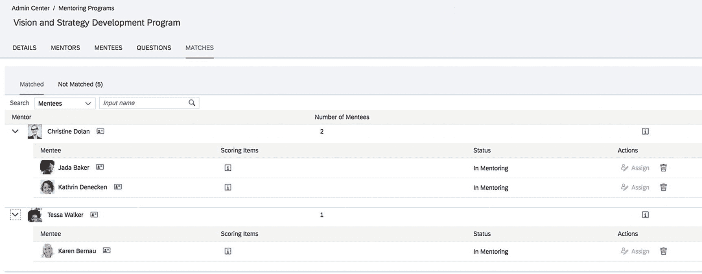

**图 4-31** 监督制项目中的匹配程序结果

如图 4-32 所示的示例，管理员可以按匹配等级进行筛选，以便查看更易于管理的匹配列表。如果有数百条记录需要审核，筛选功能可以让查找更改内容变得更加轻松。

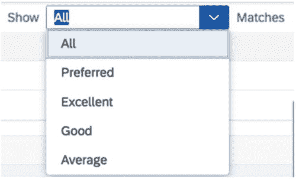

**图 4-32** 通过筛选缩小匹配列表范围

管理员可以删除任何匹配记录，这会导致该导师和学员都进入`Not Matched`（未匹配）选项卡。此外，可能会有一些未分配导师或未达到匹配标准的学员，他们也会出现在`Not Matched`选项卡中。管理员需要为所有未匹配的学员分配导师。如果允许一名导师指导多名学员，或者导师数量过剩，也可能出现没有学员的导师。

在`Not Matched`选项卡中，会显示前 500 个未匹配的记录。随着配对关系的分配，该列表将包含超出初始 500 个未匹配记录的其他名字。`Not Matched`（未匹配）结果将包括因学员不足而剩余的导师，或因导师不足而剩余的学员。

管理员可以按导师或学员进行筛选，如图 4-33 所示。

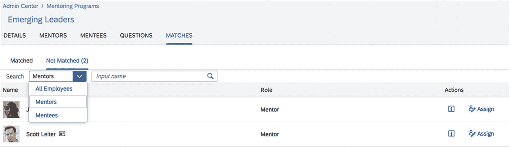

**图 4-33** 通过筛选查看未匹配的参与者

管理员可以根据剩余可用的导师或学员进行分配。当所有匹配决策完成后，管理员返回概览页面，点击项目的“开始”按钮。项目状态将从`Not Started`（未开始）变为`In-Progress`（进行中）。

随后，导师匹配邮件会发送给导师和学员，告知他们各自的匹配结果。如果学员在注册时选择了推荐导师，但管理员或匹配程序更改了分配，学员将收到通知，并获知新导师的姓名。接下来，就由导师和学员自行会面，并确定他们希望通过导师制实现的目标。

项目将保持`In-Progress`（进行中）状态，直到项目结束日期，或直到管理员手动强制项目完成，届时项目状态将变为`Finished`（已完成）。

# 用户访问导师制功能

在从参与者角度介绍导师制项目的生命周期之前，我们先了解员工如何访问项目。

要访问`Development`（发展）下的`Mentoring`（导师制）选项卡，用户需要拥有`Career Development Plan (CDP) Access Permission`（职业发展计划访问权限）和`Mentoring Programs Access Permission`（导师制项目访问权限）。

所有与员工导师制相关的功能均通过`Mentoring overview`（导师制概览）页面访问：

-   访问当前参与中的导师制项目
-   注册基于邀请的项目
-   注册开放报名项目

`Mentoring overview`（导师制概览）页面由三个选项卡组成：

1.  **My Mentoring Programs**（我的导师制项目）是默认选项卡，包含用户当前参与的所有项目。
2.  **Invitations**（邀请）包含对监督制和非监督制项目的邀请。这些是用户已被邀请但尚未注册的项目。
3.  **Open Enrollment**（开放报名）包含用户有资格加入的开放报名项目。

员工的`Mentoring overview`（导师制概览）页面示例如图 4-34 所示。

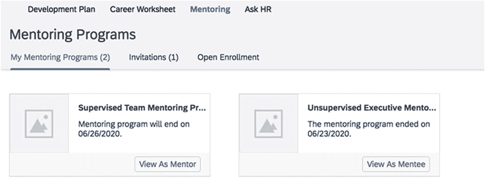

**图 4-34** 参与者导师制概览页面

在此示例中，该员工当前已注册两个项目，一个作为导师，一个作为学员。同时还有一个待处理的邀请。

监督制和非监督制项目的邀请会显示在`Invitations`（邀请）选项卡中，而开放报名项目则显示在`Open Enrollment`（开放报名）选项卡中。

现在，我们将从用户的角度来看导师制项目的生命周期。项目类型不同导致的行为差异会予以注明。

## 导师注册

在所有类型的项目中，导师应优先注册。学员需要选择导师，因此项目中必须有可供选择的导师。

管理员启动监督制或非监督制导师项目后，邀请会发送给导师。发送给导师的邀请示例如图 4-35 所示。

**图 4-35** 导师邀请邮件

导师可以使用邮件邀请中的链接访问注册表单，或前往`Mentoring`（导师制）页面查看请求。任何新邀请都会出现在`Invitations`（邀请）选项卡中，如图 4-36 所示。

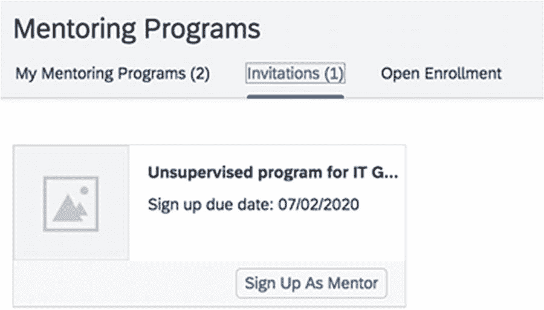

**图 4-36** 待注册项目的邀请选项卡

导师需要点击“Sign Up As Mentor”（注册为导师）按钮加入，或选择退出：

-   对于监督制项目，如果导师在学员注册开始日期前未注册，则导师注册通道将关闭，他们将无法注册。

### 程序类型与导师注册

对于**无监督**项目，即使在学员注册开始后，导师也可以继续注册。导师和学员都可以在辅导项目开始日期的前一天之前进行注册。

对于**开放注册**项目，如图 4-37 所示，邀请函位于`Open Enrollment`选项卡中，用户可以注册为导师、学员或两者皆是。

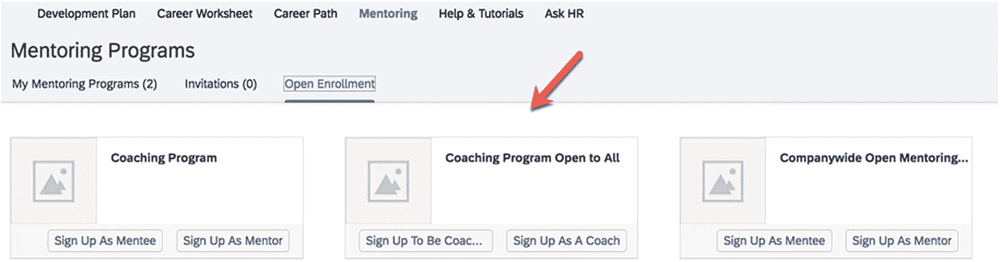

*图 4-37 包含邀请函的开放注册选项卡*

对于**开放注册**项目，没有退出选项。如果您不注册，您就不会加入该项目。由于日期是开放式的，受邀者可以在以后加入。对于开放注册项目，可以以导师或学员的身份进行注册。

所有三种项目类型在注册过程中都使用相同的三个界面：欢迎、偏好和完成。

欢迎页面如图 4-38 所示。

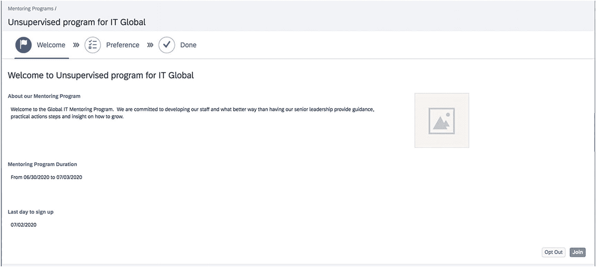

*图 4-38 用于加入或退出的欢迎页面*

欢迎页面显示项目名称和描述，以及注册截止日期和项目的开始与结束日期。对于开放注册项目，不会列出注册日期或项目开始与结束日期。

对于**受监督**和**无监督**项目，可以选择拒绝邀请。要退出项目，用户将点击“退出”按钮。在确认他们希望拒绝邀请后，该项目将从用户的`Invitations`（邀请）选项卡中移除。不会因退出项目而生成任何电子邮件，并且该项目将不再出现在项目概览页面上。如果他们之后改变主意，将无法注册。

对于**开放注册**项目，会有加入的选项，但没有退出选项。如果他们不采取任何行动，他们就不会成为项目的一部分。但是，只要项目尚未关闭，他们可以随时进入并注册。

偏好页面在所有项目中使用。这是为了找到匹配对象而回答问题的地方。导师将回答问题以便与学员匹配。导师不会进行任何学员选择。这由学员或匹配程序决定。

示例如图 4-39 所示。

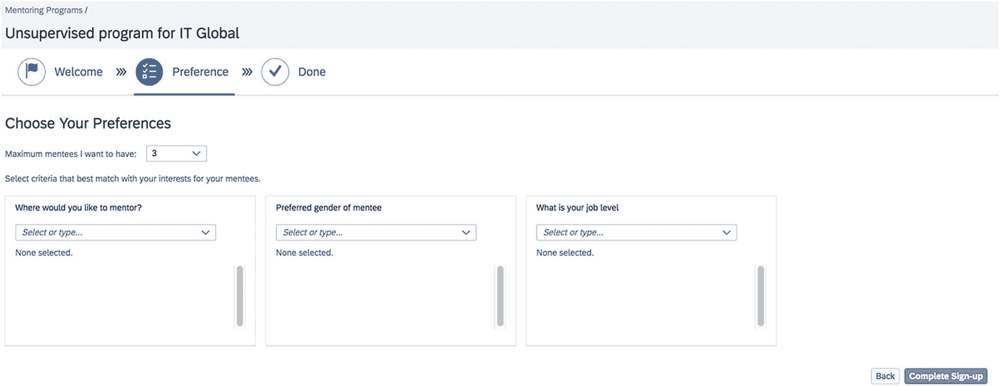

*图 4-39 导师的偏好页面*

在注册期间，如果项目已配置为允许导师带多个学员，则导师可以更改学员人数。

回答问题后，导师即完成注册，注册过程中的最后一个界面将显示，如图 4-40 所示。

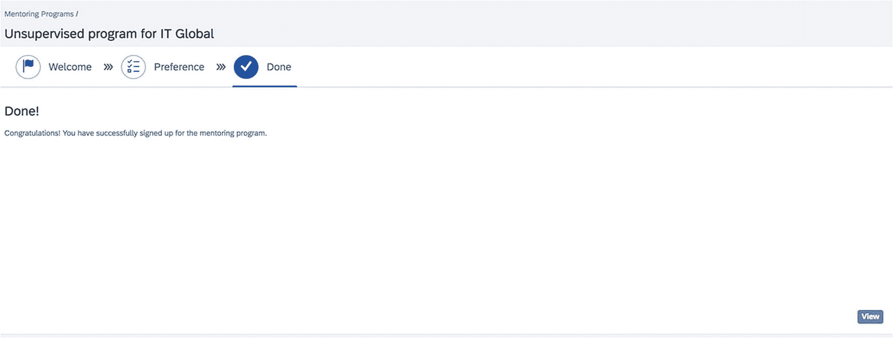

*图 4-40 导师注册完成*

导师可以查看项目详情、编辑偏好设置以及更改他们在项目中的可用状态。项目级别的概览页面如图 4-41 所示。

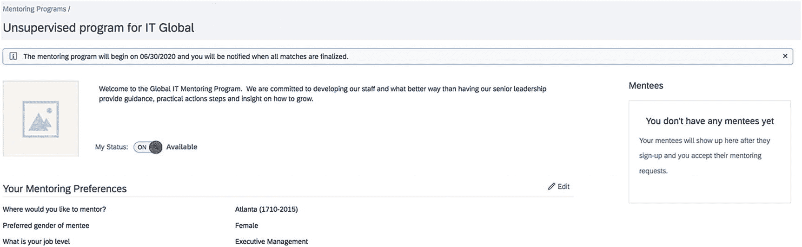

*图 4-41 导师的项目概览页面*

注册后，该项目将从`Invitations`（邀请）选项卡移动到`My Mentoring Programs`（我的辅导项目）选项卡。

#### 开放注册导师注册的特殊情况

对于**开放注册**项目，项目可能被设置为要求导师获得经理或管理员批准才能参与。在这种情况下，导师状态为待定。在获得批准之前，导师不会成为项目的一部分。这意味着潜在的导师不能更改其偏好设置、更改可用性或查看项目详情。

导师的经理将收到一封电子邮件，引导他们访问其主页。将有一个`To-Do`（待办）磁贴来批准该请求。`To-Do`磁贴如图 4-42 所示。

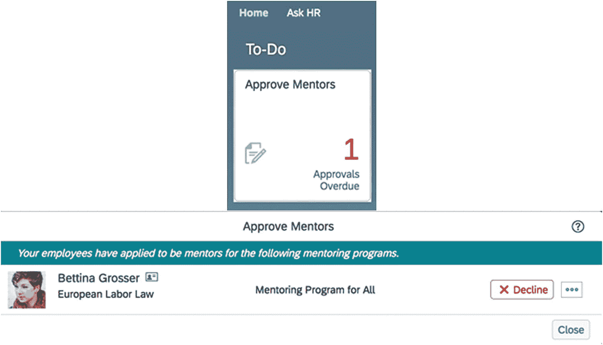

*图 4-42 用于导师批准的经理待办磁贴*

如果经理拒绝该请求，经理可以选择添加一条备注，该备注将在导师收到拒绝通知时包含在内。

同样，如果导师需要获得管理员批准才能加入，则管理员必须批准该请求。有两种拒绝类型：拒绝文档或拒绝导师参与。通过拒绝支持文档，可以在通知中添加备注，以便导师知道需要重新提交什么。导师状态保持为待定，直到获得批准。如果管理员批准，导师就成为项目的一部分。导师现在可以在其`My Mentoring Programs`（我的辅导项目）选项卡中看到该项目，并可以以导师身份查看或以学员身份注册。

如果被拒绝，导师将从项目中移除，并且该项目将不再显示在`My Mentoring Programs`（我的辅导项目）选项卡中。导师仍然可以通过返回主页上的`Open Enrollment`（开放注册）选项卡并点击“注册为学员”来以学员身份加入。

如果获得批准，导师将收到一封确认电子邮件，并且现在可以被学员选择。导师现在可以返回项目级别概览页面更改其偏好设置或可用性。

表 4-8 总结了导师注册期间不同项目类型的差异。

*表 4-8 按项目类型划分的导师注册选项*

| 操作/项目类型 | 受监督 | 无监督 | 开放注册 |
| :--- | :---: | :---: | :---: |
| 向导师发送邀请。 | X | X | X (可选) |
| 邀请位于`Invitations`选项卡中。 | X | X | |
| 邀请位于`Open Enrollment`选项卡中。 | | | X |
| 导师可以选择退出项目。 | X | X | |
| 经理或管理员批准导师参与。 | | | X |
| 导师可以在注册和接受过程中查看其偏好设置。导师可以更改其可用性。 | X | X | X |

## 学员注册

在学员收到加入**受监督**或**无监督**项目的邀请后，学员将使用电子邮件邀请中的链接或直接前往`Mentoring`（辅导）页面来加入或退出。该邀请将出现在`Invitations`（邀请）选项卡中，如图 4-43 所示。

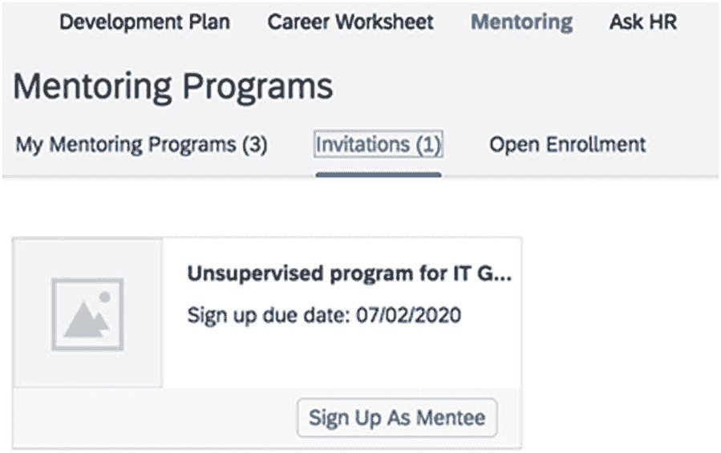

*图 4-43 学员的辅导项目邀请*

### 学员注册日期

注册日期因项目类型而异：

*   对于**受监督**项目，如果学员在项目匹配开始日期之前未注册，则学员注册将关闭，他们无法再注册。
*   对于**无监督**项目，学员可以在辅导项目开始日期的前一天之前继续注册。
*   对于**开放注册**项目，注册可以持续进行，直到管理员结束项目。

学员必须点击“注册为学员”才能加入或退出。如果他们不采取任何行动或试图在项目开始后注册，他们将不会加入该项目。如果他们退出，该邀请将从`Invitations`（邀请）选项卡中移除。

与导师注册流程相同，学员将看到项目详情，随后可以选择退出或加入。对于开放注册的项目，唯一的选择就是加入。如果学员不希望加入，则无需任何操作。若要加入，他们需填写注册表格，列出自己偏好的导师。

学员注册界面有一些导师注册界面没有的额外功能：`显示推荐导师`和`搜索导师`。此功能适用于所有三种项目类型。示例注册页面如图 4-44 所示。

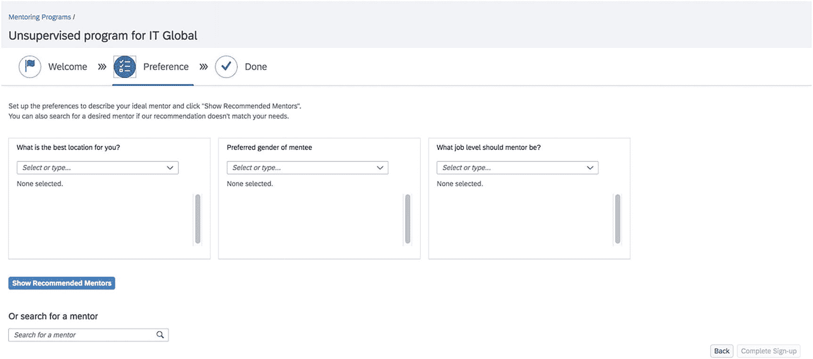

**图 4-44** 学员偏好页面

要注册，学员必须完成问卷。问题将针对学员的视角进行定制，但会使用与导师问题相同的选项列表。自由文本问题对导师和学员均相同。

完成问题后，学员需点击`显示推荐导师`按钮，查看根据其偏好和匹配规则推荐的所有导师。如果没有匹配结果，学员可以通过姓名搜索来寻找导师。无监督项目不允许学员在不选择导师的情况下注册。对于监督项目，这是可选的，因为匹配程序会为学员找到最佳匹配。

图 4-45 显示了学员输入偏好后推荐的导师。

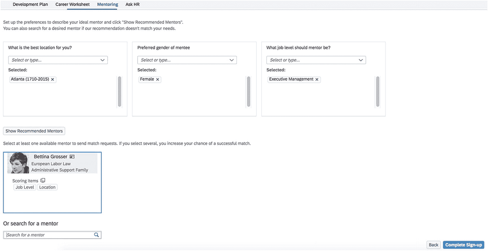

**图 4-45** 基于偏好和匹配规则的推荐匹配

在选择了一位导师（或根据推荐导师数量选择多位）后，学员完成注册，如图 4-46 所示。

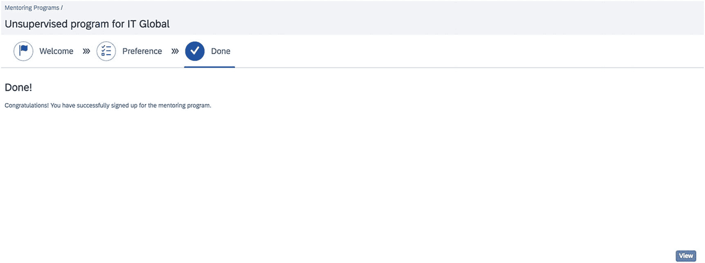

**图 4-46** 学员注册完成页面

学员可以查看项目以了解详情，并可以更改其偏好或邀请更多导师，如图 4-47 所示。

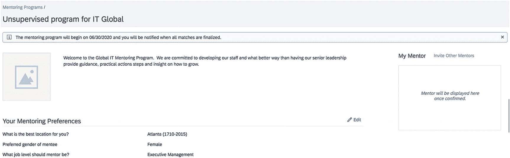

**图 4-47** 学员项目概览页面

在导师批准之前（对于无监督和开放注册项目），导师信息不会显示。

学员可以发送更多邀请，系统会提示他们重新回答问题，然后选择导师。示例如图 4-48 所示。与注册时选择导师的情况类似，如果在添加更多导师时没有匹配结果，学员可以通过姓名搜索找到导师。

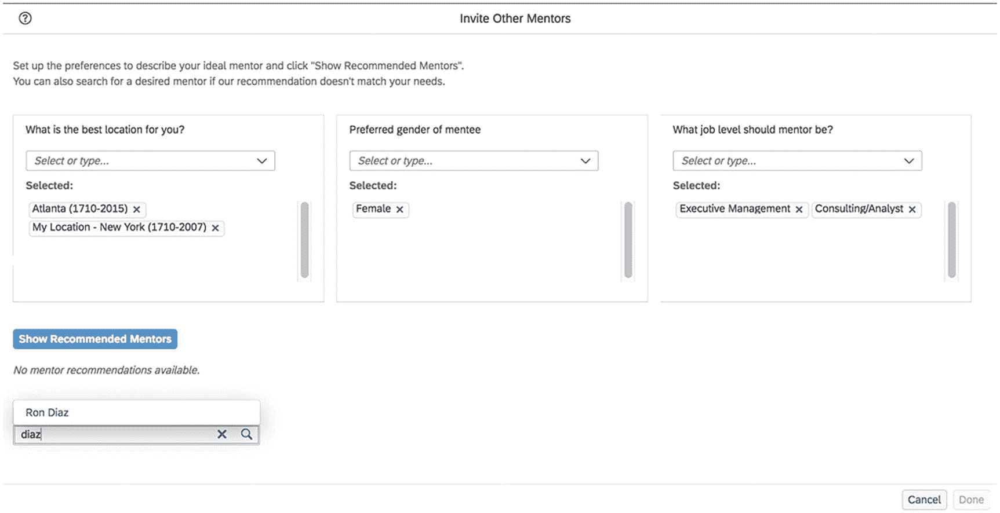

**图 4-48** 学员添加更多导师

如果根据学员的回答没有推荐匹配的导师，学员可以进行姓名搜索来寻找导师。对于开放注册和无监督项目，导师必须批准学员的请求。邀请将发送给导师，并需要其批准。对于监督项目，学员在注册时无需选择导师，因为匹配程序会确定匹配。

表 4-9 总结了学员注册期间不同项目的差异。

**表 4-9** 按项目类型划分的学员注册操作

| 操作/项目类型 | 监督式 | 非监督式 | 开放注册 |
| --- | --- | --- | --- |
| 向学员发送邀请。 | X | X | X (可选) |
| 邀请位于“邀请”选项卡中。 | X | X | |
| 邀请位于“开放注册”选项卡中。 | | | X |
| 学员接受或拒绝加入项目的邀请。 | X | X | |
| 功能 | 学员注册时 | 学员选择导师后 | 导师批准后 |
|---|---|---|---|
| 学员可查看推荐导师的偏好 | X | - | - |
| 学员选择导师 | X (可选) | - | - |
| 导师必须批准学员请求 | - | X | - |
| 学员注册后可添加更多导师请求 | X | - | - |
| 学员注册后可查看和更新偏好 | X | - | - |
| 学员查看导师在注册和接受过程中设置的偏好 | X | - | - |
| 学员注册开始后，导师可继续注册 | - | X | - |

## 导师批准

学员完成注册并选择导师后，在非监督式和开放注册项目中，导师必须批准学员的任何选择。在注册期间选择导师会触发系统向导师发送自动生成的电子邮件通知。

图 4-49 显示了一个示例导师申请。

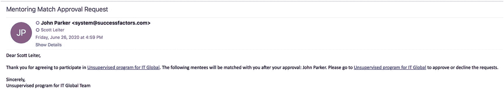

**图 4-49** 发送给导师的邮件请求

此电子邮件通知不用于监督式导师项目，因为该项目不使用批准流程。

导师将点击邮件中的链接查看请求，或直接进入导师项目级别页面，如图 4-50 所示。

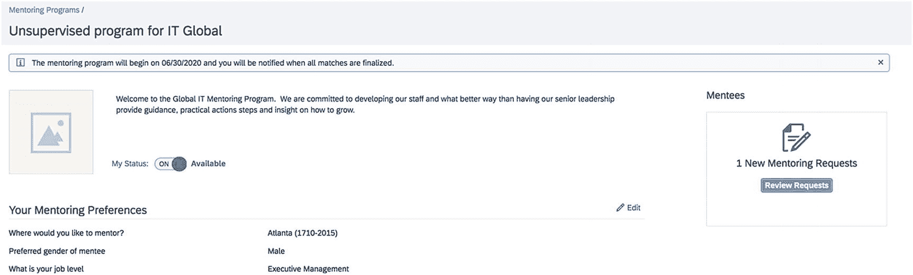

**图 4-50** 导师视角：带有待处理请求的项目概览页面

如图 4-51 所示，导师可以查看请求、查看学员的偏好，并接受或拒绝该导师关系。

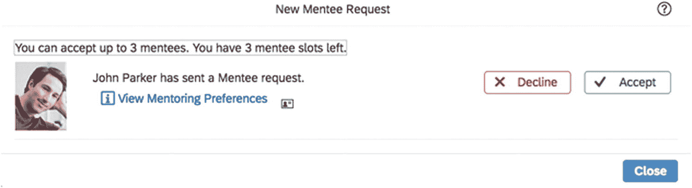

**图 4-51** 导师批准或拒绝学员请求

拒绝请求将向学员发送一封邮件，以便他们可以返回项目并重新选择。如果导师接受学员的请求，则会向学员发送确认邮件，此时学员即被分配。

一旦请求被接受，该学员将显示在导师的项目页面中，如图 4-52 所示。

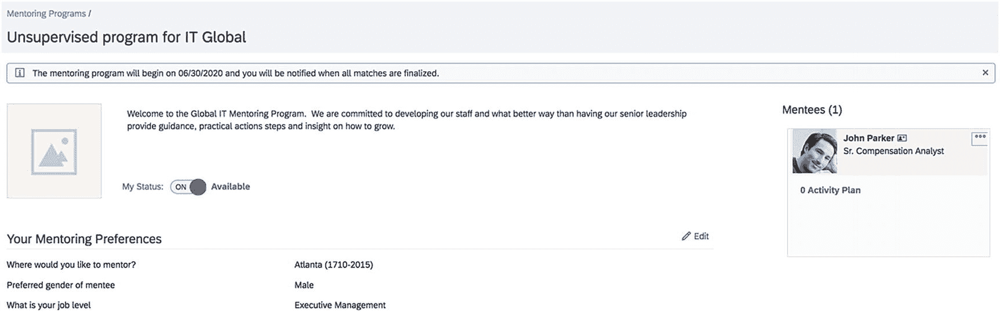

**图 4-52** 导师项目概览页面（显示已分配的学员）

导师可以查看学员的详细信息，并为学员的计划添加活动，如图 4-53 所示。

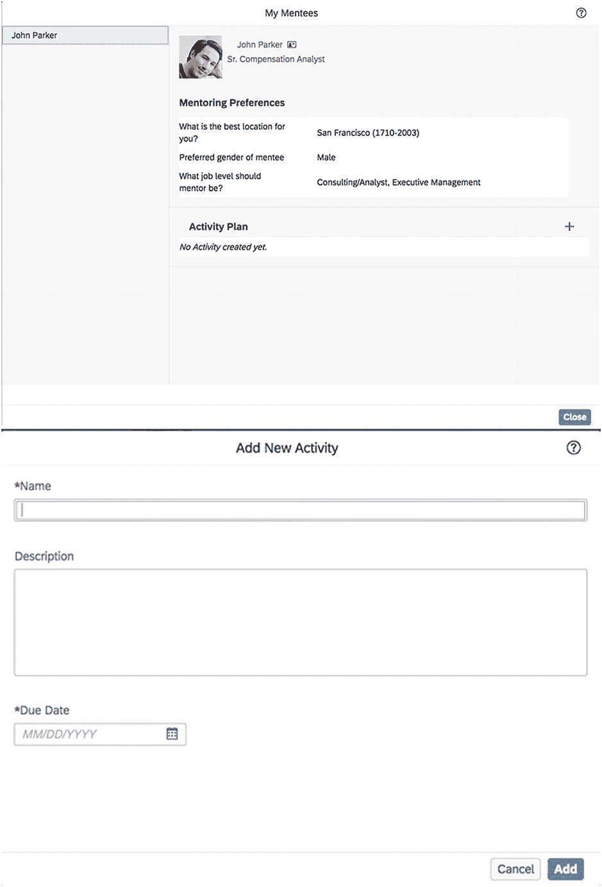

**图 4-53** 导师为学员计划添加活动

导师和学员之间最多可以添加五项活动。

当学员返回其项目页面时，将看到其导师已被添加，并且导师创建的任何活动也会显示。图 4-54 显示了一个示例。

**图 4-54** 学员视角：项目概览页面

这种关系将持续到项目结束、管理员进行重新分配，或者导师和学员结束关系为止。在项目开始前，管理员可以手动匹配之前未分配的导师和学员。导师和学员将收到导师关系匹配通知。管理员也可以更改分配，任何被重新分配的导师或学员将收到邮件通知。即使在项目开始后，管理员也可以更改任何导师关系，并会发送邮件通知。

## 项目开始后的导师和学员功能

项目开始后，学员和导师可用的功能如下：

- 导师和学员可以为学员添加活动。
- 结束并重启指导关系。
- 更新偏好设置。
- 导师可设置自身为不可用/可用状态。
- 查看指导计划详细信息。

计划启动后，导师或学员均可终止其指导关系。然而，任何一方都无法创建新的指导关系。学员终止关系的示例如图 4-55 所示。

**图 4-55** 终止指导关系选项

可在发送给导师的邮件中添加备注，如图 4-56 所示。

**图 4-56** 终止关系时可添加的可选备注

此时关系将显示为已终止，如图 4-57 所示。

**图 4-57** 计划级别概览页面上的已终止指导关系

导师将收到一封邮件通知。示例如图 4-58 所示。

**图 4-58** 指导关系终止邮件通知

终止指导关系的用户可重启关系，如图 4-59 所示。

**图 4-59** 重启指导关系

至此，我们已完整演示了从注册到计划完成的导师与学员示例。以下列出了整个计划中涉及管理员、导师和学员的步骤。

## 受监督计划的高层级步骤

- 管理员创建受监督的指导计划。
- 计划启动并保持“未开始”状态。
- 管理员手动发送导师邀请。
- 导师在“邀请”选项卡中查看邀请。
- 导师收到加入计划的邮件邀请：
    - 若加入，则填写注册表单，计划将显示在“我的指导计划”选项卡中。
    - 若选择退出，则从计划中移除，邀请也从“邀请”选项卡中移除。
- 指导注册期结束：
    - 不再有导师可以注册。
    - 管理员可在发送邀请前添加或删除学员。
- 管理员手动发送学员邀请邮件。
- 学员收到邀请：
    - 学员选择退出计划并被移除：
        - 邀请从“邀请”选项卡中移除。
    - 学员加入计划并填写注册表单以指定偏好：
        - 计划现在显示在“我的指导计划”选项卡中。
        - 学员可通过姓名搜索或从推荐列表中选择导师。
        - 若学员做出选择，则不会向导师发送邮件邀请。
        - 学员可不选择导师直接注册。
- 学员注册期结束。
- 在所有导师和学员注册后，管理员可编辑问题、修改匹配开始日期及指导计划的开始和结束日期，并上传图片。
- 匹配期开始，管理员运行匹配程序：
    - 此阶段不再有学员可以注册。
    - 根据偏好和员工档案生成建议匹配。
    - 管理员可分配任何未分配的参与者。
    - 管理员可取消分配任何已分配的参与者。
    - 管理员完成最终匹配，计划进入“进行中”状态。
    - 向导师和学员发送包含匹配信息的邮件。
- 在“进行中”阶段：
    - 若管理员取消任何关系，学员将收到通知。
    - 若管理员重新分配，学员和导师将收到通知。

## 指导原则：非监督式与开放式注册辅导计划

- 导师和学员安排会面以开始辅导。
- 导师或学员均可终止关系。
- 计划在指定结束日期或由管理员终止时结束。

## 非监督式计划的高级步骤

- 管理员创建一个非监督式辅导计划。
- 计划启动并保持“未开始”状态。
- 根据导师注册开始日期，系统自动向导师发送电子邮件，或管理员可手动触发邮件。
- 导师收到加入计划的电子邮件邀请：
    - 邀请位于“邀请”选项卡中。
    - 若导师加入，他们将填写注册表以提供偏好，计划现位于“我的辅导计划”选项卡中。
    - 若导师选择退出，他们将被从计划中移除，邀请也会从“邀请”选项卡中移除。
- 辅导注册期结束。
- 根据学员注册开始日期，系统自动发送学员电子邮件，或由管理员手动发送。
- 学员收到邀请：
    - 学员选择退出计划，并被从计划中移除。
    - 学员加入计划并填写注册表以确定偏好：
        - 学员必须通过姓名搜索或从推荐中选择一位导师。
        - 向导师发送电子邮件邀请。
    - 导师收到来自学员的邀请。
        - 若导师拒绝，将向学员发送电子邮件通知他们并让其重新选择：
            - 学员继续请求导师，直到有人接受。
        - 若导师接受邀请，将向学员发送电子邮件，并完成配对。
    - 学员和导师可以查看彼此的偏好。
- 管理员可以取消分配或分配由学员创建的配对，并且在学员开始配对后可以进行任何更改。
    - 管理员所做的任何配对更改都将为学员和导师创建通知。
    - 由管理员更改的配对无需经理批准。
- 一旦分配最终确定，管理员启动计划：
    - 计划现在处于“进行中”状态。
    - 仍然可以进行更改，任何配对更改都会生成电子邮件。
- 导师和学员决定如何以及何时见面。
- 导师和学员可以为学员添加活动。
- 若已配置，导师或学员可以随时终止关系。
- 计划在指定的计划结束日期或由管理员手动结束时终止。

以下是开放式注册辅导计划发生的步骤。

## 开放式注册计划的高级步骤

- 管理员创建计划。
- 管理员启动计划；它立即进入“进行中”状态。管理员现在将看到“导师”、“学员”和“配对”选项卡。
- 管理员通过深层链接手动发送邀请，并为导师和学员分别发送电子邮件。
    - 电子邮件可以在现在或导师设置后发送给学员。
    - 邀请位于“开放式注册”选项卡中。
- 导师可以选择加入或拒绝。
    - 若导师加入，他们填写注册表，计划转到“我的辅导计划”选项卡。
    - 若需经理批准，将向经理发送一封电子邮件：
        - 导师状态为“待定”，直到被批准或拒绝。
        - 经理可以批准或拒绝导师参与计划：
            - 若拒绝，将向导师发送电子邮件，并将导师从计划中移除。
            - 若批准，导师会收到电子邮件并等待配对。
    - 若需管理员批准，导师必须在注册表上附加文档：
        - 导师状态为“待定”，直到被批准或拒绝。
        - 若拒绝，将向导师发送电子邮件，导师可以附上正确的文档重新提交请求。
        - 若批准，导师会收到电子邮件并等待配对。
- 学员回复邀请。
    - 在至少有一位导师注册之前，学员无法注册。
    - 学员可以选择加入或拒绝：
        - 若学员拒绝，他们将被从计划中移除。
        - 若学员加入，他们回答注册表上的问题。

## 导师指导流程

- 受指导者根据回答，通过推荐或姓名搜索来寻找导师。
- 受指导者提交导师申请。
- 系统会发送电子邮件给导师，让其接受或批准。
- 一旦加入，该计划状态会从“公开报名”变为“我的指导计划”。
- 导师收到受指导者的申请邮件：
    - 导师拒绝：
        - 系统会向受指导者发送邮件，告知其必须选择并申请另一位导师。
    - 导师接受：
        - 导师和受指导者完成配对。
        - 系统会向受指导者发送邮件通知。
- 管理员监控计划，查看注册情况。

-   管理员可以取消或强制分配配对。
-   当导师变更时，参与者会收到通知。
-   计划持续进行，直至管理员结束。
-   如果系统配置允许，导师或受指导者可以随时中止参与。

接下来，我们将回顾指导流程中使用的邮件通知。

## 电子邮件通知

从注册到计划完成，系统共使用了 24 种电子邮件通知。系统会根据特定操作，自动向导师、受指导者、导师的经理以及导师管理员发送电子邮件通知。

这些邮件通知是指导流程专用的，无法在“电子邮件通知模板”中找到。唯一可以修改的邮件通知是之前看到的参与指导计划的邀请函。在创建计划期间，可以针对有监督和无监督计划修改这些导师和受指导者邀请函。其余的通知无法控制其开关或进行编辑。

表 4-10 列出了发送的指导流程邮件通知。

### 表 4-10 导师指导全过程的电子邮件通知

| 触发发送通知的条件 | 接收人 | 目的 |
|---|---|---|
| 公开计划开始 | 导师 | 邀请其作为导师加入。 |
| 公开计划开始 | 受指导者 | 邀请其作为受指导者加入。 |
| 有监督计划配对 | 导师 | 有监督计划与受指导者配对。 |
| 有监督计划配对 | 受指导者 | 有监督计划与导师配对。 |
| 申请导师 | 导师 | 受指导者请求导师批准。 |
| 拒绝导师申请 | 受指导者 | 导师未批准受指导者。 |
| 导师不可用 | 受指导者 | 导师不可用。 |
| 导师变为不可用 | 导师 | 导师状态变更为“不可用”，并附有结束日期。可更改状态。 |
| 当前导师变为不可用 | 受指导者 | 导师状态变更为“不可用”，并附有结束日期。可申请另一位导师。 |
| 待定导师审批；导师变为不可用 | 受指导者 | 待定导师的状态变更为“不可用”。可申请另一位导师。 |
| 导师变为可用 | 导师 | 导师状态从“不可用”变更为（可用），并附有结束日期。现在可以选择成为导师，或更改状态。 |
| 导师再次变为可用 | 受指导者 | 导师再次可用。 |
| 待定导师再次变为可用 | 受指导者 | 导师可用。回到待定审批状态，或更改申请。 |
| 导师次日可用 | 导师 | 通知导师明天他们将可以作为导师使用。可更改状态。 |
| 导师 7 天内可用 | 导师 | 通知导师他们将在 7 天内作为导师可用。可更改状态。 |
| 导师结束与受指导者的关系 | 受指导者 | 不再接受指导。 |
| 导师重新建立与受指导者的关系 | 受指导者 | 受指导者重新接受之前不可用导师的指导。 |
| 导师需要经理批准才能参与 | 导师的经理 | 通知经理其直接下属有成为导师的意向。经理可以批准或拒绝。 |
| 经理批准导师申请 | 导师 | 经理已批准申请。导师现在等待配对。 |
| 经理拒绝导师申请 | 导师 | 潜在导师的经理拒绝了申请。不再参与计划。 |
| 批准参与公开报名 | 导师 | 导师获得管理员或负责人批准，可参与公开报名计划。等待配对。 |
| 拒绝参与公开报名 | 导师 | 管理员或计划负责人拒绝导师参与公开报名计划的请求。可重新提交表格再次申请批准。 |
| 管理员移除配对 | 受指导者 | 配对已移除，等待重新配对。 |
| Jam 群组创建失败 | 指导管理员 | 计划负责人未成为计划的群组管理员。 |
| Jam 群组图片失败 | 指导管理员 | 未为 Jam 群组创建计划图片。 |
| 用户未被邀请加入 Jam 群组 | 指导管理员 | 未为 Jam 群组创建自动邀请。 |

## 临时报告

虽然没有可用的标准指导仪表板，但管理员可以创建临时的指导报告。可以报告以下数据元素：

-   指导计划
-   指导参与者
-   指导计划负责人
-   指导计划活动
-   指导计划已配对参与者
-   指导计划导师申请
-   指导计划导师注册表
-   指导计划受指导者注册表
-   指导计划电子邮件模板
-   指导计划注册模板
-   所有受邀参与者的状态：已注册、已配对、未注册或待定
-   来自导师和受指导者的指导偏好回复
-   与指导计划关联的 Jam 群组
-   可以手动结束指导关系的参与者

此处使用的数据来自“指导计划”，如图 4-60 所示。

**图 4-60** 用于报告的指导计划域

然后选择要用作数据集的指导计划，如图 4-61 所示。

**图 4-61** 选择要报告的指导计划

有相当多的指导字段可供报告，例如计划详细信息页面、负责人和参与者信息、导师申请和批准、注册表字段、电子邮件和匹配结果。管理员可以运行报告来跟踪参与情况，检查有多少邀请未能促成注册，查看待处理的批准请求，并识别参与者。

# 结论

至此，我们已经了解了如何配置指导功能以及所需的基于角色的权限。我们学习了管理员如何创建和管理指导计划，以及让受指导者与导师配对的步骤。指导计划充当联结导师和受指导者的框架。计划由管理员创建、跟踪和关闭。一旦配对成功，就取决于导师和受指导者自己确定他们希望通过指导关系实现什么目标。所有这些都在系统之外进行，因为每段关系都有其独特的需求。此工具的优势在于，它创建了一种根据受指导者的需求和导师可能提供的帮助来匹配人员的方法。指导计划在一个地方进行跟踪；管理员可以控制所使用的计划类型、参与人员、计划时长，以及谁有能力创建适合其组织需求的指导计划。
