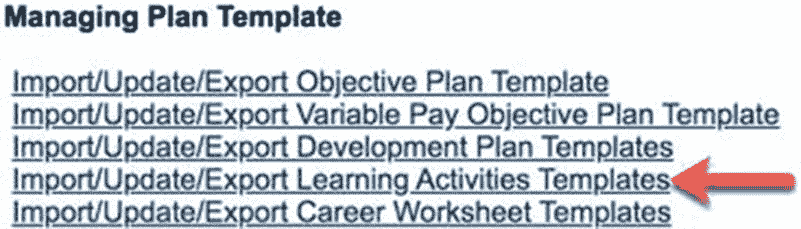
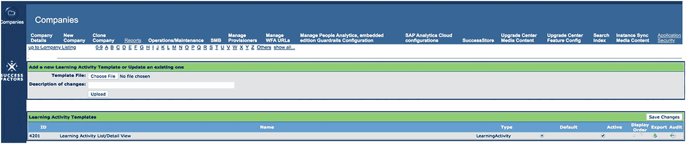
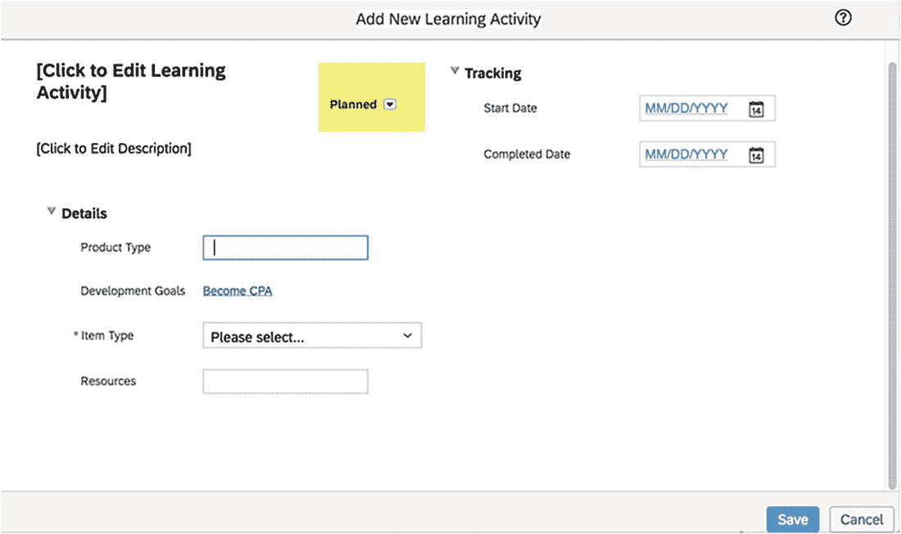
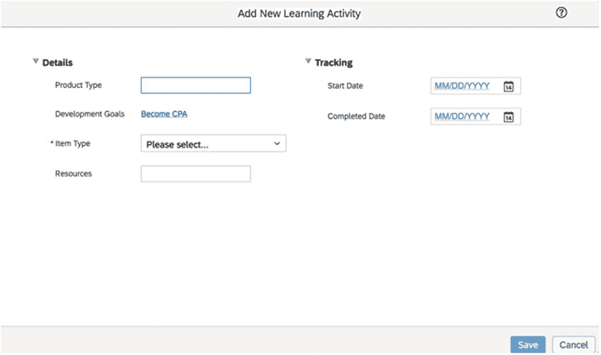

# 用户搜索角色的权限更新

此权限需要对本章前面讨论过、基于角色的用户搜索权限进行一些更新。与目标计划类似，发展计划的布局需要在模板的`<*plan-layout*>`部分中进行定义。这将决定发展计划中发展目标字段的排序。

如果你打算在绩效表单上展示发展目标，请使用 XML 中的`<*form-layout*>`部分来指明哪些发展目标字段会出现在绩效表单的发展计划部分。有关如何配置这些部分的更多信息，请参考第 1 卷，第 4 章。

修改完发展计划模板 XML 后，请在 Provisioning 中保存并导入。

## 学习活动 XML

学习活动存储在发展目标的上下文中。该模板可以支持来自 LMS 的目录学习和手动学习。

为了与发展计划一起使用，需要修改学习活动模板 XML。在 Provisioning 中，找到如图 1-31 所示的“管理计划模板”。



**图 1-31** 链接到学习活动模板

点击该链接查看“学习活动列表/详细视图”模板，如图 1-32 所示。



**图 1-32** 学习活动模板屏幕

导出模板以便进行修改。打开 XML，我们就可以开始了。

你可以使用以下参数创建一个指向 LMS 目录中学习活动的深层链接：

```
learning-activity-deep-link=true
```

以下代码段示例展示了此参数的放置位置：

模板 ID 应为“4201”，并带有`obj-plan-type` “LearningActivity”。你一次只能激活一个学习活动模板。示例如下所示：

```
LearningActivity
Learning Activity List/Detail View

5/23/19 5:39 PM
```

为了使发展目标能够拥有学习活动，需要在发展计划模板 XML 中引用学习模板 ID，正如本章前面所讨论的那样。

可以向学习活动模板 XML 添加一个开关，以控制手动添加学习记录时的弹出界面：

```
Fancy Pod
```

“on” 启用了名称、状态和描述字段的炫酷布局，如图 1-33 所示。



**图 1-33** 使用炫酷 Pod 添加学习活动的视图

包含此开关会禁用“炫酷”Pod 布局。取而代之的是，将显示名称、状态和描述字段的标准布局。图 1-34 展示了当炫酷 Pod 被禁用时，“添加新学习活动”弹出窗口的外观。



**图 1-34** 使用标准布局添加新学习活动

`Private-access`、`cascade-pull`、`cascade-push` 和 `cascade-align` 操作未被使用，可以从“学习活动列表/视图详情”模板 XML 中移除。

对于目录学习，需要以下字段：

*   **assigned:** 学习活动的所有者
*   **completed_date:** 学习活动完成日期
*   **name:** 学习活动名称
*   **description:** 学习活动描述
*   **status:** 学习活动的状态
*   **guid:** 学习活动的唯一 ID
*   **type:** 产品类型，保留字段，只能为文本
*   `dev-goals:` 与目标关联的学习活动；必须具有“写入”权限

默认状态为：

*   已计划


