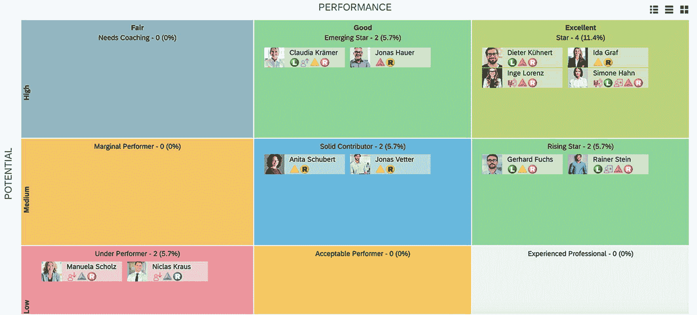
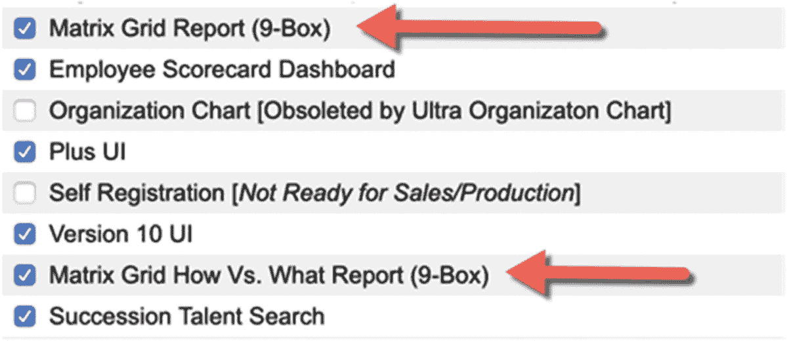
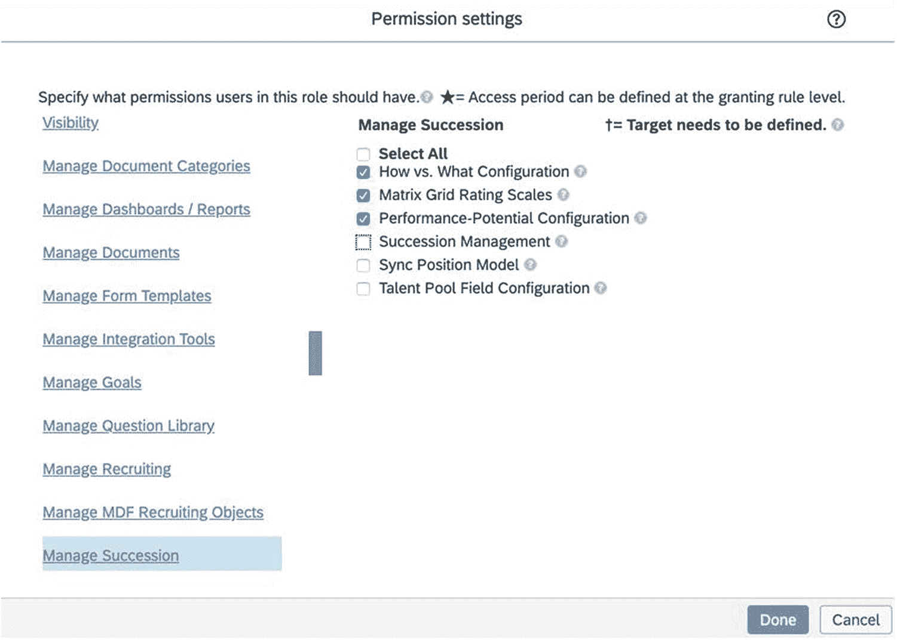
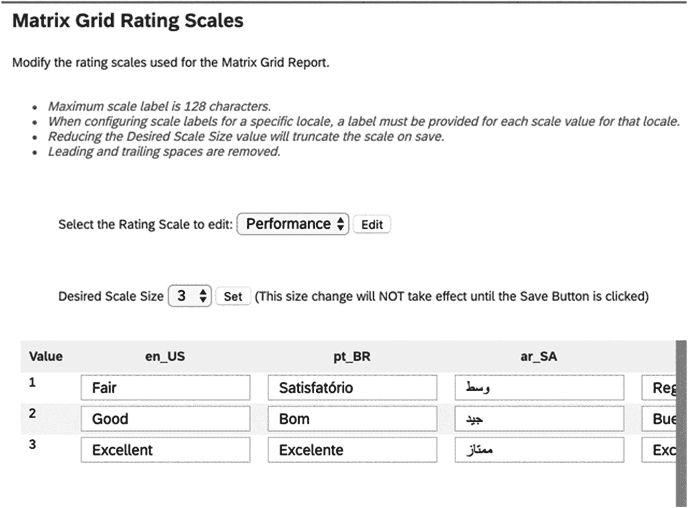
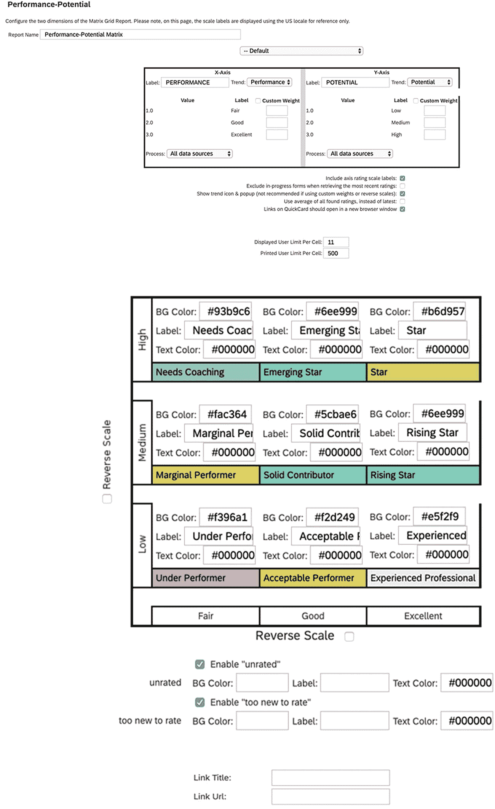
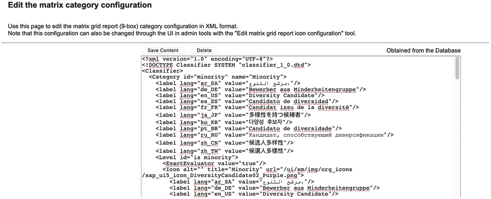
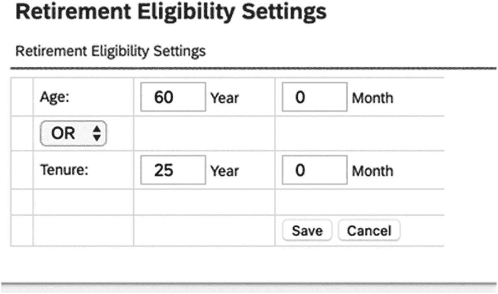
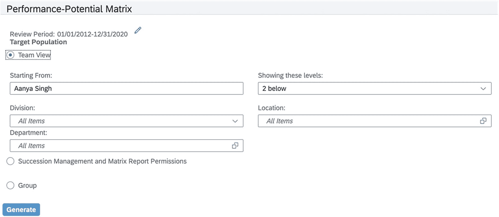
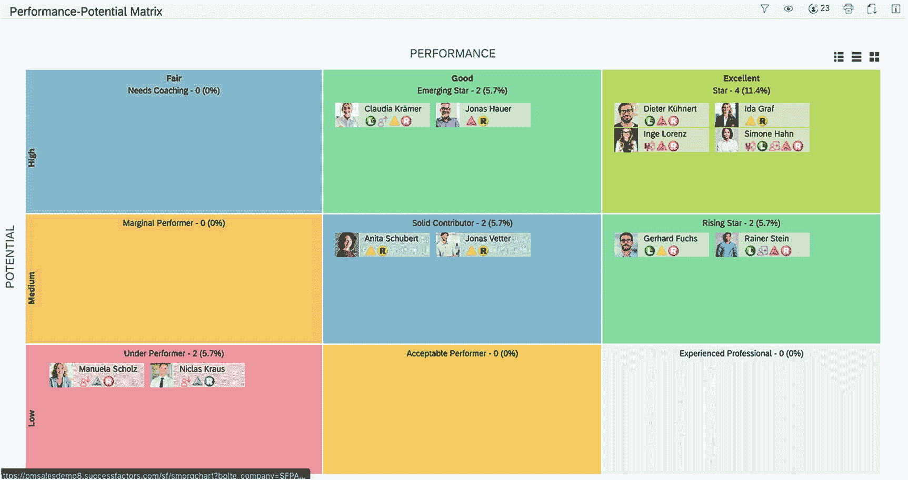
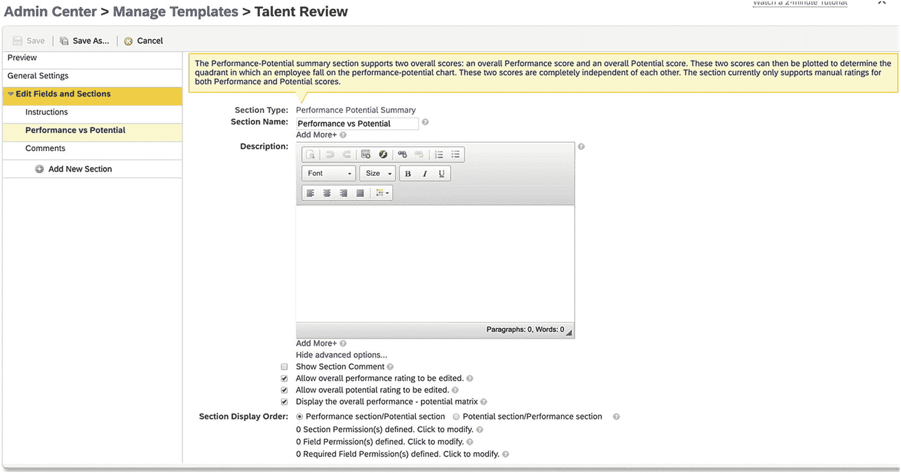

# 5. 继任管理简介、九宫格与人才评估表格

## 继任管理

管理是指识别顶尖人才并将其标记为潜在候选人以接任组织内关键职位的业务流程。例如，一家在全球开展销售业务的公司，可能会持续物色能监督美国各地区经理的销售高级副总裁。对于这样的公司而言，拥有一份能在销售高级副总裁离职时迅速填补这一关键职位的人员名单至关重要。然而，继任管理远不止是维护一份潜在继任者名单。事实上，一项优秀的继任管理策略涉及识别继任战略中的缺口，并主动识别、招募和培养适合关键职位的优秀人才，从而使企业不仅能够生存，更能繁荣发展。

为了进一步阐释这一点，让我们看两个销售高级副总裁即将离职的公司案例：

1.  一家模范公司，它使用 `SAP SuccessFactors` 实施了全面完善的继任管理策略。
2.  一家仅实施了最低限度继任管理策略的公司。

在实施最低限度继任管理策略的公司中，销售高级副总裁决定离职。他们认为自己在当前公司已到达职业生涯的顶峰，没有晋升的希望，除了离开别无发展途径。美国总裁有一份去年与高管领导团队审核过的潜在继任者电子表格，他联系了名单上排名第一的人，询问其是否对该职位感兴趣。继任者接受了，总裁安排两人在交接日前进行一次交接通话。他们发送了一封说明交接事宜的邮件，随后继任者开始担任新职位。公司的日常工作照常进行，只是短期内销售额略有下降。

在实施模范继任管理策略的公司中，总裁持续使用 `SAP SuccessFactors` 与现任销售高级副总裁进行绩效管理会议。作为这些会议的一部分，总裁主动识别出销售高级副总裁离职风险较高，并在系统中将其标记为“高风险”。在此之前，总裁已经与高管领导团队进行了一次 9 宫格校准会议，会上销售高级副总裁被标记为高潜力人才。该销售高级副总裁也在系统中被提名为总裁职位的继任者。系统计算了他们当前能力集与履行新职位职责所需能力之间的差距。这使得销售高级副总裁和总裁的生活都变得更轻松，因为他们现在有了一个共同的奋斗目标。作为持续绩效管理会议的一部分，他们一直在系统中根据销售高级副总裁的发展计划进行工作，以帮助其为新角色做好准备。同时，作为 `SuccessFactors` 导师计划的一部分，该销售高级副总裁也与另一位副总裁搭档，由后者担任导师，以帮助其为新角色做准备。由于在当前模范公司的职业生涯中如此积极主动地参与，这位销售高级副总裁根本没有考虑过离职，并且正在帮助指导其下属的区域经理（他们自己的潜在继任者）。与此同时，总裁也一直在为潜在的接任销售高级副总裁做着同样的工作。随着销售高级副总裁职位交接日的临近，总裁与变革管理团队合作，评估交接的影响以及如何最好地进行交接沟通。在 `SuccessFactors` 系统中看到新任销售高级副总裁是从一个小客户主管一步步晋升上来的，他们决定为其成就举办一场面对面的庆祝活动效果最佳。活动顺利举行，员工士气得到提升，销售额保持稳定，对发展计划的兴趣和员工保留率也随之提高。

尽管前面的例子是理论性的，但不可否认的是，`SAP SuccessFactors` 提供了多种工具来帮助客户实现这种理想化的模式。`SAP SuccessFactors 继任管理` 或许提供了最集成的解决方案，它基于其他模块的数据构建，创建了一个如示例中所概述的综合性业务解决方案。前文例子中提到的一些工具已在第一卷和第二卷的先前章节中介绍过。本章将向读者展示如何最大限度地发挥 `SAP SuccessFactors 继任管理` 的潜力，如同此处给出的模范公司示例。随着我们深入探讨继任管理模块各项功能的配置，我们将以这个模范公司为例进行参照。

本章及接下来的两章将遵循配置继任管理模块（也称为 `SCM`）的逻辑流程。我们将从本章的 9 宫格或矩阵网格配置开始。然后介绍标准的“人才评估表”，以及如何调整它以满足您组织的特定业务需求。在下一章中，我们将展示如何配置人才卡片。接着，我们将逐步讲解提名设置和继任组织架构图。之后，将介绍世系图功能。最后，在第 6 章中，我们将深入探讨其余功能，包括人才搜索、人才池、职位磁贴视图、世系图以及继任演示文稿。让我们开始吧！

# 基本设置

本章及后续两章的每个小节都将详细探讨继任模块不同主要区域的功能与配置。每个小节均假设已完成以下步骤，以开启基本的继任管理设置：

1.  登录配置系统，导航至您的组织，点击“公司设置”。
2.  勾选“继任计划”和“继任管理”旁的复选框。
3.  点击“保存”。

**注意**
本章还假设已启用基于角色的权限和 MDF。

# 九宫格或矩阵网格

矩阵网格通常被称为九宫格，因为许多公司采用 3 `×` 3 的配置，从而形成九个格子（有些公司使用其他数量的格子，如 2 `×` 2 或 3 `×` 4，`SAP SuccessFactors` 也支持此类配置）。它是一种工具，通过将员工归入其中一个格子，直观地识别员工在两个维度上的同时表现。这两个维度通常是 `绩效`-`潜能`（最常见，如图 5-1 所示）以及 `目标`-`胜任力`（也称为“怎么做 vs. 做什么”，如图 5-2 所示）。`SAP SuccessFactors` 支持同时配置这两种类型的矩阵网格，或仅使用其中一种。


**图 5-2** `目标`-`胜任力`或“怎么做 vs. 做什么”九宫格示例


**图 5-1** `绩效`-`潜能`九宫格示例

就采用哪些维度以及每个维度采用何种量表达成一致，是一项重要的业务决策，这不仅决定了组织矩阵网格的大小，也便于始终如一地向人才决策者传达信息。根据我们的经验，我们发现继任管理实施项目最大的风险之一，就是组织内部对矩阵网格的外观、或对每个格子内员工归属标准未能达成一致。在配置系统此区域之前，理解这些至关重要。

系统中显示和/或使用矩阵网格的区域有多处：

1.  矩阵网格报告
2.  人才卡片
    - 在演示文稿中
    - 在继任组织架构图中
    - 作为演示幻灯片
3.  员工档案（概览计分卡、绩效历史、趋势元素和矩阵网格位置历史组件上的迷你九宫格）
4.  人才评审表单
5.  校准
6.  精准像素级人才卡片

就本节而言，我们将涵盖矩阵网格报告的配置。这将设定系统中大部分区域的矩阵网格定义。若有例外情况，我们将在每个特定章节中予以说明。

**注意**
我们不建议在概览计分卡组件上使用迷你九宫格，因为它是一个遗留组件。有关概览计分卡组件上迷你九宫格的更多信息，请参见 `SAP` 注释 `2091458`。

# 配置矩阵网格的先决条件

在能够访问矩阵网格配置界面之前，需要完成以下设置和配置。

## 配置设置

在配置系统中，导航至“公司设置”，勾选“矩阵网格报告（九宫格）”和“矩阵网格怎么做 vs. 做什么报告（九宫格）”，如图 5-3 所示，然后点击“保存”。


**图 5-3** 矩阵网格配置前需完成的配置设置

### 权限

一旦配置设置完成后，在“管理权限角色”界面中，将为各个角色提供可选的权限选项。

**注意**
在本章中，我们假定已在 `Provisioning` 中启用了基于角色的权限。另请注意，配置设置有时需要一段时间才能在系统中生效。如果您没有立即看到权限出现，请注销并在大约一小时后重新登录。更改通常不会超过一夜即可生效。


**图 5-4** 最终用户访问矩阵网格报告所需的权限

1.  在搜索栏中输入并选择 `"管理权限角色"`。
2.  加载屏幕后，点击您要修改的角色。然后点击 `"权限…"`。
3.  为了使最终用户能够访问矩阵网格报告，需要为权限角色选中 `"继任管理与矩阵报告权限"` 和 `"矩阵报告权限"`，如图 5-4 所示。

**注意** `"继任管理与矩阵报告权限"` 需要一个目标人群。这将定义最终用户运行报告时可看到的人群。


**图 5-5** 配置矩阵网格所需的权限

1.  为了访问配置矩阵网格的屏幕，需要为分配的权限角色在 `"管理继任"` 部分下勾选 `"如何 vs. 什么配置"`、`"矩阵网格评分量尺"` 和 `"绩效-潜力配置"` 选项，如图 5-5 所示。点击 `"完成"`。请务必也在主屏幕上保存您的角色。

## 流程与表单配置

许多公司将多个表单组织到逻辑上的年度流程分组中，以便最终用户只能看到相关的表单。这可以通过使用图 5-6 所示的“流程与表单”配置屏幕来实现。如果您尚未完成，请确保在矩阵网格配置之前完成此配置。有关绩效评估表单和流程的更多信息，请参阅第一卷，第 6 章至[第 10 章](https://doi.org/10.1007/978-1-4842-6995-4_10)。


**图 5-6**“流程与表单”配置屏幕

## 矩阵网格配置

本节详细介绍了用于配置矩阵网格的屏幕和步骤。

### 矩阵网格评分量尺配置屏幕

在对任一矩阵网格进行主要配置之前，您应检查并修改评分量尺配置。这些量尺允许您控制矩阵网格的维度，例如，使其成为 9 宫格或其他大小的网格。它还允许您为系统启用的所有语言更改与每个评分等级关联的文本。要访问矩阵网格评分量尺配置屏幕，请在搜索栏中输入并选择 `"矩阵网格评分量尺"`。图 5-7 显示了该屏幕。


**图 5-7**“矩阵网格评分量尺”配置屏幕

请按以下步骤在屏幕上进行配置：

1.  加载屏幕后，主下拉菜单中有六个可选的评分量尺：`绩效`、`潜力`、`目标`、`能力`、`自定义 1` 和 `自定义 2`。
2.  选择其中一个选项并点击 `"编辑"`。
3.  下拉菜单下方的区域将展开，显示量尺中的数值数量以及您实例中激活的每种语言的翻译。
4.  您可以通过在 `所需量尺大小` 下拉菜单中选择不同的数字并点击 `"设置"` 来更改量尺。
5.  选择量尺大小后，输入文本描述。
6.  完成后，点击 `保存`。
7.  对其余量尺重复此过程。

**注意**
您在此处选择的选项也会影响员工档案中的量尺。例如，如果您允许经理直接在员工档案中选择潜力评级，则量尺将来自此配置。

为了我们的示例公司，我们建议对 `绩效` 和 `潜力` 都使用三点量尺。这将允许进行 9 宫格配置。此外，我们建议此量尺与年度绩效评估量尺匹配，以便在绩效评级中使用三点量尺。如果绩效评级未使用三点量尺，请参考下一节关于如何归一化的步骤。同样，对于 `目标` 和 `能力` 评级，我们建议使用与绩效评估的 `目标` 部分和 `能力` 部分给出的评级相匹配的三点量尺。如果您选择使用高于或低于三点的量尺进行绩效评估，但希望使用 9 宫格，则需要制定一个计划，以简单系统的方式将这些量尺转换为 9 宫格。这可能是那些在矩阵网格流程中遇到问题的公司最大的问题领域。

### 矩阵网格配置屏幕

# SAP SuccessFactors 矩阵网格报告配置

SAP SuccessFactors 支持两种矩阵网格报告：一种用于绩效-潜力，一种用于目标-能力。因此，有两个独立的配置屏幕，每个报告对应一个（尽管这些屏幕看起来并且对每个报告执行相同的操作）。这些是配置矩阵网格的主要区域。要访问绩效-潜力报告配置屏幕，请在搜索栏中输入并选择`"矩阵网格报告：绩效-潜力"`。要访问目标-能力报告配置屏幕，请在搜索栏中输入并选择`"矩阵网格：如何 vs. 什么"`。图 5-8 显示了一个典型的绩效-潜力 9 宫格配置。由于两个配置屏幕完全相同，我们不再赘述。



**图 5-8**“矩阵网格”配置屏幕

**注意**

虽然配置屏幕分别命名为“绩效-潜力”和“如何 vs. 什么”，但系统足够灵活，可以通过重新标记一个或两个配置屏幕来创建您的组织所需的任何类型的矩阵网格。请注意，您仅限于两个报告。

## 要配置矩阵网格，请遵循以下步骤：

1.  屏幕顶部的下拉菜单表示您正在编辑屏幕所用的语言选择。选择您所需的语言，屏幕将自动重新填充所选语言的内容。如果您的组织需要多种语言，您需要为每种所需语言重复此步骤及后续步骤。

2.  `"报告名称"` 字段允许您调整报告名称的措辞，以符合您组织的术语。例如，如果您的组织只使用通常称为 `"9 宫格"` 的绩效-潜力矩阵网格，您可能希望将报告名称重新标记为 `"9 宫格"`。这也将自动更改最终用户的导航标签。

3.  `X 轴` 框允许您配置矩阵的水平维度。
    1.  使用 `"标签"` 字段，您可以更改最终用户屏幕中沿 X 轴底部显示的标签。
    2.  `"趋势"` 字段还允许您选择在 `"矩阵网格评分量尺"` 配置屏幕中配置的量尺之一。这不仅会控制沿此轴显示多少个框，还会根据您在 `"矩阵网格评分量尺"` 配置屏幕中的配置控制量尺中每个点的标签。
    3.  如果您希望使用自定义权重沿此轴对评分分布进行归一化处理，请勾选`Custom Weight`复选框，并在每个评级值旁边输入一个百分比权重。

    > **注意** 在此处输入数值将控制如何，例如，将五分制的绩效量表转换为九宫格上的三分制量表。例如，如果为 1 评级输入了 100%，则所有员工都将落在 1 评级上。如果在 1 评级上输入了 50%，那么五分制量表中评分范围为 1–2.5 的任何人将落在 1 评级上。一个常见的例子是 20/60/20 分布，它会使大部分评分落在 2 评级上。

4.  `Process`下拉菜单允许您选择已配置的流程之一、员工计分卡（员工档案）或所有可用的数据源来填充您的报告。请根据情况选择其中一项。

    > **注意**
    > 理解矩阵网格报告的数据源是正确配置的基础。驱动每个维度评分（从而决定在网格中的位置）的评级可以来自两个来源：
    > 1.  员工档案（例如，实时档案或计分卡；此外，在“管理校准设置”屏幕上还有一个选项，可以包含或排除实时档案中任何正在进行中的校准会议）
    > 2.  表单（例如，绩效表单或人才评审表单，以及可能包含在表单路线图中的校准会议，如前所述——这取决于使用`Processes and Forms`配置屏幕设置流程的方式）

5.  对`Y-Axis box`重复上述`X-Axis box`的步骤。

6.  `Include axis rating labels`复选框将显示在`Matrix Grid Rating Scales`配置屏幕中为评级量表配置的标签。

7.  `Exclude in-progress forms when retrieving the most recent ratings`复选框的功能正如其字面意思。根据需要勾选此框。

    > **注意** 我们通常建议不要勾选此框。在流程进行中，让经理和人力资源人员查看员工的评分情况往往有助于最终确定评级。

8.  `Show trend icon & popup`实际上已弃用，它指的是一个旧的弹出窗口，该功能已被员工人才卡片上的趋势视图所取代。我们通常保持勾选此框，因为它已经没有实际效果了。

9.  `Use average of all found ratings, instead of latest`复选框在某人跨多个年份执行报告时生效。通常系统会取最新的评分，而在此情况下，它会计算所有找到的评分的平均值。根据需要勾选此框。

    > **注意** 用户在运行矩阵网格报告时，将能够选择要搜索的日期范围。默认情况下，系统会使用从今天起向前推一年的日期填充此字段；此后，它将使用用户上次运行报告时所选的最后日期范围。无法更改此行为。我们通常建议不要勾选上一步中提到的复选框，因为这可能会让最终用户感到困惑。通常情况下，用户关心的是员工的最新信息以做出继任决策，而不是平均值。此外，如果需要此类信息，他们可以点击员工人才卡片并查看其随时间变化的趋势。

10. `Links on Quickcard should open in a new browser window` 指的是一个名为快速卡片的过时选项。此项已不再适用。

11. `Display User Limit Per Cell` 字段将限制矩阵中每个单元格最多可容纳的员工数量。您在此字段中输入的最大值为 5000。如果用户运行报告时超出此最大值，将显示一条提示消息，告知用户已超过上限。

    > **注意** 我们不建议在每个单元格中显示大量用户，因为这可能会导致系统性能问题，并且也可能使用户难以直观查看。

12. `“每个单元格的打印用户限制”` 的作用方式相同，但适用于报告的打印版本。

13. 每个坐标轴旁的 `“反向刻度”` 复选框将分别翻转该坐标轴上的刻度顺序（例如，从升序变为降序）。

    > **注意** 我们建议不要使用反向刻度——按照惯例，大多数组织假设右上角的单元格代表最佳评分。

14. 每个单元格内的 `“背景颜色”` 字段允许您设置该单元格的背景颜色。输入您想要的每个单元格颜色的 HTML 颜色十六进制代码。

    > **注意** 您可以使用类似 W3Schools 网站这样的参考站点来查询代码对应的颜色：[`www.w3schools.com/colors/colors_picker.asp`](http://www.w3schools.com/colors/colors_picker.asp)。

15. 同样，`“文本颜色”` 字段允许您选择每个框中将显示的文本颜色。为每个单元格输入另一个 HTML 十六进制代码。

    > **注意** 您应尝试为每个单元格选择对比度良好的文本颜色和背景颜色，以帮助满足无障碍指南，并使其成为一个易于使用的系统。美国总务管理局网站概述了无障碍指南，并在此处提供了一个很棒的可用颜色调色板生成器：[`https://accessibility.digital.gov/visual-design/color-and-contrast/`](https://accessibility.digital.gov/visual-design/color-and-contrast/)。

16. 根据您当前选择的语言，在每个 `“标签”` 字段内为每个标签输入文本。

17. 如果您希望允许用户在矩阵网格右侧的额外区域中查看其报告选择标准中哪些人未评级，请选中 `“启用未评级”` 复选框。同样，勾选 `“启用太新而无法评级”` 复选框，可以在右侧看到被选中进行此评级的员工。与单元格背景颜色、标签和文本颜色类似，为这些框选择颜色或将其留空。

    > **注意** 我们建议同时使用这两个选项（除非 `“太新而无法评级”` 在您的绩效评估周期中不是一个选项，在这种情况下我们仅建议使用 `“启用未评级”` – 有关 `“太新而无法评级”` 的更多信息，请参阅第 1 卷，第 6 章）。选择这些选项对于识别可能在此过程中被忽略的员工非常有帮助。例如，经理在查看其团队的评级报告时，可能会意识到他们从未对出现在此区域中的员工进行人才评审。

18. 通过填写 `“链接标题”` 和 `“链接 URL”` 字段，为矩阵网格报告添加链接。在这些字段中输入值后，报告右上角将显示一个 `“i”` 图标，点击即可打开该链接。

    > **注意** 我们建议将此链接用作贵组织政策文档的参考点，和/或用作经理有关九宫格放置标准的使用指南。

- *如果选择了 `“所有数据源”`，则系统将获取员工计分卡和系统中所有活动流程的最新评分。虽然此选项提供最新的信息，但也可能让最终用户感到非常困惑。我们通常建议选择您最新配置的流程，然后告知经理/决策者系统何时将切换到下一个流程。创建示例数据并测试您的配置是否给出预期结果非常重要。很多时候，源选择可能会变得混乱，并导致报告中出现意外结果。根据我们的经验，此区域配置错误通常是罪魁祸首！*

# 矩阵网格图标配置屏幕

矩阵网格图标配置屏幕（图 5-9）用于在员工拥有此屏幕配置字段中填充的人才数据时，在矩阵网格报告上显示图标。例如，如果员工是男性或女性，您可以选择在报告上其姓名旁边显示男性或女性符号。您在此处进行的配置将控制整个继任模块中显示的图标，例如在继任组织架构图中。


*图 5-9*

*矩阵网格报告图标配置屏幕*

请按照以下步骤在此屏幕上执行配置：


*图 5-10*

*添加字段弹出窗口*

1.  单击`“添加新字段”`按钮以调出`“添加字段”`弹出窗口（图 5-10）。选择您要为其添加图标的字段，然后单击`“确定。”`此处的字段列表代表数据模型中尚未分配图标集的所有人才字段。有关数据模型的更多信息，请参阅第 1 卷，第 2 章。


*图 5-11*

*`“影响损失”`类别字段的编辑屏幕*

2.  将出现`“编辑字段”`弹出窗口（图 5-11）。此弹出窗口将读取与该字段关联的选项集 ID，并列出该选项集中的所有项目。

> **注意** 系统中的选项集 ID 必须与数据模型中字段的技术字段名匹配，才能显示在前面的屏幕中。如果选项集不匹配，则会出现错误屏幕，并且您将无法进行配置。您可以在选项集中心（图 5-12）编辑字段的可能值列表。有关配置人才字段（包括分配选项集）的更多信息，请参阅第 1 卷，第 2 章。


*图 5-12*

*选项集中心屏幕显示选项集 ID `impactOfLoss` 与技术字段名 `impactOfLoss` 匹配*


*图 5-13*

*未配置选项集时针对字段类别显示的错误*

3.  只要您的选项集配置正确，您就可以在`“编辑字段”`屏幕（图 5-13）上单击每个图标旁的`“更改”`按钮来为其选择图标。系统标准图标列表将显示供您选择。您必须从标准图标列表中选择——您不能上传自定义图标。完成后单击`保存更改`，您将返回到主屏幕。

4.  对所有所需的字段图标分配重复上述步骤。

5.  如果您不希望显示图标，而是希望看到选项集的文本，只需通过单击`“执行操作”`，然后选择`“删除”`来删除类别字段的条目。

> **注意** 我们建议对所有人才字段使用图标，以便它们显示在所有可用的屏幕上。这将带来优化的可视化体验。当不使用图标时，文本可能不会显示在某些概览屏幕上，例如在继任组织架构图中。

6.  要对现有配置进行编辑，请单击`“执行操作”`并选择`“编辑。”`将出现`“编辑字段”`弹出窗口，您可以重复步骤 2 来完成该字段的配置。

7.  要更改字段的显示顺序，请单击`“Take Action”`，然后为字段选择向上或向下箭头。获得所需顺序后，单击`“Save Changes”`。

## Provisioning 中的 Matrix 类别配置屏幕

另一种配置矩阵网格图标配置屏幕上显示的图标的方法是直接在 Provisioning 中访问 XML 配置。为此，请登录 provisioning 并选择所需公司，然后选择`“Matrix Category Configuration”`（见图 5-14）。在直接对 XML 完成编辑后，单击`“Save Content”`。



**图 5-14** Provisioning 中的 Matrix 类别配置屏幕

> **注意**
>
> 如果使用矩阵网格图标配置屏幕，则不应在 Provisioning 中执行此步骤。您可以将以下代码段与“Impact of loss”配置的截图进行比较，以了解 XML 和配置屏幕如何相互对应。

以下是`impactOfLoss`类别的 XML 配置代码示例。每个类别的类似结构将放置在 XML 示例的`...`区域中：

```
...

<label lang="ar_SA" value="
"/>
```


```
<label lang="ar_SA" value="
"/>
```


```
<label lang="ar_SA" value="
"/>
```


```
<label lang="ar_SA" value="
"/>
```


## 矩阵网格退休资格配置屏幕

某些组织可能希望在员工接近退休年龄时自动显示退休资格图标。这在继任规划讨论中非常有用，有助于识别可能因退休而即将离职的员工。

> **注意**
>
> 最终用户无法手动编辑此字段。它将仅根据`“出生日期”`和`“入职日期”`字段自动开启。请确保在配置前，Talent Profile 中已包含这些字段。有关更多信息，请参见第 1 卷，第 2 章。

要配置“退休资格”功能，请遵循以下步骤：



**图 5-15** 退休资格设置配置屏幕

1.  确保已配置退休资格图标（请参见本章中的“矩阵网格图标配置屏幕”部分），并且 Talent Profile 中已包含`“出生日期”`和`“入职日期”`字段。

2.  在搜索栏中键入并选择`“Matrix Grid Reports: Retirement Eligibility”`。

3.  屏幕将显示如图 5-15 所示的`“退休资格设置”`屏幕。

4.  输入年龄阈值和服务年限阈值，并根据组织政策在下拉列表中选择`“and”`或`“or”`。选择`“and”`将要求两个条件均被满足时图标才会显示，而`“or”`则在任意一个条件满足时显示图标。

5.  单击`“Save”`。

## 运行和使用矩阵网格报告

现在，我们已经完成了矩阵网格的配置，是时候看看它的实际效果了！在引言中，我们提到了矩阵网格可以显示的多个位置。可以查看矩阵网格信息的主要报告是`“Performance-Potential Matrix”`和`“How vs. What Matrix”`。

> **注意**
>
> 请记住，这些报告的标准名称可以根据您的配置进行更改！在以下导航步骤中，我们将引用标准名称。如果您更改了名称，请单击您自定义的名称。

以我们模型公司为例，这些报告可用于区域总裁和当前负责销售部门的 SVP，以便在尚未为空缺的 SVP 销售职位确定继任者时，寻找团队中的高潜力人才，或者仅用于检查他们当前的提名是否仍以高潜力水平表现良好。

### 运行报告的先决条件

除了本章已介绍的配置之外，可能还需要执行一些额外的配置。


**图 5-16** 动态组屏幕

1.  确保已为您的公司加载了部门、子部门和地点。在基本的人才管理实施中，这些会在您加载用户数据文件中的字段时自动填充。

2.  如果您想使用任何动态组，请确保在尝试运行报告之前添加这些组。为此，请单击登录用户的头像图标，然后选择`“Settings”`。在左侧菜单中，选择`“Groups”`。单击`“Create New Group”`以添加一个组。示例如图 5-16 所示。

### 运行报告

要运行任一报告，请遵循以下步骤：



# 图 5-17 Performance-Potential Matrix 报告

1.  导航至 `Succession ➤ Performance-Potential Matrix` 或 `Succession ➤ How vs. What Matrix`。

2.  屏幕将加载您选择的报告，如图 5-17 所示。

3.  通过单击铅笔图标选择评估周期日期范围。如果您选择多个年份，请记住，您在配置期间选择的设置将影响结果显示的是最新评分还是平均评分。

4.  接下来，选择目标人群。首先，从单选按钮中选择“Team View”、“Succession Management and Matrix Report Permissions”或“Group”：

    -   **团队视图**：使用此选项显示从特定经理开始及其下属的团队成员。填写选项，指定要包含在筛选条件中的经理向下层数，以及要从中选择的部门、子部门和地点（部门、子部门和地点配置作为平台配置的一部分执行）。例如，如果我们的区域总裁有权在运营部门内查找所有地区的高绩效员工，他可以在“Starting From”字段中选择 CEO、所有层级，并选择整个运营部门。

    -   **继任管理和矩阵报告权限**：此选项将为您提供有权查看的所有结果（请参见本章前面的“权限”部分）。选择此选项后，出现的唯一额外筛选条件是部门、子部门和地点。根据需要输入这些条件的选项。例如，如果某位 HR 管理员正在协助我们的区域总裁寻找高绩效和高潜力候选人，并且有权查看整个公司，他们可以选择此选项并选择运营部门以细化条件。

    -   **群组**：此选项列出系统中已创建的所有动态组。您无法在此处添加动态组，只能选择已创建好的组。动态组有助于进行临时分组，例如，如果 HR 管理员希望通过动态组标记某些无法通过常规选择条件定义的用户，以对其进行跟踪。

5.  输入选择条件后，点击“Generate”运行报告。

**注意**

通常，矩阵网格报告可能返回空结果或令人困惑的结果。我们建议按照以下步骤进行故障排查：

1.  **检查报告运行的日期——您运行的是当前年份还是去年？**

2.  **在配置界面中，确保数据源正确，并且在报告选择条件中所选年份内，您在配置中选择的员工档案和流程中确实存在数据。**

3.  **检查您是否拥有适当的基于角色的权限，以查看选择条件中您试图查看的人员。**

4.  **是否在矩阵网格报告配置界面中选择了“All data sources”数据源？或者是否勾选了“Use average of all found ratings, instead of latest”？** 这可以解释为何会显示来自其他流程的意外评级，或者为何会出现跨多个年份的评级平均值。

## 使用报告

按照上一节中的说明运行报告后，报告将根据您的配置显示，如图 5-18 所示。



**图 5-18** 绩效-潜力矩阵报告

**注意**

这是一个只读报告。要编辑候选人的位置，必须编辑配置中所选数据源中的数据。要编辑每个员工旁边显示的图标相关的数据，必须在“人才档案”界面上编辑该员工的“人才档案”数据。

我们将从上到下、从左到右逐一查看上图中出现的每个图标的功能：

1.  点击 `filter` 图标可重新打开上一节中介绍的选择条件界面。

2.  点击 `eye` 图标可打开显示选项。这将根据您的图标配置，添加/移除不同图标的显示。

3.  点击 `person` 图标可在矩阵右侧打开一个区域，显示选择条件内根据您的配置属于“太新无法评级”或“未评级”的员工。

4.  点击 `print` 图标可打开打印预览界面，您可以在其中打印矩阵。

5.  点击 `download` 图标可下载关于矩阵及每个人才类别详细信息的 Excel 报告。

6.  点击 `“i”` 图标可打开您在矩阵配置中可能添加的链接（如果未添加链接，此图标将不会显示）。

7.  点击 `display both name and photo` 图标可显示所有员工及其照片和照片右侧的信息（上图当前即选中此选项）。

8.  点击 `display name only` 图标可移除照片，仅显示姓名。此选项有助于在单元格中查看更多员工。

9.  点击 `display photo only` 图标可仅显示矩阵上员工的照片。此选项也有助于在单元格中查看更多员工。

10. 点击一个矩阵单元格可展开该单元格，显示其中更多的员工（如果适用）。

11. 点击一个员工的姓名/照片可显示该员工的人才卡片。我们将在下一章介绍人才卡片配置。可以同时打开多张人才卡片，以便对员工进行并排比较。

## 人才评估表

人才评估表是一种特殊类型的独立绩效表，旨在与矩阵网格信息配合使用。它提供了一种表单，可以使用矩阵网格布局动态地对员工数据进行绩效和潜力更改。

**注意**

虽然独立的人才评估表是继任管理的一部分，但它可能并非适合所有组织。在设计人才管理和继任流程时，最重要的决策之一是如何保持人才数据的新鲜度——是使用像人才评估表这样的表单，作为大型综合绩效表单的一部分，还是仅使用人才档案数据。从本节中获得的最重要信息是，将潜力评级包含在表单中的唯一方法是在表单中包含“绩效潜力总结”部分。否则，矩阵网格的唯一数据源将是“员工人才档案”中的潜力字段。同样，要使目标-能力评级显示在人才档案中，员工必须在包含“目标能力总结”部分（尽管该部分可以隐藏）的表单上获得评级。

以我们的模型公司为例，总裁和销售高级副总裁将使用人才评估表（或备选的综合绩效表单和/或校准方法）作为年度评估流程的一部分，为潜在继任者分配 9 宫格位置。这样，人才数据将在系统中定期更新，并在需要进行继任提名或调动时准备就绪。

## 配置人才评估表的先决条件

由于人才评估表运行于绩效模块之上，所需的先决条件配置是相同的。请参见第 1 卷第 6 章和第 7 章了解这些先决条件。与其他绩效表单不同，人才评估表在使用前还必须完成矩阵网格配置。这是因为该表单将使用配置中的评级量表、定义的轴配置、单元格颜色和标签。

## 配置人才评估表

与绩效表单类似，人才评估表在“管理模板”界面中进行配置。请按照以下步骤配置表单：

**注意**

通常，人才评估表在客户实例或 `SuccessStore` 中并不可用。在这种情况下，请从 `Provisioning` 的演示系统中下载一份副本，并通过目标实例中的 `Provisioning` 上传。或者，您也可以通过创建一个绩效表单并添加“绩效潜力总结”部分或“目标能力总结”部分（取决于您要编辑的矩阵类型），从头开始创建一个。这些部分也可以添加到年度绩效评估表中，以制作一个综合表单，而不是单独的人才评估表。



**图 5-19** 人才评估表中的绩效潜力总结部分配置

1.  在搜索栏中输入并选择“Manage Templates”以访问“管理模板”界面。

2.  点击人才评估表的名称以选择它。

**注意** 以下示例表单包含一个“简介”部分、一个“绩效潜力总结”部分和一个“评论”部分。由于“简介”和“评论”部分已在第 1 卷第 7 章关于绩效管理的部分中介绍过，我们在此仅介绍“绩效潜力总结”部分。“目标能力总结”部分类型提供相同的配置选项，只是使用这些字段作为输入，并提供一个从“目标”和“能力”部分查看计算后评级的选项，因此不再单独介绍。

3.  点击“绩效 vs. 潜力”版块。屏幕将如图 5-19 所示加载。

    1.  为 `版块名称` 输入一个文本值，例如“绩效 vs. 潜力”或“九宫格”。

    2.  （可选）输入针对该版块的最终用户描述或说明。

    3.  点击“显示高级选项…”以查看下列项目。

    4.  “显示版块评论”框的操作方式与其他版块中的此类框相同，评估者可在其中添加针对该版块的评论。如果希望启用这些评论，请选中此框。

    5.  根据需要勾选“允许编辑总体绩效评级”、“允许编辑总体潜力评级”和“显示总体绩效-潜力矩阵”。这些选项将使该版块表单中的绩效和潜力字段可编辑，并提供一个可视化的矩阵网格，供员工被评主体拖放至所需单元格。

        **注意** 如果实施独立的**人才评审表**，我们建议开启此处所有三个选项。如果使用的是包含完整绩效周期和潜力评级的综合绩效表单，则可能只需开启“允许编辑总体潜力评级”，并隐藏其他选项。

    6.  “版块显示顺序”单选按钮仅控制绩效字段和潜力字段在矩阵上方的显示顺序。

    7.  其余选项用于权限设置。有关这些权限如何运作的更多详细信息，请参阅第 1 卷，第 6 章至[第 10 章](https://doi.org/10.1007/978-1-4842-6995-4_10)。

## 启动和管理人才评审表流程

人才评审表必须分配路由图，并像其他绩效表单一样启动和管理。有关如何创建和关联路由图、启动表单以及管理流程的详细说明，请参阅第 1 卷，第 6 章至[第 10 章](https://doi.org/10.1007/978-1-4842-6995-4_10)。您可能还希望在此类路由图的末尾包含一个校准会议。有关设置校准会议的详细信息，可参考第 1 卷的[第 14 章](https://doi.org/10.1007/978-1-4842-6995-4_14)和[第 15 章](https://doi.org/10.1007/978-1-4842-6995-4_15)。

## 作为最终用户使用人才评审表

人才评审表启动后，将像其他任何绩效表单一样遵循路由图。一旦表单作为路由图步骤的一部分到达最终用户处，表单将出现在用户的“绩效收件箱”以及主页“待办事项”版块的“审核绩效”磁贴中。

请按照以下步骤使用表单：


**图 5-20** 人才评审表 – 绩效 vs 潜力版块

1.  导航至绩效模块以加载绩效收件箱，然后点击该员工的人才评审表。表单加载后，您将能够查看如图 5-20 所示的“绩效 vs. 潜力”版块。
2.  点击绩效或潜力旁边的“？”图标以查看评级量表。
3.  您可以通过将一个单元格拖放到另一个单元格，或在绩效和潜力下拉菜单中选择数值，来调整员工在矩阵网格中的位置。首先在下拉菜单中选择值以放置员工，然后尝试拖放以更改评级。
4.  “尚新无法评级”和“未评级”框显示在底部——您也可以将员工拖入或拖出这些区域。务必先点击向下箭头展开这些框。
5.  评审者还可以选择仅查看正在被评审的一名员工、所有已评估的员工，或仅查看直接下属。通过取消选中两个框或选中其中一个（两个复选框不能同时选中）在这三种模式间切换。

**注意** 对于管理者而言，使用“我的直接下属”选项最为有用。HR 管理员可能会选择“所有已评估的员工”，因为他们支持的员工很可能不是其直接下属。“所有已评估的员工”允许评审者查看其出现在路由图中的所有已创建表单的员工。

6.  点击名片图标将打开该员工的名片。请注意，这与矩阵报告、演示文稿和校准中出现的人才卡片不同。
7.  点击矩阵上其他员工的姓名，视图将切换至该员工的表单。评审者随后可以更改被点击员工的放置位置。

**注意** 这种即时切换表单的功能可能会让最终用户感到些许困惑。务必在您的变更管理/培训会议中涵盖此内容！正在编辑的员工姓名和照片将在表单顶部切换，以提示评审者当前所在的是哪位员工的表单。

8.  完成评级后，点击“最终确定表单”，将表单移至被评定员工路由图中的下一步。

至此，您已完成对该员工的评审！该员工的矩阵网格报表数据现在将显示（前提是此表单被包含为数据源，且当前日期包含在您的选择条件中）。如果您选择不包含处理中的表单，则必须确保在结果显示在报告中之前完成路由图。

## 可选的校准步骤

在此，我们还想提一下校准环节。一些组织将这些校准会议视为流程中矩阵网格排版的最终确定环节。在此场景下，您需要配置路由图，使得在每位管理者评审完其员工之后，有一个校准步骤，让管理者小组和/或其他参与者共同参加校准会议，并商定个体的最终排版。在此场景下，管理者为绩效和潜力以及/或者目标和能力输入的评级，可能会被校准会议所覆盖。

在第 1 卷的[第 14 章](https://doi.org/10.1007/978-1-4842-6995-4_14)和[第 15 章](https://doi.org/10.1007/978-1-4842-6995-4_15)中，我们概述了校准会议的所有配置选项，这应能指导您将人才评审表（或包含绩效和潜力以及/或者目标和能力的大型绩效表单）作为校准会议中的数据源。我们恳请您牢记，校准会议也可用于决定通过继任管理显示的人才档案/继任数据模型字段的值（我们将在后续章节中更详细地介绍这些内容）。因此，值得提及的是，校准可以作为一个全面的工具来进行人才评审，其范围不仅仅是对绩效评级应用正态分布曲线！我们发现，校准的这些额外功能在设计与实际公司合作的人才评审流程中非常有用。

# 结论

在阅读本书两卷至此的内容后，您已掌握足够信息，可配置独立式人才评审表或综合绩效表单中的 `绩效潜力摘要` 和 `目标能力摘要` 部分（后者将 `绩效潜力摘要` 部分作为年度绩效周期中众多环节之一）。本章内容应能帮助您理解数据如何被填充至矩阵网格报告，并如何出现在我们将在接下来两章介绍的继任管理模块的其他功能中。
