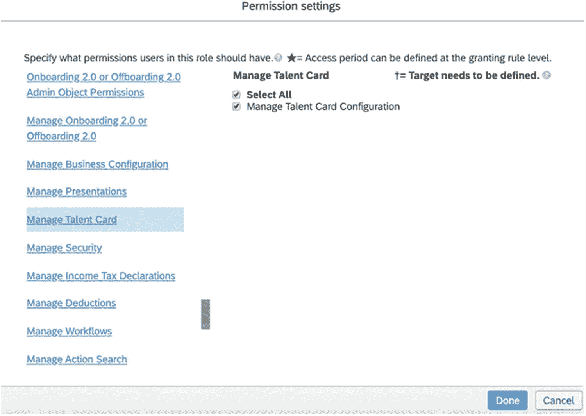
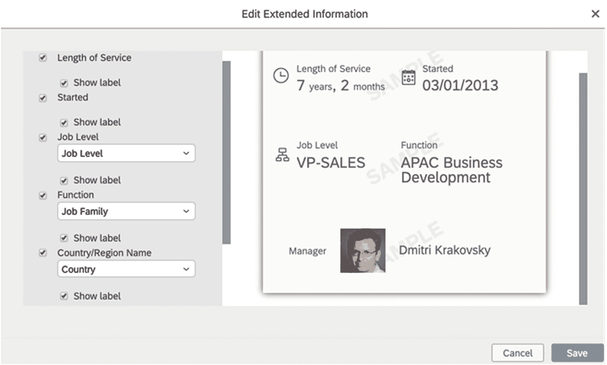
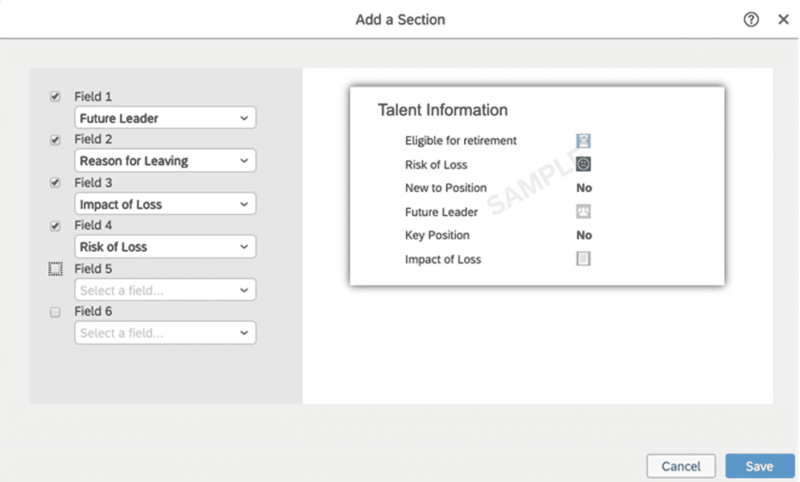
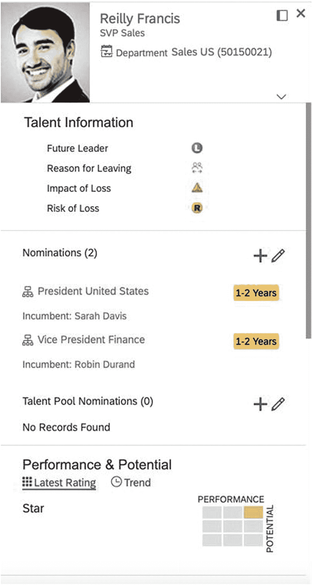
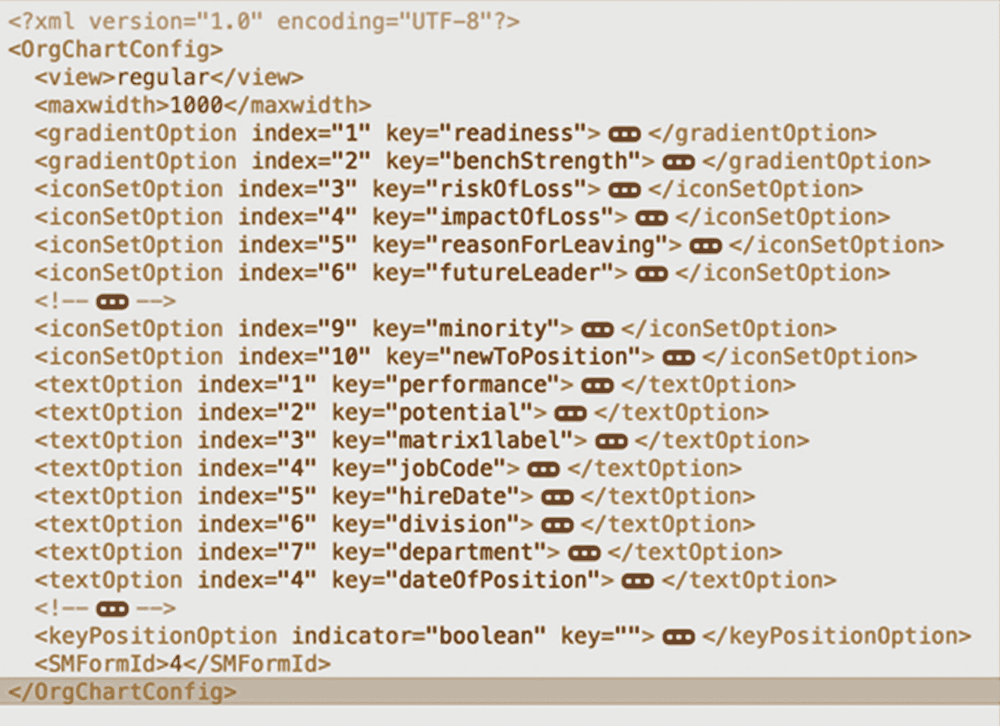
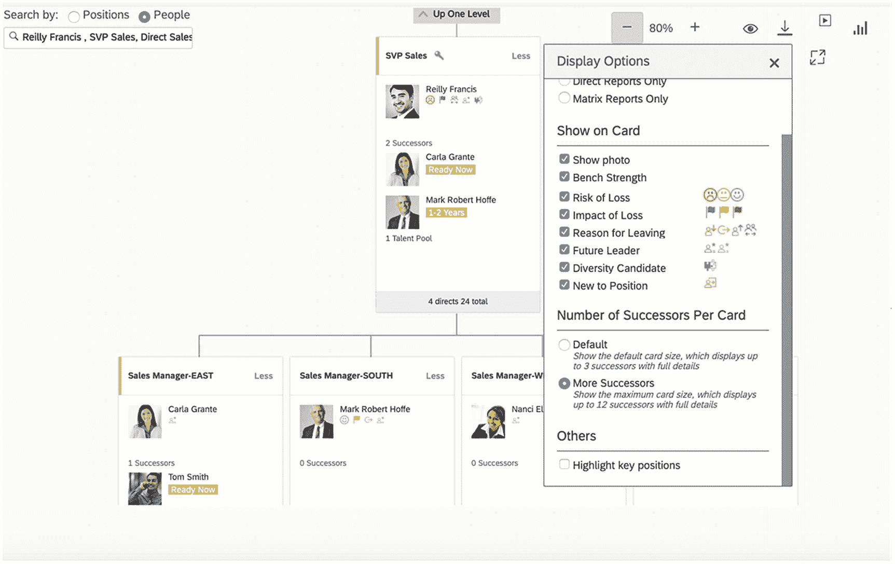
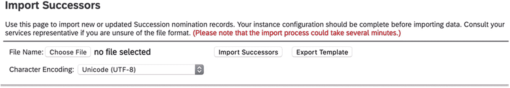
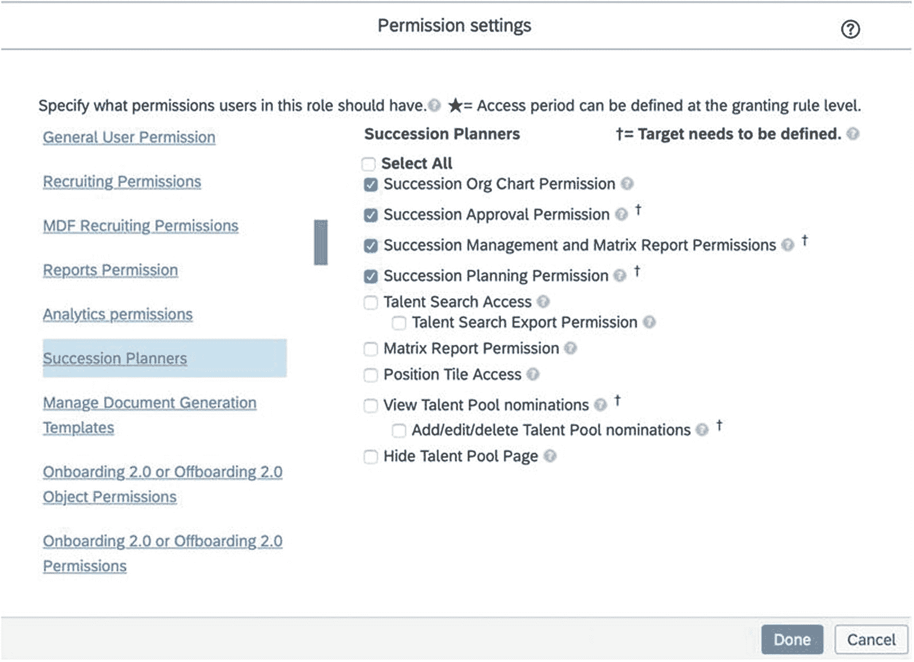

# 6. 核心继任管理

上一章中，我们重点介绍了九宫格与人才评审表。这些功能为我们提供了关于组织中哪些人员值得纳入继任规划的基础信息。现在，我们将聚焦继任管理的核心功能：将员工提名为岗位候选人。我们将首先配置模块中随处可见的人才卡片，随后深入配置提名功能——该步骤至关重要，因其将贯穿整个模块使用。之后，我们将通过"继任组织架构图"部分的说明，实际运用提名设置来提名员工。

## 人才卡片

人才卡片是可配置的弹出窗口，用于展示员工额外的人才详情。通过配置，可显示与您组织最相关的信息。人才卡片出现在多个位置：继任组织架构图、谱系图、职位磁贴视图、MDF 人才池、矩阵网格报告、校准会议及演示文稿。本节将教授如何配置人才卡片，并以最终用户视角进行查看。

### 配置人才卡片的前提条件

要配置人才卡片，首先需要获得权限：



**图 6-1** 管理人才卡片配置权限

1.  在搜索栏中输入并选择 `管理权限角色`。
2.  页面加载后，点击您希望修改的角色。然后点击 `权限...`。
3.  `管理人才卡片配置` 权限可在权限设置的 `管理人才卡片` 部分找到，如图 6-1 所示。点击 `完成`。

### 配置人才卡片

请按以下配置步骤操作：


**图 6-2** 管理人才卡片配置界面

1.  在搜索栏中输入并选择 `管理人才卡片`，以访问配置界面。您将看到如图 6-2 所示的界面。

> **注意**
> 您会看到实际上有三种人才卡片可供配置。每个界面的配置选项相同，因此我们仅介绍继任人才卡片的配置。继任人才卡片配置将应用于继任组织架构图、谱系图、职位磁贴视图、MDF 人才池以及矩阵网格报告中的人才卡片。校准人才卡片仅在校准会议中显示。演示文稿人才卡片仅在演示文稿中显示。我们建议将三种类型配置为相互一致，除非高级领导层对演示文稿或校准会议有特殊差异要求。


**图 6-3** 继任人才卡片配置界面

1.  点击 `继任人才卡片` 开始配置。将出现如图 6-3 所示的界面。



**图 6-4** “编辑扩展信息”界面

1.  点击向下箭头展开并编辑扩展信息区域，然后点击“编辑”。该区域将显示为图 6-4 所示。



**图 6-5** “人才信息板块”界面

1.  勾选您希望显示的板块各区域旁边的复选框，并选择是否显示该区域的标签。对于**职位级别**、**职能**和**国家/地区名称**，请从数据模型中选择要与此区域值关联的人才字段。完成后，点击“保存”。
2.  点击**人才信息**板块上的“编辑”（如果板块尚未显示在人才卡片上，则点击“添加新板块”并选择**人才信息**）。弹出窗口将加载，如图 6-5 所示。勾选您希望显示的字段旁的复选框，并从数据模型中选择要与该字段值关联的人才字段。


**图 6-7** “能力与目标板块”界面


**图 6-6** “绩效与潜力板块”界面

# 人才卡片配置

1. 点击`绩效与潜力`板块上的“编辑”（如果板块尚未显示在人才卡片上，则点击“添加新板块”并选择`绩效与潜力`）。弹出窗口将加载，如图 6-6 所示。选择您希望使用员工档案评分还是矩阵网格配置。对`能力与目标`板块重复此步骤，如图 6-7 所示。

**注意：** 如果您为管理者提供矩阵网格报告的访问权限并已完成相应配置，建议使用矩阵网格管理配置以保持一致性。`员工人才档案`应仅在简单实施中（作为唯一可用数据源时）使用。由于不推荐使用，我们将不详细说明——有关`员工人才档案`中旧版`概览计分卡 portlet`迷你九宫格的更多信息，请参见 SAP 注释 2091458。


### 图 6-8

**“添加/编辑自定义板块/背景元素”界面**

1. 通过点击板块的`编辑`或点击`添加板块`，然后选择`自定义板块`，再选择特定的背景元素（如图 6-8 所示），添加/编辑数据模型中您希望包含的任何背景元素。选择您希望显示的字段。无论数据模型中定义的背景元素结构如何，您最多只能设置两个标题和两个副标题。

2. 如果需要，添加徽章板块：点击`添加板块`，选择`徽章`，然后点击`添加`。除添加操作外，徽章没有其他配置选项。该板块将显示授予员工的所有徽章。

**注意：** 徽章可以是一种有趣且免费的奖励方式，允许管理者和其他员工相互奖励出色的工作或积极的态度。然而，由于该功能的开放性，我们发现大多数公司并不使用徽章。

3. 根据需要，点击任意板块上的`上移`或`下移`以调整顺序。

4. 根据需要，点击`删除`以移除任意板块。

5. 对`校准`和`演示文稿`人才卡片重复上述步骤。

## 最终用户查看人才卡片

完成人才卡片配置后，您可以通过在系统的以下任意区域点击员工姓名或照片来查看人才卡片：`继任组织架构图`、`血缘图`、`职位磁贴视图`、`MDF 人才池`、矩阵网格报告、`校准`和`演示文稿`。您可以滚动人才卡片以查看已配置的所有板块。如果您被分配了继任提名和/或人才池提名的权限（请参见本章中的“设置最终用户权限”部分），则可以直接在人才卡片上添加和编辑提名。所有其他字段均为只读。完整示例如图 6-9 所示。



### 图 6-9

**人才卡片示例**

现在您已经了解如何配置和查看人才卡片，我们可以继续以示例公司为例。当销售高级副总裁和总裁使用矩阵网格报告识别出潜在的明星候选人以接替销售高级副总裁时，他们可以点击员工姓名或照片打开人才卡片。通过人才卡片，他们可以查看候选人的更多信息，并立即提名该候选人。

# 提名配置

继任规划的核心概念是为特定职位提名特定人员，并将其培养为继任者。这一概念对于`继任组织架构图`至关重要（我们将在下一节中介绍），对`人才池`也十分重要。因此，我们现在重点介绍提名在整个继任规划功能中如何在系统中进行配置。

## 了解提名方法

继任规划配置中最重要的决策之一是选择提名方法。SuccessFactors 允许您在基于职位和基于角色-人员的提名方法之间进行选择。我们建议拥有职位数据并实施职位管理的组织使用基于 MDF 职位的提名方法。简而言之，职位管理是将单个员工数据与其工作相关信息（如所需技能、分类等，细化到个人角色级别）分离的做法。两者被视为独立的数据对象。一种常见的理解方式是：将职位视为“座位”，员工视为坐在座位上的人。该座位可以有人占用或空置，具体取决于是否有人就座。SAP SuccessFactors Employee Central 以及传统的本地部署 SAP 通常使用职位管理进行实施。

**注意：** 在基于职位的提名方法中，存在传统的职位提名方法和基于 MDF 职位的方法。由于选择传统的基于职位的方法没有太大意义（因为它无法利用 MDF 的强大功能），因此本文未作介绍。我们同样建议在可能的情况下优先使用基于 MDF 职位的提名方法，而非基于角色的方法。仅当您的组织完全没有可用职位数据时，才应选择基于角色-人员的提名方法。即便如此，SAP 也提供了一项特殊的 MDF 职位同步功能，该功能尝试基于员工层级创建职位层级。我们不会详细讨论此功能，因为它很少使用，且所需的冗长解释会分散您（读者）对更常见场景的注意力。

基于角色-人员的提名方法（也称为基于现任者的方法）适用于正在过渡到 SuccessFactors 但尚未达到基于职位提名所需的职位数据水平的组织。在这种方法中，您实质上是在提名人员接替特定员工，而非该员工所担任的职位。提名实际上是针对人员与职位代码之间的关系建立的，如果职位代码发生变更，提名数据将被丢弃。

# 选择提名方法并启用报告

现在我们已经基本了解不同提名方法的含义，接下来让我们在系统中设置一个方法，以便开始使用！


**图 6-10** 在配置中选择继任提名方法

1. 登录所属组织的 `Provisioning`，点击“公司设置”。

2. 向下滚动到“继任提名方法”，按图 6-10 所示选择方法。

3. 勾选“使用无表单提名审批工作流”旁的复选框，如图 6-10 所示（请注意，只有角色-人员提名方法才能使用基于表单的提名审批工作流）。同时勾选“超组织结构图”旁的复选框（图中未显示）。

4. 点击“保存”。

**注意**

在选择 `MDF` 职位前，应确保已激活 `MDF` 以及基于角色的权限。由于报告功能与提名方法相关联，此时可能还需要启用报告。请勾选“继任（基于 MDF 职位提名）”、“继任历史（基于 MDF 职位提名）”和“包容性继任（基于 MDF 职位提名）”复选框。本章不对报告功能进行详细说明，因为即席报告和仪表板的概念与其他模块一致。我们只需开启数据访问权限即可。

## 就绪度评级量表

必须配置就绪度评级量表，以便用户在提名他人时，能选择被提名者对应职位的就绪程度。其配置方式与绩效管理类似。请按以下步骤操作：


**图 6-11** 就绪度评级量表配置

1. 在搜索栏中输入并选择“评级量表”。

2. 点击“创建新评级量表”按钮。屏幕将显示如图 6-11 所示界面。

3. 在“名称”字段中，准确输入“Readiness”（所有实施场景中该名称必须始终为 Readiness）。

4. 选择量表的等级数量。然后为每个等级输入分数、标签和描述，并点击“保存”。

**注意**

我们建议最低分表示最不成熟，最高分表示最成熟。你还需要在继任组织结构图 XML 中定义此量表，且两者必须完全一致。我们将在“继任组织结构图”部分介绍组织结构图 XML。

## 提名设置界面

在使用此界面之前，请务必按照以下步骤配置提名设置界面：

**表 6-1** 提名设置界面选项

| 选项 | 描述 |
| --- | --- |
| 隐藏此日期之前的继任提名历史记录（留空则显示所有记录） | 建议留空此字段，以便显示所有历史记录。如果评审周期中数据已过时，或已过渡到新流程，此工具可帮助你隐藏不再相关的旧数据。 |
| 启用继任者排名 | 勾选此复选框后，每当有继任者被提名时，系统将允许用户同时输入排名编号，该编号将作为职位继任者的次要排序依据。 |
| 允许按就绪度排名 | 勾选此复选框后，用户将优先按排名排序，而非按就绪度排序。仅当前一个复选框被勾选时，此选项才会出现。 |
| 如用户拥有相应的表单创建权限，允许报告启动未来角色能力评估。 | 如果你的组织使用能力评估，可勾选此复选框启用。用户在选择就绪度级别时将看到“评估就绪度”选项。若勾选此框，则需要为每个已配置区域设置选择一个标识就绪度模板的表单模板。 |
| 根据继任计划权限过滤“当前提名”Portlet 数据 | 默认情况下，如果你拥有查看某人的权限，你将看到所有针对该职位的提名。如果勾选此复选框，用户将仅能查看其同时拥有继任计划权限的职位的提名。 |
| 在“当前提名”Portlet 中显示隐藏提名的数量 | 如果勾选了上一个复选框，此复选框将出现。勾选后，它会向用户弹出一个警告提示，告知有多少职位因安全限制而被隐藏。 |
| 对所有用户隐藏记分卡 Portlet 中的待处理提名 | 如果你已选择将提名与审批分离，则此复选框会在用户查看人才档案中的员工记分卡时，隐藏尚未获得批准的提名。 |
| 允许拥有候选人搜索权限的继任计划制定者提名外部候选人 | |

如果你已启用招聘功能，并且用户拥有执行招聘候选人搜索的权限，勾选此复选框将允许他们基于招聘外部候选人数据库执行外部候选人搜索以进行提名。

## 若被提名人成为现任者，则自动移除该提名

如果你使用的是 MDF 职位，可以勾选此选项，以便在继任者占据该职位时隐藏提名。该提名仍会存在，但会被记录为“继任成功”，仅不会在继任组织架构图中显示，从而确保任何历史报告数据不被移除。勾选此复选框后，系统不会追溯隐藏被提名人。

## 将目标人群应用于人才库提名权限

如果勾选此复选框，你需要为人才库提名权限定义目标权限。我们将在本章后续的“人才库”部分详细讨论此设置。

## 在“添加提名”对话框中，为“职位”搜索和“现任者”搜索显示独立字段（推荐用于大量用户和职位场景以获得更优性能）

如果勾选此复选框，搜索提名人的用户将看到一个带有单选按钮的弹出框，允许他们在职位或被提名人之间进行选择。此功能推荐给拥有大量职位、且在未启用此功能时提名搜索速度缓慢的公司。请注意，此选项仅适用于 MDF 职位提名方法。

1. 在搜索栏中输入并选择“提名设置”。
2. 根据表 6-1 选择配置选项。
3. 点击“保存”。

现在提名设置已完成，我们将能够详细查看使用提名的各项功能，首先从最常用的提名创建方式——继任组织架构图开始。

# 继任组织架构图

既然我们已经完成了执行提名的设置，接下来让我们深入了解如何将那些有才华的人提名到具体职位。继任组织架构图允许用户以基于职位的组织架构图形式查看人才和提名信息。我们倾向于将继任组织架构图视为 SuccessFactors 人才管理的巅峰之作。它为您提供了组织的鸟瞰图，并展示了在您选择的任意层级上，每个职位和人员处于继任计划中的哪个阶段。在销售演示中，它是最能引起高管们赞叹的功能——这绝非空穴来风。它所呈现的可视化信息是大量数据以及为确保这些数据保持最新而付出的巨大努力的结晶！不过，我们倾向于认为 SAP SuccessFactors 让这项工作变得更容易、更有趣。让我们更详细地了解一下吧！

## 配置和使用继任组织架构图的先决条件

在配置或使用组织架构图之前，我们需要确保一些关键系统设置和权限已就位。接下来我们看看这些内容。

### 激活组织架构图

## 设置继任提名方法

现在我们对不同的提名方法有了基本了解，接下来在系统中设置一个方法以便开始使用！

1. 登录到您组织的 Provisioning 系统，点击“`Company Settings`”（公司设置）。
2. 向下滚动到“`Succession nomination method`”（继任提名方法），选择您的方法。
3. 勾选“`Ultra Organization Chart`”（超级组织架构图）旁边的复选框。
4. 点击“`Save`”（保存）。

> **注意**
> “`Ultra Organization Chart`”（超级组织架构图）适用于系统中的所有组织架构图，而不仅仅是继任管理。您可以通过勾选“`Turn off Succession Organization Chart`”（关闭继任组织架构图）旁边的复选框来选择关闭继任组织架构图功能。

## 设置 MDF 职位对象和授予配置权限

如果您使用的是基于 MDF 职位的提名方法，建议您先设置好职位数据。设置系统中 MDF 职位的权限和流程将在下一章的“`Position Tile View`”（职位磁贴视图）部分中介绍。我们特意将配置分散到这两个部分中，以展示相同的数据如何以不同方式查看，以及相同的配置如何类似地影响系统的两个区域。

### 加载 MDF 职位数据

现在前提条件已经完成，MDF 对象也已定义，我们可以开始加载您可能拥有的任何历史职位数据。请按照以下步骤导入这些数据：

### 表 6-3：MDF 导入选项说明

| 选项 | 说明 |
| --- | --- |
| `File Encoding`（文件编码） | 指文件的字符编码。请注意，当您使用编辑器保存本地 `.csv` 文件时，务必在此处也选择相同的编码。我们推荐使用 `UTF-8`，因为它对国际语言的处理效果最佳。 |
| `Purge Type`（清除类型） | “`Incremental Load`”（增量加载）仅添加新对象或替换旧对象。“`Full Purge`”（完全清除）将删除上传中不存在的任何现有对象。 |
| `Suppress Redundant Date-Effective Records`（抑制冗余的日期生效记录） | 选择“`Yes`”或“`No`”；我们推荐选择“`Yes`”，以避免系统中存在冗余数据。 |
| `Key Preference`（键偏好） | 请参见上一张表，并选择与模板导出相同的选项。 |
| `Use Locale Format`（使用区域设置格式） | 根据区域设置定义日期等的格式。如果选择“`No`”，屏幕底部将显示 `MM/DD/YYYY` 的示例日期格式。如果选择“`Yes`”，系统将提示您选择区域设置偏好。 |
| `Enable Decimal Round Option`（启用小数舍入选项） | 如果您在 MDF 中为某个字段定义了小数舍入，此选项将启用该舍入功能。 |
| `Identity Type`（身份类型） | 请参见上一张表，并输入为模板选择的相同值。 |

### 表 6-2：MDF 导入模板选项说明

| 选项 | 说明 |
| --- | --- |
| `Include Dependencies`（包含依赖项） | 选择“`Yes`”将下载一个包含父对象及根据 MDF 对象定义的所有子对象的 `.csv` 模板的 zip 文件。该 zip 文件随后也必须通过导入屏幕上的 zip 文件选项进行上传。选择“`No`”将仅为职位对象下载一个 `.csv` 文件。 |
| `Include Immutable IDs`（包含不可变 ID） | 如果选择“`Yes`”，将下载实体 ID 和记录 ID。 |
| `Exclude Reference Objects`（排除参考对象） | 如果分别选择“`No`”或“`Yes`”，则在 `.zip` 文件中包含或排除参考对象 `.csv` 模板。 |
| `Key Preference`（键偏好） | 选择“`Business Key`”（业务键）将使用 MDF 用于创建唯一标识符的一组字段。“`External Code`”（外部代码）可以是基于此输入字段手动设置的键。 |
| `Hide External Code`（隐藏外部代码） | 将从下载的 `.csv` 文件中隐藏此字段。请注意，如果您的键偏好设置为“`External Code`”，则无法选择此选项。 |
| `Identity Type`（身份类型） | 定义使用“`User ID`”（用户 ID）还是“`Assignment ID`”（分配 ID）来引用员工身份。分配 ID 是 Employee Central 引入的一个较新概念，用于简化全球分配。如果您尚未实施 Employee Central，则使用用户 ID。 |

1. 在搜索栏中键入并选择“`Import and Export Data`”（导入和导出数据）。
2. 在“`Select action to perform`”（选择要执行的操作）字段中，选择“`Download Template`”（下载模板）。
3. 在“`Select Generic Object`”（选择通用对象）字段中，选择“`Position`”（职位）。

### 参考表格

4. 参考表 6-2 选择其他字段。
5. 点击“下载”。
6. 在编辑器中打开文件，并添加您的历史数据。
7. 在“要执行的操作”字段中，选择“导入数据”。
8. 在“选择通用对象”中，选择“职位”。
9. 点击“选择文件”，在本地计算机上找到该文件。
10. 参考表 6-3 了解所有其他字段选项。
11. 点击“导入”。

系统会创建一个作业来导入数据。您可以通过在搜索栏中输入并选择“监控作业”来检查作业进度和错误日志。

### 配置继任组织架构图

现在我们已经设置了基本的系统设置和权限，并定义和加载了职位数据，接下来需要定义继任数据的结构和可视化方式。这可以通过“继任组织架构图 XML”来实现。

#### 了解继任组织架构图 XML 中的字段并确保配置好选择列表

在了解如何编辑“继任组织架构图 XML”之前，需要先掌握一些关键概念。继任管理中一个容易混淆的概念是理解“继任数据模型 XML”键与“继任数据模型”之间的映射关系。虽然这些技术字段名在 XML 中通常是一致的，但并非总是如此。例如，数据模型中的`addressLine1`对应“继任组织架构图 XML”中的`addr1`键，而`lastReviewDate`映射到`last_review_date`。如果不熟悉这些细微差别，在创建 XML 时可能会遇到困扰。此外，在“继任组织架构图”的最新版本（v12）中，您只能直观地显示非文本类型的项目。为澄清这些细微差别，请参考表 6-4。

**表 6-4：数据模型到继任组织架构图字段映射及字段类型**

# 继任组织架构图配置

## 继任数据模型字段映射

| 继任数据模型字段 | 继任组织架构图键 | 字段类型 |
| :--- | :--- | :--- |
| `addressLine1` | `addr1` | `text` |
| `addressLine2` | `addr2` | `text` |
| `benchStrength` | `benchStrength` | `picklist` |
| `businessPhone` | `biz_phone` | `text` |
| `businessSegment` | `businessSegment` | `picklist` |
| `Citizenship` | `citizenship` | `picklist` |
| `City` | `city` | `text` |
| `competency` | `competency` | 遵循使用在该处配置的能力量表的矩阵网格配置 |
| `Country` | `country` | `text` |
| `custom01`–`custom15` | `custom01`–`custom15` | `text` |
| `sysOverallCustom1` | `customrating1` | 遵循使用在该处配置的自定义 1 量表的矩阵网格配置 |
| `sysOverallCustom2` | `customrating2` | 遵循使用在该处配置的自定义 2 量表的矩阵网格配置 |
| `dateOfBirth` | `dateOfBirth` | `text`（日期格式） |
| `dateOfPosition` | `dateOfPosition` | `text`（日期格式） |
| `Department` | `department` | 根据用户数据文件中加载的系统部门自动生成的列表 |
| `Division` | `division` | 根据用户数据文件中加载的系统部门自动生成的列表 |
| `Email` | `email` | `text` |
| `empId` | `empId` | `text` |
| `Ethnicity` | `ethnicity` | `picklist` |
| `Fax` | `fax` | `text` |
| `firstName` | `firstName` | `text` |
| `Function` | `function` | `picklist` |
| `futureLeader` | `futureLeader` | `Boolean`（`true`/`false`） |
| `Gender` | `gender` | 硬编码枚举，值为 M、F |
| `hireDate` | `hireDate` | `text`（日期格式） |
| `impactOfLoss` | `impactOfLoss` | `picklist` |
| `jobCode` | `jobCode` | `text` |
| `keyPosition` | `keyPosition` | `Boolean`（`true`/`false`） |
| `lastName` | `lastName` | `text` |
| `lastReviewDate` | `lastReviewDate` | `text`（日期格式） |
| `Level` | `level` | `picklist` |
| `location` | `location` | 根据用户数据文件中加载的系统地点自动生成的列表 |
| `managerId` | `managerId` | `text` |
| `Married` | `married` | `Boolean`（`true`/`false`） |
| `matrix1label` | `matrix1label` | `text`（来自矩阵网格配置） |
| `matrix2label` | `matrix2label` | `text`（来自矩阵网格配置） |
| `matrixManaged` | `matrixManaged` | `Boolean`（`true`/`false`） |
| `Mi` | `mi` | `text` |
| `Minority` | `minority` | `Boolean`（`true`/`false`） |
| `Nationality` | `nationality` | `picklist` |
| `newToPosition` | `newToPosition` | 布尔值 (true/false) |
| `objective` | `objective` | 遵循矩阵网格配置，使用其中配置的目标标尺 |
| `performance` | `performance` | 遵循矩阵网格配置，使用其中配置的绩效标尺 |
| `potential` | `potential` | 遵循矩阵网格配置，使用其中配置的潜力标尺 |
| `reasonForLeaving` | `reasonForLeaving` | 选择列表 |
| `reviewFreq` | `review_freq` | 文本 |
| `riskOfLoss` | `riskOfLoss` | 选择列表 |
| `serviceDate` | `serviceDate` | 文本 |
| `Ssn` | `ssn` | 文本 |
| `State` | `state` | 文本 |
| `talentPool` | `talentPool` | 选择列表 |
| `Title` | `title` | 文本 |
| `userId` | `userId` | 文本 |
| `Username` | `username` | 文本 |
| `zipCode` | `zip` | 文本 |

我们建议为您选择包含在组织架构图配置中的每个继任数据模型字段（如上表所述）配置选择列表。这将确保您可以在 XML 配置中为它们建立图标关联。在进行 XML 配置之前，您需要在搜索栏中输入并选择“选择列表中心”来维护这些选择列表。作为卷 1 第 2 章概述的继任数据模型配置的一部分，您可能已经完成了此操作。选择列表很重要，因为您可以在继任组织架构图配置中将选择列表与颜色渐变和/或图标关联。

## 在 Provisioning 中编辑继任组织架构图 XML

现在选择列表已设置好，我们可以开始 XML 配置了！请按照以下步骤在 Provisioning 中访问和编辑 XML：

1.  登录 Provisioning 并选择您的公司。
2.  在“继任管理”下，点击“编辑组织架构图配置”。
3.  对 XML 进行编辑（我们建议复制粘贴到离线编辑器中），以显示您希望在组织架构图上可用的图标和渐变。
4.  点击“保存”。

图 6-12 显示了一个示例 XML 文件，其中每个元素都已折叠，以显示文件的最高层级结构。您可以看到每个高层级元素要么是 `gradientOption`、`iconSetOption`、`textOption`，要么是 `keyPositionOption`。由于我们使用的是最新的继任组织架构图 (v12)，`textOptions` 将被忽略（仅在旧版本中使用）。唯一允许的 `gradientOptions` 是“`readiness`”和“`benchStrength`”。前面表格中所有其他非文本字段都可以配置为 `iconSetOptions`。`keyPositionOption` 必须在 XML 的顺序中排在最后。



**图 6-12** 继任组织架构图 XML 的折叠视图

> **注意：** 我们建议至少配置 XML，使其包含 `readiness` 和 `benchStrength` 的 `gradientOption` 以及 `keyPosition`。其余的配置取决于您希望将前面表格中的哪些选择列表和布尔字段显示为图标，以及每个字段值对应哪个图标。

图 6-13 显示了每个 `gradientOption`、`iconSetOption` 元素以及 `keyPositionOption` 配置完成后的最终结果。您可以看到每个图标都作为显示选项中的一个图标被计入，并且每个渐变都关联了一种颜色。例如，“SVP Sales”职位左侧显示了一个绿色标记，因为其总体板凳强度为“随时就绪”，因为该职位有一名候选人其就绪程度为“随时就绪”（也以绿色显示）。



**图 6-13** 继任组织架构图 XML 的最终可视化结果

接下来的小节将举例说明如何配置上例中所示的每种高层级 XML 元素。请参考表 6-5，了解应如何处理 XML 中的每个元素。

### 表 6-5 继任组织架构图 XML 元素/属性描述

| 元素/属性 | 描述 |
| :--- | :--- |

## 组织架构图配置字段

| 字段 | 描述 |
| --- | --- |
| `index=` | 唯一递增编号。为 `readiness` 使用“1”，为 `benchStrength` 使用“2”。对于其余图标，按照您希望图标出现的顺序使用递增编号。 |
| `key=` | 填写本章提供的映射表中的继任组织架构图字段键。 |
| `Type` | `readiness` 始终为“`readiness`”，`benchStrength` 始终为“`titleGradient`”。任何 `iconOption` 始终为“`iconset`”。 |
| `Label` | 用户将看到的默认文本标签。请参阅下一小节中 `gradientOption` 的示例，了解如何提供本地化标签。 |
| `Value` | 输入选择列表值。确保在“选择列表中心”屏幕中也已填写相应的值字段。对于就绪级别，值越高表示越就绪。对于性别，使用“M”或“F”；对于布尔字段，使用“true”或“false”。 |
| `Index` | 仅用于 `gradientOption`。一个单独的数字，对应于 SAP 在此维护的颜色表：`https://help.sap.com/viewer/55e0a1102eda4d83a5638a3526003bd0/2005/en-US/6dadf9f3ebc34b51a65102c6dba07081.html`。 |
| `image` | 仅用于 `iconOption`。标识将为字段的每个值显示的图标图像。SAP 在此维护图像值及对应图像的表格：`https://help.sap.com/viewer/55e0a1102eda4d83a5638a3526003bd0/2005/en-US/523be343cf874f10a633c5089ac65117.html`。 |

### `readiness` 的 `gradientOption` 元素 XML 配置示例

```xml
<gradientOption>
  <key>readiness</key>
  <Type>readiness</Type>
  <Label>Readiness</Label>
  <value>
    <Value>3-5 Years</Value>
    <Label>3-5 Years</Label>
    <Index>1.0</Index>
  </value>
  <value>
    <Value>1-2 Years</Value>
    <Label>1-2 Years</Label>
    <Index>2.0</Index>
  </value>
  <value>
    <Value>Ready Now</Value>
    <Label>Ready Now</Label>
    <Index>3.0</Index>
  </value>
</gradientOption>
```

> **注意：** 在上例中，为简洁起见，我们仅为 `en_US` 区域设置包含了一个“3–5 Years”的本地化标签。为您希望本地化的每个标签和区域设置重复此模式。这适用于 `gradientOption`、`iconOption`、和 `keyPositionOption`。

### `riskOfLoss` 的 `iconOption` 元素 XML 配置示例

```xml
<iconSetOption>
  <key>riskOfLoss</key>
  <Type>iconset</Type>
  <Label>Risk of Loss</Label>
  <value>
    <Value>High</Value>
    <image>sap_ui5_icon_RiskOfLoss01_high</image>
    <Index>3.0</Index>
  </value>
  <value>
    <Value>Medium</Value>
    <image>sap_ui5_icon_RiskOfLoss01_medium</image>
    <Index>2.0</Index>
  </value>
  <value>
    <Value>Low</Value>
    <image>sap_ui5_icon_RiskOfLoss01_low</image>
    <Index>1.0</Index>
  </value>
</iconSetOption>
```

### `keyPosition` 元素 XML 配置示例

```xml
<keyPositionOption>
  <Type>keyPosition</Type>
  <Label>Highlight key positions</Label>
</keyPositionOption>
```

### 其他可选设置

如果您希望在继任组织架构图中显示自定义管理者，请将 XML 的第二行替换为以下内容：

```xml
<setting key="usedefinedmanager" value="true" />
```

## 组织架构图配置屏幕

我们通过组织架构图配置屏幕来结束组织架构图配置。要访问该屏幕，请执行以下步骤：


**图 6-14** 组织架构图配置屏幕

1.  在搜索栏中输入并选择“组织架构图配置”。
2.  点击“继任组织架构图”选项卡。屏幕将如图 6-14 所示加载。

### 表 6-6 组织架构图配置字段

| 字段 | 描述 |
| --- | --- |
| `Display Photo` | 我们建议勾选此框以显示照片，除非您的组织尚未在员工档案中加载任何照片，或已禁用员工自行上传照片的功能。 |
| `Allow succession planners to view successors on org chart nodes/position tile view` | 当您勾选此框时，系统还将使用“继任计划”权限来确定谁可以查看继任信息，而不仅仅是使用“继任管理和矩阵报告权限”（请参阅本章后面关于设置最终用户权限的小节）。我们建议勾选此框，除非您有这样一种场景：您希望限制某些可以提名的人员的可见性——例如，如果管理者可以为其员工提名，但您不希望他们在同一管理范围内看到其他提名信息。 |
| `将继任组织架构图可见性限制为基本组织架构图目标人群` | 勾选此框后，在创建基于角色的权限时，会将可见性限制为`权限`界面中`常规用户权限`下的`组织架构图导航权限`设置。我们尚未遇到组织需要此功能的场景，因为您已经可以通过`继任管理与矩阵报告权限`来定义人群。如果您希望这些权限完全相互对应，该功能可能会很有用。 |
| `隐藏团队总人数以加快加载速度` | 如果您的组织非常庞大，在查看组织架构的顶层几级时可能会遇到问题，因为系统会尝试计算每个职位下的所有汇报关系。例如，一个拥有 30 万名员工的组织，其 CEO 会显示`x`名直接下属和总计 299999 名汇报人员。如果您在这些层级加载组织架构图时遇到长时间等待，我们建议勾选此选项，以便屏幕加载前不执行此计算。 |
| `隐藏矩阵团队规模以加快加载速度（仅限矩阵报告模式）` | 与前述场景类似，如果您使用矩阵报告并选择`仅矩阵报告`可视化选项，可以勾选此框以加快屏幕加载时间。 |

1.  按表 6-6 所示进行推荐选择，然后点击`保存`。

## 加载遗留继任者数据

完成所有配置并加载职位数据后，我们可以加载来自前一个系统的任何遗留继任者数据。请按照以下步骤访问导入界面、下载模板并上传任何遗留数据：



**图 6-15** 导入继任者界面

1.  在搜索栏中输入并选择`导入继任者`。导入继任者界面将加载，如图 6-15 所示。

### 表 6-7 继任者导入模板中的字段

| 字段 | 描述 |
| --- | --- |
| `GENERIC_POSITION_CODE` | 输入您希望提名为继任者的 MDF 职位对象的`代码`字段值。 |
| `OLD_GENERIC_POSITION_CODE` | 如果使用`转移`操作，请输入将被提名人转出的来源职位代码。 |
| `POOL_CODE` | 输入您希望提名为继任者的 MDF 人才库对象的`代码`字段值。 |
| `OLD_POOL_CODE` | 如果使用`转移`操作，请输入将被提名人转出的来源人才库代码。 |
| `READINESS` | 输入就绪程度的值 – 例如，选项列表和继任组织架构图 XML 中的`值`字段。 |
| `SUCCESSOR_USERID` | 输入继任数据模型/员工数据文件中该员工的`USERID`。 |
| `NOTE` | 输入您希望显示在评论部分中关于该提名的任何评论。 |
| `RANK` | 假设您在提名设置中选择了包含排名，请输入候选人的数字就绪排名。 |

| `ACTION` | 值可以是`ADD`、`UPDATE`、`TRANSFER`或`DELETE`。将此字段留空或使用`ADD`或`UPDATE`执行相同的功能：系统将查找现有记录进行更新；如果未找到，则添加记录。`DELETE`将删除记录。对于`TRANSFER`，您需要定义移动记录的目标和来源提名。 |

1.  点击`下载模板`。

**注意：** 模板将根据您所做的配置动态变化，因此模板不一定能在组织之间转移。

2.  在本地机器上以表 6-7 为指南填写模板（假设您到目前为止已遵循我们推荐的配置）。

3.  选择您的文件编码（我们推荐 UTF-8，因为它能最好地处理本地化语言）。

4.  点击`选择文件`，选择您已使用继任者数据编辑过的文件。

5.  点击`导入继任者`。导入完成后，您将收到一封包含导入详细信息的电子邮件。重复上述步骤以解决邮件中所述未成功加载的任何继任者数据。

## 设置最终用户权限

我们已经为设置继任组织架构图付出了很多努力。我们快完成了！最后一步是为我们的用户设置权限。为了正确查看继任组织架构图，您需要拥有查看 MDF 职位、继任数据和组织架构图界面本身的权限。我们将在下一章的`职位卡片视图`部分介绍 MDF 职位对象的权限，因为这也涉及在那里完成的 MDF 配置。请按照以下步骤授予对继任组织架构图界面和继任数据的访问权限：

### 表 6-8 继任组织架构图权限选项

| 选项 | 描述 |
| --- | --- |
| `继任组织架构图权限` | 授予对继任组织架构图界面的访问权限。 |
| `继任审批权限` | 允许用户审批提名。系统中的提名审批很简单 – 您可以通过始终同时授予`继任规划权限`和`审批权限`来有效取消审批流程。如果对同一用户和员工人群未授予审批权限，则用户的提名必须由对该人群具有审批权限的用户批准。在前文中选择此选项时，请务必在角色上定义您的目标人群。（注意，您可以选择在系统中设置待审批电子邮件。这需要在配置中设置`发送待处理提名电子邮件`批处理作业，并在`电子邮件通知模板设置`界面上设置`继任电子邮件审批者`电子邮件模板。） |
| `继任管理与矩阵报告权限` | 允许用户在组织架构图中看到此已定义的人群。 |
| `继任规划权限` | 允许用户为此已定义的人群提名继任者。 |



**图 6-16** 继任组织架构图权限

1.  在搜索栏中输入并选择`管理权限角色`。

2.  界面加载后，点击您希望修改的角色。然后点击`权限...`

3.  点击`继任规划者`（图 6-16）并根据需要从表 6-8 中选择以下选项。

4.  可选地，如果您希望在职位卡片中看到推荐的继任者，请转至`职业发展规划`并选择`推荐继任者`。

5.  可选地，如果您已实施 SuccessFactors LMS 并希望能够从组织架构图分配学习任务，请转至`学习`并选择`学习访问权限`。点击`完成`。请务必在主界面上也保存您的角色。

# 使用继任组织架构图

是时候开始使用我们的继任组织架构图了！请按照以下步骤逐步操作继任组织架构图：


**图 6-17** 继任组织架构图

1.  在搜索框中，输入并选择`查看继任组织架构图`。组织架构图将从登录用户的职位开始显示。

2.  要选择其他用户或职位，请点击单选按钮，指示您希望通过职位或个人进行搜索。在搜索框中输入并选择人员或职位名称。组织架构图将如图 6-17 所示显示。


**图 6-18** 职位卡片

1.  如果您已为人员填写了任何人才字段，并在组织架构图 XML 中设置了图标（例如`riskOfLoss`），这些图标将显示在该人员旁边。您可以将鼠标悬停在图标上，通过弹出的小窗口查看同样已配置好的文本描述，以防您不熟悉每个图标的含义。

**注意**：客户常见的一个困惑/误解是，他们认为这些人才字段可以直接在此处编辑。用户必须导航至员工的“人才档案”才能编辑这些字段中的值。您可以通过单击员工的姓名或照片打开职位磁贴，然后再次单击姓名或照片打开该员工的才能卡片，接着在才能卡片上再次单击姓名或照片，即可在新窗口中打开“人才档案”。进入后，您可以向下滚动到档案的“人才”部分，在拥有相应权限的情况下进行编辑。

2.  如果您无法看到任何图标，请单击右上角的“眼睛”图标以调出显示选项。您可以在此选择显示所有汇报人、仅显示直接下属或仅显示矩阵汇报人。您还可以勾选每个已配置图标旁的复选框，以控制该图标是否在主屏幕上显示。此外，您还可以选择为每个职位显示 3 位还是 12 位继任者。另外，还有一个选项可以仅高亮显示关键职位（其他所有职位将变为灰色）。

3.  要显示或隐藏单个职位的图标和候选人，请切换职位右上角的“更多”或“更少”链接。

4.  您可以通过单击职位顶部的“上移一级”或职位底部的“汇报人数”，在组织架构图中向上或向下导航。

5.  如果组织架构图变得杂乱，您可以再次单击已显示直接下属的职位底部的“汇报人数”，以关闭该职位的直接下属显示。

6.  您还可以通过单击并拖动鼠标来移动组织架构图。

7.  要放大或缩小，请单击屏幕右上角的“+”或“-”图标。

8.  要隐藏顶部的菜单栏并为组织架构图腾出更多空间，请单击屏幕右上角的双箭头方框图标。

9.  要下载屏幕上的图表副本，请单击屏幕右上角的向下箭头图标。您可以选择以`.pdf`或`.jpg`格式下载。

10. 要打开职位卡片，请单击屏幕上的任意位置。职位卡片将弹出，如图 6-18 所示。


**图 6-19** 提名弹出窗口

1.  单击右上角的“菜单”汉堡图标，以编辑 MDF 职位对象、删除 MDF 职位对象、查看提名历史记录（显示对候选人执行的提名操作）、创建职位申请、查看世系图、查看职位角色详细信息或隐藏该职位。如果您使用的是招聘模块，您还可以在此添加“创建申请”菜单项。所有这些选项都取决于您的配置和权限。MDF 职位相关的配置和权限在下一章的“职位磁贴视图”部分中介绍。提名在本节的前面部分以及本章的“提名设置屏幕”部分中介绍。世系图在下一章的“世系图”部分中介绍。职位角色权限在第 1 卷，第 3 章中介绍。

    *   如果您隐藏了一个职位，组织架构图右上角将出现一个新图标，该图标带有一个轮廓和一把锁，表示隐藏职位的数量。您可以单击此图标以取消隐藏所有隐藏职位。

    *   要更改关键职位值，请从下拉菜单中选择。

    *   您可以通过单击相应的栏，在查看在职者、已命名的继任者或通过职位代码与职位关联的人才库之间切换。单击任何员工姓名或照片，以打开这些人员的才能卡片。才能卡片配置在本章前面的“才能卡片”部分中介绍。请注意，您可以从此人的才能卡片中将其提名到某个职位，也可以提名某人到该员工的职位。此外，您可以通过单击“已命名继任者”栏中的“+ 添加继任者”来提名继任者（弹出窗口将如图 6-19 所示显示）。您会注意到，当您在此处添加具有不同就绪等级的继任者时，职位卡片上的替补实力以及职位左侧对应的颜色将调整为被提名者中的最佳就绪等级。最后，您还可以单击所选特定人才库栏中的“管理库”来打开该库的人才库屏幕（参见下一章的“人才库”部分）。

**注意**

您将注意到，在图中，您的搜索选项（例如是按职位还是按人员单独搜索、搜索外部候选人的能力，以及建议的继任者是否会在提名屏幕上显示）都将根据您在本章前面部分介绍的提名设置配置来显示或隐藏。在弹出窗口中单击“高级搜索…”将在弹出窗口中打开人才搜索——人才搜索在本章前面的部分中已介绍。

通过以上步骤，看到继任组织架构图如何将我们本章及许多其他章节中的众多配置整合到一个集中位置，这是非常令人欣慰的！回到我们的示例公司，我们可以看到继任组织架构图为其总裁提供的强大可视化功能和快速查看及编辑数据的能力，帮助其评估组织的继任情况。他们可以通过职位上显示的图标快速看到高级副总裁具有较高的流失风险和影响。他们还能够将高级副总裁提名到他们自己的职位上，并指定就绪等级。他们还可以看到哪些区域销售经理正在被考虑担任高级副总裁职位，以及他们的就绪等级！基于这些快速信息，管理者可以与高级副总裁进行有依据的对话，讨论其发展以及如何在高级副总裁成功继任后最佳地填补其职位。

**结论**
