# 发展目标状态值

-   `Locked`（已锁定）
-   `Deleted`（已删除）
-   `Failed`（未达成）
-   `Completed`（已完成）

当发展目标完成时，所有关联的学习活动将被设置为“Completed”（已完成）或“Locked”（已锁定）。条件权限也可能被添加到 XML 中。通过标签 `<condition>` 进行标识，必须满足某个条件，才能允许某个角色查看计划中的字段。

角色可以根据条件读取字段，如下面的代码片段所示：

以下是自定义学习类型的代码片段示例：

```
Item Type
Item TypeItem Type
Item Type

External Course
External Course

Project
Project

On-the-Job Training (OJT)
On-the-Job-Training (OJT)

Job Rotation
Job Rotation

E-Learning/Webinars
E-Learning/Webinars

Conference / Seminar
Conference/Seminar

Assignment
Assignment

Self-Learning
Self-Learning

Others
Others
```

计划布局（plan-layout）定义了学习活动字段在发展目标中的显示方式。表单布局（form-layout）、PDF 布局（pdf-layout）和详情布局（details-layouts）部分不被使用。以下是计划布局的一个示例：

在创建学习活动时应显示的所有字段都需要授予“读取”和“写入”权限。字段的定义和权限授予方式与目标和发展计划模板类似。能够读取发展计划中发展目标字段的角色，应对学习活动字段拥有相同的“读取”权限。否则，用户在查看发展计划时，将看不到学习活动的任何字段。您可以决定，经理可以向下属的发展计划添加发展目标，但只能读取学习活动字段。这意味着发展计划 XML 应为经理设置“写入”权限，而学习活动 XML 应设置“读取”权限。您需要仔细规划每个角色应能执行的操作以及应看到的内容，因为您必须正确配置模板 XML 中的权限和基于角色的权限。

## 在员工个人资料中显示发展目标门户的配置

本章前面提到过发展模板 XML 中的一个开关，它允许发展目标以门户组件的形式显示在员工个人资料中。还需要在继任数据模型中进行额外配置，以添加“发展目标门户”背景元素。

登录 Provisioning 并转到“公司设置”。找到“继任管理”部分，单击“导入/导出数据模型”链接，如图 1-35 所示。

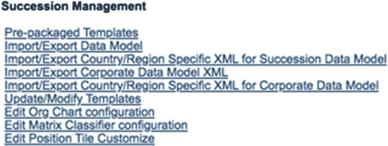

**图 1-35** 继任管理访问入口

在“导入/导出数据模型”屏幕上（如图 1-36 所示），下载数据模型以进行修改。

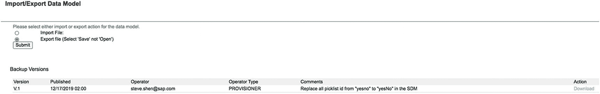

**图 1-36** 导入/导出数据模型

添加背景元素 `sysScoreCardDevelopmentObjectivesPortlet`，如下代码片段所示：

```
Development Goals Portlet
Development Goals Portlet

Development Goal
Development Goal
```

同时，将背景元素门户组件添加到 `view-template for employeeScoreCard` 中，如下代码片段所示：

```
View Template for Employee Scorecard
This view Template for Employee Scorecard should have only 1 edit template

Edit Template for Employee Scorecard
Edit Template for Employee Scorecard
```

完成更新后，保存并导入继任数据模型。

> **注意：** 背景元素的名称是“发展目标门户”（Development Objective Portlet），但在我们的示例中，我们在标签中使用了“Goal”来代替“Objective”。我们将使用其标准名称来引用背景元素门户组件，但在我们的实例中它将显示为“Development Goals Portlet”（发展目标门户）。

## 在员工个人资料中配置发展门户

返回实例中，需要在员工个人资料中配置此门户组件。转到“配置员工个人资料”以添加发展目标门户。

找到该区块并将其拖到您希望其显示的章节，如图 1-37 所示。

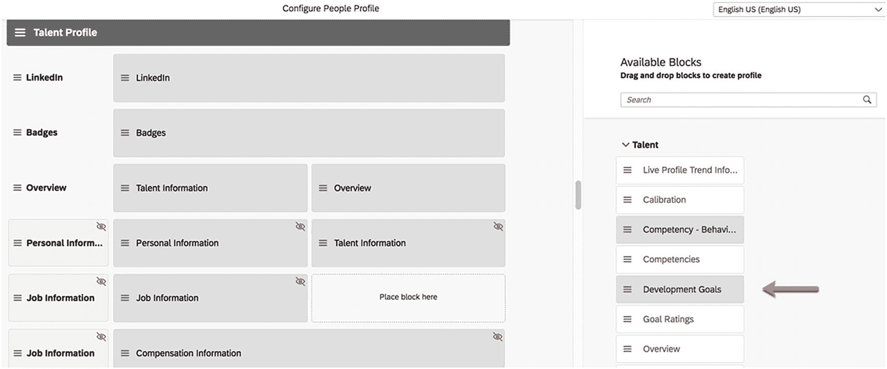

**图 1-37** 在员工个人资料中添加发展计划区块

为子章节添加标签，并添加区块标题和描述，如图 1-38 所示。也可以创建本地化标签。

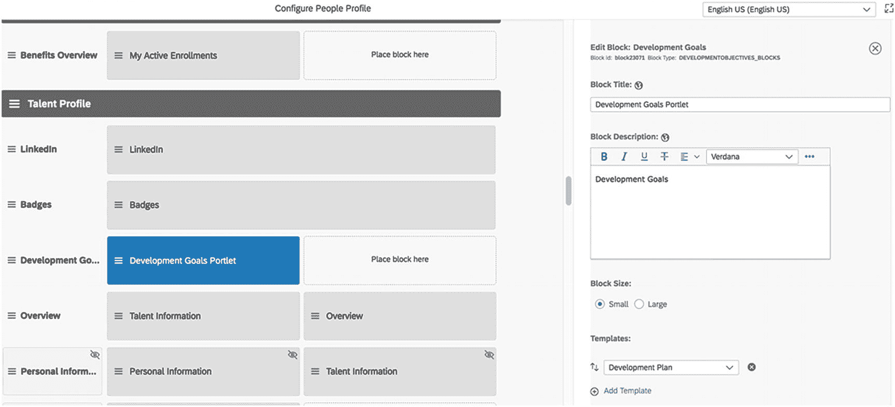

**图 1-38** 标识发展计划模板

添加区块后保存个人资料。需要授予基于角色的权限才能在员工个人资料中访问这些数据。在搜索栏中输入并选择“管理权限角色”。

对于每个应有权访问门户组件的角色，点击“权限”按钮，找到“用户权限”部分，并选择“员工数据”。在“背景”部分中授予对“发展目标门户”的“查看”访问权限，如图 1-39 所示。

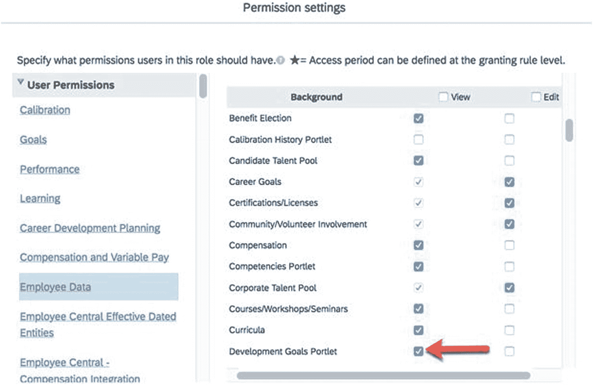

**图 1-39** 访问发展目标门户的权限

我们在本章前面了解过在开发计划 XML 中设置开关，如下所示：

```
<switch name="developmentObjectivePortlet" value="true">
```

当此开关开启时，用户的所有发展目标将显示在员工个人资料中的发展目标门户内。如果未使用此开关，默认设置允许用户选择要在其个人资料门户中添加哪些发展目标。在这种情况下，还需要为此门户组件授予“编辑”权限。示例如图 1-40 所示。

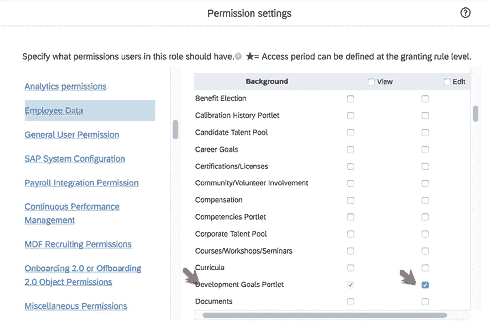

**图 1-40**

当我们以员工身份逐步完成发展计划时，我们将看到其具体工作方式。

## 导入发展目标

有一个发展目标导入工具，可用于批量上传员工发展目标。其工作方式与目标导入相同，但使用的是不同的屏幕和不同的模板。如果您已导入员工目标，则可能已授予管理员权限角色执行此任务的权限；该权限适用于两者。在管理员角色的基于角色的权限中，转到“管理员权限”部分。找到“管理目标”并添加“导入目标”。

可能存在您正从其他发展目标跟踪系统迁移到 SAP SuccessFactors 职业发展系统的情况。在这种情况下，您可能希望将其他系统中的发展目标复制到用户的新发展计划中。导入的另一个用途是为选定的用户分配部门级或公司级的发展目标。

要开始此过程，请在搜索栏中输入并选择“导入发展目标”，将显示导入屏幕，如图 1-41 所示。

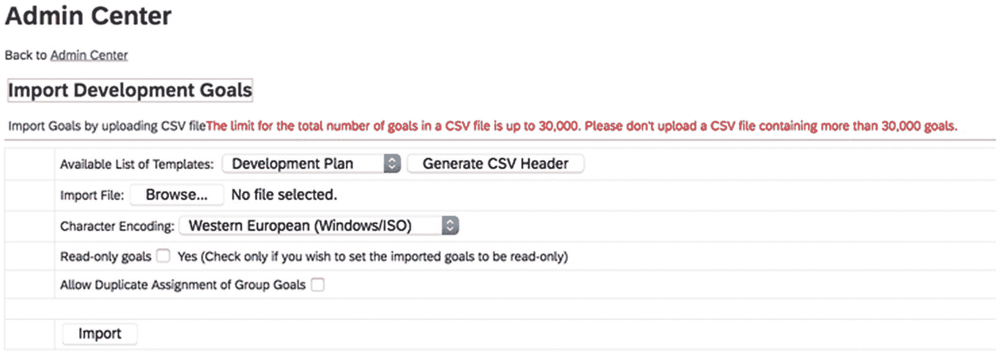

**图 1-41** 导入发展目标屏幕

从可用模板列表中，选择用于您发展计划的发展计划模板，然后单击“生成 CSV 标头”。导入模板将包含您发展计划特有的字段。当您下载 CSV 标头文件时，`OBJ_PLAN_ID` 和 `OBJ_PLAN_NAME` 将包含您的发展计划名称和 ID。

打开模板以查看其布局。示例如图 1-42 所示。


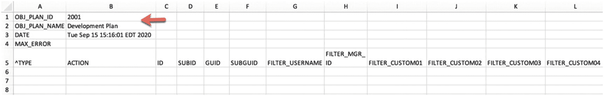

**图 1-42** 发展计划导入模板

前四行不可修改，它们用于标识发展计划。第 5 行包含发展目标计划字段的标题。标题行定义了每个发展目标字段所需的值。如果存在您不填充的标准发展目标计划字段，则可以删除这些列。您需要为每个要导入的发展目标创建一行。

`^TYPE`（A 列）字段始终为必填项。每一行的 `^TYPE` 列都应为 `"OBJECTIVE"`。`ACTION`（B 列）字段始终为必填项。每一行的 `ACTION` 列都应为 `"OBJECTIVE"`。有效的操作类型为 `"ADD"`、`"DELETE"` 和 `"UPDATE"`。如需向员工的目标计划添加目标，请使用 `"ADD"`。创建发展目标时所需的任何字段都必须在文件中填写。

## 导入文件字段说明

有关发展目标计划字段的说明，请参考表 1-9。

**表 1-9** 发展计划导入字段

| 字段 | 说明 | 值 |
| --- | --- | --- |
| `^TYPE` | 上传时使用的计划类型。 | `OBJECTIVE`。 |
| `ACTION` | 对目标执行的操作。 | `ADD`、`DELETE` 或 `UPDATE`。 |
| `ID` | 导入目标时系统生成。 | 对于 `ADD` 操作，请留空。 |
| `SUBID` | 不支持。 | 留空。 |
| `GUID` | 更新或删除目标时用作参考的标识符。 | 可以是任何您想要的值，前提是每个目标的 `GUID` 都是唯一的。 |
| `FILTER_USERNAME` | 您要为其添加目标的员工的用户名。可以通过输入多个用户名来批量分配目标。 | 可以使用分号分隔的多个用户名。若要分配给所有人：`ALL`。 |
| `FILTER_CUSTOM01-15` | 用作筛选条件的自定义字段（数据模型“默认”模块内的自定义筛选器）。 | 如果不需要，可以删除这些列。 |
| `FILTER_DEPT` | 根据用户名的部门进行筛选。 | 列出一个部门，该部门中的每个人都将获得该目标。 |
| `FILTER_DIV` | 根据用户名的分部进行筛选。 | 列出一个分部，该分部中的每个人都将获得该目标。 |
| `FILTER_JOBCODE` | 不支持。 | 留空或删除该列。 |
| `FILTER_LOC` | 根据用户名的工作地点进行筛选。 | 列出一个地点，该地点中的每个人都将获得该目标。 |
| `OBJECTIVE_CATEGORY` | 来自目标模板的默认类别 ID。 | `Goals`。 |
| `OBJECTIVE_PARENTID` | 未使用。 | 留空。 |
| `OBJECTIVE_PUBLIC` | 表示目标是否公开。 | 公开目标使用 `1` 或 `Y`，私有目标使用 `0` 或 `N`。 |
| `OBJECTIVE_name` | 发展目标的名称。 | 使用您希望在计划中看到的发展目标名称。 |
| `OBJECTIVE_metric` | 如果计划中使用，则为发展目标衡量标准。 | 如果在模板中定义为文本或文本域，则可以使用任何文本。 |
| `OBJECTIVE_start` | 如果计划中使用，则为发展目标的开始日期。 | 如果填写，日期必须采用 `MM/DD/YYYY` 格式。 |
| `OBJECTIVE_due` | 如果计划中使用，则为发展目标的截止日期。 | 如果填写，日期必须采用 `MM/DD/YYYY` 格式。 |
| `OBJECTIVE_state` | 如果计划中使用，则为发展目标的状态。 | 如果状态是下拉列表，请使用该状态的枚举值。 |
| `OBJECTIVE_competency` | 如果发展目标关联了能力项。 | 在 JPB 中，找到能力项以获取其 GUID；用逗号分隔列出每个能力项的 GUID。 |
| `OBJECTIVE_purpose` | 如果计划中使用，则为发展目标的目的。 | 如果目的是下拉列表，请使用该状态的枚举值。 |

任何 `FILTER` 列都可用于根据列中输入的值批量分配目标。`FILTER_USERNAME`、`FILTER_MGR_ID`、`FILTER_DEPT`、`FILTER_DIV` 和 `FILTER_LOC` 是默认列。用户名筛选器是唯一支持单行多条目（以分号分隔）的筛选器。用作筛选器的自定义字段必须在数据模型的 `<custom-filters>` 下定义。如果您不希望使用这些筛选器中的任何一个来批量分配目标，则可以从文件中删除这些列。

包含 `"OBJECTIVE"` 的字段标题与发展目标计划上的字段相对应。示例如图 1-43 所示。

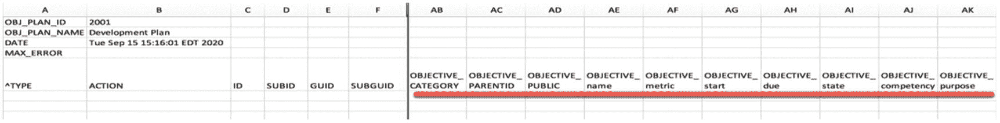

**图 1-43** 发展目标导入标题

如果您的发展计划包含能力项，并且希望导入包含能力项的发展目标，则需要在文件中引用该能力项。此引用是能力项的 `GUID`。

要查找能力项 GUID，请在搜索栏中输入并选择“管理职位档案内容”。然后选择“能力项”，您将看到与每个能力项关联的 `GUID`。示例如图 1-44 所示。

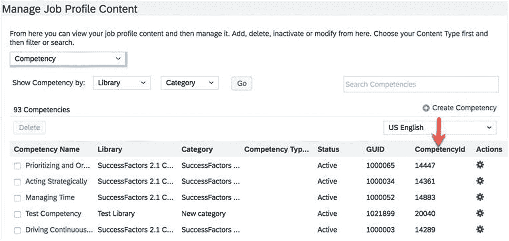

**图 1-44** 管理能力项职位档案内容

对于具有多个能力项的发展目标，请在 `OBJECTIVE_competency` 字段中填入每个能力项 ID，并用逗号分隔。如图 1-45 所示，请确保单元格格式为文本，以便使用逗号分隔符。

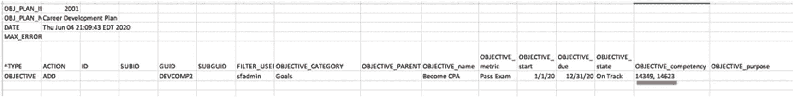

**图 1-45** 导入文件中的能力项列

使用 CSV 文件格式，并以 Unicode (UTF-8) 字符编码导入文件，如图 1-46 所示。

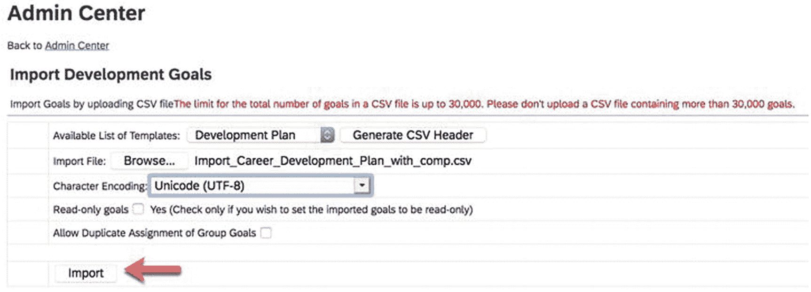

**图 1-46** 发展目标导入

上传完成后，管理员将收到一封包含导入状态的电子邮件。示例如图 1-47 所示。

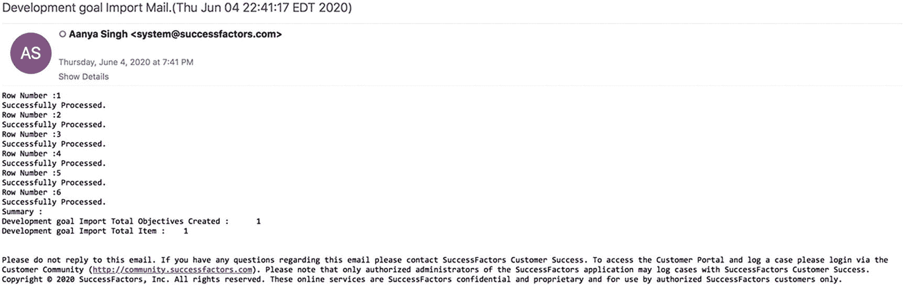

**图 1-47** 发展目标导入状态邮件

该文件将显示导入过程中检测到的任何错误。请更正文件并重新导入。

导入成功后，用户的发展计划将包含新上传的发展目标及其关联的能力项，如图 1-48 所示。

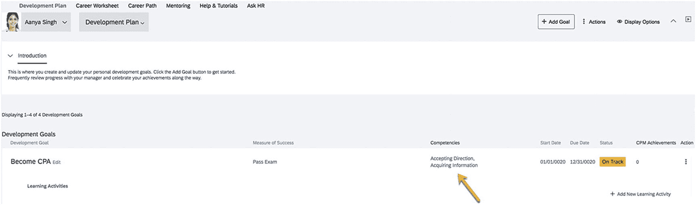

**图 1-48** 通过导入添加的发展目标

## 发展目标的更新或删除

为了批量更新或删除用户发展计划中的任何现有目标，需要系统生成的目标 ID。使用发展计划模板创建一个临时报告，并将发展目标 ID 字段包含在输出中，如图 1-49 所示。

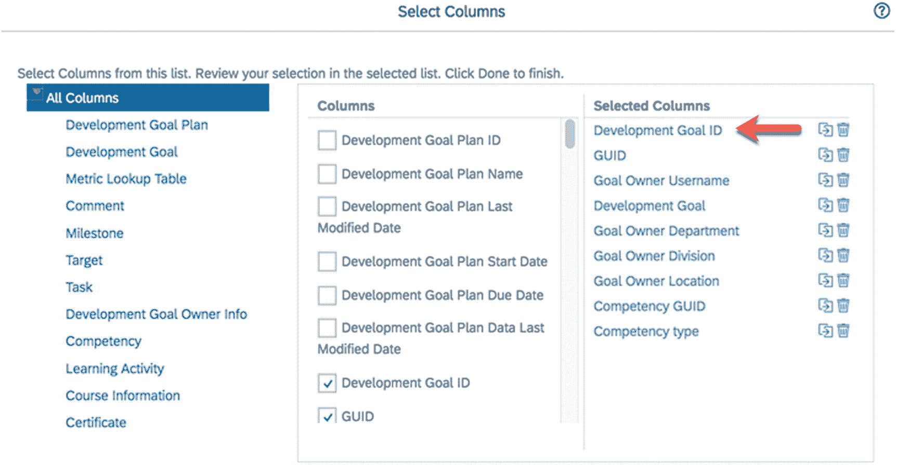

**图 1-49** 临时创建中的发展目标 ID

如图 1-50 所示，要更新任何现有目标，请在 `^TYPE` 列使用 `"OBJECTIVE"`，在 `ACTION` 列使用 `"UPDATE"`。在 C 列使用来自临时报告的发展目标 ID。仅填充要更改的发展目标的相关字段。

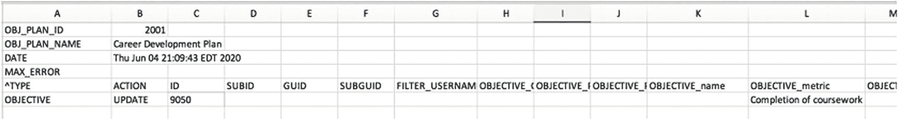

**图 1-50** 发展目标更新字段


要删除任何现有目标，请在`^TYPE`字段中使用`"OBJECTIVE"`，在`ACTION`字段中使用`"DELETE"`，并在 C 列中输入目标 ID。其他字段留空。示例如图 1-51 所示。

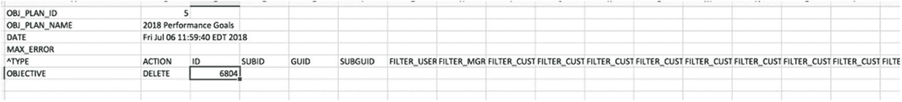

**图 1-51** 删除发展目标的字段

## 导入带有学习活动的发展目标

如前所述，要导入带有学习活动的发展目标，您需要在`Provisioning`中启用`Transcript`功能。在导入文件中，您可以添加、删除和更新自定义学习活动；但无法添加目录学习活动。

在为用户导入新的发展目标时，无法同时包含学习活动。相反，需要进行两次导入。首先，载入新的发展目标。添加发展目标后，获取其 GUID。然后，您就可以载入与该发展目标关联的学习活动了。下载文件的新表头模板。在这里，我们只需填充学习活动专属字段。此外，还需要标识发展目标的用户以及要添加学习活动的发展目标。对于每一行，将`^TYPE`设置为`"LEARNING"`，并将`ACTION`设置为`"ADD"`。包括发展目标的 GUID、必需的学习字段以及其他学习活动字段。

文件示例如图 1-52 所示。

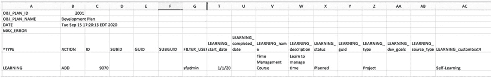

**图 1-52** 包含学习活动的发展计划导入文件

按照相同的发展目标流程操作。包含学习活动的更新后发展目标示例如图 1-53 所示。

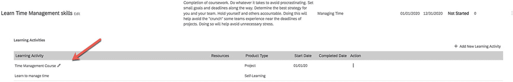

**图 1-53** 在导入文件中添加学习活动

> **注意：** 要了解更多关于导入学习活动的信息，请参阅 SAP 说明 #2472229。

## 从员工角度使用职业发展

我们已经讨论了如何在`Provisioning`和实例中设置职业发展。我们回顾了基于角色的权限，并了解了如何批量导入发展目标、配置`Development Goals Portlet`以及配置学习活动。

现在，我们将演示一个员工使用`Development Plan`的场景。

员工可以从如图 1-54 所示的首页菜单列表中访问`Development`模块。

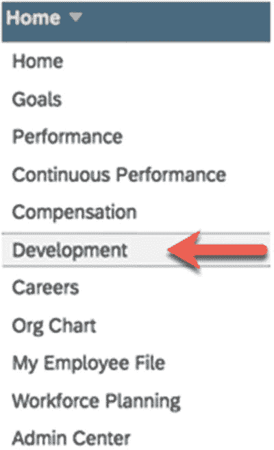

**图 1-54** 带有发展选项卡的首页菜单

将显示`Development Plan`。示例如图 1-55 所示。

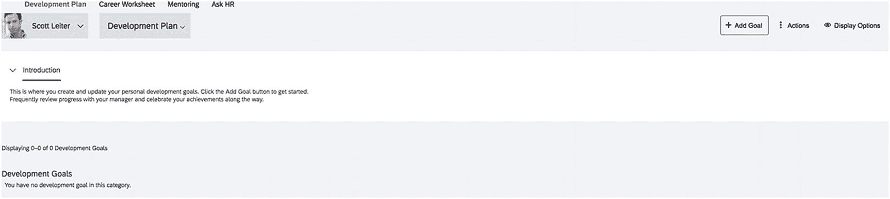

**图 1-55** 空白的发展计划

在添加任何目标之前，用户会看到一个空白的计划，其中包含一个介绍（如果已配置）以及计划顶部的一些选项。发展计划的界面风格与目标计划相同。模板配置将决定计划中可用的布局、权限和操作。有关更多详细信息，请参考第 1 卷第 4 章。

我们首先审查屏幕右上角部分可用的选项。用户可以添加新的发展目标，如图 1-56 所示。与目标计划不同，这里没有可供参考的目标库。


**图 1-56** 添加目标

用户将能够打印该计划，如图 1-57 的“操作”菜单所示。


**图 1-57** 打印操作

如图 1-58 所示，`Display Options`功能允许用户选择要在计划中显示的目标计划字段。可以隐藏某些字段，以使计划看起来更简洁。

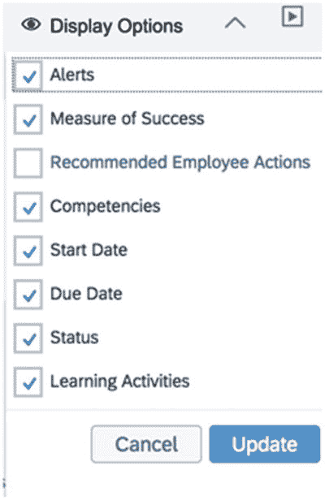

**图 1-58** 发展计划显示选项

用户可以添加发展目标，如图 1-59 所示。弹出窗口将显示模板中配置的所有字段。必须填写所有必填字段才能保存该目标。

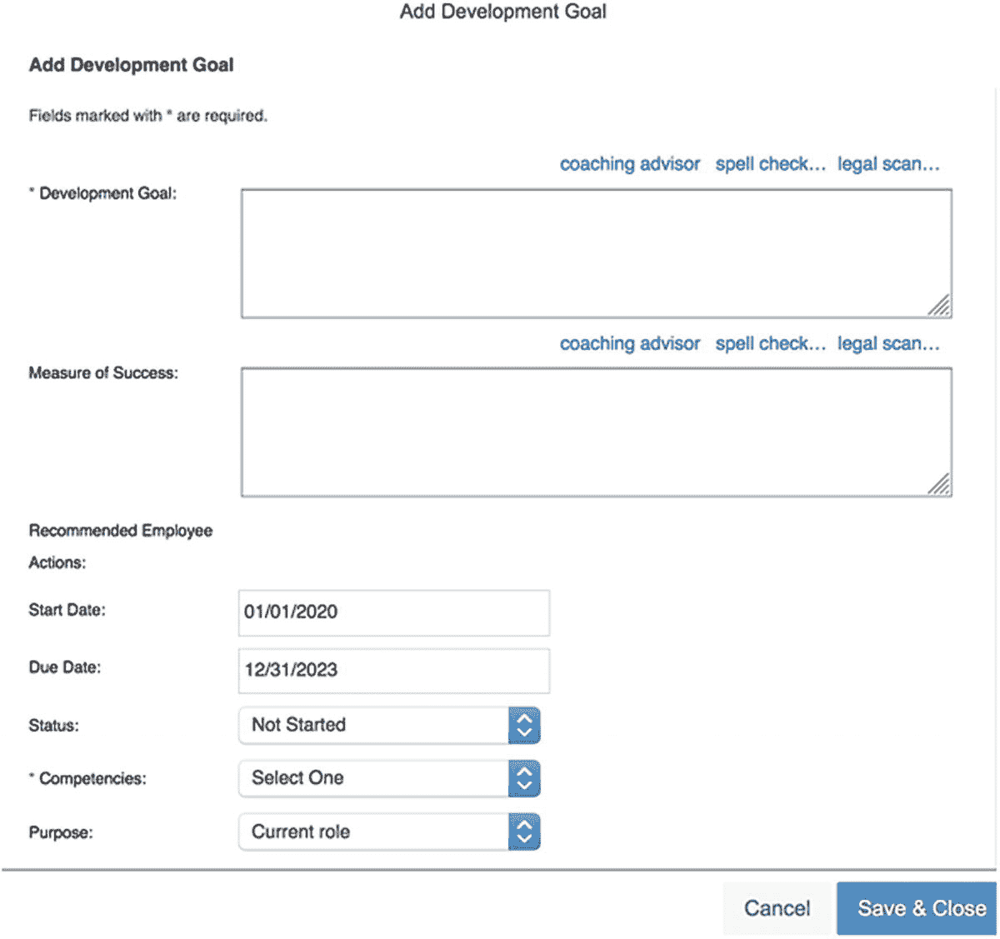

**图 1-59** 向计划添加发展目标

如果发展计划配置为允许向发展目标添加能力，则此选项也会出现。示例如图 1-60 所示。

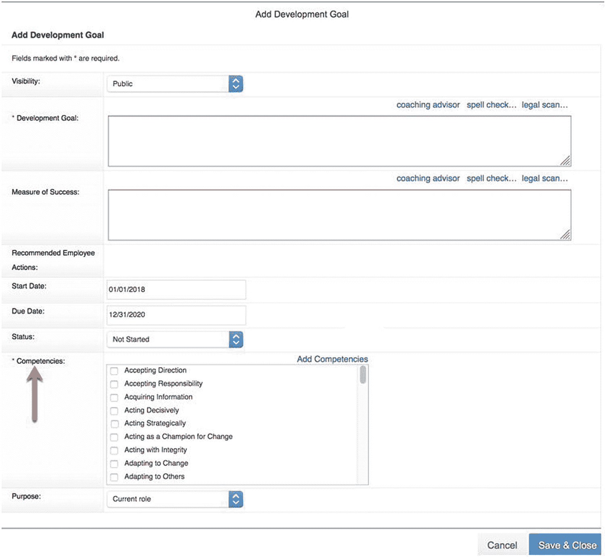

**图 1-60** 向发展目标添加能力

根据默认的能力字段配置，用户可以选择多项能力附加到发展目标上。

还有`"Add Competencies"`选项，允许用户从能力库中添加更多能力，如图 1-61 所示。

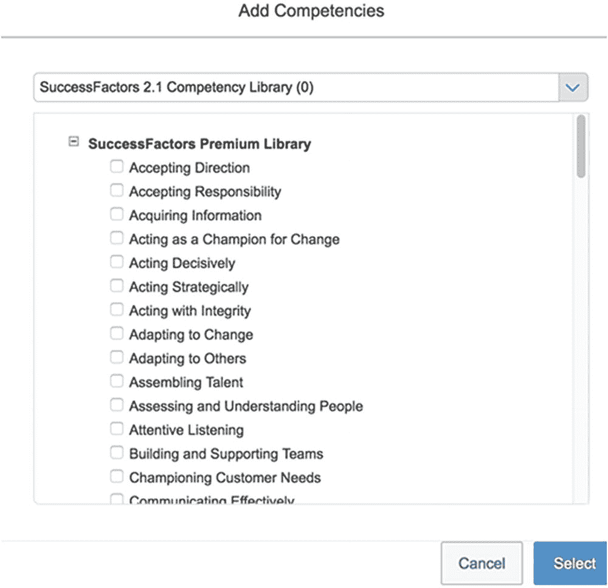

**图 1-61** 从能力库向发展目标添加能力

如果已配置，用户将在该字段看到`"Coaching Advisor"`，如图 1-62 所示。

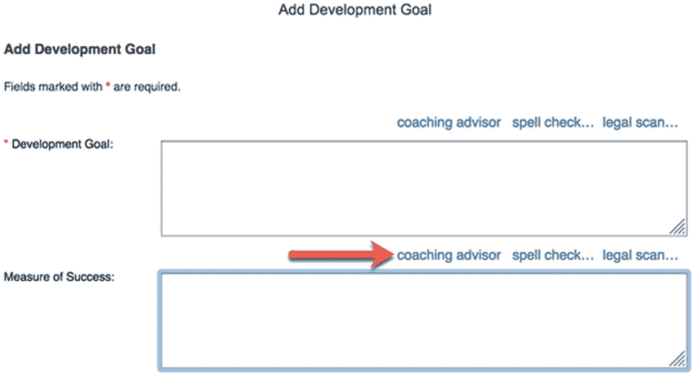

**图 1-62** 辅导顾问

如图 1-63 所示，将出现一个弹出窗口，允许用户选择要查看的能力集。

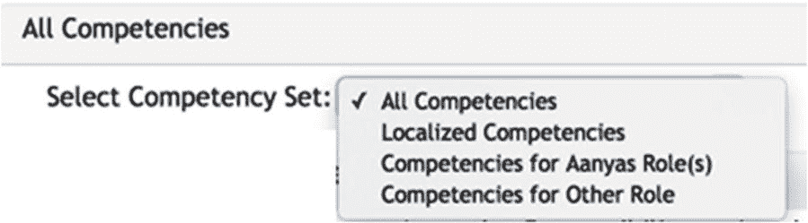

**图 1-63** 为辅导顾问选择能力

选择能力集后，会显示相应的能力。在此示例中，如图 1-64 所示，显示的是与用户工作角色关联的能力。

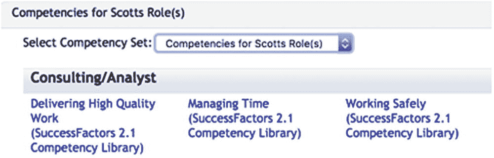

**图 1-64** 工作角色能力

然后，用户可以深入查看某个能力以了解辅导建议。示例如图 1-65 所示。在选择一个能力预览后，用户向下滚动以查看相应的辅导建议。

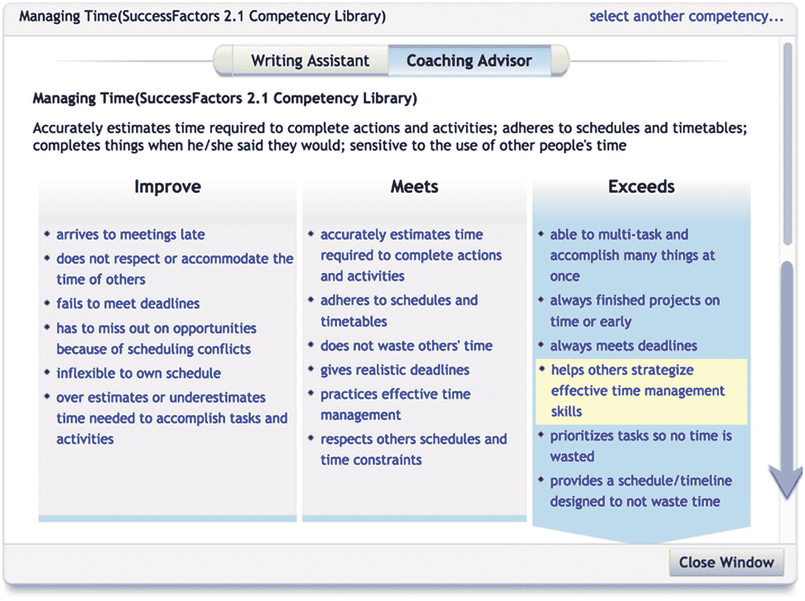

**图 1-65** 辅导建议

用户可以通过点击`"Place Text"`按钮添加辅导建议，如图 1-66 所示。

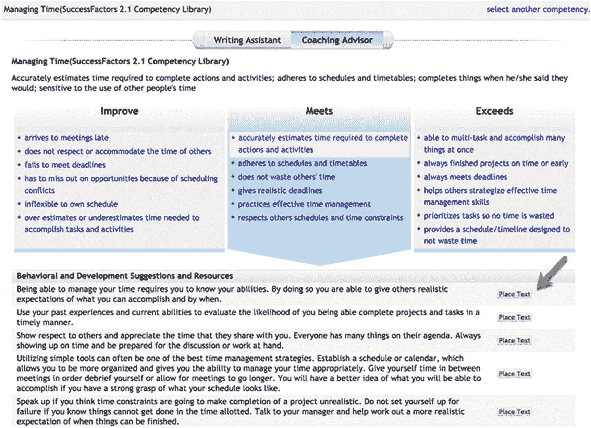

**图 1-66** 选择要添加到发展目标的文本

系统将显示一条确认消息，表明该文本已添加到发展目标的字段中，如图 1-67 所示。


**图 1-67** 确认消息


随后，用户关闭弹出窗口，文本将显示在目标计划字段中，如图 1-68 所示。

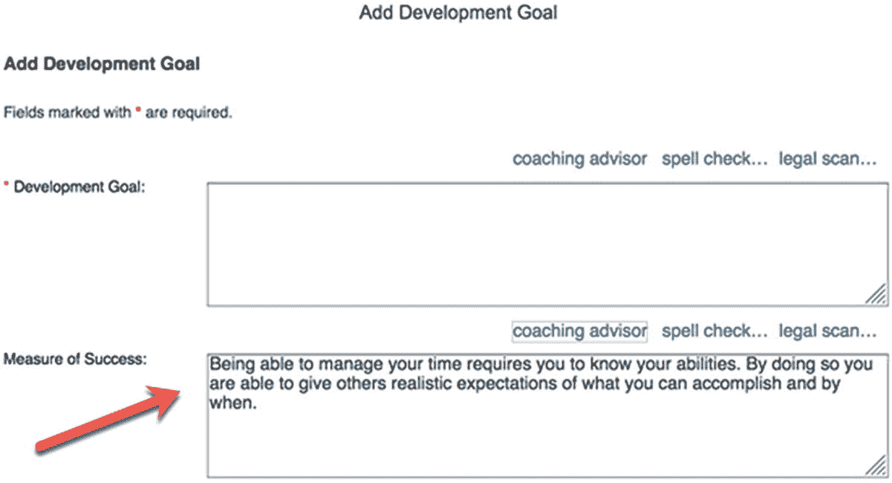

**图 1-68**  
为发展目标添加辅导建议

用户可以编辑添加到发展目标中的辅导建议措辞。更新后的发展目标如图 1-69 所示。

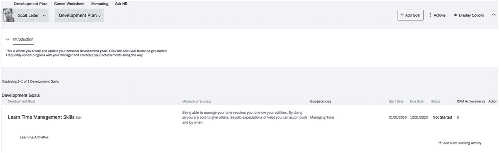

**图 1-69**  
添加辅导建议后的发展目标

## 发展规划中的 CPM 成果

如果发展目标与持续绩效管理（CPM）成果相关联，用户可引用发展规划来链接到某项活动或成果。如图 1-70 所示，用户可以将发展目标关联到 CPM 活动和成果。

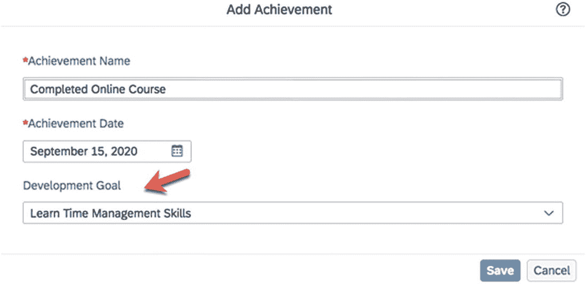

**图 1-70**  
将发展目标关联到 CPM 活动或成果

如果用户已将发展目标附加到 CPM 成果，则“CPM 成果”列将显示一个计数。示例如图 1-71 所示。

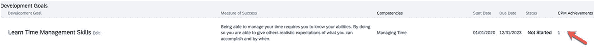

**图 1-71**  
发展目标上的 CPM 成果详情

点击“CPM 成果”列中的数字将显示成果详情，如图 1-72 所示。

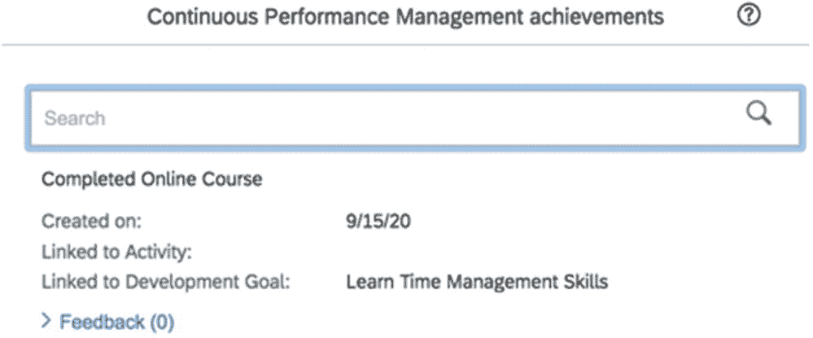

**图 1-72**  
CPM 成果详情

根据发展规划模板 XML 中配置的操作权限，用户可以编辑或删除目标、添加学习活动，或将目标添加到其个人资料中的“发展目标 Portlet”中。这些选项将显示在“操作”列下，如图 1-73 所示。

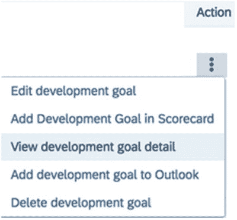

**图 1-73**  
发展目标的可用操作

## 关联到发展目标的学习活动

如果将学习活动配置为发展规划的一部分，用户将能够添加学习活动。示例如图 1-74 所示。

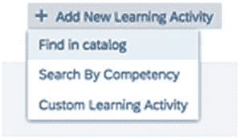

**图 1-74**  
为发展目标添加学习活动

如果将 LMS 目录配置为可在发展规划中供用户使用，则用户可以前往 LMS 目录查找课程。示例如图 1-75 所示。

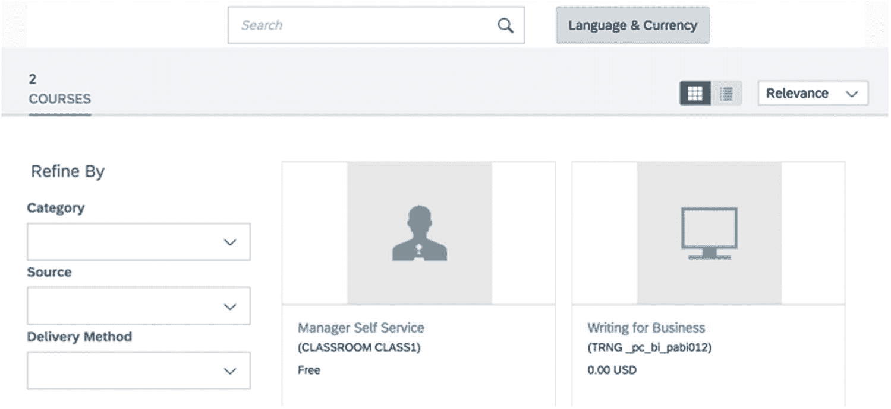

**图 1-75**  
在 LMS 目录中搜索课程

用户可能可以选择向发展目标添加自定义学习活动，如图 1-76 所示。

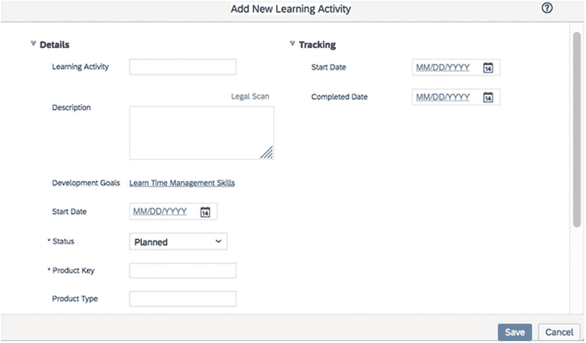

**图 1-76**  
向发展目标添加学习活动

自定义学习活动的布局基于学习活动模板 XML。一个发展目标可以添加多个学习活动。用户可以根据发展规划模板 XML 中配置的权限来编辑、查看或删除目标。用户可以通过“操作”或点击铅笔图标进行编辑来删除自定义学习活动。

详情如图 1-77 所示。


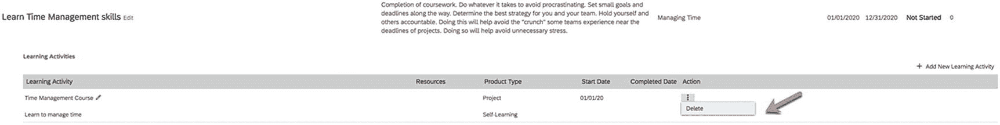

图 1-77
删除学习活动

## 档案中的发展目标

根据`发展计划 Portlet`的配置，用户可以向其档案添加发展目标，否则系统会自动将其添加到该 Portlet 中。操作选项如图 1-78 所示。在以下示例中，用户可以选择一个要添加到 Portlet 中的发展目标。

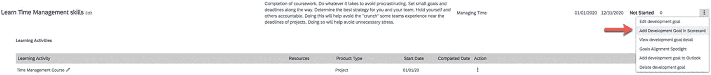

图 1-78
向发展计划 Portlet 添加发展目标

如前所述，当在开发计划模板 XML 中添加了开关后，用户将无法选择在档案的`发展目标 Portlet`中显示哪些发展目标。添加到其计划中的所有发展目标都将自动添加到其档案的 Portlet 中。“在记分卡中添加发展目标”选项将不再显示为发展目标的可用操作。

图 1-79 显示了出现在`员工档案`中的 Portlet 示例。

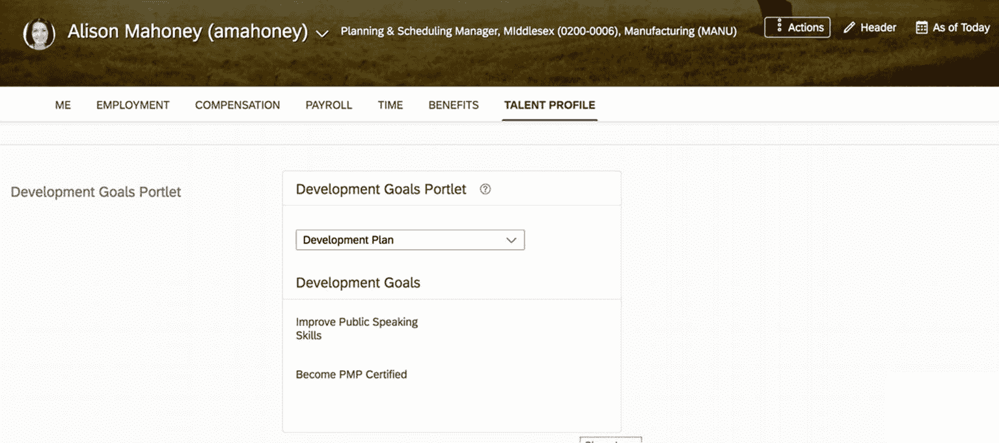

图 1-79
发展目标 Portlet

如果未设置开关，并且用户可以直接在此 Portlet 中添加发展目标，`发展目标 Portlet`不支持添加自定义学习活动或按能力进行搜索。

## 查看他人的发展计划

如果发展计划模板 XML 为所有角色授予了目标计划字段的读取权限，则在基于角色的权限允许下，用户将能够查看他人的计划。当用户查看自己的发展计划时，他们可以执行姓名搜索来查找其他用户，以便查看其计划。

在此示例中，如图 1-80 所示，用户可以进入自己的发展计划，执行姓名搜索，并查看他人计划的内容。

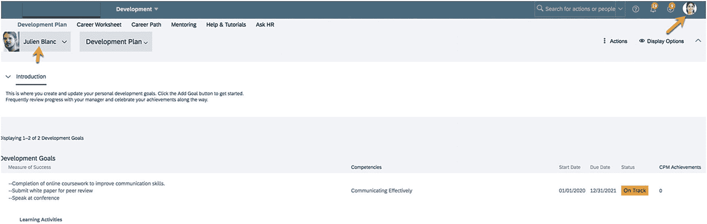

图 1-80
员工查看其他用户的发展计划

## 从管理者角度使用职业发展

管理者将能够通过姓名搜索访问其直接下属的目标计划，如图 1-81 所示。


图 1-81
管理者搜索直接下属

发展计划模板 XML 的权限决定了管理者能看到什么以及可以执行哪些操作。可以允许管理者创建、编辑和删除目标。权限可能只允许他们编辑某些字段，或者不允许他们添加学习活动。

如果管理者权限角色可以访问所有层级，那么上级管理者也将能够访问该目标计划。

如果`HR 经理`角色已更新为允许其访问所支持的任何用户，那么他们将能够访问这些用户的计划。根据 XML 中的权限，`HR 经理`可能能够编辑、删除或添加发展目标，或者可能只有“读取”权限，并且对其可以查看的字段有限制。

现在，我们已经回顾了发展目标计划的配置，并逐步了解了发展计划的工作原理。接下来，我们将简要介绍报告选项。

## 报告：标准报告

发展目标报告可在“经典视图”下的“标准报告”中找到。选择“发展目标”，如图 1-82 所示。

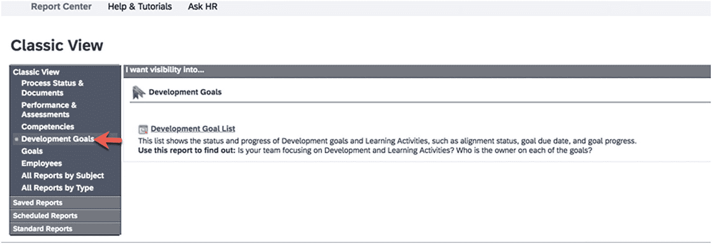

图 1-82
经典视图中的发展目标列表

在这里，您将找到唯一的标准发展计划相关报告。

现在点击“目标”，如图 1-83 所示。

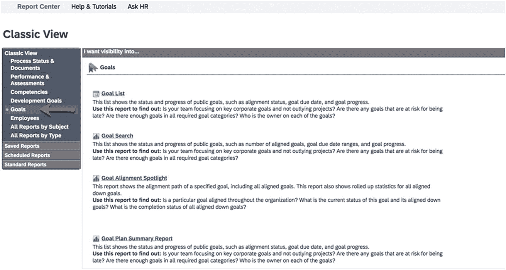

图 1-83
目标列表

许多标准的`目标管理`报告可用于发展目标报告。在报告的筛选选项中，选择您想要报告的发展计划。

使用`目标搜索`报告来报告学习活动。选择包含学习活动的发展目标计划，并确保您的导出选项包含活动级别数据。但是，当启用`成绩单`功能时，经典报告不支持报告学习活动。

## 报告：即席报告

即席报告可以包含学习活动、能力以及发展目标计划数据。

在创建即席报告时，使用`发展目标`域，如图 1-84 所示。

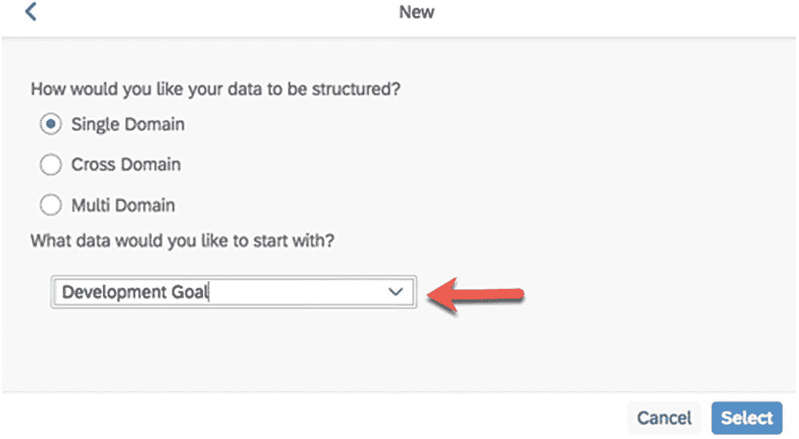

图 1-84
使用发展目标域创建即席报告

如果为发展目标数据授予了即席创建权限，那么`HR 经理`或管理者可以为其目标群体创建或运行发展计划即席报告。

作为管理员，您可以创建即席报告，这些报告将对`HR 经理`和管理者可用，以便他们可以为其目标群体运行发展报告。在通过向导创建即席报告时，在`人员`选项卡中，选择“已登录用户”以及管理者应该有权访问的层级数。示例如图 1-85 所示。

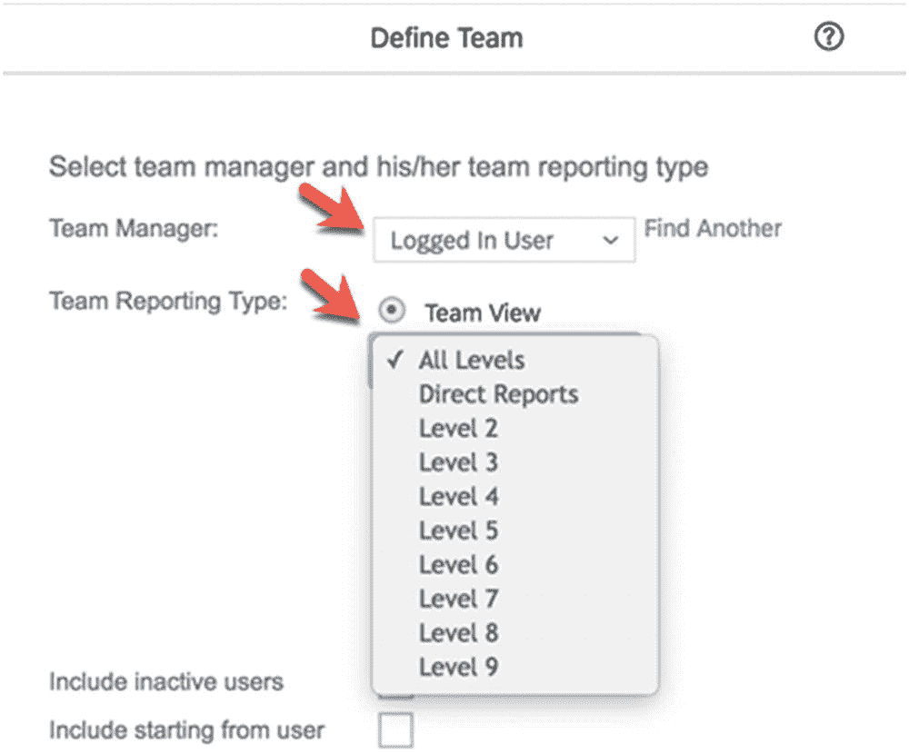

图 1-85
选择报告类型

当管理者运行此报告时，结果将仅显示其团队中的员工。

如图 1-86 所示，有许多字段可以用于报告。

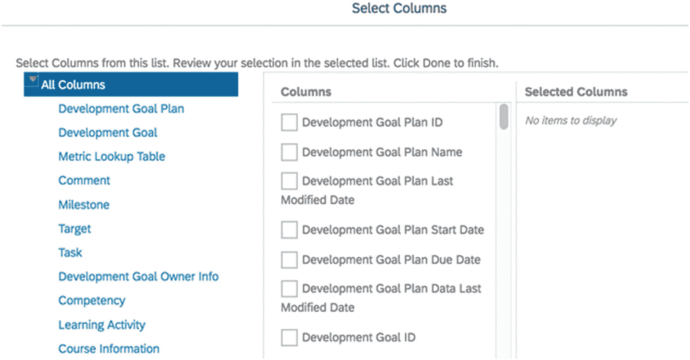

图 1-86
发展计划字段

为管理者提供即席报告，使他们能够轻松查看哪些员工创建了发展目标，并跟踪目标的进展情况。

> **注：** 要了解有关即席报告的更多信息，请参阅 SAP 说明 #2536445。

## 发展计划的其他用途

有许多接触点可以利用发展计划目标数据。我们已经看到可以添加到`员工档案`中的`发展计划 Portlet`，并了解了 CPM 成就如何与发展目标关联并显示在用户的发展计划上。我们将回顾其他一些集成领域。

### 与绩效管理表单的集成

绩效表单可以配置为包含发展目标。包含后将在绩效表单上创建一个发展计划部分。发展目标不进行评级，但为了规划目的，将此部分纳入绩效表单可能会有所帮助。用户可以在其绩效表单上添加发展目标，该目标也将流入其发展计划。示例如图 1-87 所示。

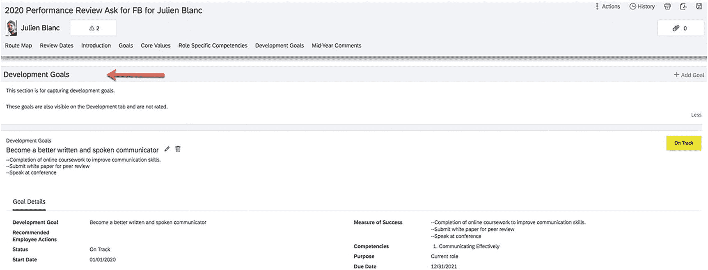

图 1-87
包含发展目标部分的绩效表单

请回看第 1 卷第 7 章，以了解将发展目标纳入绩效评估模板所需的设置。


  
## 开发计划与 360 度评估的集成

`360 度评估表`可生成包含开发目标引用和链接的报告。在表单中启用此功能后，链接将使用默认的开发计划。该链接适用于`排名视图`和`摘要视图`，但`盲点`、`隐藏优势`和`差距分析视图`不支持此功能。更多信息请参阅第 1 卷第[12](https://doi.org/10.1007/978-1-4842-6995-4_12)章。

## 开发计划与校准的集成

在校准会议中，可以查看员工的开发计划。如图 1-88 所示的`列表视图`中，点击员工的“更多”图标即可显示可用选项。

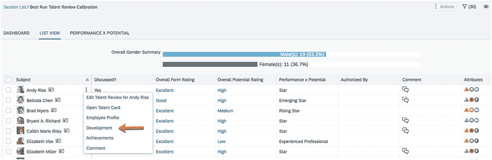

**图 1-88**  
在校准会议中链接到开发计划

点击“发展”将弹出一个窗口，显示校准对象的开发计划。请参阅第 1 卷第[14](https://doi.org/10.1007/978-1-4842-6995-4_14)章了解如何启用此选项。

## 职业发展计划与继任管理的集成

在`继任管理`模块中，可在`继任者`卡片中查看开发计划，如图 1-89 所示。


**图 1-89**  
从继任者卡片链接到开发计划

有关`继任者`卡片配置的更多信息，请参阅第 6 章。

## 与职业工作表中能力关联的开发目标

只要您的开发目标计划使用了能力，您就可以将开发目标添加到员工职业工作表的工作角色能力中，如图 1-90 所示。


**图 1-90**  
开发目标与职业工作表上的能力关联

添加到工作表能力上的开发目标随后会作为开发目标出现在用户的计划中，并关联相应能力。您将在第 2 章和第 3 章中了解更多关于此功能的信息。

