# 7. 继任管理其他功能

## 继任管理

在本章中，我们将介绍继任管理模块（`SCM`）的其余功能。这些功能允许您以多种有用的方式查看和组织人才与继任数据。首先介绍的是人才搜索（`Talent Search`），它允许您通过搜索任意人才字段来查找员工。然后介绍人才库（`Talent Pools`），它允许您将这些员工组织成逻辑分组。接下来介绍职位磁贴视图（`Position Tile View`），它提供了一种继任组织图之外的职位查看方式。随后介绍世系图（`Lineage Chart`），它展示了继任规划者的“假设”继任场景。最后，我们以继任演示（`Succession Presentations`）作为结尾，该功能帮助规划者使用实时人才管理数据进行高质量的演示。我们将继续使用第 5 章中描述的样板公司示例，为每个功能提供实际示例。

## 人才搜索

人才搜索（`Talent Search`）允许最终用户在其安全权限范围内，通过任何人才字段搜索员工。此外，用户还可以下载搜索结果、比较员工、进行继任提名和人才库提名等。本节将向您展示如何配置该功能并以最终用户身份运行它。

### 配置人才搜索的先决条件

在能够配置和运行人才搜索之前，必须设置以下设置和权限。此外，请确保您的员工人才档案（`Employee Talent Profile`）已在数据模型中配置。更多信息，请参见第 1 卷的第 2 章。

#### 人才搜索所需的配置设置

请按照以下步骤在配置（`Provisioning`）中启用人才搜索。这些步骤必须在安全设置和其他配置设置之前完成：

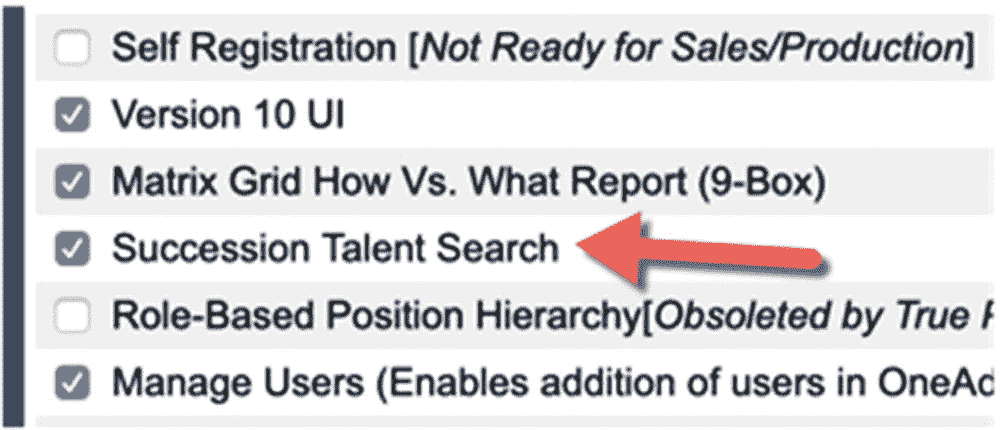

**图 7-1** 继任人才搜索配置设置

1. 登录配置（`Provisioning`）并选择您的公司实例。

2. 导航至公司设置（`Company Settings`），并勾选“继任人才搜索”（`Succession Talent Search`）复选框，如图 7-1 所示。点击保存（`Save`）。

3. 如果您希望使用选项关键字搜索（`keyword search`），该搜索可在所有可用字段中执行快速搜索，而不是仅针对单个字段进行关键字搜索，请执行以下额外步骤：
   1. 在数据模型 XML 中为您希望设为可搜索的所有字段添加读取（`Read`）权限。更多信息，请参见第 1 卷第 2 章。
   2. 在配置（`Provisioning`）中，转到搜索索引（`Search Index`）并生成索引（即使是合作伙伴，您也没有权限访问此功能，需要联系 SAP 进行首次索引）。

#### 人才搜索所需的权限设置

请按照以下步骤确保您拥有人才搜索的适当权限：

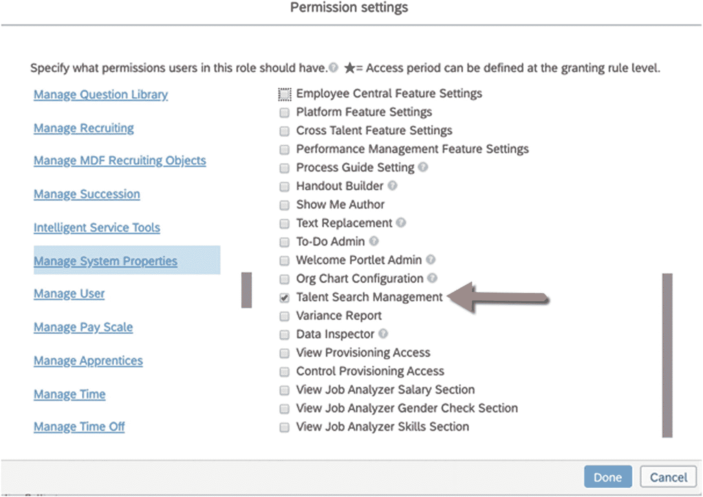

**图 7-2** 启用人才搜索配置的权限

1. 在搜索栏中输入并选择“管理权限角色”（`Manage Permission Roles`）。

2. 屏幕加载后，点击您要修改的角色。然后点击“权限...”（`Permission…`）。

3. 确保您分配的角色上已激活如图 7-2 所示的以下权限，以启用人才搜索配置：管理系统属性（`Manage System Properties`）➤ 人才搜索管理（`Talent Search Management`）。

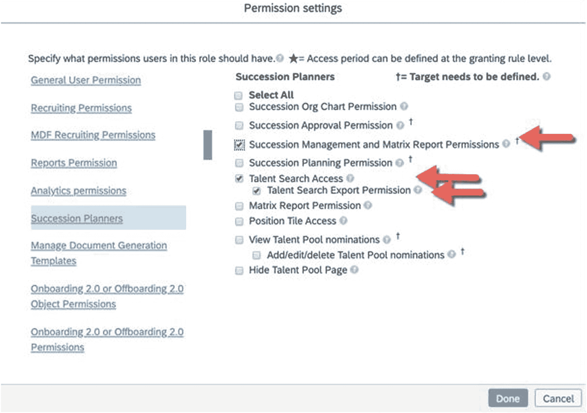

**图 7-3** 最终用户启用人才搜索的权限

1. 确保您分配的角色上已激活如图 7-3 所示的以下权限，以启用最终用户的人才搜索功能：继任规划者（`Succession Planners`）➤ 人才搜索访问（`Talent Search Access`）。如果您希望下载搜索结果的导出文件，可以额外添加人才搜索导出（`Talent Search Export`）权限。点击“完成”（`Done`）。请确保也在主屏幕上保存您的角色。

> **注意**
> 您在第 5 章中添加的继任管理和矩阵报告权限（`Succession Management` 和 `Matrix Report Permissions`）也需要启用。与此权限关联的已分配用户组将决定您可以搜索哪些员工。

### 配置人才搜索

现在所有先决条件的配置和权限都已分配完毕，我们可以访问人才搜索设置（`Talent Search Settings`）配置屏幕。请按照以下步骤完成配置：

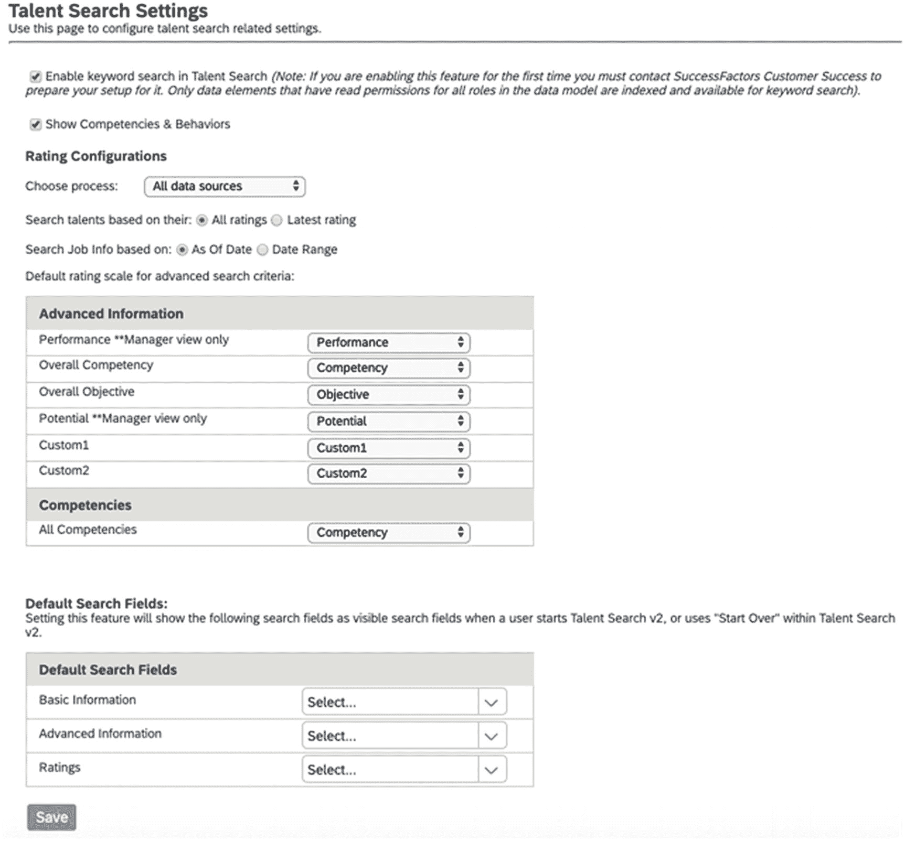

**图 7-4** 人才搜索设置屏幕

1. 在搜索栏中输入并选择“人才搜索设置”（`Talent Search Settings`）以访问配置屏幕。屏幕将如图 7-4 所示加载。

2. 如果您希望启用本节前面提到的简单关键字搜索，请勾选“在人才搜索中启用关键字搜索”（`Enable keyword search in Talent Search`）。
   > **注意**
   > 我们建议启用此选项，因为它可以节省最终用户构建查询的时间。此外，用户可能不知道数据模型结构中特定字段的位置。这样，用户无需深入了解这些结构也能进行搜索。

3. 如果您希望在搜索中包含能力项，请勾选“显示能力与行为”（`Show Competencies & Behaviors`）。
   > **注意**
   > 如果您的组织使用能力项，我们建议启用此选项，因为这是将能力项纳入搜索的唯一方法。

4. 对于“选择流程”（`Choose process`）字段，选择“所有数据源”（`All data sources`）或您配置的某个流程。
   > **注意**
   > 我们建议您镜像上一章矩阵网格配置中为数据源选择的相同配置，以保持最终用户使用的一致性。

5. 为“搜索人才基于”（`Search talents based on their`）字段选择一个值。“所有评级”（`All ratings`）将包含所有评级，而“最新评级”（`Latest rating`）仅包含最新评级。
   > **注意**
   > 我们建议将此设置为“最新评级”（`Latest rating`），以便显示最相关的评级，除非资源有特定需求需要搜索历史分数。

6. 为“搜索职位信息基于”（`Search Job Info based on`）字段选择一个值。选择“截至日期”（`As Of Date`）将提供一个日期字段，员工在搜索时必须在该日期担任该职位；而选择“日期范围”（`Date Range`）将提供两个日期字段，员工可以在这些日期之间的任意时间担任该职位。
   > **注意**
   > 我们建议使用“日期范围”（`Date Range`）选项，因为它提供了更大的灵活性。

7. 为每种高级信息搜索的默认评级量表选择一个值。这允许您从矩阵网格配置或绩效评级量表中的任何设置中进行选择。
   > **注意**
   > 我们建议这些设置与您在矩阵网格配置中的设置一致，除非您未进行此类配置。

8. 选择页面首次加载或用户点击“重新开始”（`Start Over`）时希望显示的默认搜索字段。
   > **注意**
   > 我们建议在此处不设置任何默认字段。

9. 点击“保存”（`Save`）。

### 运行人才搜索

现在所有配置和权限均已设置完毕，我们可以运行人才搜索了！请按照以下说明进行人才搜索：

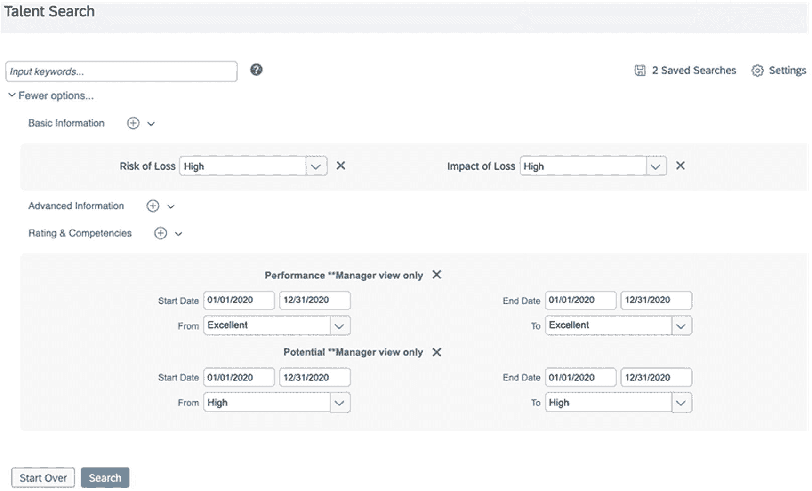

**图 7-5** 人才搜索选择条件屏幕

1. 在搜索栏中输入并选择 `Talent Search`（人才搜索），即可加载如图 7-5 所示的人才搜索界面。

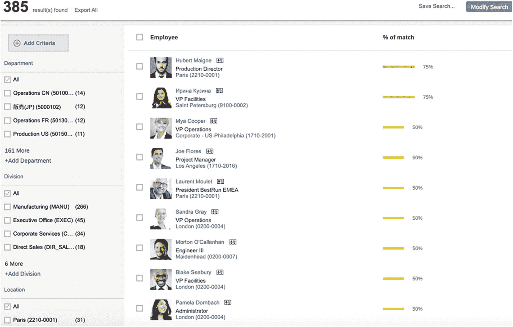

**图 7-6** 人才搜索结果界面

1.  如果已配置关键词搜索，您首先看到的将是一个按关键词搜索的字段。此字段用于在所有可用字段中执行快速搜索，而非仅针对单个字段的关键词搜索。它便于快速搜索，但不如单独选择字段精确。在此输入关键词，或点击 `More options…`（更多选项...）展开界面以分别搜索各个字段。如果您使用引号将词组括起来，系统将按“与”逻辑处理这些词；而不使用引号则采用“或”逻辑。

2.  如果您按字段分别搜索，请点击要搜索的信息类型旁的 `+` 图标：

    - **基本信息**：此区域列出了数据模型 XML 中的所有基本字段。在每个选定字段旁输入搜索文本。

    - **高级信息**：此区域列出了来自您已配置数据模型的后台元素（无论 XML 中设置的权限如何），以及您的人才库（有关人才库的更多信息，请参阅下一节）。您需要根据配置选项选择 `As Of Date`（截至日期）或 `Date Range`（日期范围）。后台元素允许您搜索后台元素中的每个单独字段。人才库则允许您从人才库列表以及您在 `MDF` 对象中可能配置的其他字段中进行选择（有关如何配置 `MDF` 对象，请参阅下一节）。

    - **评级与能力**：此区域允许您选择绩效、潜力、目标及能力等级。选择类型，然后从评分量表中选取高值和低值。如果您想选择单项能力，请点击 `Competencies…`（能力...）；在弹出的窗口中，从您选择的库中选择一项能力，然后点击 `Select`（选择）。

3.  在运行搜索之前，请点击 `Settings`（设置）图标，从以下选项中选择：

    - **运行时使用的角色**：您可以选择用于查询的权限角色。例如，如果您既是一名经理又是 HR 管理员，您可能同时拥有两个角色。HR 管理员角色将返回您作为 HR 负责人的所有员工结果，而经理角色则将返回您作为其经理的所有员工结果。

    - 勾选 `Make All Criteria Optional`（使所有条件为可选）复选框将使搜索具有包容性，而不勾选则使搜索具有排他性。

4.  您也可以通过点击 `Save`（保存）图标来调用已保存的搜索。

5.  如果您想将搜索界面重置为默认搜索条件，请点击 `Start Over`（重新开始）。

6.  当您准备执行搜索查询时，点击 `Search`（搜索）。将显示一个类似于图 7-6 的结果界面。

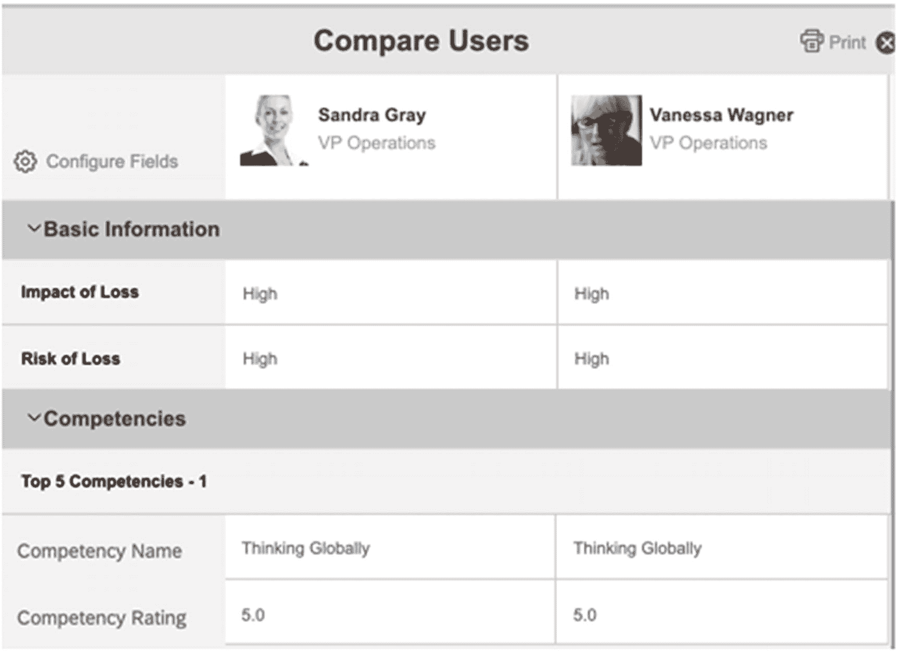

**图 7-7** 用户比较弹出窗口

1.  结果界面显示了一份员工列表，以及根据您在前一界面中定义的条件计算出的匹配百分比。左侧是用于细化当前搜索结果的筛选条件：

    - 点击员工的姓名可打开该员工的快速信息卡。

    - 点击百分比可查看员工与搜索条件匹配的详细信息。

    - 点击 `Add Criteria`（添加条件）可添加额外的筛选条件。

    - 勾选左侧条件旁的复选框，可立即细化搜索。

    - 点击 `Export All`（全部导出）可打开“导出”弹出窗口。您可以为导出文件命名，并选择要包含的字段。点击 `Export`（导出）即可生成 `.xls` 格式的导出文件。

    - 点击 `Save Search`（保存搜索）可将这些搜索条件列在您的已保存搜索中（位于选择条件界面上）。

    - 点击 `Modify Search`（修改搜索）可返回选择条件界面。

    - 勾选您要选择的每位员工旁的复选框。选择界面的顶部将出现一个菜单，包含以下选项：

        - **添加到人才库**：选择此选项将打开一个弹出窗口，允许您从现有的人才库中进行选择。您可以根据您的人才库 `MDF` 配置添加就绪水平、备注等。点击 `Nominate`（提名）将员工添加到人才库。

        - **导出**：将打开与“全部导出”相同的“导出”弹出窗口，但仅导出所选员工。点击弹出窗口中的 `Export`（导出）即可下载 `.xls` 文件。

        - **比较**：这将打开一个弹出窗口，如图 7-7 所示，显示所选员工在您选择条件的每个字段上的并排比较。您可以点击 `Configure Fields`（配置字段）调出另一个弹出窗口，允许您即时添加任何您可能想要考虑的额外字段（非常酷！）。您还可以点击 `Print`（打印）打开一个可发送到打印机的打印预览页面。

2.  `Nominate`（提名）：在“`Nominate employees for`（提名员工至...）”字段中输入职位名称或编号，以提名所选员工担任该职位。根据您的继任提名配置（请参阅下一节）选择就绪水平和排名，以及在“`Notes`（备注）”字段中为每位员工添加备注。点击 `Nominate`（提名）完成操作。

至此，我们已经逐步介绍了运行人才搜索的所有步骤。现在，让我们回顾一下我们模型公司的例子。就我们的示例而言，此功能允许 HR 管理员或总裁定期搜索那些流失风险高、流失影响大，且位于九宫格（参见前图的示例）中最高绩效和潜力格中的员工。通过这种方式，HR 管理员或副总裁可以识别出我们示例中的销售高级副总裁可能即将离开公司！然后，他们可以主动与销售高级副总裁合作，为其制定针对总裁职位的培养计划，同时为销售高级副总裁寻找继任者，而不是让销售高级副总裁的离开成为意外。接下来，我们将探讨如何将我们的搜索结果组织到人才库中。

## 人才库

`人才库`允许用户为人才管理目的创建有组织的员工分组。它们通过允许更通用的分组，为针对特定职位的继任规划提供了备选方案。它们还可用于非继任相关需求，如发展规划、轮岗计划或高潜人才库。人才池也可以与职位关联，例如，如果组织内有多名员工可能符合我们模型公司销售高级副总裁职位的资格，这些员工和职位的分组就可以通过人才池连接在一起！`MDF` 人才池利用元数据框架（`MDF`）使这些分组更有组织性。`MDF` 允许系统配置员详细说明人才池对象的数据结构，并允许详细的权限角色分配。在本节中，我们将介绍如何配置和使用人才库。

> **注意**：将不介绍传统人才库，因为它们不再是配置系统的合理选择，并且已进入 SAP 的维护终止阶段。

### 配置和使用人才库的先决条件

在能够配置和使用人才库之前，请确保本节中的要求和步骤已完成。

> **注意**

在执行这些配置步骤之前，我们假设已在配置中启用了 `MDF`。

### 升级中心

如果您的系统中尚未激活“人才库”，请按照以下步骤进行激活：

1.  在搜索栏中输入并选择“升级中心”。

2.  从列表中选择“基于新 `MDF` 人才库的继任计划”，然后按照屏幕提示进行操作。

### 配置器权限

在配置人才库之前，请确保您分配的角色权限下拥有“管理员权限” ➤ “元数据框架”权限，如图 7-8 所示（`Configure Object Definitions`， `Manage Data`， `Configure Business Rules`， `Access to non-secured objects`， `Import Permission on Metadata Framework`， `Admin access to MDF OData API`， `Manage Configuration UI`， `Manage Positions`， `Manage Sequence`）。

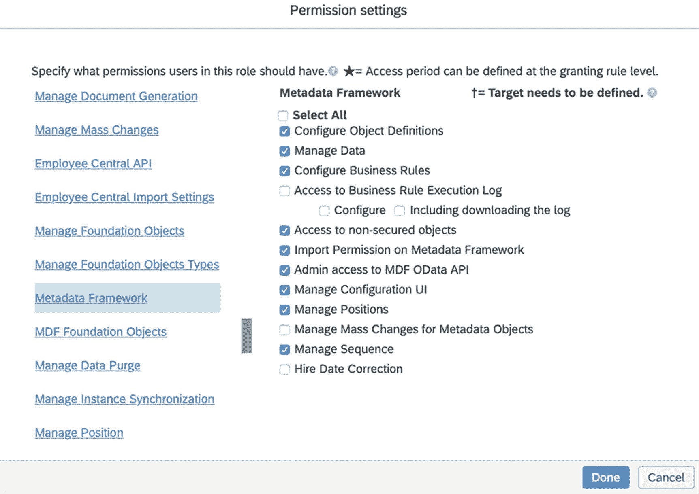

*图 7-8 管理员权限 ➤ 元数据框架权限*

**注意**

与其他部分不同，我们将配置器权限与用户权限分开说明。这是因为 `MDF` 结构应在用户权限之前定义，因为用户权限依赖于 `MDF` 配置。

此外，请确保已在“管理继任计划”下选中“人才库字段配置”，如图 7-9 所示。

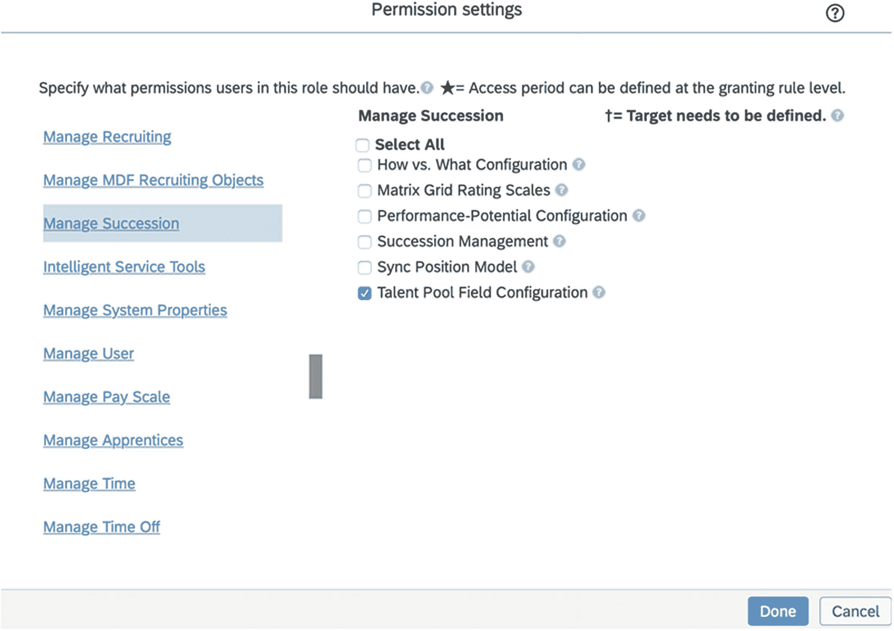

*图 7-9 人才库字段配置权限*

## 通过 MDF 配置人才库

现在您已拥有相应权限，可以开始定义人才库的数据结构了。

**注意**

本节将介绍我们为配置人才库对象定义所推荐的一些步骤。这不应被视为所有 `MDF` 对象定义选项的全面指南。`MDF` 是一个非常庞大且功能强大的工具，其内容足以写成一整本书！在下面的示例中，我们仅为对象添加安全性，并从我们的模型公司中添加一个字段，以便对人才库进行筛选过滤。

定义人才库的数据结构需通过 `MDF` 的 `Configure Object Definitions` 完成。请按照以下步骤完成配置：

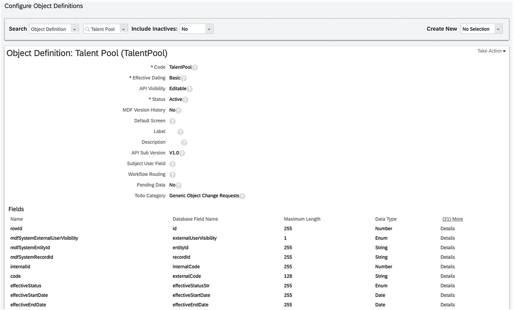

*图 7-10 人才库对象定义界面*

1.  在搜索栏中输入并选择 `Configure Object Definitions`。

## 用户权限

既然我们已经将 MDF 中的人才库对象配置为安全对象，就可以修改任何我们希望授予其人才库访问权限的用户权限角色。请按照以下步骤为角色添加人才库权限：

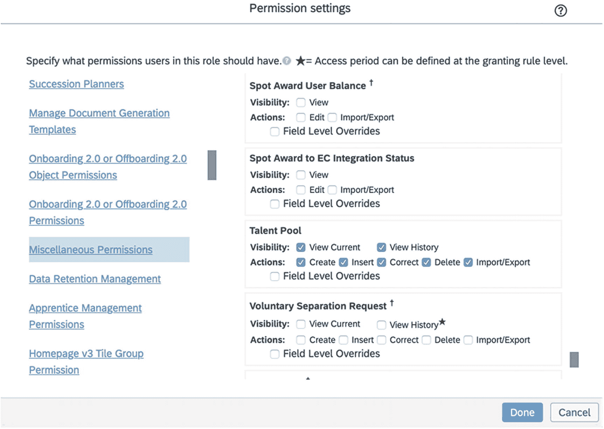

图 7-11 人才库用户权限角色的权限设置

1.  使用搜索栏导航到 `Manage Permission Roles`。
2.  点击您想要编辑的角色。然后点击 `Permissions…`。
3.  在 `Permission settings` 界面上，点击 `Miscellaneous Permissions` 并滚动到 `Talent Pool`。勾选 `View Current`、`View History`、`Create`、`Insert`、`Correct`、`Delete` 和 `Import/Export` 旁边的复选框，如图 7-11 所示。点击 `Done`。

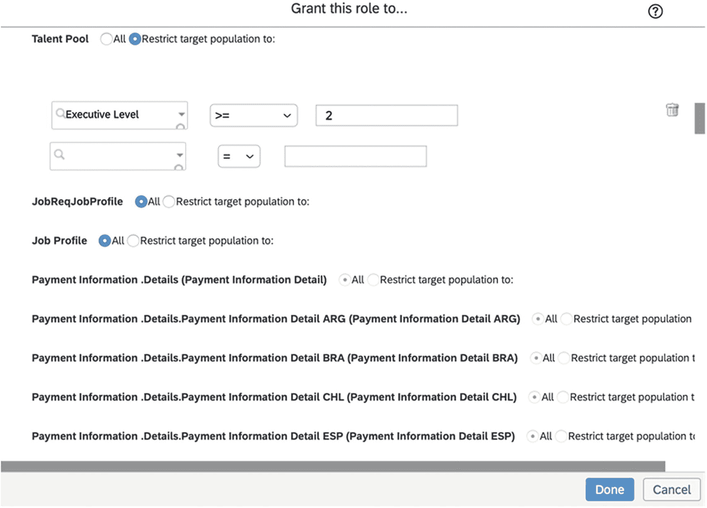

图 7-12 将人才库的目标人群定义为执行级别 2 或以下

4.  您可以进一步细化最终用户可以访问哪些人才库。在本例中，我们将使用新创建的字段 `cust_ExecutiveLevel`，允许不同用户访问不同的人才库。如图 7-12 所示，我们将授予此特定角色访问执行级别 2 的权限，供 HR 管理员使用，并假设将为执行级别 1 创建另一个角色，仅供高管团队使用。在“权限角色详情”界面上，点击 `Edit Granting`，向下滚动到 `Talent Pool`，然后选中 `Restrict target population to:` 的单选按钮。勾选第一个复选框，并输入 `Executive Level`、`>=` 和 `2`。点击 `Done`。

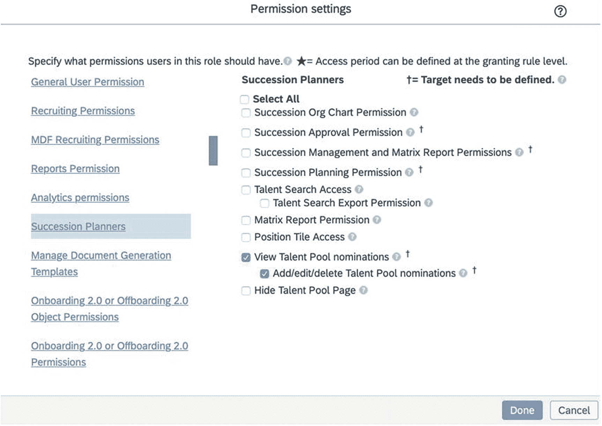

图 7-13 查看和编辑人才库提名的权限

5.  请务必记住，上述权限仅授予用户查看和编辑人才库对象的权限，并不能查看人才库中的实际提名！要添加查看提名的权限，请在 `Permission settings` 界面上点击 `Succession Planners`，勾选 `View Talent Pool nominations` 和 `Add/edit/delete Talent Pool nominations` 旁边的复选框，如图 7-13 所示，然后点击 `Done`。请确保同时保存主界面上的角色。

> **注意** 默认情况下，这将使所有员工都能访问提名。要使此权限特定于某个目标人群，请在 `Nomination Setup` 界面上点击 `Apply target population to Talent Pool Nominations Permissions`，然后像处理任何其他权限角色一样定义目标人群。我们将在下一节更详细地介绍此界面。

6.  对于某些组织而言，即使经理没有通过步骤 1 和 2 设置的权限，允许他们查看“人才档案”和“人才卡片”中的提名也是合理的。如果您想启用此功能，请登录到 Provisioning，选择您的组织，然后点击 `Company Settings`。勾选 `Viewing Talent Pool Nominations in People Profile and Talent Card Without Having the Talent Pool Object Level Permission` 旁边的复选框。

## 配置人才库提名字段

`Manage Talent Pool Field Settings` 配置界面用于控制哪些员工字段可以作为列显示或作为人才库提名中的筛选条件。请按照以下步骤配置人才库字段：

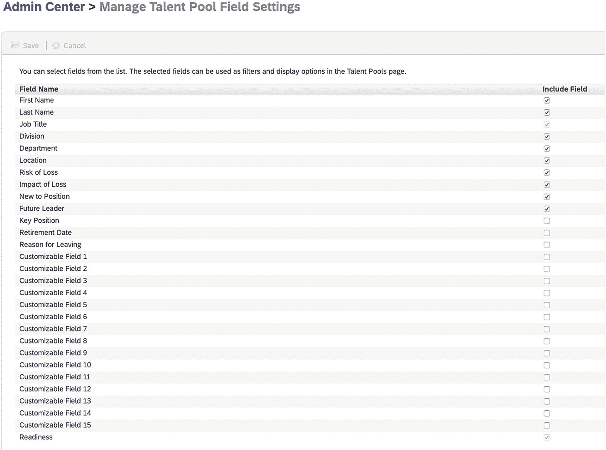

图 7-14 管理人才库字段设置界面

1.  在搜索栏中输入并选择 `Manage Talent Pool Field Settings`。配置界面将如图 7-14 所示。
2.  界面将显示数据模型中的所有标准人才库字段。勾选您希望添加为潜在列或筛选条件的每个字段旁边的复选框，然后点击 `Save`。

> **注意** `Job Title` 和 `Readiness` 默认始终被选中。

## 使用人才库

既然我们已经完成了人才库的配置，接下来就可以创建一些人才库并提名员工了！请按照以下步骤查看人才库、创建人才库、提名员工，并整理人才库内员工的视图：

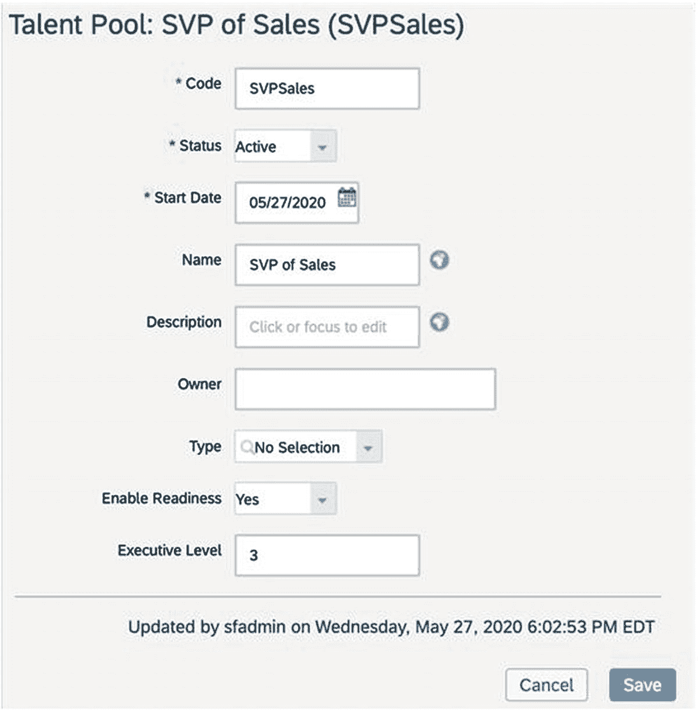

图 7-15 创建人才库界面

1.  在搜索栏中输入并选择“查看人才库”。
2.  点击“+”创建一个新的人才库。将弹出如图 7-15 所示的弹窗。在“代码”字段中输入“GenManagers”，在“状态”字段中选择“启用”，在“开始日期”字段中选择今天的日期，在“名称”字段中输入“销售高级副总裁”，在“启用就绪度”字段中选择“是”，在“高管层级”字段中选择“3”。完成后，点击“保存”。

> **注意** 此处显示的字段完全取决于您的 MDF 配置。如果某些额外字段对您的实施无意义，您可以将其隐藏，或添加其他字段。就我们的示例而言，我们只想展示自定义字段“高管层级”已出现，这有助于我们实现额外的安全级别。另请注意，任何带有地球图标的字段都可以根据您实例中激活的语言，翻译成多种语言。

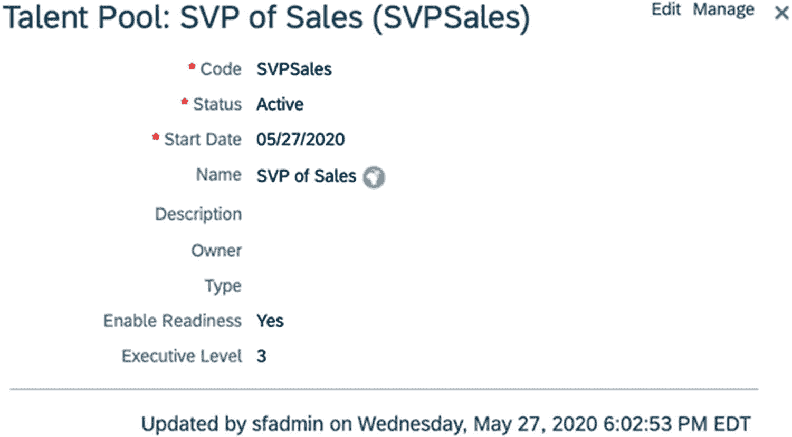

图 7-16 人才库 MDF 对象信息界面

3.  然后您将进入一个确认界面，该界面会显示您刚为新人才库 MDF 对象输入的信息，如图 7-16 所示。您可以通过点击“编辑”或“管理”来更改信息。点击“x”关闭并返回到主人才库界面，如下图所示。

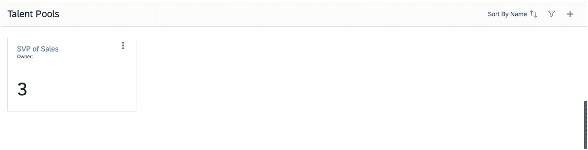

图 7-17 按名称“销售高级副总裁”过滤的人才库

4.  对于您想要创建的所有人才库，重复步骤 2 和 3。
5.  创建人才库后，它们将显示在主界面上，如图 7-17 所示。您可以通过点击右上角的漏斗图标，按代码或名称对它们进行过滤和排序。在“代码”或“名称”字段中输入您的条件，然后点击“过滤”。点击“重置”可清除过滤条件。您也可以点击漏斗图标旁的“排序方式…”来更改排序字段和顺序（升序或降序）。

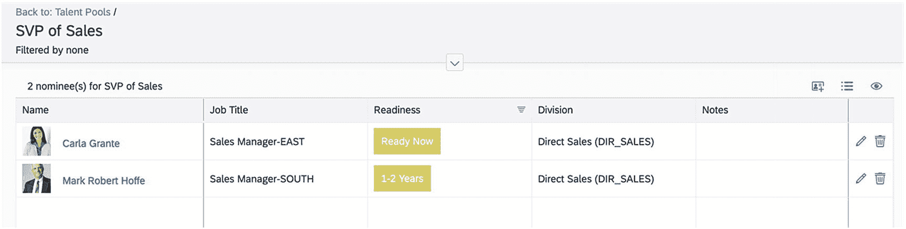

图 7-18 人才库提名界面

6.  点击任意人才库名称旁的三个点，以编辑该人才库 MDF 对象信息或删除它。
7.  点击人才库的名称，以查看和编辑该人才库内的提名。界面将刷新，显示当前的提名，如图 7-18 所示。

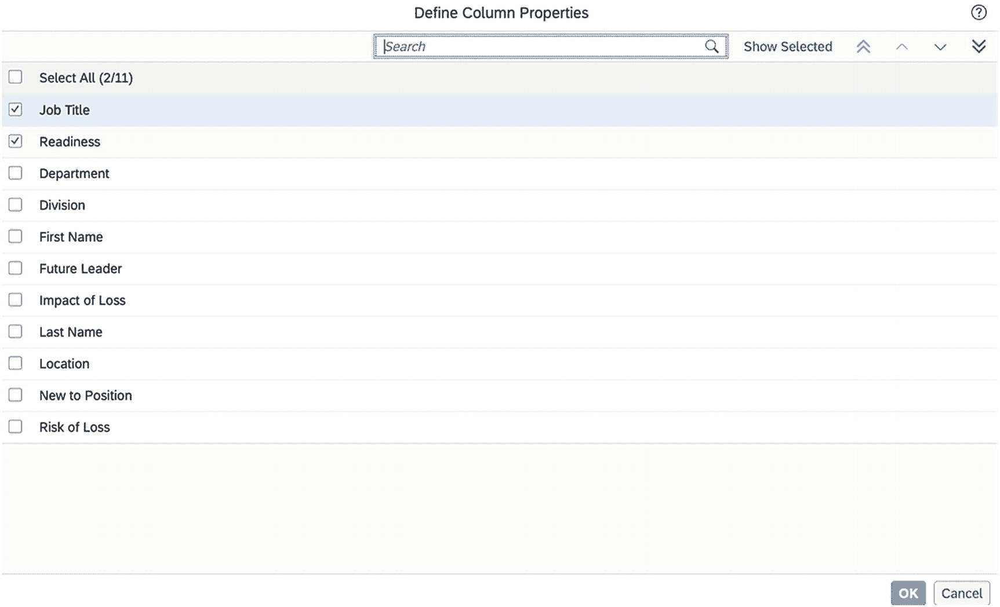

图 7-19 定义在人才库提名界面上显示的列

8. 要将员工添加到人才库，请点击名片图标。在弹出的搜索栏中输入并选择员工姓名。点击“下一步”按钮。输入就绪度级别和任何备注，然后点击“提交”。您将返回到上图所示的界面，其中会显示新添加的员工。
9. 对于您想进行的任何其他提名，重复步骤 8。

> **注意** 只要您拥有适当的权限，您也可以从任何人才卡片（如继任组织架构图、校准或演示文稿）以及人才搜索中进行提名。有关更多详细信息，请参阅本章中的相应章节。这些其他区域通常用于提名员工，因为它们提供了关于员工的更多上下文信息，而不仅仅是输入他们的姓名。

10. 点击菜单图标以编辑人才库 MDF 对象属性。
11. 点击眼睛图标。将弹出一个如图 7-19 所示的界面，用于控制被提名者列表中每个员工显示哪些列。您会注意到这些是您在配置期间选择的人才字段。点击您希望显示为列的每个字段旁的复选框，然后点击“确定”。您将返回到主人才库提名界面。
12. 您可以点击任何列的标题，以升序或降序对该列进行排序。
13. 点击“调整过滤器”。将弹出一个界面显示当前过滤器。如果要添加配置中尚未用作过滤器的字段，请点击“更多过滤器”。在新弹出的界面中，勾选您要添加的字段旁的复选框，然后点击“确定”。您可以通过取消勾选字段旁的复选框来移除字段。每个字段都会显示一个下拉菜单，其中包含人才库中被提名者的所有有效值。选择您希望用来过滤被提名者列表的值，然后点击“执行”以应用过滤器。您将返回到应用了过滤器的主被提名者列表。过滤器将显示在屏幕顶部的过滤器栏中。点击向上或向下箭头可切换过滤器栏的打开或关闭状态。
14. 点击任意被提名者旁的铅笔图标，可以在新的弹出界面中编辑该被提名者的就绪度或备注。完成后点击“提交”。
15. 点击任意被提名者旁的垃圾桶图标，可将该被提名者从人才库中移除。在弹出界面中点击“确认”以继续执行移除操作。

以我们示例中的模型公司为例，我们可以很容易地看到，如何利用人才库，基于最新的人才数据，以电子方式捕获整个组织内潜在销售高级副总裁的活跃名单，而不是基于过时信息维护手动离线列表。人才库界面允许用户组织其列表，而 MDF 允许捕获关于人才库的任何所需数据。我们甚至可以利用这些 MDF 字段来增强安全性。在我们的示例中，我们可以确信美国总统可以访问其级别及以下级别的人才库，但不能访问更高级别（例如全球高级领导团队级别）。我们还了解到，用户可以从系统中的多个区域进行提名，以便每当在系统中产生相关想法或讨论时，甚至可以通过主动使用人才搜索，将被提名者组织到人才库中。通过这种方式，当继任事件发生时，我们的用户就能做好充分准备，确定一份高度合格的继任者名单，并为他们未来的潜在职位做好准备！

> **注意**
> 我们甚至可以在使用职位档案生成器创建人才库时，直接将其映射到职位档案。在职位档案生成器的“角色”选项卡中，选择一个角色，然后转到“映射的人才库”选项卡。以我们的示例为例，我们可以确保销售高级副总裁人才库始终与职位档案相关联，这样，无论在继任组织架构图还是职位图块视图上查看时，该人才库都会显示出来。有关职位档案生成器的更多信息，请参阅第 1 卷第 2 章。

## 职位磁贴视图

职位磁贴视图允许用户从与传统组织架构图不同的角度查看职位。用户无需在层级结构中查看职位及其任职者，而是可以通过多种筛选条件，在其拥有安全访问权限的组织内所有职位中进行搜索。搜索结果以按字母顺序排列的磁贴列表形式呈现。我们可以通过 MDF 职位对象定义来设定用户可以使用哪些筛选条件。如果您已向 MDF 职位对象定义中添加了有助于区分组织中不同职位的关键字段，这将是一个非常实用的工具。让我们一起来了解一下吧！

## 配置和使用职位磁贴视图的先决条件

在开始配置之前，我们需要执行几个步骤来确保系统已准备就绪。下面我们来逐一了解。

> **注意**
> 与前一章中的“继任组织架构图”部分一样，我们假设您已按照我们对继任组织架构图的建议使用了 MDF 职位。如果没有 MDF 职位，则无法使用职位磁贴视图。

### 配置启用

在职位磁贴视图权限显示在系统之前，我们需要在配置启用中将其打开。登录配置启用并选择您要更改的公司，点击“公司设置”，然后勾选“职位磁贴视图”旁边的复选框，如图 7-20 所示。点击“保存”。

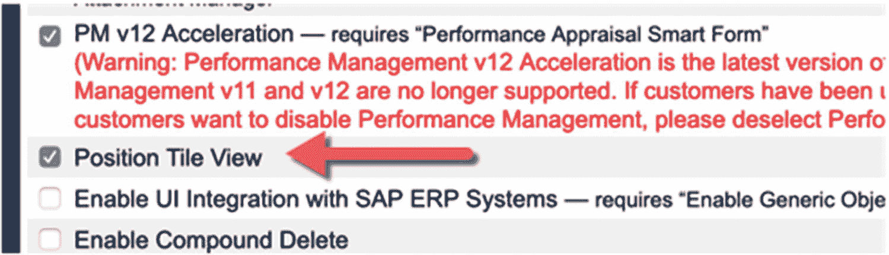

图 7-20 职位磁贴视图的配置启用设置

### 配置器权限

与人才库类似，我们需要在使用职位磁贴视图之前定义 MDF 职位对象。更多详细信息，请参见本章“人才库”部分中的“配置器权限”。

## 配置职位磁贴视图

一旦拥有适当的权限，我们就可以配置 MDF 职位对象了。在下面的步骤中，我们将添加一个字段并使其可搜索，这样我们就有了一个额外有意义的字段，可以依据该字段筛选职位并设置额外的安全权限。请按照以下步骤完成配置：

> **注意**
> 如果您的实施是 Employee Central (EC) 实施的一部分，您可能已经配置了职位对象，或者需要与 EC 团队密切合作，以确保构建一个协调一致的解决方案，因为这是继任管理和 Employee Central 之间的一个重要接触点！

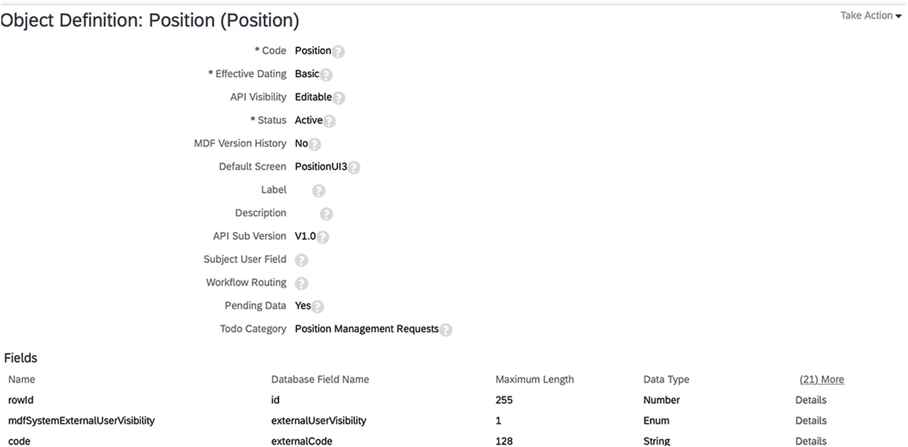

图 7-21 职位对象定义

1. 在搜索栏中输入并选择“配置对象定义”。
2. 在“搜索”字段中，选择“对象定义”。在下一个下拉菜单中，选择“职位”。职位对象定义将出现，如图 7-21 所示。
3. 点击“执行操作” ➤ “进行修正”。
4. 滚动到“字段”部分的末尾，通过在“名称”字段中输入 `cust_ExecutiveLevel`，在“最大长度”字段中输入 `2`，并在数据类型字段中选择 `数字` 来添加一个字段。点击字段旁边的“详细信息”。将出现一个弹出窗口。
5. 在弹出窗口中，向下滚动到“标签”字段，输入“高管级别”。点击完成。
6. 回到主屏幕，向下滚动到“可搜索字段”部分，在“名称”字段中输入 `cust_ExecutiveLevel`。然后向下滚动到“安全性”部分，为“受保护”字段选择“是”，并为“权限类别”字段选择“杂项权限”。滚动到底部并点击“保存”。

> **注意**
> 虽然我们在此不涵盖所有可用字段，仅尝试展示如何添加和编辑字段，但您至少需要将 `code`、`effectiveStatus`、`effectiveStartDate`、`effectiveEndDate` 和 `positionCriticality` 字段设置为必填。`Incumbent` 字段也应包含在内，但可以设置为可选，因为职位可能没有任职者。如果您希望关联职位分类，则还应包含职位代码。您还应使用此屏幕确保为您的 `positionCriticality` 字段创建了一个适当的选择列表。选择列表的名称必须严格为“PositionCriticality”。

## 配置最终用户权限

现在 MDF 已配置完成，并且职位对象已设置为受保护，我们可以修改任何我们希望授予其职位访问权限的用户权限角色。请按照以下步骤向角色添加职位磁贴权限：

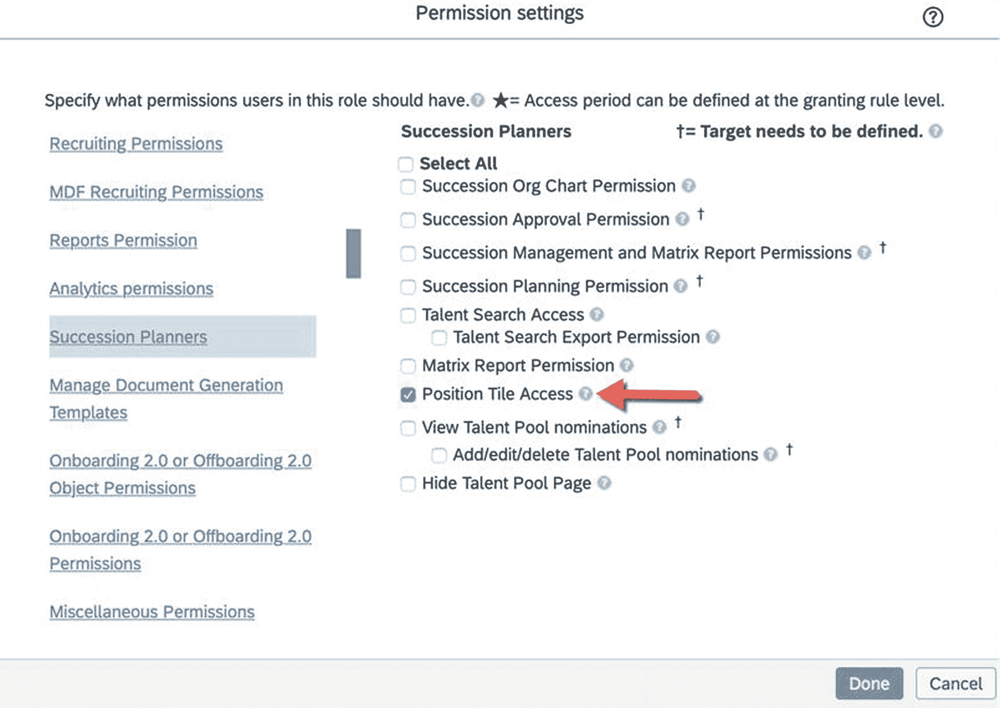

图 7-22 职位磁贴访问权限

1. 首先，我们将授予对职位磁贴视图屏幕的权限。在您角色的“权限设置”屏幕上，点击“继任规划者”，然后勾选“职位磁贴访问”旁边的复选框，如图 7-22 所示。

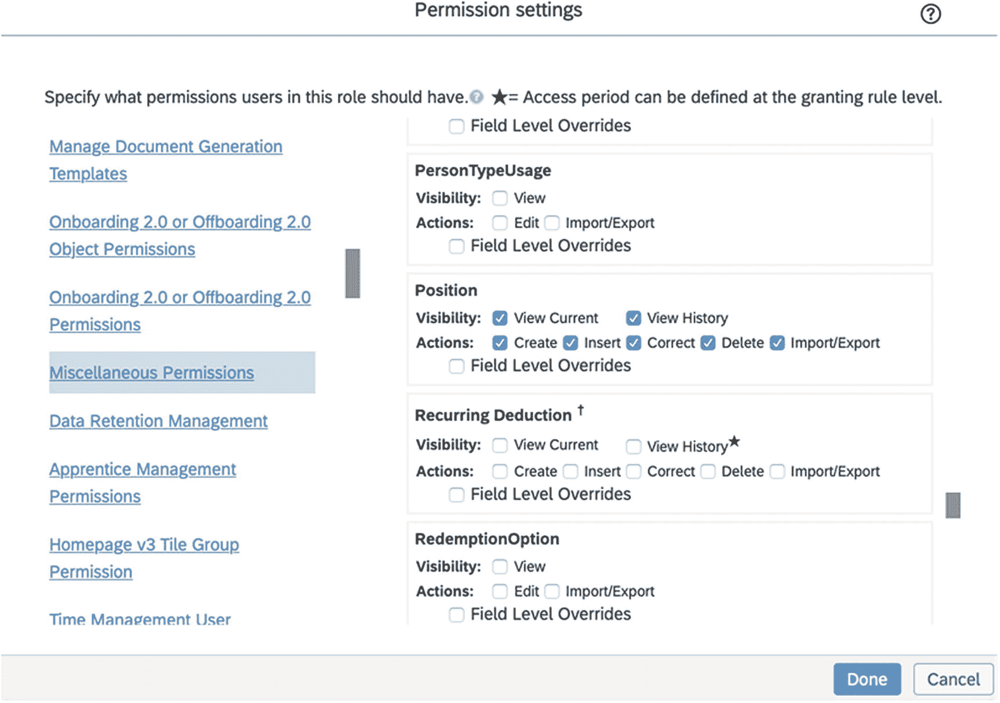

图 7-23 授予职位权限

2. 接下来，我们将授予对职位对象的权限，以便某些职位会显示在屏幕上。在“权限设置”屏幕上，点击“杂项权限”并滚动到“职位”。勾选“查看当前”、“查看历史”、“创建”、“插入”、“更正”、“删除”和“导入/导出”旁边的复选框，如图 7-23 所示。点击“完成”。

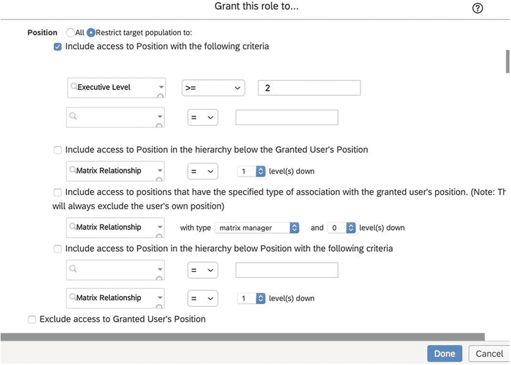

图 7-24 将职位访问权限限定为高管级别 2 及以下

3. 您可以进一步细化最终用户可以访问的职位。出于示例目的，我们将使用新创建的字段 `cust_ExecutiveLevel`，以允许不同用户访问不同的职位。我们将授予此特定角色对高管级别 2 的访问权限，供 HR 管理员使用，如下图所示，并假设将创建另一个角色用于级别 1，仅供高级领导团队使用。在权限角色详情屏幕上，点击“编辑授权”并向下滚动到“职位”，然后选中“将目标人群限制为：”的单选按钮。勾选第一个复选框并输入“高管级别”、`>=` 和 `2`。点击“完成”。示例如图 7-24 所示。

4. 请务必记住，上述权限仅授予用户查看和编辑职位对象的权限，而非查看职位内实际提名的权限！要添加查看和进行提名的权限，请同样从步骤 1 中选择“继任规划权限”。

5. 完成所有权限角色更改后，点击“保存”。

## 使用职位磁贴视图

既然职位磁贴视图已激活并配置完成，并且我们拥有安全访问权限，现在可以进入该屏幕并开始使用它了。请按照以下步骤使用该屏幕：

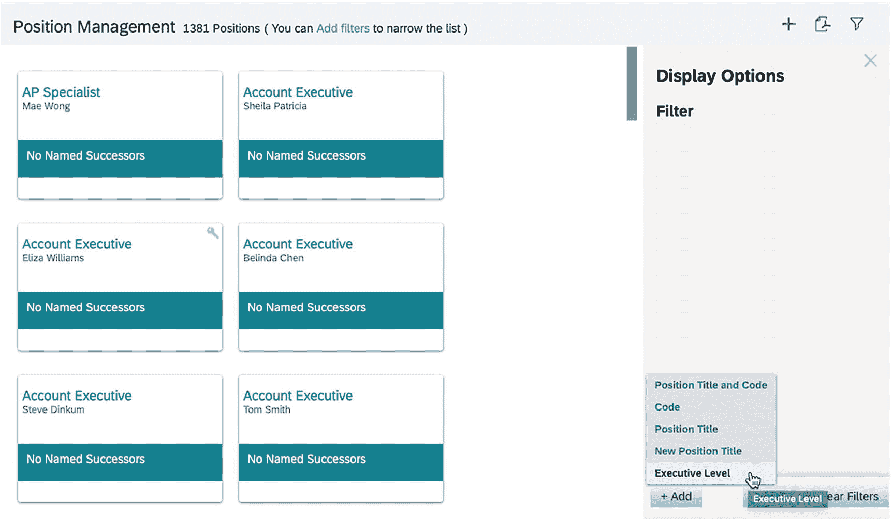

**图 7-25** 职位磁贴视图

1. 在搜索栏中，输入并选择“职位磁贴”。默认情况下，屏幕会加载您拥有安全访问权限的所有职位结果，并按职位名称的字母顺序排列。这些职位以磁贴形式显示，顶部是职位名称，其下方是现任者（如果有）。任何已命名的职位继任者也会一并显示。

2. 点击 `+` 图标以添加一个职位。请注意，此处的字段会因您对 MDF 职位对象的配置而异。将开始日期设置为今天的日期，并将职位名称设置为“区域经理 – 美国各属地”，将“状态”设置为“在职”，并将“高管级别”设置为“3”。点击“保存”。然后在确认屏幕上点击 `x`。

3. 点击漏斗图标或“添加筛选条件”以在屏幕右侧打开筛选条件面板。滚动到底部，点击“添加”以添加筛选条件。您会注意到“高管级别”已经存在，因为我们已将其作为可搜索字段添加到职位对象中！选择“高管级别”并输入“3”。点击“搜索”，系统将调出我们的职位！点击“清除筛选条件”以再次显示您所有可用的职位。见图 7-25。

4. 点击任何职位的磁贴以调出职位卡片。其操作方式与继任组织架构图相同，您可以查看现任者的人才卡片、将该职位设置为关键职位或提名继任者。您也可以点击菜单图标来编辑职位、删除职位、显示提名历史或查看谱系图。点击 `x` 关闭职位卡片。

**注意** 如果您已实施招聘，也可以从此处创建职位申请！

5. 如果您已为此屏幕创建了 BIRT 报告，还可以点击下载图标下载屏幕上职位的输出内容。

**注意** 要下载此屏幕的可打印版本，需要构建 BIRT 报告并将其上传到 Provisioning。该报告可以在 Provisioning 的“导入/更新/导出 – BI Publisher 模板/BIRT 模板”部分上传。本书不涉及编写 BIRT 报告。

## 谱系图

在通过继任组织架构图或职位磁贴视图对组织架构图上下的不同职位进行多次提名后，谱系图功能将变得非常有用！该功能允许用户直观地了解特定的继任场景可能是什么样子，不仅是直接替换的人选，还包括该替换者之下的候选人。

### 访问谱系图的先决条件

谱系图本身没有特定的配置屏幕或权限。该图表仅基于与继任组织架构图相同的配置和权限。由于我们已在之前的章节中详细介绍了这些内容，这里不再赘述。要启用谱系图，必须在 Provisioning 中激活。登录 Provisioning 并访问您的公司。点击“公司设置”，然后勾选“继任谱系报告”旁边的复选框，如图 7-26 所示。点击“保存”。

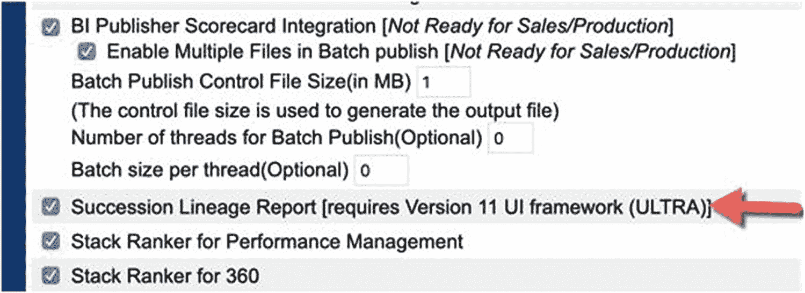

图 7-26 在 Provisioning 中开启继任谱系报告

### 使用谱系图

要使用谱系图，请遵循以下步骤：

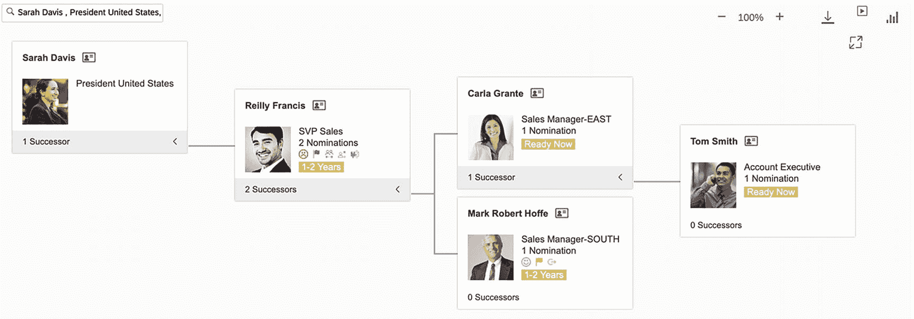

图 7-27 示例谱系图

1. 在搜索栏中输入并选择“查看继任谱系图”。

2. 在出现的屏幕上，在新搜索栏中输入您要为其开始谱系的员工姓名。

3. 当该员工出现时，您可以点击名片图标以打开该员工的人才卡片。

4. 点击员工姓名以查看为该员工显示的所有人才字段图标的文本描述（这些信息取自继任组织架构图配置 XML；有关更多详细信息，请参见第 [21](https://doi.org/10.1007/978-1-4842-6995-4_21) 章的“继任组织架构图”部分）。

5. 点击显示提名数量的底部栏以展开并显示这些被提名人的磁贴。

6. 对您想要查看的谱系的所有层级重复步骤 5。

7. 点击并拖动鼠标以移动您的谱系视图。您也可以使用 `+` 和 `-` 进行放大和缩小。最终输出的示例如图 7-27 所示。

8. 点击向下箭头图标以将图表下载为 PDF 或 JPEG 格式。

就我们的示例模型公司而言，您可以看到总裁会发现此工具非常有用。他们不仅可以看到谁可能接替高级副总裁，还可以轻松地直观了解谁已准备好接替这些接替者！上图中的示例很好地展示了我们模型继任场景的可视化效果！总裁可以确信，如果高级副总裁接任其职位，那么现在已经有一名区域销售经理准备好接替高级副总裁的位置，并且相应地有一名客户经理准备好接替该区域经理的位置。

## 继任演示

现在，我们已经了解了继任管理的整套配置和功能，只剩下最后一个功能要介绍：演示。演示通常用于在继任会议期间以引导方式向高级管理人员展示继任数据。此功能对于刚刚开始在线继任规划、并且传统上通过手动构建 PowerPoint 演示文稿向高级领导团队进行继任规划的组织来说很受欢迎。该功能在利用传统 PowerPoint 格式和利用系统中可用的最新信息之间架起了一座很好的桥梁。激活演示所需的配置最少。演示中的功能一旦激活，将采用本章前几节中的配置。

### 开启演示功能

在我们为演示功能分配权限之前，需要先激活它。要激活此功能，请遵循以下步骤：

1. 在搜索栏中输入并选择“升级中心”。

2. 在可选升级中找到“演示”。点击“了解更多并立即升级”。

3. 点击“立即升级”。

4. 点击“是”和“确定”。

### 授予演示访问权限

与几乎所有功能一样，我们需要为最终用户添加访问该屏幕的权限。请遵循以下步骤向您的权限角色添加权限：

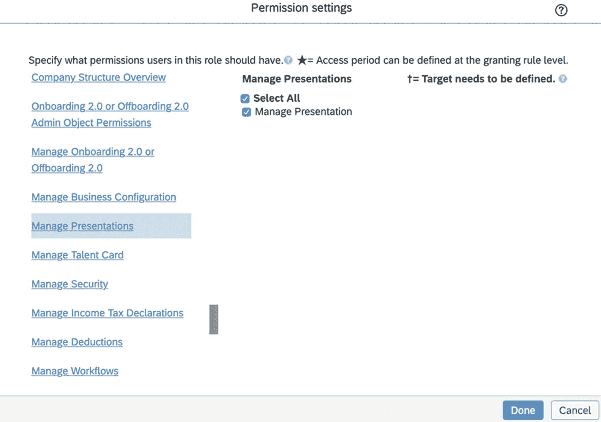

图 7-28 管理演示权限

1. 在搜索栏中输入并选择“管理权限角色”。

2. 屏幕加载后，点击您要修改的角色。然后点击“权限…”。

3. 点击“管理演示”，然后选择“管理演示”旁边的复选框，如图 7-28 所示。点击“完成”。请确保也在主屏幕上保存您的角色。

**注意** 上述权限仅授予对演示屏幕本身的访问权限。请务必记住，用户在演示中可以看到的数据基于我们本章已介绍过的针对职位、员工和提名的目标权限。

### 使用演示

现在我们已经设置了权限，让我们开始使用演示功能。请遵循以下步骤：

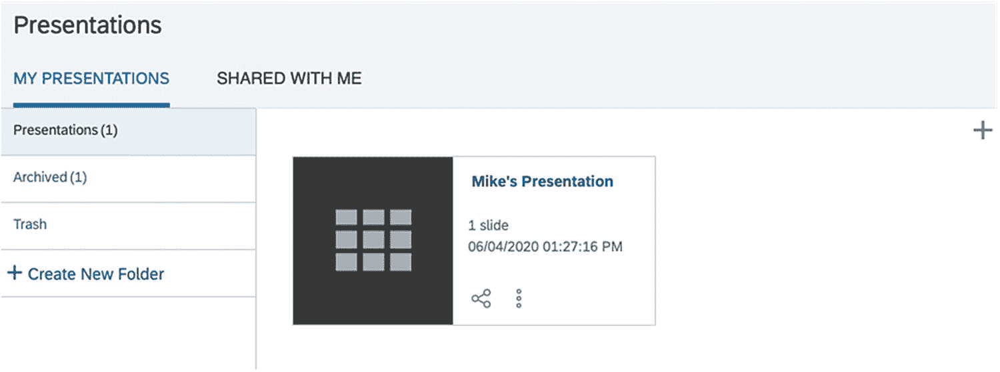

图 7-29 演示主屏幕

1. 在首次访问 Presentations 之前，你需要同意最终用户许可协议（EULA）。在搜索栏中输入并选择“Accept EULA”。

2. 单击“Accept EULA”并阅读 EULA。

3. 单击“Accept”。

4. 在搜索栏中输入并选择“Presentations”。屏幕将如图 7-29 所示。

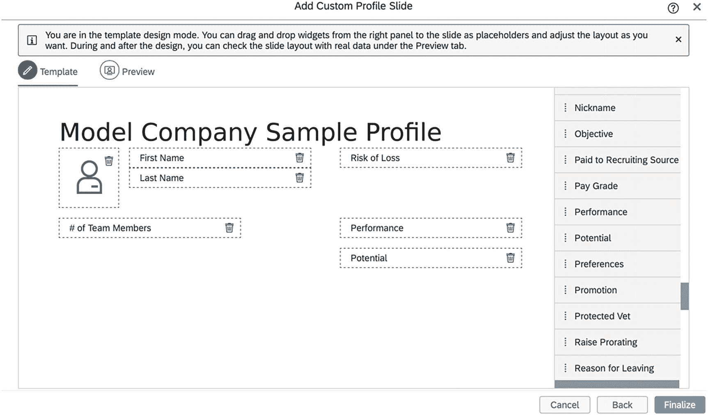

图 7-31 编辑自定义幻灯片

表 7-1 可用的实时幻灯片

| 实时幻灯片名称 | 描述 | 示例截图 |
| --- | --- | --- |
| 绩效-潜力矩阵 | 根据您的矩阵网格配置，创建一个显示实时数据的九宫格。需要您选择一个特定的团队或群组以及日期参数，就像在矩阵网格报告中操作一样。 | 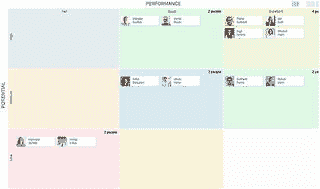 |

| 方式与内容矩阵 | 与前者相同，但适用于目标-能力配置。 | 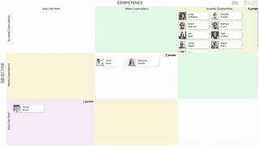 |
| --- | --- | --- |
| 继任组织架构图 | 显示从您指定的某个人或职位开始的继任组织架构图区域。您可以选择包含矩阵报告和/或仅显示关键职位。 | 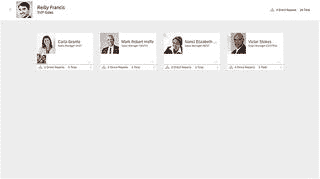 |
| 团队视图 | 从您选择的经理开始，显示特定团队的人才卡片。与上一张幻灯片相比，唯一的区别是不包含继任候选人信息。 |  |
| 人才库 | 选择一个或多个您有权访问的人才库以在幻灯片上查看。 |  |
| 人员网格 | 用于在单张幻灯片上比较一组静态人员。选择一个到四个网格的布局，并将您首选的人员添加到每个网格中。 | 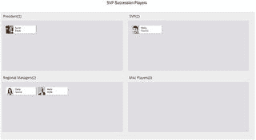 |
| 薪酬审核 | 如果您已实施薪酬管理模块，您可以使用此幻灯片为您选择的任何团队或群组展示所有相关的薪酬字段。 | 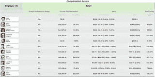 |
| 职位磁贴 | 允许您基于可用的 MDF 可搜索字段运行职位搜索查询，并显示这些职位的磁贴。 | 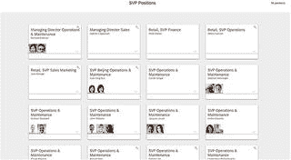 |
| 人员档案 | 允许您显示某个人的才能档案。使用群组或团队作为选择标准，可以一次添加多张幻灯片。 |  |
| 绩效历史 | 显示特定流程、日期范围以及个人、团队或人员群组的绩效历史。 |  |
| 分析 | 从您的可用磁贴库中显示最多四个分析磁贴。 | 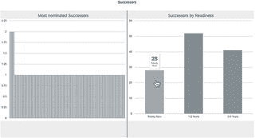 |

1.  单击“添加实时幻灯片”。根据表 7-1 选择“实时幻灯片”的类型。
2.  打印演示文稿时，你将可以选择在最终打印前如何格式化演示文稿中包含的每种类型的幻灯片。单击“打印”。
3.  编辑幻灯片内容引入了热点的概念，你只需在演示模式下单击热点区域即可打开链接或特定个人的信息卡。选择此选项后，单击正在编辑的幻灯片右上角的方形图标，然后单击并拖动以覆盖要制作热点的幻灯片区域。然后从出现的菜单中选择单击热点时要显示的链接或个人。单击“确定”完成热点设置。完成所有幻灯片的编辑后，单击“完成”。
4.  创建自定义幻灯片允许你选择一个已静态上传的幻灯片，并使用拖放编辑器覆盖实时人才信息，如图 7-31 所示。选择此选项将提示你在进入下图所示的编辑器之前，先查找一个你想要输入其信息的员工。SAP 的理念是用此功能来替代像素完美的人才卡片。
5.  在此屏幕上，你可以管理所有现有的演示文稿。
    1.  单击“创建新文件夹”创建一个除默认文件夹（“演示文稿”、“已归档”和“回收站”）之外的目录。将弹出一个窗口供你输入文件夹名称。完成后单击“确定”。
    2.  将鼠标悬停在文件夹名称上，并分别单击垃圾桶或铅笔图标，可以删除或重命名你创建的任何文件夹（你不能删除默认文件夹）。
    3.  如果你将演示文稿放入“回收站”文件夹，它不会立即被删除。将鼠标悬停在“回收站”文件夹上，可以看到“清空回收站”选项，单击它可以删除其中的演示文稿。
    4.  要访问文件夹并查看其中的演示文稿，请单击该文件夹的名称。
    5.  要创建演示文稿，请单击“+”号。
        1.  在出现的弹出窗口中输入演示文稿名称，然后单击“确定”。你将看到 Presentations 编辑屏幕加载，如图 7-30 所示。

图 7-30 Presentations 编辑屏幕

6.  单击右上角的三个点菜单图标。该菜单将为你提供以下选项：上传 PowerPoint 或 PDF 作为起始点、添加实时幻灯片、编辑演示文稿详情（仅编辑名称）、打印演示文稿或删除演示文稿。如果你选中了一张幻灯片，你还可以创建自定义幻灯片（如果你正在编辑的是一张上传的幻灯片）、编辑你创建时选中的幻灯片以及编辑幻灯片内容（仅允许你编辑热点）。

**注意**

许多用户开始使用 PowerPoint 离线创建演示文稿，或通过创建 PDF 来创建。通常，演示文稿是“实时”幻灯片（在工具中创建并访问实时数据）与这些上传幻灯片（包含离线创建的文本和图像）的组合。

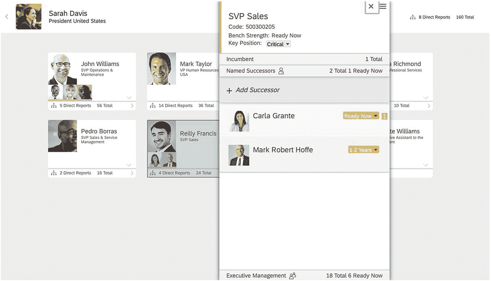

图 7-32 显示信息卡的继任组织结构图实时幻灯片演示

7.  将幻灯片添加到演示文稿后，顶部的三个视图模式图标可以在以下模式间切换：将所有幻灯片显示为小图标、在底部滚动列表中选择幻灯片后查看其大预览图、或在演示模式下查看它们。

## 演示模式与导航

1.  在演示模式下，您可以通过点击左箭头或右箭头来切换幻灯片，点击热区，或者点击实时幻灯片上显示的任意个人以查看其人才卡片，如图 7-32 所示。
2.  要共享演示，请点击分子图标。
3.  将出现一个新弹出窗口，允许您按姓名或按组进行搜索（关于如何创建组，请参考第 5 章的“运行和使用矩阵网格报告”部分）。
4.  输入并选择姓名或组。根据需要重复此操作，直到您列出所有您想要共享的个人和组。
5.  可选地，勾选复选框以向您正在与之共享的个人发送电子邮件。您也可以通过点击“自定义电子邮件”按钮来自定义此电子邮件。（您可以在“电子邮件通知模板设置”屏幕中编辑和激活此电子邮件模板）。
6.  点击“完成”以共享演示。
7.  点击演示上的三点菜单图标以编辑标题、复制演示、将其移动到另一个文件夹或删除它。选择删除只会将演示移动到“回收站”文件夹。
8.  点击“与我共享”选项卡以查看其他人共享给您的演示。您只能查看和复制已共享给您的演示。
9.  要返回主屏幕，请点击屏幕左上角的“演示”。
10. 要退出演示模式，请点击屏幕左上角的下箭头（仅当鼠标悬停在其上时才会出现！）。

以我们的模范公司为例，我们的总裁以及任何支持的人力资源管理员，现在都可以使用一个工具，该工具将他们从为高级领导团队创建演示所需的手动流程中解放出来。他们可以快速为这些高管整理一份演示文稿，以有条理且引导式的方式呈现关于 SVP 和区域经理的最新事实信息，从而无需进行艰难的对话或尝试使用可能过时的电子表格作为参考。

## 结论

我们希望您喜欢这次配置和使用继任管理的探索之旅！至此，您应该对每个功能是什么以及如何配置和授权访问它们有了扎实的理解。此外，我们还根据实际经验逐步介绍了推荐的设置，并定期简要说明我们的模范公司将如何利用该模块的所有功能。凭借这套系统和实践应用知识，您应该能够很好地利用这个强大的继任工具赋能任何组织！
