# 2. 配置职业工作表

在上一章中，我们简要介绍了 SAP SuccessFactors 职业发展模块中的功能。当在`配置`中启用`完整版 CDP`时，即可使用`开发计划`、`职业工作表`、`职业路径`和导师指导功能。

在本章中，我们将首先了解什么是职业工作表及其相互依赖关系，然后重点介绍`职业工作表`的管理任务。我们将启用`职业工作表`，并为这一职业规划工具创建必要的配置和权限。我们将学习如何创建职业路径，并探索建议工作角色的设置。我们将审视为工作角色能力添加预期评级的流程。我们将了解如何创建`角色就绪评估`表单。我们将探讨工作角色能力与开发目标的结合使用，以及它们如何与职业工作表互动。我们还将学习评估员工未来角色就绪度所需的条件。最后，我们将简要介绍`职业探索器`。此新功能目前仅在`早期采用者关怀`（EAC）计划中可用。

## 什么是职业工作表？

`职业工作表`是一种工具，通过查看工作角色、建议角色和职业路径，为用户提供职业发展机会的概览。该工具有助于员工主动规划并为未来角色做好准备。它是一个查看工作角色及其所需能力的载体。员工可以瞄准想要成长的工作角色，并集中精力为这些未来角色做准备。`职业工作表`易于实施和管理，可以提升员工的敬业度和保留率。

`职业工作表`高度依赖于已映射能力的工作角色。能力可以通过`职位档案构建器`或传统的`系列与角色`功能映射到工作角色。一个工作角色可能拥有多种能力，而对于`职业工作表`，每种能力都必须有一个预期评级。每种能力的预期评级指明了掌握该能力所需达到的分数。

职业工作表通过将员工已评级的能力与未来角色所需的能力进行对比，计算出员工对某个角色的就绪度。能力评级可能来自最近完成的`绩效管理`或`360 度评估`表单，也可能来自员工从工作表上启动的角色就绪表单。基于实际评级与预期评级的对比计算，就绪度仪表盘会显示员工具备担任未来角色能力的百分比。

工作表还会识别能力差距，突出显示员工需要改进的发展领域。基于这些差距，员工可以创建旨在掌握新角色所需能力的开发目标。

图 2-1 展示了一个职业工作表示例。

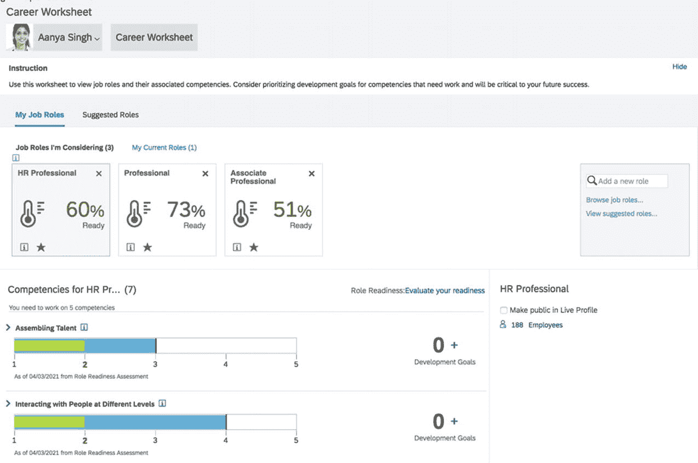

**图 2-1** 职业工作表示例

在职业工作表上，员工可以浏览工作角色、查看建议角色或查看职业路径。无论采用哪种方法，员工都能看到职位描述以及与该工作角色关联的能力。这让他们可以一窥工作职责和技能，从而判断这是否是他们想要争取的角色。

在接下来的篇幅中，我们将逐步介绍需要在`公司设置`中启用的选项。接下来，我们将为管理员角色设置基于角色的权限。我们还将学习如何创建职业路径、向`人员档案`添加`职业目标`模块、创建角色就绪表单，以及为能力添加预期评级。

## 配置设置

为了使用`职业工作表`和`职业路径`，需要先在`配置`中启用一些设置。为了让`职业工作表`正常运行，我们首先需要检查一些`公司设置`方面的前提条件。

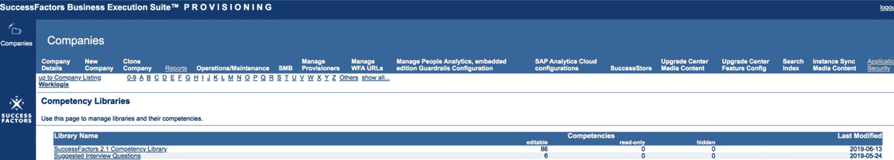

**图 2-2** 配置中的能力库

1.  由于职业工作表依赖于映射到岗位角色的能力，因此必须建立一个能力库。您可以使用如图 2-2 所示的 SuccessFactors 2.1 能力库，也可以创建自定义能力库。

接下来，我们将进入公司设置，验证某些设置是否已启用。

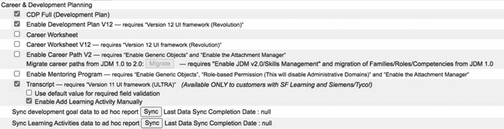

**图 2-3** 公司设置中的职业与发展规划功能

1.  发展计划设置应该已经启用。在公司设置中，找到“目标框架”部分进行验证。

2.  在“职业与发展规划”下，“CDP 完整版（发展计划）”和“发展计划 V12”应已启用。如果您在发展计划中使用了学习活动，则“成绩单”也应已启用。

发展计划设置如图 2-3 所示。

1.  验证“启用附件管理器”、“启用通用对象”、“版本 12 UI 框架（革命性）”和“JDM v.2/技能管理”也已启用。

2.  检查“员工目录”是否已启用。如果已启用，这可能会帮助您决定职业工作表模板 XML 中的一项设置，我们将在本章后面讨论该内容。

## 需要启用的公司设置

现在，我们准备在职业发展模块中启用职业工作表和职业路径。以下是公司设置中启用两者的路径：

*   目标框架 ➤ 我的目标选项卡

*   目标框架 ➤ 职业与发展规划 ➤ 职业工作表 V12

*   目标框架 ➤ 职业与发展规划 ➤ 职业工作表

*   目标框架 ➤ 职业与发展规划 ➤ 启用职业路径 V2

*   目标框架 ➤ 职业与发展规划 ➤ 启用职业路径

启用“职业工作表 V12”也将同时启用“职业工作表”。同样，启用“职业路径 V2”将同时启用“职业路径”。我们还需要在公司设置的目标框架部分找到并启用“我的目标选项卡”。

如果您在实例中使用临时报告，则有一些有限的职业工作表报告功能。若要允许报告用户在职业工作表上针对的岗位角色，请前往“分析和仪表板选项卡与杂项报告”并启用以下选项：

*   附加的临时子域架构配置 ➤ 职业工作表目标角色

*   在人员选择器中启用`包含从用户开始` ➤ 职业工作表目标角色

一旦这些设置更新并保存后，退出公司设置。接下来，我们需要前往配置中的另一个区域下载职业工作表模板。

## 职业工作表 XML

由于职业工作表模板在实例中不可用，我们需要下载模板 XML 以进行更新，例如选择要开启的功能、更改标签以及设置操作和字段权限。完成更新后，该文件将被重新导入配置中。

转到“管理计划模板”，如图 2-4 所示。这里可以找到目标和发展目标计划模板，最近在第一章中讨论过。

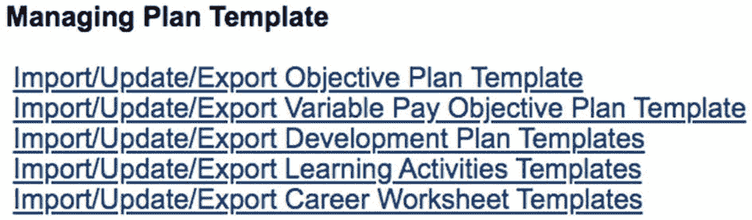

**图 2-4** 配置中的计划模板

找到并点击“导入/更新/导出职业工作表模板”链接。在这里，您将找到入门级职业工作表模板 XML。

如图 2-5 所示，显示下载和上传职业工作表模板 XML 的屏幕。您需要导出模板 XML。您的 Web 浏览器会将文件下载到本地机器。

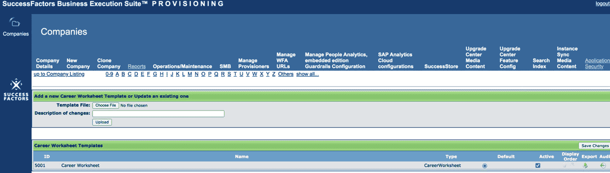

**图 2-5** 导出和导入职业工作表模板 XML 的屏幕

虽然不太可能，但如果此处没有显示职业工作表模板，请前往包含入门级模板示例的 CDP 实施指南。该指南包含一个职业工作表模板 XML，您可以将其复制到 XML 编辑器中。然后，您可以更新文件并将 XML 导入配置。另一种获取入门级模板的方法是从销售演示系统的配置中导出职业工作表模板 XML，然后将其导入到您的环境配置中。

现在模板已下载，让我们在 XML 编辑器中打开它，查看职业工作表的组件，并了解哪些选项可以修改。

以下是可在职业工作表模板 XML 中更新的元素：

*   删除字段（特别是 `gap_graph`）

*   字段标签

*   功能和字段权限

*   评级量表 ID

*   用户可选择的目标角色数量限制

*   开关

在我们深入讨论之前，以下是使用职业工作表时需要注意的一些要点：

*   只能有一个活动的职业工作表模板。

*   职业工作表模板上的字段 ID 不可修改。

*   职业工作表模板 XML 中不能使用类别。

*   无法在职业工作表模板 XML 中创建自定义字段。

*   职业工作表模板 XML 上不能授予“写入”权限。

*   职业工作表中仅显示已完成表单的评级。

*   发展目标可用于在职业工作表中为能力添加目标，并提供与某项能力相关的发展目标数量。

*   职业工作表只能链接到一个职业发展规划模板。

*   职业工作表使用默认发展计划来列出与某项能力相关的发展目标。

*   发展目标权限基于发展目标计划 XML 上的操作和角色权限。

查看 XML 的第一个部分。`<obj-plan-template>` 标签是 XML 结构中的最高级别标签。它定义了一系列可以打开或关闭的选项。这与您在目标和发展计划模板 XML 中找到的标签相同，但有一个特定于工作表的属性可以修改。

以下是一个示例代码片段：

```
<obj-plan-template cws-people-role="true" ... >
```

在该标签内，`cws-people-role` 属性默认设置为 `true`。此设置允许在职业工作表上显示一个指示器，显示拥有目标角色的员工数量。如果在公司设置中启用了员工目录，工作表中将有一个链接显示拥有该目标角色的员工姓名。

如果您不希望在工作表上显示岗位角色持有者的姓名，请将 `cws-people-role` 设置为 `false`。您仍将看到员工数量，但不会看到岗位角色持有者的姓名。

`<obj-plan-template>` 标签不应有其他属性更改。

与目标和发展计划模板 XML 一样，该标签后面跟随一系列元素。职业工作表模板的模板 ID 必须在 5001–5099 范围内，通常为 5001。计划类型必须为 `CareerWorksheet`。您可能希望进行的唯一更改是计划开始日期 `<obj_plan_start>` 和截止日期 `<obj_plan_due>`。

以下是一个示例代码片段：

```
CareerWorksheet
职业工作表

5/23/19 5:38 PM
01/01/2019
12/31/2021
```

由于开发计划通常持续数年，建议使用与开发目标计划相同的开始日期和截止日期。`Career Worksheet` 模板 XML 中可以添加一些额外的标签。

如果你为职位能力定义了行为标准，可以在职业工作表的计算中使用行为就绪评级。以下是需要使用的行为标签：

```
<behavior-tag>
```

当行为就绪状态不参与计算且不在职业工作表中显示时，行为标签示例如下：

```
<behavior-tag-example>
```

该标签应跟在 `<*text-replacement*>` 标签之后，并位于字段定义标签之前。

## 角色就绪计算的数据来源

职位的能力评级是职业工作表的核心驱动因素，用于衡量员工胜任下一个角色的准备程度。评级的数据源必须为职业工作表明确定义，才能计算目标角色的就绪情况。员工当前能力评级的默认来源是已完成的绩效评估表或 360 评估表。不过，你也可以指定一个或多个特定表单作为现有能力评级的来源。此外，职业工作表内还提供一项选项，允许员工选择一个目标角色，然后启动用于评估用户目标角色能力的 `Role Readiness Assessment` 表单。

无论哪种情况，如果使用表单中的评级，都应在职业工作表模板 XML 中添加 `<*assessment-filter*>` 过滤器来标识评级来源。必须引用表单模板 ID。你可以在“表单模板管理”下的“Provisioning”中找到表单 ID，如图 2-6 所示。

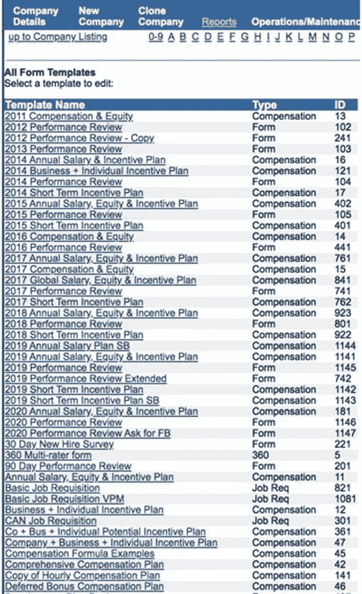

**图 2-6** 带 ID 的表单模板

若要使用多个能力评级来源，表单 ID 应以逗号分隔列出。当包含多个表单时，系统将使用最近完成的表单中的评级：

```
5,1146,1147
```

对于表单使用的每种语言，你需要一个单独的 `<*include-form-ids*>` 过滤器 ID。以下代码片段展示了同时使用多个表单评级并支持多种语言的情况：

```
5,1146,1147
5,1146,1147
5,1146,1147
```

如果你计划允许用户使用 `Role Readiness Assessment` 表单进行自我评估，请使用表单模板 ID 包含 `<*self-assessment*>` 标签。我们尚未讨论角色就绪模板，但如果在 Provisioning 中启用了职业工作表，你将在表单模板管理中看到标准的 `Role Readiness Assessment` 模板，就像表单评级来源的 ID 一样。

用于引用 `Role Readiness Assessment` 表单 ID 的代码示例如下：

```
<reference-code>
```

通常，`Role Readiness Assessment` 表单是为目标角色启动的。但现在也允许用户为其当前角色启动该表单。这通过过滤器 `<*current-self-assessment*>` 标识。它将引用与 `<self-assessment>` 过滤器相同的表单 ID。

当添加以下代码片段中的过滤器时，“我的当前角色”子选项卡将提供一个链接，用于根据员工的当前职位评估就绪程度：

```
<filter-segment>
```

这些标签的正确顺序包含在以下代码示例中：

```
<tag-order-example>
```

## 开关

在 XML 中的这些元素之后，可以添加一系列开关。开关用于开启或关闭功能。职业工作表模板中可能使用的开关如表 2-1 所示。

**表 2-1** 职业工作表 XML 开关汇总

| 开关 | 描述 | 默认值 |
| --- | --- | --- |
| `cws-dispoption-competency-desc` | 显示每个角色的能力描述。设置为“on”。 | 关闭 |
| `disable-jpb-profile-in-cws` | 设置为“off”以查看角色的职位简介描述。 | 开启 |
| `hide-position-count` | 隐藏角色的空缺职位数量。仅当在 Provisioning 中启用真实职位层级时适用。 | 关闭 |
| `new-role-readiness-calculation` | 定义角色就绪度的计算方式：求和或平均。当设置为“on”时，就绪度基于平均值计算。 | 关闭 |
| `show-self-assessment-in-current-role-tab` | 允许员工在其职业工作表中为当前角色启动角色就绪评估表单。 | 关闭 |

职业工作表模板 XML 中的开关代码示例如下：

```
<switch-code-example>
```

现在我们将详细查看每个开关及其控制的功能。

### `cws-dispoption-competency-desc`

此开关控制是否显示目标角色能力的详细信息。如果希望开启开关以查看能力描述，你需要为每个能力创建描述。你可以手动为每个能力添加描述，或使用包含描述的能力批量上传功能。这可以通过“管理工作简介内容导入/导出”来完成，本章稍后将对此进行说明。

当开关设置为“on”时，可通过将鼠标悬停在职业工作表上的信息图标上来查看每个能力的描述。

### `disable-jpb-profile-in-cws`

当启用“职位简介生成器”并定义了职位简介时，使用此开关。当此开关设置为“off”时，将显示目标角色的职位简介详情。

### `hide-position-count`

此开关显示目标角色有多少个空缺职位。默认情况下，空缺职位数量会显示。空缺职位与继任计划中的职位关联，而非招聘管理中的职位申请。然而，空缺职位计数仅适用于传统职位提名方法，并且需要在 Provisioning 中启用真实职位层级。MDF 职位不支持此功能。

要隐藏空缺职位数量，应将开关值设置为“on”。如果未设置开关且未使用传统职位提名方法，空缺职位数量将显示为 0。

### `new-role-readiness-calculation`

此开关用于定义如何计算角色的就绪度。就绪度可以按“就绪能力求和”或“能力就绪度平均值”来计算。当此开关设置为“yes”时，就绪度计算是比例值（平均值）。如果未定义开关，默认值为“off”，即使用求和作为计算类型。

## 就绪度计算类型

既然我们刚刚介绍了用于标识角色就绪计算类型的开关，让我们深入探讨一下。求和与平均都使用员工最新的能力评级，这些评级可能来自绩效评估表、360 评估的平均评级、一个或多个指定表单，或 `Role Readiness Assessment` 表单。

我们将介绍这两种就绪度计算类型，以便你决定使用哪一种。先从求和开始。

### 求和

系统首先检查员工针对目标角色各项能力的就绪评级。如果员工当前的能力评级等于或高于预期评级，则员工对该目标角色的能力“已就绪”。如果员工不具备目标角色所需的能力，则员工对该能力“未就绪”。然后，就绪度按 (员工已就绪的能力数量)/(所需能力总数)% 计算。

### 平均

就绪度基于对员工在目标角色各项能力上的就绪程度进行计算。然后计算这些评级的平均值以确定整体就绪度。计算使用 XML 中定义的评定量表：

- 如果某项能力的评级达到或超过预期能力评级，则该能力的就绪度为 100%。
- 如果员工在当前目标角色的能力评级低于预期评级，则能力准备度的计算公式如下：
  （当前评级 – 评级量表最低评级）/（预期能力评级 – 评级量表最低评级）%。
- 如果某项能力没有预期评级，或者员工没有该能力的评级，则该能力的准备度为 0。

接下来，将所有百分比相加，再除以目标角色的能力总数，得出角色准备度百分比。

这种方法可能不是最准确的，因为如果某项能力没有预期评级，或者员工没有该能力的评级，平均值计算将会出现偏差。

在 2019 年第四季度发布之前，如果员工想为其当前角色启动角色准备度评估表单，需要在绩效管理中完成。现在，员工可以直接在其职业工作表中为当前角色启动角色准备度评估表单。开启该开关后，将在“我的当前角色”选项卡中创建一个用于评估准备度的链接。

此开关必须与 `<current-self-assessment>` 标签结合使用，该标签用于标识要启动的角色准备度评估表单。

既然我们已经审查了职业工作表的可用开关，接下来让我们看一个额外的选项。

在开关之后，您可以限制用户可以考虑的目标角色数量。这是通过 `<max-per-category>` 属性在 `<category-config>` 中完成的，并紧随开关之后，如下面的示例代码片段所示：

# 职业工作表模板的权限

如果员工尝试添加的目标角色超过允许的最大数量，则会显示一条错误消息，除非用户删除一些现有的目标角色，否则无法继续添加。

出于性能考虑，最好将员工可以选择作为未来角色的数量限制在 20 个以内。

## XML

对职业工作表以及特定职业工作表计划的访问权限由实例中的基于角色的权限控制。在职业工作表中查看、添加或删除目标工作角色的权限，以及职业工作表中某些字段的读取权限，均在职业工作表模板 XML 中进行控制。

让我们来审查职业工作表模板 XML 的权限和字段定义部分。我们将从查看应用于“我正在考虑的工作角色”子选项卡的操作/角色开始，如图 2-7 所示。

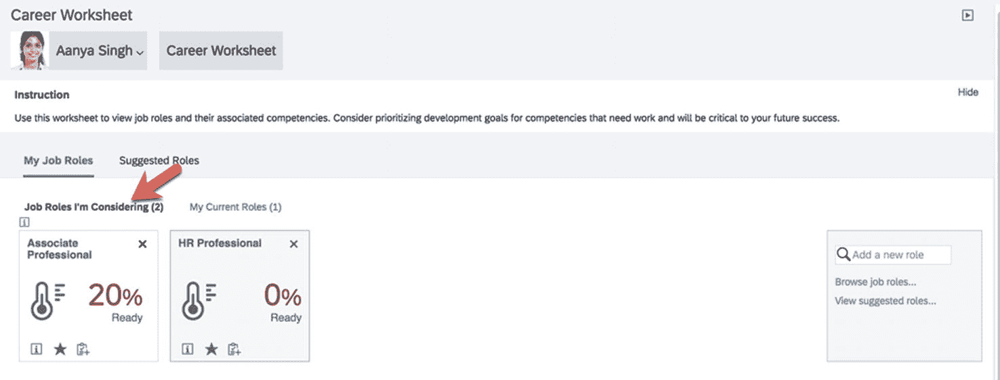

图 2-7 职业工作表的“我正在考虑的工作角色”视图

操作权限定义了角色在职业工作表中可以执行的功能。操作描述如下：

- `Private-access` 授予查看职业工作表“我正在考虑的工作角色”部分中目标角色的权限。
- `Create` 授予添加目标角色的权限，并且需要此权限才能访问“建议角色”选项卡。
- `Delete` 授予从“我正在考虑的工作角色”子选项卡中删除任何选定目标角色的权限。

如下面的示例代码片段所示，员工、其经理层级以及 HR 经理可以查看目标角色。只有员工及其经理可以添加目标角色，并且只有员工可以删除目标角色：

在图 2-8 所示的示例中，有一个选项允许员工使其目标角色在人员档案中可见。


图 2-8 使目标角色在人员档案中可见的复选框

必须至少为员工角色启用共享权限。`Share` 权限如下面的示例代码片段所示：

如果没有角色被授予 `share` 访问权限，则职业工作表上不会显示“在个人档案中公开”链接。下面的示例代码片段展示了这一点：

在本章后面，我们将审查在人员档案中配置“职业目标”块的额外步骤。

`Move` 权限在工作表中不适用，因此您可以将其从模板 XML 中移除。

在“我正在考虑的角色”子选项卡中有一些标准字段，我们将对其进行审查。表 2-2 详细列出了模板中用于定义目标工作角色详细权限的字段。如前所述，XML 标识了哪些角色可以查看、添加或删除用户的目标工作角色。除了准备度仪表盘外，所有字段都是必需的。这些字段对于工作表的设计功能至关重要，不应被移除。

表 2-2 “我正在考虑的工作角色”子选项卡中允许的字段

| 字段 | 描述 |
| --- | --- |
| `competency_name` | 与工作角色关联的能力名称。 |
| `last_rated_form` | 上次对能力进行评级的绩效（或 360）表单名称。 |
| `last_rated_date` | 上次能力评级的日期。 |
| `last_rating` | 工作角色上某项能力的最新评级。 |
| `gap_graph` | 预期能力评级与实际评级的对比表示。可以从 XML 中移除。 |
| `development_goals` | 与该能力关联的发展目标（如果有）。 |
| `readiness_meter` | 目标工作角色的准备度百分比。 |

我们已经提到了角色准备度评估表单，如果使用该表单，则会对 `last_rating` 字段进行额外更新。用于计算角色准备度的职业工作表评级量表必须与角色准备度评估表单中使用的评级量表相同。如果评级量表不匹配，准备度仪表盘将不会显示。

下面的示例代码片段显示了评级量表 `id` 字段，该字段需要与角色准备度表单关联的 PM 模板中使用的评级量表 `id` 完全相同：

```
Last Rating
#.#

Performance Rating Scale
```

角色准备度评估模板 XML 必须在能力部分引用相同的评级量表，如下面的代码片段所示：

```
```

我们将在本章后面查看角色准备度评估表单模板 XML。

## 职业工作表 XML 上的模板字段

我们现在已经查看了职业工作表的字段。通过查看职业工作表的部分内容以及这些字段的使用位置，事情会更清晰。请参考表 2-2 回顾模板字段。图 2-9 显示了这些字段在工作表上的位置。

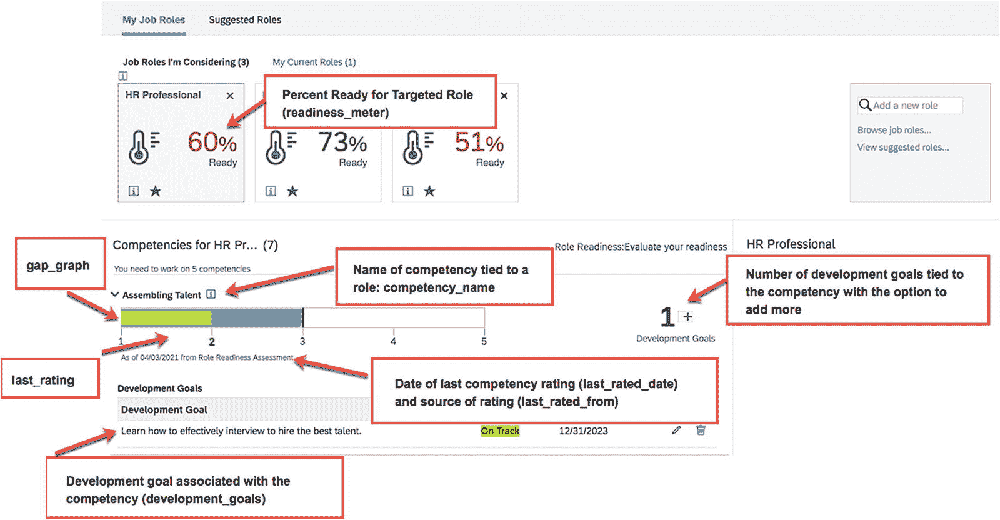

图 2-9 职业工作表模板字段及其来源概览

除了在 XML 中定义模板字段外，您还需要确定哪个（些）角色具有这些字段的可见性。`Write` 权限在工作表中不受支持，因此您只需要定义 `Read` 权限。标准模板权限可能已经非常接近您的需求。只需根据您组织的特定权限进行任何修改即可。

以下是一些需要考虑的事项：

# 职业工作表字段的基于角色的权限

基于角色的职业工作表权限不适用于目标人群。如果用户有权访问职业工作表，则该用户将能够根据“用户搜索”权限搜索其他员工。这意味着用户在自己的职业工作表中可以通过名称搜索来访问其他员工的工作表。为防止这种情况，请在“职业工作表”模板 XML 中，仅向应能查看员工职业工作表的角色授予“读取”权限。

“读取”权限只应授予那些应能查看任何员工职业工作表的角色，例如员工本人、经理和人力资源经理。

以下示例代码列出了应用于这些字段的权限：

由于继任规划人员通常与他们提名的继任者没有任何关系，因此建议允许所有角色（`*`）对 `“readiness_meter”` 字段具有可见性。如下所示为一个示例代码片段：

如下面的示例代码片段所示，任何人都不应能写入任何职业工作表的字段：

## 为目标职位角色能力添加发展目标

如果您允许用户为目标职位角色或当前职位角色能力添加发展目标，则 `“development_goal”` 字段必须包含在具有“读取”权限的字段定义中。发展计划也必须定义了能力字段。

在“职业工作表”模板 XML 中包含 `development_goal` 字段还会启用每个角色能力所显示的发展目标数量，如图 2-10 所示。

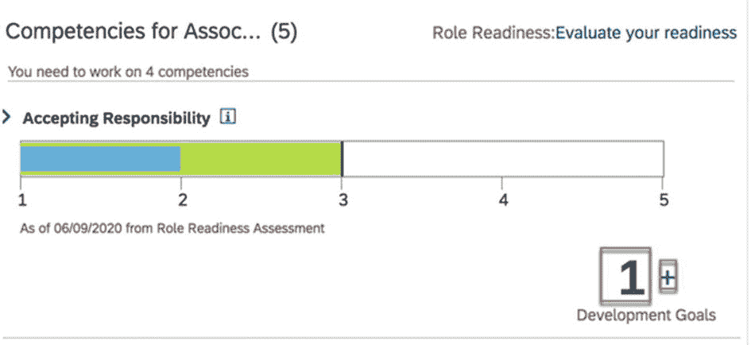

图 2-10：为能力添加发展目标

加号图标允许员工为能力添加发展目标。员工可以创建一个与需要加强的能力相关联的发展目标。为此，发展计划模板必须包含具有创建目标能力权限的能力字段。在工作表上为能力添加的任何发展目标随后都会与该能力一起显示在发展计划上。

默认情况下，用户对发展目标的“读取”和“写入”权限是从发展计划模板配置中继承的。您必须确保所有可以查看用户职业工作表的角色，在发展计划 XML 中也具有发展目标字段的“读取”权限。没有此权限，角色将无法在职业工作表上看到发展目标。

也可以将发展目标链接到职业工作表上的行为，而不是使用能力。为此，必须将发展计划配置为在能力字段中使用行为。请参阅第 1 章了解更多信息。

由于一个发展目标可以链接到多个能力，因此同一个发展目标在职业工作表中可能会被多次计算。并且同一个发展目标可以在多个职位角色中体现。

完成“职业工作表”模板 XML 更新后，请保存文件并在“配置”中的“管理计划模板”➤ “导入/更新/导出职业工作表模板”下导入该文件。

## 配置“共享”权限和数据模型

我们讨论了“职业工作表”模板 XML 中的“共享”权限，该权限允许用户将目标角色标识为“人员配置文件”中的职业兴趣。为此，需要在“继任数据模型”中进行更新。我们需要在数据模型中添加 `“preferredNextMove”` 背景元素。返回“配置”以下载数据模型。

在“继任管理”下，点击“导入/导出数据模型”链接，如图 2-11 所示。

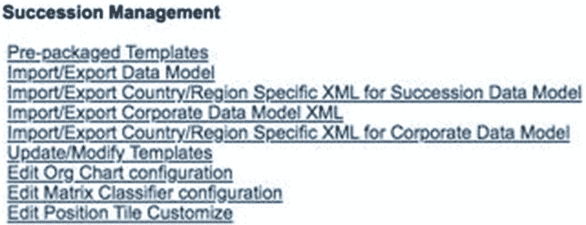

图 2-11：配置公司设置中数据模型的位置

下载数据模型文件，如图 2-12 所示。

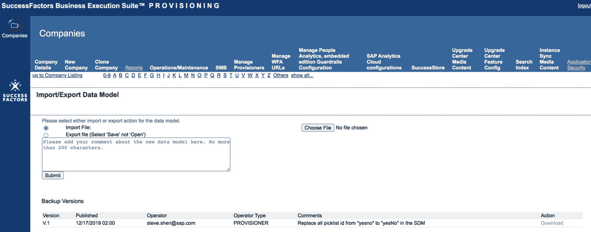

图 2-12：导入/导出数据模型界面

在 XML 编辑器中打开该文件，查看 `“preferredNextMove”` 背景元素是否正在使用。如果它已存在于数据模型中，它可能包含几个不会从工作表填充到配置文件中的字段。

该背景元素的一个示例代码片段如下所示：

```
首选下一步行动
首选下一步行动

职位名称
职位名称

级别
级别

职能
职能

时间框架
时间框架

备注
备注
```

背景元素内需要定义一个“职位名称”数据字段。这是从职业工作表填充到“人员配置文件”中职业兴趣块的唯一字段。如果背景元素中包含其他字段，则在单击职业工作表上的复选框时，这些字段不会填充。这些字段在该块中将显示为空。额外的字段只有在用户在配置文件中添加时才会填充。但是，如果您允许用户更新配置文件中的该块，则可以在背景元素中包含额外的字段。就我们的目的而言，我们只使用职位名称字段。

无论哪种情况，都要确保职位名称是必填字段。如果此背景元素在数据模型中但未被使用，您可以删除任何其他数据字段，如代码片段示例所示。如果它不在数据模型中，您需要添加它，并且可以使用这个相同的版本。

该背景元素的一个示例代码片段如下所示：

```
首选下一步行动
首选下一步行动

职位名称
职位名称
```

数据模型中还需要包含一个针对该背景元素的 `<element-template>`。一个示例代码元素如下所示：

```
首选下一步行动
首选下一步行动
职业目标.
```

如前所述，在讨论“职业工作表”模板 XML 中的操作权限时，必须至少为员工角色启用共享权限，以便将目标角色添加到其配置文件中。

完成添加后，导入更新后的数据模型 XML。进入实例后，我们将审查此背景元素的基于角色的权限以及需要进行的“人员配置文件”更新。

## 总结

我们现在已经在“配置”中启用了职业工作表和发展路径。我们已对“职业工作表”模板 XML 进行了更新，以定义功能、数据源、评分计算类型以及工作表中字段的操作权限。我们还更新了“继任数据模型”XML，以便在“人员配置文件”中显示目标角色。我们现在已准备好进入实例来设置基于角色的权限。

# 职业工作表和职业发展路径的基于角色的权限

除了在`职业工作表`模板 XML 中设置的操作和读取权限外，还需要基于角色的权限，以授予用户访问职业发展模块中`职业工作表`选项卡以及职业工作表计划的权限。如果您决定使用职业发展路径、建议角色和角色就绪评估表单，这些功能同样需要基于角色的权限。我们的讨论将假设所有这些功能都会被使用，因为这样才能赋予`职业工作表`全部功能。

我们将从授予管理员配置和管理`职业工作表`各项功能的权限开始。在第 1 章中，我们讨论了负责管理所有职业发展相关功能的管理员角色。这可以是处理所有绩效管理事务的 HR 管理员角色，也可以是专门用于管理职业发展的管理员权限角色。您也可以考虑允许 HR 经理创建和管理职业发展路径。我们将在本章后面讨论 HR 经理角色的权限。

## 分配配置和管理职业工作表的权限

前往`管理权限角色`，选择您要添加这些权限的管理员角色。在权限设置的`管理员权限`部分，找到`管理职业发展`，如图 2-13 所示。

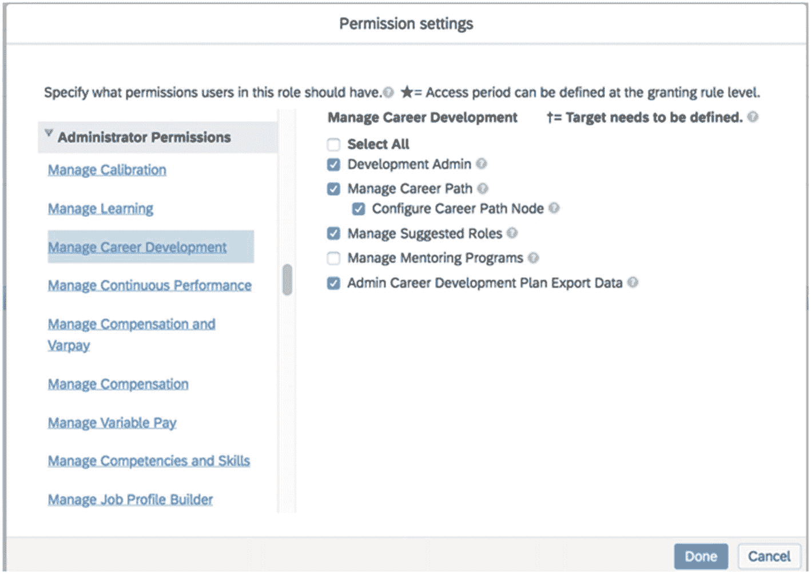

`图 2-13` 管理职业发展权限

根据上一章的讨论，`发展管理员`应该已经启用。现在我们正在添加`管理职业发展路径`、`配置职业发展路径节点`和`管理建议角色`的权限。

表 2-3 包含了`管理职业发展`权限。高亮显示的权限应添加到管理员角色中。

`表 2-3` 管理职业发展权限

| 权限 | 描述 |
|---|---|
| `发展管理员` | 管理所有发展计划设置。 |
| `管理职业发展路径` | 定义和管理职业发展路径。 |
| `配置职业发展路径节点` | 定义职业发展路径中节点显示的内容，仅适用于职业发展路径 V2。 |
| `管理建议角色` | 配置建议角色设置。 |
| `管理导师计划` | 管理导师计划。 |
| `管理员职业发展计划数据导出` | 导出职业发展计划数据。 |

我们需要添加在`职业发展计划`中的`用户权限`部分下找到的权限。图 2-14 显示了此部分的权限。

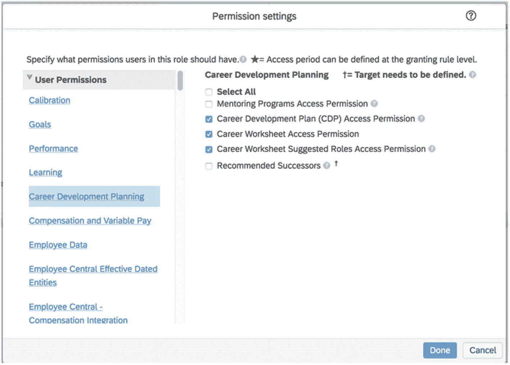

`图 2-14` 职业发展计划权限

管理员角色应该已经拥有`职业发展计划 (CDP) 访问权限`。现在我们将向该角色添加`职业工作表访问权限`和`职业工作表建议角色访问权限`。

表 2-4 突出显示了在`用户权限` ➤ `职业发展计划`内需要授予的额外权限。

`表 2-4` 职业发展计划用户权限摘要

| 权限 | 描述 |
|---|---|
| `导师计划访问权限` | 访问发展模块中的“导师”选项卡。 |
| `职业发展计划 (CDP) 访问权限` | 访问发展模块。 |
| `职业工作表访问权限` | 访问发展模块中的“职业工作表”选项卡。 |
| `职业工作表建议角色访问权限` | 访问发展模块职业工作表中的“建议角色”。 |
| `推荐继任者` | 允许访问继任组织图中的“推荐继任者”部分。 |

如果管理员将要创建或运行关于职业工作表相关数据的临时报告，则需要创建和运行这些报告的权限。

前往位于`用户权限`部分的`报告权限`，并启用以下选项：
- `创建报告` ➤ `职业工作表目标角色`
- `运行报告` ➤ `职业工作表目标角色`

该角色还需要访问`CDP 仪表板`。同样在`报告权限`下，找到`分析磁贴和仪表板`，启用`CDP 仪表板`。

图 2-15 显示了需要添加的报告访问权限。

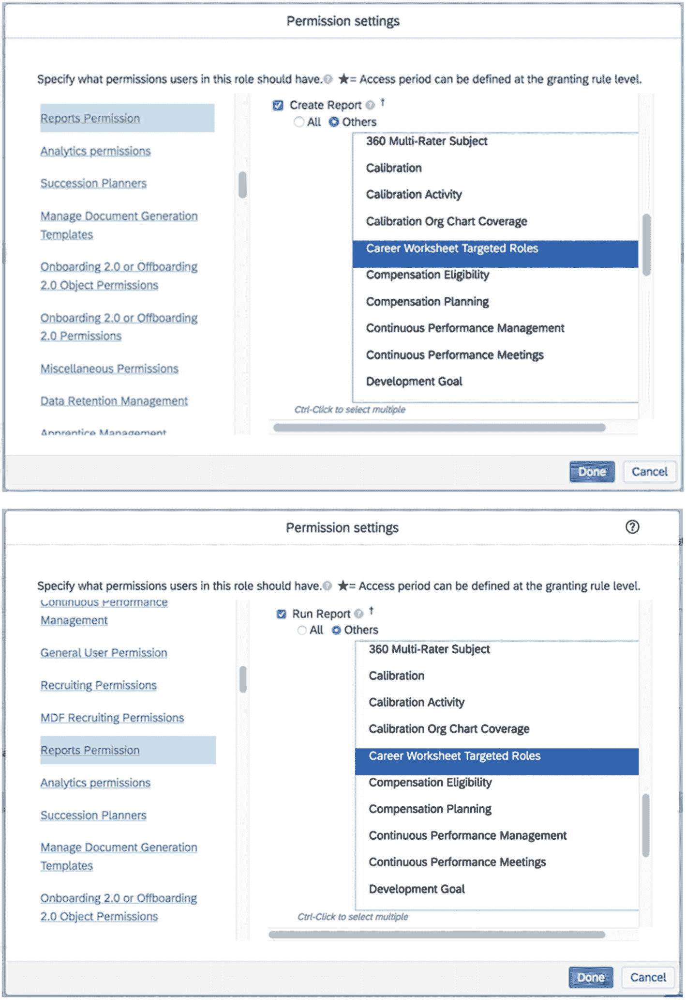

`图 2-15` 创建和运行临时报告权限

管理员还需要拥有创建和查看职业发展路径的权限。在`用户权限`部分下，前往`杂项权限`。滚动查找名为`职业发展路径`的权限，如图 2-16 所示。

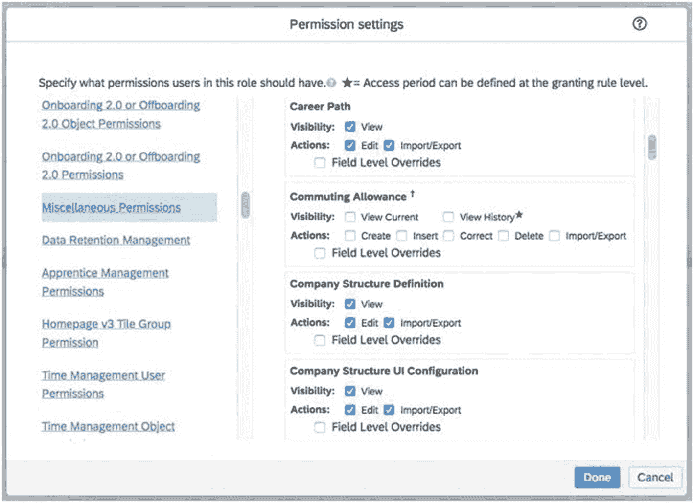

`图 2-16` 用于查看和编辑职业发展路径的杂项权限

对于`职业发展路径`，启用`查看`选项以设置可见性。启用`编辑`和`导入/导出操作`选项。

最后，添加`职业工作表`目标计划权限，如图 2-17 所示。

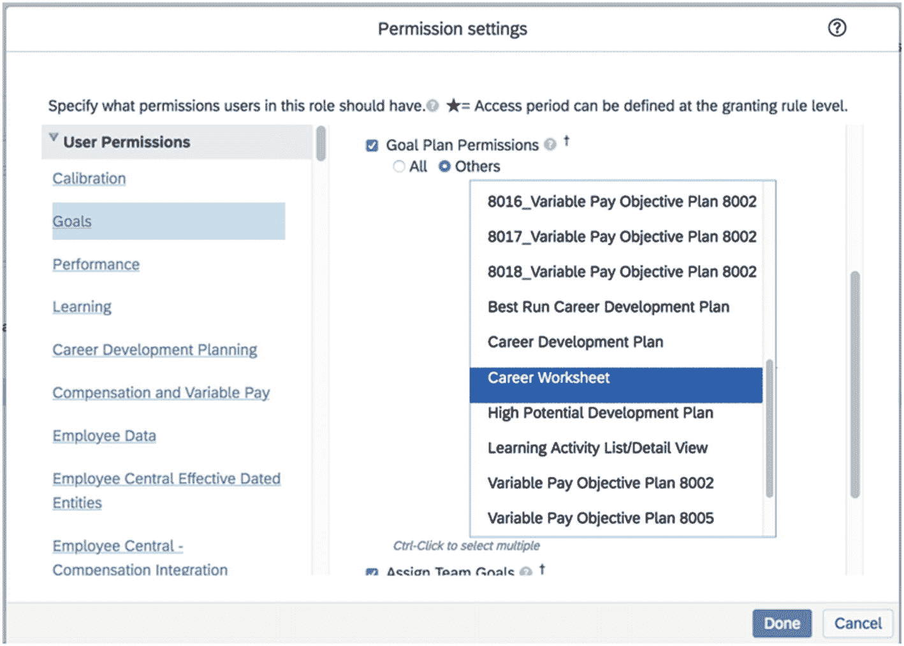

`图 2-17` 职业工作表的权限目标

在关于配置的讨论中，我们提到了添加一个目标角色以显示在人材画像的职业目标板块中的选项。我们在`职业工作表`模板 XML 中添加了`共享`权限。我们还向数据模型添加了`nextPreferredMove`背景字段。

为了让管理员创建用于人材画像的职业目标板块，必须在权限角色中启用该背景字段。如图 2-18 所示，前往位于`用户权限`部分的`员工数据`。向下滚动，在数据模型中找到背景字段`preferredNextMove`，并授予`编辑`权限。

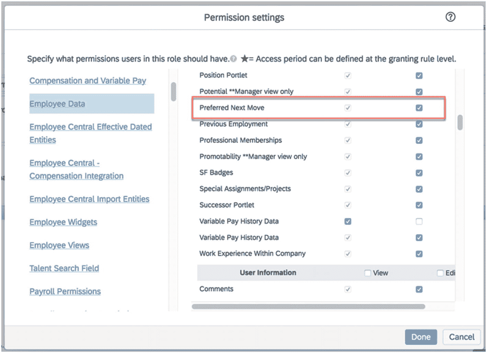

`图 2-18` 首选下一步行动背景字段的权限

现在，我们已经授予了管理员权限角色访问权限，以管理`职业工作表`的各项功能。保存该权限角色。

## 职业工作表设置

现在，我们将逐步介绍管理员将为`职业工作表`启用的所有功能。

### 更新人材画像

如果您当前没有使用板块来表示职业目标，请前往`配置人材画像`来添加该板块，如图 2-19 所示。

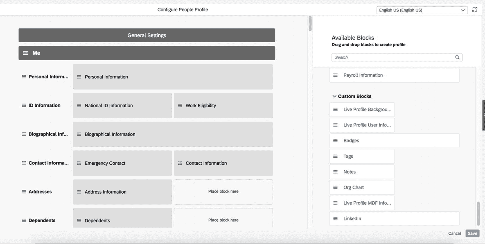

`图 2-19` 配置人材画像 添加新板块

找到一个您想放置该板块的区域。您可以将该板块添加到一个现有的、包含类似类型板块的区域中。通常，这是一个对员工、经理和 HR 经理可见的人才资料区域。在屏幕右侧的`自定义板块`下，选择`实时画像背景信息`，并将其拖拽到一个区域内的新板块中。

为板块命名并添加描述。如图 2-20 所示，该区域和板块被标记为`职业目标`。

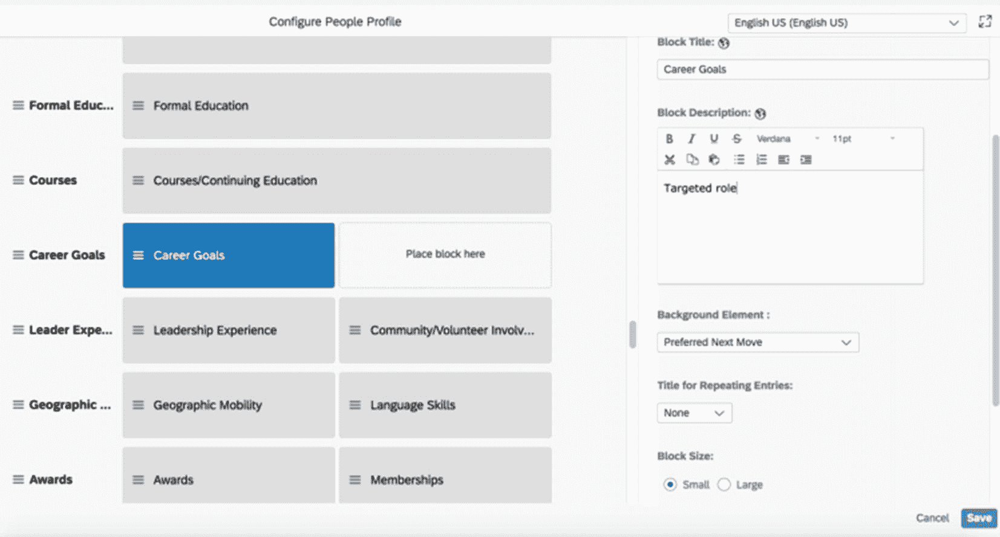

`图 2-20` 添加并标记职业目标板块

在描述部分下方，有一个背景字段下拉列表。选择背景字段`preferredNextMove`，如图 2-21 所示。

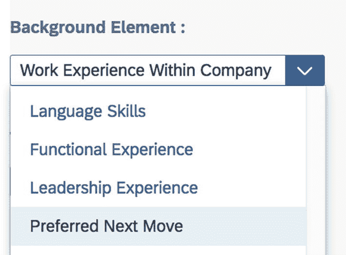

`图 2-21` 背景元素的选择

保存区块，接下来我们将进行管理员在准备使用职业工作表之前需要执行的任务。

## 角色能力预期评分

职业工作表的一个关键组成部分是岗位角色能力；它是职业工作表的支柱，因为就绪程度基于某个角色的能力。为了按预期使用职业工作表，所有岗位角色都需要已映射的能力。链接到岗位角色的每项能力还必须有一个预期评分。预期评分将与员工的实际能力评分进行对比，以此确定该员工对该角色的就绪程度。

使用`职位档案构建器 (JPB)`确保每个岗位角色都有能力项。我们还需要验证每个岗位角色能力是否都有预期评分。如果你未使用`JPB`，可以使用`族系与角色`。

管理员可以手动为岗位角色添加预期评分。为此，请前往`职位档案内容 -> 族系与角色 -> 能力`，如图 2-22 所示。

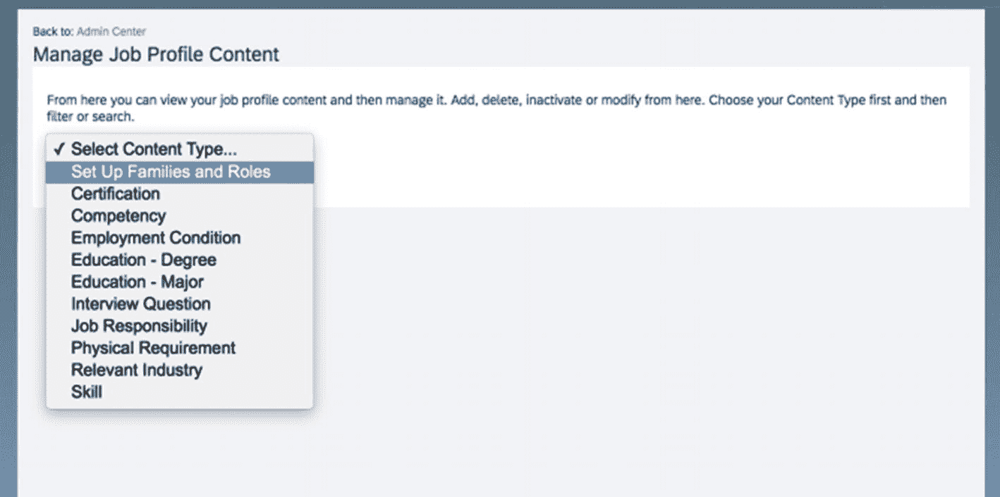
`图 2-22` 使用职位档案构建器访问族系与角色

前往`管理职位档案内容 -> 设置族系与角色`。

进入`角色`选项卡，选择一个角色进行编辑，如图 2-23 所示。

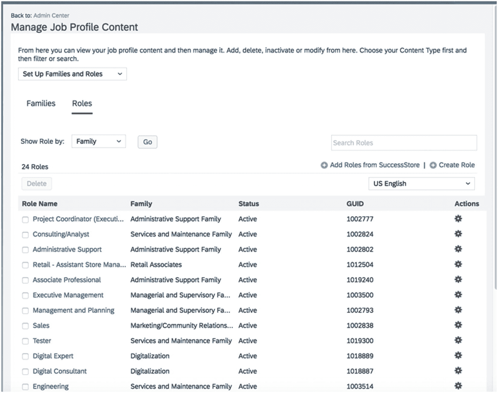
`图 2-23` 管理职位档案内容中的角色视图

选择一个角色，并进入该角色的`已映射能力`选项卡，如图 2-24 所示。如果需要，首先将能力映射到该岗位角色。

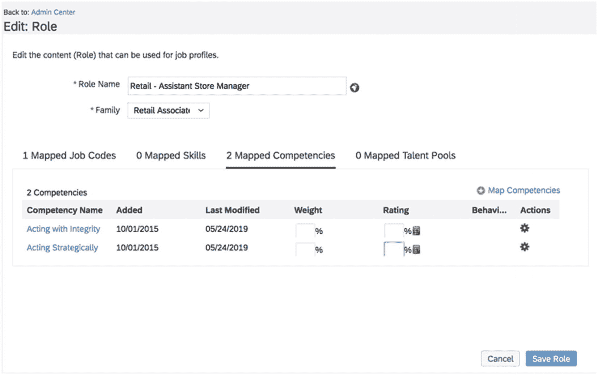
`图 2-24` 岗位角色的已映射能力

我们需要关注`评分`列。点击某项能力的计算器图标。将弹出一个弹出窗口，如图 2-25 所示。

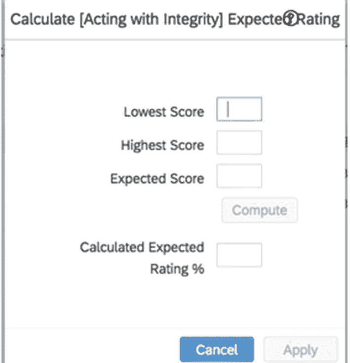
`图 2-25` 预期评分计算器

根据你在职业工作表模板`XML`和`角色就绪评估`模板中确定的评分标准，你将输入评分标准中的最低分数、最高分数，以及该能力的预期评分分数。预期分数应是对能力熟练度可接受的评分。你可能需要与组织内的薪酬或人才管理部门人员协商来确定这些评分。

输入三个分数后，`计算`按钮将变为可用，如图 2-26 所示。

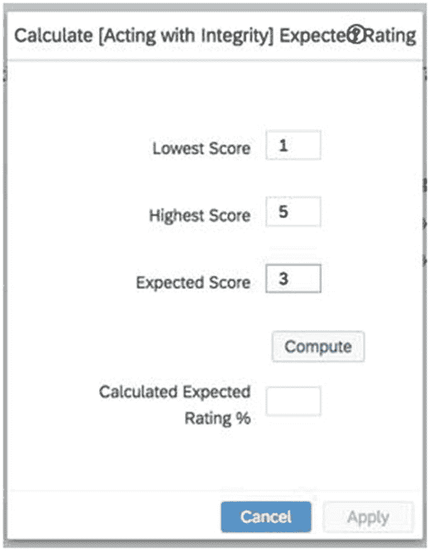
`图 2-26` 输入分数后计算按钮变为可用

随后将显示计算出的预期评分百分比。用于计算此能力预期评分的系统硬编码公式为 `(x – 1)/(评分标准 – 1) = 预期评分百分比`，其中 `x` 是职业工作表中某项能力的预期评分。

点击`应用`按钮，如图 2-27 所示。

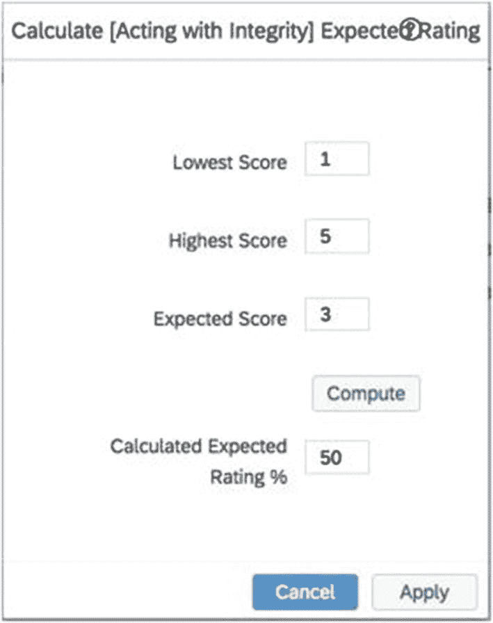
`图 2-27` 应用能力评分

现在，该能力的计算评分字段已填充完成，如图 2-28 所示。

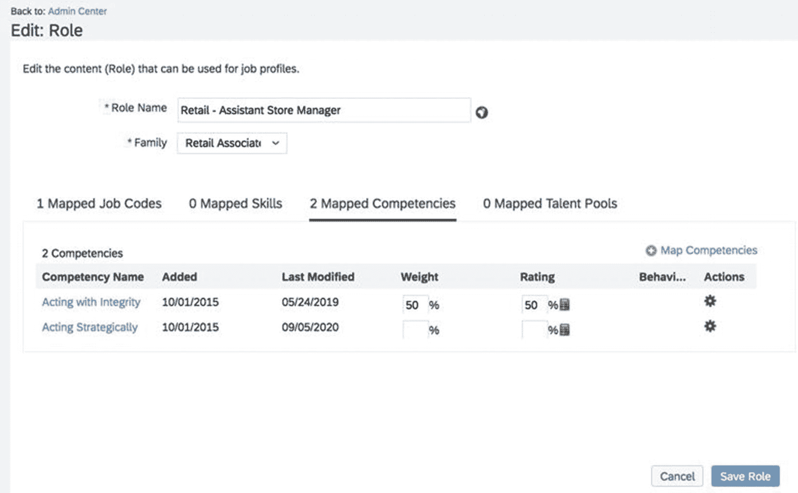
`图 2-28` 带有评分百分比的能力项

对映射到该角色的每项能力执行相同操作。你还可以为每项能力提供一个权重。完成后，点击`保存角色`按钮，如图 2-29 所示。

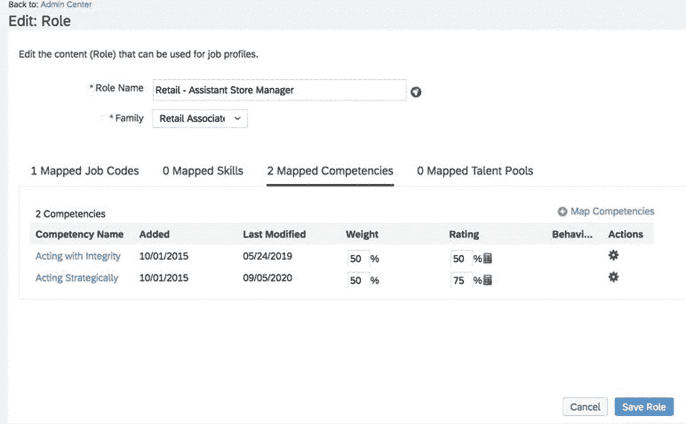
`图 2-29` 保存角色以使评分生效

需要对每个岗位角色上的每项能力都执行此操作。为了简化流程，你可以使用导入功能批量更新岗位角色能力。

## 批量更新岗位角色能力

假设你的岗位角色已有映射的能力，我们只需要为每个岗位角色上的每项能力添加权重（可选）和预期评分。这通过`角色-映射能力`模板完成。

在搜索栏中输入并选择`管理职位档案内容导入/导出`。我们将下载`角色-映射能力`模板，如图 2-30 所示。

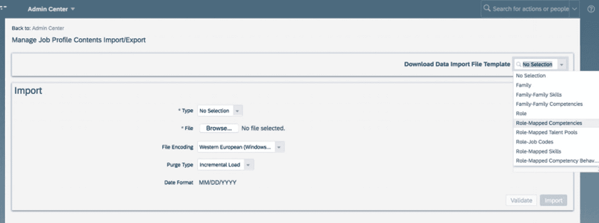
`图 2-30` 下载角色-映射能力文件

当提示时，你希望模板包含现有数据，如图 2-31 所示。

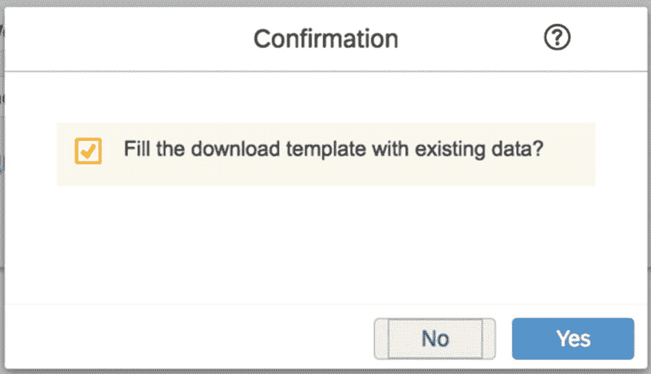
`图 2-31` 确认下载时包含数据

将出现一条消息，指示你前往`监控作业`以检索下载的文件。该消息如图 2-32 所示。


`图 2-32` 包含查找文件说明的弹出窗口

在搜索栏中输入并选择`监控作业`以查看已运行的作业。示例如图 2-33 所示。

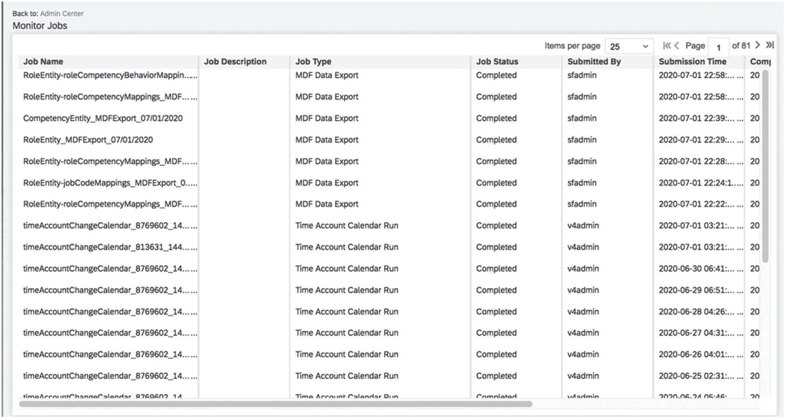
`图 2-33` 已运行的作业

使用屏幕底部的滚动条向右移动，以查看`下载状态`列，如图 2-34 所示。

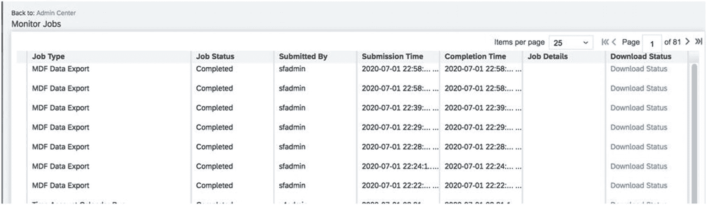
`图 2-34` 带有下载状态的监控作业视图

点击`下载状态`，将提示保存或打开该文件。示例如图 2-35 所示。

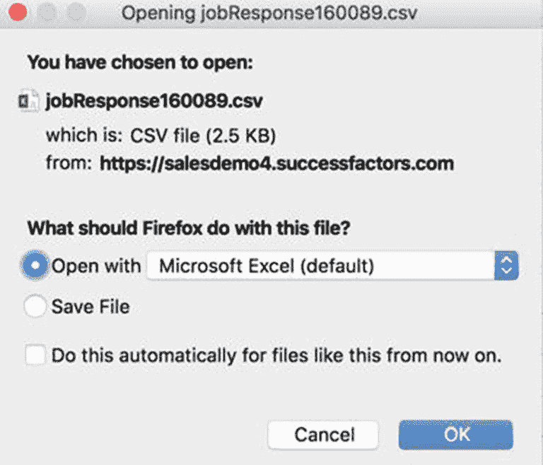
`图 2-35` 打开或保存文件的弹出屏幕

这是我们需要更新的文件。打开后，你将看到有多个语言列；这些是不同语言的标签。图 2-36 显示了该文件的布局。

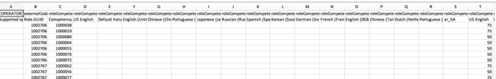
`图 2-36` 角色-映射能力文件

为了使文件更易于管理，你可以删除实例中未使用的任何语言列。在图 2-37 所示的示例中，`默认值`和`US_ 英语`是仅保留的语言列。

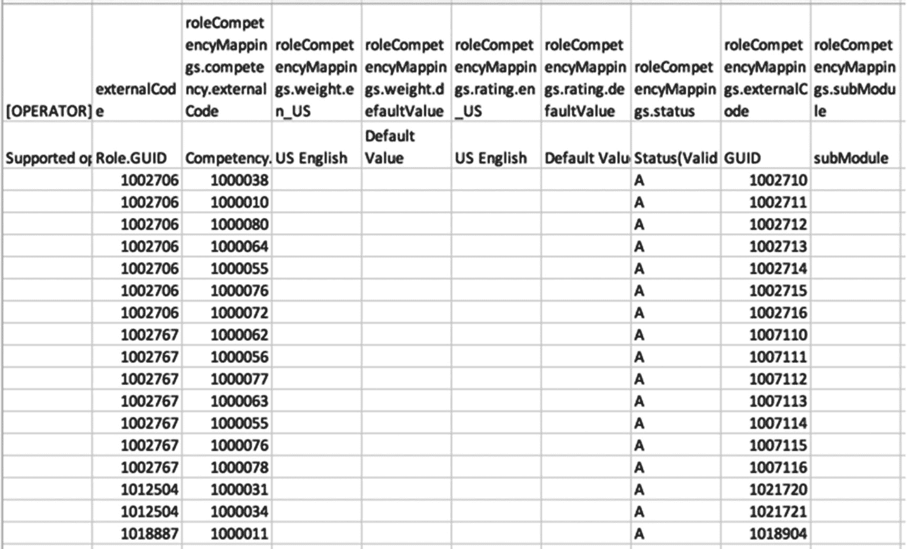
`图 2-37` 删除无关语言列后的角色-映射能力文件

为了给每个岗位角色能力添加预期评分百分比，我们将在以下列中添加值：

*   `roleCompetencyMappings.rating.en_US`
*   `roleCompetencyMappings.rating.defaultValue`

请使用以下计算公式来确定需要填入这些列中的预期评级百分比值：
`(x – 1)/(评级量表 – 1) = 预期评级百分比`，其中 `x` 是`职业工作表`中某项能力的预期评级。

在计算角色准备度时不使用权重，但你可以添加权重以备将来使用。要针对每个职务角色为每项能力添加权重，你需要填入以下列：

- `roleCompetencyMappings.weight.en_US`
- `roleCompetencyMappings.weight.defaultValue`

如果你使用任何其他语言，则需要为每种区域设置包含一列。

你可以为某些能力添加权重，而不为其他能力添加。所有能力都需要提供预期评级百分比。你看到的数字是百分比，而不是基于前述计算得出的评级。示例文件如图 2-38 所示。

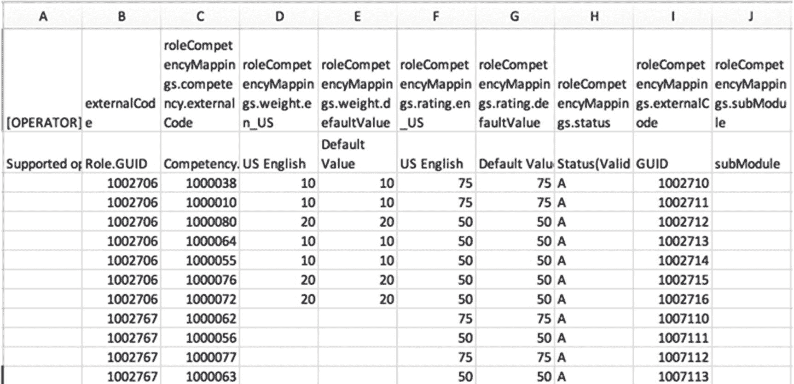
`图 2-38` 包含权重和评级的角色映射能力文件

# 导入模板与管理职业路径

## 导入模板

要导入模板，你需要包含以下列：

- `externalCode`
- `roleCompetencyMappings.competency.externalCode`
- `roleCompetencyMappings.weight.en_US`
- `roleCompetencyMappings.weight.defaultValue`
- `roleCompetencyMappings.weight.en_DEBUG`
- `roleCompetencyMappings.rating.en_US`
- `roleCompetencyMappings.rating.defaultValue`
- `roleCompetencyMappings.rating.en_DEBUG`
- `roleCompetencyMappings.status`
- `roleCompetencyMappings.externalCode`
- `roleCompetencyMappings.subModule`

从`管理职务档案内容导入/导出`导入文件，如图 2-39 所示。首先，运行以进行验证；如果成功，则执行导入。务必在`文件编码`字段中选择“Unicode (UTF-8)”。

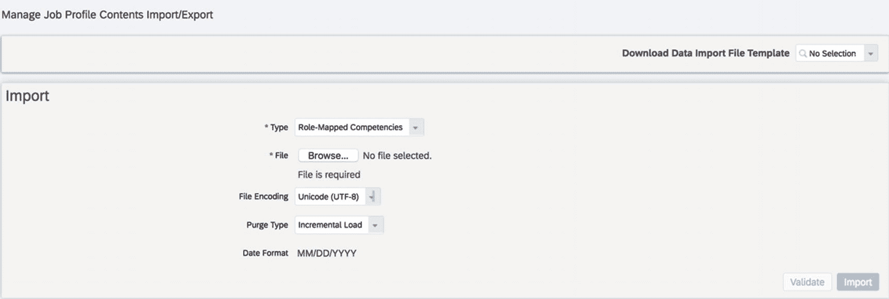

图 2-39：导入更新后的角色映射能力文件

我们现在已经了解了这个文件以及需要添加的内容。但文件中并未包含职务角色名称和能力名称。这将使得确定你要为哪个职务角色/能力映射添加字段变得棘手。因此，我们将退一步，以便你可以创建一个文件作为参考，来识别你正在处理的角色和能力。返回`管理职务档案内容导入/导出`。我们将下载包含数据的`角色`模板，以获取角色映射能力文件中使用的职务角色名称和关联的外部代码。接下来，我们还需要下载包含数据的`能力`模板，以查看能力名称及其关联的外部代码。在更新`角色映射能力`文件时，你可以将这两个文件合并作为参考。更多详细信息，请参考第 1 卷第 3 章。

## 管理职业路径

使用职业路径可以提供职务晋升的可视化表示，使员工能够了解哪些角色是通向下一职位的基础。一个职业路径由一组相似的工作组成，这些工作经过映射以显示从入门级到管理职位的晋升路径。

你可以设置多个职业路径。创建的职业路径适用于整个实例。例如，你可以创建特定于部门（如财务、销售和人力资源）的路径。并且你可以限制员工可以查看哪些职业路径。职业工作表可能包含指向职业路径的链接，以便员工可以查看各种路径，找到他们渴望的角色。他们可以在职业工作表中选择任何角色，以查看在该角色中取得成功所需的能力以及他们自身的准备程度。

如图 2-40 所示，工作表中有一个链接，可以查看任何目标角色的职业路径。

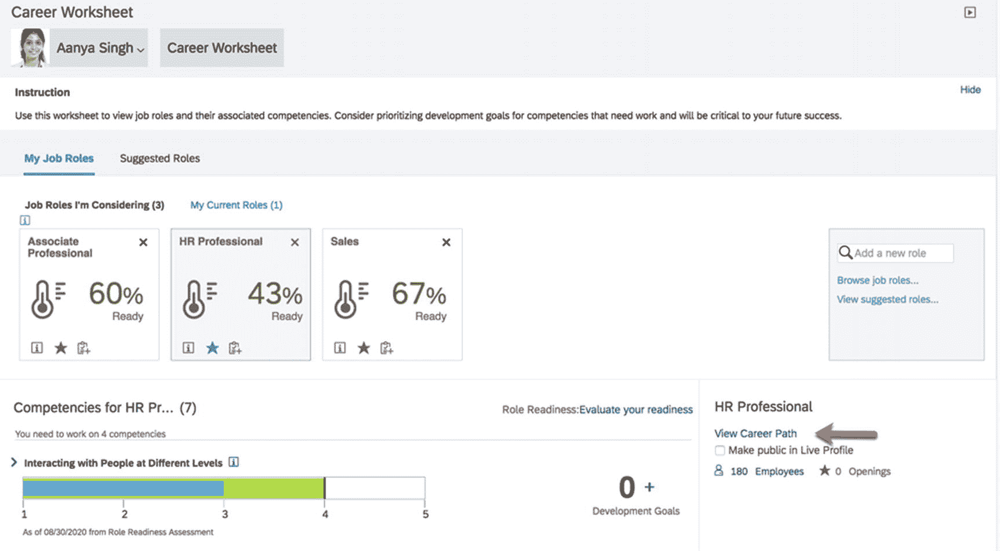

图 2-40：访问目标角色的职业路径

该角色的职业路径将显示，目标角色会被突出显示，如图 2-41 所示。

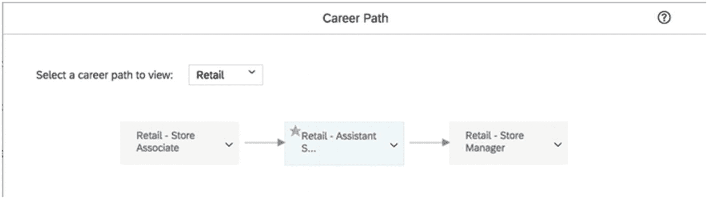

图 2-41：目标角色的职业路径

管理员需要为职业工作表中引用的职务角色创建职业路径。

管理员将在`发展`模块中拥有一个`职业路径`选项卡，如图 2-42 所示。职业路径在此处进行管理。此选项卡仅对在其基于角色的权限中拥有`管理职业路径`权限的角色可见。

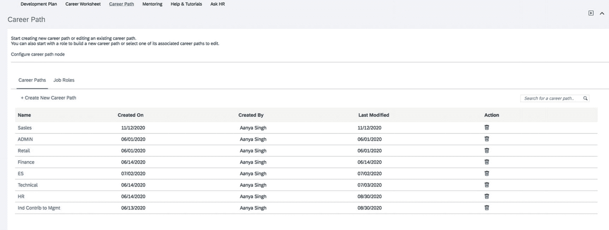

图 2-42：管理职业路径

`管理职业路径`界面包含两个选项卡：`职业路径`和`职务角色`。访问`管理职业路径`的权限将授予对这两个选项卡的访问权，这两个选项卡不能单独授权。

`职业路径`选项卡用于配置职业路径节点，以及创建、编辑和删除职业路径。单击介绍文本下方的`配置职业路径节点`链接。在此处确定要在角色节点上显示的元素。该选项卡如图 2-43 所示。

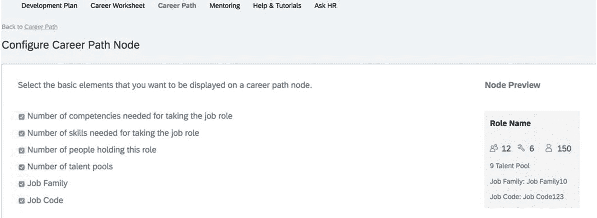

图 2-43：配置职业路径节点

使用此界面来决定职业路径内每个角色（节点）应显示哪些信息。图 2-44 标明了你可以选择的选项。

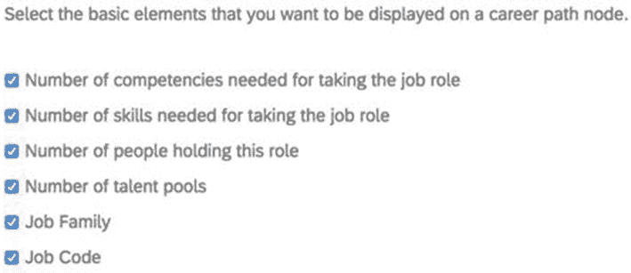

图 2-44：职业路径节点选项

决定了节点要显示的元素后，你可以查看节点预览，它会根据你的选择显示节点的大致外观。图 2-45 使用了所有元素。

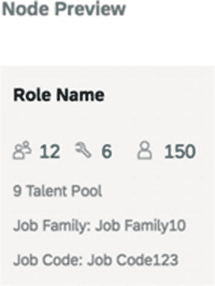

图 2-45：职业路径节点预览

所做的选择将反映在你创建的每条路径的职业节点上。保存选择并返回到`职业路径`界面。

单击`创建新的职业路径`。将弹出一个弹出窗口，如图 2-46 所示。

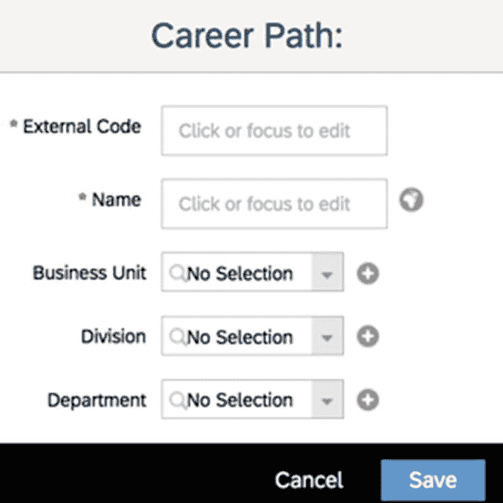

图 2-46：创建职业路径

你需要为你的职业路径起一个有意义的名称。`外部代码`和`名称`字段为必填项；`业务单元`、`部门`和`分部`为选填项。选填字段可用于限制员工对特定职业路径的访问权限。

图 2-47 显示了一个仅使用必填字段的职业路径示例。

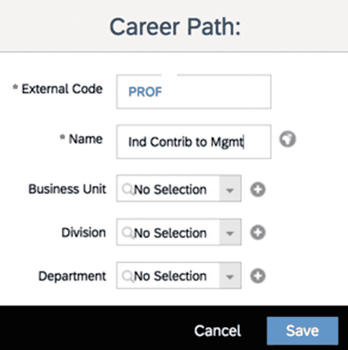

图 2-47：使用必填字段创建职业路径

保存后，将显示一个界面，你将在其中构建职业路径，如图 2-48 所示。

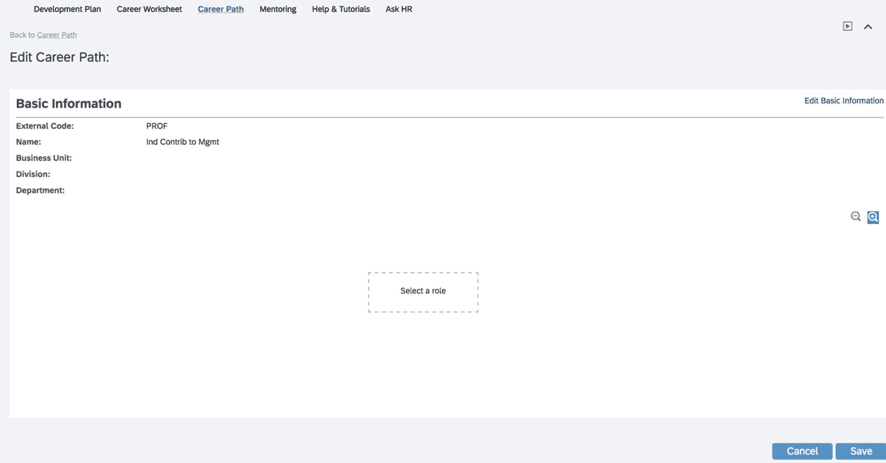

图 2-48：构建职业路径

单击屏幕中央的`选择一个角色`开始构建路径，如图 2-49 所示。将弹出一个窗口，显示你可以选择的角色。默认显示为列表视图，角色按系列/角色名称顺序排列。

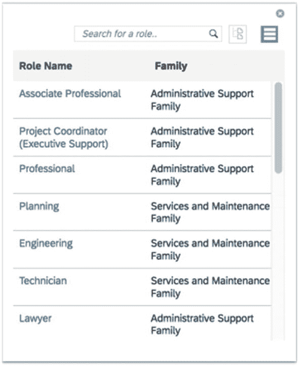

图 2-49：为职业路径选择角色


图 2-49：可添加到职业发展路径的角色

您可以将角色视图切换为树状视图，如图 2-50 所示。

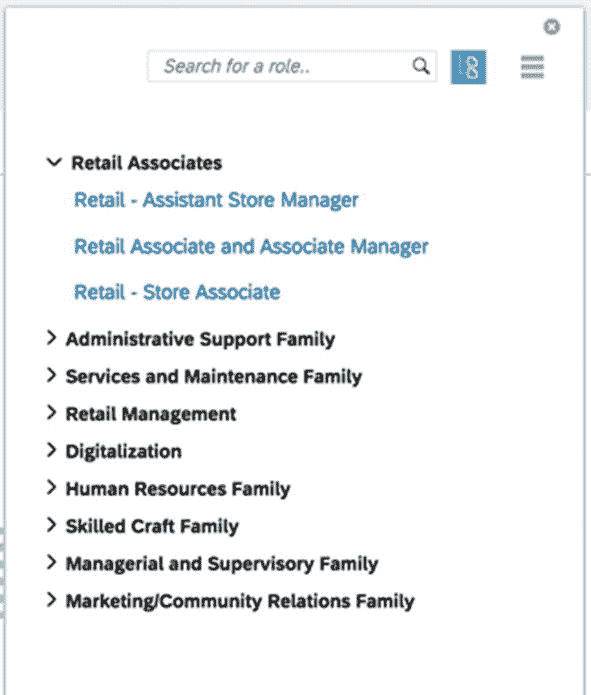

图 2-50：职位的树状视图

选择一个角色，它就会出现在职业发展路径屏幕上，如图 2-51 所示。

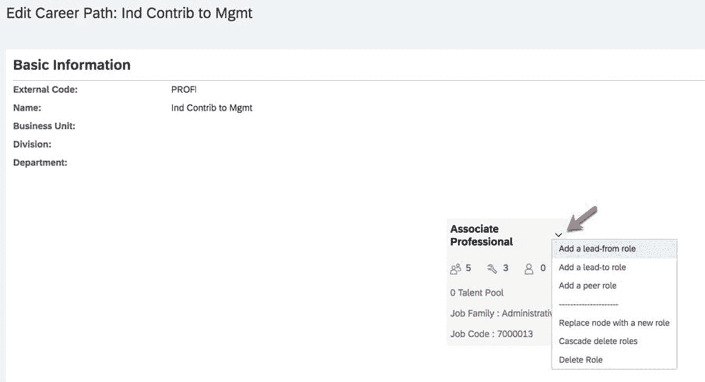

图 2-51：向职业发展路径添加职位

职业发展路径节点提供以下几种操作：

- 添加领先角色，为当前角色添加一个前置角色。
- 添加后继角色，为当前角色添加一个后置角色。
- 添加同级角色，在当前角色上方添加一个横向角色——每个节点最多可有两个横向角色。
- 用新角色替换当前节点。删除一个节点后，您可以选择一个替换节点。
- 级联删除角色。移除当前角色及其所有后续角色。
- 删除角色。移除一个角色，并将领先角色与后继角色相连接。

节点将根据所选操作出现在路径中。在下面的图 2-52 示例中，正在向路径添加一个后继角色。

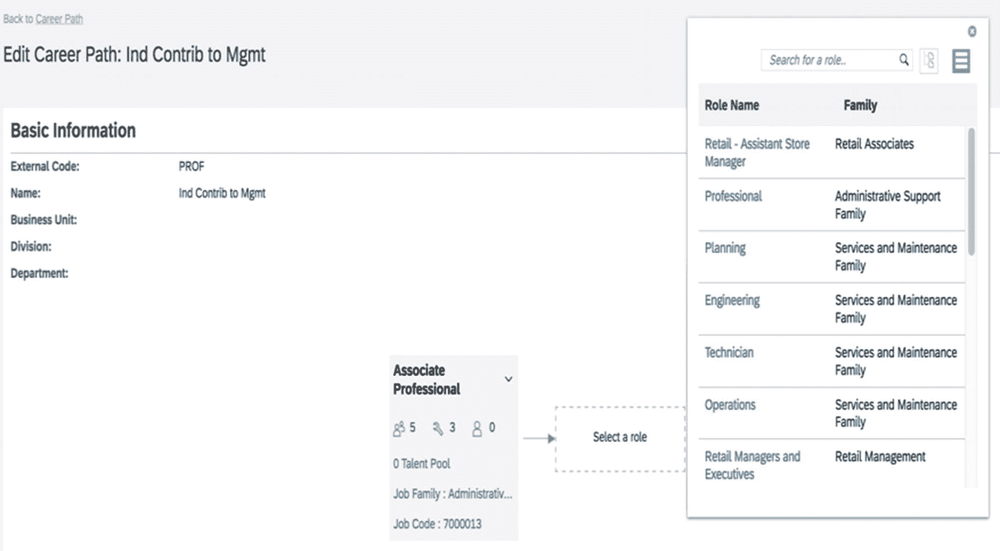

图 2-52：添加后继角色

图 2-53 展示了添加同级角色。这会将一个角色放置在路径中的同一级别上。


图 2-53：添加同级角色

继续添加角色，直到您的路径创建完成。保存路径，如图 2-54 所示。


图 2-54：保存新构建的职业发展路径

返回职业发展路径页面，即可看到您新添加的职业发展路径已列出。您可以继续创建路径，也可以编辑和删除路径。要编辑路径，请点击路径名称。在这里，您可以修改路径或编辑基本信息，如图 2-55 所示。


图 2-55：编辑职业发展路径的基本信息

点击“编辑基本信息”即可添加筛选器，如图 2-56 所示。您可以添加业务单位、部门，从而将职业发展路径的访问权限限制为仅属于这些部门的员工。


图 2-56：编辑职业发展路径

返回职业发展路径主屏幕，您可以转到“职位”选项卡，如图 2-57 所示。


图 2-57：职位选项卡

此视图让您能够查看某个角色属于多少条职业发展路径。点击角色名称，相应的职业发展路径便会显示。您选中的角色将在路径中高亮显示，如图 2-58 所示。


图 2-58：职业发展路径中选中的角色

在此屏幕上，您可以点击屏幕右下方的“编辑职业发展路径”按钮来编辑该路径。这将带您返回可编辑职业发展路径基本信息或路径本身的屏幕，如图 2-59 所示。


图 2-59：可编辑职业发展路径的屏幕

您需要执行以上步骤来创建每一条职业发展路径。

## 导入职业发展路径 V2

如果您的组织规模非常大，需要构建大量职业发展路径，手动逐一创建将非常耗时。为避免此手动流程，可以导入职业发展路径。

我们将引用两个文件：

-   **职业发展路径**：包含外部代码和特定于区域设置的翻译。

-   **职业发展路径-职业发展路径详情**：包含与职位相关的职业发展路径外部代码。

在搜索栏中键入并选中“导入和导出数据”，然后选择“下载模板”作为要执行的操作。使用“选择通用对象”下拉列表，选择“职业发展路径”。然后下载模板，如图 2-60 所示。


图 2-60：下载职业发展路径

这将生成一个压缩文件。

打开压缩文件，您会看到两个与职业发展路径相关的文件，如图 2-61 所示。


图 2-61：下载的职业发展路径文件

如图 2-62 所示，职业发展路径模板包含与手动创建职业发展路径时相同的字段：外部代码、职业发展路径名称、业务单位、部门和分部。此外，还会包含针对您实例中启用的语言对应的职业发展路径名称的特定于区域设置的翻译列。


图 2-62：职业发展路径模板

您可以删除实例中未使用语言的外部名称列，如图 2-63 所示。在此示例中，仅保留 `externalName` 列 `en_US`。


图 2-63：删除多余语言列后的职业发展路径模板

构建职业发展路径文件时，您只需填写必填的“外部代码”和“名称”字段。每条路径还需要一个唯一的外部代码。您可以使用任何对您有意义的命名约定。

保存包含您正在创建的所有职业发展路径的文件。图 2-64 是创建三个新职业发展路径的示例。


图 2-64：包含路径名称的职业发展路径文件

在搜索栏中键入并选中“导入和导出数据”，以导入新创建的职业发展路径文件。请确保使用 UTF-8 文件编码类型。首先验证文件以进行导入。转到“监控任务”查看结果。下载并打开“下载状态”列中的文件，如图 2-65 所示。


图 2-65：验证导入结果

如果没有任何错误，职业发展路径文件即可准备导入。

在搜索栏中输入并选择“导入和导出数据”，然后导入职业发展路径文件。再次进入“监控作业”以检查导入状态，并确保导入成功，如图 2-66 所示。


图 2-66：职业发展路径导入结果

如果成功，当您返回“发展”模块中的“职业发展路径”时，将看到新创建的职业发展路径。

接下来，您需要为每条职业发展路径构建职业节点。您需要包含的每个工作角色的 `GUID`。可通过“管理职位档案内容导入/导出数据”并下载“角色”数据来查找角色 `GUID`，如图 2-67 所示。


图 2-67：下载角色模板

下载文件后，前往“监控作业”下载该文件。此文件将在构建职业发展路径详细信息文件时用作参考。在职业发展路径详细信息文件中需要用到的是外部角色 `GUID` 列，如图 2-68 所示。


图 2-68：角色 `GUID`

在构建职业发展路径详细信息文件时，您需要为路径中的每个角色准备一条记录。该记录将包括职业发展路径外部代码、要添加到路径中的工作角色的角色 `GUID`、路径中下一个角色的角色 `GUID`，以及所添加的角色是否为同级角色（`“TRUE”` 或 `“FALSE”`）。示例文件如图 2-69 所示。


图 2-69：职业发展路径详细信息文件

您需要参考角色文件中的角色 `GUID` 来规划职业发展路径，以识别每个角色及其导向的下一个角色。路径的构建将基于 `Career Path-Career Path Details`（职业发展路径-职业发展路径详细信息）文件的 `nextRole` 列中列出的角色 `GUID`，以及 `isPeerRole` 列的值。

### 职业发展路径-职业发展路径详细信息文件布局

该文件用于映射角色之间的“导向”和“被导向”关联。

该文件的各列说明如下：

- **OPERATOR**（A 列）：对于新的职业发展路径，此行空白。其他值为 `Clear`、`Delimit` 和 `Delete`。

- **externalCode**（B 列）：包含职业发展路径名称。这是您在职业发展路径文件的 B 列中指定的名称。

## 职业发展路径详细信息字段

- `careerPathDetails.externalCode`（C 列）：对于新的职业发展路径，您可以在此处分配一个唯一的外部代码。如果您要更新现有职业发展路径中的详细信息，则需要从职业发展路径详细信息文件的导出中找到该代码。

- `careerPathDetails.role.externalCode`（D 列）：应包含您要添加到路径中的角色的角色 GUID。

- `nextRole.externalCode`（E 列）：应包含路径中下一个角色的角色 GUID。

- `careerPathDetails.isPeerRole`（F 列）：标识该角色是否为同级角色（`TRUE` 或 `FALSE`）。

在映射“导向”和“被导向”角色时，使用 `careerPathDetails.role.externalCode` 和 `careerPathDetails.nextRole.externalCode` 来关联路径中的下一个角色。通过在 D 列中标识一个角色并在 E 列中标识下一个角色，系统将知道下一个角色是否已在路径中。如果是，您添加的角色是“导向”角色，而不是“被导向”角色。

在映射同级角色时，`careerPathDetails.role.externalCode` 和 `careerPathDetails.nextRole.externalCode` 可能包含这两个角色中的任意一个，因为 `careerPathDetails.isPeerRole` = `“TRUE”` 定义了该映射是否为同级角色映射。

路径构建完成后，保存文件，并在“导入和导出数据”中使用通用对象类型 `“Career Path-Career Path Details”`（职业发展路径-职业发展路径详细信息）对其进行验证。在“监控作业”中检查结果后，如果验证成功，请返回“导入和导出数据”并导入该文件。导入完成后，您可以返回“发展”模块中的“职业发展路径”选项卡，职业发展路径即构建完成。

现在，您已创建了员工可以在其职业工作表中引用的职业发展路径。

## 建议角色

职业工作表的另一个功能是让员工查看建议角色。工作表中有一个名为“建议角色”的选项卡，如图 2-70 所示。员工将在此处看到基于管理员配置而为他们建议的角色。“建议角色”选项卡仅对员工可见，其经理或人力资源经理无法看到。


**图 2-70** 建议角色

建议角色可以基于职业发展路径或一组定义的标准。建议角色可以是能力、目标角色、职业发展路径和同级所选角色的组合。建议角色基于管理员完成的配置。请前往**工具** ➤ **管理建议角色**，如图 2-71 所示。


**图 2-71** 配置建议角色

基于此屏幕所选标准的算法将为用户创建建议角色，以便用户在其职业工作表上选择目标角色。

有一系列复选框用于标识建议角色所使用的标准。必须为每个启用的标准分配一个权重百分比。权重总和必须为 100，且只能是 0 到 100 之间的整数。

可选择的标准包括：

- 职业发展路径中的接近度
- 能力
- 工作族
- 空缺职位
- 团队内的受欢迎程度

每个标准的描述和评分如表 2-5 所示。

**表 2-5** 建议角色标准与评分

| 标准 | 描述 | 评分 |
| --- | --- | --- |
| 职业发展路径中的接近度* | 角色在职业发展路径中越接近，分配的分数越高。 | 对于职业发展路径中的每个角色，将接近度计算为 `1/(当前角色与路径中每个角色之间的角色数量)`。 |
| 与目标角色关联的能力 | 基于使用职业工作表就绪度计算得出的匹配分数。与预期的能力评级进行比较。 | 使用职业工作表角色就绪度百分比。从百分比转换。例如，`70%` 的就绪度百分比将对应 `0.7` 的分数。 |
| 工作族 | 如果该角色与用户角色属于同一工作族。 | `0` = 角色与用户角色属于不同工作族。`1` = 角色与用户角色属于同一工作族。 |
| 空缺职位 | 仅适用于传统职位。 | `0` = 无空缺职位。`1` = 有空缺职位。 |
| 团队内的受欢迎程度 | 具有相同经理且选择了相同目标角色的员工。 | 分数基于以下计算：选择了相同目标角色的同级人数 / 同级总人数。 |

截至撰写本文时，使用邻近因素存在一个限制。它仅适用于使用职位描述管理器（`JDM1.0`）的实例。针对职位档案构建器（`JPB`或`JDM2.0`）的代码增强发布日期尚未公布。使用所选因素，系统会为每个角色计算一个分数，然后进行加权。角色将按照分数从高到低的顺序显示在“建议角色”选项卡中。最多可显示 60 个角色。

在“建议角色”配置页面底部，有三个筛选选项：**能力**、**职务族**和**相关行业**。当用户查看其建议角色时，这些筛选器将可用，并允许他们筛选掉与其职业兴趣不符的角色。`相关行业` 是一个筛选器，仅当您使用职位档案构建器并将“相关行业”作为一部分添加到职位档案模板中时才可用。

## 角色就绪度评估表

在深入了解角色就绪度评估表的机制之前，我们先讨论一下该表是什么以及它如何融入职业工作表。角色就绪度评估表由员工从职业工作表中启动，用于评估员工在所选未来角色所需能力方面的熟练程度。该表用于帮助员工规划其职业发展，并确定未来角色所需的发展领域。

角色就绪度评估模板是一个绩效管理模板，因此它使用评分量表和路线图。如果启用了职业工作表，则应在配置（Provisioning）中找到标准的角色就绪度评估模板。它可以在“表单模板管理”下找到。该模板不应使用总体绩效评分，并且只应包含针对职位角色能力的单独评分。

模板的能力部分如图 2-72 所示。


*图 2-72：角色就绪度评估模板*

检查模板的高级设置，确保未启用“仅为在 {日期} 至 {日期} 之间没有现有表单且结束日期为空的用户创建”，如图 2-73 所示。


*图 2-73：高级设置*

该模板使用一个非常简单的路线图，仅包含员工和管理者角色。员工启动表单，对目标角色的能力进行自我评分。自我评分后，表单将路由给管理者，其主页上会出现一个“绩效待办事项”，管理者可以像访问其他绩效管理表单一样访问此表单。管理者将对表单上的每项能力进行评分。管理者的能力评分将用于与预期评分进行比较，以确定角色就绪度。然后表单返回给员工，由员工将其设置为“已完成”。路线图中的最后一步使员工能够知道他们随后可以在其职业工作表中检查角色就绪度。示例路线图见图 2-74。


*图 2-74：角色就绪度评估模板的路线图*

管理员还可以为职业工作表配置一个附加功能，接下来将对此进行讨论。

## 为职业工作表创建指向“我的当前角色”的深层链接

可以将深层链接添加到用户主页上的“快速链接”磁贴中。

要进行此设置，请在搜索中键入并选择“管理主页”，找到“快速链接”磁贴，如图 2-75 所示。


*图 2-75：管理主页*

点击“管理链接”以添加 URL，如图 2-76 所示。


*图 2-76：管理链接*

为标签提供一个名称，然后输入基础 URL，后跟 `sf/careerworksheet?currentrole=true`。要找到您的基础 URL，请查看登录页面的 URL。示例如下：

```
https://performancemanager4.successfactors.com/login#/companyEntry
```

移除 `login#/companyEntry`，并添加 `/sf/careerworksheet?currentrole=true`，如下例所示：

```
https://performancemanager4.successfactors.com/sf/careerworksheet?currentrole=true
```

将该链接设为默认链接并保存。

现在，新的深层链接将显示在主页的“快速链接”磁贴中。该链接会将员工引导至其职业工作表中的“我的当前角色”选项卡，如图 2-77 所示。


图 2-77：主页上的快速链接磁贴

## 总结

现在，我们已经回顾了配置中所需的职业工作表和职业路径设置。我们已经修改了职业工作表模板 XML。我们已经查看了管理员基于角色的权限。我们已经学习了如何创建职业路径以及如何配置建议角色。我们已经查看了职位档案构建器，以将预期评分映射到职位角色能力。我们讨论了角色就绪度评估表以及如何设置它。职业工作表现已准备就绪，可供使用。在下一章中，我们将设置基于用户角色的权限，并从用户的角度逐步了解职业工作表。现在，让我们来看一下职业工作表的集成。

## 职业工作表与继任组织图中的建议继任者集成

职业工作表与继任管理模块集成。来自职业工作表的就绪度计算结果用于在 v12 继任组织图中显示十位潜在继任者，如图 2-78 所示。


图 2-78：建议继任者

继任者的就绪度基于目标职位的职位角色能力和潜在继任者的能力评分。为此，需要满足以下条件：

-   职业工作表模板 XML 中的就绪度计算开关需要设置为“开”。
-   必须使用 `JDM 2.0`。
-   职业工作表模板 XML 中，所有角色 `“*”` 对 `readiness_meter` 具有“读取”权限。
-   定义了职位角色能力，并且用户与职位角色相关联。
-   继任规划者的权限角色具有“建议继任者”权限。

如果用户对角色所需的任何能力没有能力评分，则他们不会列为可能的继任者。

### 职业探索器

`Career Explorer` 是一项新功能，它基于组织中与其相似人员的职业路径，向员工推荐职业发展机会。它使用基于 SAP Leonardo 机器学习技术的“人员连接”来检索和分析员工中心数据。`Career Explorer` 目前仅适用于早期采用者关怀 (EAC) 计划的成员。要申请，您至少必须使用 SAP SuccessFactors Employee Central 以及使用职务代码、职位分类和能力的职位档案构建器。您必须拥有继任管理和职业发展规划，并且至少有 1000 条员工与职位角色配对记录。我们将在下一章简要介绍其功能。

# 结论

`Career Worksheet` 已启用，`Career Worksheet` 模板 XML 已配置，并且管理 `Career Worksheet` 功能的权限已授予。管理员已创建职业发展路径，确定了建议角色的标准，并配置了 `Role Readiness Assessment` 模板。

在下一章中，我们将设置员工、经理和 HR 经理角色访问 `Career Worksheet` 及其组件所需的基于角色的权限。然后，我们将逐步介绍员工及其经理在访问 `Career Worksheet` 时可使用的功能。

# 使用 `Career Worksheet`

在第 2 章中，我们启用并配置了 `Career Worksheet`。我们授予了管理员权限，并学习了如何创建职业路径。我们了解了如何选择建议角色的设置。我们查看了为职位角色能力添加期望评级的流程，并查看了 `Role Readiness Assessment` 表单。现在，我们准备了解员工及其经理如何使用 `Career Worksheet`。

我们将深入了解员工如何使用 `Career Worksheet` 来探索组织内的职位角色。我们还将看到职业路径如何为员工提供组织内职业角色晋升的概览。我们还将学习如何评估员工对未来角色的准备情况。

在本章中，我们将逐步介绍职业工作表中的选项卡。我们将了解在选择目标角色时，准备度计量表如何工作。我们将讨论每个选项卡中的组件，以及如何浏览职业路径、查看建议角色和启动 `Role Readiness Assessment` 表单。我们将查看员工、其经理及其 HR 经理可用的功能。我们还将简要介绍新的 `Career Explorer`。

以下是上一章中的一些要点提醒：

-   `Career Worksheet` 依赖于职位角色及其职位角色定义、已映射的能力以及预期能力熟练度评级。
-   必须通过使用 `Job Profile Builder` 或通过传统的系列和角色将能力映射到职位角色。我们建议使用支持职位描述描述的 JDM v2.0。如果您未使用带有 MDF 职位提名的 EC（该提名在职位对象上具有职位代码），则必须在用户数据文件 (UDF) 中分配职位代码，这些代码将在您的角色/职位代码映射中使用。有关如何将职位代码映射到角色以及如何将能力分配给角色的更多信息，请参阅第 1 卷第 3 章。您也可以将行为映射到能力。
-   如果您希望用户将职业发展目标与目标职位角色的能力相关联，则发展目标计划必须包含一个能力字段。
-   `Career Worksheet` 中使用的能力评级可能来自已完成的绩效或 360 评估表，或来自 `Role Readiness Assessment` 表单。

> **注意**
>
> 有关升级到 `Job Profile Builder` 的信息，请参阅 SAP 说明 #2383059。有关升级到 `Career Path` V2 的更多信息，请参阅 SAP 说明 #2485992。

## 用户角色的基于角色的权限

在开始之前，我们需要为员工、经理和 HR 经理角色设置基于角色的权限。这些角色权限之间的任何差异都将被高亮显示。

### `Career Worksheet` 权限

授予基于角色的权限，以便角色可以访问“发展”下的 `Career Worksheet` 选项卡。

在 `Career Development Planning` 中，员工、经理和 HR 经理角色的访问权限存在差异。员工角色将需要访问职业工作表和建议角色。建议角色仅对员工可访问；经理无法查看其直接下属的建议角色。即使有权限，经理和 HR 经理也无法访问建议角色。

在搜索栏中键入并选择“管理权限角色”。让我们从员工角色开始。打开该角色，单击“权限”，并使用以下路径授予权限：

-   `用户权限` ➤ `职业发展计划` ➤ `职业工作表访问权限`
-   `用户权限` ➤ `职业发展计划` ➤ `职业工作表建议角色访问权限`

权限如图 3-1 所示。确保已授予 `Career Development Plan` (CDP) 访问权限。这可提供从 `Home` 菜单访问 `Development` 选项卡的权限。


图 3-1 – 职业发展计划权限

保存该角色。对于经理和 HR 经理角色，使用以下路径授予权限：

-   `用户权限` ➤ `职业发展计划` ➤ `职业工作表访问权限`

在上一章中，我们学习了如何配置职业路径。如果 HR 经理角色将创建和管理职业路径，则需要额外的权限。HR 角色所需的基于角色的权限位于 `管理员权限` ➤ `管理职业发展` 中。如图 3-2 所示，授予“管理职业路径”的访问权限。配置职业路径节点是可选的。


图 3-2 – 管理职业路径权限

> **注意**
>
> 仅当使用 `Career Path` V2 时，职业路径节点才可用。使用职业路径节点可为角色提供附加信息，例如职位代码、职位族、该角色中的员工数以及角色能力数。

### 职业工作表模板访问权限

授予对 `Career Worksheet` 模板的权限，以便该角色可以访问职业工作表计划。权限由目标群体定义。由于员工角色可以访问“自己”，员工将只能看到自己的计划。当经理角色拥有模板权限时，他们可以查看其直接下属的职业工作计划。类似地，当 HR 经理角色拥有此访问权限时，目标群体将是 HR 经理所支持的所有员工。

使用以下路径为员工、经理和 HR 经理角色授予权限：

-   `用户权限` ➤ `目标` ➤ `目标计划权限` ➤ `其他` ➤ `Career Worksheet`

访问职业工作表计划的权限设置如图 3-3 所示。


**图 3-3** – 用于职业工作表的目标计划权限

这是对先前授予的 `Career Development Plan` 访问权限以及在发展计划中使用学习活动时的 `Learning Activity List/Detail View` 的补充。

### 职业路径权限

所有角色都需要职业路径的访问权限。如果 HR 经理角色将创建职业路径，则权限会有所不同。

对于员工和经理角色，在 `用户权限` 部分中，转到 `杂项权限` ➤ `职业路径` ➤ `查看可见性`。权限如图 3-4 所示。


**图 3-4** – 职业路径权限

HR 经理角色若需创建职业发展路径，则需要具备职业发展路径的“查看”和“编辑”权限。关于此权限的说明：拥有“查看”和“编辑”权限的角色将能访问所有职业发展路径。`字段级覆盖`选项用于选择在职业发展路径定义中显示或隐藏哪些基本信息元素。

覆盖字段如图 3-5 所示。


**图 3-5** 职业发展路径覆盖字段

权限类型为“无访问权限”或“只读”，如图 3-6 所示。


**图 3-6** 覆盖权限

当某个字段被选择为“*无访问权限*”时，该字段将被隐藏。如果选择“只读”，则该角色在创建或编辑职业发展路径时将无法使用此字段。

如果您希望限制用户对特定职业发展路径的访问，可以在权限角色的 `编辑授权` 部分进行设置，如图 3-7 所示。


**图 3-7** 限制访问

在 `编辑授权` 内的步骤 3 中，“为其他对象指定目标群体”，如图 3-8 所示，向下滚动找到 `Career Path`。


**图 3-8** 指定职业发展路径目标群体

有一个选项可以将目标群体限制为选定的职业发展路径。在下拉菜单中选择限制条件。这些选项在下拉列表中可见，如图 3-9 所示。


**图 3-9** 限制选项

访问权限可以按外部编码、业务单元、部门或分部进行限制。这些与创建职业发展路径时看到的筛选条件相同，如图 3-10 所示。


**图 3-10** 用于限制的职业发展路径字段

接下来，选择用于标识角色被限制访问的职业发展路径的条件和值，如图 3-11 所示。


**图 3-11** 用于限制的值

### 角色就绪度的员工权限

员工和经理角色需要在权限设置的 `用户权限` 部分下的 `绩效` 中具备 `绩效管理访问权限`，如图 3-12 所示。这将允许访问 `角色就绪度评估` 表单。很可能此权限已被授予。


**图 3-12** 绩效管理访问权限

员工角色还需要能够启动 `角色就绪度评估` 表单，因此在 `通用用户权限` 下授予 `创建表单` 的权限，并选择 `角色就绪度评估`，如图 3-13 所示。


**图 3-13** 创建角色就绪度评估表单的权限

经理和 HR 经理角色不需要创建 `角色就绪度评估` 表单的权限，因为只有员工可以从他们的职业工作表中启动此表单。

### 经理和 HR 经理角色的报告权限

如果经理和 HR 经理将要创建或运行关于 `职业工作表` 目标角色数据的即席报告，则需要创建和运行这些报告的权限。

对于这些角色，请转到 `用户权限` 部分中的 `报告权限`，并启用以下项：

-   `创建报告` ➤ `职业工作表目标角色`
-   `运行报告` ➤ `职业工作表目标角色`

这些角色还需要访问 `CDP 仪表板`。同样在 `报告权限` 下的 `分析磁贴和仪表板` 中，启用 `CDP 仪表板`。这些权限将允许经理访问其直接下属的报告。HR 经理角色将能够访问其支持的所有员工。

基于角色的权限汇总于表 3-1。

**表 3-1** 各角色所需权限

| 权限/角色 | 员工角色 | 经理角色 | HR 经理角色 |
| --- | --- | --- | --- |
| `职业发展规划 ➤ 职业工作表访问权限` | X | X | X |
| `职业发展规划 ➤ 职业工作表建议角色访问权限` | X | | |
| `管理职业发展 ➤ 管理职业路径` | | | X 可选 |
| `创建表单权限 ➤ 角色就绪度评估` | X | | |
| `绩效管理访问权限` | X | X | |
| `杂项权限 ➤ 职业路径` | X | X | X |
| `目标 ➤ 目标计划权限 ➤ 职业工作表` | X | X | X |
| `报告权限 ➤ 创建报告 ➤ 职业工作表目标角色` | | X | X |
| `报告权限 ➤ 运行报告 ➤ 职业工作表目标角色` | | X | X |
| `报告权限 ➤ 分析磁贴和仪表板 ➤ CDP 仪表板` | | X | X |

现在，我们已经为员工、经理和 HR 经理权限角色授予了 `职业工作表` 的访问权限。接下来，我们将了解 `职业工作表` 中的功能。

### 员工可用的职业工作表功能

员工在 `职业工作表` 中可用的特性和功能包括：

-   浏览工作角色
-   查看建议的角色
-   浏览角色时查看工作简介
-   添加目标角色
-   查看目标角色所需的胜任力
-   查看所有包含目标角色某项胜任力的角色
-   启动 `角色就绪度评估` 表单
-   查看目标角色的职业发展路径
-   查看当前角色的职业发展路径
-   使目标角色在员工资料中可见
-   为目标角色胜任力添加发展目标
-   为当前角色胜任力添加发展目标
-   查看目标角色中的员工姓名
-   查看每个目标角色的就绪度指示器
-   查看目标角色已满足的胜任力
-   查看目标角色的差距分析

### 使用职业工作表

现在我们已经了解了员工可以使用哪些功能，让我们开始吧！

`职业工作表` 包含在 `职业发展` 模块中。员工可以通过点击主页主菜单的下拉菜单并选择 `发展` 来访问 `职业工作表`。默认视图是“发展计划”，如图 3-14 所示。点击选项卡切换到“职业工作表”。


**图 3-14** 从主页菜单查看发展模块

`职业工作表`，如图 3-15 所示，由两个选项卡组成：`我的工作角色` 和 `建议的角色`。下图显示了 `我的工作角色` 选项卡的视图。


**图 3-15** 员工首次查看职业工作表的视图

## 我的工作角色

我们将逐一浏览工作表中的每个选项卡。我们会查看每个选项卡中显示的内容及其工作方式。首先，我们来看一下 `我的工作角色` 选项卡。

`我的工作角色` 包含两个子选项卡：`我正在考虑的工作角色` 和 `我的当前角色`。每个选项卡的标签都包含一个工作角色数量计数。

`我正在考虑的工作角色` 将显示员工选为目标角色的每个工作角色。这可以看作是潜在的未来角色。在员工选中目标角色之前，这里不会显示任何工作角色。在这种情况下，该选项卡会显示“您尚未添加任何角色”，如图 3-15 所示。

一旦选中了目标角色，员工将看到他们为胜任该角色所做的准备程度。准备程度基于对目标角色工作角色能力的掌握情况，并通过准备程度仪表盘显示。`准备程度仪表盘`会显示员工准备程度的具体百分比。

在我们查看此屏幕上的可用功能、如何浏览工作角色、查看建议角色或职业路径以及选择目标角色之前，让我们先切换到`我的当前角色`子选项卡。这将让我们有机会熟悉每个子选项卡中的一些组件。一旦我们了解了基础知识，我们将返回到`我正在考虑的工作角色`。

## 我的当前角色选项卡

点击`我的当前角色`以查看与员工当前工作角色相关的信息。屏幕显示如图 3-16 所示。


*图 3-16 我的当前角色选项卡*

`我的当前角色`包含基于职位代码字段与员工关联的工作角色。当前的职位名称列在工作角色能力上方的方框中。提醒一下，一个职位代码只能映射到一个工作角色，但您可以有多个职位代码映射到同一个工作角色。工作角色具有已映射的能力及期望评级。我们将重点关注工作角色的这些期望评级。我们在前一章讨论了定义期望能力的方法。第 1 卷，第 3 章描述了将职位代码映射到工作角色的过程，如有任何问题，您可以参考该章节。

在此子选项卡中，您可以看到员工当前工作角色的工作角色能力以及任何相关的`发展目标`。如果员工已完成对工作角色能力进行评级的绩效评估，工作表将使用评估表中的能力评级，并显示与实际评级对比的期望能力评级。

如果这听起来还不清楚，我们稍后会讲到。我们通过先查看当前工作角色来为理解`我正在考虑的工作角色`选项卡奠定基础。

此页面结构使得所有工作角色能力都会列出，并且将包括映射到该工作角色的任何`核心能力`。员工未达到或超过期望评级的能力将首先显示。这些能力将出现在标题“您需要改进 n 项能力”下，其中`n`是能力的数量，如图 3-17 所示。


*图 3-17 能力未达标的当前角色*

员工能力评级达到或超过期望评级的工作角色能力将显示在标题“您已达标 n 项能力”下，如图 3-18 所示。这些能力将紧随未达标的能力之后。


*图 3-18 实际评级达到或超过期望的工作角色能力视图*

图 3-19 显示了某项能力的详细信息。


*图 3-19 能力详细信息*

点击能力名称右侧的信息图标可查看能力详细信息。

能力详细信息来自能力描述，如图 3-20 所示。可以通过路径`管理工作档案内容 -> 能力 -> 能力名称`找到。


*图 3-20 能力描述*

回到`我的工作角色`，每个能力下方都有一个差距图。这是员工能力掌握程度与期望能力评级之间差距的可视化表示。该图表标识了员工对该能力的最后一次记录评级与期望评级之间的差异。它使用了`职业工作表`模板 XML 和提供评级的绩效模板中标识的评级量表。我们在前一章中查看了这两个模板，并指出必须使用相同的评级量表，差距图和准备程度仪表盘才能正常工作。

将鼠标悬停在图表上可查看实际评级与期望评级的对比，如图 3-21 所示。


*图 3-21 带有评级的差距图*

图表上看到的期望评级来自工作角色能力期望评级，如图 3-22 所示。请参阅前一章以了解期望能力评级的设置。


*图 3-22 工作角色能力期望分数*

每项员工评级达到或超过期望的能力，将显示绿线（上次评级）覆盖蓝线（期望评级），如图 3-23 所示。如前所述，这些能力会在所有未达标的能力之后显示。


*图 3-23 实际能力评级超过期望能力评级*

实际评级的日期和来源显示在图表下方，如图 3-24 所示。在此示例中，于`09/14/20`完成的`2020 年绩效评估征求反馈`表单是能力评级的来源。


*图 3-24 实际能力评级的日期和来源*

提醒一下，系统会使用已完成的绩效表单中最新的评级。

如果有任何与该能力相关的发展目标，它们将反映在差距图右侧的发展目标计数中。要查看发展目标的详细信息，请展开该能力，如图 3-25 所示。在此，您可以编辑或删除该能力。此处所做的任何更改都将反映在员工的发展计划中。


*图 3-25 与工作角色能力相关的发展目标*

点击加号，如图 3-26 所示，可为该能力添加发展目标。


*图 3-26 能力项的发展目标计数*

添加目标将增加该能力项的发展目标计数，并且该目标会连同关联的能力项一同被添加至发展目标计划中，如图 3-27 所示。


*图 3-27 为能力项添加发展目标*

现在，发展目标已与工作表上的能力项相关联，如图 3-28 所示。


*图 3-28 为职位角色能力项新增的发展目标*

该发展目标已添加至发展计划，并关联了相应的能力项，如图 3-29 所示。


*图 3-29 包含新发展目标与关联能力项的发展计划*

现在，我们应该已经熟悉差距图如何工作、衡量的是什么，以及“我的当前角色”中如何显示职位角色能力项。这与“我正在考虑的职位角色”选项卡使用的布局相同，但后者还包含一些我们接下来将要探索的附加功能。

## 我正在考虑的职位角色

在员工选择未来角色之前，“`我正在考虑的职位角色`”子选项卡不会包含任何角色或能力项，如图 3-30 所示。如前所述，未来角色也称为目标角色，这两个术语可以互换使用。


*图 3-30 未包含任何角色的“我正在考虑的职位角色”选项卡*

一旦选择了某个职位角色，它就会显示在此子选项卡中，并且与该角色关联的能力项也会包含在内。最初，员工可以通过两种方式选择目标角色：浏览职位角色或查看建议角色。选择角色后，还会通过目标角色的职业发展路径提供额外选项。我们将详细研究每种方法。

### 浏览职位角色

员工可以点击“`浏览职位角色...`”链接来查看所有职位角色，如图 3-31 所示。


*图 3-31 浏览职位角色*

将弹出一个窗口，按职务族显示所有职位角色。员工可以展开任意职务族以查看其下的角色。示例如图 3-32 所示。


## 3.32 按职务族浏览职位角色

点击某个职位角色的展开图标，可以查看职位描述。这基于该职位角色的职务简介。示例如图 3-33 所示。


## 3.33 职务简介

选择一个角色并点击“`添加角色`”。可以选择任意数量的角色作为目标角色。但是，可以在“`职业工作表 XML`”中设置一个属性来限制所选角色的数量。一旦达到限制，员工将无法选择更多角色，如图 3-34 所示。


## 3.34 已达到最大角色数量的提示消息

请回顾前一章，了解如何在“`职业工作表 XML`”中设置此限制。

“`我正在考虑的职位角色`”屏幕将显示新选择的角色，如图 3-35 所示。


**图 3-35** “我正在考虑的职位角色”子选项卡中的目标角色

在此子选项卡中选择目标角色的另一种方法是使用`查看建议角色...`。

### 建议角色

访问建议角色有两种方式。在“我正在考虑的职位角色”中，您可以点击`查看建议角色...`。另一种选择是点击`建议角色`选项卡。这两种选项均在图 3-36 中高亮显示。


**图 3-36** 查看建议角色的选项

`建议角色`选项卡的权限并非基于角色。换句话说，您无法选择哪些被许可的角色可以查看此选项卡。但是，此选项卡仅在员工查看其职业工作表时可用。如果为经理或人力资源经理角色设置的基于角色的权限授予了对建议角色的访问权限，那么在查看员工的职业工作表时，这两种角色也不会看到此选项。

我们已在上一章中讨论过建议角色的配置。建议角色可以基于系统管理员创建的职业路径，或者基于一组标准的算法。

图 3-37 显示了员工在其职业工作表的“建议角色”选项卡中可能看到的内容示例。


**图 3-37** 建议角色

员工可以使用`能力`或`职务族`筛选器来缩小角色范围，如图 3-38 所示。


**图 3-38** 建议角色筛选器

员工可以根据这些建议角色的能力选择查看建议角色，如图 3-39 所示。


**图 3-39** 基于建议角色能力进行筛选

员工可以按建议角色的任何职务族进行筛选，如图 3-40 所示。


**图 3-40** 按职务族查看建议职位角色

`职务族`筛选器的示例如图 3-41 所示。根据所选筛选器，仅显示四个建议角色。


**图 3-41** 基于职务族筛选器的建议角色

员工可能看不到任何建议角色。图 3-42 显示了一个示例。


**图 3-42** 无可用建议角色

如果员工尚未选择任何目标角色，没有带有能力评分的已完成绩效表格，或者不符合任何建议角色的条件，则可能出现这种情况。通常，一旦员工选择一个角色并返回此页面，建议角色就会显示出来。

可以通过点击每个角色旁边的加号来选择任意或全部建议角色。将显示一条确认消息，如图 3-43 所示。此外，该角色的添加图标将变为非激活状态。


**图 3-43** 建议角色已添加消息

目标角色现在显示在“我正在考虑的职位角色”子选项卡中，如图 3-44 所示。


**图 3-44** “我正在考虑的职位角色”子选项卡中的目标角色

该职位角色所需的能力也将一并列出。如果员工当前的职位角色包含任何相同的能力，则可能会显示差距图；如果员工有针对这些能力的发展目标，则发展目标及其计数也会列出。

您会注意到，准备度仪表显示了这些目标角色的准备度百分比。这是因为员工当前的职位角色包含一些与目标角色相同的能力。员工当前角色的能力评分被用来计算准备度百分比。您还会注意到，五个能力中只有两个有差距图。这是因为员工当前角色只拥有其中两种能力，并且有相应的评分。我们将在本章后面看到，使用“角色准备度评估”表单是一种填充其他能力的方法，因为这种方式会基于目标角色的能力对员工进行评分。

对于目标角色的每项能力，都会显示同样关联了该能力的角色数量，如图 3-45 所示。在“家族与角色”中映射到某项能力的所有职位角色都将作为具备该能力的角色包含在差距图部分。


**图 3-45** 共享该能力的其他角色

点击链接可查看同样具备此项能力的目标角色名称。示例如图 3-46 所示。


**图 3-46** 具备该能力的其他职位角色

### 职业路径

现在员工已选择了目标角色，还可以查看职业路径。员工可以查看目标角色的职业路径。示例如图 3-47 所示。


**图 3-47** 查看目标角色职业路径的选项

职业路径将显示出来。示例如图 3-48 所示。


**图 3-48** 目标角色的职业路径

目标角色将带有星标，并以不同颜色（通常为蓝色）显示。

如果员工当前的角色也在该职业路径中，它也会被加上星标。如果员工选择了多个目标角色，也可以在此页面查看这些角色的职业路径。点击`选择要查看的职业路径：`下拉列表，可查看其他目标角色的路径名称，如图 3-49 所示。


**图 3-49** 选择查看其他职业路径的选项

点击职业路径中的任意角色，即可查看其职位简介，如图 3-50 所示。


**图 3-50** 目标角色职位简介

还可以从职业路径中添加另一个目标角色。点击某个角色的向下箭头，如图 3-51 所示。


**图 3-51** 添加目标角色

也可以从职业工作表中删除现有的目标角色。点击下拉图标可查看删除选项。示例如图 3-52 所示。


**图 3-52** 取消选择目标角色

此处所做的更改将反映在“我考虑的工作角色”子选项卡中。

如果目标角色不属于某个职业路径，则不会有查看该职业路径的选项，如图 3-53 所示。


**图 3-53** 无可查看职业路径的目标角色

既然已经选择了目标角色，我们来更详细地了解它们。

## 目标角色功能

每个目标角色都会有一个准备度指示器，包含三个图标：“角色详情”、“将此设为目标角色默认项”和“添加新的学习活动”。示例如图 3-54 所示。


**图 3-54** 准备度指示器图标

#### 角色详情

将鼠标悬停在任何目标角色的信息图标上，即可查看职务简介，如图 3-55 所示。


**图 3-55** 目标角色职务简介

#### 默认角色

点击任意目标角色的星形图标可将其设为默认角色，如图 3-56 所示。当该目标角色成为默认目标角色时，星形图标将改变颜色。


**图 3-56** 点击星形图标将该角色设为默认目标角色

#### 添加学习活动

当启用`LMS`时，将显示“添加新的学习活动”图标，如图 3-57 所示。


**图 3-57** 添加新的学习活动图标

如果`LMS`与`发展`模块集成，并且您允许用户为发展目标添加学习活动，则员工可以将学习活动分配至其`LMS 待办事项列表`。

如图 3-58 所示，员工可以在学习目录中查找活动，或通过能力搜索活动。请注意，当用户从`LMS`中完成的学习项目获得能力评等时，准备度指示器会相应更新。


**图 3-58** 启用 LMS 时的学习活动选项

您可能已开启`LMS`，但未在`发展`模块中使用。在这种情况下，您会看到此图标，但它不会链接到任何内容。`职业工作表`模板`XML`中没有隐藏此图标的选项。

### 目标角色选项

要从“我考虑的工作角色”子选项卡中删除目标角色，请点击目标角色右上角的“X”图标，如图 3-59 所示。


**图 3-59** 删除目标角色

这将从“我考虑的工作角色”子选项卡中移除该目标角色。

## 准备度指示器

如前文所述，映射到工作角色的能力是职业工作表上所列能力的唯一来源。员工对某个角色的准备度是通过将员工的已评能力与目标角色的预期能力评等进行对比来确定的。图表始终使用最新的能力评等，无论其来源如何。

`准备度指示器`会根据情况显示百分比、`0%` 或 `角色未就绪`。如果用户拥有包含目标角色任何能力的已完成绩效表单，则目标角色的`准备度指示器`将显示百分比。但如果员工针对目标角色的能力评等非常低，以至于将准备度计算为`0%`，则百分比可能为 `0%`。员工可能只具备目标角色所需的一项能力，因此准备度也会计算为`0%`。

在图 3-60 所示的示例中，员工仅具备目标角色的一项能力，且评等低于预期评等。


**图 3-60** 目标角色准备度为 0%

如果员工对目标角色中的任何能力均无评等，则准备度指示器将显示 `角色未就绪`，如图 3-61 所示。


**图 3-61** 无匹配能力的目标角色

## 员工档案中的职业目标

员工可以将任意或所有目标角色添加到其 `人员档案` 的 `职业目标` 区块中。方法是点击目标角色上的复选框 `在动态档案中公开`，如图 3-62 所示。


**图 3-62** 将目标角色添加到档案

当员工查看其档案时，该角色将显示出来，如图 3-63 所示。


**图 3-63** 档案中的目标角色

根据权限设置，员工可以在其档案中查看目标角色或编辑目标。其他角色在查看员工档案时也可能被授予查看此区块的权限。

回到职业工作表的“我考虑的工作角色”子选项卡，员工可以看到目标角色中的员工人数，如图 3-64 所示。


**图 3-64** 目标角色中的员工人数

点击该数字可查看与该角色关联的员工姓名，如图 3-65 所示。


**图 3-65** 担任该目标角色的员工姓名

## 角色准备度评估

除了根据员工现有角色当前已评定的能力来评估其转入目标角色的准备度外，还可以仅根据目标角色的能力进行评估。此方法使用 `角色准备度评估` 表单。员工突出显示一个目标角色，然后点击链接启动 `角色准备度评估` 表单。示例如图 3-66 所示。


**图 3-66** 启动角色准备度评估

## 发起“岗位胜任度评估”表的好处

发起`岗位胜任度评估`表的好处在于，员工及其直属经理将根据目标岗位所需的能力标准来评估胜任程度，而非依赖当前的能力评级——后者可能并不适用于新岗位。此外，员工可能缺乏目标岗位所需的能力，因此胜任度计算结果可能产生偏差。

只有员工角色才能在职业工作表中发起`岗位胜任度评估`表。经理或人力资源经理无法发起该表，且代理功能不允许用户代表员工发起表单。

使用`岗位胜任度评估`表时，每项能力的差距图评级基于经理的评级和预期能力评级。

在“我考虑的工作岗位”子标签页中，针对任何目标岗位都有一个“评估你的胜任度”链接。点击该链接可直接打开`岗位胜任度评估`表，跳过常规的表单创建步骤。该表已配置为自动填充目标岗位的能力项。示例如图 3-67 所示。


**图 3-67** 从职业工作表发起`岗位胜任度评估`表

员工需对每个目标岗位的能力进行自我评分。填写完成后，表单将流转至其经理处进行评分。

经理将在其“绩效收件箱”中收到`岗位胜任度评估`表。经理需根据其对员工掌握每项能力程度的判断提供评分，如图 3-68 所示。


**图 3-68** 经理对目标岗位能力进行评分

表单将返回给员工，供其查看经理评分并设置表单为已完成状态。员工可通过其“绩效收件箱”或返回其职业工作表访问该表单。针对该目标岗位，将显示“岗位胜任度评估进行中”链接，如图 3-69 所示。


**图 3-69** 表单进行中

点击该链接将引导员工进入表单并将其设置为已完成状态，如图 3-70 所示。


**图 3-70** 设置为已完成的表单视图

已完成的表单将出现在员工和经理的“绩效已完成”文件夹中。当员工返回工作表时，“胜任度仪表盘”将根据评分显示百分比，如图 3-71 所示。


**图 3-71** 评估完成后更新的`胜任度仪表盘`

如果其他目标岗位包含刚评分的相同能力项，这些岗位的`胜任度仪表盘`现在可能显示不同百分比。请参考前一章节中的“岗位能力预期评级”部分，了解如何确定这一数值。

当目标岗位显示“评估你的胜任度”时，可以再次生成该表单。也可为任何其他目标岗位发起表单。重新发起并完成另一份`岗位胜任度评估`表后，将根据每个目标岗位的新评分重新计算胜任度仪表盘和差距图。还可以添加更多待考虑岗位，并针对这些新岗位运行表单。

用户可以根据需要多次重新发起该表单。他们可以对其选择的任何目标岗位重新运行评估。

## 当前岗位的岗位胜任度评估

员工也可以从“我的当前岗位”发起`岗位胜任度评估`表，如图 3-72 所示。


**图 3-72** 为当前岗位发起`岗位胜任度评估`

这将使用当前岗位的能力项发起表单，如图 3-73 所示。


**图 3-73** 当前岗位的`岗位胜任度评估`表

该表单将经历与为目标岗位发起表单时相同的步骤。

如图 3-74 所示，完成评估后，当前岗位将在每个差距图中显示更新的能力评分，并显示表单名称和表单完成日期。


**图 3-74** 基于`岗位胜任度评估`更新的差距图

请注意，当前岗位没有`胜任度仪表盘`，但每个能力项都会有差距图。这对员工很有用，他们可以围绕这些能力项制定发展目标。

如果有任何目标岗位使用了这些相同的能力项，其`胜任度仪表盘`和差距图将在“我考虑的工作岗位”子标签页中更新。示例如图 3-75 所示。


**图 3-75** 基于已完成的`岗位胜任度评估`更新的目标岗位差距图

当前岗位已评分的能力项，以及表单名称和完成日期，也会反映在包含这些能力项的任何目标岗位中。需要留意的是：如果你未针对某个目标岗位运行`岗位胜任度评估`表，则该目标岗位的胜任度评级可能源于不同日期、不同来源的评分。

## 职业工作表中“我的当前岗位”的深层链接

在 2020 年上半年版本发布之前，如果员工想查看职业工作表中的当前岗位，他们必须进入“发展”模块，打开“职业工作表”，并将“我的工作角色”子标签页从“我考虑的工作岗位”切换为“我的当前岗位”，如图 3-76 所示。


**图 3-76** 在`职业工作表`中查看当前岗位

现在，员工可以从专用主页的“快速链接”磁贴直接进入“职业工作表”中的“我的当前岗位”子标签页，如图 3-77 所示。


**图 3-77** 主页上的“快速链接”

用户会点击“快速链接”磁贴，查看所有可用链接，如图 3-78 所示，这将直接跳转到他们在“职业工作表”中的当前角色。


**图 3-79：** 链接到当前角色


**图 3-78：** 快速链接到当前角色

点击“我的当前角色职业工作表”链接会将员工直接带到他们的职业工作表，如图 3-79 所示。

## 经理视角的职业工作表

现在我们已经了解了员工在职业工作表中可以执行的操作，让我们来看看经理的视角。

根据职业工作表模板 XML 和基于角色的权限配置，经理和 HR 经理角色可以访问员工的职业工作表。

任一角色都需要进入他们自己的职业工作表，并进行姓名搜索来访问员工的计划。经理可以查看目标角色的职业路径、浏览角色，以及查看目标角色中的员工，如图 3-80 所示。


**图 3-80：** 经理视角的员工“我正在考虑的工作角色”子标签页

经理还可以访问员工的“我的当前角色”子标签页，如图 3-81 所示。


**图 3-81：** 经理视角的员工当前角色

根据权限，经理将能够查看正在考虑的角色、当前角色，以及差距图表和准备就绪度量。他们还可以查看角色的职业路径、浏览工作角色，以及添加待考虑的工作。但是，经理看不到员工的“建议角色”标签页，也无法启动“角色准备就绪评估”表单。

经理和 HR 经理对员工职业工作表的访问可能包括以下内容：

*   浏览工作角色。

*   查看带有准备就绪度量和差距分析的目标角色。

*   添加目标角色。

*   查看职业路径并添加角色。

*   为目标角色或当前角色上的能力添加发展目标。

经理和 HR 经理没有以下权限：

*   查看“建议角色”标签页。

*   删除目标角色。

*   查看建议角色。

*   启动角色准备就绪评估（代表员工）。

如果允许，HR 经理还可以创建职业路径。

现在我们已经了解了员工、他们的经理和他们的 HR 经理在职业工作表中可以做什么。接下来，我们将简要介绍报告选项。

## 职业工作表报告

职业工作表的即席报告功能非常有限。目标角色是职业工作表中唯一可报告的部分。该报告可以显示员工在其职业工作表中选择的所有目标角色。但是，它也会显示当前角色，并且无法区分当前角色和目标角色。

### 即席报告

要创建职业工作表目标角色的即席报告，报告类型为“表格”，如图 3-82 所示。


**图 3-82：** 创建即席报告的报告类型

要选择的域是“职业工作表目标角色”，如图 3-83 所示。


**图 3-83：** 数据源

向导会引导您完成创建报告的步骤。首先，命名报告，并选择要包含的人员。在“数据集”选项卡中，要选择的模板是“职业工作表”，如图 3-84 所示。


**图 3-84：** 要选择的模板

从“列”选项卡中，选择要显示的字段，如图 3-85 所示。


**图 3-85：** 报告的输出字段

选择字段和任何筛选条件后，运行报告。该报告将显示员工的当前角色以及目标角色，如图 3-86 所示。


**图 3-86：** 报告结果

## 仪表板

还有一个标准的 CDP 仪表板可以启用。它允许经理查看其团队中员工的目标角色以及每个角色的能力准备就绪情况。

可以从 SuccessStore 添加该仪表板。在搜索栏中输入并选择“管理仪表板”。如图 3-87 所示，点击“管理标准仪表板和 YouCalc 文件”。


**图 3-87：** 管理仪表板

点击“从 SuccessStore 添加”，如图 3-88 所示。


**图 3-88：** 在“管理仪表板”中添加标准 CDP 仪表板

滚动列表，找到“CDP 仪表板”，然后点击“添加到实例”，如图 3-89 所示。


**图 3-89：** 在“管理仪表板”中添加标准 CDP 仪表板

正如本章开头基于角色的权限中提到的，请确保经理和 HR 角色有权访问此仪表板。在经理和 HR 经理角色的基于角色的权限中，添加“报告权限” ➤ “分析工具和仪表板” ➤ “其他” ➤ “CDP 仪表板”，如图 3-90 所示。


**图 3-90：** 访问 CDP 仪表板的权限

当仪表板由经理生成时，仪表板概览会显示目标角色计数，如图 3-91 所示。


**图 3-91：** 仪表板上的目标角色计数

经理可以深入查看任何角色，以了解每位员工的准备就绪情况，如图 3-92 所示。


**图 3-92：** 目标角色的深入查看

### 职业探索器

职业发展的一个新组件是`职业探索器`。它利用机器学习算法，根据用户“与我相似”的特征来推荐未来职位。`职业探索器`基于组织中与员工情况相似人群的职业路径来推荐职业机会。这使得员工能够发现传统职业路径之外可能的未来角色，并将这些角色设定为自身职业发展的目标。

员工可以查看曾担任其职位或具有相似技能、过往职位、教育背景的用户的职业路径，从而帮助自己确定下一步发展。这提供了有别于使用预定义职业路径决定下一角色的个性化指导。

`职业探索器`如图 3-93 所示。


**图 3-93** 职业探索器

员工可使用`职业探索器`查看量身定制的未来职位以供考虑。每个角色都可以查看其能力、技能和其他职位简介详情。员工可以选择一个未来角色，该角色将添加到其职业工作表中。在工作表上，员工会看到目标角色所需具备的能力，这有助于他们识别能力差距和需要发展的领域。

需要说明的是，`职业探索器`仅在 2020 年上半年的早期采用者关怀（EAC）计划中可用。

## 总结

我们已为`职业工作表`授予用户权限。我们了解了员工如何根据 HR 管理员做出的配置决策来使用`职业工作表`的功能。员工可以利用此工具探索职业路径、查看未来可能期望获得的职位、发现达到这些职位所需技能和能力的差距，并通过发展目标战略性地规划如何弥补这些不足。我们还了解了经理和人力资源经理如何访问员工的职业工作表并针对其目标职位生成报告。我们简要了解了`职业探索器`及其如何与`职业工作表`集成。

# 4. 导师制

导师制是帮助员工个人成长和职业发展的宝贵工具。导师制在提供指导、建议和榜样作用的有经验员工与初级员工之间建立了一种关系。导师可以分享自身职业见解，帮助受指导者设定发展目标、识别兴趣领域，并提供建立人际网络的机会。

SAP SuccessFactors 中的导师解决方案分为两部分。导师管理员将使用`管理导师计划`工具，在`发展`模块之外创建、维护和跟踪导师计划。管理员将创建导师计划、确定参与者、定义匹配导师和受指导者的标准、邀请用户参与、分配和重新分配匹配关系，以及更改计划状态。我们将详细讨论这些功能。该模块与`发展`模块协同工作，以支持员工的发展。

## 导师流程概述

一旦管理员创建了导师计划，就会向选定的员工发送电子邮件邀请，邀请他们加入。邮件包含一个链接，该链接将受邀者引导至`职业发展`模块中一个名为`导师制`的新标签页。所有基于用户的导师任务都在此执行，包括注册导师计划、确定偏好以寻找最佳匹配、接受和拒绝请求，以及结束导师关系。我们将以导师和受指导者的身份体验导师计划的示例。

当计划建立且导师和受指导者匹配成功后，管理员可以更改导师关系、修改导师的可用性、跟踪和报告计划，以及关闭计划。

加入时，导师和受指导者需要明确他们在导师关系中寻求什么。导师/受指导者匹配是通过识别偏好，然后为受指导者找到满足这些需求的导师来完成的。所创建计划类型决定了谁可以加入、如何进行匹配，以及是否需要批准参与。

电子邮件通知在导师计划中使用非常频繁。用户在计划期间可能会收到 24 种导师制通知。这些电子邮件会提示用户在`导师制`概览页面中采取行动。在本章末尾，我们将介绍这些邮件、它们的内容以及触发条件。

在本章中，我们将涵盖以下主题：

- Provisioning 中的导师设置

- 基于角色的权限

- 管理导师计划

- 创建自定义导师计划

- 使用匹配计划

- 作为参与者使用导师制

- 电子邮件通知

- 临时报告

### Provisioning 设置

让我们从使用导师制所需的 Provisioning 功能开始。

如果您正在使用`职业发展`，这些功能应已在 Provisioning 中启用：

- 元数据框架（MDF）

- 通用对象

- 附件管理器

- CDP 完整版（发展计划）

- 基于角色的权限

### 导师制设置

要使用导师制，请在`公司设置`中，找到`目标框架`下的`职业与发展规划`部分，勾选`启用导师计划`旁边的复选框，如图 4-1 所示。


**图 4-1** 在公司设置中启用导师计划

### 其他可启用选项

根据您的组织情况，您还可以启用其他选项：

- 如果您希望通过使用动态员工组来识别导师参与者，则应启用`动态组 V2（我的组）`。

- `SAP Jam`可以与导师制集成以创建 SAP 组。如果您希望使用此功能，则必须在`公司设置`中也启用`SAP Jam 集成`。

- 对于`临时导师制报告`，请确保已启用“临时报告生成器”，然后启用：
  - “其他临时子域架构配置”下的“导师计划”
  - 在人员选择器中“启用从用户开始包含”下的“导师计划”

保存所做的更新。

根据您在导师计划中选择使用的功能，在 Provisioning 中可能还需要执行其他任务。这些项涉及自定义程序和自定义选择列表。我们将在本章后面解释这两项。

一旦在 Provisioning 中启用导师制，就需要在用户界面中设置权限。

### 基于角色的权限

`Mentoring`功能通过 API 调用为导师计划参与者填充数据。数据访问由基于角色的权限控制。管理员、所有者和计划参与者所需的权限将根据他们对计划所需的访问级别而有所不同。这些权限包括用于管理计划的管理员功能，以及允许访问计划的用户功能。此外，`Mentoring`功能使用了元数据框架（`MDF`），这要求所有角色都拥有基本的“读取”和“写入”权限。现在，我们将了解`Mentoring`功能所需的角色以及每个角色所需的权限。

## 导师计划管理员角色

您可以决定为人才组中的某个个人创建一个新角色来管理导师计划。在这种情况下，请将该用户分配到一个与此权限角色关联的导师计划权限组。在非常大的组织中，您可能有多个导师计划管理员。您也可以决定将导师计划权限添加到一个现有的 HR 管理员角色中。

## 导师计划参与者角色

如果您组织中的所有成员都有资格参与导师计划，则可以将导师计划权限添加到员工角色中。如果只有组织的某些部门参与，则可以为这些用户创建一个权限组。然后将新的权限组分配到一个新的导师计划权限角色。

在搜索栏中键入并选择“管理权限角色”。选择要更新的角色。表 4-1 包含了导师计划管理员角色和导师计划用户角色所需的权限。导师和学员拥有相同的权限，因此这些权限不需要单独的权限角色。您可以将权限添加到一个现有的员工权限角色中。或者，正如刚才提到的，如果有一组特定的员工将使用导师计划，您可以确定这些用户来创建一个权限组，然后将他们分配给一个导师计划用户角色。

### 表 4-1 管理和参与导师计划所需的基于角色的权限

| 用户权限部分 | 权限 | 管理员角色 | 导师/学员角色 |
| --- | --- | --- | --- |
| **常规用户权限** | `公司信息访问 ➤ 用户搜索` | `X` | `X` |
| | `社区访问` | `X` | `X` |
| **员工数据** | `姓氏, 名字 ➤ 查看` | `X` | `X` |
| **职业发展计划** | `导师计划访问权限` | `X` | `X` |
| **报告权限** | `为导师计划创建/运行临时报告` | | `X` |
| **管理员权限部分** | | | |
| **元数据框架** | `访问非安全对象` | `X` | `X` |
| **管理集成工具** | `允许管理员通过基本身份验证访问 OData API` | `X` | |
| **管理职业发展** | `管理导师计划` | `X` | |
| **管理用户** | `管理员工动态组` | `X` (可选) | |

如前所述，`Mentoring`功能包含与 SAP Jam 的集成。启用后，导师计划管理员可以在建立导师计划时创建 SAP Jam（社区）群组。这为参与者提供了一个额外的协作、培训和讨论平台。要利用此集成，请确保所有参与导师计划的用户都已启用了基于角色的 SAP Jam 访问权限。

### 选择列表

创建导师计划时，导师计划管理员会设计一个注册表单。注册表单包含一系列导师和学员必须回答的问题才能参与。这些问题用于确定他们在导师关系中寻求的偏好。根据回答和匹配规则，系统会推荐导师/学员配对。问题的答案可以是自由格式文本，也可以基于选择列表中的值。以下列出了可用于回答问题的标准选择列表：

*   能力
*   部门
*   事业部
*   地点
*   性别
*   职位族
*   职位角色
*   职位代码
*   职位级别
*   职位名称
*   技能

也可以创建自定义选择列表。无论哪种情况，标准选择列表和自定义选择列表都必须在数据模型中定义，并授予“读取”权限。

既然我们已经在 Provisioning 中启用了`Mentoring`功能，并设置了基于角色的管理员和导师计划用户权限，那么让我们进一步讨论可以创建的计划类型以及创建它们的步骤。

## 导师计划类型

可以创建三种类型的导师计划：

1.  **公开报名：** 这些计划对所有员工或特定群组开放。计划没有固定的日期，包括结束日期。用户可以注册为导师、学员或两者兼有。可以选择要求导师的参与必须由其经理或导师计划管理员批准。学员必须在注册时选择导师；但是，导师可以拒绝。
2.  **受监督：** 导师计划管理员选择参与计划的导师和学员。管理员必须根据预定义日期手动发送邀请。学员只能在导师注册期结束后才能注册。学员可以指出导师偏好，但不会通知导师批准或拒绝学员。一个匹配程序会为每位学员确定最佳匹配。管理员可以更改任何匹配，然后才会将匹配确认信息发送给导师和学员。
3.  **不受监督：** 不受监督的导师类型是基于邀请的。导师计划管理员选择参与计划的导师和学员，邀请系统会根据导师和学员的注册日期自动生成。管理员也可以手动触发邀请邮件。在注册期间，学员必须选择一位导师。导师会收到请求通知，并可以批准或拒绝该提议。管理员也可以分配或解除分配关系。

表 4-2 突出显示了不同计划类型的一些功能差异。本章稍后将详细讨论这些功能。

### 表 4-2 每种计划类型可用的功能

| 操作/计划类型 | 受监督 | 不受监督 | 公开报名 |
| --- | --- | --- | --- |
| 自动发送邀请 | | `X` | |
| 使用匹配程序识别推荐匹配 | `X` | | |
| 使用计划日期 | `X` | `X` | |
| 导师需批准参与 | | | `X` |
| 计划需要邀请才能参与 | `X` | `X` | |
| 计划对任何有导师计划访问权限的人开放 | | | `X` |
| 可以以学员、导师或两者身份加入计划 | | | `X` |
| 学员可以选择导师 | `X` | `X` | `X` |
| 当学员选择导师时，导师会收到一封电子邮件 | | `X` | `X` |
| 管理员可以分配和重新分配任何匹配 | `X` | `X` | `X` |
| 导师可以拒绝学员请求 | | `X` | `X` |
| 导师可以更改其可用性 | `X` | `X` | `X` |
| 仅在单独的导师和学员注册期内注册 | `X` | | |

#### 自定义项目

到目前为止，我们已经了解了三种可用的标准导师计划类型。此外，还可以创建最多三种自定义计划类型。它们具有与标准计划相同的特性和功能，但使用自定义标签。自定义计划提供了灵活性，可以用您自己的标签替换计划中使用的所有导师相关术语。您可能希望将一个计划称为“辅导计划”而不是导师计划。通过创建自定义标签，自定义计划内的屏幕以及电子邮件通知都将使用您的标签。

系统级别的`文本替换`工具会用自定义值覆盖默认文本。在这里，所有导师相关的术语都可以替换为其他标签。这将影响所有标准导师计划的所有标签。计划级别的替换文本用于创建自定义导师计划，其标签仅针对这些计划。最多可以创建三个自定义计划，每个计划都有自己的标签。使用自定义标签创建文本替换包。我们很快就会介绍这个过程。

## 导师管理功能

现在我们将学习如何创建、跟踪和更新导师计划。在搜索栏中输入并选择“管理导师计划”。导师计划概览屏幕将如图 4-2 所示显示。


**图 4-2** 管理导师计划概览页面

所有导师管理任务都在此执行。我们将回顾此页面上的功能以创建和管理导师计划，但首先让我们了解一些在创建任何计划之前可能设置的可选配置。

## 导师计划设置

位于屏幕右上角，点击“设置”链接到导师计划配置。在此处完成的配置将应用于所有导师计划。可以定义两种类型的配置：自定义选择列表和文本替换。

图 4-3 显示了自定义选择列表配置的默认选项卡。


**图 4-3** 导师计划设置

### 自定义选择列表

除了标准选择列表外，管理员还可以在注册问题中使用自定义选择列表。当管理员在创建计划注册表单时选择问题类别时，此处标识的任何自定义选择列表都将可用。这样，在注册过程中回答偏好问题时，就可以使用自定义选择列表的值。

在`自定义选择列表配置`选项卡的下拉列表中，管理员可以标识在设计注册表单时要提供的任何额外选择列表。选择选择列表后，创建选择列表标签。图 4-4 显示了一个示例。这是在创建计划期间选择问题类别时将显示的选择列表名称。


`图 4-4` 添加自定义选择列表

选择列表标签可以本地化，如图 4-5 所示。


`图 4-5` 本地化自定义选择列表名称

所有用于问题的选择列表都将在设计注册表单时出现在问题类别选择中。在问题类别的下拉列表中，自定义选择列表将按字母顺序显示在标准选择列表之后。

## 自定义计划

点击“设置”中的另一个选项卡。在此选项卡中，管理员将标识最多三个自定义计划的文本替换包。图 4-6 显示了一个示例。


`图 4-6` 用于标识自定义导师计划的文本替换配置选项卡

如果您不打算使用任何自定义计划，则此选项卡中无需输入任何内容。您可以跳过以下详细介绍创建自定义语言包步骤的部分。如果您计划使用自定义计划，请在使用`文本替换配置`选项卡之前定义替换文本。

让我们回到配置中的公司设置。应启用语言包以及“启用管理语言工具”。需要为您使用的每种语言启用语言包。

一旦启用了“管理语言”工具，“管理语言”将在公司设置中可用，如图 4-7 所示。


`图 4-7` 在配置中访问“管理语言”

在“管理语言”中，下载默认活动语言的默认标签，如图 4-8 所示。


`图 4-8` 下载标准默认标签

该文件用作查找导师计划中使用的所有标签的参考。如果默认活动语言的自定义区域设置不存在，则创建一个。如果存在，您将向其中添加条目。无论哪种情况，请下载自定义标签文件。新创建的文件只包含一个标题行。我们将使用包含新自定义计划标签的新键来填充它。

使用记事本或任何 UTF-8 编辑器打开默认的`.csv`文件。

按键（A 列）对文件进行排序，以查找所有以`DEVELOPMENT_MENT.`开头的键。这些将是所有与导师相关的标签，如图 4-9 所示。


`图 4-9` 默认标签文件中的导师相关标签

我们需要为自定义导师计划类型创建带有自定义标签的自定义键。首先，将所有与导师相关的键从默认文件复制到空的自定义文件或现有的自定义文件中。自定义文件将只包含两列：键和语言。在创建文件时，我们将在 B 列中使用`en_US`。

检查每个键的标签（B 列），找出任何包含导师相关单词或短语的标签。您可以删除自定义文件中不需要新标签的任何键。一种更费力的方法是进入实例，打开系统语言的调试版本，并查看每个导师屏幕以了解所使用的键和标签。记录所有需要自定义标签的键，并确保这些键将出现在您的自定义文本文件中。

对三个自定义计划的引用必须标识为`TYPEA`、`TYPEB`或`TYPEC`。例如，如果您正在创建一个辅导计划，此自定义计划的所有标签的键中应包含`TYPEA`。如果另一个导师计划是针对学习小组的，则该计划的所有标签的键中应包含`TYPEB`。其他新计划将使用`TYPEC`的标签。

对于您的第一个自定义计划，请使用`TYPEA`。现在，您的自定义文件上应该拥有所有需要新文本的键。您需要将`_TEXTREPLACEHEADING_TYPEA`附加到自定义文件中的每个键上。

如图 4-10 所示，A 列包含了所有常规的 `DEVELOPMENT_MENTORING` 键，并附带了替换文本键（`_TEXTREPLACEHEADING_TYPEA`）。这些键标识了将在您的第一个自定义程序（`TYPEA`）中使用的所有标签。


`图 4-10` 用于创建自定义标签的示例文件

对于替换某个单词或短语（例如 mentor、mentee 或 mentoring）的键，请在 B 列中提供新的自定义标签。对于需要引用新单词的键，也请使用 `_TEXTREPLACEHEADING_TYPEA` 创建新的键。标签应引用这些新单词键。

在前图所示的文件中，辅导计划键（`DEVELOPMENT_Mentoring_program`）现在在文件上有一个自定义键，名为 `DEVELOPMENT__Mentoring_program_TEXTREPLACEHEADING_TYPEA`，其标签为“Coaching Program”。任何引用“mentoring”计划的键都需要创建一个包含 `_TEXTREPLACEHEADING_TYPEA` 的新键名，并且标签需要引用 `DEVELOPMENT__Mentoring_program_TEXTREPLACEHEADING_TYPEA`，以便将“mentoring program”替换为“coaching program”。

文件构建完成后，上传自定义标签文件。要使自定义文本替换功能在其他系统语言中生效，请针对这些语言重复相同的过程。

现在，辅导管理员可以返回实例，在“管理辅导计划”中进入“设置”，以选择要使用的文本替换包。如图 4-11 所示，启用并命名所创建的每种类型。


`图 4-11` 为自定义辅导计划确定要使用的自定义语言文本包

在我们演示的示例中，只创建了一个自定义计划。请注意，替换包的键名与添加到自定义文件 `TEXTREPLACEHEADING_TYPEA` 中键的后缀名称相同。当创建任意标准类型的新计划时，管理员将选择“计划文本替换选项”，并指定要使用的替换包名称。当我们实际创建一个计划时，这一点会更清晰。

## 管理员计划概览页面

更新计划设置后，返回计划概览页面。辅导计划按状态分组。计划将显示在概览页面的“未开始”、“进行中”和“已完成”部分。概览页面的示例如图 4-12 所示。


`图 4-12` 辅导计划概览

计划状态描述如下：

- **未开始：** 计划注册仍在进行中；仍需输入信息。

- **进行中：** 计划已开始，对于开放式计划，它们保持开放直到手动关闭。受监督和不受监督的计划会运行至结束日期。在此阶段无法删除。管理员需要先将状态设置为 `Complete`。

- **已完成：** 计划已达到结束日期，不再活跃。只有已完成的计划才能被删除。

单击现有计划将显示“详细信息”选项卡，这是默认选项卡。根据计划类型和状态，还可能有“导师”、“学员”、“问题”和“匹配”选项卡。示例如图 4-13 所示。


`图 4-13` 辅导计划中的选项卡

现在我们已经浏览了概览页面并了解了设置，接下来让我们看看用于创建辅导计划的屏幕。

### 创建新辅导计划

从概览页面，管理员需点击“创建新辅导计划”。如图 4-14 所示，弹窗将显示计划类型。管理员选择要创建的计划类型后，系统会依次显示一系列引导页面，用于定义计划的参数。根据计划类型的不同，详情页面中的字段和参与者页面会存在一些差异。选择类型后，管理员需点击“继续”按钮开始创建辅导计划。


`图 4-14` 创建辅导计划时选择计划类型

所选的计划类型决定了目标受众、是否发送邀请以及是否设置计划日期。你需要在“详细信息”选项卡中标识这些标签。

表 4-3 列出了管理员在创建辅导计划时会用到的页面。根据辅导计划类型的不同，这些页面会存在一些差异。

### 表 4-3 计划页面

| 计划创建页面 | 描述 | 受监督 | 非受监督 | 公开报名 |
| :--- | :--- | :--- | :--- | :--- |
| 辅导计划详细信息 | 用于命名和定义计划及其设置，并在适用时设置日期。 | X | X | X |
| 导师 | 选择被邀请作为导师参与计划的员工。 | X | X | |
| 学员 | 选择被邀请作为学员参与计划的员工。 | X | X | |
| 注册表单 | 定义参与者报名时需要完成的问题。同时定义匹配规则。 | X | X | X |
| 摘要 | 包含用于创建表单的每个页面的内容，为管理员在启动前提供进行任何更新的机会。 | X | X | X |
| 电子邮件模板 | 标准的导师和学员邀请电子邮件通知会显示在摘要页面上，以便管理员进行自定义修改。 | X | X | |

在创建任何类型的辅导计划时，都会显示“辅导计划详细信息”页面。针对每种计划类型，所显示的字段仅存在细微差异。例如，图 4-15 展示了受监督辅导计划的详细信息页面。


### 图 4-15 受监督辅导计划的详细信息页面

详细信息页面上所有可能的字段均列于表 4-4 中。表中包含了每个字段的描述以及会显示该字段的计划类型。

### 表 4-4 详细信息选项卡字段

| 字段 | 描述 | 受监督 | 非受监督 | 公开报名 |
| :--- | :--- | :--- | :--- | :--- |
| 上传图片 | 可为你的计划上传图片。 | X | X | X |
| 辅导计划名称 | 辅导计划的名称，将显示在电子邮件、管理员辅导工具以及参与者的辅导界面上。必填字段。支持本地化。 | X | X | X |
| 描述 | 对参与者可见，显示在其参与的每个计划的计划页面上。也可使用此字段包含任何有用的信息，例如后续步骤或计划指南。支持本地化。 | X | X | X |
| 所有者 | 被指定的所有者可在管理员创建计划后对其进行管理。在流程中的任何时候，管理员都可以移除或更改所有者。 | X | X | X |
| 导师学员上限 | 定义每位导师最多可带的学员数量；上限为 20 人。计划创建后，管理员可调整此限额。当导师注册时，只要限额大于 1，他们也可以调整此数量。 | X | X | X |
| 学员导师上限 | 定义每位学员最多可拥有的导师数量；上限为 20 人。计划创建后，管理员可调整此限额。当导师注册时，只要限额大于 1，他们也可以调整此数量。 | X | X | X |
| 允许参与者结束辅导关系 | 此选项在公开报名计划中启用；否则参与者无法自行结束关系，需由管理员介入。可对受监督和非受监督计划启用。 | X | X | X |
| 创建与此辅导计划关联的社区群组 | 将社区群组与计划关联。辅导管理员和所有者被邀请加入该群组并担任管理员。导师和学员匹配后，他们也会被加入该群组。辅导计划的导师和学员概览页面会显示 SAP Jam 群组动态。 | X | X | X |
| 导师审批方式 ➤ 需要导师审批（由辅导计划管理员或经理审批） | 仅适用于公开报名计划。如果勾选，辅导计划管理员或经理必须批准导师参与计划。 | | | X |
| 管理员或所有者审批导师 | 选择此选项时，需包含文本以注明注册请求中必须包含的文件。导师提交注册请求并上传管理员或所有者必须批准的文件。导师状态将为“待定”，直至获得批准。 | | | X |
| 经理审批导师 | 当用户注册为导师时，系统会向其经理发送邮件以批准其参与。导师状态将为“待定”，直至获得批准。 | | | X |
| 目标参与者 | 为限制参与范围，请选择一个目标群体。除非指定了特定群组，否则任何拥有辅导访问权限的角色均有资格参与。 | | | X |
| 辅导计划文本替换选项 | 如果创建的是非辅导的自定义计划，并且需要自定义文本，请选择文本替换包。 | X | X | X |
| 导师注册开始日期 | 必填字段。导师可为其被邀请参与的计划进行注册的起始日期。不能是当前日期。 | X | X | |
| 学员注册开始日期 | 必填字段。学员可为其被邀请参与的计划进行注册的起始日期。不能早于或等于导师注册开始日期。 | X | X | |
| 匹配开始日期 | 必填字段。匹配计划开始的日期，此后不再允许参与者注册。 | X | | |
| 辅导计划开始日期 | 必填字段。辅导计划的第一天。 | X | X | |
| 辅导计划结束日期 | 必填字段。计划的最后一天。 | X | X | |

我们已在章节前面学习了如何创建自定义计划。现在我们将了解如何引用它们。如图 4-16 所示，选择其中一种辅导计划类型。


### 图 4-16 自定义计划的选择

通过从“辅导计划文本替换选项”列表中选择新定义的文本包，计划将使用这些标签，而非系统默认标签。这些标签适用于辅导界面以及系统生成的辅导邮件。你可以使用新标签创建公开报名、受监督或非受监督计划，而无需更改标准计划的标签。

自定义计划创建完成后，当用户进入“辅导”功能进行注册时，他们将看到这个新计划，并且该计划将包含新的标签，如图 4-17 所示。


### 图 4-17 使用自定义标签的公开报名计划

所有之前对导师、学员或导师计划的引用现在都将引用新标签。

现在回到“详细信息”页面。根据您正在创建的导师计划类型，填写“导师计划详细信息”页面，保存，然后继续到下一个界面。

正如我们在表 4-4 中之前所见，`Mentors`和`Mentees`页面包含在监督式和未监督式导师计划中。这些界面不适用于开放注册计划，因为此类计划对所有人开放，员工可以注册为导师、学员，或两者兼备。

`Mentors`和`Mentees`页面用于确定哪些员工将被邀请参与导师计划。

`Mentors`页面如图 4-18 所示。


### 图 4-18 用于确定受邀导师的`Mentors`页面

在`Mentors`和`Mentees`页面上，使用名称搜索来选择个人或已设置好的任何组。

对于监督式和未监督式计划，`Mentees`页面与`Mentors`页面看起来相同，并且遵循相同的逻辑。在此，管理员将选择那些将收到邀请以学员身份加入导师计划的员工。

所有类型的导师计划都包含“报名表”页面。此页面用于创建参与者在报名时需要回答的问题。匹配规则也将在此处定义。在匹配过程中，系统将根据这些规则进行推荐匹配。

界面示例如图 4-19 所示。


### 图 4-19 用于创建问题的报名表

`Signup Form`界面上显示的字段如表 4-5 所示。在创建表单时，请审阅这些描述，以指导您创建问题和匹配规则。

### 表 4-5 报名表创建页面上的问题字段

| 报名表字段 | 描述 |
| :--- | :--- |
| `Question Category` | 如果问题是从选择列表中回答的，请确定要使用的选择列表。另一种选项是自由格式文本。使用此选项时，没有“匹配依据”字段和匹配类型。如果您不使用问题，请选择一个类别以用于员工资料匹配。为了让导师能够与学员匹配，所有问题不能都是自由格式文本。 |
| `Matching Based On` | 偏好、资料、学员偏好或导师偏好。• 基于偏好匹配：导师和学员根据他们对问题的回答进行匹配。• 学员偏好：使用此匹配类型，问题仅针对学员。导师不会在他们的报名表上看到该问题。匹配基于学员的回答和导师的员工资料。• 导师偏好：使用此匹配类型，问题仅针对导师。学员不会在他们的报名表上看到该问题。匹配基于导师的回答和学员的员工资料。• 资料：此匹配类型不使用问题。匹配基于导师和学员的员工资料进行。 |

# 指导计划配置

## 问题字段

| 字段 | 说明 |
| :--- | :--- |
| `Questions to Mentor` | 提供一个要问导师的问题。这是一个文本字段，可以本地化。此问题仅在导师注册计划时可见。 |
| `Questions to Mentee` | 提供一个要问学员的问题。这是一个文本字段，可以本地化。此问题仅在学员注册计划时可见。 |
| `Key Question` | 如果一个问题被标记为“关键”，并且导师和学员对该问题的回答不匹配，那么他们将不会被匹配。 |
| `Matching Type` | 选项为“已匹配”或“不匹配”。匹配的进行方式取决于参与者的回答或匹配的员工资料。 |
| `Weight` | 如果每个问题的权重留空，则问题权重均等。否则，应输入 1-100 的整数。权重总和必须为 100。 |
| `Email Template Setup: Mentor invitation and Mentee invitation` | 仅对监督式和未监督式计划可见。管理员可以修改所发送的电子邮件邀请的标准文本。 |

每个问题必须填写的字段如图 4-20 所示。


### 图 4-20：报名表页面上问题的字段

根据所选的问题类别，某些字段将会变灰。表 4-6 指出了哪些字段可用于每个文本问题和选择列表。由于选择列表有四种匹配选项，因此需要填写的字段会有所不同。

### 表 4-6：根据问题类别要填写的字段

| 问题类别 | 匹配依据 | 给导师的问题 | 给学员的问题 | 关键问题 | 匹配类型 | 权重 |
| :--- | :--- | :--- | :--- | :--- | :--- | :--- |
| 自由格式文本 | N/A | X | X | N/A | N/A | N/A |
| 选择列表 | 偏好 | X | X | X | X | X |
| 选择列表 | 资料 | N/A | N/A | X | X | N/A |
| 选择列表 | 学员偏好 | N/A | X | X | X | X |
| 选择列表 | 导师偏好 | X | N/A | X | X | X |

使用“问题类别”字段来识别问题中使用的选择列表，这样当导师和学员回答问题时会显示相应的值。选择列表后，确定匹配标准。“匹配依据”偏好将决定该问题在报名表上会显示哪些字段。

请注意，使用自由文本问题时，回答限制为 128 个字符。此外，这些答案不用于匹配，也不用于匹配算法。这些答案主要是信息性的，因为当在导师/学员的导师偏好中查看潜在人选时可能会看到这些回答。

导师和学员将在注册过程中回答问题。推荐的导师由所使用的问题以及每个问题的匹配规则共同定义。

匹配顺序的规则包括：

*   学员选择一个首选的导师，除非该导师已达到允许的最大学员人数。
*   学员选择多个首选导师，则与匹配分数最高的导师进行匹配。
*   如果学员的首选导师不可用，则学员将与匹配分数最高的导师进行匹配。
*   如果学员未选择首选导师，则学员将与匹配分数最高的导师进行匹配。

监督式计划使用不同的方法来计算匹配。映射程序将在本章后面讨论。

对于监督式和未监督式计划，管理员将可以选择更新发给导师和学员的电子邮件邀请。电子邮件模板如图 4-21 所示。要修改电子邮件模板，请点击“设置”。在此，管理员可以修改导师和学员邀请的主题和电子邮件正文。


### 图 4-21：用于编辑的电子邮件通知

在创建问题并在适用情况下修改电子邮件邀请后，管理员将前往“摘要”界面。在创建过程中使用的每个界面的内容都将显示在“摘要”页面上。图 4-22 展示了一个监督式导师计划“摘要”页面的示例。


### 图 4-22：监督式计划的摘要页面

进行任何更新后，程序可以被删除、保存或启动。如果保存表单但未启动，程序设置状态为`Draft`，并保留在概览页面的`Not Started`存储桶中。如果启动，邀请将发出，报名随即开始。让我们快速回顾一下程序创建过程，并重点说明基于程序类型的一些差异。

## 开放报名计划

创建过程包含三个界面：`Mentoring Program Details`、`Signup Form` 和 `Summary`。此类计划不使用日期，也不邀请导师或被指导者。该计划对任何人开放，可作为导师、被指导者或两者兼任。如果您不希望计划对所有人开放，也可指定一个群组。开放报名的一个独特之处在于，管理员可以选择让导师的参与需经经理或管理员批准。

如果您将计划配置为需要经理批准，则必须使用主页磁贴。请前往 `Manage Home Page` ➤ `To-Do Settings` ➤ `Show/Hide To-Do Tiles`，如图 4-23 所示。


### 图 4-23：显示/隐藏待办事项磁贴

必须启用`Approve Requests`待办事项磁贴，如图 4-24 所示。


### 图 4-24：启用“批准请求”待办事项磁贴

配置完成后，当员工需要经理批准才能以导师身份参与开放报名计划时，经理的主页上将出现一个待办事项磁贴，他们可以在该磁贴上批准或拒绝请求。

所有计划细节设置完毕后，即可启动计划。此时，该计划将出现在概览页面的`In-Progress`部分。

在开放报名启动过程中，管理员可以发送加入计划的邀请。与监督型和非监督型计划不同，这里没有邀请邮件。相反，管理员需要创建一封邮件，并包含一个指向该计划的深层链接。要查找深层链接，请前往概览页面找到该计划。点击计划名称，查看`Details`选项卡。向下滚动即可看到深层链接，如图 4-25 所示。


### 图 4-25：开放报名计划内的深层链接

导师和被指导者的链接不同，因为需要回答的问题基于各自的视角，并且在指导流程中需要执行不同的步骤。但是，如果您打算允许任何人成为导师或被指导者，可以将两个链接都放在邮件中。

收到邮件通知后，导师和被指导者即可前往报名页面进行注册。如果导师加入需要管理员批准，管理员需要进入计划并接受或拒绝请求，如图 4-26 所示。


### 图 4-26：向指导管理员发送的导师参与请求通知

拒绝请求将向导师发送一封邮件，并将该计划从导师的`My Mentoring Programs`选项卡中移除。批准则会使导师可供匹配，并移除其待处理状态。

在报名期间的任何时候，管理员都可以返回计划进行更改，例如添加问题、更改日期或更改所有者。此时他们将看到`Mentors`、`Mentees`和`Matches`选项卡。管理员可以查看谁已加入、谁有导师，还可以分配或重新分配匹配。该计划将持续开放，直到管理员关闭它。对于监督型和非监督型计划也是如此。

## 创建监督型和非监督型指导计划

管理员遵循与创建开放报名指导计划相同的初始步骤。表 4-7 展示了一些功能及其在两种计划类型之间的区别。

### 表 4-7：计划类型比较

| 功能 | 监督型计划 | 非监督型计划 |
| :--- | :--- | :--- |
| 明确的开始和结束日期，严格规定导师和被指导者何时可以报名。一旦被指导者开始报名，导师报名即关闭。 | 日期更灵活，因此被指导者可以在导师报名进行中时报名。 |
| 手动将计划推进到下一步。 | 基于日期，系统自动将计划推进到下一步，也可选择手动推进。 |
| 邀请邮件必须由管理员手动发起。 | 邀请邮件根据计划定义的开始日期自动发送，或可手动完成。 |
| 被指导者邀请发出后，已受邀的导师将无法再报名。 | 对于导师和被指导者，报名期在计划结束前一天结束。 |
| 使用匹配开始日期。 | 不使用匹配开始日期。 |
| 可在匹配前编辑问题。 | 只要计划尚未结束，即可编辑问题。 |

| 根据配置和偏好进行匹配，但管理员可以编辑匹配。 | 提供匹配指导，但由被指导者直接联系导师。 |
| --- | --- |
| 被指导者在报名时不必选择导师。如果他们确实选择了导师，在匹配程序运行之前不会向该导师发送邮件。 | 被指导者报名时，必须选择一位导师。请求会立即发送给该导师。 |
| 无需导师批准。匹配程序结束后，导师和被指导者将通过邮件收到他们的匹配结果。 | 导师必须批准被指导者的请求才能完成匹配。如果不批准，管理员可以手动进行匹配。 |
| 导师和被指导者可在报名期间退出，但之后不能决定重新报名。 | 导师和被指导者可在报名期间退出，但之后不能决定重新报名。 |
| 管理员可以在计划启动后添加、编辑和删除报名表单问题，以及修改匹配规则。 | 管理员可以在计划启动后添加、编辑和删除报名表单问题，以及修改匹配规则。 |
| 被指导者报名开始日期不能与导师开始日期相同或早于导师开始日期。 | 被指导者报名开始日期不能与导师开始日期相同或早于导师开始日期。 |
| 导师开始日期不能是当前日期。 | 导师开始日期不能是当前日期。 |
| 匹配触发计划从`Not Started`转变为`In-Progress`。 | 无匹配程序。 |
| 在匹配程序运行之前，管理员不会在计划中看到`Matches`选项卡。 | 在导师收到邀请后，管理员将看到`Matches`选项卡。 |
| 在匹配程序运行之前，管理员无法分配或重新分配导师和被指导者。 | 一旦有导师和被指导者注册了计划，管理员即可进行分配和重新分配。 |
| 计划在匹配程序完成且管理员进行任何重新分配之前，不会显示为`In-Progress`。 | 一旦被指导者完成报名且管理员进行任何匹配重新分配后，计划即显示为`In-Progress`。 |

## 监督型指导计划

监督型指导计划使用明确的开始和结束日期，并且管理员必须通过点击计划上的按钮手动发送邀请，如图 4-27 所示。


**图 4-27：** 管理员指导概览页面上的监督型计划

确认后，邮件将发送给在项目创建期间被识别为导师的所有员工。在报名期间的任何时候，管理员都可以返回项目进行更改，例如添加问题、更改日期或更改负责人。但是，导师开始日期不能更改，也不能再添加导师。

一旦学员开始日期到来，管理员必须返回概览页面，在计划的学员开始日期发送学员邀请。如果管理员在指定的学员开始日期之前发送邮件，则不能再有导师注册。同样，在报名期间，管理员仍可进行项目更改。然而，一旦学员邀请发出，学员开始日期就不能更改，也不能再添加学员。

管理员等待导师和学员注册或退出项目。学员和导师的加入时间没有重叠。对于受监督的项目，匹配将根据配置的匹配开始日期开始。在匹配程序运行之前，管理员不会在项目中看到“匹配”选项卡。管理员将看到所有已加入或退出的导师和学员，并可查看他们的偏好。

学员注册完成后，管理员将手动启动匹配程序，如图 4-28 所示。


图 4-28 设置为运行匹配程序的受监督项目

在管理员查看匹配结果并手动进行任何调整之前，项目不会进入“进行中”状态。一旦匹配最终确定，管理员将启动项目。邮件将发送给导师和学员，通知他们各自的辅导伙伴。

## 非受监督辅导项目

对于非受监督的项目，系统将根据项目创建时确定的开始日期自动发送项目邀请。但是，管理员可以在系统发送日期之前手动发送邀请。学员注册也采用相同的流程。根据创建项目时确定的开始日期，学员邀请将被发出，或者管理员可以手动发送邀请。

在此期间，管理员可以进行项目更改，并查看已加入、退出或未回复的导师和学员。“匹配”选项卡也将可见，因此管理员可以看到学员所做的导师选择。管理员还可以进行任何匹配重新分配。一旦管理员审查了匹配结果并做出了最终更改，项目将进入“进行中”状态。任何导师发生变更的人都会收到电子邮件通知。

项目现已全面运行。受监督和非受监督的辅导项目将持续运行，直到其结束日期或由管理员终止。如果配置允许，导师和学员也可以结束他们的辅导关系。

## 管理项目

我们之前已经简要介绍了通知开始发出后管理员可以执行的操作。现在我们将更深入地了解这些功能。如前所述，管理员或负责人使用“管理辅导项目”工具从项目概览屏幕进行所有项目管理。除创建项目外，负责人可以执行所有项目管理功能。

项目创建后，辅导管理员可以对项目进行更改、查看导师和学员、查看匹配结果以及分配和重新分配匹配。这将根据辅导项目的不同而在不同时间进行。

对于所有项目类型，辅导管理员可以在流程的任何步骤查看项目。根据项目状态，管理员可以修改问题、更改导师/学员限制、将导师标记为不可用或进行匹配。

对于受监督的项目，问题和匹配规则可以在匹配程序运行之前修改。对于开放注册和非受监督的项目，可以在项目结束之前进行更改。

一旦学员和导师成为项目的一部分，管理员可以更改辅导关系，并为未分配的学员分配导师。

如果管理员在启动后添加问题，则这些问题适用于添加问题后注册的人员。现有参与者如果编辑他们的偏好，将会看到新问题。

管理员删除问题后，后续注册的人员将看不到已删除的问题。已经注册的人员也不会再看到该问题。

所有项目类型都支持手动匹配功能。在回顾手动匹配功能后，我们将介绍受监督项目使用的匹配程序。

## 管理员匹配

对于开放注册和非受监督的辅导项目，一旦项目邀请发出，管理员将在项目中看到“匹配”选项卡。此选项卡在受监督项目中不可见，直到匹配程序运行后才会显示。“匹配”选项卡有两个子选项卡：“已匹配”和“未匹配”。“已匹配”选项卡包含基于导师批准学员请求的分配。没有推荐匹配或请求被拒绝的学员将出现在“未匹配”选项卡中。图 4-29 显示了“未匹配”选项卡。


图 4-29 未匹配或未分配的导师和学员

在图 4-30 中，管理员为一名学员选择了一位新导师。这是基于可用导师进行的。如果允许导师有多名学员且尚未达到上限，他们也将作为可能的导师出现。


图 4-30 管理员分配导师

辅导管理员也可以在“已匹配”选项卡中更改现有的辅导关系。这是通过从导师列表中删除学员来实现的。当学员出现在“未匹配”选项卡中时，管理员可以进行新的匹配。

一旦管理员将项目移至“进行中”状态，任何导师的变更都将触发电子邮件通知。如果管理员删除一个关系，学员将收到电子邮件通知。如果建立了新的辅导关系，则会向导师和学员发送电子邮件通知。

受监督项目具有一个映射项目功能，该功能在其他两种辅导项目类型中不可用。以下将对此进行详细说明。

## 监督制项目的匹配程序

导师与学员之间的匹配基于注册表单问题所设定的规则。匹配规则决定了推荐匹配结果。匹配程序首先通过关键问题的匹配规则进行筛选，若不满足规则，则导师与学员不被视为匹配。若基于某个关键问题的规则存在匹配，系统则会继续根据附加问题的匹配规则进行匹配。对于非关键问题，系统会对比偏好或员工档案来计算匹配分数。

技能与能力类问题基于所选列表值的匹配数量进行匹配。匹配值数量除以学员的总值数量即为匹配分数，范围是 0–100。其余的标准选项列表和自定义选项列表问题采用 0 或 100 的分数。导师与学员之间至少需要有一个值匹配，该问题才能获得 100 分。

所有匹配分数累加后得到导师的最终分数。如果各问题权重不同，则权重也将纳入最终匹配分数的计算。

系统最多为每位学员推荐十位导师。匹配采用星级制，共分四个匹配等级：

1.  首选匹配（四星）：基于注册时选择的优先导师
2.  优秀匹配（三星）：匹配分数达到 75%或以上
3.  良好匹配（两星）：匹配分数在 50%–74.99%之间
4.  一般匹配（一星）：匹配分数在 49.99%或以下

一旦匹配程序完成，管理员可以点击项目名称查看项目详情。

只有在匹配程序运行之后，`Matches`（匹配结果）选项卡才会显示。该选项卡最多可列出 200 个匹配结果。图 4-31 展示了`Matched`（已匹配）选项卡的示例。


**图 4-31** 监督制项目中的匹配程序结果

如图 4-32 所示的示例，管理员可以按匹配等级进行筛选，以便查看更易于管理的匹配列表。如果有数百条记录需要审核，筛选功能可以让查找更改内容变得更加轻松。


**图 4-32** 通过筛选缩小匹配列表范围

管理员可以删除任何匹配记录，这会导致该导师和学员都进入`Not Matched`（未匹配）选项卡。此外，可能会有一些未分配导师或未达到匹配标准的学员，他们也会出现在`Not Matched`选项卡中。管理员需要为所有未匹配的学员分配导师。如果允许一名导师指导多名学员，或者导师数量过剩，也可能出现没有学员的导师。

在`Not Matched`选项卡中，会显示前 500 个未匹配的记录。随着配对关系的分配，该列表将包含超出初始 500 个未匹配记录的其他名字。`Not Matched`（未匹配）结果将包括因学员不足而剩余的导师，或因导师不足而剩余的学员。

管理员可以按导师或学员进行筛选，如图 4-33 所示。


**图 4-33** 通过筛选查看未匹配的参与者

管理员可以根据剩余可用的导师或学员进行分配。当所有匹配决策完成后，管理员返回概览页面，点击项目的“开始”按钮。项目状态将从`Not Started`（未开始）变为`In-Progress`（进行中）。

随后，导师匹配邮件会发送给导师和学员，告知他们各自的匹配结果。如果学员在注册时选择了推荐导师，但管理员或匹配程序更改了分配，学员将收到通知，并获知新导师的姓名。接下来，就由导师和学员自行会面，并确定他们希望通过导师制实现的目标。

项目将保持`In-Progress`（进行中）状态，直到项目结束日期，或直到管理员手动强制项目完成，届时项目状态将变为`Finished`（已完成）。

# 用户访问导师制功能

在从参与者角度介绍导师制项目的生命周期之前，我们先了解员工如何访问项目。

要访问`Development`（发展）下的`Mentoring`（导师制）选项卡，用户需要拥有`Career Development Plan (CDP) Access Permission`（职业发展计划访问权限）和`Mentoring Programs Access Permission`（导师制项目访问权限）。

所有与员工导师制相关的功能均通过`Mentoring overview`（导师制概览）页面访问：

-   访问当前参与中的导师制项目
-   注册基于邀请的项目
-   注册开放报名项目

`Mentoring overview`（导师制概览）页面由三个选项卡组成：

1.  **My Mentoring Programs**（我的导师制项目）是默认选项卡，包含用户当前参与的所有项目。
2.  **Invitations**（邀请）包含对监督制和非监督制项目的邀请。这些是用户已被邀请但尚未注册的项目。
3.  **Open Enrollment**（开放报名）包含用户有资格加入的开放报名项目。

员工的`Mentoring overview`（导师制概览）页面示例如图 4-34 所示。


**图 4-34** 参与者导师制概览页面

在此示例中，该员工当前已注册两个项目，一个作为导师，一个作为学员。同时还有一个待处理的邀请。

监督制和非监督制项目的邀请会显示在`Invitations`（邀请）选项卡中，而开放报名项目则显示在`Open Enrollment`（开放报名）选项卡中。

现在，我们将从用户的角度来看导师制项目的生命周期。项目类型不同导致的行为差异会予以注明。

## 导师注册

在所有类型的项目中，导师应优先注册。学员需要选择导师，因此项目中必须有可供选择的导师。

管理员启动监督制或非监督制导师项目后，邀请会发送给导师。发送给导师的邀请示例如图 4-35 所示。


**图 4-35** 导师邀请邮件

导师可以使用邮件邀请中的链接访问注册表单，或前往`Mentoring`（导师制）页面查看请求。任何新邀请都会出现在`Invitations`（邀请）选项卡中，如图 4-36 所示。


**图 4-36** 待注册项目的邀请选项卡

导师需要点击“Sign Up As Mentor”（注册为导师）按钮加入，或选择退出：

-   对于监督制项目，如果导师在学员注册开始日期前未注册，则导师注册通道将关闭，他们将无法注册。

### 程序类型与导师注册

对于**无监督**项目，即使在学员注册开始后，导师也可以继续注册。导师和学员都可以在辅导项目开始日期的前一天之前进行注册。

对于**开放注册**项目，如图 4-37 所示，邀请函位于`Open Enrollment`选项卡中，用户可以注册为导师、学员或两者皆是。


*图 4-37 包含邀请函的开放注册选项卡*

对于**开放注册**项目，没有退出选项。如果您不注册，您就不会加入该项目。由于日期是开放式的，受邀者可以在以后加入。对于开放注册项目，可以以导师或学员的身份进行注册。

所有三种项目类型在注册过程中都使用相同的三个界面：欢迎、偏好和完成。

欢迎页面如图 4-38 所示。


*图 4-38 用于加入或退出的欢迎页面*

欢迎页面显示项目名称和描述，以及注册截止日期和项目的开始与结束日期。对于开放注册项目，不会列出注册日期或项目开始与结束日期。

对于**受监督**和**无监督**项目，可以选择拒绝邀请。要退出项目，用户将点击“退出”按钮。在确认他们希望拒绝邀请后，该项目将从用户的`Invitations`（邀请）选项卡中移除。不会因退出项目而生成任何电子邮件，并且该项目将不再出现在项目概览页面上。如果他们之后改变主意，将无法注册。

对于**开放注册**项目，会有加入的选项，但没有退出选项。如果他们不采取任何行动，他们就不会成为项目的一部分。但是，只要项目尚未关闭，他们可以随时进入并注册。

偏好页面在所有项目中使用。这是为了找到匹配对象而回答问题的地方。导师将回答问题以便与学员匹配。导师不会进行任何学员选择。这由学员或匹配程序决定。

示例如图 4-39 所示。


*图 4-39 导师的偏好页面*

在注册期间，如果项目已配置为允许导师带多个学员，则导师可以更改学员人数。

回答问题后，导师即完成注册，注册过程中的最后一个界面将显示，如图 4-40 所示。


*图 4-40 导师注册完成*

导师可以查看项目详情、编辑偏好设置以及更改他们在项目中的可用状态。项目级别的概览页面如图 4-41 所示。


*图 4-41 导师的项目概览页面*

注册后，该项目将从`Invitations`（邀请）选项卡移动到`My Mentoring Programs`（我的辅导项目）选项卡。

#### 开放注册导师注册的特殊情况

对于**开放注册**项目，项目可能被设置为要求导师获得经理或管理员批准才能参与。在这种情况下，导师状态为待定。在获得批准之前，导师不会成为项目的一部分。这意味着潜在的导师不能更改其偏好设置、更改可用性或查看项目详情。

导师的经理将收到一封电子邮件，引导他们访问其主页。将有一个`To-Do`（待办）磁贴来批准该请求。`To-Do`磁贴如图 4-42 所示。


*图 4-42 用于导师批准的经理待办磁贴*

如果经理拒绝该请求，经理可以选择添加一条备注，该备注将在导师收到拒绝通知时包含在内。

同样，如果导师需要获得管理员批准才能加入，则管理员必须批准该请求。有两种拒绝类型：拒绝文档或拒绝导师参与。通过拒绝支持文档，可以在通知中添加备注，以便导师知道需要重新提交什么。导师状态保持为待定，直到获得批准。如果管理员批准，导师就成为项目的一部分。导师现在可以在其`My Mentoring Programs`（我的辅导项目）选项卡中看到该项目，并可以以导师身份查看或以学员身份注册。

如果被拒绝，导师将从项目中移除，并且该项目将不再显示在`My Mentoring Programs`（我的辅导项目）选项卡中。导师仍然可以通过返回主页上的`Open Enrollment`（开放注册）选项卡并点击“注册为学员”来以学员身份加入。

如果获得批准，导师将收到一封确认电子邮件，并且现在可以被学员选择。导师现在可以返回项目级别概览页面更改其偏好设置或可用性。

表 4-8 总结了导师注册期间不同项目类型的差异。

*表 4-8 按项目类型划分的导师注册选项*

| 操作/项目类型 | 受监督 | 无监督 | 开放注册 |
| :--- | :---: | :---: | :---: |
| 向导师发送邀请。 | X | X | X (可选) |
| 邀请位于`Invitations`选项卡中。 | X | X | |
| 邀请位于`Open Enrollment`选项卡中。 | | | X |
| 导师可以选择退出项目。 | X | X | |
| 经理或管理员批准导师参与。 | | | X |
| 导师可以在注册和接受过程中查看其偏好设置。导师可以更改其可用性。 | X | X | X |

## 学员注册

在学员收到加入**受监督**或**无监督**项目的邀请后，学员将使用电子邮件邀请中的链接或直接前往`Mentoring`（辅导）页面来加入或退出。该邀请将出现在`Invitations`（邀请）选项卡中，如图 4-43 所示。


*图 4-43 学员的辅导项目邀请*

### 学员注册日期

注册日期因项目类型而异：

*   对于**受监督**项目，如果学员在项目匹配开始日期之前未注册，则学员注册将关闭，他们无法再注册。
*   对于**无监督**项目，学员可以在辅导项目开始日期的前一天之前继续注册。
*   对于**开放注册**项目，注册可以持续进行，直到管理员结束项目。

学员必须点击“注册为学员”才能加入或退出。如果他们不采取任何行动或试图在项目开始后注册，他们将不会加入该项目。如果他们退出，该邀请将从`Invitations`（邀请）选项卡中移除。

与导师注册流程相同，学员将看到项目详情，随后可以选择退出或加入。对于开放注册的项目，唯一的选择就是加入。如果学员不希望加入，则无需任何操作。若要加入，他们需填写注册表格，列出自己偏好的导师。

学员注册界面有一些导师注册界面没有的额外功能：`显示推荐导师`和`搜索导师`。此功能适用于所有三种项目类型。示例注册页面如图 4-44 所示。


**图 4-44** 学员偏好页面

要注册，学员必须完成问卷。问题将针对学员的视角进行定制，但会使用与导师问题相同的选项列表。自由文本问题对导师和学员均相同。

完成问题后，学员需点击`显示推荐导师`按钮，查看根据其偏好和匹配规则推荐的所有导师。如果没有匹配结果，学员可以通过姓名搜索来寻找导师。无监督项目不允许学员在不选择导师的情况下注册。对于监督项目，这是可选的，因为匹配程序会为学员找到最佳匹配。

图 4-45 显示了学员输入偏好后推荐的导师。


**图 4-45** 基于偏好和匹配规则的推荐匹配

在选择了一位导师（或根据推荐导师数量选择多位）后，学员完成注册，如图 4-46 所示。


**图 4-46** 学员注册完成页面

学员可以查看项目以了解详情，并可以更改其偏好或邀请更多导师，如图 4-47 所示。


**图 4-47** 学员项目概览页面

在导师批准之前（对于无监督和开放注册项目），导师信息不会显示。

学员可以发送更多邀请，系统会提示他们重新回答问题，然后选择导师。示例如图 4-48 所示。与注册时选择导师的情况类似，如果在添加更多导师时没有匹配结果，学员可以通过姓名搜索找到导师。


**图 4-48** 学员添加更多导师

如果根据学员的回答没有推荐匹配的导师，学员可以进行姓名搜索来寻找导师。对于开放注册和无监督项目，导师必须批准学员的请求。邀请将发送给导师，并需要其批准。对于监督项目，学员在注册时无需选择导师，因为匹配程序会确定匹配。

表 4-9 总结了学员注册期间不同项目的差异。

**表 4-9** 按项目类型划分的学员注册操作

| 操作/项目类型 | 监督式 | 非监督式 | 开放注册 |
| --- | --- | --- | --- |
| 向学员发送邀请。 | X | X | X (可选) |
| 邀请位于“邀请”选项卡中。 | X | X | |
| 邀请位于“开放注册”选项卡中。 | | | X |
| 学员接受或拒绝加入项目的邀请。 | X | X | |
| 功能 | 学员注册时 | 学员选择导师后 | 导师批准后 |
|---|---|---|---|
| 学员可查看推荐导师的偏好 | X | - | - |
| 学员选择导师 | X (可选) | - | - |
| 导师必须批准学员请求 | - | X | - |
| 学员注册后可添加更多导师请求 | X | - | - |
| 学员注册后可查看和更新偏好 | X | - | - |
| 学员查看导师在注册和接受过程中设置的偏好 | X | - | - |
| 学员注册开始后，导师可继续注册 | - | X | - |

## 导师批准

学员完成注册并选择导师后，在非监督式和开放注册项目中，导师必须批准学员的任何选择。在注册期间选择导师会触发系统向导师发送自动生成的电子邮件通知。

图 4-49 显示了一个示例导师申请。


**图 4-49** 发送给导师的邮件请求

此电子邮件通知不用于监督式导师项目，因为该项目不使用批准流程。

导师将点击邮件中的链接查看请求，或直接进入导师项目级别页面，如图 4-50 所示。


**图 4-50** 导师视角：带有待处理请求的项目概览页面

如图 4-51 所示，导师可以查看请求、查看学员的偏好，并接受或拒绝该导师关系。


**图 4-51** 导师批准或拒绝学员请求

拒绝请求将向学员发送一封邮件，以便他们可以返回项目并重新选择。如果导师接受学员的请求，则会向学员发送确认邮件，此时学员即被分配。

一旦请求被接受，该学员将显示在导师的项目页面中，如图 4-52 所示。


**图 4-52** 导师项目概览页面（显示已分配的学员）

导师可以查看学员的详细信息，并为学员的计划添加活动，如图 4-53 所示。


**图 4-53** 导师为学员计划添加活动

导师和学员之间最多可以添加五项活动。

当学员返回其项目页面时，将看到其导师已被添加，并且导师创建的任何活动也会显示。图 4-54 显示了一个示例。


**图 4-54** 学员视角：项目概览页面

这种关系将持续到项目结束、管理员进行重新分配，或者导师和学员结束关系为止。在项目开始前，管理员可以手动匹配之前未分配的导师和学员。导师和学员将收到导师关系匹配通知。管理员也可以更改分配，任何被重新分配的导师或学员将收到邮件通知。即使在项目开始后，管理员也可以更改任何导师关系，并会发送邮件通知。

## 项目开始后的导师和学员功能

项目开始后，学员和导师可用的功能如下：

- 导师和学员可以为学员添加活动。
- 结束并重启指导关系。
- 更新偏好设置。
- 导师可设置自身为不可用/可用状态。
- 查看指导计划详细信息。

计划启动后，导师或学员均可终止其指导关系。然而，任何一方都无法创建新的指导关系。学员终止关系的示例如图 4-55 所示。


**图 4-55** 终止指导关系选项

可在发送给导师的邮件中添加备注，如图 4-56 所示。


**图 4-56** 终止关系时可添加的可选备注

此时关系将显示为已终止，如图 4-57 所示。


**图 4-57** 计划级别概览页面上的已终止指导关系

导师将收到一封邮件通知。示例如图 4-58 所示。


**图 4-58** 指导关系终止邮件通知

终止指导关系的用户可重启关系，如图 4-59 所示。


**图 4-59** 重启指导关系

至此，我们已完整演示了从注册到计划完成的导师与学员示例。以下列出了整个计划中涉及管理员、导师和学员的步骤。

## 受监督计划的高层级步骤

- 管理员创建受监督的指导计划。
- 计划启动并保持“未开始”状态。
- 管理员手动发送导师邀请。
- 导师在“邀请”选项卡中查看邀请。
- 导师收到加入计划的邮件邀请：
    - 若加入，则填写注册表单，计划将显示在“我的指导计划”选项卡中。
    - 若选择退出，则从计划中移除，邀请也从“邀请”选项卡中移除。
- 指导注册期结束：
    - 不再有导师可以注册。
    - 管理员可在发送邀请前添加或删除学员。
- 管理员手动发送学员邀请邮件。
- 学员收到邀请：
    - 学员选择退出计划并被移除：
        - 邀请从“邀请”选项卡中移除。
    - 学员加入计划并填写注册表单以指定偏好：
        - 计划现在显示在“我的指导计划”选项卡中。
        - 学员可通过姓名搜索或从推荐列表中选择导师。
        - 若学员做出选择，则不会向导师发送邮件邀请。
        - 学员可不选择导师直接注册。
- 学员注册期结束。
- 在所有导师和学员注册后，管理员可编辑问题、修改匹配开始日期及指导计划的开始和结束日期，并上传图片。
- 匹配期开始，管理员运行匹配程序：
    - 此阶段不再有学员可以注册。
    - 根据偏好和员工档案生成建议匹配。
    - 管理员可分配任何未分配的参与者。
    - 管理员可取消分配任何已分配的参与者。
    - 管理员完成最终匹配，计划进入“进行中”状态。
    - 向导师和学员发送包含匹配信息的邮件。
- 在“进行中”阶段：
    - 若管理员取消任何关系，学员将收到通知。
    - 若管理员重新分配，学员和导师将收到通知。

## 指导原则：非监督式与开放式注册辅导计划

- 导师和学员安排会面以开始辅导。
- 导师或学员均可终止关系。
- 计划在指定结束日期或由管理员终止时结束。

## 非监督式计划的高级步骤

- 管理员创建一个非监督式辅导计划。
- 计划启动并保持“未开始”状态。
- 根据导师注册开始日期，系统自动向导师发送电子邮件，或管理员可手动触发邮件。
- 导师收到加入计划的电子邮件邀请：
    - 邀请位于“邀请”选项卡中。
    - 若导师加入，他们将填写注册表以提供偏好，计划现位于“我的辅导计划”选项卡中。
    - 若导师选择退出，他们将被从计划中移除，邀请也会从“邀请”选项卡中移除。
- 辅导注册期结束。
- 根据学员注册开始日期，系统自动发送学员电子邮件，或由管理员手动发送。
- 学员收到邀请：
    - 学员选择退出计划，并被从计划中移除。
    - 学员加入计划并填写注册表以确定偏好：
        - 学员必须通过姓名搜索或从推荐中选择一位导师。
        - 向导师发送电子邮件邀请。
    - 导师收到来自学员的邀请。
        - 若导师拒绝，将向学员发送电子邮件通知他们并让其重新选择：
            - 学员继续请求导师，直到有人接受。
        - 若导师接受邀请，将向学员发送电子邮件，并完成配对。
    - 学员和导师可以查看彼此的偏好。
- 管理员可以取消分配或分配由学员创建的配对，并且在学员开始配对后可以进行任何更改。
    - 管理员所做的任何配对更改都将为学员和导师创建通知。
    - 由管理员更改的配对无需经理批准。
- 一旦分配最终确定，管理员启动计划：
    - 计划现在处于“进行中”状态。
    - 仍然可以进行更改，任何配对更改都会生成电子邮件。
- 导师和学员决定如何以及何时见面。
- 导师和学员可以为学员添加活动。
- 若已配置，导师或学员可以随时终止关系。
- 计划在指定的计划结束日期或由管理员手动结束时终止。

以下是开放式注册辅导计划发生的步骤。

## 开放式注册计划的高级步骤

- 管理员创建计划。
- 管理员启动计划；它立即进入“进行中”状态。管理员现在将看到“导师”、“学员”和“配对”选项卡。
- 管理员通过深层链接手动发送邀请，并为导师和学员分别发送电子邮件。
    - 电子邮件可以在现在或导师设置后发送给学员。
    - 邀请位于“开放式注册”选项卡中。
- 导师可以选择加入或拒绝。
    - 若导师加入，他们填写注册表，计划转到“我的辅导计划”选项卡。
    - 若需经理批准，将向经理发送一封电子邮件：
        - 导师状态为“待定”，直到被批准或拒绝。
        - 经理可以批准或拒绝导师参与计划：
            - 若拒绝，将向导师发送电子邮件，并将导师从计划中移除。
            - 若批准，导师会收到电子邮件并等待配对。
    - 若需管理员批准，导师必须在注册表上附加文档：
        - 导师状态为“待定”，直到被批准或拒绝。
        - 若拒绝，将向导师发送电子邮件，导师可以附上正确的文档重新提交请求。
        - 若批准，导师会收到电子邮件并等待配对。
- 学员回复邀请。
    - 在至少有一位导师注册之前，学员无法注册。
    - 学员可以选择加入或拒绝：
        - 若学员拒绝，他们将被从计划中移除。
        - 若学员加入，他们回答注册表上的问题。

## 导师指导流程

- 受指导者根据回答，通过推荐或姓名搜索来寻找导师。
- 受指导者提交导师申请。
- 系统会发送电子邮件给导师，让其接受或批准。
- 一旦加入，该计划状态会从“公开报名”变为“我的指导计划”。
- 导师收到受指导者的申请邮件：
    - 导师拒绝：
        - 系统会向受指导者发送邮件，告知其必须选择并申请另一位导师。
    - 导师接受：
        - 导师和受指导者完成配对。
        - 系统会向受指导者发送邮件通知。
- 管理员监控计划，查看注册情况。

-   管理员可以取消或强制分配配对。
-   当导师变更时，参与者会收到通知。
-   计划持续进行，直至管理员结束。
-   如果系统配置允许，导师或受指导者可以随时中止参与。

接下来，我们将回顾指导流程中使用的邮件通知。

## 电子邮件通知

从注册到计划完成，系统共使用了 24 种电子邮件通知。系统会根据特定操作，自动向导师、受指导者、导师的经理以及导师管理员发送电子邮件通知。

这些邮件通知是指导流程专用的，无法在“电子邮件通知模板”中找到。唯一可以修改的邮件通知是之前看到的参与指导计划的邀请函。在创建计划期间，可以针对有监督和无监督计划修改这些导师和受指导者邀请函。其余的通知无法控制其开关或进行编辑。

表 4-10 列出了发送的指导流程邮件通知。

### 表 4-10 导师指导全过程的电子邮件通知

| 触发发送通知的条件 | 接收人 | 目的 |
|---|---|---|
| 公开计划开始 | 导师 | 邀请其作为导师加入。 |
| 公开计划开始 | 受指导者 | 邀请其作为受指导者加入。 |
| 有监督计划配对 | 导师 | 有监督计划与受指导者配对。 |
| 有监督计划配对 | 受指导者 | 有监督计划与导师配对。 |
| 申请导师 | 导师 | 受指导者请求导师批准。 |
| 拒绝导师申请 | 受指导者 | 导师未批准受指导者。 |
| 导师不可用 | 受指导者 | 导师不可用。 |
| 导师变为不可用 | 导师 | 导师状态变更为“不可用”，并附有结束日期。可更改状态。 |
| 当前导师变为不可用 | 受指导者 | 导师状态变更为“不可用”，并附有结束日期。可申请另一位导师。 |
| 待定导师审批；导师变为不可用 | 受指导者 | 待定导师的状态变更为“不可用”。可申请另一位导师。 |
| 导师变为可用 | 导师 | 导师状态从“不可用”变更为（可用），并附有结束日期。现在可以选择成为导师，或更改状态。 |
| 导师再次变为可用 | 受指导者 | 导师再次可用。 |
| 待定导师再次变为可用 | 受指导者 | 导师可用。回到待定审批状态，或更改申请。 |
| 导师次日可用 | 导师 | 通知导师明天他们将可以作为导师使用。可更改状态。 |
| 导师 7 天内可用 | 导师 | 通知导师他们将在 7 天内作为导师可用。可更改状态。 |
| 导师结束与受指导者的关系 | 受指导者 | 不再接受指导。 |
| 导师重新建立与受指导者的关系 | 受指导者 | 受指导者重新接受之前不可用导师的指导。 |
| 导师需要经理批准才能参与 | 导师的经理 | 通知经理其直接下属有成为导师的意向。经理可以批准或拒绝。 |
| 经理批准导师申请 | 导师 | 经理已批准申请。导师现在等待配对。 |
| 经理拒绝导师申请 | 导师 | 潜在导师的经理拒绝了申请。不再参与计划。 |
| 批准参与公开报名 | 导师 | 导师获得管理员或负责人批准，可参与公开报名计划。等待配对。 |
| 拒绝参与公开报名 | 导师 | 管理员或计划负责人拒绝导师参与公开报名计划的请求。可重新提交表格再次申请批准。 |
| 管理员移除配对 | 受指导者 | 配对已移除，等待重新配对。 |
| Jam 群组创建失败 | 指导管理员 | 计划负责人未成为计划的群组管理员。 |
| Jam 群组图片失败 | 指导管理员 | 未为 Jam 群组创建计划图片。 |
| 用户未被邀请加入 Jam 群组 | 指导管理员 | 未为 Jam 群组创建自动邀请。 |

## 临时报告

虽然没有可用的标准指导仪表板，但管理员可以创建临时的指导报告。可以报告以下数据元素：

-   指导计划
-   指导参与者
-   指导计划负责人
-   指导计划活动
-   指导计划已配对参与者
-   指导计划导师申请
-   指导计划导师注册表
-   指导计划受指导者注册表
-   指导计划电子邮件模板
-   指导计划注册模板
-   所有受邀参与者的状态：已注册、已配对、未注册或待定
-   来自导师和受指导者的指导偏好回复
-   与指导计划关联的 Jam 群组
-   可以手动结束指导关系的参与者

此处使用的数据来自“指导计划”，如图 4-60 所示。


**图 4-60** 用于报告的指导计划域

然后选择要用作数据集的指导计划，如图 4-61 所示。


**图 4-61** 选择要报告的指导计划

有相当多的指导字段可供报告，例如计划详细信息页面、负责人和参与者信息、导师申请和批准、注册表字段、电子邮件和匹配结果。管理员可以运行报告来跟踪参与情况，检查有多少邀请未能促成注册，查看待处理的批准请求，并识别参与者。

# 结论

至此，我们已经了解了如何配置指导功能以及所需的基于角色的权限。我们学习了管理员如何创建和管理指导计划，以及让受指导者与导师配对的步骤。指导计划充当联结导师和受指导者的框架。计划由管理员创建、跟踪和关闭。一旦配对成功，就取决于导师和受指导者自己确定他们希望通过指导关系实现什么目标。所有这些都在系统之外进行，因为每段关系都有其独特的需求。此工具的优势在于，它创建了一种根据受指导者的需求和导师可能提供的帮助来匹配人员的方法。指导计划在一个地方进行跟踪；管理员可以控制所使用的计划类型、参与人员、计划时长，以及谁有能力创建适合其组织需求的指导计划。

# 5. 继任管理简介、九宫格与人才评估表格

## 继任管理

管理是指识别顶尖人才并将其标记为潜在候选人以接任组织内关键职位的业务流程。例如，一家在全球开展销售业务的公司，可能会持续物色能监督美国各地区经理的销售高级副总裁。对于这样的公司而言，拥有一份能在销售高级副总裁离职时迅速填补这一关键职位的人员名单至关重要。然而，继任管理远不止是维护一份潜在继任者名单。事实上，一项优秀的继任管理策略涉及识别继任战略中的缺口，并主动识别、招募和培养适合关键职位的优秀人才，从而使企业不仅能够生存，更能繁荣发展。

为了进一步阐释这一点，让我们看两个销售高级副总裁即将离职的公司案例：

1.  一家模范公司，它使用 `SAP SuccessFactors` 实施了全面完善的继任管理策略。
2.  一家仅实施了最低限度继任管理策略的公司。

在实施最低限度继任管理策略的公司中，销售高级副总裁决定离职。他们认为自己在当前公司已到达职业生涯的顶峰，没有晋升的希望，除了离开别无发展途径。美国总裁有一份去年与高管领导团队审核过的潜在继任者电子表格，他联系了名单上排名第一的人，询问其是否对该职位感兴趣。继任者接受了，总裁安排两人在交接日前进行一次交接通话。他们发送了一封说明交接事宜的邮件，随后继任者开始担任新职位。公司的日常工作照常进行，只是短期内销售额略有下降。

在实施模范继任管理策略的公司中，总裁持续使用 `SAP SuccessFactors` 与现任销售高级副总裁进行绩效管理会议。作为这些会议的一部分，总裁主动识别出销售高级副总裁离职风险较高，并在系统中将其标记为“高风险”。在此之前，总裁已经与高管领导团队进行了一次 9 宫格校准会议，会上销售高级副总裁被标记为高潜力人才。该销售高级副总裁也在系统中被提名为总裁职位的继任者。系统计算了他们当前能力集与履行新职位职责所需能力之间的差距。这使得销售高级副总裁和总裁的生活都变得更轻松，因为他们现在有了一个共同的奋斗目标。作为持续绩效管理会议的一部分，他们一直在系统中根据销售高级副总裁的发展计划进行工作，以帮助其为新角色做好准备。同时，作为 `SuccessFactors` 导师计划的一部分，该销售高级副总裁也与另一位副总裁搭档，由后者担任导师，以帮助其为新角色做准备。由于在当前模范公司的职业生涯中如此积极主动地参与，这位销售高级副总裁根本没有考虑过离职，并且正在帮助指导其下属的区域经理（他们自己的潜在继任者）。与此同时，总裁也一直在为潜在的接任销售高级副总裁做着同样的工作。随着销售高级副总裁职位交接日的临近，总裁与变革管理团队合作，评估交接的影响以及如何最好地进行交接沟通。在 `SuccessFactors` 系统中看到新任销售高级副总裁是从一个小客户主管一步步晋升上来的，他们决定为其成就举办一场面对面的庆祝活动效果最佳。活动顺利举行，员工士气得到提升，销售额保持稳定，对发展计划的兴趣和员工保留率也随之提高。

尽管前面的例子是理论性的，但不可否认的是，`SAP SuccessFactors` 提供了多种工具来帮助客户实现这种理想化的模式。`SAP SuccessFactors 继任管理` 或许提供了最集成的解决方案，它基于其他模块的数据构建，创建了一个如示例中所概述的综合性业务解决方案。前文例子中提到的一些工具已在第一卷和第二卷的先前章节中介绍过。本章将向读者展示如何最大限度地发挥 `SAP SuccessFactors 继任管理` 的潜力，如同此处给出的模范公司示例。随着我们深入探讨继任管理模块各项功能的配置，我们将以这个模范公司为例进行参照。

本章及接下来的两章将遵循配置继任管理模块（也称为 `SCM`）的逻辑流程。我们将从本章的 9 宫格或矩阵网格配置开始。然后介绍标准的“人才评估表”，以及如何调整它以满足您组织的特定业务需求。在下一章中，我们将展示如何配置人才卡片。接着，我们将逐步讲解提名设置和继任组织架构图。之后，将介绍世系图功能。最后，在第 6 章中，我们将深入探讨其余功能，包括人才搜索、人才池、职位磁贴视图、世系图以及继任演示文稿。让我们开始吧！

# 基本设置

本章及后续两章的每个小节都将详细探讨继任模块不同主要区域的功能与配置。每个小节均假设已完成以下步骤，以开启基本的继任管理设置：

1.  登录配置系统，导航至您的组织，点击“公司设置”。
2.  勾选“继任计划”和“继任管理”旁的复选框。
3.  点击“保存”。

**注意**
本章还假设已启用基于角色的权限和 MDF。

# 九宫格或矩阵网格

矩阵网格通常被称为九宫格，因为许多公司采用 3 `×` 3 的配置，从而形成九个格子（有些公司使用其他数量的格子，如 2 `×` 2 或 3 `×` 4，`SAP SuccessFactors` 也支持此类配置）。它是一种工具，通过将员工归入其中一个格子，直观地识别员工在两个维度上的同时表现。这两个维度通常是 `绩效`-`潜能`（最常见，如图 5-1 所示）以及 `目标`-`胜任力`（也称为“怎么做 vs. 做什么”，如图 5-2 所示）。`SAP SuccessFactors` 支持同时配置这两种类型的矩阵网格，或仅使用其中一种。


**图 5-2** `目标`-`胜任力`或“怎么做 vs. 做什么”九宫格示例


**图 5-1** `绩效`-`潜能`九宫格示例

就采用哪些维度以及每个维度采用何种量表达成一致，是一项重要的业务决策，这不仅决定了组织矩阵网格的大小，也便于始终如一地向人才决策者传达信息。根据我们的经验，我们发现继任管理实施项目最大的风险之一，就是组织内部对矩阵网格的外观、或对每个格子内员工归属标准未能达成一致。在配置系统此区域之前，理解这些至关重要。

系统中显示和/或使用矩阵网格的区域有多处：

1.  矩阵网格报告
2.  人才卡片
    - 在演示文稿中
    - 在继任组织架构图中
    - 作为演示幻灯片
3.  员工档案（概览计分卡、绩效历史、趋势元素和矩阵网格位置历史组件上的迷你九宫格）
4.  人才评审表单
5.  校准
6.  精准像素级人才卡片

就本节而言，我们将涵盖矩阵网格报告的配置。这将设定系统中大部分区域的矩阵网格定义。若有例外情况，我们将在每个特定章节中予以说明。

**注意**
我们不建议在概览计分卡组件上使用迷你九宫格，因为它是一个遗留组件。有关概览计分卡组件上迷你九宫格的更多信息，请参见 `SAP` 注释 `2091458`。

# 配置矩阵网格的先决条件

在能够访问矩阵网格配置界面之前，需要完成以下设置和配置。

## 配置设置

在配置系统中，导航至“公司设置”，勾选“矩阵网格报告（九宫格）”和“矩阵网格怎么做 vs. 做什么报告（九宫格）”，如图 5-3 所示，然后点击“保存”。


**图 5-3** 矩阵网格配置前需完成的配置设置

### 权限

一旦配置设置完成后，在“管理权限角色”界面中，将为各个角色提供可选的权限选项。

**注意**
在本章中，我们假定已在 `Provisioning` 中启用了基于角色的权限。另请注意，配置设置有时需要一段时间才能在系统中生效。如果您没有立即看到权限出现，请注销并在大约一小时后重新登录。更改通常不会超过一夜即可生效。


**图 5-4** 最终用户访问矩阵网格报告所需的权限

1.  在搜索栏中输入并选择 `"管理权限角色"`。
2.  加载屏幕后，点击您要修改的角色。然后点击 `"权限…"`。
3.  为了使最终用户能够访问矩阵网格报告，需要为权限角色选中 `"继任管理与矩阵报告权限"` 和 `"矩阵报告权限"`，如图 5-4 所示。

**注意** `"继任管理与矩阵报告权限"` 需要一个目标人群。这将定义最终用户运行报告时可看到的人群。


**图 5-5** 配置矩阵网格所需的权限

1.  为了访问配置矩阵网格的屏幕，需要为分配的权限角色在 `"管理继任"` 部分下勾选 `"如何 vs. 什么配置"`、`"矩阵网格评分量尺"` 和 `"绩效-潜力配置"` 选项，如图 5-5 所示。点击 `"完成"`。请务必也在主屏幕上保存您的角色。

## 流程与表单配置

许多公司将多个表单组织到逻辑上的年度流程分组中，以便最终用户只能看到相关的表单。这可以通过使用图 5-6 所示的“流程与表单”配置屏幕来实现。如果您尚未完成，请确保在矩阵网格配置之前完成此配置。有关绩效评估表单和流程的更多信息，请参阅第一卷，第 6 章至[第 10 章](https://doi.org/10.1007/978-1-4842-6995-4_10)。


**图 5-6**“流程与表单”配置屏幕

## 矩阵网格配置

本节详细介绍了用于配置矩阵网格的屏幕和步骤。

### 矩阵网格评分量尺配置屏幕

在对任一矩阵网格进行主要配置之前，您应检查并修改评分量尺配置。这些量尺允许您控制矩阵网格的维度，例如，使其成为 9 宫格或其他大小的网格。它还允许您为系统启用的所有语言更改与每个评分等级关联的文本。要访问矩阵网格评分量尺配置屏幕，请在搜索栏中输入并选择 `"矩阵网格评分量尺"`。图 5-7 显示了该屏幕。


**图 5-7**“矩阵网格评分量尺”配置屏幕

请按以下步骤在屏幕上进行配置：

1.  加载屏幕后，主下拉菜单中有六个可选的评分量尺：`绩效`、`潜力`、`目标`、`能力`、`自定义 1` 和 `自定义 2`。
2.  选择其中一个选项并点击 `"编辑"`。
3.  下拉菜单下方的区域将展开，显示量尺中的数值数量以及您实例中激活的每种语言的翻译。
4.  您可以通过在 `所需量尺大小` 下拉菜单中选择不同的数字并点击 `"设置"` 来更改量尺。
5.  选择量尺大小后，输入文本描述。
6.  完成后，点击 `保存`。
7.  对其余量尺重复此过程。

**注意**
您在此处选择的选项也会影响员工档案中的量尺。例如，如果您允许经理直接在员工档案中选择潜力评级，则量尺将来自此配置。

为了我们的示例公司，我们建议对 `绩效` 和 `潜力` 都使用三点量尺。这将允许进行 9 宫格配置。此外，我们建议此量尺与年度绩效评估量尺匹配，以便在绩效评级中使用三点量尺。如果绩效评级未使用三点量尺，请参考下一节关于如何归一化的步骤。同样，对于 `目标` 和 `能力` 评级，我们建议使用与绩效评估的 `目标` 部分和 `能力` 部分给出的评级相匹配的三点量尺。如果您选择使用高于或低于三点的量尺进行绩效评估，但希望使用 9 宫格，则需要制定一个计划，以简单系统的方式将这些量尺转换为 9 宫格。这可能是那些在矩阵网格流程中遇到问题的公司最大的问题领域。

### 矩阵网格配置屏幕

# SAP SuccessFactors 矩阵网格报告配置

SAP SuccessFactors 支持两种矩阵网格报告：一种用于绩效-潜力，一种用于目标-能力。因此，有两个独立的配置屏幕，每个报告对应一个（尽管这些屏幕看起来并且对每个报告执行相同的操作）。这些是配置矩阵网格的主要区域。要访问绩效-潜力报告配置屏幕，请在搜索栏中输入并选择`"矩阵网格报告：绩效-潜力"`。要访问目标-能力报告配置屏幕，请在搜索栏中输入并选择`"矩阵网格：如何 vs. 什么"`。图 5-8 显示了一个典型的绩效-潜力 9 宫格配置。由于两个配置屏幕完全相同，我们不再赘述。


**图 5-8**“矩阵网格”配置屏幕

**注意**

虽然配置屏幕分别命名为“绩效-潜力”和“如何 vs. 什么”，但系统足够灵活，可以通过重新标记一个或两个配置屏幕来创建您的组织所需的任何类型的矩阵网格。请注意，您仅限于两个报告。

## 要配置矩阵网格，请遵循以下步骤：

1.  屏幕顶部的下拉菜单表示您正在编辑屏幕所用的语言选择。选择您所需的语言，屏幕将自动重新填充所选语言的内容。如果您的组织需要多种语言，您需要为每种所需语言重复此步骤及后续步骤。

2.  `"报告名称"` 字段允许您调整报告名称的措辞，以符合您组织的术语。例如，如果您的组织只使用通常称为 `"9 宫格"` 的绩效-潜力矩阵网格，您可能希望将报告名称重新标记为 `"9 宫格"`。这也将自动更改最终用户的导航标签。

3.  `X 轴` 框允许您配置矩阵的水平维度。
    1.  使用 `"标签"` 字段，您可以更改最终用户屏幕中沿 X 轴底部显示的标签。
    2.  `"趋势"` 字段还允许您选择在 `"矩阵网格评分量尺"` 配置屏幕中配置的量尺之一。这不仅会控制沿此轴显示多少个框，还会根据您在 `"矩阵网格评分量尺"` 配置屏幕中的配置控制量尺中每个点的标签。
    3.  如果您希望使用自定义权重沿此轴对评分分布进行归一化处理，请勾选`Custom Weight`复选框，并在每个评级值旁边输入一个百分比权重。

    > **注意** 在此处输入数值将控制如何，例如，将五分制的绩效量表转换为九宫格上的三分制量表。例如，如果为 1 评级输入了 100%，则所有员工都将落在 1 评级上。如果在 1 评级上输入了 50%，那么五分制量表中评分范围为 1–2.5 的任何人将落在 1 评级上。一个常见的例子是 20/60/20 分布，它会使大部分评分落在 2 评级上。

4.  `Process`下拉菜单允许您选择已配置的流程之一、员工计分卡（员工档案）或所有可用的数据源来填充您的报告。请根据情况选择其中一项。

    > **注意**
    > 理解矩阵网格报告的数据源是正确配置的基础。驱动每个维度评分（从而决定在网格中的位置）的评级可以来自两个来源：
    > 1.  员工档案（例如，实时档案或计分卡；此外，在“管理校准设置”屏幕上还有一个选项，可以包含或排除实时档案中任何正在进行中的校准会议）
    > 2.  表单（例如，绩效表单或人才评审表单，以及可能包含在表单路线图中的校准会议，如前所述——这取决于使用`Processes and Forms`配置屏幕设置流程的方式）

5.  对`Y-Axis box`重复上述`X-Axis box`的步骤。

6.  `Include axis rating labels`复选框将显示在`Matrix Grid Rating Scales`配置屏幕中为评级量表配置的标签。

7.  `Exclude in-progress forms when retrieving the most recent ratings`复选框的功能正如其字面意思。根据需要勾选此框。

    > **注意** 我们通常建议不要勾选此框。在流程进行中，让经理和人力资源人员查看员工的评分情况往往有助于最终确定评级。

8.  `Show trend icon & popup`实际上已弃用，它指的是一个旧的弹出窗口，该功能已被员工人才卡片上的趋势视图所取代。我们通常保持勾选此框，因为它已经没有实际效果了。

9.  `Use average of all found ratings, instead of latest`复选框在某人跨多个年份执行报告时生效。通常系统会取最新的评分，而在此情况下，它会计算所有找到的评分的平均值。根据需要勾选此框。

    > **注意** 用户在运行矩阵网格报告时，将能够选择要搜索的日期范围。默认情况下，系统会使用从今天起向前推一年的日期填充此字段；此后，它将使用用户上次运行报告时所选的最后日期范围。无法更改此行为。我们通常建议不要勾选上一步中提到的复选框，因为这可能会让最终用户感到困惑。通常情况下，用户关心的是员工的最新信息以做出继任决策，而不是平均值。此外，如果需要此类信息，他们可以点击员工人才卡片并查看其随时间变化的趋势。

10. `Links on Quickcard should open in a new browser window` 指的是一个名为快速卡片的过时选项。此项已不再适用。

11. `Display User Limit Per Cell` 字段将限制矩阵中每个单元格最多可容纳的员工数量。您在此字段中输入的最大值为 5000。如果用户运行报告时超出此最大值，将显示一条提示消息，告知用户已超过上限。

    > **注意** 我们不建议在每个单元格中显示大量用户，因为这可能会导致系统性能问题，并且也可能使用户难以直观查看。

12. `“每个单元格的打印用户限制”` 的作用方式相同，但适用于报告的打印版本。

13. 每个坐标轴旁的 `“反向刻度”` 复选框将分别翻转该坐标轴上的刻度顺序（例如，从升序变为降序）。

    > **注意** 我们建议不要使用反向刻度——按照惯例，大多数组织假设右上角的单元格代表最佳评分。

14. 每个单元格内的 `“背景颜色”` 字段允许您设置该单元格的背景颜色。输入您想要的每个单元格颜色的 HTML 颜色十六进制代码。

    > **注意** 您可以使用类似 W3Schools 网站这样的参考站点来查询代码对应的颜色：[`www.w3schools.com/colors/colors_picker.asp`](http://www.w3schools.com/colors/colors_picker.asp)。

15. 同样，`“文本颜色”` 字段允许您选择每个框中将显示的文本颜色。为每个单元格输入另一个 HTML 十六进制代码。

    > **注意** 您应尝试为每个单元格选择对比度良好的文本颜色和背景颜色，以帮助满足无障碍指南，并使其成为一个易于使用的系统。美国总务管理局网站概述了无障碍指南，并在此处提供了一个很棒的可用颜色调色板生成器：[`https://accessibility.digital.gov/visual-design/color-and-contrast/`](https://accessibility.digital.gov/visual-design/color-and-contrast/)。

16. 根据您当前选择的语言，在每个 `“标签”` 字段内为每个标签输入文本。

17. 如果您希望允许用户在矩阵网格右侧的额外区域中查看其报告选择标准中哪些人未评级，请选中 `“启用未评级”` 复选框。同样，勾选 `“启用太新而无法评级”` 复选框，可以在右侧看到被选中进行此评级的员工。与单元格背景颜色、标签和文本颜色类似，为这些框选择颜色或将其留空。

    > **注意** 我们建议同时使用这两个选项（除非 `“太新而无法评级”` 在您的绩效评估周期中不是一个选项，在这种情况下我们仅建议使用 `“启用未评级”` – 有关 `“太新而无法评级”` 的更多信息，请参阅第 1 卷，第 6 章）。选择这些选项对于识别可能在此过程中被忽略的员工非常有帮助。例如，经理在查看其团队的评级报告时，可能会意识到他们从未对出现在此区域中的员工进行人才评审。

18. 通过填写 `“链接标题”` 和 `“链接 URL”` 字段，为矩阵网格报告添加链接。在这些字段中输入值后，报告右上角将显示一个 `“i”` 图标，点击即可打开该链接。

    > **注意** 我们建议将此链接用作贵组织政策文档的参考点，和/或用作经理有关九宫格放置标准的使用指南。

- *如果选择了 `“所有数据源”`，则系统将获取员工计分卡和系统中所有活动流程的最新评分。虽然此选项提供最新的信息，但也可能让最终用户感到非常困惑。我们通常建议选择您最新配置的流程，然后告知经理/决策者系统何时将切换到下一个流程。创建示例数据并测试您的配置是否给出预期结果非常重要。很多时候，源选择可能会变得混乱，并导致报告中出现意外结果。根据我们的经验，此区域配置错误通常是罪魁祸首！*

# 矩阵网格图标配置屏幕

矩阵网格图标配置屏幕（图 5-9）用于在员工拥有此屏幕配置字段中填充的人才数据时，在矩阵网格报告上显示图标。例如，如果员工是男性或女性，您可以选择在报告上其姓名旁边显示男性或女性符号。您在此处进行的配置将控制整个继任模块中显示的图标，例如在继任组织架构图中。


*图 5-9*

*矩阵网格报告图标配置屏幕*

请按照以下步骤在此屏幕上执行配置：


*图 5-10*

*添加字段弹出窗口*

1.  单击`“添加新字段”`按钮以调出`“添加字段”`弹出窗口（图 5-10）。选择您要为其添加图标的字段，然后单击`“确定。”`此处的字段列表代表数据模型中尚未分配图标集的所有人才字段。有关数据模型的更多信息，请参阅第 1 卷，第 2 章。


*图 5-11*

*`“影响损失”`类别字段的编辑屏幕*

2.  将出现`“编辑字段”`弹出窗口（图 5-11）。此弹出窗口将读取与该字段关联的选项集 ID，并列出该选项集中的所有项目。

> **注意** 系统中的选项集 ID 必须与数据模型中字段的技术字段名匹配，才能显示在前面的屏幕中。如果选项集不匹配，则会出现错误屏幕，并且您将无法进行配置。您可以在选项集中心（图 5-12）编辑字段的可能值列表。有关配置人才字段（包括分配选项集）的更多信息，请参阅第 1 卷，第 2 章。


*图 5-12*

*选项集中心屏幕显示选项集 ID `impactOfLoss` 与技术字段名 `impactOfLoss` 匹配*


*图 5-13*

*未配置选项集时针对字段类别显示的错误*

3.  只要您的选项集配置正确，您就可以在`“编辑字段”`屏幕（图 5-13）上单击每个图标旁的`“更改”`按钮来为其选择图标。系统标准图标列表将显示供您选择。您必须从标准图标列表中选择——您不能上传自定义图标。完成后单击`保存更改`，您将返回到主屏幕。

4.  对所有所需的字段图标分配重复上述步骤。

5.  如果您不希望显示图标，而是希望看到选项集的文本，只需通过单击`“执行操作”`，然后选择`“删除”`来删除类别字段的条目。

> **注意** 我们建议对所有人才字段使用图标，以便它们显示在所有可用的屏幕上。这将带来优化的可视化体验。当不使用图标时，文本可能不会显示在某些概览屏幕上，例如在继任组织架构图中。

6.  要对现有配置进行编辑，请单击`“执行操作”`并选择`“编辑。”`将出现`“编辑字段”`弹出窗口，您可以重复步骤 2 来完成该字段的配置。

7.  要更改字段的显示顺序，请单击`“Take Action”`，然后为字段选择向上或向下箭头。获得所需顺序后，单击`“Save Changes”`。

## Provisioning 中的 Matrix 类别配置屏幕

另一种配置矩阵网格图标配置屏幕上显示的图标的方法是直接在 Provisioning 中访问 XML 配置。为此，请登录 provisioning 并选择所需公司，然后选择`“Matrix Category Configuration”`（见图 5-14）。在直接对 XML 完成编辑后，单击`“Save Content”`。


**图 5-14** Provisioning 中的 Matrix 类别配置屏幕

> **注意**
>
> 如果使用矩阵网格图标配置屏幕，则不应在 Provisioning 中执行此步骤。您可以将以下代码段与“Impact of loss”配置的截图进行比较，以了解 XML 和配置屏幕如何相互对应。

以下是`impactOfLoss`类别的 XML 配置代码示例。每个类别的类似结构将放置在 XML 示例的`...`区域中：

```
...

<label lang="ar_SA" value="
"/>
```


```
<label lang="ar_SA" value="
"/>
```


```
<label lang="ar_SA" value="
"/>
```


```
<label lang="ar_SA" value="
"/>
```


## 矩阵网格退休资格配置屏幕

某些组织可能希望在员工接近退休年龄时自动显示退休资格图标。这在继任规划讨论中非常有用，有助于识别可能因退休而即将离职的员工。

> **注意**
>
> 最终用户无法手动编辑此字段。它将仅根据`“出生日期”`和`“入职日期”`字段自动开启。请确保在配置前，Talent Profile 中已包含这些字段。有关更多信息，请参见第 1 卷，第 2 章。

要配置“退休资格”功能，请遵循以下步骤：


**图 5-15** 退休资格设置配置屏幕

1.  确保已配置退休资格图标（请参见本章中的“矩阵网格图标配置屏幕”部分），并且 Talent Profile 中已包含`“出生日期”`和`“入职日期”`字段。

2.  在搜索栏中键入并选择`“Matrix Grid Reports: Retirement Eligibility”`。

3.  屏幕将显示如图 5-15 所示的`“退休资格设置”`屏幕。

4.  输入年龄阈值和服务年限阈值，并根据组织政策在下拉列表中选择`“and”`或`“or”`。选择`“and”`将要求两个条件均被满足时图标才会显示，而`“or”`则在任意一个条件满足时显示图标。

5.  单击`“Save”`。

## 运行和使用矩阵网格报告

现在，我们已经完成了矩阵网格的配置，是时候看看它的实际效果了！在引言中，我们提到了矩阵网格可以显示的多个位置。可以查看矩阵网格信息的主要报告是`“Performance-Potential Matrix”`和`“How vs. What Matrix”`。

> **注意**
>
> 请记住，这些报告的标准名称可以根据您的配置进行更改！在以下导航步骤中，我们将引用标准名称。如果您更改了名称，请单击您自定义的名称。

以我们模型公司为例，这些报告可用于区域总裁和当前负责销售部门的 SVP，以便在尚未为空缺的 SVP 销售职位确定继任者时，寻找团队中的高潜力人才，或者仅用于检查他们当前的提名是否仍以高潜力水平表现良好。

### 运行报告的先决条件

除了本章已介绍的配置之外，可能还需要执行一些额外的配置。


**图 5-16** 动态组屏幕

1.  确保已为您的公司加载了部门、子部门和地点。在基本的人才管理实施中，这些会在您加载用户数据文件中的字段时自动填充。

2.  如果您想使用任何动态组，请确保在尝试运行报告之前添加这些组。为此，请单击登录用户的头像图标，然后选择`“Settings”`。在左侧菜单中，选择`“Groups”`。单击`“Create New Group”`以添加一个组。示例如图 5-16 所示。

### 运行报告

要运行任一报告，请遵循以下步骤：


# 图 5-17 Performance-Potential Matrix 报告

1.  导航至 `Succession ➤ Performance-Potential Matrix` 或 `Succession ➤ How vs. What Matrix`。

2.  屏幕将加载您选择的报告，如图 5-17 所示。

3.  通过单击铅笔图标选择评估周期日期范围。如果您选择多个年份，请记住，您在配置期间选择的设置将影响结果显示的是最新评分还是平均评分。

4.  接下来，选择目标人群。首先，从单选按钮中选择“Team View”、“Succession Management and Matrix Report Permissions”或“Group”：

    -   **团队视图**：使用此选项显示从特定经理开始及其下属的团队成员。填写选项，指定要包含在筛选条件中的经理向下层数，以及要从中选择的部门、子部门和地点（部门、子部门和地点配置作为平台配置的一部分执行）。例如，如果我们的区域总裁有权在运营部门内查找所有地区的高绩效员工，他可以在“Starting From”字段中选择 CEO、所有层级，并选择整个运营部门。

    -   **继任管理和矩阵报告权限**：此选项将为您提供有权查看的所有结果（请参见本章前面的“权限”部分）。选择此选项后，出现的唯一额外筛选条件是部门、子部门和地点。根据需要输入这些条件的选项。例如，如果某位 HR 管理员正在协助我们的区域总裁寻找高绩效和高潜力候选人，并且有权查看整个公司，他们可以选择此选项并选择运营部门以细化条件。

    -   **群组**：此选项列出系统中已创建的所有动态组。您无法在此处添加动态组，只能选择已创建好的组。动态组有助于进行临时分组，例如，如果 HR 管理员希望通过动态组标记某些无法通过常规选择条件定义的用户，以对其进行跟踪。

5.  输入选择条件后，点击“Generate”运行报告。

**注意**

通常，矩阵网格报告可能返回空结果或令人困惑的结果。我们建议按照以下步骤进行故障排查：

1.  **检查报告运行的日期——您运行的是当前年份还是去年？**

2.  **在配置界面中，确保数据源正确，并且在报告选择条件中所选年份内，您在配置中选择的员工档案和流程中确实存在数据。**

3.  **检查您是否拥有适当的基于角色的权限，以查看选择条件中您试图查看的人员。**

4.  **是否在矩阵网格报告配置界面中选择了“All data sources”数据源？或者是否勾选了“Use average of all found ratings, instead of latest”？** 这可以解释为何会显示来自其他流程的意外评级，或者为何会出现跨多个年份的评级平均值。

## 使用报告

按照上一节中的说明运行报告后，报告将根据您的配置显示，如图 5-18 所示。


**图 5-18** 绩效-潜力矩阵报告

**注意**

这是一个只读报告。要编辑候选人的位置，必须编辑配置中所选数据源中的数据。要编辑每个员工旁边显示的图标相关的数据，必须在“人才档案”界面上编辑该员工的“人才档案”数据。

我们将从上到下、从左到右逐一查看上图中出现的每个图标的功能：

1.  点击 `filter` 图标可重新打开上一节中介绍的选择条件界面。

2.  点击 `eye` 图标可打开显示选项。这将根据您的图标配置，添加/移除不同图标的显示。

3.  点击 `person` 图标可在矩阵右侧打开一个区域，显示选择条件内根据您的配置属于“太新无法评级”或“未评级”的员工。

4.  点击 `print` 图标可打开打印预览界面，您可以在其中打印矩阵。

5.  点击 `download` 图标可下载关于矩阵及每个人才类别详细信息的 Excel 报告。

6.  点击 `“i”` 图标可打开您在矩阵配置中可能添加的链接（如果未添加链接，此图标将不会显示）。

7.  点击 `display both name and photo` 图标可显示所有员工及其照片和照片右侧的信息（上图当前即选中此选项）。

8.  点击 `display name only` 图标可移除照片，仅显示姓名。此选项有助于在单元格中查看更多员工。

9.  点击 `display photo only` 图标可仅显示矩阵上员工的照片。此选项也有助于在单元格中查看更多员工。

10. 点击一个矩阵单元格可展开该单元格，显示其中更多的员工（如果适用）。

11. 点击一个员工的姓名/照片可显示该员工的人才卡片。我们将在下一章介绍人才卡片配置。可以同时打开多张人才卡片，以便对员工进行并排比较。

## 人才评估表

人才评估表是一种特殊类型的独立绩效表，旨在与矩阵网格信息配合使用。它提供了一种表单，可以使用矩阵网格布局动态地对员工数据进行绩效和潜力更改。

**注意**

虽然独立的人才评估表是继任管理的一部分，但它可能并非适合所有组织。在设计人才管理和继任流程时，最重要的决策之一是如何保持人才数据的新鲜度——是使用像人才评估表这样的表单，作为大型综合绩效表单的一部分，还是仅使用人才档案数据。从本节中获得的最重要信息是，将潜力评级包含在表单中的唯一方法是在表单中包含“绩效潜力总结”部分。否则，矩阵网格的唯一数据源将是“员工人才档案”中的潜力字段。同样，要使目标-能力评级显示在人才档案中，员工必须在包含“目标能力总结”部分（尽管该部分可以隐藏）的表单上获得评级。

以我们的模型公司为例，总裁和销售高级副总裁将使用人才评估表（或备选的综合绩效表单和/或校准方法）作为年度评估流程的一部分，为潜在继任者分配 9 宫格位置。这样，人才数据将在系统中定期更新，并在需要进行继任提名或调动时准备就绪。

## 配置人才评估表的先决条件

由于人才评估表运行于绩效模块之上，所需的先决条件配置是相同的。请参见第 1 卷第 6 章和第 7 章了解这些先决条件。与其他绩效表单不同，人才评估表在使用前还必须完成矩阵网格配置。这是因为该表单将使用配置中的评级量表、定义的轴配置、单元格颜色和标签。

## 配置人才评估表

与绩效表单类似，人才评估表在“管理模板”界面中进行配置。请按照以下步骤配置表单：

**注意**

通常，人才评估表在客户实例或 `SuccessStore` 中并不可用。在这种情况下，请从 `Provisioning` 的演示系统中下载一份副本，并通过目标实例中的 `Provisioning` 上传。或者，您也可以通过创建一个绩效表单并添加“绩效潜力总结”部分或“目标能力总结”部分（取决于您要编辑的矩阵类型），从头开始创建一个。这些部分也可以添加到年度绩效评估表中，以制作一个综合表单，而不是单独的人才评估表。


**图 5-19** 人才评估表中的绩效潜力总结部分配置

1.  在搜索栏中输入并选择“Manage Templates”以访问“管理模板”界面。

2.  点击人才评估表的名称以选择它。

**注意** 以下示例表单包含一个“简介”部分、一个“绩效潜力总结”部分和一个“评论”部分。由于“简介”和“评论”部分已在第 1 卷第 7 章关于绩效管理的部分中介绍过，我们在此仅介绍“绩效潜力总结”部分。“目标能力总结”部分类型提供相同的配置选项，只是使用这些字段作为输入，并提供一个从“目标”和“能力”部分查看计算后评级的选项，因此不再单独介绍。

3.  点击“绩效 vs. 潜力”版块。屏幕将如图 5-19 所示加载。

    1.  为 `版块名称` 输入一个文本值，例如“绩效 vs. 潜力”或“九宫格”。

    2.  （可选）输入针对该版块的最终用户描述或说明。

    3.  点击“显示高级选项…”以查看下列项目。

    4.  “显示版块评论”框的操作方式与其他版块中的此类框相同，评估者可在其中添加针对该版块的评论。如果希望启用这些评论，请选中此框。

    5.  根据需要勾选“允许编辑总体绩效评级”、“允许编辑总体潜力评级”和“显示总体绩效-潜力矩阵”。这些选项将使该版块表单中的绩效和潜力字段可编辑，并提供一个可视化的矩阵网格，供员工被评主体拖放至所需单元格。

        **注意** 如果实施独立的**人才评审表**，我们建议开启此处所有三个选项。如果使用的是包含完整绩效周期和潜力评级的综合绩效表单，则可能只需开启“允许编辑总体潜力评级”，并隐藏其他选项。

    6.  “版块显示顺序”单选按钮仅控制绩效字段和潜力字段在矩阵上方的显示顺序。

    7.  其余选项用于权限设置。有关这些权限如何运作的更多详细信息，请参阅第 1 卷，第 6 章至[第 10 章](https://doi.org/10.1007/978-1-4842-6995-4_10)。

## 启动和管理人才评审表流程

人才评审表必须分配路由图，并像其他绩效表单一样启动和管理。有关如何创建和关联路由图、启动表单以及管理流程的详细说明，请参阅第 1 卷，第 6 章至[第 10 章](https://doi.org/10.1007/978-1-4842-6995-4_10)。您可能还希望在此类路由图的末尾包含一个校准会议。有关设置校准会议的详细信息，可参考第 1 卷的[第 14 章](https://doi.org/10.1007/978-1-4842-6995-4_14)和[第 15 章](https://doi.org/10.1007/978-1-4842-6995-4_15)。

## 作为最终用户使用人才评审表

人才评审表启动后，将像其他任何绩效表单一样遵循路由图。一旦表单作为路由图步骤的一部分到达最终用户处，表单将出现在用户的“绩效收件箱”以及主页“待办事项”版块的“审核绩效”磁贴中。

请按照以下步骤使用表单：


**图 5-20** 人才评审表 – 绩效 vs 潜力版块

1.  导航至绩效模块以加载绩效收件箱，然后点击该员工的人才评审表。表单加载后，您将能够查看如图 5-20 所示的“绩效 vs. 潜力”版块。
2.  点击绩效或潜力旁边的“？”图标以查看评级量表。
3.  您可以通过将一个单元格拖放到另一个单元格，或在绩效和潜力下拉菜单中选择数值，来调整员工在矩阵网格中的位置。首先在下拉菜单中选择值以放置员工，然后尝试拖放以更改评级。
4.  “尚新无法评级”和“未评级”框显示在底部——您也可以将员工拖入或拖出这些区域。务必先点击向下箭头展开这些框。
5.  评审者还可以选择仅查看正在被评审的一名员工、所有已评估的员工，或仅查看直接下属。通过取消选中两个框或选中其中一个（两个复选框不能同时选中）在这三种模式间切换。

**注意** 对于管理者而言，使用“我的直接下属”选项最为有用。HR 管理员可能会选择“所有已评估的员工”，因为他们支持的员工很可能不是其直接下属。“所有已评估的员工”允许评审者查看其出现在路由图中的所有已创建表单的员工。

6.  点击名片图标将打开该员工的名片。请注意，这与矩阵报告、演示文稿和校准中出现的人才卡片不同。
7.  点击矩阵上其他员工的姓名，视图将切换至该员工的表单。评审者随后可以更改被点击员工的放置位置。

**注意** 这种即时切换表单的功能可能会让最终用户感到些许困惑。务必在您的变更管理/培训会议中涵盖此内容！正在编辑的员工姓名和照片将在表单顶部切换，以提示评审者当前所在的是哪位员工的表单。

8.  完成评级后，点击“最终确定表单”，将表单移至被评定员工路由图中的下一步。

至此，您已完成对该员工的评审！该员工的矩阵网格报表数据现在将显示（前提是此表单被包含为数据源，且当前日期包含在您的选择条件中）。如果您选择不包含处理中的表单，则必须确保在结果显示在报告中之前完成路由图。

## 可选的校准步骤

在此，我们还想提一下校准环节。一些组织将这些校准会议视为流程中矩阵网格排版的最终确定环节。在此场景下，您需要配置路由图，使得在每位管理者评审完其员工之后，有一个校准步骤，让管理者小组和/或其他参与者共同参加校准会议，并商定个体的最终排版。在此场景下，管理者为绩效和潜力以及/或者目标和能力输入的评级，可能会被校准会议所覆盖。

在第 1 卷的[第 14 章](https://doi.org/10.1007/978-1-4842-6995-4_14)和[第 15 章](https://doi.org/10.1007/978-1-4842-6995-4_15)中，我们概述了校准会议的所有配置选项，这应能指导您将人才评审表（或包含绩效和潜力以及/或者目标和能力的大型绩效表单）作为校准会议中的数据源。我们恳请您牢记，校准会议也可用于决定通过继任管理显示的人才档案/继任数据模型字段的值（我们将在后续章节中更详细地介绍这些内容）。因此，值得提及的是，校准可以作为一个全面的工具来进行人才评审，其范围不仅仅是对绩效评级应用正态分布曲线！我们发现，校准的这些额外功能在设计与实际公司合作的人才评审流程中非常有用。

# 结论

在阅读本书两卷至此的内容后，您已掌握足够信息，可配置独立式人才评审表或综合绩效表单中的 `绩效潜力摘要` 和 `目标能力摘要` 部分（后者将 `绩效潜力摘要` 部分作为年度绩效周期中众多环节之一）。本章内容应能帮助您理解数据如何被填充至矩阵网格报告，并如何出现在我们将在接下来两章介绍的继任管理模块的其他功能中。

# 6. 核心继任管理

上一章中，我们重点介绍了九宫格与人才评审表。这些功能为我们提供了关于组织中哪些人员值得纳入继任规划的基础信息。现在，我们将聚焦继任管理的核心功能：将员工提名为岗位候选人。我们将首先配置模块中随处可见的人才卡片，随后深入配置提名功能——该步骤至关重要，因其将贯穿整个模块使用。之后，我们将通过"继任组织架构图"部分的说明，实际运用提名设置来提名员工。

## 人才卡片

人才卡片是可配置的弹出窗口，用于展示员工额外的人才详情。通过配置，可显示与您组织最相关的信息。人才卡片出现在多个位置：继任组织架构图、谱系图、职位磁贴视图、MDF 人才池、矩阵网格报告、校准会议及演示文稿。本节将教授如何配置人才卡片，并以最终用户视角进行查看。

### 配置人才卡片的前提条件

要配置人才卡片，首先需要获得权限：


**图 6-1** 管理人才卡片配置权限

1.  在搜索栏中输入并选择 `管理权限角色`。
2.  页面加载后，点击您希望修改的角色。然后点击 `权限...`。
3.  `管理人才卡片配置` 权限可在权限设置的 `管理人才卡片` 部分找到，如图 6-1 所示。点击 `完成`。

### 配置人才卡片

请按以下配置步骤操作：


**图 6-2** 管理人才卡片配置界面

1.  在搜索栏中输入并选择 `管理人才卡片`，以访问配置界面。您将看到如图 6-2 所示的界面。

> **注意**
> 您会看到实际上有三种人才卡片可供配置。每个界面的配置选项相同，因此我们仅介绍继任人才卡片的配置。继任人才卡片配置将应用于继任组织架构图、谱系图、职位磁贴视图、MDF 人才池以及矩阵网格报告中的人才卡片。校准人才卡片仅在校准会议中显示。演示文稿人才卡片仅在演示文稿中显示。我们建议将三种类型配置为相互一致，除非高级领导层对演示文稿或校准会议有特殊差异要求。


**图 6-3** 继任人才卡片配置界面

1.  点击 `继任人才卡片` 开始配置。将出现如图 6-3 所示的界面。


**图 6-4** “编辑扩展信息”界面

1.  点击向下箭头展开并编辑扩展信息区域，然后点击“编辑”。该区域将显示为图 6-4 所示。


**图 6-5** “人才信息板块”界面

1.  勾选您希望显示的板块各区域旁边的复选框，并选择是否显示该区域的标签。对于**职位级别**、**职能**和**国家/地区名称**，请从数据模型中选择要与此区域值关联的人才字段。完成后，点击“保存”。
2.  点击**人才信息**板块上的“编辑”（如果板块尚未显示在人才卡片上，则点击“添加新板块”并选择**人才信息**）。弹出窗口将加载，如图 6-5 所示。勾选您希望显示的字段旁的复选框，并从数据模型中选择要与该字段值关联的人才字段。


**图 6-7** “能力与目标板块”界面


**图 6-6** “绩效与潜力板块”界面

# 人才卡片配置

1. 点击`绩效与潜力`板块上的“编辑”（如果板块尚未显示在人才卡片上，则点击“添加新板块”并选择`绩效与潜力`）。弹出窗口将加载，如图 6-6 所示。选择您希望使用员工档案评分还是矩阵网格配置。对`能力与目标`板块重复此步骤，如图 6-7 所示。

**注意：** 如果您为管理者提供矩阵网格报告的访问权限并已完成相应配置，建议使用矩阵网格管理配置以保持一致性。`员工人才档案`应仅在简单实施中（作为唯一可用数据源时）使用。由于不推荐使用，我们将不详细说明——有关`员工人才档案`中旧版`概览计分卡 portlet`迷你九宫格的更多信息，请参见 SAP 注释 2091458。


### 图 6-8

**“添加/编辑自定义板块/背景元素”界面**

1. 通过点击板块的`编辑`或点击`添加板块`，然后选择`自定义板块`，再选择特定的背景元素（如图 6-8 所示），添加/编辑数据模型中您希望包含的任何背景元素。选择您希望显示的字段。无论数据模型中定义的背景元素结构如何，您最多只能设置两个标题和两个副标题。

2. 如果需要，添加徽章板块：点击`添加板块`，选择`徽章`，然后点击`添加`。除添加操作外，徽章没有其他配置选项。该板块将显示授予员工的所有徽章。

**注意：** 徽章可以是一种有趣且免费的奖励方式，允许管理者和其他员工相互奖励出色的工作或积极的态度。然而，由于该功能的开放性，我们发现大多数公司并不使用徽章。

3. 根据需要，点击任意板块上的`上移`或`下移`以调整顺序。

4. 根据需要，点击`删除`以移除任意板块。

5. 对`校准`和`演示文稿`人才卡片重复上述步骤。

## 最终用户查看人才卡片

完成人才卡片配置后，您可以通过在系统的以下任意区域点击员工姓名或照片来查看人才卡片：`继任组织架构图`、`血缘图`、`职位磁贴视图`、`MDF 人才池`、矩阵网格报告、`校准`和`演示文稿`。您可以滚动人才卡片以查看已配置的所有板块。如果您被分配了继任提名和/或人才池提名的权限（请参见本章中的“设置最终用户权限”部分），则可以直接在人才卡片上添加和编辑提名。所有其他字段均为只读。完整示例如图 6-9 所示。


### 图 6-9

**人才卡片示例**

现在您已经了解如何配置和查看人才卡片，我们可以继续以示例公司为例。当销售高级副总裁和总裁使用矩阵网格报告识别出潜在的明星候选人以接替销售高级副总裁时，他们可以点击员工姓名或照片打开人才卡片。通过人才卡片，他们可以查看候选人的更多信息，并立即提名该候选人。

# 提名配置

继任规划的核心概念是为特定职位提名特定人员，并将其培养为继任者。这一概念对于`继任组织架构图`至关重要（我们将在下一节中介绍），对`人才池`也十分重要。因此，我们现在重点介绍提名在整个继任规划功能中如何在系统中进行配置。

## 了解提名方法

继任规划配置中最重要的决策之一是选择提名方法。SuccessFactors 允许您在基于职位和基于角色-人员的提名方法之间进行选择。我们建议拥有职位数据并实施职位管理的组织使用基于 MDF 职位的提名方法。简而言之，职位管理是将单个员工数据与其工作相关信息（如所需技能、分类等，细化到个人角色级别）分离的做法。两者被视为独立的数据对象。一种常见的理解方式是：将职位视为“座位”，员工视为坐在座位上的人。该座位可以有人占用或空置，具体取决于是否有人就座。SAP SuccessFactors Employee Central 以及传统的本地部署 SAP 通常使用职位管理进行实施。

**注意：** 在基于职位的提名方法中，存在传统的职位提名方法和基于 MDF 职位的方法。由于选择传统的基于职位的方法没有太大意义（因为它无法利用 MDF 的强大功能），因此本文未作介绍。我们同样建议在可能的情况下优先使用基于 MDF 职位的提名方法，而非基于角色的方法。仅当您的组织完全没有可用职位数据时，才应选择基于角色-人员的提名方法。即便如此，SAP 也提供了一项特殊的 MDF 职位同步功能，该功能尝试基于员工层级创建职位层级。我们不会详细讨论此功能，因为它很少使用，且所需的冗长解释会分散您（读者）对更常见场景的注意力。

基于角色-人员的提名方法（也称为基于现任者的方法）适用于正在过渡到 SuccessFactors 但尚未达到基于职位提名所需的职位数据水平的组织。在这种方法中，您实质上是在提名人员接替特定员工，而非该员工所担任的职位。提名实际上是针对人员与职位代码之间的关系建立的，如果职位代码发生变更，提名数据将被丢弃。

# 选择提名方法并启用报告

现在我们已经基本了解不同提名方法的含义，接下来让我们在系统中设置一个方法，以便开始使用！


**图 6-10** 在配置中选择继任提名方法

1. 登录所属组织的 `Provisioning`，点击“公司设置”。

2. 向下滚动到“继任提名方法”，按图 6-10 所示选择方法。

3. 勾选“使用无表单提名审批工作流”旁的复选框，如图 6-10 所示（请注意，只有角色-人员提名方法才能使用基于表单的提名审批工作流）。同时勾选“超组织结构图”旁的复选框（图中未显示）。

4. 点击“保存”。

**注意**

在选择 `MDF` 职位前，应确保已激活 `MDF` 以及基于角色的权限。由于报告功能与提名方法相关联，此时可能还需要启用报告。请勾选“继任（基于 MDF 职位提名）”、“继任历史（基于 MDF 职位提名）”和“包容性继任（基于 MDF 职位提名）”复选框。本章不对报告功能进行详细说明，因为即席报告和仪表板的概念与其他模块一致。我们只需开启数据访问权限即可。

## 就绪度评级量表

必须配置就绪度评级量表，以便用户在提名他人时，能选择被提名者对应职位的就绪程度。其配置方式与绩效管理类似。请按以下步骤操作：


**图 6-11** 就绪度评级量表配置

1. 在搜索栏中输入并选择“评级量表”。

2. 点击“创建新评级量表”按钮。屏幕将显示如图 6-11 所示界面。

3. 在“名称”字段中，准确输入“Readiness”（所有实施场景中该名称必须始终为 Readiness）。

4. 选择量表的等级数量。然后为每个等级输入分数、标签和描述，并点击“保存”。

**注意**

我们建议最低分表示最不成熟，最高分表示最成熟。你还需要在继任组织结构图 XML 中定义此量表，且两者必须完全一致。我们将在“继任组织结构图”部分介绍组织结构图 XML。

## 提名设置界面

在使用此界面之前，请务必按照以下步骤配置提名设置界面：

**表 6-1** 提名设置界面选项

| 选项 | 描述 |
| --- | --- |
| 隐藏此日期之前的继任提名历史记录（留空则显示所有记录） | 建议留空此字段，以便显示所有历史记录。如果评审周期中数据已过时，或已过渡到新流程，此工具可帮助你隐藏不再相关的旧数据。 |
| 启用继任者排名 | 勾选此复选框后，每当有继任者被提名时，系统将允许用户同时输入排名编号，该编号将作为职位继任者的次要排序依据。 |
| 允许按就绪度排名 | 勾选此复选框后，用户将优先按排名排序，而非按就绪度排序。仅当前一个复选框被勾选时，此选项才会出现。 |
| 如用户拥有相应的表单创建权限，允许报告启动未来角色能力评估。 | 如果你的组织使用能力评估，可勾选此复选框启用。用户在选择就绪度级别时将看到“评估就绪度”选项。若勾选此框，则需要为每个已配置区域设置选择一个标识就绪度模板的表单模板。 |
| 根据继任计划权限过滤“当前提名”Portlet 数据 | 默认情况下，如果你拥有查看某人的权限，你将看到所有针对该职位的提名。如果勾选此复选框，用户将仅能查看其同时拥有继任计划权限的职位的提名。 |
| 在“当前提名”Portlet 中显示隐藏提名的数量 | 如果勾选了上一个复选框，此复选框将出现。勾选后，它会向用户弹出一个警告提示，告知有多少职位因安全限制而被隐藏。 |
| 对所有用户隐藏记分卡 Portlet 中的待处理提名 | 如果你已选择将提名与审批分离，则此复选框会在用户查看人才档案中的员工记分卡时，隐藏尚未获得批准的提名。 |
| 允许拥有候选人搜索权限的继任计划制定者提名外部候选人 | |

如果你已启用招聘功能，并且用户拥有执行招聘候选人搜索的权限，勾选此复选框将允许他们基于招聘外部候选人数据库执行外部候选人搜索以进行提名。

## 若被提名人成为现任者，则自动移除该提名

如果你使用的是 MDF 职位，可以勾选此选项，以便在继任者占据该职位时隐藏提名。该提名仍会存在，但会被记录为“继任成功”，仅不会在继任组织架构图中显示，从而确保任何历史报告数据不被移除。勾选此复选框后，系统不会追溯隐藏被提名人。

## 将目标人群应用于人才库提名权限

如果勾选此复选框，你需要为人才库提名权限定义目标权限。我们将在本章后续的“人才库”部分详细讨论此设置。

## 在“添加提名”对话框中，为“职位”搜索和“现任者”搜索显示独立字段（推荐用于大量用户和职位场景以获得更优性能）

如果勾选此复选框，搜索提名人的用户将看到一个带有单选按钮的弹出框，允许他们在职位或被提名人之间进行选择。此功能推荐给拥有大量职位、且在未启用此功能时提名搜索速度缓慢的公司。请注意，此选项仅适用于 MDF 职位提名方法。

1. 在搜索栏中输入并选择“提名设置”。
2. 根据表 6-1 选择配置选项。
3. 点击“保存”。

现在提名设置已完成，我们将能够详细查看使用提名的各项功能，首先从最常用的提名创建方式——继任组织架构图开始。

# 继任组织架构图

既然我们已经完成了执行提名的设置，接下来让我们深入了解如何将那些有才华的人提名到具体职位。继任组织架构图允许用户以基于职位的组织架构图形式查看人才和提名信息。我们倾向于将继任组织架构图视为 SuccessFactors 人才管理的巅峰之作。它为您提供了组织的鸟瞰图，并展示了在您选择的任意层级上，每个职位和人员处于继任计划中的哪个阶段。在销售演示中，它是最能引起高管们赞叹的功能——这绝非空穴来风。它所呈现的可视化信息是大量数据以及为确保这些数据保持最新而付出的巨大努力的结晶！不过，我们倾向于认为 SAP SuccessFactors 让这项工作变得更容易、更有趣。让我们更详细地了解一下吧！

## 配置和使用继任组织架构图的先决条件

在配置或使用组织架构图之前，我们需要确保一些关键系统设置和权限已就位。接下来我们看看这些内容。

### 激活组织架构图

## 设置继任提名方法

现在我们对不同的提名方法有了基本了解，接下来在系统中设置一个方法以便开始使用！

1. 登录到您组织的 Provisioning 系统，点击“`Company Settings`”（公司设置）。
2. 向下滚动到“`Succession nomination method`”（继任提名方法），选择您的方法。
3. 勾选“`Ultra Organization Chart`”（超级组织架构图）旁边的复选框。
4. 点击“`Save`”（保存）。

> **注意**
> “`Ultra Organization Chart`”（超级组织架构图）适用于系统中的所有组织架构图，而不仅仅是继任管理。您可以通过勾选“`Turn off Succession Organization Chart`”（关闭继任组织架构图）旁边的复选框来选择关闭继任组织架构图功能。

## 设置 MDF 职位对象和授予配置权限

如果您使用的是基于 MDF 职位的提名方法，建议您先设置好职位数据。设置系统中 MDF 职位的权限和流程将在下一章的“`Position Tile View`”（职位磁贴视图）部分中介绍。我们特意将配置分散到这两个部分中，以展示相同的数据如何以不同方式查看，以及相同的配置如何类似地影响系统的两个区域。

### 加载 MDF 职位数据

现在前提条件已经完成，MDF 对象也已定义，我们可以开始加载您可能拥有的任何历史职位数据。请按照以下步骤导入这些数据：

### 表 6-3：MDF 导入选项说明

| 选项 | 说明 |
| --- | --- |
| `File Encoding`（文件编码） | 指文件的字符编码。请注意，当您使用编辑器保存本地 `.csv` 文件时，务必在此处也选择相同的编码。我们推荐使用 `UTF-8`，因为它对国际语言的处理效果最佳。 |
| `Purge Type`（清除类型） | “`Incremental Load`”（增量加载）仅添加新对象或替换旧对象。“`Full Purge`”（完全清除）将删除上传中不存在的任何现有对象。 |
| `Suppress Redundant Date-Effective Records`（抑制冗余的日期生效记录） | 选择“`Yes`”或“`No`”；我们推荐选择“`Yes`”，以避免系统中存在冗余数据。 |
| `Key Preference`（键偏好） | 请参见上一张表，并选择与模板导出相同的选项。 |
| `Use Locale Format`（使用区域设置格式） | 根据区域设置定义日期等的格式。如果选择“`No`”，屏幕底部将显示 `MM/DD/YYYY` 的示例日期格式。如果选择“`Yes`”，系统将提示您选择区域设置偏好。 |
| `Enable Decimal Round Option`（启用小数舍入选项） | 如果您在 MDF 中为某个字段定义了小数舍入，此选项将启用该舍入功能。 |
| `Identity Type`（身份类型） | 请参见上一张表，并输入为模板选择的相同值。 |

### 表 6-2：MDF 导入模板选项说明

| 选项 | 说明 |
| --- | --- |
| `Include Dependencies`（包含依赖项） | 选择“`Yes`”将下载一个包含父对象及根据 MDF 对象定义的所有子对象的 `.csv` 模板的 zip 文件。该 zip 文件随后也必须通过导入屏幕上的 zip 文件选项进行上传。选择“`No`”将仅为职位对象下载一个 `.csv` 文件。 |
| `Include Immutable IDs`（包含不可变 ID） | 如果选择“`Yes`”，将下载实体 ID 和记录 ID。 |
| `Exclude Reference Objects`（排除参考对象） | 如果分别选择“`No`”或“`Yes`”，则在 `.zip` 文件中包含或排除参考对象 `.csv` 模板。 |
| `Key Preference`（键偏好） | 选择“`Business Key`”（业务键）将使用 MDF 用于创建唯一标识符的一组字段。“`External Code`”（外部代码）可以是基于此输入字段手动设置的键。 |
| `Hide External Code`（隐藏外部代码） | 将从下载的 `.csv` 文件中隐藏此字段。请注意，如果您的键偏好设置为“`External Code`”，则无法选择此选项。 |
| `Identity Type`（身份类型） | 定义使用“`User ID`”（用户 ID）还是“`Assignment ID`”（分配 ID）来引用员工身份。分配 ID 是 Employee Central 引入的一个较新概念，用于简化全球分配。如果您尚未实施 Employee Central，则使用用户 ID。 |

1. 在搜索栏中键入并选择“`Import and Export Data`”（导入和导出数据）。
2. 在“`Select action to perform`”（选择要执行的操作）字段中，选择“`Download Template`”（下载模板）。
3. 在“`Select Generic Object`”（选择通用对象）字段中，选择“`Position`”（职位）。

### 参考表格

4. 参考表 6-2 选择其他字段。
5. 点击“下载”。
6. 在编辑器中打开文件，并添加您的历史数据。
7. 在“要执行的操作”字段中，选择“导入数据”。
8. 在“选择通用对象”中，选择“职位”。
9. 点击“选择文件”，在本地计算机上找到该文件。
10. 参考表 6-3 了解所有其他字段选项。
11. 点击“导入”。

系统会创建一个作业来导入数据。您可以通过在搜索栏中输入并选择“监控作业”来检查作业进度和错误日志。

### 配置继任组织架构图

现在我们已经设置了基本的系统设置和权限，并定义和加载了职位数据，接下来需要定义继任数据的结构和可视化方式。这可以通过“继任组织架构图 XML”来实现。

#### 了解继任组织架构图 XML 中的字段并确保配置好选择列表

在了解如何编辑“继任组织架构图 XML”之前，需要先掌握一些关键概念。继任管理中一个容易混淆的概念是理解“继任数据模型 XML”键与“继任数据模型”之间的映射关系。虽然这些技术字段名在 XML 中通常是一致的，但并非总是如此。例如，数据模型中的`addressLine1`对应“继任组织架构图 XML”中的`addr1`键，而`lastReviewDate`映射到`last_review_date`。如果不熟悉这些细微差别，在创建 XML 时可能会遇到困扰。此外，在“继任组织架构图”的最新版本（v12）中，您只能直观地显示非文本类型的项目。为澄清这些细微差别，请参考表 6-4。

**表 6-4：数据模型到继任组织架构图字段映射及字段类型**

# 继任组织架构图配置

## 继任数据模型字段映射

| 继任数据模型字段 | 继任组织架构图键 | 字段类型 |
| :--- | :--- | :--- |
| `addressLine1` | `addr1` | `text` |
| `addressLine2` | `addr2` | `text` |
| `benchStrength` | `benchStrength` | `picklist` |
| `businessPhone` | `biz_phone` | `text` |
| `businessSegment` | `businessSegment` | `picklist` |
| `Citizenship` | `citizenship` | `picklist` |
| `City` | `city` | `text` |
| `competency` | `competency` | 遵循使用在该处配置的能力量表的矩阵网格配置 |
| `Country` | `country` | `text` |
| `custom01`–`custom15` | `custom01`–`custom15` | `text` |
| `sysOverallCustom1` | `customrating1` | 遵循使用在该处配置的自定义 1 量表的矩阵网格配置 |
| `sysOverallCustom2` | `customrating2` | 遵循使用在该处配置的自定义 2 量表的矩阵网格配置 |
| `dateOfBirth` | `dateOfBirth` | `text`（日期格式） |
| `dateOfPosition` | `dateOfPosition` | `text`（日期格式） |
| `Department` | `department` | 根据用户数据文件中加载的系统部门自动生成的列表 |
| `Division` | `division` | 根据用户数据文件中加载的系统部门自动生成的列表 |
| `Email` | `email` | `text` |
| `empId` | `empId` | `text` |
| `Ethnicity` | `ethnicity` | `picklist` |
| `Fax` | `fax` | `text` |
| `firstName` | `firstName` | `text` |
| `Function` | `function` | `picklist` |
| `futureLeader` | `futureLeader` | `Boolean`（`true`/`false`） |
| `Gender` | `gender` | 硬编码枚举，值为 M、F |
| `hireDate` | `hireDate` | `text`（日期格式） |
| `impactOfLoss` | `impactOfLoss` | `picklist` |
| `jobCode` | `jobCode` | `text` |
| `keyPosition` | `keyPosition` | `Boolean`（`true`/`false`） |
| `lastName` | `lastName` | `text` |
| `lastReviewDate` | `lastReviewDate` | `text`（日期格式） |
| `Level` | `level` | `picklist` |
| `location` | `location` | 根据用户数据文件中加载的系统地点自动生成的列表 |
| `managerId` | `managerId` | `text` |
| `Married` | `married` | `Boolean`（`true`/`false`） |
| `matrix1label` | `matrix1label` | `text`（来自矩阵网格配置） |
| `matrix2label` | `matrix2label` | `text`（来自矩阵网格配置） |
| `matrixManaged` | `matrixManaged` | `Boolean`（`true`/`false`） |
| `Mi` | `mi` | `text` |
| `Minority` | `minority` | `Boolean`（`true`/`false`） |
| `Nationality` | `nationality` | `picklist` |
| `newToPosition` | `newToPosition` | 布尔值 (true/false) |
| `objective` | `objective` | 遵循矩阵网格配置，使用其中配置的目标标尺 |
| `performance` | `performance` | 遵循矩阵网格配置，使用其中配置的绩效标尺 |
| `potential` | `potential` | 遵循矩阵网格配置，使用其中配置的潜力标尺 |
| `reasonForLeaving` | `reasonForLeaving` | 选择列表 |
| `reviewFreq` | `review_freq` | 文本 |
| `riskOfLoss` | `riskOfLoss` | 选择列表 |
| `serviceDate` | `serviceDate` | 文本 |
| `Ssn` | `ssn` | 文本 |
| `State` | `state` | 文本 |
| `talentPool` | `talentPool` | 选择列表 |
| `Title` | `title` | 文本 |
| `userId` | `userId` | 文本 |
| `Username` | `username` | 文本 |
| `zipCode` | `zip` | 文本 |

我们建议为您选择包含在组织架构图配置中的每个继任数据模型字段（如上表所述）配置选择列表。这将确保您可以在 XML 配置中为它们建立图标关联。在进行 XML 配置之前，您需要在搜索栏中输入并选择“选择列表中心”来维护这些选择列表。作为卷 1 第 2 章概述的继任数据模型配置的一部分，您可能已经完成了此操作。选择列表很重要，因为您可以在继任组织架构图配置中将选择列表与颜色渐变和/或图标关联。

## 在 Provisioning 中编辑继任组织架构图 XML

现在选择列表已设置好，我们可以开始 XML 配置了！请按照以下步骤在 Provisioning 中访问和编辑 XML：

1.  登录 Provisioning 并选择您的公司。
2.  在“继任管理”下，点击“编辑组织架构图配置”。
3.  对 XML 进行编辑（我们建议复制粘贴到离线编辑器中），以显示您希望在组织架构图上可用的图标和渐变。
4.  点击“保存”。

图 6-12 显示了一个示例 XML 文件，其中每个元素都已折叠，以显示文件的最高层级结构。您可以看到每个高层级元素要么是 `gradientOption`、`iconSetOption`、`textOption`，要么是 `keyPositionOption`。由于我们使用的是最新的继任组织架构图 (v12)，`textOptions` 将被忽略（仅在旧版本中使用）。唯一允许的 `gradientOptions` 是“`readiness`”和“`benchStrength`”。前面表格中所有其他非文本字段都可以配置为 `iconSetOptions`。`keyPositionOption` 必须在 XML 的顺序中排在最后。


**图 6-12** 继任组织架构图 XML 的折叠视图

> **注意：** 我们建议至少配置 XML，使其包含 `readiness` 和 `benchStrength` 的 `gradientOption` 以及 `keyPosition`。其余的配置取决于您希望将前面表格中的哪些选择列表和布尔字段显示为图标，以及每个字段值对应哪个图标。

图 6-13 显示了每个 `gradientOption`、`iconSetOption` 元素以及 `keyPositionOption` 配置完成后的最终结果。您可以看到每个图标都作为显示选项中的一个图标被计入，并且每个渐变都关联了一种颜色。例如，“SVP Sales”职位左侧显示了一个绿色标记，因为其总体板凳强度为“随时就绪”，因为该职位有一名候选人其就绪程度为“随时就绪”（也以绿色显示）。


**图 6-13** 继任组织架构图 XML 的最终可视化结果

接下来的小节将举例说明如何配置上例中所示的每种高层级 XML 元素。请参考表 6-5，了解应如何处理 XML 中的每个元素。

### 表 6-5 继任组织架构图 XML 元素/属性描述

| 元素/属性 | 描述 |
| :--- | :--- |

## 组织架构图配置字段

| 字段 | 描述 |
| --- | --- |
| `index=` | 唯一递增编号。为 `readiness` 使用“1”，为 `benchStrength` 使用“2”。对于其余图标，按照您希望图标出现的顺序使用递增编号。 |
| `key=` | 填写本章提供的映射表中的继任组织架构图字段键。 |
| `Type` | `readiness` 始终为“`readiness`”，`benchStrength` 始终为“`titleGradient`”。任何 `iconOption` 始终为“`iconset`”。 |
| `Label` | 用户将看到的默认文本标签。请参阅下一小节中 `gradientOption` 的示例，了解如何提供本地化标签。 |
| `Value` | 输入选择列表值。确保在“选择列表中心”屏幕中也已填写相应的值字段。对于就绪级别，值越高表示越就绪。对于性别，使用“M”或“F”；对于布尔字段，使用“true”或“false”。 |
| `Index` | 仅用于 `gradientOption`。一个单独的数字，对应于 SAP 在此维护的颜色表：`https://help.sap.com/viewer/55e0a1102eda4d83a5638a3526003bd0/2005/en-US/6dadf9f3ebc34b51a65102c6dba07081.html`。 |
| `image` | 仅用于 `iconOption`。标识将为字段的每个值显示的图标图像。SAP 在此维护图像值及对应图像的表格：`https://help.sap.com/viewer/55e0a1102eda4d83a5638a3526003bd0/2005/en-US/523be343cf874f10a633c5089ac65117.html`。 |

### `readiness` 的 `gradientOption` 元素 XML 配置示例

```xml
<gradientOption>
  <key>readiness</key>
  <Type>readiness</Type>
  <Label>Readiness</Label>
  <value>
    <Value>3-5 Years</Value>
    <Label>3-5 Years</Label>
    <Index>1.0</Index>
  </value>
  <value>
    <Value>1-2 Years</Value>
    <Label>1-2 Years</Label>
    <Index>2.0</Index>
  </value>
  <value>
    <Value>Ready Now</Value>
    <Label>Ready Now</Label>
    <Index>3.0</Index>
  </value>
</gradientOption>
```

> **注意：** 在上例中，为简洁起见，我们仅为 `en_US` 区域设置包含了一个“3–5 Years”的本地化标签。为您希望本地化的每个标签和区域设置重复此模式。这适用于 `gradientOption`、`iconOption`、和 `keyPositionOption`。

### `riskOfLoss` 的 `iconOption` 元素 XML 配置示例

```xml
<iconSetOption>
  <key>riskOfLoss</key>
  <Type>iconset</Type>
  <Label>Risk of Loss</Label>
  <value>
    <Value>High</Value>
    <image>sap_ui5_icon_RiskOfLoss01_high</image>
    <Index>3.0</Index>
  </value>
  <value>
    <Value>Medium</Value>
    <image>sap_ui5_icon_RiskOfLoss01_medium</image>
    <Index>2.0</Index>
  </value>
  <value>
    <Value>Low</Value>
    <image>sap_ui5_icon_RiskOfLoss01_low</image>
    <Index>1.0</Index>
  </value>
</iconSetOption>
```

### `keyPosition` 元素 XML 配置示例

```xml
<keyPositionOption>
  <Type>keyPosition</Type>
  <Label>Highlight key positions</Label>
</keyPositionOption>
```

### 其他可选设置

如果您希望在继任组织架构图中显示自定义管理者，请将 XML 的第二行替换为以下内容：

```xml
<setting key="usedefinedmanager" value="true" />
```

## 组织架构图配置屏幕

我们通过组织架构图配置屏幕来结束组织架构图配置。要访问该屏幕，请执行以下步骤：


**图 6-14** 组织架构图配置屏幕

1.  在搜索栏中输入并选择“组织架构图配置”。
2.  点击“继任组织架构图”选项卡。屏幕将如图 6-14 所示加载。

### 表 6-6 组织架构图配置字段

| 字段 | 描述 |
| --- | --- |
| `Display Photo` | 我们建议勾选此框以显示照片，除非您的组织尚未在员工档案中加载任何照片，或已禁用员工自行上传照片的功能。 |
| `Allow succession planners to view successors on org chart nodes/position tile view` | 当您勾选此框时，系统还将使用“继任计划”权限来确定谁可以查看继任信息，而不仅仅是使用“继任管理和矩阵报告权限”（请参阅本章后面关于设置最终用户权限的小节）。我们建议勾选此框，除非您有这样一种场景：您希望限制某些可以提名的人员的可见性——例如，如果管理者可以为其员工提名，但您不希望他们在同一管理范围内看到其他提名信息。 |
| `将继任组织架构图可见性限制为基本组织架构图目标人群` | 勾选此框后，在创建基于角色的权限时，会将可见性限制为`权限`界面中`常规用户权限`下的`组织架构图导航权限`设置。我们尚未遇到组织需要此功能的场景，因为您已经可以通过`继任管理与矩阵报告权限`来定义人群。如果您希望这些权限完全相互对应，该功能可能会很有用。 |
| `隐藏团队总人数以加快加载速度` | 如果您的组织非常庞大，在查看组织架构的顶层几级时可能会遇到问题，因为系统会尝试计算每个职位下的所有汇报关系。例如，一个拥有 30 万名员工的组织，其 CEO 会显示`x`名直接下属和总计 299999 名汇报人员。如果您在这些层级加载组织架构图时遇到长时间等待，我们建议勾选此选项，以便屏幕加载前不执行此计算。 |
| `隐藏矩阵团队规模以加快加载速度（仅限矩阵报告模式）` | 与前述场景类似，如果您使用矩阵报告并选择`仅矩阵报告`可视化选项，可以勾选此框以加快屏幕加载时间。 |

1.  按表 6-6 所示进行推荐选择，然后点击`保存`。

## 加载遗留继任者数据

完成所有配置并加载职位数据后，我们可以加载来自前一个系统的任何遗留继任者数据。请按照以下步骤访问导入界面、下载模板并上传任何遗留数据：


**图 6-15** 导入继任者界面

1.  在搜索栏中输入并选择`导入继任者`。导入继任者界面将加载，如图 6-15 所示。

### 表 6-7 继任者导入模板中的字段

| 字段 | 描述 |
| --- | --- |
| `GENERIC_POSITION_CODE` | 输入您希望提名为继任者的 MDF 职位对象的`代码`字段值。 |
| `OLD_GENERIC_POSITION_CODE` | 如果使用`转移`操作，请输入将被提名人转出的来源职位代码。 |
| `POOL_CODE` | 输入您希望提名为继任者的 MDF 人才库对象的`代码`字段值。 |
| `OLD_POOL_CODE` | 如果使用`转移`操作，请输入将被提名人转出的来源人才库代码。 |
| `READINESS` | 输入就绪程度的值 – 例如，选项列表和继任组织架构图 XML 中的`值`字段。 |
| `SUCCESSOR_USERID` | 输入继任数据模型/员工数据文件中该员工的`USERID`。 |
| `NOTE` | 输入您希望显示在评论部分中关于该提名的任何评论。 |
| `RANK` | 假设您在提名设置中选择了包含排名，请输入候选人的数字就绪排名。 |

| `ACTION` | 值可以是`ADD`、`UPDATE`、`TRANSFER`或`DELETE`。将此字段留空或使用`ADD`或`UPDATE`执行相同的功能：系统将查找现有记录进行更新；如果未找到，则添加记录。`DELETE`将删除记录。对于`TRANSFER`，您需要定义移动记录的目标和来源提名。 |

1.  点击`下载模板`。

**注意：** 模板将根据您所做的配置动态变化，因此模板不一定能在组织之间转移。

2.  在本地机器上以表 6-7 为指南填写模板（假设您到目前为止已遵循我们推荐的配置）。

3.  选择您的文件编码（我们推荐 UTF-8，因为它能最好地处理本地化语言）。

4.  点击`选择文件`，选择您已使用继任者数据编辑过的文件。

5.  点击`导入继任者`。导入完成后，您将收到一封包含导入详细信息的电子邮件。重复上述步骤以解决邮件中所述未成功加载的任何继任者数据。

## 设置最终用户权限

我们已经为设置继任组织架构图付出了很多努力。我们快完成了！最后一步是为我们的用户设置权限。为了正确查看继任组织架构图，您需要拥有查看 MDF 职位、继任数据和组织架构图界面本身的权限。我们将在下一章的`职位卡片视图`部分介绍 MDF 职位对象的权限，因为这也涉及在那里完成的 MDF 配置。请按照以下步骤授予对继任组织架构图界面和继任数据的访问权限：

### 表 6-8 继任组织架构图权限选项

| 选项 | 描述 |
| --- | --- |
| `继任组织架构图权限` | 授予对继任组织架构图界面的访问权限。 |
| `继任审批权限` | 允许用户审批提名。系统中的提名审批很简单 – 您可以通过始终同时授予`继任规划权限`和`审批权限`来有效取消审批流程。如果对同一用户和员工人群未授予审批权限，则用户的提名必须由对该人群具有审批权限的用户批准。在前文中选择此选项时，请务必在角色上定义您的目标人群。（注意，您可以选择在系统中设置待审批电子邮件。这需要在配置中设置`发送待处理提名电子邮件`批处理作业，并在`电子邮件通知模板设置`界面上设置`继任电子邮件审批者`电子邮件模板。） |
| `继任管理与矩阵报告权限` | 允许用户在组织架构图中看到此已定义的人群。 |
| `继任规划权限` | 允许用户为此已定义的人群提名继任者。 |


**图 6-16** 继任组织架构图权限

1.  在搜索栏中输入并选择`管理权限角色`。

2.  界面加载后，点击您希望修改的角色。然后点击`权限...`

3.  点击`继任规划者`（图 6-16）并根据需要从表 6-8 中选择以下选项。

4.  可选地，如果您希望在职位卡片中看到推荐的继任者，请转至`职业发展规划`并选择`推荐继任者`。

5.  可选地，如果您已实施 SuccessFactors LMS 并希望能够从组织架构图分配学习任务，请转至`学习`并选择`学习访问权限`。点击`完成`。请务必在主界面上也保存您的角色。

# 使用继任组织架构图

是时候开始使用我们的继任组织架构图了！请按照以下步骤逐步操作继任组织架构图：


**图 6-17** 继任组织架构图

1.  在搜索框中，输入并选择`查看继任组织架构图`。组织架构图将从登录用户的职位开始显示。

2.  要选择其他用户或职位，请点击单选按钮，指示您希望通过职位或个人进行搜索。在搜索框中输入并选择人员或职位名称。组织架构图将如图 6-17 所示显示。


**图 6-18** 职位卡片

1.  如果您已为人员填写了任何人才字段，并在组织架构图 XML 中设置了图标（例如`riskOfLoss`），这些图标将显示在该人员旁边。您可以将鼠标悬停在图标上，通过弹出的小窗口查看同样已配置好的文本描述，以防您不熟悉每个图标的含义。

**注意**：客户常见的一个困惑/误解是，他们认为这些人才字段可以直接在此处编辑。用户必须导航至员工的“人才档案”才能编辑这些字段中的值。您可以通过单击员工的姓名或照片打开职位磁贴，然后再次单击姓名或照片打开该员工的才能卡片，接着在才能卡片上再次单击姓名或照片，即可在新窗口中打开“人才档案”。进入后，您可以向下滚动到档案的“人才”部分，在拥有相应权限的情况下进行编辑。

2.  如果您无法看到任何图标，请单击右上角的“眼睛”图标以调出显示选项。您可以在此选择显示所有汇报人、仅显示直接下属或仅显示矩阵汇报人。您还可以勾选每个已配置图标旁的复选框，以控制该图标是否在主屏幕上显示。此外，您还可以选择为每个职位显示 3 位还是 12 位继任者。另外，还有一个选项可以仅高亮显示关键职位（其他所有职位将变为灰色）。

3.  要显示或隐藏单个职位的图标和候选人，请切换职位右上角的“更多”或“更少”链接。

4.  您可以通过单击职位顶部的“上移一级”或职位底部的“汇报人数”，在组织架构图中向上或向下导航。

5.  如果组织架构图变得杂乱，您可以再次单击已显示直接下属的职位底部的“汇报人数”，以关闭该职位的直接下属显示。

6.  您还可以通过单击并拖动鼠标来移动组织架构图。

7.  要放大或缩小，请单击屏幕右上角的“+”或“-”图标。

8.  要隐藏顶部的菜单栏并为组织架构图腾出更多空间，请单击屏幕右上角的双箭头方框图标。

9.  要下载屏幕上的图表副本，请单击屏幕右上角的向下箭头图标。您可以选择以`.pdf`或`.jpg`格式下载。

10. 要打开职位卡片，请单击屏幕上的任意位置。职位卡片将弹出，如图 6-18 所示。


**图 6-19** 提名弹出窗口

1.  单击右上角的“菜单”汉堡图标，以编辑 MDF 职位对象、删除 MDF 职位对象、查看提名历史记录（显示对候选人执行的提名操作）、创建职位申请、查看世系图、查看职位角色详细信息或隐藏该职位。如果您使用的是招聘模块，您还可以在此添加“创建申请”菜单项。所有这些选项都取决于您的配置和权限。MDF 职位相关的配置和权限在下一章的“职位磁贴视图”部分中介绍。提名在本节的前面部分以及本章的“提名设置屏幕”部分中介绍。世系图在下一章的“世系图”部分中介绍。职位角色权限在第 1 卷，第 3 章中介绍。

    *   如果您隐藏了一个职位，组织架构图右上角将出现一个新图标，该图标带有一个轮廓和一把锁，表示隐藏职位的数量。您可以单击此图标以取消隐藏所有隐藏职位。

    *   要更改关键职位值，请从下拉菜单中选择。

    *   您可以通过单击相应的栏，在查看在职者、已命名的继任者或通过职位代码与职位关联的人才库之间切换。单击任何员工姓名或照片，以打开这些人员的才能卡片。才能卡片配置在本章前面的“才能卡片”部分中介绍。请注意，您可以从此人的才能卡片中将其提名到某个职位，也可以提名某人到该员工的职位。此外，您可以通过单击“已命名继任者”栏中的“+ 添加继任者”来提名继任者（弹出窗口将如图 6-19 所示显示）。您会注意到，当您在此处添加具有不同就绪等级的继任者时，职位卡片上的替补实力以及职位左侧对应的颜色将调整为被提名者中的最佳就绪等级。最后，您还可以单击所选特定人才库栏中的“管理库”来打开该库的人才库屏幕（参见下一章的“人才库”部分）。

**注意**

您将注意到，在图中，您的搜索选项（例如是按职位还是按人员单独搜索、搜索外部候选人的能力，以及建议的继任者是否会在提名屏幕上显示）都将根据您在本章前面部分介绍的提名设置配置来显示或隐藏。在弹出窗口中单击“高级搜索…”将在弹出窗口中打开人才搜索——人才搜索在本章前面的部分中已介绍。

通过以上步骤，看到继任组织架构图如何将我们本章及许多其他章节中的众多配置整合到一个集中位置，这是非常令人欣慰的！回到我们的示例公司，我们可以看到继任组织架构图为其总裁提供的强大可视化功能和快速查看及编辑数据的能力，帮助其评估组织的继任情况。他们可以通过职位上显示的图标快速看到高级副总裁具有较高的流失风险和影响。他们还能够将高级副总裁提名到他们自己的职位上，并指定就绪等级。他们还可以看到哪些区域销售经理正在被考虑担任高级副总裁职位，以及他们的就绪等级！基于这些快速信息，管理者可以与高级副总裁进行有依据的对话，讨论其发展以及如何在高级副总裁成功继任后最佳地填补其职位。

**结论**

# 7. 继任管理其他功能

## 继任管理

在本章中，我们将介绍继任管理模块（`SCM`）的其余功能。这些功能允许您以多种有用的方式查看和组织人才与继任数据。首先介绍的是人才搜索（`Talent Search`），它允许您通过搜索任意人才字段来查找员工。然后介绍人才库（`Talent Pools`），它允许您将这些员工组织成逻辑分组。接下来介绍职位磁贴视图（`Position Tile View`），它提供了一种继任组织图之外的职位查看方式。随后介绍世系图（`Lineage Chart`），它展示了继任规划者的“假设”继任场景。最后，我们以继任演示（`Succession Presentations`）作为结尾，该功能帮助规划者使用实时人才管理数据进行高质量的演示。我们将继续使用第 5 章中描述的样板公司示例，为每个功能提供实际示例。

## 人才搜索

人才搜索（`Talent Search`）允许最终用户在其安全权限范围内，通过任何人才字段搜索员工。此外，用户还可以下载搜索结果、比较员工、进行继任提名和人才库提名等。本节将向您展示如何配置该功能并以最终用户身份运行它。

### 配置人才搜索的先决条件

在能够配置和运行人才搜索之前，必须设置以下设置和权限。此外，请确保您的员工人才档案（`Employee Talent Profile`）已在数据模型中配置。更多信息，请参见第 1 卷的第 2 章。

#### 人才搜索所需的配置设置

请按照以下步骤在配置（`Provisioning`）中启用人才搜索。这些步骤必须在安全设置和其他配置设置之前完成：


**图 7-1** 继任人才搜索配置设置

1. 登录配置（`Provisioning`）并选择您的公司实例。

2. 导航至公司设置（`Company Settings`），并勾选“继任人才搜索”（`Succession Talent Search`）复选框，如图 7-1 所示。点击保存（`Save`）。

3. 如果您希望使用选项关键字搜索（`keyword search`），该搜索可在所有可用字段中执行快速搜索，而不是仅针对单个字段进行关键字搜索，请执行以下额外步骤：
   1. 在数据模型 XML 中为您希望设为可搜索的所有字段添加读取（`Read`）权限。更多信息，请参见第 1 卷第 2 章。
   2. 在配置（`Provisioning`）中，转到搜索索引（`Search Index`）并生成索引（即使是合作伙伴，您也没有权限访问此功能，需要联系 SAP 进行首次索引）。

#### 人才搜索所需的权限设置

请按照以下步骤确保您拥有人才搜索的适当权限：


**图 7-2** 启用人才搜索配置的权限

1. 在搜索栏中输入并选择“管理权限角色”（`Manage Permission Roles`）。

2. 屏幕加载后，点击您要修改的角色。然后点击“权限...”（`Permission…`）。

3. 确保您分配的角色上已激活如图 7-2 所示的以下权限，以启用人才搜索配置：管理系统属性（`Manage System Properties`）➤ 人才搜索管理（`Talent Search Management`）。


**图 7-3** 最终用户启用人才搜索的权限

1. 确保您分配的角色上已激活如图 7-3 所示的以下权限，以启用最终用户的人才搜索功能：继任规划者（`Succession Planners`）➤ 人才搜索访问（`Talent Search Access`）。如果您希望下载搜索结果的导出文件，可以额外添加人才搜索导出（`Talent Search Export`）权限。点击“完成”（`Done`）。请确保也在主屏幕上保存您的角色。

> **注意**
> 您在第 5 章中添加的继任管理和矩阵报告权限（`Succession Management` 和 `Matrix Report Permissions`）也需要启用。与此权限关联的已分配用户组将决定您可以搜索哪些员工。

### 配置人才搜索

现在所有先决条件的配置和权限都已分配完毕，我们可以访问人才搜索设置（`Talent Search Settings`）配置屏幕。请按照以下步骤完成配置：


**图 7-4** 人才搜索设置屏幕

1. 在搜索栏中输入并选择“人才搜索设置”（`Talent Search Settings`）以访问配置屏幕。屏幕将如图 7-4 所示加载。

2. 如果您希望启用本节前面提到的简单关键字搜索，请勾选“在人才搜索中启用关键字搜索”（`Enable keyword search in Talent Search`）。
   > **注意**
   > 我们建议启用此选项，因为它可以节省最终用户构建查询的时间。此外，用户可能不知道数据模型结构中特定字段的位置。这样，用户无需深入了解这些结构也能进行搜索。

3. 如果您希望在搜索中包含能力项，请勾选“显示能力与行为”（`Show Competencies & Behaviors`）。
   > **注意**
   > 如果您的组织使用能力项，我们建议启用此选项，因为这是将能力项纳入搜索的唯一方法。

4. 对于“选择流程”（`Choose process`）字段，选择“所有数据源”（`All data sources`）或您配置的某个流程。
   > **注意**
   > 我们建议您镜像上一章矩阵网格配置中为数据源选择的相同配置，以保持最终用户使用的一致性。

5. 为“搜索人才基于”（`Search talents based on their`）字段选择一个值。“所有评级”（`All ratings`）将包含所有评级，而“最新评级”（`Latest rating`）仅包含最新评级。
   > **注意**
   > 我们建议将此设置为“最新评级”（`Latest rating`），以便显示最相关的评级，除非资源有特定需求需要搜索历史分数。

6. 为“搜索职位信息基于”（`Search Job Info based on`）字段选择一个值。选择“截至日期”（`As Of Date`）将提供一个日期字段，员工在搜索时必须在该日期担任该职位；而选择“日期范围”（`Date Range`）将提供两个日期字段，员工可以在这些日期之间的任意时间担任该职位。
   > **注意**
   > 我们建议使用“日期范围”（`Date Range`）选项，因为它提供了更大的灵活性。

7. 为每种高级信息搜索的默认评级量表选择一个值。这允许您从矩阵网格配置或绩效评级量表中的任何设置中进行选择。
   > **注意**
   > 我们建议这些设置与您在矩阵网格配置中的设置一致，除非您未进行此类配置。

8. 选择页面首次加载或用户点击“重新开始”（`Start Over`）时希望显示的默认搜索字段。
   > **注意**
   > 我们建议在此处不设置任何默认字段。

9. 点击“保存”（`Save`）。

### 运行人才搜索

现在所有配置和权限均已设置完毕，我们可以运行人才搜索了！请按照以下说明进行人才搜索：


**图 7-5** 人才搜索选择条件屏幕

1. 在搜索栏中输入并选择 `Talent Search`（人才搜索），即可加载如图 7-5 所示的人才搜索界面。


**图 7-6** 人才搜索结果界面

1.  如果已配置关键词搜索，您首先看到的将是一个按关键词搜索的字段。此字段用于在所有可用字段中执行快速搜索，而非仅针对单个字段的关键词搜索。它便于快速搜索，但不如单独选择字段精确。在此输入关键词，或点击 `More options…`（更多选项...）展开界面以分别搜索各个字段。如果您使用引号将词组括起来，系统将按“与”逻辑处理这些词；而不使用引号则采用“或”逻辑。

2.  如果您按字段分别搜索，请点击要搜索的信息类型旁的 `+` 图标：

    - **基本信息**：此区域列出了数据模型 XML 中的所有基本字段。在每个选定字段旁输入搜索文本。

    - **高级信息**：此区域列出了来自您已配置数据模型的后台元素（无论 XML 中设置的权限如何），以及您的人才库（有关人才库的更多信息，请参阅下一节）。您需要根据配置选项选择 `As Of Date`（截至日期）或 `Date Range`（日期范围）。后台元素允许您搜索后台元素中的每个单独字段。人才库则允许您从人才库列表以及您在 `MDF` 对象中可能配置的其他字段中进行选择（有关如何配置 `MDF` 对象，请参阅下一节）。

    - **评级与能力**：此区域允许您选择绩效、潜力、目标及能力等级。选择类型，然后从评分量表中选取高值和低值。如果您想选择单项能力，请点击 `Competencies…`（能力...）；在弹出的窗口中，从您选择的库中选择一项能力，然后点击 `Select`（选择）。

3.  在运行搜索之前，请点击 `Settings`（设置）图标，从以下选项中选择：

    - **运行时使用的角色**：您可以选择用于查询的权限角色。例如，如果您既是一名经理又是 HR 管理员，您可能同时拥有两个角色。HR 管理员角色将返回您作为 HR 负责人的所有员工结果，而经理角色则将返回您作为其经理的所有员工结果。

    - 勾选 `Make All Criteria Optional`（使所有条件为可选）复选框将使搜索具有包容性，而不勾选则使搜索具有排他性。

4.  您也可以通过点击 `Save`（保存）图标来调用已保存的搜索。

5.  如果您想将搜索界面重置为默认搜索条件，请点击 `Start Over`（重新开始）。

6.  当您准备执行搜索查询时，点击 `Search`（搜索）。将显示一个类似于图 7-6 的结果界面。


**图 7-7** 用户比较弹出窗口

1.  结果界面显示了一份员工列表，以及根据您在前一界面中定义的条件计算出的匹配百分比。左侧是用于细化当前搜索结果的筛选条件：

    - 点击员工的姓名可打开该员工的快速信息卡。

    - 点击百分比可查看员工与搜索条件匹配的详细信息。

    - 点击 `Add Criteria`（添加条件）可添加额外的筛选条件。

    - 勾选左侧条件旁的复选框，可立即细化搜索。

    - 点击 `Export All`（全部导出）可打开“导出”弹出窗口。您可以为导出文件命名，并选择要包含的字段。点击 `Export`（导出）即可生成 `.xls` 格式的导出文件。

    - 点击 `Save Search`（保存搜索）可将这些搜索条件列在您的已保存搜索中（位于选择条件界面上）。

    - 点击 `Modify Search`（修改搜索）可返回选择条件界面。

    - 勾选您要选择的每位员工旁的复选框。选择界面的顶部将出现一个菜单，包含以下选项：

        - **添加到人才库**：选择此选项将打开一个弹出窗口，允许您从现有的人才库中进行选择。您可以根据您的人才库 `MDF` 配置添加就绪水平、备注等。点击 `Nominate`（提名）将员工添加到人才库。

        - **导出**：将打开与“全部导出”相同的“导出”弹出窗口，但仅导出所选员工。点击弹出窗口中的 `Export`（导出）即可下载 `.xls` 文件。

        - **比较**：这将打开一个弹出窗口，如图 7-7 所示，显示所选员工在您选择条件的每个字段上的并排比较。您可以点击 `Configure Fields`（配置字段）调出另一个弹出窗口，允许您即时添加任何您可能想要考虑的额外字段（非常酷！）。您还可以点击 `Print`（打印）打开一个可发送到打印机的打印预览页面。

2.  `Nominate`（提名）：在“`Nominate employees for`（提名员工至...）”字段中输入职位名称或编号，以提名所选员工担任该职位。根据您的继任提名配置（请参阅下一节）选择就绪水平和排名，以及在“`Notes`（备注）”字段中为每位员工添加备注。点击 `Nominate`（提名）完成操作。

至此，我们已经逐步介绍了运行人才搜索的所有步骤。现在，让我们回顾一下我们模型公司的例子。就我们的示例而言，此功能允许 HR 管理员或总裁定期搜索那些流失风险高、流失影响大，且位于九宫格（参见前图的示例）中最高绩效和潜力格中的员工。通过这种方式，HR 管理员或副总裁可以识别出我们示例中的销售高级副总裁可能即将离开公司！然后，他们可以主动与销售高级副总裁合作，为其制定针对总裁职位的培养计划，同时为销售高级副总裁寻找继任者，而不是让销售高级副总裁的离开成为意外。接下来，我们将探讨如何将我们的搜索结果组织到人才库中。

## 人才库

`人才库`允许用户为人才管理目的创建有组织的员工分组。它们通过允许更通用的分组，为针对特定职位的继任规划提供了备选方案。它们还可用于非继任相关需求，如发展规划、轮岗计划或高潜人才库。人才池也可以与职位关联，例如，如果组织内有多名员工可能符合我们模型公司销售高级副总裁职位的资格，这些员工和职位的分组就可以通过人才池连接在一起！`MDF` 人才池利用元数据框架（`MDF`）使这些分组更有组织性。`MDF` 允许系统配置员详细说明人才池对象的数据结构，并允许详细的权限角色分配。在本节中，我们将介绍如何配置和使用人才库。

> **注意**：将不介绍传统人才库，因为它们不再是配置系统的合理选择，并且已进入 SAP 的维护终止阶段。

### 配置和使用人才库的先决条件

在能够配置和使用人才库之前，请确保本节中的要求和步骤已完成。

> **注意**

在执行这些配置步骤之前，我们假设已在配置中启用了 `MDF`。

### 升级中心

如果您的系统中尚未激活“人才库”，请按照以下步骤进行激活：

1.  在搜索栏中输入并选择“升级中心”。

2.  从列表中选择“基于新 `MDF` 人才库的继任计划”，然后按照屏幕提示进行操作。

### 配置器权限

在配置人才库之前，请确保您分配的角色权限下拥有“管理员权限” ➤ “元数据框架”权限，如图 7-8 所示（`Configure Object Definitions`， `Manage Data`， `Configure Business Rules`， `Access to non-secured objects`， `Import Permission on Metadata Framework`， `Admin access to MDF OData API`， `Manage Configuration UI`， `Manage Positions`， `Manage Sequence`）。


*图 7-8 管理员权限 ➤ 元数据框架权限*

**注意**

与其他部分不同，我们将配置器权限与用户权限分开说明。这是因为 `MDF` 结构应在用户权限之前定义，因为用户权限依赖于 `MDF` 配置。

此外，请确保已在“管理继任计划”下选中“人才库字段配置”，如图 7-9 所示。


*图 7-9 人才库字段配置权限*

## 通过 MDF 配置人才库

现在您已拥有相应权限，可以开始定义人才库的数据结构了。

**注意**

本节将介绍我们为配置人才库对象定义所推荐的一些步骤。这不应被视为所有 `MDF` 对象定义选项的全面指南。`MDF` 是一个非常庞大且功能强大的工具，其内容足以写成一整本书！在下面的示例中，我们仅为对象添加安全性，并从我们的模型公司中添加一个字段，以便对人才库进行筛选过滤。

定义人才库的数据结构需通过 `MDF` 的 `Configure Object Definitions` 完成。请按照以下步骤完成配置：


*图 7-10 人才库对象定义界面*

1.  在搜索栏中输入并选择 `Configure Object Definitions`。

## 用户权限

既然我们已经将 MDF 中的人才库对象配置为安全对象，就可以修改任何我们希望授予其人才库访问权限的用户权限角色。请按照以下步骤为角色添加人才库权限：


图 7-11 人才库用户权限角色的权限设置

1.  使用搜索栏导航到 `Manage Permission Roles`。
2.  点击您想要编辑的角色。然后点击 `Permissions…`。
3.  在 `Permission settings` 界面上，点击 `Miscellaneous Permissions` 并滚动到 `Talent Pool`。勾选 `View Current`、`View History`、`Create`、`Insert`、`Correct`、`Delete` 和 `Import/Export` 旁边的复选框，如图 7-11 所示。点击 `Done`。


图 7-12 将人才库的目标人群定义为执行级别 2 或以下

4.  您可以进一步细化最终用户可以访问哪些人才库。在本例中，我们将使用新创建的字段 `cust_ExecutiveLevel`，允许不同用户访问不同的人才库。如图 7-12 所示，我们将授予此特定角色访问执行级别 2 的权限，供 HR 管理员使用，并假设将为执行级别 1 创建另一个角色，仅供高管团队使用。在“权限角色详情”界面上，点击 `Edit Granting`，向下滚动到 `Talent Pool`，然后选中 `Restrict target population to:` 的单选按钮。勾选第一个复选框，并输入 `Executive Level`、`>=` 和 `2`。点击 `Done`。


图 7-13 查看和编辑人才库提名的权限

5.  请务必记住，上述权限仅授予用户查看和编辑人才库对象的权限，并不能查看人才库中的实际提名！要添加查看提名的权限，请在 `Permission settings` 界面上点击 `Succession Planners`，勾选 `View Talent Pool nominations` 和 `Add/edit/delete Talent Pool nominations` 旁边的复选框，如图 7-13 所示，然后点击 `Done`。请确保同时保存主界面上的角色。

> **注意** 默认情况下，这将使所有员工都能访问提名。要使此权限特定于某个目标人群，请在 `Nomination Setup` 界面上点击 `Apply target population to Talent Pool Nominations Permissions`，然后像处理任何其他权限角色一样定义目标人群。我们将在下一节更详细地介绍此界面。

6.  对于某些组织而言，即使经理没有通过步骤 1 和 2 设置的权限，允许他们查看“人才档案”和“人才卡片”中的提名也是合理的。如果您想启用此功能，请登录到 Provisioning，选择您的组织，然后点击 `Company Settings`。勾选 `Viewing Talent Pool Nominations in People Profile and Talent Card Without Having the Talent Pool Object Level Permission` 旁边的复选框。

## 配置人才库提名字段

`Manage Talent Pool Field Settings` 配置界面用于控制哪些员工字段可以作为列显示或作为人才库提名中的筛选条件。请按照以下步骤配置人才库字段：


图 7-14 管理人才库字段设置界面

1.  在搜索栏中输入并选择 `Manage Talent Pool Field Settings`。配置界面将如图 7-14 所示。
2.  界面将显示数据模型中的所有标准人才库字段。勾选您希望添加为潜在列或筛选条件的每个字段旁边的复选框，然后点击 `Save`。

> **注意** `Job Title` 和 `Readiness` 默认始终被选中。

## 使用人才库

既然我们已经完成了人才库的配置，接下来就可以创建一些人才库并提名员工了！请按照以下步骤查看人才库、创建人才库、提名员工，并整理人才库内员工的视图：


图 7-15 创建人才库界面

1.  在搜索栏中输入并选择“查看人才库”。
2.  点击“+”创建一个新的人才库。将弹出如图 7-15 所示的弹窗。在“代码”字段中输入“GenManagers”，在“状态”字段中选择“启用”，在“开始日期”字段中选择今天的日期，在“名称”字段中输入“销售高级副总裁”，在“启用就绪度”字段中选择“是”，在“高管层级”字段中选择“3”。完成后，点击“保存”。

> **注意** 此处显示的字段完全取决于您的 MDF 配置。如果某些额外字段对您的实施无意义，您可以将其隐藏，或添加其他字段。就我们的示例而言，我们只想展示自定义字段“高管层级”已出现，这有助于我们实现额外的安全级别。另请注意，任何带有地球图标的字段都可以根据您实例中激活的语言，翻译成多种语言。


图 7-16 人才库 MDF 对象信息界面

3.  然后您将进入一个确认界面，该界面会显示您刚为新人才库 MDF 对象输入的信息，如图 7-16 所示。您可以通过点击“编辑”或“管理”来更改信息。点击“x”关闭并返回到主人才库界面，如下图所示。


图 7-17 按名称“销售高级副总裁”过滤的人才库

4.  对于您想要创建的所有人才库，重复步骤 2 和 3。
5.  创建人才库后，它们将显示在主界面上，如图 7-17 所示。您可以通过点击右上角的漏斗图标，按代码或名称对它们进行过滤和排序。在“代码”或“名称”字段中输入您的条件，然后点击“过滤”。点击“重置”可清除过滤条件。您也可以点击漏斗图标旁的“排序方式…”来更改排序字段和顺序（升序或降序）。


图 7-18 人才库提名界面

6.  点击任意人才库名称旁的三个点，以编辑该人才库 MDF 对象信息或删除它。
7.  点击人才库的名称，以查看和编辑该人才库内的提名。界面将刷新，显示当前的提名，如图 7-18 所示。


图 7-19 定义在人才库提名界面上显示的列

8. 要将员工添加到人才库，请点击名片图标。在弹出的搜索栏中输入并选择员工姓名。点击“下一步”按钮。输入就绪度级别和任何备注，然后点击“提交”。您将返回到上图所示的界面，其中会显示新添加的员工。
9. 对于您想进行的任何其他提名，重复步骤 8。

> **注意** 只要您拥有适当的权限，您也可以从任何人才卡片（如继任组织架构图、校准或演示文稿）以及人才搜索中进行提名。有关更多详细信息，请参阅本章中的相应章节。这些其他区域通常用于提名员工，因为它们提供了关于员工的更多上下文信息，而不仅仅是输入他们的姓名。

10. 点击菜单图标以编辑人才库 MDF 对象属性。
11. 点击眼睛图标。将弹出一个如图 7-19 所示的界面，用于控制被提名者列表中每个员工显示哪些列。您会注意到这些是您在配置期间选择的人才字段。点击您希望显示为列的每个字段旁的复选框，然后点击“确定”。您将返回到主人才库提名界面。
12. 您可以点击任何列的标题，以升序或降序对该列进行排序。
13. 点击“调整过滤器”。将弹出一个界面显示当前过滤器。如果要添加配置中尚未用作过滤器的字段，请点击“更多过滤器”。在新弹出的界面中，勾选您要添加的字段旁的复选框，然后点击“确定”。您可以通过取消勾选字段旁的复选框来移除字段。每个字段都会显示一个下拉菜单，其中包含人才库中被提名者的所有有效值。选择您希望用来过滤被提名者列表的值，然后点击“执行”以应用过滤器。您将返回到应用了过滤器的主被提名者列表。过滤器将显示在屏幕顶部的过滤器栏中。点击向上或向下箭头可切换过滤器栏的打开或关闭状态。
14. 点击任意被提名者旁的铅笔图标，可以在新的弹出界面中编辑该被提名者的就绪度或备注。完成后点击“提交”。
15. 点击任意被提名者旁的垃圾桶图标，可将该被提名者从人才库中移除。在弹出界面中点击“确认”以继续执行移除操作。

以我们示例中的模型公司为例，我们可以很容易地看到，如何利用人才库，基于最新的人才数据，以电子方式捕获整个组织内潜在销售高级副总裁的活跃名单，而不是基于过时信息维护手动离线列表。人才库界面允许用户组织其列表，而 MDF 允许捕获关于人才库的任何所需数据。我们甚至可以利用这些 MDF 字段来增强安全性。在我们的示例中，我们可以确信美国总统可以访问其级别及以下级别的人才库，但不能访问更高级别（例如全球高级领导团队级别）。我们还了解到，用户可以从系统中的多个区域进行提名，以便每当在系统中产生相关想法或讨论时，甚至可以通过主动使用人才搜索，将被提名者组织到人才库中。通过这种方式，当继任事件发生时，我们的用户就能做好充分准备，确定一份高度合格的继任者名单，并为他们未来的潜在职位做好准备！

> **注意**
> 我们甚至可以在使用职位档案生成器创建人才库时，直接将其映射到职位档案。在职位档案生成器的“角色”选项卡中，选择一个角色，然后转到“映射的人才库”选项卡。以我们的示例为例，我们可以确保销售高级副总裁人才库始终与职位档案相关联，这样，无论在继任组织架构图还是职位图块视图上查看时，该人才库都会显示出来。有关职位档案生成器的更多信息，请参阅第 1 卷第 2 章。

## 职位磁贴视图

职位磁贴视图允许用户从与传统组织架构图不同的角度查看职位。用户无需在层级结构中查看职位及其任职者，而是可以通过多种筛选条件，在其拥有安全访问权限的组织内所有职位中进行搜索。搜索结果以按字母顺序排列的磁贴列表形式呈现。我们可以通过 MDF 职位对象定义来设定用户可以使用哪些筛选条件。如果您已向 MDF 职位对象定义中添加了有助于区分组织中不同职位的关键字段，这将是一个非常实用的工具。让我们一起来了解一下吧！

## 配置和使用职位磁贴视图的先决条件

在开始配置之前，我们需要执行几个步骤来确保系统已准备就绪。下面我们来逐一了解。

> **注意**
> 与前一章中的“继任组织架构图”部分一样，我们假设您已按照我们对继任组织架构图的建议使用了 MDF 职位。如果没有 MDF 职位，则无法使用职位磁贴视图。

### 配置启用

在职位磁贴视图权限显示在系统之前，我们需要在配置启用中将其打开。登录配置启用并选择您要更改的公司，点击“公司设置”，然后勾选“职位磁贴视图”旁边的复选框，如图 7-20 所示。点击“保存”。


图 7-20 职位磁贴视图的配置启用设置

### 配置器权限

与人才库类似，我们需要在使用职位磁贴视图之前定义 MDF 职位对象。更多详细信息，请参见本章“人才库”部分中的“配置器权限”。

## 配置职位磁贴视图

一旦拥有适当的权限，我们就可以配置 MDF 职位对象了。在下面的步骤中，我们将添加一个字段并使其可搜索，这样我们就有了一个额外有意义的字段，可以依据该字段筛选职位并设置额外的安全权限。请按照以下步骤完成配置：

> **注意**
> 如果您的实施是 Employee Central (EC) 实施的一部分，您可能已经配置了职位对象，或者需要与 EC 团队密切合作，以确保构建一个协调一致的解决方案，因为这是继任管理和 Employee Central 之间的一个重要接触点！


图 7-21 职位对象定义

1. 在搜索栏中输入并选择“配置对象定义”。
2. 在“搜索”字段中，选择“对象定义”。在下一个下拉菜单中，选择“职位”。职位对象定义将出现，如图 7-21 所示。
3. 点击“执行操作” ➤ “进行修正”。
4. 滚动到“字段”部分的末尾，通过在“名称”字段中输入 `cust_ExecutiveLevel`，在“最大长度”字段中输入 `2`，并在数据类型字段中选择 `数字` 来添加一个字段。点击字段旁边的“详细信息”。将出现一个弹出窗口。
5. 在弹出窗口中，向下滚动到“标签”字段，输入“高管级别”。点击完成。
6. 回到主屏幕，向下滚动到“可搜索字段”部分，在“名称”字段中输入 `cust_ExecutiveLevel`。然后向下滚动到“安全性”部分，为“受保护”字段选择“是”，并为“权限类别”字段选择“杂项权限”。滚动到底部并点击“保存”。

> **注意**
> 虽然我们在此不涵盖所有可用字段，仅尝试展示如何添加和编辑字段，但您至少需要将 `code`、`effectiveStatus`、`effectiveStartDate`、`effectiveEndDate` 和 `positionCriticality` 字段设置为必填。`Incumbent` 字段也应包含在内，但可以设置为可选，因为职位可能没有任职者。如果您希望关联职位分类，则还应包含职位代码。您还应使用此屏幕确保为您的 `positionCriticality` 字段创建了一个适当的选择列表。选择列表的名称必须严格为“PositionCriticality”。

## 配置最终用户权限

现在 MDF 已配置完成，并且职位对象已设置为受保护，我们可以修改任何我们希望授予其职位访问权限的用户权限角色。请按照以下步骤向角色添加职位磁贴权限：


图 7-22 职位磁贴访问权限

1. 首先，我们将授予对职位磁贴视图屏幕的权限。在您角色的“权限设置”屏幕上，点击“继任规划者”，然后勾选“职位磁贴访问”旁边的复选框，如图 7-22 所示。


图 7-23 授予职位权限

2. 接下来，我们将授予对职位对象的权限，以便某些职位会显示在屏幕上。在“权限设置”屏幕上，点击“杂项权限”并滚动到“职位”。勾选“查看当前”、“查看历史”、“创建”、“插入”、“更正”、“删除”和“导入/导出”旁边的复选框，如图 7-23 所示。点击“完成”。


图 7-24 将职位访问权限限定为高管级别 2 及以下

3. 您可以进一步细化最终用户可以访问的职位。出于示例目的，我们将使用新创建的字段 `cust_ExecutiveLevel`，以允许不同用户访问不同的职位。我们将授予此特定角色对高管级别 2 的访问权限，供 HR 管理员使用，如下图所示，并假设将创建另一个角色用于级别 1，仅供高级领导团队使用。在权限角色详情屏幕上，点击“编辑授权”并向下滚动到“职位”，然后选中“将目标人群限制为：”的单选按钮。勾选第一个复选框并输入“高管级别”、`>=` 和 `2`。点击“完成”。示例如图 7-24 所示。

4. 请务必记住，上述权限仅授予用户查看和编辑职位对象的权限，而非查看职位内实际提名的权限！要添加查看和进行提名的权限，请同样从步骤 1 中选择“继任规划权限”。

5. 完成所有权限角色更改后，点击“保存”。

## 使用职位磁贴视图

既然职位磁贴视图已激活并配置完成，并且我们拥有安全访问权限，现在可以进入该屏幕并开始使用它了。请按照以下步骤使用该屏幕：


**图 7-25** 职位磁贴视图

1. 在搜索栏中，输入并选择“职位磁贴”。默认情况下，屏幕会加载您拥有安全访问权限的所有职位结果，并按职位名称的字母顺序排列。这些职位以磁贴形式显示，顶部是职位名称，其下方是现任者（如果有）。任何已命名的职位继任者也会一并显示。

2. 点击 `+` 图标以添加一个职位。请注意，此处的字段会因您对 MDF 职位对象的配置而异。将开始日期设置为今天的日期，并将职位名称设置为“区域经理 – 美国各属地”，将“状态”设置为“在职”，并将“高管级别”设置为“3”。点击“保存”。然后在确认屏幕上点击 `x`。

3. 点击漏斗图标或“添加筛选条件”以在屏幕右侧打开筛选条件面板。滚动到底部，点击“添加”以添加筛选条件。您会注意到“高管级别”已经存在，因为我们已将其作为可搜索字段添加到职位对象中！选择“高管级别”并输入“3”。点击“搜索”，系统将调出我们的职位！点击“清除筛选条件”以再次显示您所有可用的职位。见图 7-25。

4. 点击任何职位的磁贴以调出职位卡片。其操作方式与继任组织架构图相同，您可以查看现任者的人才卡片、将该职位设置为关键职位或提名继任者。您也可以点击菜单图标来编辑职位、删除职位、显示提名历史或查看谱系图。点击 `x` 关闭职位卡片。

**注意** 如果您已实施招聘，也可以从此处创建职位申请！

5. 如果您已为此屏幕创建了 BIRT 报告，还可以点击下载图标下载屏幕上职位的输出内容。

**注意** 要下载此屏幕的可打印版本，需要构建 BIRT 报告并将其上传到 Provisioning。该报告可以在 Provisioning 的“导入/更新/导出 – BI Publisher 模板/BIRT 模板”部分上传。本书不涉及编写 BIRT 报告。

## 谱系图

在通过继任组织架构图或职位磁贴视图对组织架构图上下的不同职位进行多次提名后，谱系图功能将变得非常有用！该功能允许用户直观地了解特定的继任场景可能是什么样子，不仅是直接替换的人选，还包括该替换者之下的候选人。

### 访问谱系图的先决条件

谱系图本身没有特定的配置屏幕或权限。该图表仅基于与继任组织架构图相同的配置和权限。由于我们已在之前的章节中详细介绍了这些内容，这里不再赘述。要启用谱系图，必须在 Provisioning 中激活。登录 Provisioning 并访问您的公司。点击“公司设置”，然后勾选“继任谱系报告”旁边的复选框，如图 7-26 所示。点击“保存”。


图 7-26 在 Provisioning 中开启继任谱系报告

### 使用谱系图

要使用谱系图，请遵循以下步骤：


图 7-27 示例谱系图

1. 在搜索栏中输入并选择“查看继任谱系图”。

2. 在出现的屏幕上，在新搜索栏中输入您要为其开始谱系的员工姓名。

3. 当该员工出现时，您可以点击名片图标以打开该员工的人才卡片。

4. 点击员工姓名以查看为该员工显示的所有人才字段图标的文本描述（这些信息取自继任组织架构图配置 XML；有关更多详细信息，请参见第 [21](https://doi.org/10.1007/978-1-4842-6995-4_21) 章的“继任组织架构图”部分）。

5. 点击显示提名数量的底部栏以展开并显示这些被提名人的磁贴。

6. 对您想要查看的谱系的所有层级重复步骤 5。

7. 点击并拖动鼠标以移动您的谱系视图。您也可以使用 `+` 和 `-` 进行放大和缩小。最终输出的示例如图 7-27 所示。

8. 点击向下箭头图标以将图表下载为 PDF 或 JPEG 格式。

就我们的示例模型公司而言，您可以看到总裁会发现此工具非常有用。他们不仅可以看到谁可能接替高级副总裁，还可以轻松地直观了解谁已准备好接替这些接替者！上图中的示例很好地展示了我们模型继任场景的可视化效果！总裁可以确信，如果高级副总裁接任其职位，那么现在已经有一名区域销售经理准备好接替高级副总裁的位置，并且相应地有一名客户经理准备好接替该区域经理的位置。

## 继任演示

现在，我们已经了解了继任管理的整套配置和功能，只剩下最后一个功能要介绍：演示。演示通常用于在继任会议期间以引导方式向高级管理人员展示继任数据。此功能对于刚刚开始在线继任规划、并且传统上通过手动构建 PowerPoint 演示文稿向高级领导团队进行继任规划的组织来说很受欢迎。该功能在利用传统 PowerPoint 格式和利用系统中可用的最新信息之间架起了一座很好的桥梁。激活演示所需的配置最少。演示中的功能一旦激活，将采用本章前几节中的配置。

### 开启演示功能

在我们为演示功能分配权限之前，需要先激活它。要激活此功能，请遵循以下步骤：

1. 在搜索栏中输入并选择“升级中心”。

2. 在可选升级中找到“演示”。点击“了解更多并立即升级”。

3. 点击“立即升级”。

4. 点击“是”和“确定”。

### 授予演示访问权限

与几乎所有功能一样，我们需要为最终用户添加访问该屏幕的权限。请遵循以下步骤向您的权限角色添加权限：


图 7-28 管理演示权限

1. 在搜索栏中输入并选择“管理权限角色”。

2. 屏幕加载后，点击您要修改的角色。然后点击“权限…”。

3. 点击“管理演示”，然后选择“管理演示”旁边的复选框，如图 7-28 所示。点击“完成”。请确保也在主屏幕上保存您的角色。

**注意** 上述权限仅授予对演示屏幕本身的访问权限。请务必记住，用户在演示中可以看到的数据基于我们本章已介绍过的针对职位、员工和提名的目标权限。

### 使用演示

现在我们已经设置了权限，让我们开始使用演示功能。请遵循以下步骤：


图 7-29 演示主屏幕

1. 在首次访问 Presentations 之前，你需要同意最终用户许可协议（EULA）。在搜索栏中输入并选择“Accept EULA”。

2. 单击“Accept EULA”并阅读 EULA。

3. 单击“Accept”。

4. 在搜索栏中输入并选择“Presentations”。屏幕将如图 7-29 所示。


图 7-31 编辑自定义幻灯片

表 7-1 可用的实时幻灯片

| 实时幻灯片名称 | 描述 | 示例截图 |
| --- | --- | --- |
| 绩效-潜力矩阵 | 根据您的矩阵网格配置，创建一个显示实时数据的九宫格。需要您选择一个特定的团队或群组以及日期参数，就像在矩阵网格报告中操作一样。 |  |

| 方式与内容矩阵 | 与前者相同，但适用于目标-能力配置。 |  |
| --- | --- | --- |
| 继任组织架构图 | 显示从您指定的某个人或职位开始的继任组织架构图区域。您可以选择包含矩阵报告和/或仅显示关键职位。 |  |
| 团队视图 | 从您选择的经理开始，显示特定团队的人才卡片。与上一张幻灯片相比，唯一的区别是不包含继任候选人信息。 |  |
| 人才库 | 选择一个或多个您有权访问的人才库以在幻灯片上查看。 |  |
| 人员网格 | 用于在单张幻灯片上比较一组静态人员。选择一个到四个网格的布局，并将您首选的人员添加到每个网格中。 |  |
| 薪酬审核 | 如果您已实施薪酬管理模块，您可以使用此幻灯片为您选择的任何团队或群组展示所有相关的薪酬字段。 |  |
| 职位磁贴 | 允许您基于可用的 MDF 可搜索字段运行职位搜索查询，并显示这些职位的磁贴。 |  |
| 人员档案 | 允许您显示某个人的才能档案。使用群组或团队作为选择标准，可以一次添加多张幻灯片。 |  |
| 绩效历史 | 显示特定流程、日期范围以及个人、团队或人员群组的绩效历史。 |  |
| 分析 | 从您的可用磁贴库中显示最多四个分析磁贴。 |  |

1.  单击“添加实时幻灯片”。根据表 7-1 选择“实时幻灯片”的类型。
2.  打印演示文稿时，你将可以选择在最终打印前如何格式化演示文稿中包含的每种类型的幻灯片。单击“打印”。
3.  编辑幻灯片内容引入了热点的概念，你只需在演示模式下单击热点区域即可打开链接或特定个人的信息卡。选择此选项后，单击正在编辑的幻灯片右上角的方形图标，然后单击并拖动以覆盖要制作热点的幻灯片区域。然后从出现的菜单中选择单击热点时要显示的链接或个人。单击“确定”完成热点设置。完成所有幻灯片的编辑后，单击“完成”。
4.  创建自定义幻灯片允许你选择一个已静态上传的幻灯片，并使用拖放编辑器覆盖实时人才信息，如图 7-31 所示。选择此选项将提示你在进入下图所示的编辑器之前，先查找一个你想要输入其信息的员工。SAP 的理念是用此功能来替代像素完美的人才卡片。
5.  在此屏幕上，你可以管理所有现有的演示文稿。
    1.  单击“创建新文件夹”创建一个除默认文件夹（“演示文稿”、“已归档”和“回收站”）之外的目录。将弹出一个窗口供你输入文件夹名称。完成后单击“确定”。
    2.  将鼠标悬停在文件夹名称上，并分别单击垃圾桶或铅笔图标，可以删除或重命名你创建的任何文件夹（你不能删除默认文件夹）。
    3.  如果你将演示文稿放入“回收站”文件夹，它不会立即被删除。将鼠标悬停在“回收站”文件夹上，可以看到“清空回收站”选项，单击它可以删除其中的演示文稿。
    4.  要访问文件夹并查看其中的演示文稿，请单击该文件夹的名称。
    5.  要创建演示文稿，请单击“+”号。
        1.  在出现的弹出窗口中输入演示文稿名称，然后单击“确定”。你将看到 Presentations 编辑屏幕加载，如图 7-30 所示。


图 7-30 Presentations 编辑屏幕

6.  单击右上角的三个点菜单图标。该菜单将为你提供以下选项：上传 PowerPoint 或 PDF 作为起始点、添加实时幻灯片、编辑演示文稿详情（仅编辑名称）、打印演示文稿或删除演示文稿。如果你选中了一张幻灯片，你还可以创建自定义幻灯片（如果你正在编辑的是一张上传的幻灯片）、编辑你创建时选中的幻灯片以及编辑幻灯片内容（仅允许你编辑热点）。

**注意**

许多用户开始使用 PowerPoint 离线创建演示文稿，或通过创建 PDF 来创建。通常，演示文稿是“实时”幻灯片（在工具中创建并访问实时数据）与这些上传幻灯片（包含离线创建的文本和图像）的组合。


图 7-32 显示信息卡的继任组织结构图实时幻灯片演示

7.  将幻灯片添加到演示文稿后，顶部的三个视图模式图标可以在以下模式间切换：将所有幻灯片显示为小图标、在底部滚动列表中选择幻灯片后查看其大预览图、或在演示模式下查看它们。

## 演示模式与导航

1.  在演示模式下，您可以通过点击左箭头或右箭头来切换幻灯片，点击热区，或者点击实时幻灯片上显示的任意个人以查看其人才卡片，如图 7-32 所示。
2.  要共享演示，请点击分子图标。
3.  将出现一个新弹出窗口，允许您按姓名或按组进行搜索（关于如何创建组，请参考第 5 章的“运行和使用矩阵网格报告”部分）。
4.  输入并选择姓名或组。根据需要重复此操作，直到您列出所有您想要共享的个人和组。
5.  可选地，勾选复选框以向您正在与之共享的个人发送电子邮件。您也可以通过点击“自定义电子邮件”按钮来自定义此电子邮件。（您可以在“电子邮件通知模板设置”屏幕中编辑和激活此电子邮件模板）。
6.  点击“完成”以共享演示。
7.  点击演示上的三点菜单图标以编辑标题、复制演示、将其移动到另一个文件夹或删除它。选择删除只会将演示移动到“回收站”文件夹。
8.  点击“与我共享”选项卡以查看其他人共享给您的演示。您只能查看和复制已共享给您的演示。
9.  要返回主屏幕，请点击屏幕左上角的“演示”。
10. 要退出演示模式，请点击屏幕左上角的下箭头（仅当鼠标悬停在其上时才会出现！）。

以我们的模范公司为例，我们的总裁以及任何支持的人力资源管理员，现在都可以使用一个工具，该工具将他们从为高级领导团队创建演示所需的手动流程中解放出来。他们可以快速为这些高管整理一份演示文稿，以有条理且引导式的方式呈现关于 SVP 和区域经理的最新事实信息，从而无需进行艰难的对话或尝试使用可能过时的电子表格作为参考。

## 结论

我们希望您喜欢这次配置和使用继任管理的探索之旅！至此，您应该对每个功能是什么以及如何配置和授权访问它们有了扎实的理解。此外，我们还根据实际经验逐步介绍了推荐的设置，并定期简要说明我们的模范公司将如何利用该模块的所有功能。凭借这套系统和实践应用知识，您应该能够很好地利用这个强大的继任工具赋能任何组织！

# 8. 结论

恭喜您完成我们全面讲解 SAP SuccessFactors 人才管理模块和功能的第二卷！让我们回顾一下我们在两卷中学到的内容，以便了解这些模块如何协同工作，提供全面的人才管理解决方案。

在第一卷中，我们从人才档案和职位档案生成器开始。我们向您展示了如何存储、组织和显示员工及职位相关的人才管理数据，以便在 SuccessFactors Talent 的各个模块中使用。然后，我们深入探讨了目标管理和绩效管理模块，向您展示了如何设定目标并衡量员工实现目标的成功程度。

在本卷中，我们从深入探讨发展模块开始。第 1、2、3 和 4 章介绍了各种员工发展功能。在第 1 章中，您学习了如何配置发展计划，包括从 SuccessStore 创建基本计划以及直接编辑 XML。类似地，第 2 和第 3 章向您展示了如何配置职业工作表，以便员工可以通过与职位档案生成器集成，查看建议的角色并针对特定角色进行发展。在第 4 章中，我们学习了如何为三种不同类型的标准导师计划设置管理员和参与者，或者如何创建一个适合您组织需求的自定义导师计划，以将员工聚集在一起促进他们的职业发展。总的来说，这些章节向您展示了系统如何帮助员工设定发展目标、与经理合作实现这些目标、将目标与特定学习联系起来、瞄准特定角色和职业路径，以及通过导师制在直属经理之外寻求帮助。

最后，在第 5、6 和 7 章中，您探索了继任管理模块。第 5 章向您介绍了配置和使用九宫格及人才评审表，并展示了它们如何整合到校准中。第 6 章探讨了提名如何工作，以及如何配置继任组织图以利用各种数据来帮助决策者进行关键职位提名。在第 7 章中，我们探索了其他有用的工具，如人才搜索、人才库、职位磁贴视图、谱系图和演示。总之，您看到了继任管理模块如何利用整个人才管理套件的数据来识别顶尖人才，并协助决策者进行关键职位的继任决策。

在回顾了这两卷的所有章节之后，我们希望您现在能够认识到 `SAP SuccessFactors` 的功能和模块所支持的高层业务流程。此外，我们希望您能看到这些模块如何整合成一个连贯的解决方案。确实，当正确实施和使用时，`SAP SuccessFactors` 可以帮助员工和组织协同设定并跟踪业务和发展目标，同时提供有价值的职业发展机会，帮助企业和员工共同成功。在下一节中，我们将介绍如何通过实施一个全面高效的系统来实现这一潜在的业务价值。

# 实现商业价值与后续步骤

在回顾中，我们逐一讲解了每个章节，从宏观层面描绘了每个模块和功能所带来的商业价值。在整本书中，我们还融入了实际经验以及示范公司案例，为配置决策提供建议。此外，我们指出了每个模块如何相互关联，从而构建成一个统一的解决方案。

实施咨询的艺术在于理解客户需求，同时平衡这些需求与实用性和典型做法之间的关系。这需要通过汲取关于可能性的知识以及他人的成功经验来实现，同时不忘如何提供真正的长期价值。希望阅读本书后，您已基于我们的技术知识和实际案例，获得了大量所需的知识。现在的关键在于理解业务优先级，并利用产品将其转化为商业价值。设定并实现这些优先级的第一步，就是规划系统部署。

## 规划您的部署

通过了解完整的人才管理套件的功能以及各模块如何协同工作，您可以规划如何推进组织的实施工作。通常，我们看到人才管理套件中的各个模块是逐一部署的，而不是采用“大爆炸”式的方法。我们有意识地按照我们推荐（并且经常看到）客户部署各个模块和功能的顺序来安排章节结构。但这并非意味着这是推荐部署人才管理套件的唯一方式。

例如，许多组织在实施 `Job Profile Builder` 之前，需要时间来创建职位目录，因此他们可能会在部署 `目标管理` 和 `绩效管理` 时，不与 `Job Profile Builder` 建立任何关联。他们甚至可能在未使用 `Job Profile Builder` 的情况下部署 `发展` 和 `继任` 模块，待职位目录完成后，再通过较小规模的迭代来添加集成功能。诸如传统绩效考核系统合同到期之类的事件，往往会驱动时间表——但我们发现，在这些场景下，如果对整个套件有前瞻性的认识，可以避免在后续实施其他模块时进行返工。最终的部署计划应同时考虑业务优先级和时间价值因素。

## 实施

在制定了部署策略和时间表后，就可以开始第一个模块的实施了！无论是合作伙伴还是客户，都应确保熟悉 `SAP Activate` 实施方法论。从宏观角度看，该方法论采用了敏捷方法。通常，实施过程会经历三个迭代周期：在工作手册中收集客户需求，配置系统，向业务相关方演示，然后根据反馈进行重新配置，最后正式上线。通常，配置在测试实例中完成，待所有测试完成并获得业务相关方批准后，再迁移到独立的生产实例。实施过程可能充满挑战，但根据我们的经验，人才管理模块是使用 `SAP SuccessFactors` 实施起来最直接的模块之一。

## 上线后的生命周期

一旦实施完成，系统其实才刚刚开始发挥其有用性。重要的是要认识到，作为一款云产品，`SAP SuccessFactors` 并非静态不变。在撰写本书时，SAP 每年进行两次重大版本发布。这些版本会首先部署在测试数据中心的测试实例中，然后再迁移到客户的生产实例，以便客户在版本部署到生产环境之前有机会进行探索。这些版本通常包含所有模块的产品增强功能。务必查看产品发布计划详情，了解每个版本包含哪些新功能和变更功能的具体日期和细节。SAP 还为其每个产品模块未来几年的发展愿景提供了路线图。我们建议定期查看这些信息，以便调整您的持续系统维护和部署策略，从而充分利用最新的技术增强功能，并根据业务优先级的变化调整系统方向。

根据我们的经验，系统上线后，会有一个持续的工作循环：与业务相关方合作，定期用新的相关功能更新系统，并向用户传达这些发布变更。作为一款不断演进的产品，目睹 `SAP SuccessFactors` 的未来发展令人兴奋！

## 最后的思考

感谢您与我们一同探索 `SAP SuccessFactors` 的各项功能和模块！我们希望您的阅读体验是积极的，并且您会像我们一样喜欢实施和管理 `SAP SuccessFactors`。如果您是这项技术的新手，我们欢迎您加入社区，并迎接它带来的激动人心的职业机会。如果您是经验丰富的专业人士，我们希望您能学到新东西。如果您只是在评估，我们希望您能考虑这款全面的产品。祝您在人才管理的征程上一帆风顺，并期待在行业中与您相遇！

# 索引

## A, B, C

### 职业发展计划 (CDP)

#### 额外用户

- 校准

- 职业工作表

- 绩效表单

- 继任

- 360 度评估表单

#### 即席报表

#### 基于管理员角色的权限

- CPM 成就

- 操作

- 学习活动

- 档案

- 查看他人计划

#### 员工视角

- 辅导建议

- 辅导顾问

- 能力

- 确认消息

- 岗位能力

### 最终用户权限

- 访问 `发展` 标签页

- 访问特定计划

- 经理/人力资源经理

- 基于角色的权限

- 角色/目标人群

- 与目标计划对比

#### 导入

- 字段描述

- 学习活动

- 多种能力

- 状态邮件

- 更新/删除

#### 经理视角

#### 主要配置

- 邮件通知

- 移动应用

- 模板

- 配置设置

- 标准报表

- XML 配置

#### 操作权限

- 能力

- 内容权限

- 下载/编辑/上传

- 字段

- 学习活动

- 关联能力

- 人员档案

- 模板

- 模板属性更新

- 查看/写入权限

#### 职业探索器

### 职业路径

- 构建

- 编辑

- 示例

- 文件布局

- 导入 V2

- 岗位规则

- 节点选项

- 保存

- 选定角色

- 目标角色

- 使用

### 职业工作表

- 即席报告

- 数据源

- 输出字段

- 报表类型

- 结果

- 模板

#### 职业路径权限

- 字段

- 覆盖字段

- 权限类型

- 限制访问

- 限制选项

- 目标人群

- 值

#### 创建指向我当前角色的深层链接

#### 仪表盘

- 添加 CDP

- 从 SuccessStore 添加

- 向下钻取，目标角色

- 管理

- 权限

- 目标角色计数

### 定义

#### 功能

#### 经理视图

- 配置设置

- 公司设置

- 库

- 权限

- 模板字段

#### 快速链接

- 当前角色

- 主页

### 基于角色的权限

- 背景元素

- CDP

- 员工

- 员工权限

- 员工角色

- 人力资源经理

- `管理职业发展`

- 经理

- 报表访问权

- 报表权限

- 查看/编辑

#### 模板访问权限

#### 岗位就绪度评估

- 当前角色

- 员工角色

- 进行中的表单

- 表单集

- 差距图

- 启动

- 经理评分

- 就绪度测量器

- 目标角色

#### 角色

- 设置

- 职业路径

- 岗位角色

- 人员档案更新

- 岗位能力期望评分

- 继任组织架构图

#### 使用

#### XML

- 平均化

- 代码片段

- 就绪度计算，类型

# 角色就绪度计算

## 求和

## 开关

## 模板

## 持续绩效管理 (CPM)

## D

## 动态群组

## E、F、G、H、I

## 早期采用者关怀计划 (EAC)

## J、K

## 职位画像构建器 (JPB)

## L

## 谱系图

### 功能特性

### 前提条件

## 继任演示

### 使用方式

## M

## 矩阵网格配置

### 图标配置页面

### 资源预配置

### 评级量表

### 退休资格

### 屏幕页面

### 学员注册

### 添加额外导师

### 完成页面

### 邀请

### 学员偏好页面

### 导师审批

## 开放报名项目

### 概览页面

### 项目类型

### 调查问卷

### 推荐导师

### 督导型项目

### 非督导型项目

## 导师指导

### 临时报表

### 数据元素

### 导师指导项目域

### 导师指导项目选择

### 项目详细信息页面

#### 管理员功能

#### 创建新项目

### 自定义标签

#### 自定义项目

### 详细信息页面

#### 详细信息选项卡字段

#### 电子邮件通知

#### 自由文本问题

#### 匹配规则

#### 学员页面

#### 导师页面

#### 项目屏幕页面

### 项目类型

#### 问题类别

#### 问题字段

#### 注册表单

### 摘要页面

#### 文本包

### 自定义选择列表

#### 自定义项目

#### 自定义键值

### 自定义标签

#### 默认标签

#### 键值

#### 管理语言

#### 导师相关标签

#### 导师相关键值

#### 文本替换

#### 文本替换包

### 定义

#### 电子邮件通知

### 管理项目

### 匹配项目

### 学员/导师功能

#### 电子邮件通知

#### 结束导师关系

### 开放报名项目

#### 可选备注

#### 重新开始导师关系

### 督导型项目

### 非督导型项目

### 选择列表

### 项目概览页面

### 项目设置

### 项目类型

### 功能特性

### 开放报名项目

### 督导型项目

### 非督导型项目

### 资源预配置设置

#### 公司设置

### 功能特性

#### 选项

### 基于角色的权限

#### 管理员功能

#### 管理员角色

#### API

#### 参与者角色

#### 用户访问权限

### 开放报名项目

### 概览页面

## 导师注册

### 完成页面

### 邀请邮件

### 邀请选项卡

### 开放报名项目

### 偏好页面

### 项目级概览页面

### 拒绝邀请

### 督导型项目

### 非督导型项目

### 欢迎页面

## 元数据框架 (MDF)

## 我的职位角色

### 我正在考虑的职位角色选项卡

#### 浏览职位角色

#### 职业发展路径

#### 建议角色

#### 目标角色

#### 无角色

### 我当前的职位角色选项卡

#### 胜任力描述

#### 胜任力详情

#### 胜任力评级

#### 数据/来源

#### 发展目标

#### 发展计划

#### 预期分数

#### 差距图表

#### 职位代码字段

#### 职位角色胜任力

#### 就绪度仪表盘

#### 子选项卡

#### 目标角色

#### 添加学习活动

#### 默认角色

#### 员工档案

#### 选项

#### 就绪度仪表盘

#### 角色详情

## N

## 九宫格/矩阵网格

### 区域

### 定义

### 示例

### 权限

### 流程/表单配置

### 资源预配置

### 报表

### 前提条件

### 运行

#### 使用报表

## 提名配置

### 活跃报表

### 方法

### 就绪度评级量表

### 设置屏幕页面

## O

## 开放报名导师指导项目

### 批准申请待办事项磁贴

### 自定义标签

### 拒绝

### 深层链接

### 功能特性

### 进行中部分

### 学员/导师功能

### 学员注册

### 导师参与请求

### 我的导师指导项目选项卡

### 显示/隐藏待办事项磁贴

### 注册

### 待办事项磁贴

## P、Q

## 职位磁贴视图

### 配置

### 配置器权限

### 定义

### 最终用户权限

### 资源预配置

### 使用方式

## R

## 基于角色-人员的提名方法

## 角色就绪度评估表单

## 推广策略

## S

## SAP SuccessFactors

## 继任管理

### 定义

### 示例

### 设置

## SVP

## 继任管理模块 (SCM)

## 继任组织架构图

### 配置页面

### 定义

### `gradientOption` 元素

### `iconOption` 元素 XML 配置

### 加载旧版继任者数据

### 加载 MDF 职位数据

### 提名弹窗

### 可选设置

### 职位卡片

### 前提条件

### 设置最终用户权限

### 时间

### XML/确保选择列表

### XML 资源预配置

## 继任演示

### 功能特性

### 授予访问权限

### 使用演示

## 督导型导师指导项目

### 管理员导师指导概览页面

### 详细信息页面

### 功能特性

### 匹配项目

### 学员/导师功能

### 学员注册

### 学员开始日期

### 注册

### 摘要页面

## T

## 人才卡片

### 配置

### 定义

### 前提条件

### 最终用户视图

## 人才库

### 配置器权限

### 定义

### MDF

### 提名字段

### 权限，用户

### 页面

### 设置

### 销售副总裁

### 升级中心

## 人才评审表单

### 配置

### 定义

### 最终用户

### 启动/管理

### 管理套件

### 可选校准步骤

### 前提条件

### 档案

## 人才搜索

### 配置

### 定义

### 前提条件

### 运行

## U、V、W、X、Y、Z

## 非督导型导师指导项目

### 功能特性

### 进行中

### 匹配选项卡

### 学员/导师功能

### 学员注册

### 开始日期

## 用户数据文件 (`UDF`)