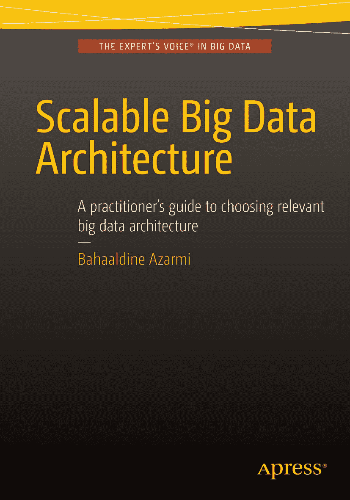

# 可扩展的大数据架构

`natasha.jayne.townsend@gmail.com`

巴哈阿尔丁·阿扎尔马《可扩展大数据架构：从业者选择相关大数据架构指南》

本文中作者引用的任何源代码或其他补充材料，读者可在 [`www.apress.com`](http://www.apress.com/) 获取。有关如何找到本书源代码的详细信息，请访问 [`www.apress.com/source-code/`](http://www.apress.com/source-code/)。

ISBN `978-1-4842-1327-8`

e-ISBN `978-1-4842-1326-1`

DOI `10.1007/978-1-4842-1326-1`

© Apress 2016

常务董事: Welmoed Spahr

主编: Celestin Suresh John

开发编辑: Douglas Pundick

技术审阅: Sundar Rajan Raman 和 Manoj Patil

编辑委员会: Steve Anglin, Pramila Balen, Louise Corrigan, Jim DeWolf, Jonathan Gennick, Robert Hutchinson, Celestin Suresh John, Michelle Lowman, James Markham, Susan McDermott, Matthew Moodie, Jeffrey Pepper, Douglas Pundick, Ben Renow-Clarke, Gwenan Spearing

协调编辑: Jill Balzano

文字编辑: Rebecca Rider, Laura Lawrie 和 Kim Wimpsett

排版: SPi Global

索引编制: SPi Global

插图: SPi Global

封面设计: Anna Ishchenko

有关翻译信息，请发送电子邮件至 `rights@apress.com`，或访问 [`www.apress.com`](http://www.apress.com/)。

Apress 及 friends of ED 图书可批量购买用于学术、企业或促销用途。大多数图书也提供电子书版本和许可。更多信息，请参考我们的特别批量销售–电子书许可网页，网址为 [`www.apress.com/bulk-sales`](http://www.apress.com/bulk-sales)。

本作品受版权保护。出版商保留所有权利，涉及材料的全部或部分，特别是翻译、重印、重用插图、朗诵、广播、以缩微胶片或任何其他物理方式复制、以及传输或信息存储与检索、电子改编、计算机软件、或目前已知或以后开发的类似或不同方法的权利。与评论或学术分析相关的简短摘录，或专门为在计算机系统上输入和执行而提供的材料，仅供本作品购买者专用，不受此法律保留的限制。本出版物或其部分的复制仅在出版商所在地现行版权法规定下允许，且使用许可必须始终从 Springer 获取。使用许可可通过 Copyright Clearance Center 的 RightsLink 获取。违反者将根据相应版权法被起诉。

本书中可能出现商标名称、标识和图像。我们不在每次出现商标名称、标识或图像时都使用商标符号，而是仅以编辑方式使用这些名称、标识和图像，以造福商标所有者，无意侵犯商标权。

本出版物中对商品名称、商标、服务标记和类似术语的使用，即使未明确标识，也不应被视为对其是否受所有权权利的表达意见。

尽管本书中的建议和信息在出版时被认为是真实和准确的，但作者、编辑和出版商对可能出现的任何错误或遗漏不承担任何法律责任。出版商对本书所含材料不作任何明示或暗示的保证。

本书通过 Springer Science+Business Media New York 在全球图书贸易中发行，地址：233 Spring Street, 6th Floor, New York, NY 10013。电话：1-800-SPRINGER，传真：(201) 348-4505，电子邮件：`orders-ny@springer-sbm.com`，或访问 `www.springeronline.com`。

Apress Media, LLC 是加利福尼亚州的有限责任公司，其唯一成员（所有者）是 Springer Science + Business Media Finance Inc (SSBM Finance Inc)。SSBM Finance Inc 是特拉华州的一家公司。

献给 Aurelia 和 June。

## 目录

*   第 1 章：大数据问题 1
    *   识别大数据症状 1
    *   规模至关重要 1
    *   典型业务用例 2
    *   了解大数据项目生态系统 3
    *   Hadoop 发行版 3
    *   数据采集 6
    *   处理语言 7
    *   机器学习 10
    *   NoSQL 存储 10
    *   创建长期大数据架构的基础 12
    *   架构概述 12
    *   日志采集应用 13
    *   学习应用 13
    *   处理引擎 14
    *   搜索引擎 15
    *   总结 15
*   第 2 章：使用 NoSQL 的早期大数据 17
    *   NoSQL 全景 17
    *   键/值 17
    *   列式 18
    *   文档式 18
    *   图式 19
    *   我们用例中的 NoSQL 20
    *   Couchbase 介绍 21
    *   架构 22
    *   集群管理器和管理控制台 24
    *   管理文档 28
    *   ElasticSearch 介绍 30
    *   架构 30
    *   监控 ElasticSearch 34
    *   使用 ElasticSearch 搜索 36
    *   在基于 SQL 的架构中将 NoSQL 用作缓存 38
    *   缓存文档 38
    *   使用 Couchbase XDCR 的 Couchbase ElasticSearch 插件 40
    *   仅 ElasticSearch 40
    *   总结 40
*   第 3 章：定义处理拓扑 41
    *   数据架构的初步方法 41
    *   一点背景知识 41
    *   处理数据源 42
    *   处理数据 45
    *   拆分架构 49
    *   批处理 50
    *   流处理 52
    *   Lambda 架构的概念 53
    *   总结 55
*   第 4 章：流数据 57
    *   流式架构 57
    *   架构图 57
    *   技术 58
    *   采集数据的剖析 60
    *   点击流数据 60
    *   原始数据 62
    *   日志生成器 63
    *   设置流式架构 64
    *   在 Apache Kafka 中传输日志 64
    *   从 Apache Kafka 中取出日志 72
    *   总结 79
*   第 5 章：查询和分析模式 81
    *   定义分析策略 81
    *   持续处理 81
    *   实时查询 82
    *   使用 Spark 处理和索引数据 82
    *   准备 Spark 项目 82
    *   理解基本的 Spark 应用 84
    *   实现 Spark 流处理器 86
    *   实现 Spark 索引器 89
    *   实现 Spark 数据处理 91
    *   使用 Elasticsearch 进行数据分析 93
    *   聚合框架介绍 93
    *   在 Kibana 中可视化数据 100
    *   总结 103
*   第 6 章：从你的数据中学习？ 105
    *   机器学习简介 105
    *   监督学习 105
    *   无监督学习 107
    *   使用 Spark 进行机器学习 108
    *   将机器学习添加到我们的架构 108
    *   将机器学习添加到我们的架构 112
    *   丰富点击流数据 112
    *   对数据进行标签化 117
    *   训练并做出预测 119
    *   总结 121
*   第 7 章：治理考量 123
    *   Docker 化架构 123
    *   Docker 介绍 123
    *   安装 Docker 125
    *   创建你的 Docker 镜像 125
    *   编排架构 128
    *   架构可扩展性 132
    *   架构的规模估算与扩展 132
    *   使用 Elastic Stack 监控基础设施 135
    *   考虑安全性 136
    *   总结 137
*   索引 139

**内容概览**

# 关于作者和技术审阅者

## 关于作者
xi

## 关于技术审阅者
xiii

*   第 1 章：大数据问题 1
*   第 2 章：使用 NoSQL 的早期大数据 17
*   第 3 章：定义处理拓扑 41
*   第 4 章：流数据 57
*   第 5 章：查询和分析模式 81
*   第 6 章：从你的数据中学习？ 105
*   第 7 章：治理考量 123
*   索引 139