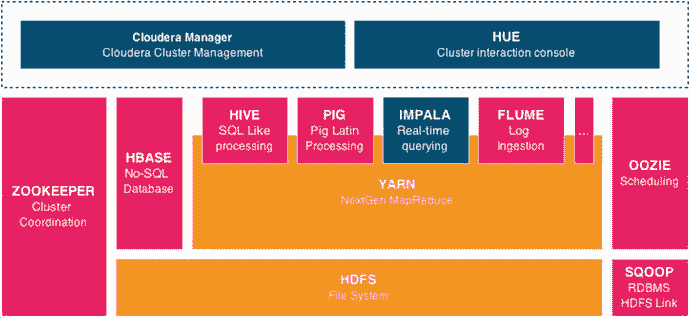
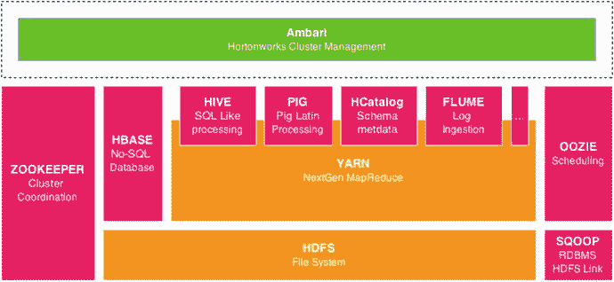
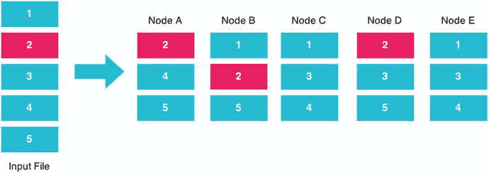
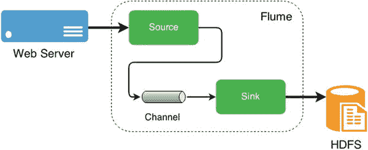
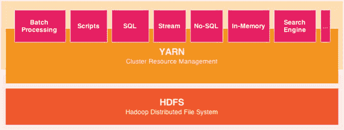
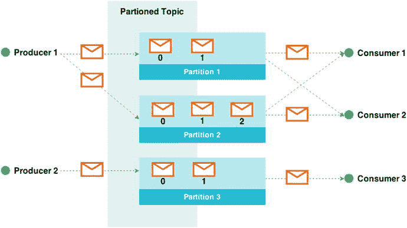
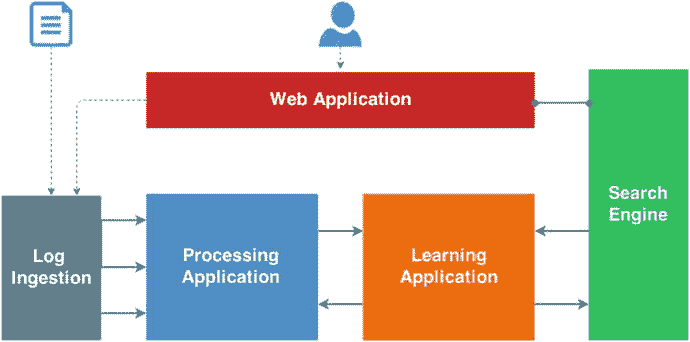
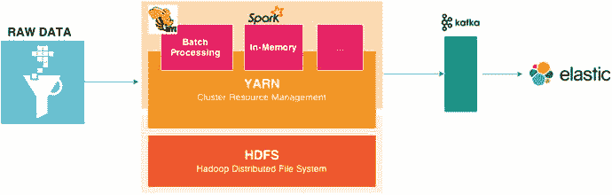

# 大数据难题

数据管理正变得前所未有的复杂。大数据无处不在，人人关注，并呈现多种不同形式：广告、社交图谱、信息流、推荐、营销、医疗健康、安全、政府等等。

在过去三年中，涌现了数千种与大数据采集、管理和分析相关的技术；这给 IT 团队带来了艰巨的任务——需要做出选择，而大多数时候却缺乏一套全面的方法论来指导这个选择过程。

在为自身情况做选择时，请问自己以下问题：我应该在何时考虑为我的 IT 系统采用大数据？我准备好采用它了吗？我应该从哪里开始？尽管觉得大数据只是一个营销趋势，我真的应该去实施它吗？

所有这些问题都萦绕在大多数首席信息官和首席技术官的脑海中，并且它们大致涵盖了当您决定部署分布式大数据架构时，使您的业务面临风险的原因和方式。

本章旨在帮助您识别大数据症状——换句话说，就是当您明显需要考虑将大数据添加到您的架构中时的迹象——但它也指导您了解各种大数据技术，以便您能够区分它们，理解它们各自的专长领域。最后，在本章结尾，我们会基于现实生活中的例子，构建一个典型分布式大数据架构的基础。

## 识别大数据症状

您可能基于不同的需求选择启动一个大数据项目：由于您处理的数据量、由于系统数据结构多样性、由于您遇到的可扩展性问题，或者由于您希望降低数据处理成本。在本节中，您将看到哪些症状能使一个团队意识到他们需要启动大数据项目。

### 规模至关重要

促使人们开始考虑大数据的两个主要领域是当他们开始遇到与数据大小和数量相关的问题时；尽管大多数时候这些问题确实构成了考虑大数据的正当理由，但在今天，它们并非走上这条路的唯一原因。

还有其他一些您也应该考虑的症状——例如，数据类型。当传统数据存储（如 `SQL` 数据库）期望您预先进行结构化（如创建表）时，您将如何设法增加各种类型的数据？

如果不添加一种灵活的、无模式的、能够处理新数据结构的技术的支持，这是不可行的。当我谈论数据类型时，您应该想象非结构化数据、图数据、图像、视频、语音等等。

是的，存储非结构化数据是好的，但如果您能从中提取出有价值的信息则更好。另一个症状源于这个前提：大数据还包括从高容量的多种数据中提取增值信息。几年前，当读取事务多于写入事务时，通用的缓存或数据库配合每周的 `ETL` 处理任务就足够了。如今这已不再是趋势。现在，您需要一种架构，能够随着数据的流入，处理从长时间处理到近实时处理的各种任务。该架构应该是分布式的，而不依赖于僵化的、高性能且昂贵的大型机；相反，它应该基于更可用、性能驱动且成本更低的技术，以提供更高的灵活性。

那么，您如何利用所有这些增值数据，又如何能够自然地搜索它们呢？要回答这个问题，请再次思考传统数据存储，您在其中不同的列上创建索引以加速搜索查询。那么，如果您想要索引所有一百列，以便能够执行涉及不定数量关键列的复杂查询，该怎么办？您可不想用基本的 `SQL` 数据库来做这件事；相反，对于这种特定需求，您更应该考虑使用 `NoSQL` 存储。

因此，在当今数据管理趋势的背景下，只要沿着数据采集、数据结构化、数据处理和数据可视化的路径走一遭，就很容易得出结论：规模不再是主要担忧。

### 典型业务用例

除了技术和架构方面的考虑，您可能还面临着典型的“大数据”用例。其中一些与特定行业相关；另一些则没有特定领域限制，可以应用于多种行业。

这些考虑因素通常基于对应用程序日志的分析，例如 Web 访问日志、应用服务器日志和数据库日志，但也可能基于其他类型的数据源，例如社交网络数据。

当面临此类用例时，如果您希望随着业务增长能够进行横向扩展，那么您可能需要考虑分布式大数据架构。

#### 消费者行为分析

了解您的客户，或者我们通常所说的“`360 度客户视图`”，可能是最流行的大数据用例。这种客户视图通常用于电子商务网站，其起点是非结构化的点击流——换句话说，它由访问者执行的主动和被动的网站导航行为构成。通过计算和分析对广告或产品的点击和曝光次数，您可以根据访问者的行为来调整其用户体验，同时牢记目的是为了获得洞察以优化漏斗转化率。

#### 情感分析

公司非常关心他们的形象和声誉在社交网络上是如何被感知的；他们希望最小化所有可能损害其知名度的负面事件，并利用正面事件。通过以近乎实时的方式抓取大量的社交数据，他们可以提取社交群体对其品牌的情感，并识别有影响力的用户与之联系，以便根据与这些用户互动的结果来改变或强化某个趋势。

#### `CRM` 数据整合

您可以将消费者行为分析与基于访问者社交活动数据的情感分析相结合。公司希望将这些在线数据源与现有的离线数据（即 `CRM`，客户关系管理）结合起来，以获得更好、更准确的客户细分。因此，公司可以利用这种细分，构建更好的目标定位系统，通过营销活动发送个性化优惠。

#### 预测

从数据中学习已成为过去两年大数据的主要趋势。基于预测的大数据在多个行业中可能非常有效，例如在电信行业，预测路由器日志分析已得到广泛应用。每当设备上可能发生问题时，公司可以预测并订购部件，以避免停机或利润损失。

当与之前的用例结合时，您可以使用预测架构来优化产品目录选择和定价，具体取决于用户的全局行为。

# 理解大数据项目的生态系统

一旦你确定自己实际上需要实施一个大数据项目，最困难的事情就是选择要在架构中使用的技术。这不仅关乎挑选最著名的 Hadoop 相关技术，还在于理解如何对它们进行分类，以构建一个一致的分布式架构。

要了解大数据星系中项目的数量，请浏览 [`https://github.com/zenkay/bigdata-ecosystem#projects-1`](https://github.com/zenkay/bigdata-ecosystem#projects-1) 以查看超过 100 个已分类的项目。

在这里，你会看到可能需要考虑选择 Hadoop 发行版、分布式文件系统、类 SQL 处理语言、机器学习语言、调度器、面向消息的中间件、NoSQL 数据存储、数据可视化等等。

由于本书的目的是描述构建分布式架构的可扩展方式，我不会深入探讨所有项目类别；相反，我会重点介绍那些在一个典型大数据项目中可能用到的项目。你最终可以根据需要调整此架构并集成各种项目。你将在专门的章节中看到使用这些项目的具体示例。

为了使介绍的 Hadoop 技术更具相关性，我们将构建一个满足先前描述的典型用例的分布式架构，即：

*   消费者行为分析

*   情感分析

*   CRM 数据导入与预测

## Hadoop 发行版

在一个涉及 Hadoop 相关生态系统技术的大数据项目中，你有两种选择：

*   单独下载你需要的项目，并尝试将各种技术组装成一个连贯、弹性和一致的架构。

*   使用最流行的 Hadoop 发行版之一，它为你组装或创建了这些技术。

虽然第一种选择完全可行，但你可能会想选择第二种，因为打包好的 Hadoop 发行版能确保所有已安装组件之间的兼容性、易于安装、基于配置的部署、监控和支持。

`Hortonworks` 和 `Cloudera` 是该领域的主要参与者。这两个供应商之间存在一些差异，但对于启动一个大数据项目包来说，只要你不关注专有插件，它们是等价的。

我在此的目标不是介绍每个发行版中的所有组件，而是关注每个供应商为标准生态系统添加了什么。在接下来的页面中，我将根据我们在每种情况下对架构的需求，介绍大部分其他组件。

### Cloudera CDH

`Cloudera` 在基于 Hadoop 的组件之上添加了一套内部组件；这些组件旨在为你提供更好的集群管理和搜索体验。

以下是其中一些组件的列表：

*   `Impala`：一个实时的、并行化的、基于 SQL 的引擎，用于在 `HDFS`（Hadoop 分布式文件系统）和 `Base` 中搜索数据。`Impala` 被认为是 Hadoop 发行版供应商市场上最快的查询引擎，并且是加州大学伯克利分校 `Spark` 的直接竞争对手。

*   `Cloudera Manager`：这是 `Cloudera` 的用于在你的 Hadoop 集群中管理和部署 Hadoop 组件的控制台。

*   `Hue`：一个控制台，允许用户与数据交互，并为集群中包含的不同 Hadoop 组件运行脚本。

图 1-1 展示了 `Cloudera` 的 Hadoop 发行版及其组件的分类：

图 1-1.

Cloudera Hadoop 发行版

*   橙色组件是 Hadoop 核心栈的一部分。

*   粉色组件是 Hadoop 生态系统项目的一部分。

*   蓝色组件是 `Cloudera` 专属组件。

### Hortonworks HDP

`Hortonworks` 是 100% 开源的，它倾向于在其发行版中打包稳定版本的 Hadoop 项目组件，而非最新版本。

它在技术栈中添加了一个与 `Cloudera Manager` 相当的组件管理控制台。

图 1-2 展示了一个与图 1-1 相同分类的 `Hortonworks` 发行版；区别在于绿色组件是 `Hortonworks` 专属组件。

图 1-2.

Hortonworks Hadoop 发行版

正如我之前所说，在构建我们的架构时，这两个发行版（`Hortonworks` 和 `Cloudera`）是等价的。然而，如果考虑到每个发行版的成熟度，那么我们应该选择 `Cloudera`；在功能方面，`Cloudera Manager` 比 `Ambari` 更完整、更稳定。此外，如果你考虑让用户实时地与大型数据集交互，你绝对应该选择 `Cloudera`，因为它的性能非常出色且久经验证。

### Hadoop 分布式文件系统 (HDFS)

你可能想知道数据被摄入到 Hadoop 集群后存储在哪里。通常它被存放在一个称为 `HDFS` 的专用文件系统中。

以下是 `HDFS` 的关键特性：

*   分布式

*   高吞吐量访问

*   高可用性

*   容错性

*   可调优性

*   安全性

*   负载均衡

`HDFS` 是 Hadoop 集群中数据存储的一等公民。数据会自动在集群的数据节点间进行复制。

图 1-3 展示了 `HDFS` 中的数据如何在一个包含五个节点的集群上进行复制。

图 1-3.

HDFS 数据复制

你可以在 `hadoop.apache.org` 了解更多关于 `HDFS` 的信息。

## 数据采集

数据采集或数据引入可以从不同的源头开始。它可以是大型日志文件、流数据、ETL 处理结果、在线非结构化数据或离线结构化数据。

### Apache Flume

当你需要引入日志时，我强烈推荐使用 `Apache Flume`；它被设计为可靠且高可用，并提供了一个基于流式数据流的简单、灵活且直观的编程模型。基本上，你可以通过配置（无需编写一行代码）来配置一个数据管道。

`Flume` 由源（source）、通道（channel）和槽（sink）组成。`Flume` 源主要负责从外部源（例如 `Apache Avro` 源）消费一个事件，并将其存储到通道中。通道是一个被动的存储系统（如文件系统），它会保留事件直到槽消费它。槽消费事件，将其从通道中删除，并分发到外部目标。

图 1-4 描述了通过 `Flume` 管道，在一个 Web 服务器（如 `Apache`）和 `HDFS` 之间的日志流。

图 1-4.

Flume 架构

关于 `Flume`，其理念是使用它将例如 Web 服务器生成的不同日志文件移动到 `HDFS` 中。请记住，我们很可能在一个可能包含负载均衡器、HTTP 服务器、应用服务器、访问日志等的分布式架构上工作。我们可以以不同的方式利用所有这些资产，并且它们可以由 `Flume` 管道处理。你可以在 `flume.apache.org` 了解更多关于 `Flume` 的信息。

### Apache Sqoop

`Sqoop` 是一个旨在结构化数据存储与 HDFS 之间传输大量数据的项目。您可以使用它将数据从外部关系数据库导入到 HDFS、Hive 甚至 HBase，或者将数据从 Hadoop 集群导出到关系数据库或数据仓库。

`Sqoop` 支持 Oracle、MySQL 和 Postgres 等主流关系数据库。该项目免去了您编写数据传输脚本的麻烦，并为您提供了高性能的数据传输功能。

由于关系数据库中的数据可能快速增长，最好从一开始就识别出快速增长的表，并使用 `Sqoop` 定期将数据传输到 Hadoop 中以便进行分析。

然后，当数据进入 Hadoop 后，可以与其他数据结合，最终，我们可以使用 `Sqoop export` 将数据注入到商业智能分析工具中。您可以在 `sqoop.apache.org` 了解更多关于 `Sqoop` 的信息。

## 处理语言

一旦数据进入 HDFS，我们会使用不同的处理语言来充分挖掘原始批量数据的价值。

### Yarn：下一代 MapReduce

`MapReduce` 是第一代 Hadoop 集群中的主要处理框架；它基本上将相关数据分组到一起（`Map`），然后根据指定的聚合操作对数据进行汇总（`Reduce`）。

在 Hadoop 1.0 中，用户可以选择使用不同的语言编写 `MapReduce` 作业——Java、Python、Pig、Hive 等。无论用户选择哪种语言，所有人都依赖相同的处理模型：`MapReduce`。

然而，自从 Hadoop 2.0 发布以来，一种新的架构开始处理 HDFS 之上的数据处理。随着 `YARN`（另一种资源协调器）的实现，其他处理模型也被允许使用，而 `MapReduce` 只是其中之一。这意味着用户现在能够根据特定的使用场景使用特定的处理模型。

图 1-5 展示了 HDFS、YARN 和处理模型的组织方式。

图 1-5. YARN 架构

我们无法涵盖所有语言和处理模型；而是将重点放在 Hive 和 Spark 上，它们覆盖了我们的使用场景，即长时间数据处理和流处理。

## 使用 Hive 进行批处理

当您决定编写第一个批处理作业时，可以使用您偏好的编程语言来实现，例如 Java 或 Python，但如果您这样做，最好对 Map 和 Reduce 设计模式非常熟悉，这需要开发时间和复杂的编码，并且有时真的很难维护。

作为替代方案，您可以使用更高级的语言，例如 `Hive`，它为用户带来了以类似 SQL 的方式从 HDFS 查询数据的简洁性和强大功能。有时您需要在 `MapReduce`/Java 中编写 10 行代码；而在 `Hive` 中，您只需要一个简单的 SQL 查询。

当您使用其他语言而不是原生 `MapReduce` 时，主要缺点是性能。`Hive` 和 `MapReduce` 之间存在固有的延迟；此外，用户 SQL 查询的性能可能因查询而异，就像关系数据库中的情况一样。您可以在 `hive.apache.org` 了解更多关于 `Hive` 的信息。

`Hive` 不是一种近实时或实时的处理语言；它用于批处理，例如低优先级的长期处理作业。为了处理实时到达的数据，我们需要使用 `Spark Streaming`。

## 使用 Spark Streaming 进行流处理

`Spark Streaming` 允许您像在 Java、Scala 或 Python 中编写批处理作业一样编写处理作业，但用于处理流式数据。当您处理高吞吐量数据源（例如社交网络 (Twitter)、点击流日志或 Web 访问日志）时，这非常合适。

`Spark Streaming` 是 Spark 的一个扩展，它利用了其分布式数据处理框架，并将流式计算视为在短时间间隔上进行的一系列非确定性微批次计算。您可以在 `spark.apache.org` 了解更多关于 `Spark Streaming` 的信息。

`Spark Streaming` 可以从多种来源获取数据，但当它与例如 Apache Kafka 结合时，`Spark Streaming` 可以成为强大的容错和高性能系统的基础。

## 使用 Apache Kafka 的消息中间件

Apache Kafka 是由 LinkedIn 用 Scala 编写的分布式发布-订阅消息应用程序。`Kafka` 经常与 `Apache ActiveMQ` 或 `RabbitMQ` 进行比较，但根本区别在于 `Kafka` 不实现 `JMS`（Java 消息服务）。然而，`Kafka` 是一个持久化消息和高吞吐量系统，它支持队列和主题语义，并使用 `ZooKeeper` 来形成集群节点。

`Kafka` 实现了发布-订阅的企业集成模式，并支持并行性和企业特性以提高性能和改进容错能力。

图 1-6 给出了一个典型的发布-订阅架构的高级视图，其中消息通过一个为分区主题提供服务的代理进行传输。

图 1-6. Kafka 分区主题示例

我们将在架构中将 `Kafka` 用作一个枢纽点，主要用于接收数据并将其推送到 `Spark Streaming`。您可以在 `kafka.apache.org` 了解更多关于 `Kafka` 的信息。

## 机器学习

在我们的架构中讨论机器学习永远不嫌早，特别是在处理具有无限收敛模型（可通过小数据样本凸显出来）的使用场景时。我们可以使用特定于机器学习的语言，或者利用现有层，例如带有 `Spark MLlib`（机器学习库）的 Spark。

### Spark MLlib

`MLlib` 为 Spark 启用了机器学习功能，它利用了 Spark 的有向无环图（`DAG`）执行引擎，并提供了一套 API 来简化 Spark 的机器学习集成。它由各种算法组成，从基本统计、逻辑回归、k-means 聚类和高斯混合模型到奇异值分解和多项式朴素贝叶斯。

借助 `Spark MLlib` 的开箱即用算法，您只需几行代码即可训练数据并构建预测模型。您可以在 `spark.apache.org/mllib` 了解更多关于 `Spark MLlib` 的信息。

## NoSQL 存储

NoSQL 数据存储是数据架构的基本组成部分，因为它们可以吸收海量数据，并无需额外工作即可提供开箱即用的可扩展性和弹性，从而实现高可用性。Couchbase 和 ElasticSearch 是我们将要重点关注的两种技术；我们现在简要讨论它们，在本书的后续部分，我们将看到如何使用它们。

### Couchbase

`Couchbase` 是一个面向文档的 NoSQL 数据库，易于扩展，提供灵活的模型，并且始终保持高性能。我们将 `Couchbase` 用作依赖我们关系数据库的文档数据存储。

基本上，我们将所有来自前端的读取查询重定向到 `Couchbase`，以防止关系数据库上的高读取吞吐量。有关 `Couchbase` 的更多信息，请访问 `couchbase.com`。

# ElasticSearch

`ElasticSearch` 是一种 NoSQL 技术，因其可扩展的分布式索引引擎和搜索功能而广受欢迎。它基于 Apache Lucene，能够在您的架构中实现实时数据分析和全文搜索。

`ElasticSearch` 是 ELK 平台的一部分，该平台代表 `ElasticSearch` + `Logstash` + `Kibana`，由 Elastic 公司提供。这三款产品协同工作，为数据收集、存储和可视化提供最佳的端到端平台：

- `Logstash` 让您能从多种来源（如社交数据、日志、消息队列或传感器）收集数据，然后支持数据富化和转换，最后将数据传输到诸如 `ElasticSearch` 的索引系统。

- `ElasticSearch` 在一个分布式、可扩展且具备弹性的系统中对数据进行索引。它采用无模式设计，并为多种语言提供库，以便它们能轻松快速地实现应用程序中的实时搜索和分析。

- `Kibana` 是一个可定制的用户界面，您可以在其中构建从简单到复杂的仪表板，以探索和可视化由 `ElasticSearch` 索引的数据。

图 1-7 展示了 Elastic 产品的结构。

图 1-7. ElasticSearch 产品

如上图所示，Elastic 还提供商业产品，例如 Marvel（基于 `Kibana` 的监控控制台）、Shield（一个安全框架，例如提供身份验证和授权）以及 Watcher（一个警报和通知系统）。本书不会使用这些商业产品。

相反，我们将主要使用 `ElasticSearch` 作为一个搜索引擎，来存储由 Spark 产生的数据。经过处理和聚合后，数据被索引到 `ElasticSearch` 中，以便第三方系统能够通过 `ElasticSearch` 查询引擎来查询数据。另一方面，我们也使用 ELK 来处理日志和可视化分析，但这是从平台运维的角度出发。有关 `ElasticSearch` 的更多信息，请访问 `elastic.co`。

## 打造长期大数据架构的基础

在牢记我们将要使用的所有大数据技术后，我们现在可以继续前进，构建我们架构的基础。

### 架构概览

从高层视角来看，我们的架构将类似于另一个电子商务应用架构。我们需要以下组件：

- 一个访客可以用来浏览产品目录的 Web 应用程序

- 一个旨在拉取和处理日志的日志采集应用程序

- 一个用于为访客触发推荐的机器学习应用程序

- 一个充当架构中央处理集群的处理引擎

- 一个用于为处理后的数据拉取分析结果的搜索引擎

图 1-8 展示了这些不同的应用程序在这样一个架构中是如何组织的。

图 1-8. 架构概览

### 日志采集应用程序

日志采集应用程序用于消费应用程序日志，例如 Web 访问日志。为了方便用例，提供了一个生成的 Web 访问日志，它模拟了访客浏览产品目录的行为。这些日志代表了用于长期处理以及实时推荐的点击流日志。

架构中可以有兩種选择：第一种可由 `Flume` 保证，将日志实时传输到我们的处理应用程序中；第二种可由 `ElasticSearch`、`Logstash` 和 `Kibana`（ELK 平台）保证，用于创建访问分析。

图 1-9 展示了日志是如何被 ELK 和 `Flume` 处理的。

图 1-9. 采集应用程序

在此架构中使用 ELK 能为我们带来更大价值，因为这三款产品能够无缝集成，并且比单独使用 `Flume` 并试图达到相同功能级别能带来更多价值。

### 机器学习应用程序

机器学习应用程序接收数据流并构建预测，以优化我们的推荐引擎。该应用程序使用一个基础算法来介绍基于 `Spark MLlib` 的机器学习概念。

图 1-10 展示了数据是如何通过 `Kafka` 被机器学习应用程序接收的，然后被发送到 `Spark` 进行处理，最后被索引到 `ElasticSearch` 中以供进一步使用。

图 1-10. 机器学习

### 处理引擎

处理引擎是架构的核心；它从多种来源接收数据，并将处理任务委托给适当的模型。

图 1-11 展示了数据是如何被处理引擎接收的，该处理引擎由用于路径处理的 `Hive` 和用于实时/近实时处理的 `Spark` 组成。

图 1-11. 处理引擎

这里我们使用 `Kafka` 结合 `Logstash` 将数据分发到 `ElasticSearch`。`Spark` 运行在 Hadoop 集群之上，但这并非强制要求。在本书中，为简化起见，我们不搭建 Hadoop 集群，而是更倾向于以独立模式运行 `Spark`。但显然，您可以将您的工作部署到您偏好的 Hadoop 发行版中。

### 搜索引擎

搜索引擎利用处理引擎处理过的数据，并暴露出一个专用的 `RESTful API`，该 API 将用于分析目的。

## 总结

到目前为止，我们已经了解了构成我们架构的所有组件。在下一章中，我们将重点关注 NoSQL 部分，并将进一步探讨两种不同的技术：Couchbase 和 `ElasticSearch`。
