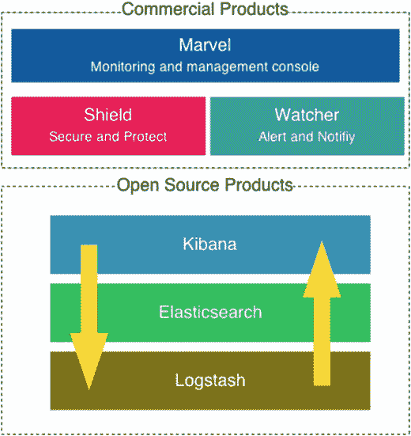
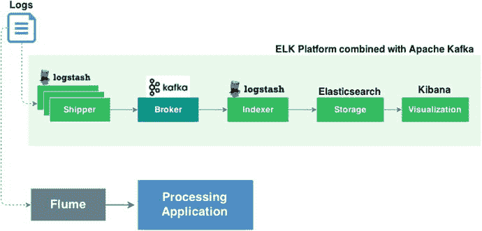
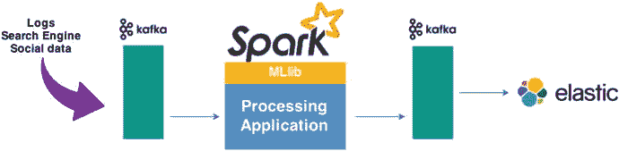

# ElasticSearch

`ElasticSearch` 是一种 NoSQL 技术，因其可扩展的分布式索引引擎和搜索功能而广受欢迎。它基于 Apache Lucene，能够在您的架构中实现实时数据分析和全文搜索。

`ElasticSearch` 是 ELK 平台的一部分，该平台代表 `ElasticSearch` + `Logstash` + `Kibana`，由 Elastic 公司提供。这三款产品协同工作，为数据收集、存储和可视化提供最佳的端到端平台：

- `Logstash` 让您能从多种来源（如社交数据、日志、消息队列或传感器）收集数据，然后支持数据富化和转换，最后将数据传输到诸如 `ElasticSearch` 的索引系统。
- `ElasticSearch` 在一个分布式、可扩展且具备弹性的系统中对数据进行索引。它采用无模式设计，并为多种语言提供库，以便它们能轻松快速地实现应用程序中的实时搜索和分析。
- `Kibana` 是一个可定制的用户界面，您可以在其中构建从简单到复杂的仪表板，以探索和可视化由 `ElasticSearch` 索引的数据。

图 1-7 展示了 Elastic 产品的结构。

图 1-7. ElasticSearch 产品

如上图所示，Elastic 还提供商业产品，例如 Marvel（基于 `Kibana` 的监控控制台）、Shield（一个安全框架，例如提供身份验证和授权）以及 Watcher（一个警报和通知系统）。本书不会使用这些商业产品。

相反，我们将主要使用 `ElasticSearch` 作为一个搜索引擎，来存储由 Spark 产生的数据。经过处理和聚合后，数据被索引到 `ElasticSearch` 中，以便第三方系统能够通过 `ElasticSearch` 查询引擎来查询数据。另一方面，我们也使用 ELK 来处理日志和可视化分析，但这是从平台运维的角度出发。有关 `ElasticSearch` 的更多信息，请访问 `elastic.co`。

## 打造长期大数据架构的基础

在牢记我们将要使用的所有大数据技术后，我们现在可以继续前进，构建我们架构的基础。

### 架构概览

从高层视角来看，我们的架构将类似于另一个电子商务应用架构。我们需要以下组件：

- 一个访客可以用来浏览产品目录的 Web 应用程序
- 一个旨在拉取和处理日志的日志采集应用程序
- 一个用于为访客触发推荐的机器学习应用程序
- 一个充当架构中央处理集群的处理引擎
- 一个用于为处理后的数据拉取分析结果的搜索引擎

图 1-8 展示了这些不同的应用程序在这样一个架构中是如何组织的。

图 1-8. 架构概览

### 日志采集应用程序

日志采集应用程序用于消费应用程序日志，例如 Web 访问日志。为了方便用例，提供了一个生成的 Web 访问日志，它模拟了访客浏览产品目录的行为。这些日志代表了用于长期处理以及实时推荐的点击流日志。

架构中可以有兩種选择：第一种可由 Flume 保证，将日志实时传输到我们的处理应用程序中；第二种可由 `ElasticSearch`、`Logstash` 和 `Kibana`（ELK 平台）保证，用于创建访问分析。

图 1-9 展示了日志是如何被 ELK 和 Flume 处理的。

图 1-9. 采集应用程序

在此架构中使用 ELK 能为我们带来更大价值，因为这三款产品能够无缝集成，并且比单独使用 Flume 并试图达到相同功能级别能带来更多价值。

### 机器学习应用程序

机器学习应用程序接收数据流并构建预测，以优化我们的推荐引擎。该应用程序使用一个基础算法来介绍基于 Spark MLlib 的机器学习概念。

图 1-10 展示了数据是如何通过 Kafka 被机器学习应用程序接收的，然后被发送到 Spark 进行处理，最后被索引到 `ElasticSearch` 中以供进一步使用。

图 1-10. 机器学习

### 处理引擎

处理引擎是架构的核心；它从多种来源接收数据，并将处理任务委托给适当的模型。

图 1-11 展示了数据是如何被处理引擎接收的，该处理引擎由用于路径处理的 Hive 和用于实时/近实时处理的 Spark 组成。

图 1-11. 处理引擎

这里我们使用 Kafka 结合 Logstash 将数据分发到 `ElasticSearch`。Spark 运行在 Hadoop 集群之上，但这并非强制要求。在本书中，为简化起见，我们不搭建 Hadoop 集群，而是更倾向于以独立模式运行 Spark。但显然，您可以将您的工作部署到您偏好的 Hadoop 发行版中。

### 搜索引擎

搜索引擎利用处理引擎处理过的数据，并暴露出一个专用的 RESTful API，该 API 将用于分析目的。

## 总结

到目前为止，我们已经了解了构成我们架构的所有组件。在下一章中，我们将重点关注 NoSQL 部分，并将进一步探讨两种不同的技术：Couchbase 和 `ElasticSearch`。

