# 2. 早期大数据与 NoSQL

在本章中，我将向您概述大数据项目背景下可用的数据存储技术。然后，我将重点介绍 Couchbase 和 `ElasticSearch`，并向您展示它们的使用方法以及它们之间的区别。

第一部分将让您更好地理解 NoSQL 领域内现有技术的不同风格。

## NoSQL 格局

对于传统的三层应用来说，关系型数据库是许多开发人员和数据库管理员的选择，几乎也是唯一的选择。这种情况是由多种原因造成的，包括数据建模方法、与数据交互的查询语言，以及这些技术强大的特性，它们能够部署提供一致数据存储的解决方案，以服务于复杂的应用。

随后需求开始演变/变化，以至于这些数据存储不再能解决所有数据存储问题。这就是“NoSQL”这个术语诞生的背景——它通过首先打破标准化的 SQL 模式导向范式，为这些问题提供了一种新的方法。

NoSQL 技术是无模式的、高度可扩展的，并且其中一些技术还是高度分布式和高性能的。大多数情况下，它们通过扮演缓存、搜索引擎、非结构化存储和易失性信息存储等角色，来完善包含现有 RDBMS 技术的架构。

它们被分为四大类：

键值数据存储 · 列式数据存储 · 文档型数据存储 · 图数据存储

现在，让我们深入探讨不同的类别，然后选择最适合我们用例的那一个。


### 键/值存储

最容易理解的 NoSQL 数据存储是键/值存储。这类数据存储的基本工作方式类似于字典，通过将键与值进行匹配来运作。它们常用于需要存储基础信息的高性能场景——例如，需要快速写入和检索会话信息时。对于这类用例，这些数据存储性能卓越且高效，同时也通常具备高可扩展性。

键/值存储也可用于队列场景，确保数据不会丢失，例如在日志架构或搜索引擎索引架构中。

`Redis` 和 `Riak KV` 是最著名的键/值数据存储；`Redis` 应用更为广泛，它拥有一个内存中的键/值存储，并支持可选的数据持久化。`Redis` 经常在 Web 应用程序中用于存储会话相关数据，例如 `node` 或 PHP Web 应用；它每秒可以处理数千次会话检索而不会影响性能。另一个典型的用例是本书后面将描述的队列场景；`Redis` 置于 `Logstash` 和 `ElasticSearch` 之间，用于避免流式日志数据在被索引到 `ElasticSearch` 以供查询之前丢失。

### 列存储

当键/值数据存储达到其极限，因为你希望存储大量的记录，且这些记录包含远超键/值存储简单性质的巨量信息时，就会用到列导向数据存储。

对于来自关系型数据库领域的人来说，列数据存储技术可能难以理解，但实际上，它们相当简单。在关系型数据库中，数据按行存储，而在列数据存储中，数据显然是按列存储的。使用列式数据库的主要好处是你可以快速访问大量数据。在关系型数据库中，一行是一个连续的磁盘条目，多行存储在不同的磁盘位置，这使得访问更加困难；而在列式数据库中，属于同一列的所有单元格是连续存储的。

例如，考虑在关系型数据库中查找所有博客标题；这在磁盘条目方面可能代价高昂，特别是在谈论数百万条记录时；而在列式数据库中，这样的搜索仅代表一次访问。

这类数据库对于从特定族中检索大量数据确实非常方便，但代价是缺乏灵活性。最常用的列式数据库是 Google Cloud Bigtable，但具体来说，还有 Apache HBase 和 Cassandra。

列式数据库的另一个好处是易于扩展，因为数据是按列存储的；这些列在它们可以存储的信息量方面具有高度可扩展性。这就是为什么它们主要用于保存非易失性、长期存在的信息以及扩展场景。

### 文档存储

列式数据库并不适合构建包含更深层嵌套结构的数据——这正是文档导向数据存储发挥作用的地方。数据确实是以键/值对的形式存储的，但这些键/值对被全部压缩进所谓的文档中。这个文档依赖于某种结构或编码，例如 `XML`，但大多数情况下，它依赖于 `JSON`（JavaScript 对象表示法）。

尽管文档导向数据库在结构上和表示数据方面更有用，但它们也有缺点——特别是在与数据交互方面。它们基本上需要获取整个文档——例如，当它们读取特定字段时——这会极大地影响性能。

当你需要嵌套信息时，你倾向于使用文档导向数据库。例如，考虑如何在你的应用程序中表示一个账户。它会包含以下内容：

*   基本信息：名、姓、生日、个人资料图片、URL、创建日期等
*   复杂信息：地址、认证方式（密码、Facebook 等）、兴趣等

这也是 NoSQL 文档导向存储经常用于 Web 应用程序的原因：使用嵌套对象表示对象非常容易，并且与前端 JavaScript 技术集成是无缝的，因为这两种技术都使用 `JSON`。

当今最常用的技术是 `MongoDB`、`Couchbase` 和 `Apache CouchDB`。它们易于安装和启动，文档齐全，可扩展，但最重要的是，它们是启动现代 Web 应用程序最显而易见的选择。

`Couchbase` 是我们将在架构中使用的技术之一，特别是因为我们能够使用它来存储、组织和查询数据。我选择 `Couchbase` 主要是基于一个性能基准测试，该测试表明，在高吞吐量下，其高延迟比 `MongoDB` 更低。

另外值得一提的是，`Couchbase` 是 `CouchDB` 和 `Memcached` 的结合体。如今，从支持的角度来看，使用 `Couchbase` 更有意义，更多细节请参见此链接。

### 图存储

图数据库与其他类型的数据库确实不同。它们使用不同的范式来表示数据——一种类似树的结构，包含节点和边，并通过称为关系的路径相互连接。

这些数据库随着社交网络而兴起，例如，用于表示用户的“朋友”网络、他们朋友之间的关系等。使用其他类型的数据存储，可以在文档中存储用户的朋友关系，但即便如此，存储“朋友的朋友”关系可能会变得非常复杂；更好的做法是使用图数据库，为每个朋友创建节点，通过关系连接它们，并根据查询的需求和范围来遍历图。

最著名的图数据库是 `Neo4j`，正如我之前提到的，它用于处理复杂关系信息的用例，例如实体之间的连接以及与之相关的其他实体；但它也用于分类场景。

图 2-1 展示了三个实体如何在一个图数据库中被连接起来。

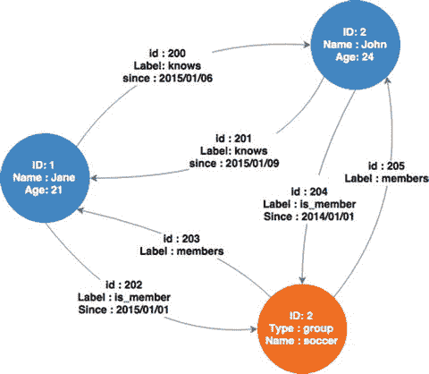

图 2-1.

图数据库示例

图中的两个账户节点，Jane 和 John，通过定义其关系的边相互连接；它们自某个日期起就彼此认识。另一个群组节点连接到这两个账户节点，这表明 Jane 和 John 自某个日期起就一直是足球群组的成员。


### 我们用例中的 NoSQL

针对我们的用例，首先需要一种面向文档的 NoSQL 技术，将关系型数据库中包含的数据结构化地组织成 JSON 文档。如前所述，传统的关系型数据库管理系统（RDBMS）会将数据存储到通过关系关联的多个表中，这在需要获取整个对象的描述时会更加困难且效率低下。

我们以一个可拆分为图 2-2 所示多个表的账户为例。

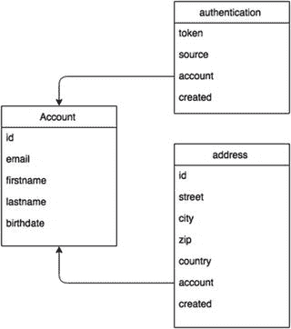
图 2-2. 账户表

如果要检索所有账户信息，基本上需要在三个表之间进行两次连接。现在请思考一下：每当用户连接时，我都需要对所有用户执行此操作，而这些连接在我的应用程序中是由于不同的业务逻辑原因而发生的。说到底，你只是想要账户本身的“视图”。

如果我们只需将账户标识符传递给应用程序 API 的一个方法，并返回以下 JSON 文档，就能获取整个账户视图呢？

```
{
    "id": "account_identifier",
    "email": "account@email.com",
    "firstname": "account_firstname",
    "lastname": "account_lastname",
    "birthdate": "account_birthdate",
    "authentication": [{
        "token": "authentication_token_1",
        "source": "authenticaton_source_1",
        "created": "12-12-12"
    }, {
        "token": "authentication_token_2",
        "source": "authenticaton_source_2",
        "created": "12-12-12"
    }],
    "address": [{
        "street": "address_street_1",
        "city": "address_city_1",
        "zip": "address_zip_1",
        "country": "address_country_1",
        "created": "12-12-12"
    }]
}
```

其好处显而易见：通过维护应用程序实体的最新 JSON 表示形式，我们可以获得更好、更快的数据访问。此外，我们可以将这种方法推广到所有读取请求，所有读取操作均在 NoSQL 数据存储上完成，而所有修改请求（创建、更新、删除）则由 RDBMS 处理。但我们必须实现一种逻辑，既能将 RDBMS 上的任何更改事务性地传播到 NoSQL 数据存储，又能在缓存中未找到对象时从关系型数据库中创建该对象。

你可能会问，既然我们知道在 NoSQL 数据存储中创建文档既高效又具有可扩展性，为什么还要保留 RDBMS？这是因为实际上这并非我们应用程序的目标。我们不想造成颠覆性影响。假设 RDBMS 已经存在，而由于 RDBMS 缺乏灵活性，我们想要集成一个 NoSQL 数据存储。我们希望充分利用这两项技术的优势——特别是 RDBMS 的数据一致性和 NoSQL 的可扩展性。

此外，这只是一个可以执行的简单查询示例，但我们希望更进一步，例如对文档的任意字段进行全文搜索。实际上，使用关系型数据库如何实现这一点？可以建立索引，这没错，但我们会索引所有表列吗？事实上，这是不可能的；但使用 ElasticSearch 等 NoSQL 技术，你可以轻松做到这一点。

在深入探讨这样的 NoSQL 缓存系统之前，我们需要了解如何使用 Couchbase 面向文档的数据库，然后审视其局限性，这些局限性将驱使我们转向 ElasticSearch。

我们将看到，我们的可扩展架构最初依赖于 Couchbase，但由于 Couchbase 的一些重要局限性，我们首先会用 ElasticSearch 来完善该架构，然后再最终完全迁移到 ElasticSearch。

## Couchbase 简介

Couchbase 是一个开源、面向文档的数据库，具有灵活的数据模型、高性能、可扩展等特点，适用于需要将关系型数据库中的数据转换为结构化 JSON 文档的用例（如我们所述的场景）。

大多数 NoSQL 技术都有相似的架构——我们首先会了解 Couchbase 的架构组织方式，并熟悉 Couchbase 中的命名约定，然后深入探讨如何查询存储在 Couchbase 中的数据，最后讨论跨数据中心复制。


### 架构

Couchbase 基于真正的无共享架构，这意味着没有单点争用，因为集群中的每个节点都是自给自足且独立的。这正是分布式技术的工作方式——节点不共享任何内存或磁盘存储。

文档在 Couchbase 中以 JSON 或二进制格式存储，在集群中复制，并组织成称为存储桶（bucket）的单元。通过设置缓存的 RAM，以及设置用于弹性的副本数，可以根据存储和访问需求对存储桶进行扩展。在底层，一个存储桶被分割成更小的单元，称为 vBuckets，这些实际上是数据分区。Couchbase 使用集群映射将分区映射到其所属的服务器。

一个 Couchbase 服务器在集群内最多可为一个存储桶复制三次；然后，每个 Couchbase 服务器管理活动或副本 vBuckets 的一个子集。这就是 Couchbase 实现弹性的方式；每次索引文档时，它都会被复制，如果集群中的某个节点宕机，集群会将副本分区提升为活动状态，以确保服务持续运行。

如图 2-3 所示，集群中只有一份数据副本是活动的，并有零个或多个副本。

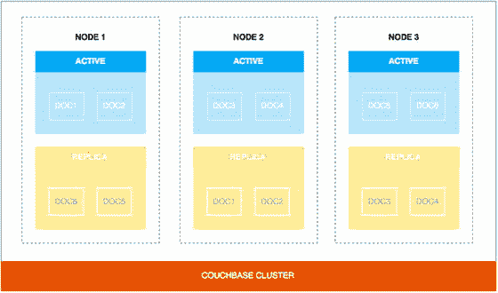

图 2-3. Couchbase 活动文档与副本

从客户端的角度来看，如果智能客户端作为提供的客户端（Java、C、C++、Ruby 等）的一部分被使用，那么这些客户端会连接到集群映射；这样，客户端就可以将请求从应用程序发送到持有该文档的相应服务器。在交互方面，有一点很重要需要记住：默认情况下，对文档的操作是异步的。这意味着，例如，当你更新一个文档时，Couchbase 不会立即在磁盘上更新它。它实际上会经历如图 2-4 所示的处理过程。

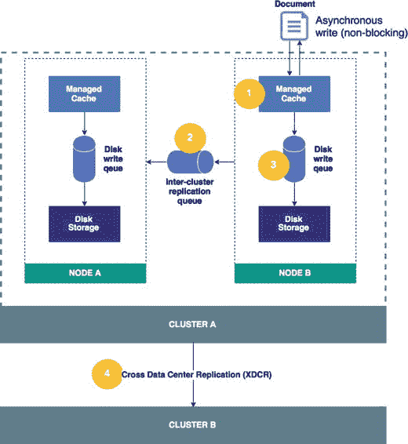

图 2-4. Couchbase 数据流

如图 2-4 所示，智能客户端连接到一个 Couchbase 服务器实例，并首先将文档异步写入托管缓存。客户端会立即得到响应，不会被阻塞直到数据流处理结束，但可以在客户端层面更改此行为，使客户端等待写入完成。然后，文档被放入集群间写入队列，以便在集群中复制；之后，文档被放入磁盘存储写入队列，以持久化到相关节点磁盘上。如果部署了多个集群，则可以使用跨数据中心复制（XDCR）功能将更改传播到位于不同数据中心的其它集群。

Couchbase 有自己查询数据的方式；实际上，你可以通过简单的文档 ID 来查询数据，但 Couchbase 的强大之处在于视图功能。在 Couchbase 中，存在一个名为设计文档的二级索引，它在存储桶内创建。一个存储桶可以包含多种类型的文档，例如，在一个简单的电子商务应用中，一个存储桶可能包含以下内容：

*   账户
*   产品
*   购物车
*   订单
*   账单

Couchbase 通过设计文档在逻辑上对它们进行分割。一个存储桶可以包含多个设计文档，这些文档也包含多个视图。视图是一个函数，它以用户定义的方式对存储在存储桶中的文档进行索引。该函数精确地说是一个用户定义的映射/规约（map/reduce）函数，它跨集群映射文档并输出键/值对，然后这些键/值对被存储在索引中以便进一步检索。让我们回到我们的电子商务网站示例，并尝试索引所有订单，以便我们可以通过账户标识符获取它们。映射/规约函数如下所示：

```
function(doc, meta) {
  if (doc.order_account_id)
    emit(doc.order_account_id, null);
}
```

`if` 语句使该函数只关注包含 `order_account_id` 字段的文档，然后索引此标识符。因此，任何客户端都可以基于该标识符在 Couchbase 中查询数据。

### 集群管理器与管理控制台

集群管理器由集群内的一个特定节点（即协调节点）处理。任何时候，如果集群内的某个节点发生故障，协调节点将通过通知集群内所有其它节点来处理故障转移，定位故障节点的副本分区并将其提升为活动状态。图 2-5 描述了故障转移过程。

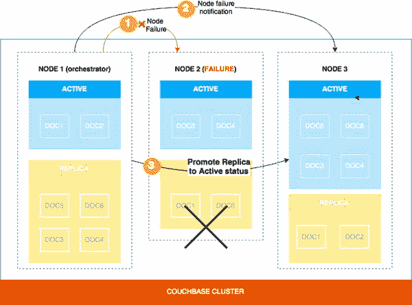

图 2-5. Couchbase 故障转移

如果协调节点发生故障，那么所有节点都会通过心跳看门狗（一个在所有集群节点上运行的集群组件）检测到该故障。一旦检测到故障，就会在节点中选举出新的协调节点。

所有与集群相关的功能都通过 API 暴露，这些 API 可用于管理 Couchbase，但好消息是，系统自带了一个管理控制台。Couchbase 控制台是一个安全控制台，允许你管理和监控集群；你可以从可用的操作中进行选择，包括设置服务器、创建存储桶、浏览和更新文档、实现新视图以及监控 vBucket 和磁盘写入队列。

图 2-6 展示了 Couchbase 控制台主页，其中概述了现有存储桶使用的 RAM、数据使用的磁盘以及存储桶的活动情况。

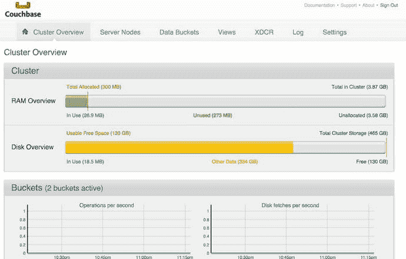

图 2-6. Couchbase 控制台主页

你可以在“服务器节点”选项卡中执行集群管理，该选项卡允许用户配置故障转移和复制，以防止数据丢失。图 2-7 显示了一个单节点安装，如警告信息所示，这对于故障转移来说是不安全的。

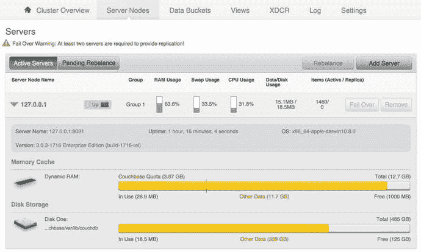

图 2-7. Couchbase 服务器节点

你随时可以通过点击“添加服务器”按钮来添加新的 Couchbase 服务器；当你这样做时，数据将开始在节点间复制以实现故障转移。

通过点击服务器 IP，你可以访问存储桶每个方面的精细监控数据，如图 2-8 所示。

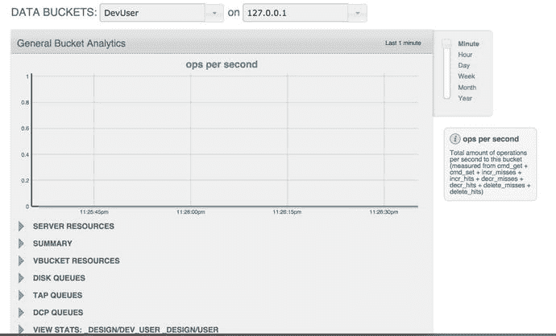

图 2-8. Couchbase 存储桶监控

此图显示了一个名为 DevUser 的数据存储桶，其中包含与用户相关的 JSON 文档。如前所述，索引新文档的过程是底层复杂数据流的一部分。当你处理产生高索引吞吐量的大量数据时，监控控制台中显示的指标至关重要。例如，磁盘队列统计信息可以揭示数据写入磁盘时的瓶颈。

在图 2-9 中，我们可以看到排出率（即从磁盘写入队列写入磁盘的项目数）在写入副本时在活动端交替趋于平稳，并且活动项的平均年龄在该平稳期增长。另一种异常行为是看到活动项的平均年龄持续增长，这将意味着与推入写入磁盘队列的活动项数量相比，写入过程太慢。

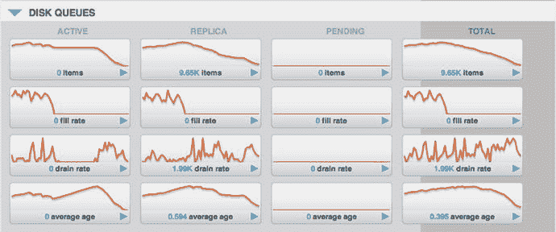

图 2-9. Couchbase 存储桶磁盘队列


#### 管理文档

您可以通过管理控制台的存储桶视图来管理所有文档。该视图允许用户浏览存储桶、设计文档和视图。文档存储在 Couchbase 的存储桶中，并可在管理控制台的“数据存储桶”选项卡中访问，如图 2-10 所示。

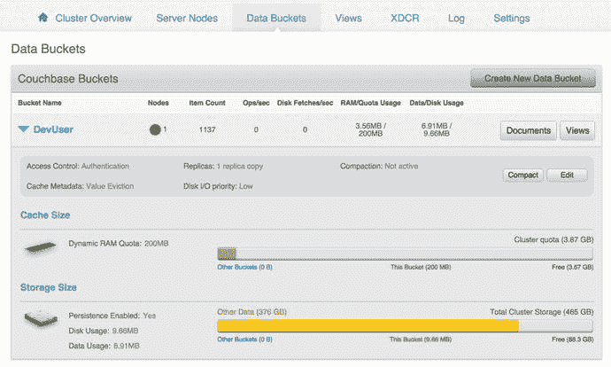

图 2-10. Couchbase 控制台存储桶视图

与服务器视图类似，控制台会显示存储桶的统计信息，例如内存和存储大小，以及每秒操作数。但此视图的真正优势在于，您可以浏览文档并按 ID 检索它们，如图 2-11 所示。

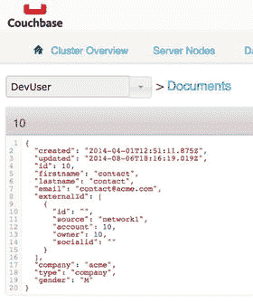

图 2-11. 按 ID 查询的 Couchbase 文档

同样在此视图中，您可以创建设计文档和视图来索引文档以供进一步检索，如图 2-12 所示。

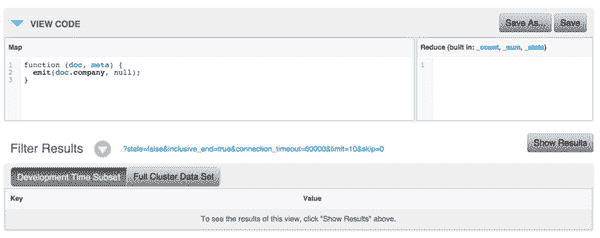

图 2-12. Couchbase 控制台视图实现

在图 2-12 中，我实现了一个根据公司名称检索文档的视图。管理控制台是管理文档的便捷方式，但在实际应用中，您可以从管理控制台开始实施您的设计文档，然后创建一个备份以实现其部署的工业化。

所有设计文档都存储在一个 JSON 文件中，该文件具有描述所有视图的简单结构，类似于代码清单 2-1 所示。

代码清单 2-1. 设计文档 JSON 示例

```
[{
    ...
    "doc": {
        "json": {
            "views": {
                "by_Id": {"map": "function (doc, meta) {\n  emit(doc.id, doc);\n}"},
                "by_email": {"map": "function (doc, meta) {\n  emit(doc.email, doc);\n}"},
                "by_name": {"map": "function (doc, meta) {\n  emit(doc.firstname, null);\n}"},
                "by_company": {"map": "function (doc, meta) {\n  emit(doc.company, null);\n}"},
                "by_form": {"map": "function (doc, meta) {\n  emit(meta.id, null);\n}"}
            }
        }
        ...
    }
}]
```

如您所见，您可以通过管理控制台执行文档管理，但请记住，在工业化架构中，大部分工作是通过使用 Couchbase API 的脚本完成的。

## 介绍 ElasticSearch

您已经看到了一个使用 Couchbase 的 NoSQL 数据库示例；ElasticSearch 也是一种 NoSQL 技术，但它与 Couchbase 完全不同。它是由名为 Elastic 的公司提供的分布式数据存储（在撰写本书时，ElasticSearch 的版本是 2.1）。

### 架构

ElasticSearch 是一种 NoSQL 技术，允许您存储、搜索和分析数据。它是一个基于 Apache Lucene 构建的索引/搜索引擎，Apache Lucene 是一个用 Java 编写的开源全文搜索引擎。从一开始，ElasticSearch 就被设计为分布式和可横向扩展的，这意味着除了通过向节点添加更多资源来进行垂直扩展外，您还可以通过动态添加更多节点来进行水平扩展，以提高集群的高可用性和弹性。如果某个节点发生故障，由于数据在集群中进行了复制，数据将由另一个节点提供服务。

ElasticSearch 是一个无模式引擎；数据以 JSON 格式存储，并分区为我们称之为分片（shards）的单元。分片实际上是一个 Lucene 索引，是 ElasticSearch 中最小的扩展单元。在 ElasticSearch 中，分片组织成索引（indexes），应用程序可以通过索引进行读写交互。最终，索引只是 ElasticSearch 中的一个逻辑命名空间，它将一组分片重新组合在一起，当请求到来时，ElasticSearch 会将其路由到适当的分片，如图 2-13 所示。

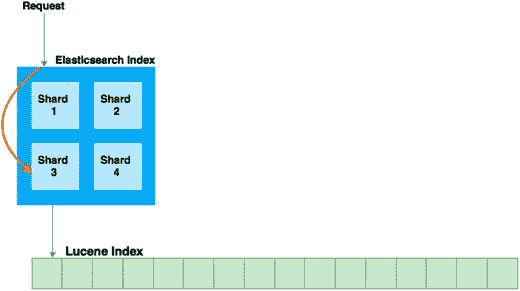

图 2-13. Elasticsearch 索引与分片

ElasticSearch 中存在两种类型的分片：主分片（primary shards）和副本分片（replica shards）。当您启动一个 ElasticSearch 节点时，您可以先只添加一个主分片，这可能就足够了。但是，如果随着时间推移，读取/索引请求吞吐量增加怎么办？如果是这种情况，单个主分片可能不再够用，您就需要另一个分片。您无法动态添加分片并期望 ElasticSearch 自动扩展；它必须使用两个新的主分片在更大的索引中对所有数据重新建立索引。因此，如您所见，在基于 ElasticSearch 的项目开始时，对集群中需要多少主分片有一个合理的估计非常重要。在节点中添加更多分片可能不会增加集群的容量，因为您受到节点硬件容量的限制。要增加集群容量，您必须添加更多也持有主分片的节点，如图 2-14 所示。

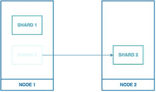

图 2-14. ElasticSearch 主分片分配

好处在于，ElasticSearch 会自动通过网络将分片复制到新节点上，如图 2-14 所述。但是，如果您想确保不会丢失数据怎么办？这时副本分片就派上用场了。

副本分片最初是为了故障转移而创建的；当主分片宕机时，副本会提升为主分片以确保集群的连续性。副本分片在索引时具有与主分片相同的负载；这意味着一旦文档在主分片中被索引，它也会在副本分片中被索引。这就是为什么向集群添加更多副本不会提高索引性能，但如果添加额外的硬件，仍然可以显著提高搜索性能。在拥有两个主分片和两个副本分片的三节点集群中，我们将得到如图 2-15 所示的分区情况。

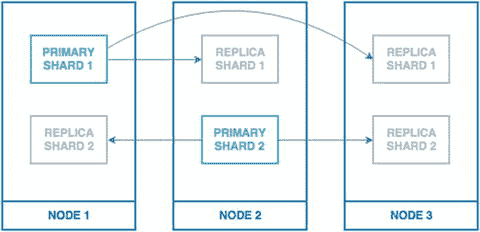

图 2-15. ElasticSearch 主分片与副本分片

除了提高性能之外，这种用例还有助于平衡请求，并在整个集群上获得更好的性能。

关于纯粹的 ElasticSearch 架构，最后要讨论的是索引，更具体地说是节点。索引被分组到 ElasticSearch 节点中，实际上有三种类型的节点，如图 2-16 所示。


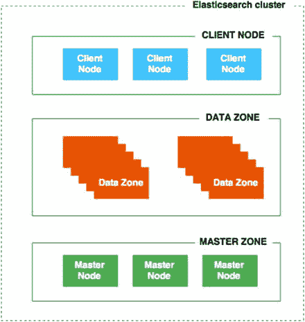

图 2-16. ElasticSearch 集群拓扑

以下是这三种类型节点的描述：

- **主节点**：此类节点是轻量级的，负责集群管理。这意味着它们不存储任何数据、不提供索引服务，也不处理搜索请求。它们专用于确保集群稳定性，且工作负载较低。建议配置三个专用主节点，以确保当一个节点发生故障时，冗余机制能保障集群正常运行。
- **数据节点**：此类节点存储数据，并提供索引和搜索请求服务。
- **客户端节点**：此类节点在某些处理步骤中确保负载均衡，并可以承担数据节点能执行的部分工作负载。例如，在搜索请求中，将请求分发到各个节点并收集输出以生成响应，这一过程在运行时可能非常繁重。

现在你已经了解了 ElasticSearch 的架构，让我们使用搜索 API 进行一些查询操作。

### 监控 ElasticSearch

Elastic 为 ElasticSearch 提供了一个名为 Marvel 的插件，旨在监控 ElasticSearch 集群。该插件是 Elastic 商业产品的一部分，但可以在开发模式下免费使用。

你可以通过以下链接下载 Marvel，安装过程非常简单：

[`https://www.elastic.co/downloads/marvel`](https://www.elastic.co/downloads/marvel)

Marvel 依赖于 Elastic 的可视化控制台 Kibana，并附带了一系列可视化技术，使操作员能够非常精确地了解集群中发生的情况。图 2-17 显示了启动 Marvel 时看到的概览仪表盘。

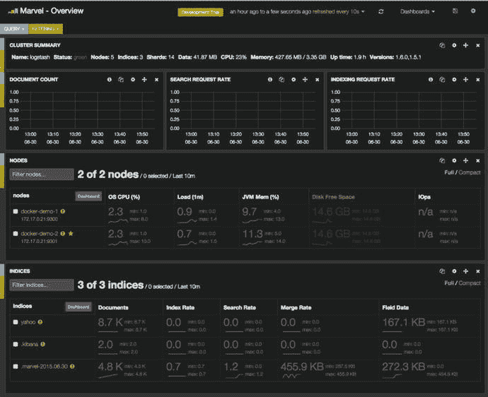

图 2-17. ElasticSearch Marvel 控制台

Marvel 提供了关于节点、索引和分片的信息；关于 CPU 使用情况；关于 JVM 的内存使用情况；关于索引速率以及搜索速率的信息。Marvel 甚至深入到 Lucene 层面，提供关于刷新（flush）和合并（merge）的信息。例如，你可以实时查看集群上的分片分配情况，如图 2-18 所示。

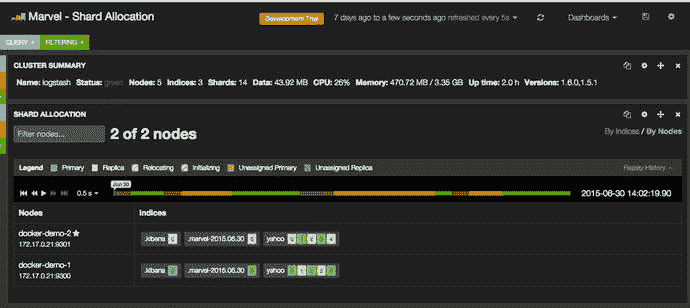

图 2-18. Marvel 的分片分配视图

为了让你了解 Marvel 能提供关于集群的巨量信息，图 2-19 展示了“节点统计”仪表盘中你能看到的部分信息。

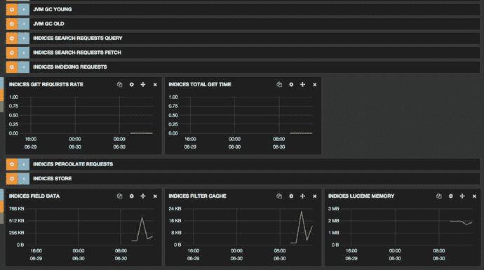

图 2-19. Marvel 节点统计仪表盘

如你所见，仪表盘按多行组织；事实上，在这个截图中你无法看到全部超过 20 行的内容。每行包含一个或多个关于该行主题的可视化信息。在图 2-19 中，你可以看到没有向索引发送任何 `GET` 请求；这就是折线图在 0 处持平的原因。

在开发模式下，这些统计数据将帮助你扩展服务器，例如，从一个单节点集群开始，根据你的特定需求观察其行为。然后在生产模式下，你能够跟踪集群内部的运行状况，而不会丢失任何相关信息。

### 使用 ElasticSearch 进行搜索

Marvel 附带了一个名为 Sense 的功能，这是一个用于 ElasticSearch 的查询编辑器/助手。Sense 的真正强大之处在于其自动完成查询的能力，当你对所有的 ElasticSearch API 不熟悉时，这一点非常有帮助，如图 2-20 所示。

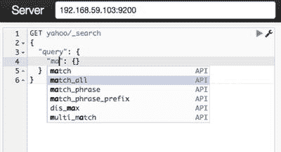

图 2-20. Marvel Sense 自动完成功能

例如，你还可以将查询导出为 cURL 格式，以便在脚本中使用，如图 2-21 所示。

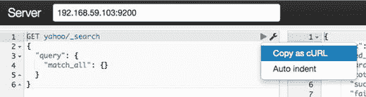

图 2-21. Marvel Sense 复制为 cURL 功能

在这种情况下，该查询将生成一个 cURL 命令，如代码清单 2-3 所示。

**代码清单 2-3.** Sense 生成的 cURL 命令示例

```
curl -XGET "http://192.168.59.103:9200/yahoo/_search" -d'
{
  "query": {
    "match_all": {}
  }
}'
```

这个查询基本上是在搜索“yahoo”索引下的所有文档。为了演示搜索 API 的好处，我使用了一个来自 Yahoo 的数据集，其中包含过去几年雅虎股票的价格。ElasticSearch 搜索 API 的关键特性之一是聚合框架。你可以以不同的方式聚合数据；最常见的方式是通过日期直方图，它相当于一个时间线。图 2-22 展示了一个查询示例；该查询按日期聚合股票数据，时间间隔为一个月，并计算该月的股票最大值。

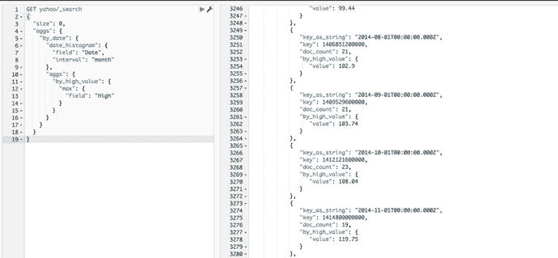

图 2-22. Marvel Sense 聚合示例

作为结果，我们得到一个包含数组的文档，其中每个项目包含日期、该月期间找到的文档数量以及最高值，如代码清单 2-4 所示。

**代码清单 2-4.** 聚合桶

```
{
        "key_as_string": "2015-01-01T00:00:00.000Z",
        "key": 1420070400000,
        "doc_count": 20,
        "by_high_value": {
               "value": 120
         }
}
```

正如你在图 2-22 的查询中看到的，这里有两层聚合：第一层是日期直方图，第二层是最大值。确实，只要从查询角度来看有意义，ElasticSearch 支持多层聚合。

搜索 API 功能非常丰富，我们无法在本书中逐一浏览所有特性，但你已经对其能力有了初步了解。你可以通过以下文档链接获取更多信息：

[`https://www.elastic.co/guide/en/elasticsearch/reference/1.4/search-search.html`](https://www.elastic.co/guide/en/elasticsearch/reference/1.4/search-search.html)

现在你已经熟悉了我们的两种 NoSQL 技术，让我们看看将它们集成到电子商务应用程序中的一种不同方法。

## 在基于 SQL 的架构中将 NoSQL 用作缓存

至此，你应该理解与 SQL 数据库相比，使用 NoSQL 技术的好处。但我们不希望破坏现有基于 SQL 数据库的架构。在接下来的方法中，我们将看到如何完善我们的架构，以便基于 NoSQL 技术为数据访问增加更多的灵活性。


好的，作为一名高级文档工程师和翻译员，我将严格遵循您的格式要求，将给定的英文文本翻译成中文。


### 缓存文档

首先需要讨论的是，如何在我们的 NoSQL 后端中事务性地复制数据。我们希望的是，每次在 SQL 数据库中写入数据时，都能在 NoSQL 后端创建、更新并丰富一个文档。可以创建一个尚不存在的文档，也可以更新某个字段，或者通过一个对应于关系型数据库管理系统（RDBMS）中表关系的子文档来丰富它。在访问文档方面，每当发起一个 API `GET` 请求时，底层实现应首先在 NoSQL 后端中查找，如果文档存在则直接返回。

但如果文档不存在呢？这时应触发一个缓存未命中事件，并将其发送给 NoSQL 管理器实现，以便从 RDBMS 重建该文档。听起来不错！但如果插入事务在 SQL 层面失败了怎么办？框架应该是事务性的，并且仅当事务已在 SQL 中提交时，才触发文档构建。

图 2-23 总结了这一机制。

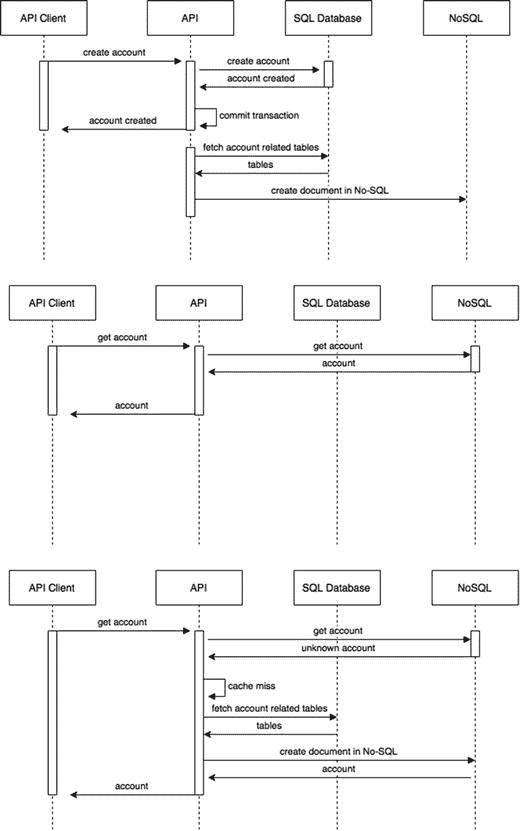

图 2-23. 在 NoSQL 中缓存文档

以下是图 2-23 中所示内容的说明：

-   第一张图展示了如何在 RDBMS 中创建一个账户，以及随后如何在 NoSQL 中创建一个代表整个账户的文档。
-   第二张图展示了 API 如何通过 NoSQL 存储获取一个账户。
-   第三张图展示了一个缓存未命中的示例，即当文档在 NoSQL 中不存在，而必须从 RDBMS 重新创建时的情况。

我们实际上是在为基于 NoSQL 的 web 应用构建一个缓存。这种方法依赖于能够灵活地从 NoSQL 访问整个文档，无需向 SQL 数据库发出请求带来的负担，同时也依赖于能够灵活利用 NoSQL 的分布式特性。通过这种方法，我们可以想象随着请求率的增长而扩展集群，并减少对 SQL 数据库的需求。

### 用于 Couchbase 的 ElasticSearch 插件（基于 Couchbase XDCR）

为了实现这样的缓存机制，我们需要选择一项 NoSQL 技术。我的第一种方法是单独使用 Couchbase，但正如你已经看到的，Couchbase 的搜索功能并不十分便捷。

处理用于索引数据的 map/reduce 函数并不简单，尤其是在进行简单聚合操作时。Couchbase 是一个很棒的 NoSQL 数据库，但实现搜索功能却非常痛苦。

相反，你可以使用 Couchbase/ElasticSearch 集成插件，它基本上是利用跨数据中心复制（XDCR）特性，将所有数据复制到我们的 ElasticSearch 集群（ [`www.couchbase.com/jp/couchbase-server/connectors/elasticsearch`](http://www.couchbase.com/jp/couchbase-server/connectors/elasticsearch) ）。

这样，你就可以在你的 API 中添加一个 `Search Manager` 类，实现 ElasticSearch 搜索 API 来检索数据。

但是，仅仅为了能从 NoSQL 而不是我们的 RDBMS 中获取文档，这仍然会引起大量的开销。在运维任务方面，这意味着你需要维护三种不同的技术：RDBMS、Couchbase 和 ElasticSearch。

### 仅使用 ElasticSearch

既然我们有以下需求，为什么还要继续使用 Couchbase 呢？

-   能够对整个对象进行索引，例如将账户从 SQL 索引到 NoSQL。
-   能够通过灵活的搜索 API 进行从简单到复杂的搜索，包括聚合操作。

在我们特定的用例中，你一开始可能选择 Couchbase，因为它是一个 NoSQL 数据库，并且根据你学到的实践，文档应该存储在数据库中。当体验这种架构时，你会意识到你真正需要的是访问和请求数据的最有效方式，而在我们的案例中，ElasticSearch 就是最有效的方式。

## 小结

到此为止，你已经了解了 Couchbase 或 ElasticSearch 等 NoSQL 技术如何为现有的基于 RDBMS 的应用带来灵活性。

同时，你也看到了，从高层视角看似乎相似的两项技术，实际上可能存在着根本性的不同。

在下一章中，你将学习如何处理处理拓扑。

