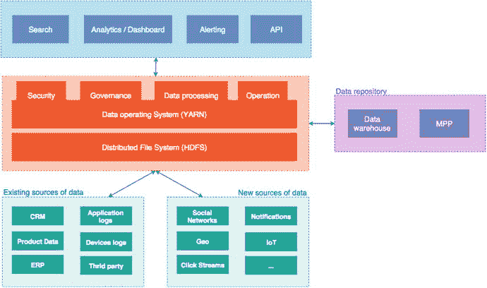
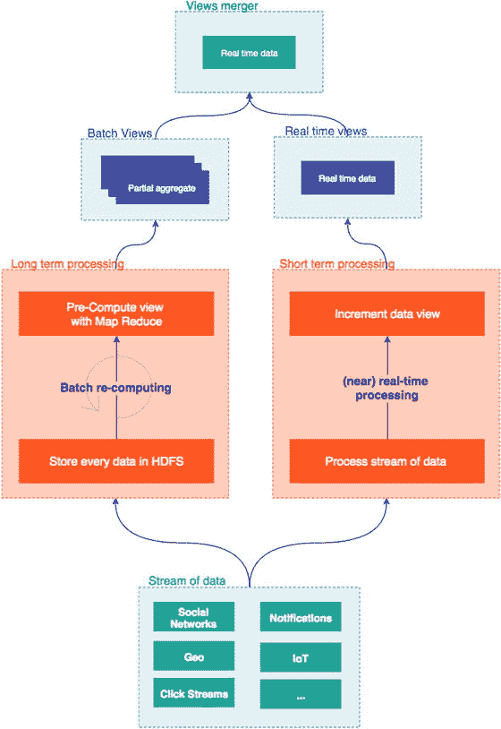
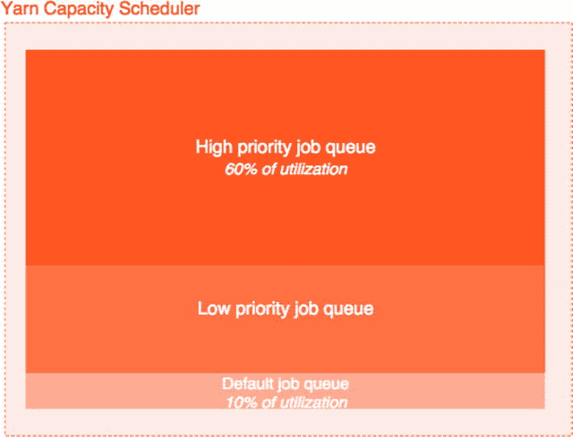
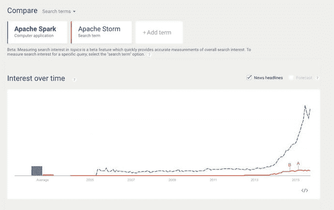
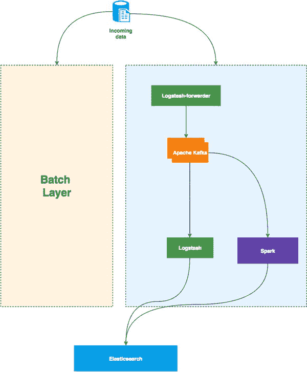

# 3. 定义处理拓扑

在上一章中，我解释了如何在你贯穿本书构建的架构中使用 NoSQL 技术。NoSQL 技术为应用提供了一些缓存和搜索功能，但由于你想要处理数据，你需要定义一种方法来处理各种数据流，以便向用户提供洞察或向应用提供服务。

本章将通过引导你了解 IT 组织中常用的数据架构，来解释如何定义处理拓扑。然后，你将看到，在遵守服务等级协议（SLA）时，拆分是一种自然而然的选择。最后，我将讨论一种特定的架构 —— Lambda 架构，它是不同类型架构的组合。

## 数据架构的初步方法

本节描述了使用大数据领域的常见技术部署数据架构的第一步。

### 一些背景知识

如今，许多 IT 组织正在演进他们的数据架构，因为他们依赖于所谓的传统数据架构。处理多个数据源并不新鲜；这些架构连接着众多的数据源，例如 `CRM` 系统、文件系统和遗留系统。它们主要运行在关系型数据库之上，如 `Oracle`、`DB2` 或 `Microsoft SQL`。

如今，通常的数据分析周期是运行一些定期进程，直接从数据库中提取和处理数据。这主要通过提取、转换、加载（`ETL`）工具（如 `Informatica` 或 `Talend`）来完成。目标是将消化处理后的数据加载到数据仓库中，供进一步分析使用。

不幸的是，这种处理数据的方式并不符合周期末端的业务需求。这些数据管道可能需要数小时、数天，有时甚至数周才能完成，但业务决策需要立刻做出。

除了处理时间之外，数据性质上的一些根本性变化也无法被这些架构轻松处理，例如，需要重构数据模型的数据结构，甚至需要考虑可扩展性的数据量。扩展这些系统并不容易，因为我这里谈论的不是分布式系统。扩展在部署时间上成本高昂，在硬件方面也是如此，因为数据库需要高性能的 `CPU`、`RAM` 和存储解决方案才能运行。

如今，大多数 IT 组织正在转向部署基于 `Hadoop` 技术的数据架构。实际上，目标不再是依赖僵化、昂贵的技术，而是要将处理负载分布到一批廉价机器上，并能够摄取大量不同类型的数据。

图 3-1 展示了此类架构的拓扑概览。



图 3-1. 基于 `Hadoop` 的数据架构

下一节将介绍数据管道、涉及的技术类型，以及此类架构的常见实践。

### 处理数据源

如图 3-1 所示，数据可以来自多个内部或外部来源，但大数据尤其来自内部应用和设备日志，以及社交网络、开放数据，甚至传感器。

以社交网络为例，数据如潮水般涌入 IT 组织，其中包含了有趣的信息，但这些诱人的信息却被淹没在海量的无用信息中。因此，首先需要存储这些数据，然后对其进行处理，以提取重要部分。这些数据对销售非常有用，尤其是当你基于它进行情感分析，以揭示社交生态系统对你的品牌或产品的感受时。

根据提供商的不同，数据可以是结构化的、半结构化的或非结构化的。代码清单 3-1 给出了一个半结构化消息的示例。

`代码清单 3-1.` 推文半结构化数据示例

```
{
"created_at": "Fri Sep 11 12:11:59 +0000 2015",
"id": 642309610196598800,
"id_str": "642309610196598785",
"text": "After a period in silent mode, going back to tweet life",
"source": "<a href=\"http://twitter.com/download/iphone\" rel=\"nofollow\">Twitter for iPhone</a>",
"truncated": false,
"in_reply_to_status_id": null,
"in_reply_to_status_id_str": null,
"in_reply_to_user_id": null,
"in_reply_to_user_id_str": null,
"in_reply_to_screen_name": null,
"user":  {
"id": 19450096,
"id_str": "19450096",
"name": "Bahaaldine",
"screen_name": "Bahaaldine",
"location": "Paris",
"description": "",
"url": null,
"entities":  {
"description":  {
"urls":  []
}
},
"protected": false,
"followers_count": 59,
"friends_count": 107,
"listed_count": 8,
"created_at": "Sat Jan 24 15:32:11 +0000 2009",
"favourites_count": 66,
"utc_offset": null,
"time_zone": null,
"geo_enabled": true,
"verified": false,
"statuses_count": 253,
"lang": "en",
"contributors_enabled": false,
"is_translator": false,
"is_translation_enabled": false,
"profile_background_color": "C0DEED",
"profile_background_image_url": "http://pbs.twimg.com/profile_background_images/454627542842896384/-n_C_Vzs.jpeg",
"profile_background_image_url_https": "https://pbs.twimg.com/profile_background_images/454627542842896384/-n_C_Vzs.jpeg",
"profile_background_tile": false,
"profile_image_url": "http://pbs.twimg.com/profile_images/448905079673094144/dz109X55_normal.jpeg",
"profile_image_url_https": "https://pbs.twimg.com/profile_images/448905079673094144/dz109X55_normal.jpeg",
"profile_banner_url": "https://pbs.twimg.com/profile_banners/19450096/1397226440",
"profile_link_color": "0084B4",
"profile_sidebar_border_color": "FFFFFF",
"profile_sidebar_fill_color": "DDEEF6",
"profile_text_color": "333333",
"profile_use_background_image": true,
"has_extended_profile": false,
"default_profile": false,
"default_profile_image": false,
"following": false,
"follow_request_sent": false,
"notifications": false
},
"geo": null,
"coordinates": null,
"place": null,
"contributors": null,
"is_quote_status": false,
"retweet_count": 0,
"favorite_count": 0,
"entities":  {
"hashtags":  [],
"symbols":  [],
"user_mentions":  [],
"urls":  []
},
"favorited": false,
"retweeted": false,
"lang": "en"
}
```

正如你在示例中所见，该文档是一个 JavaScript 对象表示法 (`JSON`) 文档，包含大量描述推文的字符串元数据字段。但其中一些字段更为复杂；存在一些数组，有时为空，有时则包含一组数据。此外，还有纯文本内容，例如推文正文。

这应该会让你思考数据需要如何存储。仅仅将数据放在 `HDFS` 上是远远不够的；你可能需要在数据之上构建一个元结构，使用支持这种数据结构复杂性的技术。例如，你可以通过 `Hive` 来实现这一点，这将在后续章节中讨论。

社交网络代表了你在处理大量异构数据时所要面对的复杂性。除了结构之外，你还需要将数据分类成逻辑子集，以增强数据处理能力。

考虑到情感分析的例子，将数据组织起来以便在海量非结构化数据中定位有价值的信息，是合情合理的。例如，一种常见做法是将数据划分为基于时间的分区，这样后续的数据处理就可以轻松地专注于某一年数据中的特定周数。

## 数据平台安全与处理

你还必须注意保护数据访问的安全性，最可能的方式是使用 Kerberos 或其他认证提供商。但随着数据平台吸引新的应用场景，多租户需要处理的首要问题就是安全性。然后，你需要创建数据的定期快照，以便进行归档，并在发生故障时进行恢复。

所有这些考量都是相当标准的，幸运的是，大多数发行版供应商都提供了相应的支持。存在一些开箱即用的软件包，能够确保或帮助你实现或配置这些概念。

### 数据处理

当你需要将数据从源端纯粹地转换到目标端时，数据转换通常由 ETL 工具处理。诸如 `Talend`、`Pentaho`、`Informatica` 或 `IBM Datastage` 等工具是大数据项目中最常用的软件。但它们仍不完善，你还需要一些补充工具（例如 `Sqoop`）来简单地导入或导出数据。无论哪种情况，都需要使用多种工具来摄取数据，而它们的共同点是目标端：`HDFS`。`HDFS` 是 Hadoop 发行版的入口点；数据必须以某种方式存储在这个文件系统中，以便由高级应用程序和项目进行处理。

当数据存储在 `HDFS` 上后，如何访问和处理它呢？例如，这正是 `Hive` 所能做到的。它在 `HDFS` 中存储的文件之上创建了一个结构，以便更容易地访问这些文件。这个结构本身就类似于数据库中的表。例如，列表 3-2 展示了可以为上述推特示例创建的结构。

**列表 3-2.** Hive 推特结构

```sql
create table tweets (
  created_at string,
  entities struct <
    hashtags: array<struct<text: string>>,
    media: array<struct<media_url: string, media_url_https: string, sizes: array<struct<url: string>>>>,
    urls: array<struct<url: string>>,
    user_mentions: array<struct<name: string, screen_name: string>>
  >,
  geo struct <
    coordinates: array<float>,
    type: string
  >,
  id bigint,
  id_str string,
  in_reply_to_screen_name string,
  in_reply_to_status_id bigint,
  in_reply_to_status_id_str string,
  in_reply_to_user_id int,
  in_reply_to_user_id_str string,
  retweeted_status struct <
    created_at: string,
    entities: struct <
      hashtags: array<struct<text: string>>,
      media: array<struct<media_url: string, media_url_https: string, sizes: array<struct<url: string>>>>,
      urls: array<struct<url: string>>,
      user_mentions: array<struct<name: string, screen_name: string>>
    >,
    geo: struct <
      coordinates: array<float>,
      type: string
    >,
    id: bigint,
    id_str: string,
    in_reply_to_screen_name: string,
    in_reply_to_status_id: bigint,
    in_reply_to_status_id_str: string,
    in_reply_to_user_id: int,
    in_reply_to_user_id_str: string,
    source: string,
    text: string,
    user: struct <
      id: int,
      id_str: string,
      name: string,
      profile_image_url_https: string,
      protected: boolean,
      screen_name: string,
      verified: boolean
    >
  >,
  source string,
  text string,
  user struct <
    id: int,
    id_str: binary,
    name: string,
    profile_image_url_https: string,
    protected: boolean,
    screen_name: string,
    verified: boolean
  >
)
PARTITIONED BY (datehour INT)
ROW FORMAT SERDE 'org.openx.data.jsonserde.JsonSerDe'
LOCATION '/user/username/tweets';
```

如你所见，推文被组织成一张表，其中的子结构描述了源端非结构化文档的复杂性。现在，数据安全地存储在 `HDFS` 中，通过 `Hive` 进行结构化，并准备好成为处理或查询管道的一部分。例如，列表 3-3 展示了已收集数据中主题标签的分布情况。

**列表 3-3.** 热门主题标签

```sql
SELECT
  LOWER(hashtags.text),
  COUNT(*) AS hashtag_count
FROM tweets
LATERAL VIEW EXPLODE(entities.hashtags) t1 AS hashtags
GROUP BY LOWER(hashtags.text)
ORDER BY hashtag_count DESC
LIMIT 15;
```

使用 `Hive` 查询数据非常方便，因为它提供了一种类似 SQL 的查询语言。问题在于查询的延迟；它基本上具有与 MapReduce 作业相同的延迟。实际上，上述查询会被转换为一个 MapReduce 作业，该作业遵循通常的执行管道，从而导致处理时间较长。

当需要实时跟踪数据转换时（例如在实时观看热门主题标签时），这种情况就会成为问题。随着 `Spark` 等技术的兴起，实时大规模数据处理不再是神话。它不仅带来了实时处理能力，而且实现起来也很简单。例如，列表 3-4 展示了如何在 MapReduce 中实现单词计数。

**列表 3-4.** MapReduce 中的单词计数（来自 [www.dattamsha.com/2014/09/hadoop-mr-vs-spark-rdd-wordcount-program/](http://www.dattamsha.com/2014/09/hadoop-mr-vs-spark-rdd-wordcount-program/)）

```markdown
# 架构拆分

在处理大量数据时，使用 Hadoop 能带来许多解决方案，但在分配资源和管理存储数据方面也带来了挑战；你始终希望在保持最低延迟以向最终用户提供数据的同时降低成本。

与任何其他架构一样，数据架构应满足 SLA 驱动的需求。因此，并非每个作业都应平等消耗所有资源，而应通过优先级系统进行管理，或在架构、硬件、网络等方面相互隔离。

在本节中，我将讨论现代数据架构如何拆分，以应对因 SLA 而产生的不同时间需求。为了说明这一点，我将讨论图 3-2 中展示的分区。



如图所示，架构分为以下几个部分：

-   长期处理部分

-   短期处理部分

-   视图合并部分

我将逐一介绍这些部分，并解释每个部分所承担的角色。

## 批处理

长期处理作业（或称批处理）是从第一代 Hadoop 架构开始实施的作业，例如 `MapReduce`、`Hive`、`Pig` 等。这些作业通常处理海量数据，并生成摘要数据，或更标准地说，生成数据聚合。数据利用 `HDFS` 文件系统的能力和调度进行分发，并由不同的工具进行管理，具体取决于你所使用的发行版。

通常，这些作业的目标是保持计算数据的聚合，并使其可用于分析。如前所述，批处理在大数据潮流初期是首要的处理方式，因为它是一种自然的数据处理方式：你提取或收集数据，然后调度作业。处理作业可能会花费大量时间才能完成聚合计算。

这些作业也主要满足了那些无法处理数据流的传统系统的处理需求。与需要持续监控的流式系统相比，批处理一次性运行，因此变得非常易于管理和监控。现在有了 `YARN`，管理分配给批处理应用的资源也变得容易。这样，IT 组织也可以根据每个批处理的 SLA 来拆分批处理架构，这将在下一节中讨论。

### 处理优先级

在处理批处理时，IT 组织希望完全控制与处理相关的操作，例如调度甚至对某些作业进行优先级排序。与大多数 IT 系统一样，数据平台始于一个试点用例，这可能会吸引其他组织的其他部分为平台添加更多用例。这简单地将平台转变为一个多租户数据平台，其中包含许多依赖于用例的 SLA。

在 Hadoop 2.0 和基于 Yarn 的架构中，为多租户提供的特性允许用户访问同一数据平台，并使用不同的集群容量运行处理。`YARN` 还允许你运行非 `MapReduce` 应用，因此通过 `ResourceManager` 和 YARN 容量调度器，可以在应用类型之间进行作业优先级排序。

---

列表 3-5 展示了如何在 Spark（Python）中实现相同功能。

**列表 3-5.** Spark 中的单词计数

```python
from pyspark import SparkContext

logFile = "hdfs://localhost:9000/user/bigdatavm/input"
sc = SparkContext("spark://bigdata-vm:7077", "WordCount")
textFile = sc.textFile(logFile)
wordCounts = textFile.flatMap(lambda line: line.split()).map(lambda word: (word, 1)).reduceByKey(lambda a, b: a+b)
wordCounts.saveAsTextFile("hdfs://localhost:9000/user/bigdatavm/output")
```

这引出了我的讨论：有必要将架构拆分为多个部分，分别处理特定需求，一部分用于批处理，另一部分用于流处理。

---

以下是 Hadoop MapReduce 的 Java 实现示例：

```java
package org.apache.hadoop.examples;

import java.io.IOException;
import java.util.StringTokenizer;
import org.apache.hadoop.conf.Configuration;
import org.apache.hadoop.fs.Path;
import org.apache.hadoop.io.IntWritable;
import org.apache.hadoop.io.Text;
import org.apache.hadoop.mapreduce.Job;
import org.apache.hadoop.mapreduce.Mapper;
import org.apache.hadoop.mapreduce.Reducer;
import org.apache.hadoop.mapreduce.lib.input.FileInputFormat;
import org.apache.hadoop.mapreduce.lib.input.FileSplit;
import org.apache.hadoop.mapreduce.lib.output.FileOutputFormat;
import org.apache.hadoop.util.GenericOptionsParser;

public class WordCount {

  public static class TokenizerMapper
       extends Mapper<Object, Text, Text, IntWritable>{

    private final static IntWritable one = new IntWritable(1);
    private Text word = new Text();

    public void map(Object key, Text value, Context context
                    ) throws IOException, InterruptedException {
      StringTokenizer itr = new StringTokenizer(value.toString());
      while (itr.hasMoreTokens()) {
        word.set(itr.nextToken());
        context.write(word, one);
      }
    }
  }

  public static class IntSumReducer
       extends Reducer<Text,IntWritable,Text,IntWritable> {
    private IntWritable result = new IntWritable();

    public void reduce(Text key, Iterable<IntWritable> values,
                       Context context
                       ) throws IOException, InterruptedException {
      int sum = 0;
      for (IntWritable val : values) {
        sum += val.get();
      }
      result.set(sum);
      context.write(key, result);
    }
  }

  public static void main(String[] args) throws Exception {
    Configuration conf = new Configuration();
    String[] otherArgs = new GenericOptionsParser(conf, args).getRemainingArgs();
    Job job = new Job(conf, "word count");
    job.setJarByClass(WordCount.class);
    job.setMapperClass(TokenizerMapper.class);
    job.setCombinerClass(IntSumReducer.class);
    job.setReducerClass(IntSumReducer.class);
    job.setOutputKeyClass(Text.class);
    job.setOutputValueClass(IntWritable.class);
    FileInputFormat.addInputPath(job, new Path(otherArgs[0]));
    FileOutputFormat.setOutputPath(job, new Path(otherArgs[1]));
    System.exit(job.waitForCompletion(true) ? 0 : 1);
  }
}
```

Hadoop 工作负载的分配是在容量调度器层面完成的。通过配置，你可以精细地安排可预测的集群资源份额，并能够实现安全且显著的集群利用率。这是通过设置作业队列的利用率百分比来实现的。图 3-3 展示了这一概念。



该示例展示了三个队列的不同优先级：高、低和默认。这可以在清单 3-6 所示的简单 YARN 容量调度器配置中体现。

```xml
<property>
  <name>yarn.scheduler.capacity.root.queues</name>
  <value>default,highPriority,lowPriority</value>
</property>

<property>
  <name>yarn.scheduler.capacity.root.highPriority.capacity</name>
  <value>60</value>
</property>

<property>
  <name>yarn.scheduler.capacity.root.lowPriority.capacity</name>
  <value>20</value>
</property>

<property>
  <name>yarn.scheduler.capacity.root.default.capacity</name>
  <value>10</value>
</property>
```

每个队列都被分配了一个最小集群容量，这个容量实际上是弹性的。这意味着如果有空闲资源可用，一个队列可以占用超过最初分配的最小容量。不过，最大容量也可以被分配，如清单 3-7 所示。

```xml
<property>
  <name>yarn.scheduler.capacity.root.lowPriority.maximum-capacity</name>
  <value>50</value>
</property>
```

此配置设置了容量，因此任何提交作业的人（例如，一个 `MapReduce` 作业）都可以根据预期要求将其提交到特定队列，如清单 3-8 所示。

```java
Configuration priorityConf = new Configuration();
priorityConf.set("mapreduce.job.queuename", queueName);
```

借助 YARN 容量调度器，批处理在资源管理方面变得更加高效，并且在行业中有许多应用，例如为推荐引擎分配比不那么关键的需求（如用于通知的数据处理）更多的资源。但谈到推荐，现在大多数 IT 系统都使用短期处理作业来进行推荐，并依赖于流式架构，我将在下一节中对此进行描述。

### 流处理

短期处理（即流处理）旨在摄取高吞吐量的数据。专为流式处理设计的解决方案能够处理海量数据，它们是高度分布式、可扩展且具有容错能力的技术。

这类架构必须解决一系列挑战。如前所述，主要挑战在于处理海量数据。虽然以往也存在流式处理技术，但此类方案必须具有高可用性、高弹性以及高性能。它们之所以高性能，是因为数据量、数据复杂性和数据规模都在增长。

数据量的增长意味着这些架构必须能够无缝地与多种数据源和应用集成，例如数据仓库、文件、历史数据、社交网络、应用日志等。它们需要提供一致的敏捷 API 和面向客户端的 API，同时还要能够将信息输出到多种渠道，例如通知引擎、搜索引擎和第三方应用。从根本上说，这类技术在对市场变化的实时响应方面有更多的约束。

最后，提供实时分析的能力是终端用户对流式架构的首要期望。需求非常明确，包括以下几个方面：实时发现数据、能够尽可能轻松地查询数据、以及通过告警进行主动监控，以便在事件达到阈值时通知用户和应用程序。

流式架构最初应用于金融领域的高吞吐量交易场景，但现已扩展到众多其他用例，主要包括电子商务、电信、欺诈检测和分析。这促成了两项主要技术的兴起：`Apache Spark` 和 `Apache Storm`。

`Spark` 是本书中我选择依赖的技术。我曾有幸多次使用它，我认为它是目前社区支持度最高、价值最大、最具吸引力的技术。图 3-4 佐证了这一点。



图 3-4. `Apache Spark` 与 `Apache Storm` 的谷歌趋势对比

在本节中，我不再赘述，而是用两个章节（第 X 章和第 X 章）专门讨论流式架构和服务架构。我将描述如何组合包括 `Spark` 在内的不同技术来处理实时流和搜索分析。

## Lambda 架构的概念

前几节描述了将数据架构拆分为三个部分的必要性：批处理、流处理和服务架构。虽然在大多数现有 IT 组织的数据架构中，批处理仍然是常见做法，但当你能够先对大多数用例的数据进行流式处理，并在需要时将数据存储在面向批处理的文件系统中时，批处理就并非真正的必需了。

对于一个以批处理为导向的 IT 组织来说，部署流式架构说起来容易做起来难。相比之下，流式架构在运维方面带来了更大的复杂性，因为操作员必须始终保持在线，而架构师必须设计和规划一个既能吸收突发的数据峰值，又能维持可接受响应时间的解决方案。

尽管如此，当你意识到部署一个 `Hadoop` 发行版“仅仅”是为了完成流式架构能用相同（有时甚至更多）处理 API 完成的工作时所付出的沉重代价，最终你会发现，从流式处理入手要容易得多。即使你的服务等级协议（SLA）并不严苛，且你也不期望在几秒或几分钟内获取数据，你仍然可以减少为实现 SLA 所投入的精力。

在我看来，流式架构是现代数据架构的自然演进。它降低了软件复杂性，就像第一代大数据兴起时硬件的减少一样。我在此处的架构选择可能并不通用，且与我日常的工作内容紧密相关，但当我浏览自己处理过的各种用例时，我意识到我的技术栈能够满足 90%的用例需求。

Lambda 架构融合了两个领域的精华。数据在速度层（speed layer）中进行实时处理并具有短暂性；在批处理层（batch layer）中被重新计算并用于创建部分聚合结果；最后在服务层（serving layer）中合并并提供服务。为了实现这一范式，我选择了以下产品拓扑结构：

*   `Logstash-forwarder` 用于摄取数据
*   `Apache Kafka` 用于分发数据
*   `Logtash agent` 用于处理日志
*   `Apache Spark` 用于流处理
*   `Elasticsearch` 作为服务层

图 3-5 展示了这一拓扑结构。



图 3-5. Lambda 架构的速度层和服务层

Lambda 架构常用于电子商务网站，用于推荐或安全分析等不同目的。以点击流数据为例，可以从中提取多种洞察。

*   一方面，利用长处理层（long-processing layer），可以对点击流进行处理、聚合，并与其他数据源关联，从而为消费这些数据的推荐引擎构建精确的数据源。在此示例中，点击流数据可以与包含精确人口统计信息的其他数据湖（data lakes）关联，构建可供分析的视图，然后索引到 `Elasticsearch` 中。
*   另一方面，同一份数据可用于机器人检测。事实上，大多数电子商务网站都面临安全威胁，一种防范方法是，通过流处理层分析点击行为，并实时将机器人 IP 地址列入黑名单。在图 3-5 中，你可以使用 `Spark` 进行复杂的关联分析，或运行机器学习过程，在数据索引到 `Elasticsearch` 之前提取数据。

在下一章中，我将不再详细讨论批处理层，因为这是目前大多数大数据书籍涵盖的熟知话题。服务层最常由 `Hive` 处理，但当 `Elasticsearch` 能够近乎实时地创建分析时，为什么还要使用 `Hive` 呢？现在，通过诸如 `ES-Hadoop` 连接器（[`www.elastic.co/products/hadoop`](https://www.elastic.co/products/hadoop)）等新连接器，你可以在大多数用例中，将数据访问、查询和聚合工作委派给像 `Elasticsearch` 这样的实时搜索技术，后者能提供更强大的功能。

## 总结

至此，你应该更好地理解了 Lambda 架构在处理多种数据源类型时的价值，以及它在需要向最终用户和应用程序提供服务时满足服务等级协议（SLA）期望方面的作用。

在下一章中，我将重点构建 Lambda 架构的流式处理部分，并将使用点击流数据作为我们讨论的基础。