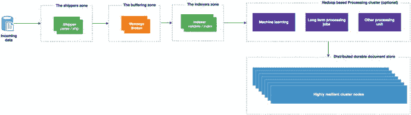
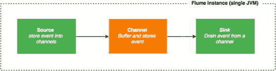
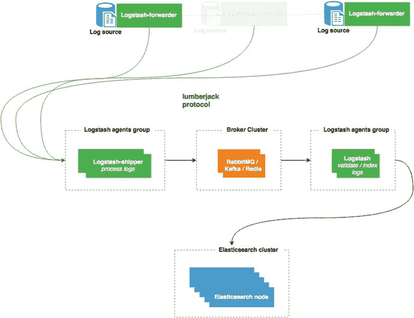
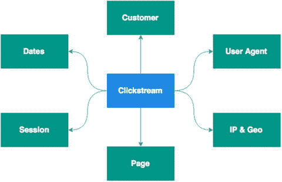
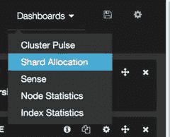
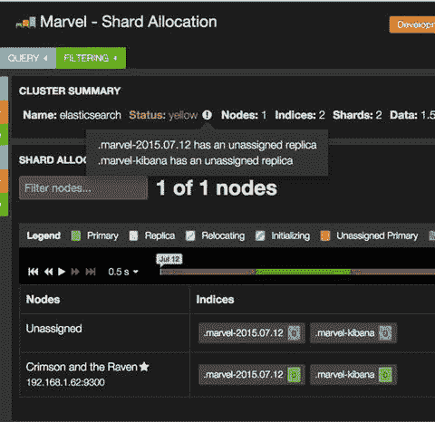
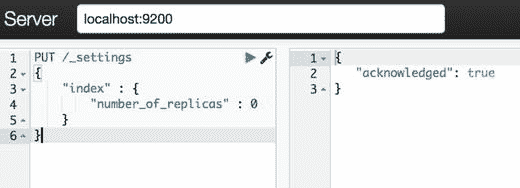
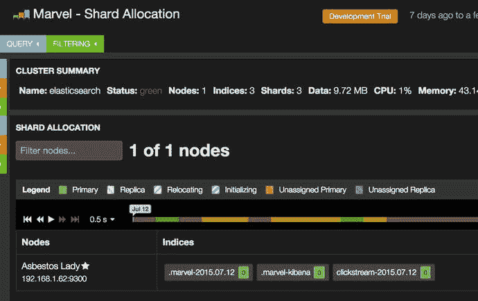

# 4. 流式数据

在上一章中，我们重点讨论了在 `Hadoop` 集群中运行并利用 `YARN` 或 `Hive` 的长期处理任务。在本章中，我想向你介绍我称之为 2014 年数据处理方式的流式数据。确实，越来越多的数据处理基础设施依赖于流式或日志架构，这些架构摄取数据，进行一些转换，然后将数据传输到数据持久层。

本章将重点介绍三项关键技术：`Kafka`、`Spark` 和来自 `Elastic` 的 `ELK` 技术栈。我们将致力于将它们组合使用，以实现可根据需求应用的多种日志架构。

## 流式架构

在本节中，我们将了解架构的流式处理部分是如何构建的，以及我们可以使用哪些技术进行数据摄取。

### 架构图

首先，在深入探讨架构细节之前，让我们先讨论一下“流式”（streaming）这个词，它在本文的上下文中可能会被误解。实际上，我所说的流式架构，是指一种能够随着数据的到来即时摄入数据的架构。

数据可以由不同的提供者生成：应用程序日志文件，例如 Apache HTTP 访问日志、您的 REST API 日志；来自消息代理技术（如 `Apache Kafka`）；甚至直接来自一个 TCP 端点。

通常，数据被摄入后会被传输到一个缓冲层，该层大多基于消息代理。我们称这部分为日志架构的传输部分。缓冲部分通常用于确保数据不会丢失，并将架构的传输部分和处理部分解耦。

无论数据何时以流式方式进入架构，消息代理都应当是分布式的，并保证数据的持久性。

数据经过缓冲后，可以设置两种处理架构：

-   一种处理管道，旨在对数据进行转换、格式化、验证和丰富化，然后进行持久化。大多数情况下，负责传输的技术会处理这一部分。有些技术也同时处理传输、缓冲和处理部分。

-   一种基于 Hadoop 技术的处理管道，它为处理过程提供额外功能，例如机器学习能力。

图 4-1 以图形方式展示了我们刚才讨论的内容。



图 4-1. 典型数据摄入架构剖析

### 技术

现在，让我们为这些高层模块赋予一些具体的名称。在数据摄入方面，最常用的技术可能是 `Apache Flume` 和 `Elastic` 的 `Logstash`。它们是两种常用的技术，用于从多种数据源摄入流数据，进行处理，然后建立索引。

`Flume` 架构具有可扩展性，并依赖于如图 4-2 所示的三层结构。



图 4-2. Flume 架构

`Flume` 的 `Source` 从外部源接收数据，并将其存储在一个或多个 `Flume` `Channel` 中。数据一旦进入 `Channel`，就会被存储并保留，直到 `Sink` 将其安全地排出。`Sink` 将消息写入目标存储。`Flume` 通常用于 Hadoop 架构中，例如，因为写入 `HDFS` 非常简单。`Flume` 能够保证从诸如 `Avro`、`Thrift`、`Syslog` 或另一个 `Flume` `Agent` 等数据源向 `HDFS`、日志文件、`Avro`，或直接向 `HBase` 甚至 `Elasticsearch` 输送数据。其水平扩展能力确保了容错性和高吞吐量。

另一方面，从结构角度来看，`Logstash` 完全不同。`Logstash` 是一个单一的模块化代理，负责接收、转发并“遗忘”日志。这里说的“遗忘”，并不是指 `Logstash` 不追踪它刚刚消费的内容（比如一个文件），而是指它没有附带一个用于持久化数据以提供开箱即用弹性的缓冲层。`Logstash` 使用 `JRuby` 编写，并运行在 `JVM` 中。为了避免使用 `JVM` 传输日志的缺点，`Logstash` 附带 `Logstash-forwarder`，这是一种专用的代理程序，用于接收和转发日志到另一个程序。

`Logstash` 的典型用法依赖于图 4-3 所示的架构。



图 4-3. Logstash 日志平台的典型架构

如图所示，该架构遵循我们之前讨论的结构进行划分，具有以下特点：

-   第一部分由安装在日志源旁边的 `Logstash-forwarders` 组成，它们仅负责接收数据并将其发送到负责处理日志的 `Logstash` 实例组，然后再将数据放入消息代理。

-   第二部分基于一个消息代理；推荐使用 `RabbitMQ`、`Kafka` 和 `Redis`。为了简化起见，并且因为逐一介绍每种可能的组合会占用很多篇幅，我们将重点放在 `Apache Kafka` 上，它目前似乎拥有最好的发展势头。

-   第三部分基于 `Logstash` 处理器组，它们可以在将事件索引到 `Elasticsearch` 之前对其进行验证。

在 `Logstash` 中，处理管道是一个声明式配置导向的文件，由输入（inputs）、过滤器（filters）和输出（outputs）组成。

`Logstash` 带有一系列输入/输出插件，让您可以连接到各种数据源，如文件、syslog、`tcp`、`xmpp` 等等。支持的输入插件完整列表可在以下页面找到：

-   [`www.elastic.co/guide/en/logstash/current/input-plugins.html`](https://www.elastic.co/guide/en/logstash/current/input-plugins.html)

-   [`www.elastic.co/guide/en/logstash/current/output-plugins.html`](https://www.elastic.co/guide/en/logstash/current/output-plugins.html)

过滤器通过根据需要配置过滤器来帮助处理事件。例如，如果您想将接收到的事件中的某个字段转换为整数，您只需编写如代码清单 4-1 所示的内容。

代码清单 4-1. Logstash 过滤器示例

```
filter {
  mutate {
    convert => { "fieldname" => "integer" }
  }
}
```

我们将在本章后面部分更深入地详细分析一个读取日志并处理它们的处理管道示例，但现在，先提供支持的过滤器列表链接：

-   [`www.elastic.co/guide/en/logstash/current/filter-plugins.html`](https://www.elastic.co/guide/en/logstash/current/filter-plugins.html)

您可能已经注意到在图中，建议的方法是将处理后的数据索引到 `Elasticsearch` 中。`Logstash` 支持不同类型的存储，并与 `Elasticsearch` 无缝集成。

`Elasticsearch` 将扮演索引引擎的角色，我们稍后将用它来进行搜索和分析。

## 摄入数据的剖析

在这部分，我们将讨论需要摄入到流式平台的数据结构。如前所述，我们的目标是利用网站访客的活动数据。因此，我们将重点关注所谓的“点击流数据”。

### 点击流数据

我想无需提醒您，关于网站访客活动这类关键数据。我们接下来要描述的“点击流数据”正是其中的一部分。

运营网站时，您很可能想了解访客的行为模式，以及如何优化他们的体验。网站要成长壮大，面临的挑战包括：

*   网站流量

*   独立访客数

*   转化率

*   按点击付费的流量

*   页面停留时间

*   ……

拥有这些关键绩效指标（KPI），您就能回答以下问题：我的页面是如何被访问的？何时被访问？访客在某个页面上停留了多久？人们更喜欢在哪些地方花费时间？他们是如何离开网站的？典型的页面间导航路径是怎样的？

了解网站上发生的情况至关重要，幸运的是，我们的架构设计正是为了在日志文件中生成数据，从而帮助我们实现这一目标。

通常，点击流数据基于 Web 访问日志，这些日志由 Apache 服务器或 NGINX 等服务器生成。根据您的日志配置，每当用户访问您的网站并在页面间导航时，每个操作都会在访问日志中写入一行。图 4-4 展示了一条点击流数据所包含的信息维度。



图 4-4. 点击流数据的结构

点击流数据将直接或间接地提供：

*   日期信息，例如事件发生的时间戳、访客的停留时间

*   用于浏览网站的用户代理、版本和设备信息

*   与访客关联的会话信息，这有助于关联不同的数据行：会话开始时间、结束时间、持续时间

*   页面信息，包括访客浏览的内容、发送到服务器的请求类型、域名/子域名

*   访客 IP 地址信息，间接提供地理位置相关信息

根据获取的信息类型，还可以将客户身份与点击流数据进行映射关联。

### 原始数据

在本书中，我们将使用 Apache HTTP 服务器，并通过其日志配置文件来生成点击流数据。配置相当简单，使用特定的语法将我们所需的信息呈现在日志行中。代码清单 4-2 是 Apache HTTP 服务器生成的一条典型访问日志行。

**代码清单 4-2. 访问日志行示例**

```
10.10.10.10 - - [10/July/2015:11:1:11 +0100] "GET /path/to/my/resource HTTP/1.1" 200 4392 "http://www.domain.com/referring-page" " Mozilla/5.0 (Macintosh; Intel Mac OS X 10_10_3) AppleWebKit/537.36 (KHTML, like Gecko) Chrome/43.0.2357.132 Safari/537.36" 1224 6793
```

这一行由代码清单 4-3 中描述的 Apache 日志配置生成。

**代码清单 4-3. Apache 日志配置**

```
LogLevel error

ErrorLog  /home/example/logs/error.log

LogFormat "%h %l %u %t \"%r\" %>s %b \"%{Referer}i\" \"%{User-Agent}i\" %I %O" combinedio

CustomLog /home/example/logs/access.log combinedio
```

**加粗**的一行定义了生成的日志行的结构：

*   `10.10.10.10` (`%h`)：请求的 IP 地址
*   `[10/July/2015:11:11:11 +0100]` (`%t`)：请求接收时间。格式为 `[日/月/年:时:分:秒 时区]`
*   `GET /path/to/my/resource HTTP/1.1` (`\"%r\"`)：请求的第一行，包含请求类型、路径、协议等有用信息
*   `200` (`%>s`)：HTTP 返回码
*   `4392` (`%b`)：返回到客户端的响应体大小（不含 HTTP 头），单位为字节
*   `%{Referer}`：HTTP 请求头中的 Referer（引用来源）
*   `%{User-Agent}`：HTTP 请求头中的 User Agent（用户代理）
*   `%I`：接收的字节数（包含 HTTP 头）
*   `%O`：发送的字节数（包含 HTTP 头）

可以看到，Apache 将数据组织到日志行的不同对应部分。但归根结底，接收日志的应用程序会将此数据视为非结构化数据，因为由第三方应用程序来解析它并非易事。

因此，您需要一种技术，既能消费这些不断追加到访问日志文件中的行（或传输整个文件），又能将这些数据转换为结构化文档，以便后续的分析和搜索。

这就是 Logstash 发挥作用的地方；接下来我们将搭建流式处理架构，并开始传输和摄入数据。

### 日志生成器

或许有一些公共数据集可用于测试我们的流式处理架构，但为简单起见，我更倾向于实现一个小型日志生成器来创建访问日志。我选择使用 Python 来实现这个生成器，如代码清单 4-4 所示。

**代码清单 4-4. 访问日志代码生成器**

```
#!/usr/bin/python

import time
import datetime
import random

timestr = time.strftime("%Y%m%d-%H%M%S")
f = open('../source/access_log_'+timestr+'.log','w')

### ips
with open('ips.txt') as ips_file:
        ips = ips_file.read().splitlines()

### referers
with open('referers.txt') as referers_file:
        referers = referers_file.read().splitlines()

### resources
with open('resources.txt') as resources_file:
        resources = resources_file.read().splitlines()

### user agents
with open('user_agents.txt') as user_agents_file:
        useragents = user_agents_file.read().splitlines()

### codes
with open('codes.txt') as codes_file:
        codes = codes_file.read().splitlines()

### requests
with open('requests.txt') as requests_file:
        requests = requests_file.read().splitlines()

event_time = datetime.datetime(2013,10,10)

for i in xrange(0,50000):
        increment = datetime.timedelta(seconds=random.randint(30,300))
        event_time += increment
        uri = random.choice(resources)
        if uri.find("Store")>0:
                uri += random.randint(1000,1500)
        ip = random.choice(ips)
        useragent = random.choice(useragents)
        referer = random.choice(referers)
        code = random.choice(codes)
        request= random.choice(requests)
        f.write('%s - - [%s] "%s %s HTTP/1.0" %s %s "%s" "%s"\n' % (random.choice(ips),event_time.strftime('%d/%b/%Y:%H:%M:%S %z'),request,uri,coe,random.randint(2000,5000),referer,useragent))
```

这个生成器依赖于不同的文本文件，并在 `../source/access_log_` 目录下生成指定数量的日志行，如代码清单 4-5 所示。

**代码清单 4-5. 启动生成器**

```
./generator.py 50000
```

上面这行命令将生成 50,000 行访问日志。您可以通过更新文本文件轻松自定义用于生成日志的内容。

请注意，代码清单 4-4 中使用的所有资源文件均可在以下 Github 仓库中找到：

[`https://github.com/bahaaldine/scalable-big-data-architecture/tree/master/chapter4/generator`](https://github.com/bahaaldine/scalable-big-data-architecture/tree/master/chapter4/generator)

## 搭建流式处理架构

为了搭建流式处理架构，我们将工作分为两部分：数据传输和数据处理。

### 将日志传输到 Apache Kafka

数据传输指的是将数据从生成它的机器传输到将要摄入并处理它的机器上。这正是我们接下来要使用 `Logstash-forwarder` 完成的工作。然后，数据将被存储到一个异步的、可靠的持久化层中，以确保消息的可靠投递。这里使用的消息代理是 Apache Kafka。

#### 转发器

在下面的章节中，我们将首先安装转发器并进行配置，具体来说是由 Lumberjack（一种安全的传输协议）确保其安全性。

#### 安装

`Logstash-forwarder` 使用 Go 语言编写，可以通过 RPM 包或直接从源码安装。我将采用第二种方式，并遵循以下步骤：

- 从此网址安装 Go：[`http://golang.org/doc/install`](http://golang.org/doc/install)
- 从 Git 仓库获取源码：`git clone git://github.com/elasticsearch/logstash-forwarder.git`
- 最后编译它：

```
cd logstash-forwarder
go build -o logstash-forwarder
```

`Logstash` 的安装非常简单。你只需在以下页面下载合适的软件包：[`https://www.elastic.co/downloads/logstash`](https://www.elastic.co/downloads/logstash)

## Lumberjack：安全协议

`Forwarder` 将安装在数据源旁边，负责将日志传输并发送到 `Logstash` 处理器。它使用 `lumberjack` 协议，该协议是安全的，需要有效的私钥（`.key` 文件）和 SSL 证书（`.crt` 文件）。`Logstash-forwarder` 和 `Logstash` 服务器都将使用这些资产来保护数据传输。

要生成有效的 `KEY` 和 `CRT` 文件，请运行清单 4-6 中描述的命令。

**清单 4-6. 密钥和证书命令行**

```
openssl req -x509  -batch -nodes -newkey rsa:2048 -keyout lumberjack.key -out lumberjack.crt -subj /CN=localhost
```

该命令将生成 `lumberjack.key` 和 `lumberjack.crt`。这里需要提及一个关于证书的重要事项。生成证书时使用的主题应与将在 `Logstash-forwarder` 文件中使用的主题一致。这里我们使用 `CN=localhost` 生成证书，因此在转发器文件中也需要使用 `localhost`。更多相关信息可在此页面找到：[`https://github.com/elastic/logstash-forwarder#important-tlsssl-certificate-notes`](https://github.com/elastic/logstash-forwarder#important-tlsssl-certificate-notes)

### 配置文件

`Logstash-forwarder` 的配置由网络和文件子配置组成；清单 4-7 显示了我为示例项目使用的配置。

**清单 4-7. Logstash 配置文件，可在以下位置找到：[`https://github.com/bahaaldine/scalable-big-data-architecture/blob/master/chapter4/logstash/forwarder/forwarder.json`](https://github.com/bahaaldine/scalable-big-data-architecture/blob/master/chapter4/logstash/forwarder/forwarder.json)**

```
{
  "network": {
    "servers": [ "HOST:PORT" ],
    "ssl certificate": "path/to/the/crt/file",
    "ssl key": "path/to/the/key/file",
    "ssl ca": "path/to/the/crt/file",
    "timeout": 15
  },
  "files": [
    {
      "paths": [
        "path/to/the/log/files"
      ],
      "fields": { "type": "access_log" }
    },
    {
      "paths": [ "-" ],
      "fields": { "type": "stdin" }
    }
  ]
}
```

我们来稍微解释一下这个配置：

- 网络配置主要使用一个目标下游服务器数组，这些服务器将接收日志文件。`servers` 数组中的每一项都是指向服务器的地址，例如 `localhost:5043`。
  - 然后 `ssl*` 条目指向我们刚刚生成的 `.key` 和 `.crt` 文件。
  - 最后一个参数是 `timeout`，它定义了 `Logstash-forwarder` 在认定连接中断之前等待下游服务器的时间，然后它会尝试连接到服务器数组中的另一个服务器。
- `files` 条目是一个将要传输的数据的数组；在我的示例中，我使用了：
  - 一个包含本书示例日志文件的目录的绝对路径。字段值设置了事件类型。
  - 一个包含 `-` 的特殊路径，这意味着 `Logstash-forwarder` 将转发标准输入内容，换句话说，就是你在命令行提示符下输入的任何内容。这是测试 `Logstash-forwarder` 和 `Logstash` 服务器之间传输管道的好方法。

还有更多配置文件路径的选项，例如使用通配符，这对于日志轮换非常实用。有关配置的更多信息可以在 `Logstash-forwarder` 的 Github 仓库中找到：[`https://github.com/elastic/logstash-forwarder`](https://github.com/elastic/logstash-forwarder)

`Logstash` 处理代理也需要一个配置文件。它遵循本章中提到的直接结构。清单 4-8 显示了我为本书使用的配置。

**清单 4-8. Logstash 处理管道示例，可在以下位置找到：[`https://github.com/bahaaldine/scalable-big-data-architecture/blob/master/chapter4/logstash/processor/forwarder_to_kafka.conf`](https://github.com/bahaaldine/scalable-big-data-architecture/blob/master/chapter4/logstash/processor/forwarder_to_kafka.conf)**

```
input {
  lumberjack {
    port => "5043"
    ssl_certificate => "path/to/crt/file"
    ssl_key => "path/to/key/file"
  }
}

filter {
  grok {
    match => {
      "message" => "%{COMBINEDAPACHELOG}"
    }
  }
}

output {
  stdout { codec => rubydebug }
  kafka {
    topic_id => "clickstream"
  }
}
```

此配置文件包含三个部分：

- **输入**：包含 `Logstash` 监听的输入流，用于接收数据。这里我们在 `localhost:5043` 上监听我们的 `Logstash-forwarder`，并且如前所述，我们使用了 `.key` 和 `.crt` 文件。
- **过滤器**：获取接收日志中包含的每一行，并将其转换为结构化事件。这里我们使用 `grok` 过滤器，这在处理 Apache HTTP 服务器组合日志时特别有用。`grok` 组合日志模式是多个 `grok` 模式的组合。其声明如清单 4-9 所示。

**清单 4-9. Grok Apache 通用日志与组合日志模式**

```
COMMONAPACHELOG %{IPORHOST:clientip} %{USER:ident} %{USER:auth} \[%{HTTPDATE:timestamp}\] "(?:%{WORD:verb} %{NOTSPACE:request}(?: HTTP/%{NUMBER:httpversion})?|%{DATA:rawrequest})" %{NUMBER:response} (?:%{NUMBER:bytes}|-)
COMBINEDAPACHELOG %{COMMONAPACHELOG} %{QS:referrer} %{QS:agent}
```

- `COMBINEDAPACHELOG` 模式依赖于另外两个模式：`COMMONAPACHELOG` 和 `QS` 模式。实际上，`grok` 附带了一组预定义的模式，这些模式可以被重用和组合来创建多级模式。你可以在以下页面获取有关 `grok` 过滤器的更多信息：[`https://www.elastic.co/guide/en/logstash/current/plugins-filters-grok.html`](https://www.elastic.co/guide/en/logstash/current/plugins-filters-grok.html)。预定义模式的更多信息在这里：[`https://github.com/elastic/logstash/blob/v1.4.2/patterns/grok-patterns`](https://github.com/elastic/logstash/blob/v1.4.2/patterns/grok-patterns)

## 输出

连接到我们的 Apache Kafka 服务器以将数据放入其中。我们还使用了带有 `ruby` 编解码器的 `stdout` 输出，这对于调试管道和查看事件结构非常方便。

## 消息代理

现在我们将配置 Apache Kafka 集群。为此，我们将创建一个由两个代理组成的集群，并暴露一个 `clickstream` 主题。主题本质上是一个通道，Logstash 处理器将通过该通道发布每个事件。然后，另一个程序将订阅该主题并消费消息；在我们的架构中，这一任务将由 Logstash 或 Apache Spark 完成。

下载、安装和配置 Apache Kafka 相对简单，需要遵循以下步骤：

表 4-1.

|   | `server-1.properties` | `server-2.properties` |
|---|---|---|
| `broker.id` | 1 | 2 |
| `port` | 9092 | 9093 |
| `log.dirs` | `/tmp/kafka-logs-1` | `/tmp/kafka-logs-2` |

*   首先，在以下页面下载 Kafka：[`kafka.apache.org/downloads.html`](http://kafka.apache.org/downloads.html)
*   解压并访问安装目录下的 `config` 文件夹，找到 `server.properties` 文件。
*   我们将复制该文件，并为我们的两个代理集群创建两个独立的文件。你应该会看到 `server-1.properties` 和 `server-2.properties`。
*   如表 4-1 所示，修改这两个文件中的属性，以避免两个实例之间发生任何冲突。

这三个属性分别代表代理标识符、代理监听端口和代理日志目录。这两个文件可以在以下仓库中找到：[`https://github.com/bahaaldine/scalable-big-data-architecture/tree/master/chapter4/kafka`](https://github.com/bahaaldine/scalable-big-data-architecture/tree/master/chapter4/kafka)

现在，我们可以开始连接各个部分并运行架构的第一部分来进行验证了。

## 运行魔法

我们将从下游到上游依次运行传输部分的每个模块；因此，我们先从 Kafka 开始。Kafka 依赖 Apache Zookeeper 来管理代理集群；我们将首先在安装目录下使用清单 4-10 所示的命令启动它。

清单 4-10. Zookeeper 启动命令

```
bin/zookeeper-server-start.sh config/zookeeper.properties
```

这会输出一定数量的日志行，但你应该会看到一些指示 Zookeeper 服务器正在运行的信息，如清单 4-11 所示。

清单 4-11. Zookeeper 启动日志

```
...
[2015-07-11 22:51:39,787] INFO Starting server (org.apache.zookeeper.server.ZooKeeperServerMain)
...
[2015-07-11 22:51:39,865] INFO binding to port 0.0.0.0/0.0.0.0:2181 (org.apache.zookeeper.server.NIOServerCnxnFactory)
...
```

现在，我们将使用清单 4-12 所示的命令启动两个代理实例。

清单 4-12. Kafka 服务器启动命令

```
bin/kafka-server-start.sh path/to/server-1.properties &
bin/kafka-server-start.sh path/to/server-2.properties &
```

你会看到第一个代理的日志行，如清单 4-13 所示。

清单 4-13. 第一个代理启动日志行

```
[2015-07-11 22:59:36,934] INFO [Kafka Server 1], started (kafka.server.KafkaServer)
[2015-07-11 22:59:37,006] INFO New leader is 1 (kafka.server.ZookeeperLeaderElector$LeaderChangeListener)
```

清单 4-14 显示了第二个代理的日志行。

清单 4-14. 第二个代理启动日志行

```
[2015-07-11 23:00:46,592] INFO [Kafka Server 2], started (kafka.server.KafkaServer)
```

清单 4-15 显示了如何在我们的集群中创建一个主题。

清单 4-15. Kafka 创建主题命令

```
bin/kafka-topics.sh --create --zookeeper localhost:2181 --replication-factor 3 --partitions 1 --topic clickstream
```

为什么 `replication-factor` 是 2？因为我们的集群可以在不发生数据丢失的情况下，容忍最多一台服务器故障。

为了确保传输部分的消息可以在下游被消费，我们将运行一个测试消费者，如清单 4-16 所示。

清单 4-16. Kafka 测试消费者命令

```
bin/kafka-console-consumer.sh --zookeeper localhost:2181 --from-beginning –topic clickstream
```

现在，让我们从 Logstash 代理安装目录运行 Logstash 处理代理，如清单 4-17 所示。

清单 4-17. Logstash 处理代理启动命令

```
/bin/logstash -f /path/to/forwarder_to_kafka.conf
```

其输出应如清单 4-18 所示。

清单 4-18. Logstash 启动日志

```
Logstash startup completed
```

最后，`logstash-forwarder` 如清单 4-19 所示。

清单 4-19. Logstash-forwarder 启动命令

```
/Applications/logstash-forwarder/logstash-forwarder -config forwarder.json
```

这应该会生成清单 4-20 所示的输出。

清单 4-20. Logstash-forwarder 启动日志

```
2015/07/12 00:00:29.085015 Connecting to [::1]:5043 (localhost)
2015/07/12 00:00:29.246207 Connected to ::1
```

我们已经准备好生成访问日志文件，并通过传输管道查看数据流；启动脚本，并生成一行日志，如清单 4-21 所示。

清单 4-21. 日志生成器启动命令

```
./generator.py 1
```

让我们检查 Logstash 处理器的日志，如清单 4-22 所示。

清单 4-22. Logstash 处理器日志

```
{
```

如上文所述，`stdout` 输出中的 `ruby` 编解码器对于查看流式事件的内容非常实用。在之前的日志中，我们可以看到 `grok` 已经完成了它的工作，解析了日志行，并将事件正确地结构化为了预期的格式。

现在，我们也应该在 Kafka 消费者端看到相同的消息，但格式为 JSON，如列表 4-23 所示。

列表 4-23. Kafka 消费者日志文件

```
{
    "message": "10.10.10.15 - - [10\/Oct\/2013:00:03:47 +0000] \"GET \/products\/product3 HTTP\/1.0\" 401 3627 \"http:\/\/www.amazon.com\" \"Mozilla\/5.0 (Windows; U; MSIE 9.0; WIndows NT 9.0; en-US))\" ",
    "@version": "1",
    "@timestamp": "2015-07-11T22:19:19.879Z",
    "file": "\/Users\/bahaaldine\/Dropbox\/apress\/demo\/chapter 4 \/source\/access_log_20150712-001915.log",
    "host": "MBPdeBaaaldine2",
    "offset": "0",
    "type": "access_log",
    "clientip": "10.10.10.15",
    "ident": "-",
    "auth": "-",
    "timestamp": "10\/Oct\/2013:00:03:47 +0000",
    "verb": "GET",
    "request": "\/products\/product3",
    "httpversion": "1.0",
    "response": "401",
    "bytes": "3627",
    "referrer": "\"http:\/\/www.amazon.com\"",
    "agent": "\"Mozilla\/5.0 (Windows; U; MSIE 9.0; WIndows NT 9.0; en-US))\""
}
```

到目前为止一切顺利；我们现在确信我们的数据传输和处理管道能够端到端地工作。接下来，我们进入数据提取端并对数据进行索引。

## 从 Apache Kafka 提取日志

数据提取是指使用一个消费者代理，该代理连接到 Kafka 并消费主题中的消息。这项工作将再次由 Logstash 完成，但这次会为代理使用不同的配置，因为后者将在 Elasticsearch 中对数据进行索引。

### 配置 Elasticsearch

在提取数据之前，我们需要配置我们的端点——Elasticsearch 集群。

#### 安装

无论我们使用何种方法（从 Logstash 或 Spark）将数据索引到 Elasticsearch，都需要搭建一个 Elasticsearch 集群。本书将模拟一个实际示例，并在单个节点集群上工作，但添加更多 Elasticsearch 节点只需几秒钟。

从以下链接下载并解压 Elasticsearch：

[`https://www.elastic.co/downloads/elasticsearch`](https://www.elastic.co/downloads/elasticsearch)

解压后，您需要安装一个名为 Marvel 的插件，它将帮助我们更好地了解 Elasticsearch 内部发生的情况。为此，请进入解压后的 Elasticsearch 文件夹，并运行以下命令：

`bin/plugin -i elasticsearch/marvel/latest`

值得一提的是，本书使用的 Marvel 版本与最新版本相比，该命令可能有所不同。有关更多信息，请参阅此处的 Marvel 安装文档：

[`https://www.elastic.co/guide/en/marvel/current/installing-marvel.html`](https://www.elastic.co/guide/en/marvel/current/installing-marvel.html)

这将在几秒钟内安装好 Marvel。然后运行 Elasticsearch：

`bin/elasticsearch`

在浏览器中访问以下 Marvel 控制台的 URL，然后从右上角的菜单中选择“分片分配”：`http://localhost:9200/_plugin/marvel`，如图 4-5 所示。





**图 4-5.** 访问分片分配仪表盘

如您所见，Marvel 提示集群中有两个未分配的副本，这导致集群的整体状态为黄色。只要我们运行的是单实例集群，这种情况就完全正常。Elasticsearch 不会将副本分片分配到与主分片相同的节点上；那样做是没有意义的。请记住，副本分片为您的集群提供了弹性恢复能力；在我们的情况下，我们需要启动另一个 Elasticsearch 实例，但由于我们处于测试环境，这似乎有点过头了。那么，让我们通过使用 Elasticsearch 索引设置 API 来更改集群配置：点击右侧菜单中的“Sense”切换到 Sense 控制台，您将进入 Sense 控制台，该控制台通过自动补全功能帮助您轻松运行 API 查询。

我们在这里要做的是将集群中创建的索引里的每个分片的副本数更新为 0，并将集群状态变为绿色。复制并粘贴列表 4-24 中的查询，然后点击运行按钮。

**列表 4-24.** 将副本数更新为 0 的索引 API

```
PUT /_settings
{
    "index" : {
        "number_of_replicas" : 0
    }
}
```

Sense 将返回一个确认响应，如图 4-6 所示。



**图 4-6.** 查询结果

如您所见，这个请求非常容易理解：它使用了设置 API，并发送了一个包含 `index` 对象的 PUT 请求，以指定索引中的每个分片应有 0 个副本。现在，如果您回到分片分配视图，您应该会看到集群状态变为绿色。

### 创建索引模板

现在我们将为数据创建映射，并为索引、文档和字段设置正确的参数。在 Sense 中，发出清单 4-25 中描述的请求。

**清单 4-25.** 点击流索引模板

```
PUT _template/clickstream
{
  "template": "clickstream-*",
  "settings": {
    "number_of_shards": 1,
    "number_of_replicas": 0
  },
  "mappings": {
    "_default_": {
      "dynamic_templates": [
        {
          "string_fields": {
            "mapping": {
              "index": "not_analyzed",
              "omit_norms": true,
              "type": "string"
            },
            "match_mapping_type": "string",
            "match": "*"
          }
        }
      ],
      "_all": {
        "enabled": true
      },
      "properties": {
        "response": { "type": "integer"},
        "bytes": { "type": "integer" }
      }
    }
  }
}
```

我们正在创建一个名为 `clickstream` 的模板，该模板将应用于 Elasticsearch 中创建的名称与 `clickstream-*` 正则表达式匹配的所有索引。我们将在本章后面看到这样做的原因。它包含主要部分：

*   **设置**：我们在此定义了集群中点击流索引所需的 `shard` 和 `replica` 数量。这与我们之前所做的等效，但现在已打包在模板中并应用于每个新的点击流索引。

*   **映射**：这定义了 Elasticsearch 应如何分析数据。Elasticsearch 有一个非常重要的概念，称为分析器，它基本上定义了我们的字段应如何为搜索目的进行解释和结构化。例如，您可以使用分词器并将字段内容拆分为多个 `token`。分析器的概念非常丰富，我建议您阅读以下文档，以更好地理解这里发生的事情：

### 直接使用 Logstash 索引数据

现在 Elasticsearch 已配置并运行，我们可以启动 Logstash 索引器实例并耗尽 Kafka。

#### 配置文件

要存储由点击流日志记录架构创建的文档，我们可以创建一个单独的索引并将所有内容存储在其中。但是随着站点流量的增长，数据量也会增长，因此我们应该考虑按时间分割索引，这在此处更有意义。

例如，考虑到您获取的数据越多，您拥有的旧数据可能就越没用，这些旧数据可能会被归档，以便为较新的数据留出更多的服务器资源。好消息是，这非常简单，并且直接在索引级别完成，换句话说，由 Logstash 完成。

清单 4-26 是我们的 Logstash 索引器的配置。

**清单 4-26.** Logstash 索引器配置，可在 [`https://github.com/bahaaldine/scalable-big-data-architecture/blob/master/chapter4/logstash/indexer/kafka_to_elasticsearch.conf`](https://github.com/bahaaldine/scalable-big-data-architecture/blob/master/chapter4/logstash/indexer/kafka_to_elasticsearch.conf) 找到

```conf
input {
  kafka {
    topic_id => "clickstream"
  }
}

filter {
}

output {
  stdout { codec => rubydebug }
  elasticsearch {
    index => "clickstream-%{+YYYY.MM.dd}"
    manage_template => false
    host => localhost
    protocol => http
  }
}
```

如您所见，与处理代理相比，配置相当简单，并且附带了一个新的输出，专门用于索引到 Elasticsearch，具有以下设置：

*   `index`：是我们希望将数据索引到的索引名称；这里的索引是一个模式，将生成一个基于日期的索引名称。
*   `manage_template`：Logstash 是否应管理索引模板；因为我们之前已经创建了一个，所以不需要。
*   `host` 和 `protocol`：这些很明显，指向我们的 Elasticsearch 集群。

#### 运行并索引数据

让我们运行 Logstash 索引器，看看 Elasticsearch 中发生了什么。发出如清单 4-27 所示的命令。

**清单 4-27.** Logstash 索引器启动命令

```bash
bin/logstash -f /path/to/kafka_to_elasticsearch.conf
```

使用 Python 脚本生成单个事件日志文件，像之前一样，您应该看到 ruby 调试编解码器输出事件结构。让我们关注 Elasticsearch，进入“分片分配”（Shard Allocation）仪表板，看看我们的点击流索引是否已创建，如图 4-7 所示。



**图 4-7.** 在 Marvel 中创建的新点击流索引

我们现在有了一个名为 `clickstream-2015.07.12` 的索引。显然，日期可能会根据您启动 Logstash 索引器的时间而变化，但无论如何，您应该有一个索引。

现在让我们进入 Sense，通过发出如清单 4-28 所示的命令来查询数据。

**清单 4-28.** 在 Sense 中查询点击流数据

```json
GET /clickstream-2015.07.12/_search
{
  "query": {
    "match_all": {}
  }
}
```

您得到的输出应该类似于清单 4-29 所示。

**清单 4-29.** 搜索输出

```json
{
   "took": 1,
   "timed_out": false,
   "_shards": {
      "total": 1,
      "successful": 1,
      "failed": 0
   },
   "hits": {
      "total": 1,
      "max_score": 1,
      "hits": [
         {
            "_index": "clickstream-2015.07.12",
            "_type": "access_log",
            "_id": "AU6CJyWNDD4MpZzVyM-9",
            "_score": 1,
            "_source": {
               "message": "10.10.10.13 - - [10/Oct/2013:00:04:55 +0000] \"GET /products/product3 HTTP/1.0\" 200 3219 \"http://www.google.com \" \"Mozilla/4.0 (compatible; MSIE 7.0; Windows NT 6.0)\" ",
               "@version": "1",
               "@timestamp": "2015-07-12T12:04:39.882Z",
               "file": "/Users/bahaaldine/Dropbox/apress/demo/chapter 4 /source/access_log_20150712-140436.log",
               "host": "MBPdeBaaaldine2",
               "offset": "0",
               "type": "access_log",
               "clientip": "10.10.10.13",
               "ident": "-",
               "auth": "-",
               "timestamp": "10/Oct/2013:00:04:55 +0000",
               "verb": "GET",
               "request": "/products/product3",
               "httpversion": "1.0",
               "response": "200",
               "bytes": "3219",
               "referrer": "\"http://www.google.com \"",
               "agent": "\"Mozilla/4.0 (compatible; MSIE 7.0; Windows NT 6.0)\""
            }
         }
      ]
   }
}
```

我们可以看到文档已被 Elasticsearch 存储并返回，并且符合我们上游配置的结构。

### 创建点击流别名

我需要在 Elasticsearch 中配置的最后一件事就是别名。如前所述，索引将基于时间创建，例如每天，因此我们最终会得到 N 个索引，但我们可能希望对所有索引进行搜索和分析。

为了将所有索引归入一个名称，我们将创建一个指向所有索引的别名。客户端应用只需知道别名即可访问数据。在 Sense 中执行如清单 4-30 所示的 API 查询来创建别名。

**清单 4-30.** 使用 `clickstream` 别名

```json
POST /_aliases
{
  "actions" : [
      { "add" : { "index" : "clickstream-*", "alias" : "clickstream" } }
  ]
}
```

现在，在 Sense 中，你可以执行如清单 4-31 所示的命令，并得到与之前查询完全相同的结果。

**清单 4-31.** 使用`clickstream`别名查询

```json
GET /clickstream/_search
{
  "query": {
    "match_all": {}
  }
}
```

## 总结

我们的流式/日志架构现已准备就绪，可以接收数据并将其索引到分布式持久化数据存储中，例如`Elasticsearch`。在下一章中，我们将看到如何使用`Elasticsearch` API 进行近实时查询，并将看到本摄取架构第二部分的实现：`Spark`处理部分。
