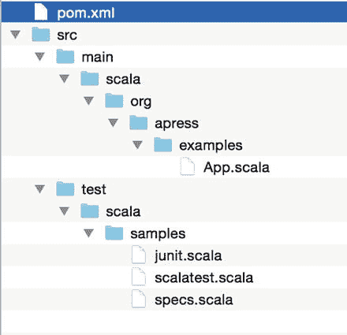
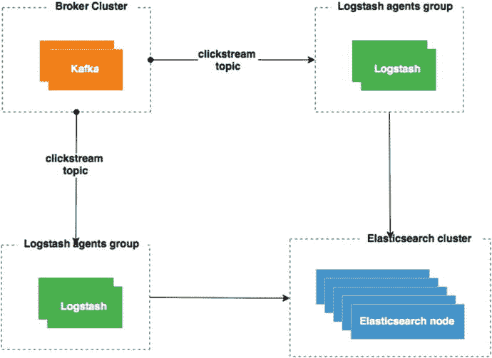
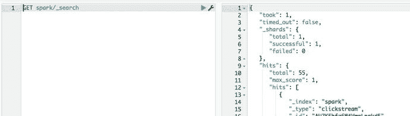
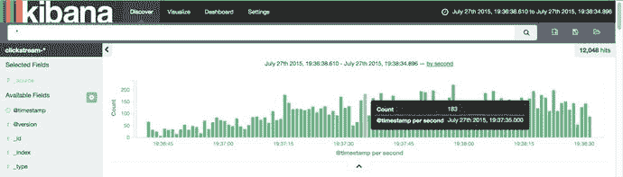
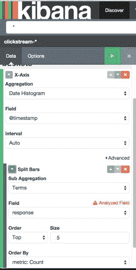
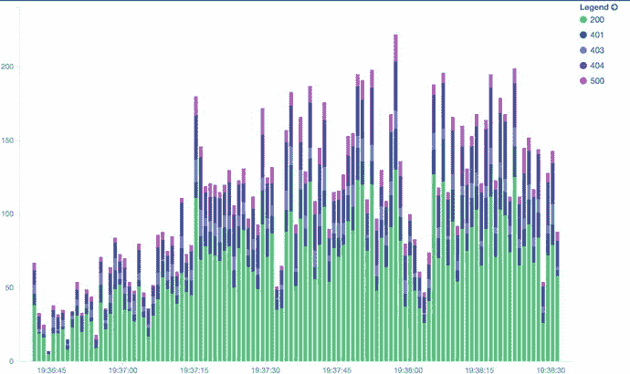
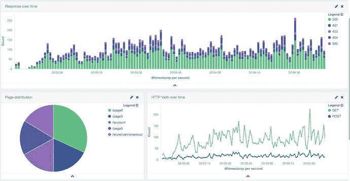

# 5. 查询与分析模式

进入数据可视化的方法有很多种，首先要制定分析策略，该策略应能让我们实时识别数据中的模式，同时也能通过持续处理来利用已摄取的数据。这就是本章将要介绍的内容，具体包括如何集成 Spark、在 Elasticsearch 中进行分析，最终在 Kibana 中可视化我们的工作成果。

## 定义分析策略

在本节中，我们将介绍两种不同的数据分析方法：一种是持续处理数据并更新文档存储中的分析结果，另一种是按需进行实时查询。最后我们会发现，在可扩展的架构中，并没有非黑即白的策略；你很可能最终会两者兼用，但通常是从其中一种开始。

### 持续处理

我所说的持续处理，是指能够随着批次数据的到来，从中提取关键绩效指标和度量值。这是流式架构中的一个常见用例，一旦设置好，可以带来很多好处。这里的思路是依赖一项技术，它需要具备以下特性：

-   分布式

-   有弹性

-   能进行近实时处理

-   在服务器和处理能力方面可扩展

Spark 是在该架构中扮演此角色的绝佳候选者；你基本上可以集成 Spark 和 Kafka 来实现持续的批处理。实际上，Spark 会按批次间隔从 Kafka 主题中消费消息，并在将数据索引到数据存储（显然是 Elasticsearch）之前对数据应用处理：

-   第一个好处是减轻数据存储的处理负担

-   第二个好处是能够拥有像 Spark 这样可扩展的处理层。你可以随着时间的推移添加更多执行不同类型处理的 Spark Kafka 消费者。

典型的处理方式是对批次数据进行聚合，例如在我们的例子中，统计查询次数、404 错误数量、一段时间内与用户的数据交换量等等。但最终，这种处理可以发展到利用 Spark 的机器学习功能对数据进行预测。

一旦处理后的数据由 Kafka 传递出来，再由 Spark 进行流式处理和处理，它们就应该可用于分析和搜索。这时 Elasticsearch 就登场了，它允许用户实时访问数据。

### 实时查询

实时查询消除了对传统批处理架构（如 Hadoop 相关发行版）的依赖，这类架构部署起来可能很笨重，并且不是最终用户所期望的。

如今，你通常希望立即获得信息，而不是五分钟或第二天之后。

实时查询策略的效率取决于你使用的数据存储。它还应提供一组 API，让用户能够从大量数据中大规模地提取关键信息。

Elasticsearch 做到了这一点：它支持通过聚合框架运行聚合查询，以进行近实时的文档分组或文档字段数据计算。

借助实时查询和 Elasticsearch 开箱即用的聚合能力，我们可以构建一个摄取管道，消除从数据被摄取到数据在 Elasticsearch 中被索引这段时间内的所有处理。换句话说，这个管道可以简化为使用 Logstash 将数据从 Kafka 中排出，并索引到 Elasticsearch 中。

这里的思路是，要判断哪些工作应该由 Spark 处理，哪些应该留给 Elasticsearch。我们会看到，使用 Elasticsearch 实现简单的分组聚合会非常方便。

## 使用 Spark 处理并索引数据

为了使用 Spark 摄取数据，我们首先需要实现一个 Spark 流式处理代理，它会从 Kafka 消费数据，然后进行处理并索引到 Elasticsearch。接下来，我们将 Spark 的摄取过程分成两部分：流式处理器和索引器。

**注意**，本章使用的代码可以在以下仓库中找到：[`https://github.com/bahaaldine/scalable-big-data-architecture/tree/master/chapter5/spark-scala-streamer`](https://github.com/bahaaldine/scalable-big-data-architecture/tree/master/chapter5/spark-scala-streamer).

### 准备 Spark 项目

为了实现流式代理，我们将使用 Spark Streaming，这是一个可靠、容错的 API，用于从各种数据源流式传输数据。更多信息请访问：

[`https://spark.apache.org/streaming/`](https://spark.apache.org/streaming/)

到目前为止，我们不会对接收到的数据进行结构化处理。我们的目标是建立流式传输本身，从 Kafka 摄取数据流，并能够将其打印出来。我习惯使用 Eclipse (Mars 4.5) 来实现我的 Java (1.8)/Scala(2.10) 项目。IntelliJ 也是一款非常优秀的 IDE，在 Scala 应用程序中非常流行。

我们需要做的第一件事是创建一个具有所需依赖项的 Spark 项目结构。为此，我们将使用 Maven 和一个可以在 Github 上轻松找到的 Spark 原型。在我的示例中，我将使用：

[`https://github.com/mbonaci/spark-archetype-scala`](https://github.com/mbonaci/spark-archetype-scala)

使用这个原型，你可以简单地生成一个 Scala 项目，然后就可以在 Eclipse 中使用它。执行清单 5-1 中所示的命令。

**清单 5-1.** Spark Scala 原型生成

```
mvn archetype:generate \
  -DarchetypeCatalog=https://github.com/mbonaci/spark-archetype-scala/raw/master/archetype-catalog.xml \
  -DarchetypeRepository=https://github.com/mbonaci/spark-archetype-scala/raw/master \
  -DgroupId=org.apress.examples \
  -DartifactId=spark-scala-streamer \
  -Dversion=1.0-SNAPSHOT
```

请注意，此处用于换行的转义字符应根据操作系统进行调整；例如，在 Windows 上应该是« ^ »。

Maven 会提示并要求确认，然后才生成项目。完成这些步骤并最终完成创建。然后，你应该会得到如图 5-1 所示的目录结构。



**图 5-1.** Spark Scala 项目目录结构

为了使 Maven 能够正确地编译和打包你的应用程序，这个目录结构非常重要。

我们要做的第一件事是理解 Maven 为我们生成的示例应用程序。

### 理解基本的 Spark 应用程序

Spark 原型的好处是生成了一个示例应用程序，它给出了 Spark 程序的基本结构。它首先从 Spark 上下文的配置开始，然后处理数据，并将该处理的结果发送到输出。

在示例程序（`App.scala` 文件）中，`SparkContext` 的配置包括设置应用程序名称（该名称将出现在集群元数据中）以及我们将在其上执行应用程序的集群，如清单 5-2 所示。

**清单 5-2.** Spark 上下文配置

```
val conf = new SparkConf()
  .setAppName("The swankiest Spark app ever")
  .setMaster("local[2]")
```

这里我们使用了特殊值 `local[2]`，这意味着我们希望使用本地 Spark 运行时（两个线程）在本地机器上运行应用程序。这对于测试目的非常方便，我们将在本书中使用这种方法。

配置完成后，我们将使用清单 5-3 所示的配置创建一个新的 Spark 配置。

**清单 5-3.** Spark 创建

```
val sc = new SparkContext(conf)
```

然后，示例程序创建一个数据集，如清单 5-4 所示。

**清单 5-4.** Spark 数据集创建

```
val col = sc.parallelize(0 to 100 by 5)
```

实际上，这行代码包含两个步骤：

-   首先，它创建一个集合，包含从 0 到 100 的每五个数字。

-   然后，Spark 通过将该集合复制到一个分布式数据集中来并行化它。换句话说，根据集群的拓扑结构，Spark 将并行处理此数据集。该数据集通常称为弹性分布式数据集（RDD）。

请注意，这里我们没有设置想要将数据集分割成的分区数量，因为我们让 Spark 来处理，但我们可以像清单 5-5 所示那样对数据进行分区。

**清单 5-5.** Spark 手动添加分区

```
val col = sc.parallelize(0 to 100 by 5, 2)
```

最后，我们使用 Spark 示例函数转换数据，该函数生成一个新的 RDD，其中包含一个新的值集合，如清单 5-6 所示。

**清单 5-6.** Spark 创建新的 RDD

```
val smp = col.sample(true, 4)
```

这里我们使用了一个种子值为四的数字生成器。如果你想打印出生成的样本内容，请使用如清单 5-7 所示的镜像映射函数。

**清单 5-7.** Spark 使用镜像映射函数

```
smp.map(x => x).collect
```

这将打印出类似清单 5-8 所示的内容。

**清单 5-8.** Spark 处理输出

```
Array(0, 0, 0, 0, 0, 5, 5, 5, 5, 10, 10, 15, 15, 15, 15, 15, 20, 20, 20, 20, 25, 30, 30, 35, 35, 35, 35, 35, 35, 35, 35, 40, 40, 45, 45, 55, 55, 55, 55, 60, 65, 70, 70, 70, 70, 70, 70, 70, 75, 75, 75, 75, 80, 80, 80, 80, 85, 85, 90, 90, 100, 100, 100, 100, 100)
```

如果你使用清单 5-9 的命令运行示例应用程序：

**清单 5-9.** Spark 启动命令

```
mvn scala:run -DmainClass=org.apress.examples.App
```

代码的最后部分（清单 5-10）：

**清单 5-10.** Spark 驱动程序代码

```
val colCount = col.count
val smpCount = smp.count
println("orig count = " + colCount)
println("sampled count = " + smpCount)
```

将打印出：

**清单 5-11.** Spark 驱动程序输出

```
orig count = 21
sampled count = 78
```

这个 Spark 应用程序被称为 Spark 驱动程序。显然，这个示例很容易理解，并且只使用了很少的功能，但它给出了驱动程序结构的一般概念。在我们的用例中，我们希望通过 Spark 实现的目标是能够以分布式方式处理大量数据，消化它们，然后在架构中将它们发送到下游。

### 实现 Spark Streamer

在现有架构中引入 Spark 并不需要修改我们在第 4 章中已经看到的内容；只需为我们的 Kafka 点击流主题添加一个新的消费者，如图 5-2 所示。



**图 5-2.** 将 Spark Kafka 流式处理添加到我们的架构中

我们的 Spark 驱动程序应该能够连接到 Kafka 并消费数据流。为此，我们将配置一个名为 `StreamingContext` 的特殊 Spark 上下文，如代码清单 5-12 所示。

**代码清单 5-12.** 配置 Spark Streaming 上下文

```
val sparkConf = new SparkConf().setAppName("KafkaStreamerToElasticsearch ")
sparkConf.set("es.index.auto.create", "true")
val ssc = new StreamingContext(sparkConf, Seconds(2))
```

如您所见，上下文配置与之前的 Spark 驱动程序示例基本相同，区别如下：

- 我们使用 `es.index.auto.create` 选项来确保在数据索引时，索引会自动在 Elasticsearch 中创建。

- 我们将 `StreamingContext` 的批处理间隔设置为 2 秒，这意味着数据将每隔 2 秒从 Kafka 主题流式传输一次。

我们现在需要配置要从哪些代理（brokers）和哪些主题（topics）接收数据，然后在这两者之间创建流式传输线路，如代码清单 5-13 所示。

**代码清单 5-13.** 连接 Spark 和 Kafka

```
val Array(brokers, topics) = args
val topicsSet = topics.split(",").toSet
val kafkaParams = MapString, String
val messages = KafkaUtils.createDirectStreamString, String, StringDecoder, StringDecoder
```

`args` 变量包含运行驱动程序时传递给它的参数。代理列表和主题列表都用逗号分隔。解析后，使用 Spark 流式框架（`org.apache.spark.streaming` 包）提供的 `KafkaUtils` 类在 Kafka 和 Spark 之间创建直接流。在我们的示例中，所有消息都接收在 `messages` 变量中。

此时，我们应该能够使用代码清单 5-14 中的 `map` 函数输出每条流式传输的点击流日志行。

**代码清单 5-14.** 映射并打印行

```
val lines = messages.map(_._2)
lines.print();
```

前面几行中有几点需要留意：

- `messages` 变量是一个包含流式数据的 RDD。

- `_` 语法表示匿名函数中的一个参数，如代码清单 5-15 所示。

**代码清单 5-15.** Spark `map` 函数简化语法

```
map(_._2)
```

这等价于代码清单 5-16 中所示的一行，其中 `_2` 是 `x` 元组的第二个元素。

**代码清单 5-16.** Spark `map` 函数完整语法

```
map(x => x._2)
```

要运行驱动程序，我们首先要使用 Maven 构建它。运行以下命令来编译 Scala 代码并将其打包成一个 JAR：

```
mvn scala:compile package
```

请注意，对于该驱动程序，我使用的是 Scala 2.10.5，它需要 Java 7 才能运行：

```
export JAVA_HOME=/Library/Java/JavaVirtualMachines/jdk1.7.0_21.jdk/Contents/Home/
```

编译并打包后，您应该在项目的 `target` 目录中得到两个 JAR 文件：

- `spark-scala-streamer-1.0.0.jar`：仅包含编译后的项目类。

- `spark-scala-streamer-1.0.0-jar-with-dependencies.jar`：包含编译后的类和项目依赖项。

我们将使用与上一部分略有不同的方法来运行驱动程序：使用标准 Spark 发行版中的 `spark-submit` 可执行文件，该发行版可从此处下载：

[`http://spark.apache.org/downloads.html`](http://spark.apache.org/downloads.html)

在撰写本文时，我使用的是 1.4.0 版本。下载后，我建议您只需将 Spark 二进制文件添加到您的 `PATH` 环境变量中，如代码清单 5-17 所示。

**代码清单 5-17.** 将 Spark 二进制文件添加到 `PATH` 环境变量

```
export SPARK_HOME=/Applications/spark-1.4.0/bin
export PATH=$SPARK_HOME:$PATH
```

这将简化对所有 Spark 可执行文件的访问，包括 `spark-submit`，您可以像代码清单 5-18 中那样使用它来执行我们之前的程序。

**代码清单 5-18.** 使用 `spark-submit` 运行 Spark 驱动程序

```
spark-submit --class org.apress.examples.chapter4.KafkaStreamer \
  --master local[1] \
  target/spark-scala-streamer-1.0.0-jar-with-dependencies.jar \
  localhost:9092,localhost:9093 clickstream
```

如您所见，我们将 `KafkaStreamer`（它属于我们刚刚创建的 JAR）传递给 `spark-submit`。我们使用带有依赖项的 JAR，否则 Spark 将找不到所需的类，您很可能会遇到“找不到类”异常。在命令末尾，您可能已经认出了包含代理列表（我们要连接的目标）和主题（我们要从中流式传输数据的目标）的参数。运行此命令会启动 Spark 并监听传入消息，因此请使用我们在上一部分中使用的生成器生成日志行，并确保流式处理管道正在运行以便将消息推送到 Kafka 中。您应该在控制台中看到一些行输出，如代码清单 5-19 所示。

**代码清单 5-19.** Spark 流式传输的数据示例

# Spark 索引实现

```
-------------------------------------------
Time: 1437921302000 ms
-------------------------------------------
{"message":"10.10.10.11 - - [10/Oct/2013:00:04:02 +0000] \"GET /page3 HTTP/1.0\" 200 4401 \"http://www.amazon.com\" \"Mozilla/5.0 (Windows; U; Windows NT 6.1; rv:2.2) Gecko/20110201\" ","@version":"1","@timestamp":"2015-07-26T14:35:00.869Z","file":"/tmp/source/access_log_20150726-163457.log","host":"ea8fceb4f5b0","offset":"0","type":"access_log","clientip":"10.10.10.11","ident":"-","auth":"-","timestamp":"10/Oct/2013:00:04:02 +0000","verb":"GET","request":"/page3","httpversion":"1.0","response":"200","bytes":"4401","referrer":"\"http://www.amazon.com\"","agent":"\"Mozilla/5.0 (Windows; U; Windows NT 6.1; rv:2.2) Gecko/20110201\""}
{"message":"10.10.10.15 - - [10/Oct/2013:00:05:44 +0000] \"POST /page6 HTTP/1.0\" 200 2367 \"http://www.bing.com\" \"Mozilla/5.0 (Linux; U; Android 2.3.5; en-us; HTC Vision Build/GRI40) AppleWebKit/533.1 (KHTML, like Gecko) Version/4.0 Mobile Safari/533.1\" ","@version":"1","@timestamp":"2015-07-26T14:35:00.869Z","file":"/tmp/source/access_log_20150726-163457.log","host":"ea8fceb4f5b0","offset":"167","type":"access_log","clientip":"10.10.10.15","ident":"-","auth":"-","timestamp":"10/Oct/2013:00:05:44 +0000","verb":"POST","request":"/page6","httpversion":"1.0","response":"200","bytes":"2367","referrer":"\"http://www.bing.com\"","agent":"\"Mozilla/5.0 (Linux; U; Android 2.3.5; en-us; HTC Vision Build/GRI40) AppleWebKit/533.1 (KHTML, like Gecko) Version/4.0 Mobile Safari/533.1\""}
```

现在，我们代码的流式处理部分已经运行，我们可以专注于索引部分了。

## 实现 Spark 索引器

索引部分是驱动程序的最后一部分，但令人意外的是，我们并没有将其配置推迟到最后一步。

这里我们要做的是确保我们消费的每个点击流事件都可以被索引到 ElasticSearch 中。点击流事件实际上是字符串流形式接收的 JSON；然后我们需要解析该字符串，将其编组为 JSON RDD，然后创建一个 `Clickstream` 对象的 RDD。

首先，让我们定义我们的 `Clickstream` 对象，如清单 5-20 所示。

**清单 5-20.** Clickstream 对象

```
case class Clickstream (
   message:String,
   version:String,
   file:String,
   host:String,
   offset:String,
   eventType:String,
   clientip:String,
   ident:String,
   auth:String,
   timestamp:String,
   verb:String,
   request:String,
   httpVersion:String,
   response:String,
   bytes:Integer,
   referrer:String,
   agent: String
)
```

除了 `bytes` 字段，我们假定其他所有字段都是 `String` 类型。现在让我们解析 JSON 字符串的每一行，如清单 5-21 所示。

**清单 5-21.** Spark 解析行

```
val parsedEvents =
lines.map(JSON.parseFull(_))
     .map(_.get.asInstanceOf[scala.collection.immutable.Map[String,Any]])
```

这些行分两步处理：

*   每一行使用 `JSON.parseFull` 进行解析

*   对于每个 JSON，RDD 被转换为一个键值对映射表。

最后，从 `parsedEvents` 变量中提取出点击流事件 RDD，如清单 5-22 所示。

**清单 5-22.** Spark Clickstream 对象解析

```
val events = parsedEvents.map(data=>Clickstream(
   data("message").toString
   ,data("@version").toString
   ,data("file").toString
   ,data("host").toString
   ,data("offset").toString
   ,data("type").toString
   ,data("clientip").toString
   ,data("ident").toString
   ,data("auth").toString
   ,data("timestamp").toString
   ,data("verb").toString
   ,data("request").toString
   ,data("httpversion").toString
   ,data("response").toString
   ,Integer.parseInt(data("bytes").toString)
   ,data("referrer").toString
   ,data("agent").toString
))
```

我们简单地在每个已解析的事件 Map 和新的 `Clickstream` 事件对象之间建立映射。然后，最后我们使用 Elasticsearch Hadoop 连接器对数据进行索引，如清单 5-23 所示。

**清单 5-23.** 索引到 Elasticsearch 的 Clickstream 事件

```
events.foreachRDD{ rdd =>
if (rdd.toLocalIterator.nonEmpty) {
          EsSpark.saveToEs(rdd, "spark/clickstream")
        }
}
```

我正在创建一个与上一章中 Logstash 创建的索引不同的索引。数据位于 `spark` 索引下的 `clickstream` 类型中。

你可以在此链接找到关于 Elasticsearch Hadoop 连接器的更多信息：

[`https://www.elastic.co/guide/en/elasticsearch/hadoop/current/index.html`](https://www.elastic.co/guide/en/elasticsearch/hadoop/current/index.html)

至此，你应该能够在生成数据后将数据索引到 Elasticsearch 中，如图 5-3 所示。



**图 5-3.** spark 索引中的 Clickstream 事件

如你所见，我正使用 Elasticsearch 搜索 API 从 `spark` 索引中获取数据；结果，我从该索引中获取到了 55 个点击流事件。

## 实现 Spark 数据处理

以这一部分作为结尾可能看起来有些奇怪，但我更倾向于在深入探讨 Spark 的核心用途——数据处理之前，先让流式传输管道准备好工作。

## Spark 数据处理管道

我们现在将向之前的 Spark 代码中添加更多的处理逻辑，并引入一个新的对象：`PageStatistic` 对象。该对象将保存我们想要了解的关于用户在网站上行为的所有统计数据。我们会将示例限制在一个基本的程度上；在下一章中，我们将进行更深入的探讨。

处理部分随后将分为以下几个部分：

*   创建一个简单的 `PageStatistic` 对象来保存统计数据
*   计算统计数据
*   索引部分

让我们首先从 `PageStatistic` 对象开始，目前它只保存 GET 和 POST 请求的计数，如清单 5-24 所示。

清单 5-24. `PageStatistic` 对象定义

```
case class PageStatistic (
  getRequest:Long,
  postRequest:Long
)
```

然后，我们将使用一个来自 Spark Scala 库的特殊函数 `countByValue` 来计算我们从 Kafka 接收到的日志批次中 GET 和 POST 的数量，如清单 5-25 所示。

清单 5-25. 使用 `countByValue` 计算 GET 和 POST 的计数

```
val requestMap = events
  .map(event => event.verb)
  .countByValue()
  .map(x=>x.productIterator.collect{case (a,b) => (a -> b)}.toMap.withDefaultValue(0L));

val requests = requestMap.map(data => PageStatistic(
  data("GET").asInstanceOf[Long],
  data("POST").asInstanceOf[Long]
));
```

在这段代码中，我们简单地获取每个接收到的事件，并对其应用 `countByValue` 函数。然后我们创建一个默认值为 0 的映射表，并对其进行迭代以提取出 `PageStatistic` 对象。

最后，我们使用 `spark` 索引将数据索引到 Elasticsearch 中，并创建一个新的文档类型 `stats`，如清单 5-26 所示。

清单 5-26. 在 `spark` Elasticsearch 索引中索引 `stats` 文档

```
requests.foreachRDD{ rdd =>
  if (rdd.toLocalIterator.nonEmpty) {
    EsSpark.saveToEs(rdd, "spark/stats")
  }
}
```

如果我们使用清单 5-27 在 Elasticsearch 中检查：

清单 5-27. 从 Elasticsearch 获取 `spark stats` 文档

```
GET spark/stats/_search
```

我们会得到：

```
{
   "took": 1,
   "timed_out": false,
   "_shards": {
      "total": 1,
      "successful": 1,
      "failed": 0
   },
   "hits": {
      "total": 1,
      "max_score": 1,
      "hits": [
         {
            "_index": "spark",
            "_type": "stats",
            "_id": "AU7ReZIVvtspbVGliqwM",
            "_score": 1,
            "_source": {
               "getRequest": 34,
               "postRequest": 12
            }
         }
      ]
   }
}
```

我们可以看到我们的文档保存了 `PageStatistic` 对象中计算出的两个字段。但这种级别的简单计算是 Elasticsearch 可以轻松实现的；我们将在下一节中看到具体方法。请记住，在下一章中，我们将尝试强调这个 Spark 处理管道，以展示该技术栈的全部威力。

## 使用 Elasticsearch 进行数据分析

### 聚合框架简介

Elasticsearch 提供了一套强大的 API，让用户能够充分利用他们的数据。聚合框架可以将数据分组，并支持对从小到大的数据集进行实时分析查询。

我们使用 Spark 进行的简单分析，同样可以使用 Elasticsearch 的聚合框架大规模地完成。该框架分为两种类型的聚合：

*   桶聚合：旨在根据文档共有的键和标准对一组文档进行分组。满足条件的文档落入相应的桶中。
*   指标聚合：旨在对一组文档计算指标，例如平均值、最大值、最小值，甚至日期直方图。

事实上，聚合的强大之处在于它们可以嵌套。

### 桶聚合

桶聚合用于创建文档分组。与指标聚合不同，它可以嵌套使用，从而获得实时的多级聚合。在 Spark 中，创建 `PageStatistic` 结构需要大量编码，且逻辑会因开发者而异，这可能会显著影响处理性能；而在 Elasticsearch 中，要达到相同目标的工作量要少得多。

桶聚合的实现非常简单。我们以动词分布为例：如果想按动词对文档分组，只需遵循清单 5-28 所示的代码即可。

清单 5-28. 点击流 HTTP 动词上的词条聚合

```
curl -XGET "http://192.168.59.103:9200/clickstream-2015.07.27/_search" -d'
{
  "size": 0,
  "aggs": {
    "by_verb": {
      "terms": {
        "field": "verb"
      }
    }
  }
}'
```

随后会返回清单 5-29 所示的代码。

清单 5-29. 词条聚合结果

```
{
  "took": 11,
  "timed_out": false,
  "_shards": {
    "total": 1,
    "successful": 1,
    "failed": 0
  },
  "hits": {
    "total": 29280,
    "max_score": 0,
    "hits": []
  },
  "aggregations": {
    "by_verb": {
      "doc_count_error_upper_bound": 0,
      "sum_other_doc_count": 0,
      "buckets": [
        {
          "key": "get",
          "doc_count": 24331
        },
        {
          "key": "post",
          "doc_count": 4949
        }
      ]
    }
  }
}
```

如您所见，我在几毫秒内就完成了聚合，近乎实时（`11` 毫秒），并得到了 `get` 和 `post` HTTP 动词的分布情况。但如果我们想要获得与 Spark 中类似的结果——即 HTTP 动词基于时间的分布呢？那么可以使用日期直方图聚合，并在其中嵌套一个词条聚合，如清单 5-30 所示。

清单 5-30. 带有嵌套词条聚合的日期直方图

```
curl -XGET "http://192.168.59.103:9200/clickstream-2015.07.27/_search" -d'
{
  "size": 0,
  "aggs": {
    "over_time": {
      "date_histogram": {
        "field": "@timestamp",
        "interval": "minute"
      },
      "aggs": {
        "by_verb": {
          "terms": {
            "field": "verb"
          }
        }
      }
    }
  }
}'
```

日期直方图聚合确实非常易用；它指定了：

- 保存时间戳的字段（`@timestamp`），直方图将使用该字段
- 分桶的间隔。这里我使用了 `minute`，因为在我写这本书时，笔记本电脑上索引了超过 100 万个文档。这显然需要时间，因此我确信文档分布在几分钟内。我本可以使用 `day`、`month` 或 `year`，或者指定一个日期表达式 `2h` 来表示“每 2 小时”。

您可以在我的查询中看到嵌套的词条聚合；让我们将间隔改为`20m`，以获得更紧凑的结果，如清单 5-31 所示。

**清单 5-31.** 日期直方图和嵌套词条聚合结果

```
{
  "took": 73,
  "timed_out": false,
  "_shards": {
    "total": 1,
    "successful": 1,
    "failed": 0
  },
  "hits": {
    "total": 228387,
    "max_score": 0,
    "hits": []
  },
  "aggregations": {
    "over_time": {
      "buckets": [
        {
          "key_as_string": "2015-07-27T11:20:00.000Z",
          "key": 1437996000000,
          "doc_count": 105442,
          "by_verb": {
            "doc_count_error_upper_bound": 0,
            "sum_other_doc_count": 0,
            "buckets": [
              {
                "key": "get",
                "doc_count": 87593
              },
              {
                "key": "post",
                "doc_count": 17849
              }
            ]
          }
        },
        {
          "key_as_string": "2015-07-27T11:40:00.000Z",
          "key": 1437997200000,
          "doc_count": 122945,
          "by_verb": {
            "doc_count_error_upper_bound": 0,
            "sum_other_doc_count": 0,
            "buckets": [
              {
                "key": "get",
                "doc_count": 102454
              },
              {
                "key": "post",
                "doc_count": 20491
              }
            ]
          }
        }
      ]
    }
  }
}
```

如您所见，我们得到了两个 20 分钟数据桶以及嵌套的 HTTP 动词分布。当您希望将这些数据绘制成时间线或柱状图，以时间维度呈现数据，并能精细控制分析数据的时间段时，这类聚合是非常理想的。

现在，让我们看看如果使用指标聚合会怎样。

### 指标聚合

指标聚合是聚合集的最后一个层级，用于计算文档集上的指标。其中一些计算被视为单值指标聚合，因为它们基本上是对文档执行特定运算，例如平均值、最小值、最大值或总和；另一些则是多值聚合，因为它们为文档集中的特定字段提供多个统计指标，例如 `stats` 聚合。

作为多值聚合指标的一个示例，让我们对 `bytes` 字段执行 `stats` 聚合，以更深入地了解我们网站页面的吞吐量，如代码清单 5-32 所示。

**代码清单 5-32.** 对 `bytes` 字段的统计聚合

```
GET clickstream-2015.07.27/_search
{
  "size": 0,
  "aggs": {
    "by_stats": {
      "stats": {
        "field": "bytes"
      }
    }
  }
}
```

`stats` 聚合只接收一个数值字段作为输入——此处为 `bytes`——并返回代码清单 5-33。

**代码清单 5-33.** 统计聚合查询输出

```
{
  "took": 1,
  "timed_out": false,
  "_shards": {
    "total": 1,
    "successful": 1,
    "failed": 0
  },
  "hits": {
    "total": 2843774,
    "max_score": 0,
    "hits": []
  },
  "aggregations": {
    "by_stats": {
      "count": 2843774,
      "min": 2086,
      "max": 4884,
      "avg": 3556.769230769231,
      "sum": 3932112564
    }
  }
}
```

结果为 `bytes` 字段计算了不同的指标：

- `count` 表示查询所涉及的文档数量，此处超过 250 万
- `min` 和 `max` 分别是 `bytes` 的最小值和最大值
- `avg` 是所有文档的 `bytes` 平均值
- `sum` 是所有文档中 `bytes` 字段的总和

这就是如何通过一个小查询从文档中提取统计信息。但让我们更进一步，尝试组合我们的桶聚合和指标聚合。我们要做的是添加另一个聚合层级，并检查每种 HTTP 动词类型的吞吐量，如代码清单 5-34 所示。

**代码清单 5-34.** 三级聚合

```
GET clickstream-2015.07.27/_search
{
  "size": 0,
  "aggs": {
    "over_time": {
      "date_histogram": {
        "field": "@timestamp",
        "interval": "20m"
      },
      "aggs": {
        "by_verb": {
          "terms": {
            "field": "verb"
          },
          "aggs": {
            "by_bytes": {
              "stats": {
                "field": "bytes"
              }
            }
          }
        }
      }
    }
  }
}
```

我们将每 20 分钟获取每个 HTTP 动词的字节统计信息，如代码清单 5-35 所示。

**代码清单 5-35.** 三级聚合结果

```
{
  "took": 2,
  "timed_out": false,
  "_shards": {
    "total": 1,
    "successful": 1,
    "failed": 0
  },
  "hits": {
    "total": 39,
    "max_score": 0,
    "hits": []
  },
  "aggregations": {
    "over_time": {
      "buckets": [
        {
          "key_as_string": "2015-07-27T14:00:00.000Z",
          "key": 1438005600000,
          "doc_count": 19,
          "by_verb": {
            "doc_count_error_upper_bound": 0,
            "sum_other_doc_count": 0,
            "buckets": [
              {
                "key": "get",
                "doc_count": 14,
                "by_bytes": {
                  "count": 14,
                  "min": 2086,
                  "max": 4728,
                  "avg": 3232.4285714285716,
                  "sum": 45254
                }
              },
              {
                "key": "post",
                "doc_count": 5,
                "by_bytes": {
                  "count": 5,
                  "min": 2550,
                  "max": 4741,
                  "avg": 3382.2,
                  "sum": 16911
                }
              }
            ]
          }
        },
        {
          "key_as_string": "2015-07-27T14:20:00.000Z",
          "key": 1438006800000,
          "doc_count": 20,
          "by_verb": {
            "doc_count_error_upper_bound": 0,
            "sum_other_doc_count": 0,
            "buckets": [
              {
                "key": "get",
                "doc_count": 16,
                "by_bytes": {
                  "count": 16,
                  "min": 2487,
                  "max": 4884,
                  "avg": 3804.25,
                  "sum": 60868
                }
              },
              {
                "key": "post",
                "doc_count": 4,
                "by_bytes": {
                  "count": 4,
                  "min": 3182,
                  "max": 4616,
                  "avg": 3920.25,
                  "sum": 15681
                }
              }
            ]
          }
        }
      ]
    }
  }
}
```

这里的关键并非重做 Spark 的功能，对于此类操作，Elasticsearch 更为便捷；目标是利用这些特性来充分发挥 Spark 的能力。

### 在 Kibana 中可视化数据

作为结果报告的一个示例，我们将创建一个 Kibana 4 仪表板，展示如何使用 Elasticsearch 聚合 API。

Kibana UI 可通过以下 URL 访问您的本地安装实例：`http://localhost:5601`。

在 Kibana 的“发现”选项卡中，我们可以看到正在接收数据，如图 5-4 所示。



**图 5-4.** 探索点击流数据

让我们尝试创建一个条形图可视化，展示 HTTP 响应代码随时间变化的分布情况。这有助于检测异常，例如针对我们网站的入侵尝试等。

通过“可视化”选项卡，您可以通过配置创建此类图表，如图 5-5 所示。



**图 5-5.** 在 Kibana 中创建聚合

我们期望 Kibana 绘制一份报告，显示 200、404 等状态码随时间变化的数量，如图 5-6 所示。



**图 5-6.** HTTP 响应代码随时间变化

将数据可视化带我们进入另一个维度，并轻松展示了聚合框架的强大功能。Kibana 本身不进行任何计算；它只是渲染从 Elasticsearch 返回的数据。代码清单 5-36 展示了 Kibana 在底层请求的内容。

**代码清单 5-36.** Kibana 向 Elasticsearch 发起的请求

```
"aggs": {
    "2": {
      "date_histogram": {
        "field": "@timestamp",
        "interval": "1s",
        "pre_zone": "+01:00",
        "pre_zone_adjust_large_interval": true,
        "min_doc_count": 1,
        "extended_bounds": {
          "min": 1438022198610,
          "max": 1438022314896
        }
      },
      "aggs": {
        "3": {
          "terms": {
            "field": "response",
            "size": 5,
            "order": {
              "_count": "desc"
            }
          }
        }
      }
    }
}
```

Kibana 依赖于 Elasticsearch 的扩展能力，这类可视化可以从小型到非常大的数据集上实现。最终，您想要获得的是数据的完整视图，例如图 5-7 所示的 Kibana 仪表板。



**图 5-7.** Kibana 仪表板

## 小结

在下一章中，我们将为处理流程增加更多复杂性，并引入更多预测功能。此外，我们还将继续使用 Kibana 仪表板来展示处理结果。