# 机器学习简介

机器学习是一种创建计算机程序的概念，这些程序能在接触新数据时进行自我学习。

如今，机器学习被广泛应用，几乎渗透到所有行业，例如：根据用户过往行为优化导航体验，根据患者背景推荐合适的药物或疗法，以及帮助火星车在移动和穿越障碍时更好地进行地面导航。

当你使用谷歌搜索、收听 Spotify 歌单、浏览亚马逊商品目录，或在爱彼迎上预订公寓时，机器学习都在背后发挥作用。

本章的目的并非开设机器学习课程，而是在我们的 Lambda 架构背景下讨论它。不过，我们会做一个简要的介绍，并讨论监督学习和无监督学习——这两种机器学习中最常见的实践方式，同时也会简单讲解我们稍后将使用的算法：`K-means`。

## 监督学习

在处理机器学习时，你必须面对诸如“该使用哪种模型？”以及“应采用什么策略来训练数据？”等问题。监督学习和无监督学习之间的区别在于模型的因果性质。

在监督学习中，输入（即一组观测值）会根据图 6-1 描述的模型影响输出（即另一组观测值）。

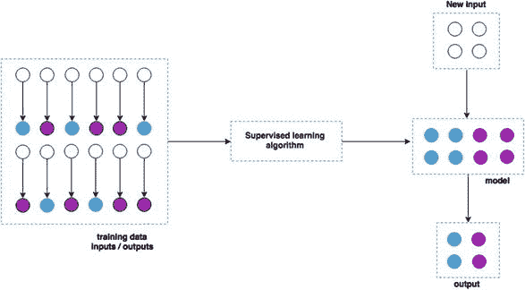

图 6-1. 监督学习算法

模型基于训练数据创建，并随着新数据的到来而不断丰富。这个过程是持续运行的。

一个现实生活中的例子是：为了批准个人贷款而进行的数据训练。通过获取过去申请人的信息，如财务状况、健康状况、职业等，学习过程可以推断出贷款是否应该获批。

图 6-2 展示了监督学习的一个具体应用，它显示了巴黎市中心一年内公寓的平均月租金。一个数据样本帮助我们对数据应用了线性回归，以揭示预测结果。例如，图 6-2 中的红线显示，平均价格在 2018 年将达到 4000 欧元。

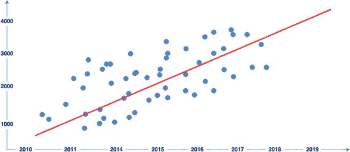

图 6-2. 基于线性回归的监督学习

在处理历史数据以预测短期到中期未来时，这种机器学习方法效果非常好，但这些预测所依据的模型在某些用例中并不明显。

## 无监督学习

与监督学习相反，无监督学习中的模型是基于输入数据创建的，并随着数据的流入而不断改进。一些无监督算法可以检测数据中的相似性，并尝试创建相似数据的聚类，如图 6-3 所示。

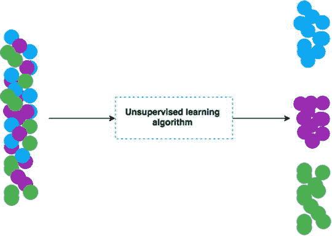

图 6-3. 无监督算法

这更适用于我们的流式处理场景，因为在这些场景中，数据在开始时是未知的，并且其模式可能随时间变化。

这类算法被称为聚类算法。一些知名的算法包括：

*   `K-means`
*   `K-medians`
*   期望最大化
*   层次聚类

在我们的案例中，我们将专注于 `K-means` 算法。

## 使用 Spark 进行机器学习

显然，机器学习始于静态数据。首先创建一个数据集，我们基于该数据集构建模型，然后将模型应用于后续创建的数据以得出预测。在我们的案例中，当我们启动 Spark Streaming 驱动程序时，没有任何数据可供我们进行预测；我们必须利用流式数据的批次来构建并训练模型。

我们数据的行为模式可能会不时发生变化；这就是为什么流式架构比批量机器学习更适合这类用例的原因。通过流式处理，我们可以从数据中学习，并训练我们的模型，使其能够随时间调整预测。

Spark 对于这种流式学习架构非常方便，因为它提供了现成的组件：用于流式处理的 `Spark Streaming` ([`http://spark.apache.org/streaming/`](http://spark.apache.org/streaming/)) 和用于机器学习的 `Mllib` ([`http://spark.apache.org/mllib/`](http://spark.apache.org/mllib/))，如图 6-4 所示。

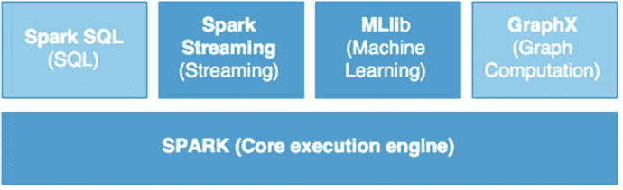

图 6-4. Spark 架构

为了构建关于我们访客行为的预测，这两个库将在同一个 Spark 驱动程序中同时使用。我们将重点关注使用 `Spark Mllib` 的最常见方法之一：实现一个 `K-means` 聚类，将我们的数据划分到 `K` 个聚类中。但在那之前，让我们更仔细地看看这个 `K-means` 算法。

## 为架构添加机器学习

`K-means`算法属于无监督机器学习算法。它是数据聚类领域最常用的算法之一，也是最简单的算法之一。

`K-means`允许我们将给定的数据集划分为`K`个簇；每个簇都有一个称为质心的中心点。对于给定的数据，我们定义`K`个质心，并尽可能让它们相互远离，然后将每个数据点关联到最近的质心，从而形成数据的初始分组。

每个质心都需要结合之前加入该簇的数据点重新计算，这将产生`K`个新的质心或簇重心。在重新计算每个质心后，所有数据点会再次被关联到最近的质心。这种重新计算过程会持续进行，直到质心不再移动为止。

以下是主要步骤的示意图说明：

首先我们需要一个数据集：

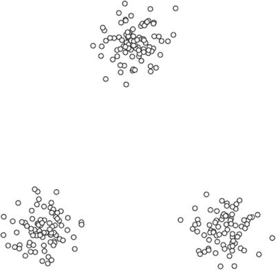

图 6-5. 待聚类的数据集

然后我们在二维空间中放置`K`个质心，以表示我们的簇中心：

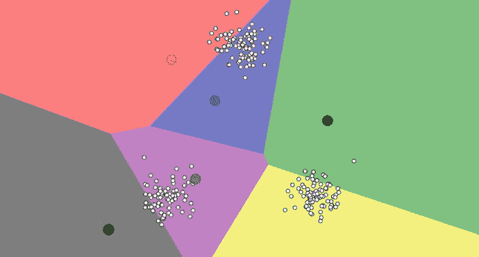

图 6-6. 添加质心以表示簇

这将把空间分割成不同颜色的区域，每种颜色对应一个质心的颜色。每个数据点都与最近的质心关联，从而得到初始分组。接着我们开始根据数据点重新计算质心位置：如图 6-7 所示，质心的位置发生了变化，并更靠近数据点的聚集区域。

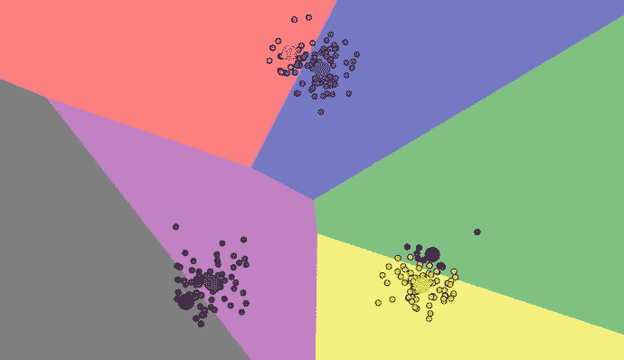

图 6-7. 首次重新计算阶段

在重新计算阶段结束时，质心不再移动，因为以下目标函数已被最小化到极致：

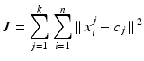

其中，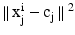 是数据点 `x[i]^j` 与最近质心 `c[j]` 之间的平方距离。

最终，聚类结果看起来略有不同，如图 6-8 所示。

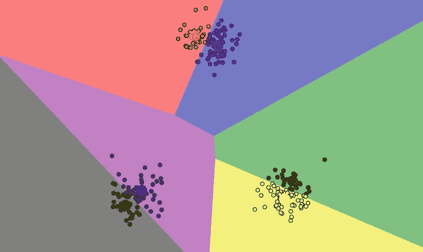

图 6-8. 最终的聚类状态

为了可视化数据，我使用了这个非常棒且实用的网站：[`http://www.naftaliharris.com/blog/visualizing-k-means-clustering/`](http://www.naftaliharris.com/blog/visualizing-k-means-clustering/)

如果我们为图 6-8 增加一些现实元素，它可能会更有意义：


图 6-9. 使用 K-means 分割的世界

看看借助`K-means`，你可以多么轻松地根据自己选择的标准来分割世界！

所以，我想当我们将其与我们当前的点击流用例关联起来时，这就更有意义了。我们希望构建一个机器学习流水线，将点击流数据聚类成分类后的客户行为。

## 为架构添加机器学习

我们现在将为 Lambda 架构添加机器学习。这将是一个渐进的过程，因为我们首先需要处理数据，然后处理学习模型，最后进行预测。

通过为架构添加机器学习，我们希望实现的是用户行为的实时分析和预测。我们将使用一个机器学习流水线来帮助我们分类网站访客，以便根据之前的浏览行为推送产品推荐。

处理此过程的总体思路包括：

-   在数据流式传输时对其进行丰富：我们将通过使用额外数据源简单地为数据添加标签，从而为数据增加更多的业务含义。
-   训练一个分类器：这意味着我们需要建立一个模型，以便基于统计算法从数据中学习。
-   使用我们的模型进行预测。

### 丰富点击流数据

在深入纯粹的机器学习之前，我们需要为用例增加更多业务逻辑。我们将使用 Spark 来完成这项任务，并利用该技术高度弹性和分布式的特性。策略是加载一个数据映射表，该映射表表示浏览器 URI 与产品类别之间的对应关系，这样我们就能得到访客所浏览产品的类别，如图 6-10 所示。

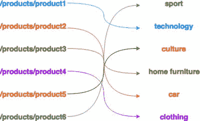

图 6-10. 产品映射

这确实是一个非常简短的映射示例，它可以在 Spark 中加载并保存在内存中，而不会产生任何开销。在实际用例中，映射表可能具有相当大的规模，在内存中保存可能不安全。在这种情况下，我会使用持久化存储，例如 HDFS，甚至是 Elasticsearch。将其存储在 ES 中的原因可能是为了便于搜索合适的映射。在本示例中，我们将创建一个简单的 CSV 文件。

数据丰富的过程如图 6-11 所示。

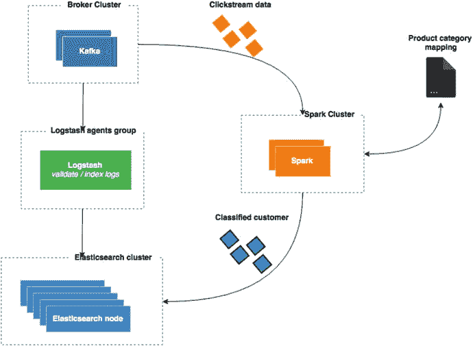

图 6-11. 数据丰富示意图

这些数据与前一章讨论的在 Spark 中获取的数据类似，但不同之处在于，我们将：

-   创建一个客户对象
-   将这些数据与我们内存中的映射表进行比对
-   丰富我们的客户对象
-   将它们索引到 Elasticsearch 中

为此，我们将创建另一个名为 `spark-enrich-and-ml` 的 Scala 项目，你可以在我的 Github 账户中找到它：[`https://github.com/bahaaldine/spark-enrich-and-ml`](https://github.com/bahaaldine/spark-enrich-and-ml)。

### 准备数据集

我们需要构建一个映射文件，以便将点击流数据关联到产品类别。我们将使用位于以下路径中的 Python 脚本：[`https://github.com/bahaaldine/elasticsearch-clickstream-demo/blob/master/generator/mapping_generator.py`](https://github.com/bahaaldine/elasticsearch-clickstream-demo/blob/master/generator/mapping_generator.py)。

该 Python 脚本会生成 200,000 个 URI，并将它们随机映射到代码清单 6-1 所示任意列表中的一个类别。

代码清单 6-1. 产品类别

```python
#!/usr/bin/python
import csv
import random

productCount = 200000
productCategories = ["设备配件","高科技配件","IT 配件","宠物","汽车","婴儿","家庭办公","厨房","电子游戏","骑行","蓝光和 DVD","办公用品","家用电器","高科技","IT","音频和音乐","园艺","玩具和游戏","图书","软件","照明","家居","音乐","轮胎","运动与休闲","视频","化妆品","珠宝","鞋类","手表","健康","服装"]

with open('mappings.csv', 'wb') as outf:
    fieldnames = ['uri'] + ['category']
    csvwriter = csv.DictWriter(outf, fieldnames)
    while productCount > 0:
        row = {}
        csvwriter.writerow(dict(row, uri="/products/product%d" % productCount, category=random.choice(productCategories)))
        productCount -= 1
```

如你所见，共有 32 个类别。你将按照代码清单 6-2 所示执行这些脚本。

代码清单 6-2. 映射文件提取

```
python mapping_generator.py
```

你应该会得到以下 `mappings.csv` 文件：

```
...
/products/product90956,Shoes
/products/product90955,Shoes
/products/product90954,baby
/products/product90953,household applicance
/products/product90952,Books
/products/product90951,Audio and musique
/products/product90950,IT
/products/product90949,Devices accessories
/products/product90948,Devices accessories
/products/product90947,Jewellery
/products/product90946,car
/products/product90945,Devices accessories
/products/product90944,Toys and games
/products/product90943,baby
/products/product90942,Books
/products/product90941,IT accessories
/products/product90940,cycling
...
```

另一方面，[`https://raw.githubusercontent.com/bahaaldine/elasticsearch-clickstream-demo/master/generator/resources.txt`](https://raw.githubusercontent.com/bahaaldine/elasticsearch-clickstream-demo/master/generator/resources.txt) 文件包含了所有可能的产品 URI。

最后，Spark 将负责根据映射文件将 URI 关联到类别。因此，让我们在以下类中分析所需的 Spark 代码：[`https://github.com/bahaaldine/spark-enrich-and-ml/blob/master/src/main/scala/org/apache/spark/examples/SparkEnricher.scala`](https://github.com/bahaaldine/spark-enrich-and-ml/blob/master/src/main/scala/org/apache/spark/examples/SparkEnricher.scala)。

我们保留了 `Clickstream` 对象，但添加了一个 `Customer` 对象，它将作为我们流处理的输出。

代码清单 6-3. Customer 对象

```scala
case class Customer (
    session:String,
    request:String,
    category:String
)
```

请注意，整个 Spark 项目可以在以下仓库中找到：[`https://github.com/bahaaldine/scalable-big-data-architecture/tree/master/chapter6/spark-enrich-and-ml`](https://github.com/bahaaldine/scalable-big-data-architecture/tree/master/chapter6/spark-enrich-and-ml)。

到目前为止，`Customer` 对象非常简单，只包含三个字段：

*   `session` 字段，用于标识用户的键
*   `request` 字段，包含产品 URI
*   `category` 字段，将使用映射文件填充产品类别。

Spark 上下文配置保持不变；我们只是添加了另一个数据源，即我们的映射文件，如代码清单 6-4 所示。

代码清单 6-4. 加载映射文件

```scala
val mappingFile = ssc.sparkContext.textFile("/path/to/mappings.csv")
val mappings = mappingFile.map(line => line.split(",")).map(x => (x(0),x(1))).collectAsMap()
val broadcastMapping = ssc.sparkContext.broadcast(mappings)
```

请记住，之前的 Python 脚本生成了一个名为 `mappings.csv` 的映射文件。你必须在此代码中设置该路径，才能使 Spark 驱动程序正常工作。

映射被加载到一个 `mappings` 变量中，然后通过广播创建为只读变量，放入每个 Spark 机器的缓存中。随后使用该变量创建并丰富 `Customer` 对象，如代码清单 6-5 所示。

**代码清单 6-5.** 创建并丰富 `Customer` 对象

```
val customers = events.map { clickstream =>
    val lookupMap = broadcastMapping.value
    Customer(
        clickstream.clientip
        , clickstream.request
        , lookupMap.getOrElse(clickstream.request, "category not found")
    )
}
```

映射被加载到 `lookupMap` 变量中，我们通过 `getOrElse` 来查找产品类别。如果映射不存在，则返回“category not found”。最后，我们使用代码清单 6-6 中的代码片段将每个 `Customer` 对象索引到 Elasticsearch 中。

**代码清单 6-6.** `Customer` RDD 索引

```
customers.foreachRDD{ rdd =>
    if (rdd.toLocalIterator.nonEmpty) {
        EsSpark.saveToEs(rdd, "spark/customer")
    }
}
```

每个客户都会被索引到 Elasticsearch 的 `spark` 索引中，类型为 `customer`。为了测试我们的代码，请确保 lambda 架构完全运行，然后启动 `build.sh` 文件来构建并启动我们的驱动程序。

**代码清单 6-7.** Spark 驱动程序启动命令

```
./build.sh
```

通过使用 `generator.py` 脚本生成新的点击流日志，你应该会在 `spark` 索引中得到索引后的客户。只需浏览 `http://elasticsearch_host:9200/spark/_search`，即可获得代码清单 6-8 所示的输出。

**代码清单 6-8.** Elasticsearch 中索引的客户

```
hits: {
    total: 10,
    max_score: 1,
    hits: [
        {
            _index: "spark",
            _type: "customer",
            _id: "AU9-8BCuIm6jDjOublOw",
            _score: 1,
            _source: {
                session: "86.192.183.220",
                request: "/products/product106871",
                category: "Watches"
            }
        },
        {
            _index: "spark",
            _type: "customer",
            _id: "AU9-8BCuIm6jDjOublO1",
            _score: 1,
            _source: {
                session: "86.192.149.103",
                request: "/products/product158310",
                category: "cycling"
            }
        }
        ...
    ]
}
```

此时，我们拥有一个完整的索引，其中包含已映射的客户。我们现在将利用这一丰富阶段来对数据进行聚类并构建预测。

### 数据标签化

为训练模型，我们将构建一个二维向量，该向量基于类别标签和客户标签生成。类别标签与特定类别相关联，例如“汽车”、“运动”等；而客户标签则引入了一个虚构的客户类型概念。

客户标签的取值为 1 至 5，具体含义如下：

免费 早鸟 黄金 铂金 大客户

因此，在训练模型之前，我们需要创建几个映射文件，以便能通过标签识别类别，并通过标签识别客户。

`https://github.com/bahaaldine/elasticsearch-clickstream-demo/blob/master/generator/mapping_generator.py` 已进行了轻微修改，新增了一个标签列，如代码清单 6-9 所示。

**代码清单 6-9.** 为类别添加标签

```
category = random.choice(productCategories)

csvwriter.writerow(dict(row, uri="/products/product%d" % productCount, category=category, label=productCategories.index(category)+1))
```

该标签是根据相关类别在 `productCategories` 列表变量中的位置计算得出的。执行 Python 脚本后，您应获取一个如代码清单 6-10 所示的映射文件。

**代码清单 6-10.** 带有标签的类别映射文件

```
...
/products/product199988,High-Tech accessories,2
/products/product199987,House,22
/products/product199986,baby,6
/products/product199985,Heatlh,31
/products/product199984,Watches,30
...
```

对于客户，我创建了一个新的 Python 脚本，位于：

`https://github.com/bahaaldine/elasticsearch-clickstream-demo/blob/master/generator/ip_mapping_generator.py`

该脚本会在生成的文件中，为每个 IP 地址随机添加一个 1 到 5 之间的整数，如代码清单 6-11 所示。

**代码清单 6-11.** IP 映射文件生成器

```
#!/usr/bin/python

import csv
import random

with open('ip_mappings.csv', 'wb') as outf:
        fieldnames = ['ip'] + ['label']
        csvwriter = csv.DictWriter(outf, fieldnames)
        for i in range(0,255):
                for j in range(0,255):
                        row = {}
                        csvwriter.writerow(dict(row, ip="86.192."+str(i)+"."+str(j), label=random.randint(1,5)))
```

使用 IP 地址作为客户标识符看起来是一个奇怪的选择，但我这样做是为了方便读者理解本书的这一部分，并能在有限的客户标识符范围内进行工作。

执行 Python 脚本后，您应获得类似于代码清单 6-12 所示的输出内容。

**代码清单 6-12.** 带有标签的 IP 映射

```
...
86.192.0.15,3
86.192.0.16,3
86.192.0.17,5
86.192.0.18,3
86.192.0.19,1
86.192.0.20,4
86.192.0.21,1
...
```

这意味着客户 `86.192.0.21` 是一位**免费**客户。

### 训练与预测

在最后这一节中，我们将利用前面讨论过的所有资产，构建一个 K-Means 流式机器学习驱动程序。为此，我们将复用之前的 Scala 代码，并增加以下步骤。

首先，我们加载刚刚修改或创建的映射文件，如代码清单 6-13 所示。

**代码清单 6-13.** 加载映射文件

# 机器学习与数据流处理

这里我们创建了三个广播映射：

- 我们已知的产品类别映射
- 从修改后的 `mappings.csv` 中提取的类别标签映射
- 从新创建的 `ip_mappings.csv` 中提取的 IP 标签映射文件

数据丰富过程保持不变；但为了模型进行预测所需的训练数据和测试数据，我增加了两个闭包，如代码清单 6-14 所示。

### 代码清单 6-14. 创建训练数据

```scala
val trainingData = customers.map { customer =>
  val categoryLookupMap = brodcastCategoryLabelMapping.value
  val customerLookupMap = brodcastIpLabelMapping.value
  val categoryLabel = categoryLookupMap.getOrElse(customer.category, 1).asInstanceOf[Double]
  val customerLabel = customerLookupMap.getOrElse(customer.session, 1).asInstanceOf[Double]
  Vectors.dense(Array(categoryLabel, customerLabel))
}
```

第一个闭包使用了类别标签映射和 IP 标签映射，构建了一个二维向量，该向量建立了类别与客户类型之间的关联。例如，一个向量的值可能如下所示：

`[30.0, 3.0]`

该向量将第 29 个（索引 29+1，参见映射生成器）类别，即“鞋子”，与第三种客户类型（即黄金客户）关联起来。

测试数据部分如代码清单 6-15 所示。

### 代码清单 6-15. 创建测试数据

```scala
val testData = customers.map { customer =>
  val categoryLookupMap = brodcastCategoryLabelMapping.value
  val customerLookupMap = brodcastIpLabelMapping.value
  val categoryLabel = categoryLookupMap.getOrElse(customer.category, 1).asInstanceOf[Double]
  val customerLabel = customerLookupMap.getOrElse(customer.session, 1).asInstanceOf[Double]
  LabeledPoint(categoryLabel, Vectors.dense(Array(categoryLabel, customerLabel)))
}
```

这里我们创建了一种不同类型的对象 `LabelPoint`。该对象包含两个成员：

- `label`（标签）：这里我将标签设置为与类别标签相同的值。
- `vector`（向量）：向量的构建方式与训练数据中的相同。

最后，我们创建并训练模型，如代码清单 6-16 所示。

### 代码清单 6-16. 创建并训练模型

```scala
val model = new StreamingKMeans()
  .setK(3)
  .setDecayFactor(1.0)
  .setRandomCenters(2, 0.0)

model.trainOn(trainingData)
```

这里我们指定需要三个聚类中心，由于数据是流式的，我们设置了一个衰减因子，并注意这些数据是非线性的。我们需要模型在反映历史数据的同时，重点训练最新数据。

接着我们调用模型对训练数据进行训练。现在只需调用 `predict` 方法即可获得预期结果，如代码清单 6-17 所示。

### 代码清单 6-17. 触发预测

```scala
model.predictOnValues(testData.map(lp => (lp.label, lp.features))).foreachRDD{ rdd =>
  if (rdd.toLocalIterator.nonEmpty) {
    EsSpark.saveToEs(rdd, "spark/prediction")
  }
}
```

现在您应该能看到预测数据传入 Elasticsearch，可进一步用于推荐引擎或数据分析，如代码清单 6-18 所示。

### 代码清单 6-18. 索引到 Elasticsearch 的预测数据

```json
...
{
  _index: "spark",
  _type: "prediction",
  _id: "AU-A58AEIm6jDjOublw2",
  _score: 1,
  _source: {
    _1: 24,
    _2: 2
  }
},
{
  _index: "spark",
  _type: "prediction",
  _id: "AU-A58AEIm6jDjOublw7",
  _score: 1,
  _source: {
    _1: 8,
    _2: 1
  }
}
...
```

现在您只需发挥想象力，思考如何利用这些数据改善网站访客的用户体验。您可以基于此构建推荐引擎，向“早鸟”客户推送第 23 类（即“音乐”类，24+1，参见映射生成器）相关的横幅、应用内通知和邮件。

## 本章小结

我们的架构正变得越来越复杂。本章介绍了如何通过机器学习功能丰富数据处理管道，并在数据传入 Elasticsearch 时进行聚类。

下一章将讨论治理以及为降低生产风险应建立的主要资产。