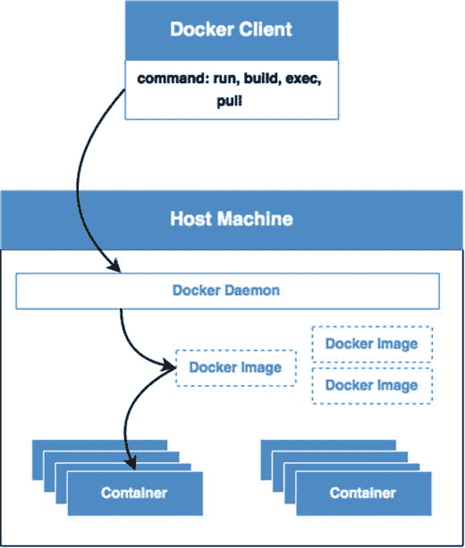
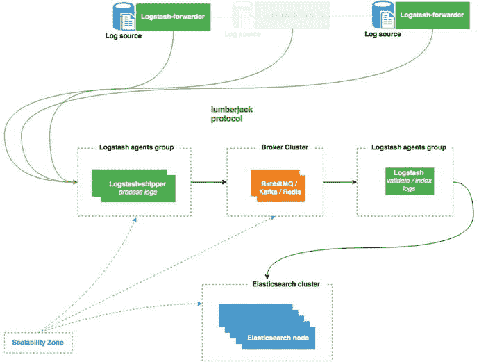

# 7. 治理考量

架构的核心要素之一是其治理方式。换言之，如何规划规模、部署及事件监控？本章将从架构的“Docker 化”入手探讨治理考量，同时讨论可扩展性及其对架构的影响。

## 架构的 Docker 化

部署数据架构有多种方式：可以将组件安装在分布式物理机或虚拟机上。近年来，Docker 已成为分布式架构部署的标准，因此本书将使用 Docker 作为示例场景的部署方案。

### Docker 简介

Docker 是一个开源平台，允许用户缩短从开发阶段到生产阶段的部署周期。它提供了一套全面的工具和 API，帮助您构建运行应用程序的基础设施。

针对本书的使用场景，您将能够通过 Docker 容器部署完整架构。Docker 拥有自己的术语体系，定义如下：

- `Docker 容器`：运行应用程序的最小工作单元。例如，可以有一个运行 Apache Tomcat 服务器以提供 RESTful API 的 Docker 容器。

- `Docker 镜像`：描述 Docker 容器的镜像文件。在此示例中，您需要一个操作系统和一些软件包来运行 Tomcat。所有必需的资源和配置都写入名为 `Dockerfile` 的只读模板中，该模板即 Docker 镜像。有关 Docker 镜像的更多信息，请参阅 [`https://docs.docker.com/userguide/dockerimages/`](https://docs.docker.com/userguide/dockerimages/)。

- `Docker 客户端`：与底层 Docker 功能交互的首要用户界面。编写 Docker 镜像后，您将通过构建镜像来运行 Docker 容器。这是使用 Docker 客户端完成的操作。有关 Docker 命令行的更多信息，请参阅 [`https://docs.docker.com/reference/commandline/cli/`](https://docs.docker.com/reference/commandline/cli/)。

- `Docker 守护进程`：协调运行 Docker 容器所需的所有底层操作。用户通过 Docker 客户端与守护进程交互。

图 7-1 总结了我刚才描述的内容。



**图 7-1.** Docker 组件

因此，在示例场景中，如果关注涉及多种技术的数据处理部分，Docker 在运行和配置基础设施方面具有巨大优势。您基本上只需要为每个需要在不同容器上运行的技术创建 Docker 镜像，包括以下内容：

- Logstash 转发器

- Logstash（处理器和索引器使用相同技术，仅配置不同）

- Kafka

- Zookeeper

- Elasticsearch

- Kibana

### 安装 Docker

Docker 支持多种安装配置。例如，在本书范围内，我在 Mac OS X 上运行 Docker，其安装步骤与 Ubuntu 略有不同。

建议您访问以下页面，按照适合您系统的安装流程进行操作：

[`https://docs.docker.com/installation/`](https://docs.docker.com/installation/)

您还需要 Docker Compose，可在此处获取：

[`https://docs.docker.com/compose/install/`](https://docs.docker.com/compose/install/)

您还需要 Docker Machine，可在此处获取：

[`https://docs.docker.com/machine/install-machine/`](https://docs.docker.com/machine/install-machine/)

完成安装后，请通过执行代码清单 7-1 中的命令，确保可以运行 Docker 和 Docker Compose 命令行。

**代码清单 7-1.** Docker 安装检查

```
bash-3.2$ docker -v
Docker version 1.7.1, build 786b29d
bash-3.2$ docker-compose -v
docker-compose version: 1.3.2
CPython version: 2.7.9
OpenSSL version: OpenSSL 1.0.1j 15 Oct 2014
bash-3.2$ docker-machine -v
docker-machine version 0.3.0 (0a251fe)
```

从以上代码中，您可以看到我编写本书时使用的 Docker 组件版本。

至此，您已准备好开始创建基础设施的 Docker 镜像。

### 创建 Docker 镜像

在本节中，我将详细说明如何为您的架构应用程序之一创建 Docker 镜像。您会发现，其他应用程序的整体流程都是相同的，因此我只描述其中一个镜像的创建过程。

供您参考，您可以在我的 GitHub 仓库中找到所有镜像：

- Elasticsearch: [`https://github.com/bahaaldine/docker-elasticsearch`](https://github.com/bahaaldine/docker-elasticsearch)

- Logstash: [`https://github.com/bahaaldine/docker-logstash`](https://github.com/bahaaldine/docker-logstash)

- Logstash 转发器: [`https://github.com/bahaaldine/docker-logstash-forwarder`](https://github.com/bahaaldine/docker-logstash-forwarder)

- Kibana: [`https://github.com/bahaaldine/docker-kibana`](https://github.com/bahaaldine/docker-kibana)

- Zookeeper: [`https://github.com/bahaaldine/docker-zookeeper`](https://github.com/bahaaldine/docker-zookeeper)

- Apache Kafka: [`https://github.com/bahaaldine/docker-kafka`](https://github.com/bahaaldine/docker-kafka)

- 用于 Kafka 的 Apache Zookeeper: [`https://github.com/bahaaldine/docker-zookeeper`](https://github.com/bahaaldine/docker-zookeeper)

- Apache Spark: [`https://github.com/bahaaldine/docker-spark`](https://github.com/bahaaldine/docker-spark)

现在让我们聚焦于创建 Elasticsearch Docker 镜像，并逐步分析 `Dockerfile` 文件，该文件位于以下链接：

[`https://github.com/bahaaldine/docker-elasticsearch/blob/master/Dockerfile`](https://github.com/bahaaldine/docker-elasticsearch/blob/master/Dockerfile)

该模板分为多个部分，每个部分负责特定的任务。

- **镜像配置**：首先，你需设置容器类型，此处为运行 Elasticsearch 的 Java 容器，并设定若干描述性元数据标签。以下是维护者信息：

```
FROM java:8
MAINTAINER Bahaaldine Azarmi baha@elastic.co
```

- **操作系统级配置**：随后，你通过设置所需的环境变量、升级容器包列表并安装必要的软件包来创建操作系统级配置。

# Docker化Elasticsearch架构

```
ENV DEBIAN_FRONTEND noninteractive
RUN apt-get update
RUN apt-get install -y supervisor curl
# Elasticsearch
RUN \
    apt-key adv --keyserver pool.sks-keyservers.net --recv-keys 46095ACC8548582C1A2699A9D27D666CD88E42B4 && \
    if ! grep "elasticsearch" /etc/apt/sources.list; then echo "deb http://packages.elasticsearch.org/elasticsearch/1.6/debian stable main" >> /etc/apt/sources.list;fi && \
    apt-get update
```

- **应用级安装**：安装过程十分简洁，只需运行以下命令：

  ```
  apt-get install -y elasticsearch
  ```

- **应用配置**：接着，你运行几个 `sed` 命令来修改 Elasticsearch 配置文件（`elasticsearch.yml`），以设定集群配置。在以下代码中，你设置了集群名称、Elasticsearch 数据存储目录路径、分片与副本数量，以及用于发布正确主机的网络配置：

  ```
  sed -i '/#cluster.name:.*/a cluster.name: logging' /etc/elasticsearch/elasticsearch.yml && \
  sed -i '/#path.data: \/path\/to\/data/a path.data: /data' /etc/elasticsearch/elasticsearch.yml && \
  sed -i '/#index.number_of_shards:.*/a index.number_of_shards: 1' /etc/elasticsearch/elasticsearch.yml && \
  sed -i '/#index.number_of_replicas:.*/a index.number_of_replicas: 0' /etc/elasticsearch/elasticsearch.yml && \
  sed -i '/#marvel.index.number_of_replicas:.*/a index.number_of_replicas: 0' /etc/elasticsearch/elasticsearch.yml && \
  sed -i '/#network.publish_host:.*/a network.publish_host: elasticsearch' /etc/elasticsearch/elasticsearch.yml
  ```

- **应用运行时配置**：此处你使用 [Supervisor](http://supervisord.org/)（一个进程控制系统）来编排容器内已安装应用的执行。因此，你需要创建配置以确保其正常运行。接着，你安装 Marvel（Elasticsearch 监控插件），并将 `9200` 端口暴露给容器外部环境。

  ```
  ADD etc/supervisor/conf.d/elasticsearch.conf /etc/supervisor/conf.d/elasticsearch.conf
  RUN /usr/share/elasticsearch/bin/plugin -i elasticsearch/marvel/latest
  EXPOSE 9200
  ```

- **容器运行时配置**：最后一步是让 Supervisor 使用 Supervisor 配置文件运行。

  ```
  CMD [ "/usr/bin/supervisord", "-n", "-c", "/etc/supervisor/supervisord.conf" ]
  ```

如果你查看其他 Docker 镜像，会发现有些镜像之间有所不同，因为我一贯采用上述步骤来创建 Docker 镜像。

你必须构建一个 Docker 镜像才能使用它。要构建 Elasticsearch 镜像，请在 Docker 镜像文件夹中运行以下命令：

```
docker build -t bahaaldine/docker-elasticsearch .
```

`build` 命令会在当前目录中搜索 `Dockerfile` 文件，并开始构建名为 `bahaaldine/docker-elasticsearch` 的 Docker 镜像（不过你也可以根据需要更改名称）。无论如何，你可以通过执行以下命令来检查本地镜像仓库，确认该镜像是否存在：

```
bash-3.2$ docker images

REPOSITORY                         TAG     IMAGE ID            CREATED            VIRTUAL SIZE
bahaaldine/docker-elasticsearch   latest  a3422c874201        About a minute ago  877.4 MB
```

现在，要启动你的容器，请运行以下命令：

```
bash-3.2$ docker run -ti -p 9200:9200 -p 9300:9300 --add-host="elasticsearch:192.168.59.103" bahaaldine/docker-elasticsearch

2015-08-23 13:33:24,689 CRIT Supervisor running as root (no user in config file)
2015-08-23 13:33:24,689 WARN Included extra file "/etc/supervisor/conf.d/elasticsearch.conf" during parsing
2015-08-23 13:33:24,697 INFO RPC interface 'supervisor' initialized
2015-08-23 13:33:24,697 CRIT Server 'unix_http_server' running without any HTTP authentication checking
2015-08-23 13:33:24,697 INFO supervisord started with pid 1
2015-08-23 13:33:25,701 INFO spawned: 'elasticsearch1' with pid 7
2015-08-23 13:33:27,331 INFO success: elasticsearch1 entered RUNNING state, process has stayed up for > than 1 seconds (startsecs)
```

现在 Elasticsearch 容器正在运行，并在主机的相同端口上暴露了 `9200` 和 `9300` 端口，这意味着如果你尝试连接到 `192.168.59.103:9200`，应该会收到 Elasticsearch REST API 的响应，如清单 7-2 所示。

**清单 7-2.** Elasticsearch 安装检查

```
{
  status: 200,
  name: "lambda-architecture",
  cluster_name: "logging",
  version: {
    number: "1.6.2",
    build_hash: "622039121e53e5f520b5ff8720fdbd3d0cb5326b",
    build_timestamp: "2015-07-29T09:24:47Z",
    build_snapshot: false,
    lucene_version: "4.10.4"
  },
  tagline: "You Know, for Search"
}
```

我第一次尝试将我的架构 Docker 化时，脑海中浮现了几个问题：如果我有十个节点的集群该怎么办？架构的其余部分呢？我是否必须在命令行中为每个容器指定特定配置？

你显然理解将架构应用 Docker 化的好处，但如果必须手动管理每个容器，那将是一场噩梦。这正是 Docker Compose 发挥作用的地方。

### 构建架构

`Composing the architecture`这里包含两层含义；首先，它意味着你将组合 Docker 容器来构建架构，同时也意味着你需要一个高级工具来帮助你管理每个容器的配置和运行时偏好。

# Docker Compose 与 Lambda 架构部署

幸运的是，`Docker Compose` 正是完成此任务的完美工具。`Compose` 基于单文件配置，允许用户以声明式的方式创建多容器应用。虽然不推荐在生产环境中使用 `Compose`，但它在开发、预发布或持续集成（CI）环境中至关重要。

在本节中，我将引导你查看以下 GitHub 项目中的 `Docker Compose` 文件：

[`https://github.com/bahaaldine/scalable-big-data-architecture/tree/master/chapter7/docker`](https://github.com/bahaaldine/scalable-big-data-architecture/tree/master/chapter7/docker)

与镜像类似，你将重点关注一个容器的配置，并且会看到其他容器的配置基本一致。Compose 文件启动了一个包含以下组件的架构：

*   一个包含单节点 `Zookeeper` 集群的`两节点` `Kafka` 集群
*   一个`单节点` `Elasticsearch` 集群
*   一个`单实例`的 `Kibana`
*   一个 `Logstash` 转发器
*   一个 `Logstash` 处理器
*   一个 `Logstash` 索引器

清单 [7-3] 展示了组合后的结果。

**清单 7-3.** Docker Compose Lambda 架构文件

```yaml
zookeeper1:
  image: bahaaldine/docker-zookeeper
  volumes:
    - "conf/kafka/server1:/etc/kafka"
    - "logs/zookeeper1:/opt/kafka/logs/"
  ports:
    - "2181:2181"
  extra_hosts:
    - "brokers:192.168.59.103"

kafka1:
  image: bahaaldine/docker-kafka
  volumes:
    - "conf/kafka/server1:/etc/kafka"
    - "logs/kafka1:/opt/kafka/logs/"
  extra_hosts:
    - "brokers:192.168.59.103"
  ports:
    - "9092:9092"

kafka2:
  image: bahaaldine/docker-kafka
  volumes:
    - "conf/kafka/server2:/etc/kafka"
    - "logs/kafka2:/opt/kafka/logs/"
  extra_hosts:
    - "brokers:192.168.59.103"
  links:
    - "kafka1"
  ports:
    - "9093:9093"

logstashProcessor1:
  image: bahaaldine/docker-logstash-agent
  volumes:
    - "conf/logstash/processor:/etc/logstash"
    - "conf/security:/etc/logstash/security"
    - "logs/logstash-processor1:/var/log/logstash"
  links:
    - kafka1
  ports:
    - "5043:5043"

elasticsearch1:
  image: bahaaldine/docker-elasticsearch
  ports:
    - "9200:9200"
  volumes:
    - "logs/elasticsearch1:/var/log/elasticsearch"
    - "conf/elasticsearch/templates:/etc/elasticsearch/templates"
    - "data:/data"
  extra_hosts:
    - "elasticsearch:192.168.59.103"

logstashIndexer1:
  image: bahaaldine/docker-logstash-agent
  volumes:
    - "conf/logstash/indexer:/etc/logstash"
    - "logs/logstash-indexer1:/var/log/logstash"
  links:
    - elasticsearch1
  extra_hosts:
    - "brokers:192.168.59.103"
    - "elasticsearch:192.168.59.103"

logstashForwarder:
  image: bahaaldine/docker-logstash-forwarder
  volumes:
    - "conf/logstash/forwarder:/etc/logstash-forwarder"
    - "conf/security:/etc/logstash-forwarder/security"
    - "logs/logstash-forwarder1:/tmp/logs/"
    - "source:/tmp/source"
  extra_hosts:
    - "processors:192.168.59.103"

kibana1:
  image: bahaaldine/docker-kibana
  ports:
    - "5601:5601"
  volumes:
    - "logs/kibana:/var/log/kibana"
  extra_hosts:
    - "elasticsearch:192.168.59.103"
```

## Elasticsearch 容器配置详解

如果现在关注 `Elasticsearch` 容器配置，你可能会认出之前在命令行尝试运行容器时传递的一些参数。

```bash
docker run -ti -p 9200:9200 -p 9300:9300 --add-host="elasticsearch:192.168.59.103" bahaaldine/docker-elasticsearch
```

你在 Docker `run` 命令中能做的所有操作，都可以在 `Compose` `YML` 文件中描述。

首先设置容器镜像：`image: bahaaldine/docker-elasticsearch`

然后将主机端口映射到容器端口：

```yaml
ports:
    - "9200:9200"
```

接下来，将主机文件系统与容器中用于日志、配置以及 `Elasticsearch` 存储数据的目录进行映射。这一点很重要，因为当容器关闭时，容器内存储的所有数据都会丢失。因此，映射这些文件夹是为了确保它们能比容器的生命周期更长久。

```yaml
volumes:
    - "logs/elasticsearch1:/var/log/elasticsearch"
    - "conf/elasticsearch/templates:/etc/elasticsearch/templates"
    - "data:/data"
```

最后，请求 Docker 将一个主机添加到 `/etc/hosts` 文件中。

```yaml
extra_hosts:
    - "elasticsearch:192.168.59.103"
```

仅此而已。正如我之前所提到的，所有其他容器都以同样的方式配置；你只需运行清单 [7-4] 中所示的命令即可启动架构。

**清单 7-4.** Docker Compose 项目启动命令

```bash
docker-compose up
```

请注意，在启动 `Compose` 项目之前，我已经构建了所有镜像。这是因为我已经将所有镜像推送到了名为 Docker Hub 的公共 Docker 注册表中（[`https://hub.docker.com/`](https://hub.docker.com/)）。如果镜像不可用，你会收到错误信息。

## Logstash Forwarder 配置

我的 Compose 项目附带生成器脚本，该脚本用于在 `source` 目录中创建一些数据。请记住，`Logstash-forwarder` 正是从该目录传输文件的；这一点同样体现在 `Compose` `YML` 文件中，如清单 [7-5] 所示。

**清单 7-5.** Logstash Forwarder 配置片段

```yaml
logstashForwarder:
  image: bahaaldine/docker-logstash-forwarder
  volumes:
    - "conf/logstash/forwarder:/etc/logstash-forwarder"
    - "conf/security:/etc/logstash-forwarder/security"
    - "logs/logstash-forwarder1:/tmp/logs/"
    - "source:/tmp/source"
```

# Docker 与 Elastic Stack 架构的可伸缩性与监控

`source` 目录被映射到容器的 `/tmp/source` 文件夹。

从治理角度来看，Docker 简化了架构配置的过程；现在你需要关注架构的可伸缩性以及如何调整其规模，以便在需要时进行横向扩展。

## 架构可伸缩性

在本节中，我将讨论数据架构中存在的不同可伸缩性区域，并提出一些建议。

### 架构的规模估算与扩展

在估算架构规模以处理特定数据量并达成特定服务等级协议（SLA）时，答案总是“视情况而定”。

本节的目标并非提供某种万能配方或公式，让架构的每个部分都获得精确的硬件规模估算，而是为您指明方向，助您更好地应对这一问题。

架构的规模估算在架构的不同层级均有需求：

- 在 `Logstash` 处理和索引层面
- 在 `Kafka`/`Zookeeper` 层面
- 在 `Elasticsearch` 层面

对于所有这些层面，有一些通用方面需要考虑，以进行合理的规模估算。

- 每日输入数据的大小等：了解数据如何在架构中流动，有助于您估算 `Elasticsearch` 所需的存储量。根据每个节点的总大小，您可以估算索引数据的大小，但别忘了应用压缩率；例如，一个基础的原始日志最终会变成一个索引后的 JSON 文档，其体积会更大。
- 摄入数据的结构：数据可能具有简单的结构，例如 Apache 日志，也可能具有多行结构，例如 Java 应用程序异常。
- 每秒摄入的平均事件数：这提供了有关架构中每个层面为支撑负载所需内存和 CPU 的信息。
- 保留周期：在摄入时序数据时，有时在集群中保留与搜索相关（即使开始变旧）的数据非常重要。这就是保留原则，根据所需周期，这可能会耗费大量磁盘空间。
- 是否需要高可用性：在大多数企业用例中，您希望确保如果某个应用程序实例发生故障，整个架构仍能继续运行。每个应用程序可能有不同的术语，但这本质上就是弹性原则。增加更多服务器、副本和实例以避免数据丢失；服务连续性会带来硬件成本，因为显然您不希望在同一台机器上运行应用程序的多个实例。

对于每个应用程序，您还需要考虑一些特定的规模估算因素。

- 预期索引吞吐量：数据摄入和索引的节奏可能不均，这意味着根据一天中的时段（例如在电子商务网站上），您可能会面临不同的负载。因此，设定能够保障此类不常见但重要活动的 SLA 至关重要。
- `Kibana` 中的仪表盘数量：请记住，`Kibana` 依赖 `Elasticsearch` API 来构建组成仪表盘的可视化图表。因此，每当您刷新 `Kibana` 时，它都会向 `Elasticsearch` 发送请求，产生搜索或聚合负载，如果负载显著，集群需要考虑在内。
- 可视化用户数量：根据用例不同，连接到 `Kibana` 查看仪表盘的用户数量也可能不同。这将对规模估算产生影响。

拥有所有这些信息还不够；您还需要进行实验，分析我刚才提到的关键性能指标（KPI），以查看您的架构是否可持续。一种简单但有效的方法是，从伪分布式模式架构开始，即架构中每个应用程序都只运行一个实例。此规则不适用于需要至少三台服务器才能具备弹性的 `Zookeeper`；同样，`Elasticsearch` 主节点（专门用于集群状态管理的特定节点）也是如此。

这个实验可以应用于 `Kafka`、`Elasticsearch` 数据节点和 `Logstash` 处理器/索引器。一旦在单实例模式下获得了每个层面的指标，就可以线性地横向扩展，并再次进行性能测试。

其他参数也会影响规模估算，例如 `Elasticsearch` 上的副本数量，这在许多用例中既能增加弹性，也能提高搜索速度。添加副本会增加所需的机器数量，从而影响您的规模估算。

图 7-2 展示了 Lambda 架构具有多个可扩展区域，并且能够横向扩展，这意味着通过向应用程序添加更多节点来增加弹性和负载支持是相当容易的。



*图 7-2. 可扩展区域*

本节的重点在于探讨横向扩展分布式架构时需要考虑的各个方面。

从资源调配的角度来看，由于架构采用了 Docker 化，扩展非常容易，您只需添加带有相关配置的新容器即可。

在摄入层面，到目前为止还没有 `Logstash` 集群的概念；每个实例都是可以独立扩展的轻量级运行时。因此，当您横向扩展时，主要任务是配置相同的输入源以并行化工作负载。

在 `Elasticsearch` 层面，当一个文档被索引时，它会被存储在一个单独的主分片中。`Elasticsearch` 根据清单 7-6 中的公式评估应将文档索引到哪个分片。

*清单 7-6. 文档路由公式*

```
shard = hash(routing) % number_of_primary_shards
```

因此，在集群中添加节点不会对现有数据产生任何影响，并可能实现更好的分片分配；然而，增加更多的主分片将使先前的路由值失效，并且需要重新索引所有数据才能检索。当您处理大量数据时，重新索引将耗费大量时间，这就会成为一个问题。

### 使用 Elastic Stack 监控基础设施

在前面的章节中，您学习了如何搭建一个 Lambda 架构来摄入 Apache 日志以揭示业务分析。该架构的每一层在整个事务处理中都负责特定任务，并且每个应用可能都有不同的重要 KPI 需要监控。

问题是，为什么不将所学知识扩展到监控您自己的架构呢？这个问题背后的思路是，让您的架构日志能够被摄入，从而获得进一步的运维洞察。

您需要做的只是按照以下步骤来组织架构：

**集中化管理日志。** 如果日志集中存储在 SAN（存储区域网络）、Amazon S3 存储桶或其他网络共享文件夹等单一位置，将有助于简化日志信息的检索以及监控架构的部署。在 `Docker Compose` 文件中，配置已设置为将所有日志集中到 `Docker Compose` 项目的 `logs` 文件夹中。清单 7-7 展示了 `Zookeeper` 的配置。

*清单 7-7. Docker Compose Kafka 配置*

```
kafka1:
  image: bahaaldine/docker-kafka
  volumes:
    - "conf/kafka/server1:/etc/kafka"
    - "logs/kafka1:/opt/kafka/logs/"
  extra_hosts:
    - "brokers:192.168.59.103"
  ports:
    - "9092:9092"
```

然后，您应该考虑重用现有的 `Elasticsearch` 集群，或者创建一个新的集群。显然，这个问题的答案取决于不同因素，例如现有集群的密度和工作负载，甚至是购置新机器时可能涉及的成本等非技术因素。如果是专用集群，事情会更简单；如果不是，则事件应存储在新的索引中，例如通过新的“monitoring”索引别名。有时不同的事件类型会被索引；您应该记住，`Kibana` 会处理整个索引，而不会区分索引内不同类型的文档。因此，正确命名事件以避免字段冲突也是您需要考虑的一点。

使用 `Curator`（`https://github.com/elastic/curator`）来管理索引也至关重要！我前面讨论过保留期限，这对于监控架构同样重要。随着监控日志被摄入和索引，基于时间的索引会被创建，通过 `Curator`，您将能够安排关闭、归档或删除索引的流程（例如，所有超过六周的索引）。

最后要考虑的是整个架构的安全性，将在下一节中描述。

### 考虑安全性

安全性很复杂，尤其是在分布式架构中。理想情况下，存在一组工具和最佳实践可以减少保护架构安全的痛苦。

- 第一个提示与将您的架构 Docker 化有关。每个容器都与外界隔离。您可以限制容器将使用的资源数量，例如 RAM、CPU 或网络使用量，但您也可以限制网络连接层面的访问权限。

不过，有时您需要将容器暴露给外部世界。例如，在前面的示例中，我设置了 `Docker Compose` YML 文件的配置，使得 `Elasticsearch` 容器暴露了 9200 端口，如清单 7-8 所示。

*清单 7-8. Docker Compose Elasticsearch 配置*

```
elasticsearch1:
  image: bahaaldine/docker-elasticsearch
  ports:
    - "9200:9200"
  volumes:
    - "logs/elasticsearch1:/var/log/elasticsearch"
    - "conf/elasticsearch/templates:/etc/elasticsearch/templates"
    - "data:/data"
  extra_hosts:
    - "elasticsearch:192.168.59.103"
```

- 如果主机上的端口未得到安全保护，这就构成了安全漏洞。理想情况下，这不需要任何特定的安全配置，可以通过常规的安全最佳实践（如 IP 过滤、代理等）来处理。

- 从转发器到处理器的日志传输通过使用证书的 Lumberjack 协议得到安全保障。

- Kibana 也需要暴露其端口，以便用户访问仪表盘。在安全最佳实践方面，这里同样适用；您可以简单地部署一个代理 Web 服务器（如 Apache Web 服务器），并将其配置为暴露 HTTPS 端点。

- 最后是访问 Elasticsearch 中的数据。即使您在 Elasticsearch 前放置了代理，默认情况下一个用户也可以访问其他用户的索引。截至目前，保护 Elasticsearch 数据和访问权限唯一受支持的方法是使用一个名为 `Shield` 的商业插件。

`Shield` 是一个 Elasticsearch 插件，为 ELK 堆栈提供了多种安全功能，包括以下内容：

- 基于角色的访问控制：可以定义角色并将其映射到用户或用户组。每个权限都可以进行精细配置，例如集群和索引级别的权限。在这种情况下，您可以隔离共享的 Elasticsearch 集群，使每个用户只能看到其拥有相关权限的数据和资产。

- `LDAP` 或 `Active Directory` 用户：`Shield` 可以连接到您的 `LDAP` 或 `Active Directory`，这样您就不需要在 Elasticsearch 中重新定义所有用户；这只会影响角色，并且您可以利用现有的身份验证机制。用户可以是真实的人类用户，甚至可以是技术用户，例如在 Elasticsearch 中索引文档的 Logstash 代理。

- 加密通信：`Shield` 支持通过 `SSL` 和 `TLS` 进行加密通信。

- 审计日志记录：对集群的每次访问都会被记录。

- IP 过滤：您可以限制对特定 IP 地址或 IP 地址范围的访问。

因此，随着集群的增长、为用户提供更多入口点以及在不同的数据项目之间共享资源，您可能需要考虑添加一个企业级插件，例如 `Shield`，来保护您的架构。

## 总结

数据架构本质上是分布式且高度可扩展的。在本章中，您学习了如何通过使用 Docker Compose 打包架构，为治理层面持续带来灵活性。至此，您应该能够扩展此架构，例如添加新组件，并用新的配置来丰富 Docker Compose 项目。