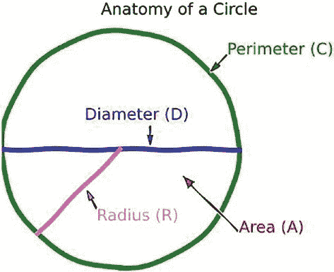
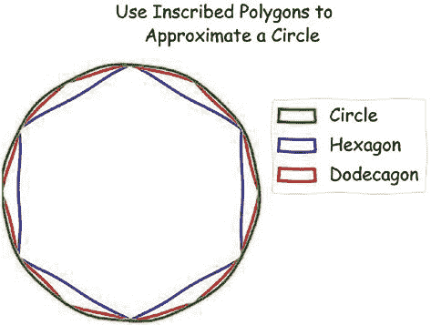
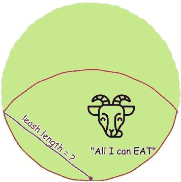
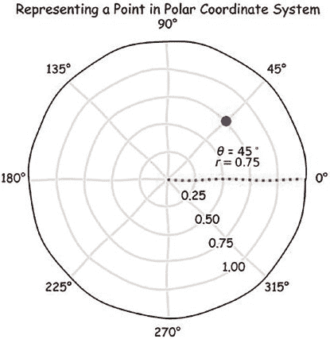
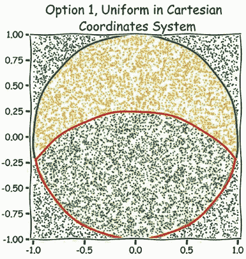
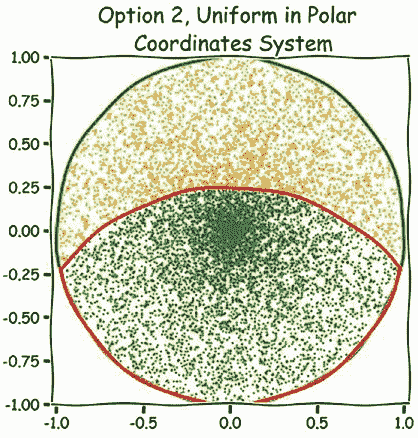
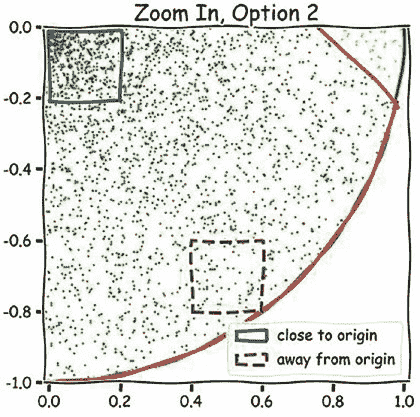

## 第 1 章

### 用蒙特卡洛模拟计算圆周率π

#### 背景

当波兰裔美国数学家、核物理学家斯坦尼斯瓦夫·乌拉姆在 20 世纪 40 年代发明并系统阐述了现代蒙特卡洛方法时，他和同事们将其命名为“蒙特卡洛”，因为乌拉姆的叔叔经常借亲戚的钱去摩纳哥的蒙特卡洛赌场赌博。斯坦尼斯瓦夫·乌拉姆和其他许多杰出科学家当时正致力于如今被称为“曼哈顿计划”的秘密核武器项目。蒙特卡洛方法被用来编程模拟核反应。在某种程度上，蒙特卡洛方法塑造了我们今天所看到的世界。

在定理或算法获得学术上的正式名称之前，它们常常已被充满好奇心的先驱们通过有趣的、基于示例的方法研究过了。让我们从一个故事开始。

#### 智者竞赛

假设在 16 世纪的某一天，在中东的某个地方，一位国王给他王国中最聪明的两位智者（包括你）24 小时时间，要求用最优雅的方式计算出π的值。国王慷慨地承诺提供你想要的任何合理资源。

π是圆的周长与直径的比值。通常，我们也称圆的周长为`C`，如图 1-1 所示。

© 李荣鹏与中野爱一郎 2022

R. Li 和 A. Nakano，《用 Python 进行仿真》，[`doi.org/10.1007/978-1-4842-8185-7_1`](https://doi.org/10.1007/978-1-4842-8185-7_1#DOI)



**图 1-1.** 圆的符号表示

你的对手要了王国里最好的纸张、细绳和直尺。国王宣布竞赛后，他立即开始分割圆。他的方法与大约 1000 年前中国数学家**祖冲之**使用的方法相同。

嗯，在 16 世纪，微积分还没被发明出来。聪明的你打算怎么办？你可不会坐以待毙，让对手获胜！相反，你向国王要了 1000 人来帮你计算。你还索要了足够多的细沙粒、10 英寸乘 10 英寸的普通纸张、直尺和细绳。国王好奇地慷慨批准了你的请求。

#### 通过撒沙粒估算π

现在，你手下有 1000 人听候你的命令。你将这样做：你让每个人在方形纸上画一个最大的内接圆。之后，让他们将*1000*颗沙粒*随机地*撒在纸上。每个人都需要仔细计数并记录落在圆内的沙粒数量。当然，沙粒可能意外落到纸张外面。如果是这样，这个人需要重新撒，直到全部 1000 颗沙粒都落在纸上为止。

国王感到困惑。而你显得胸有成竹，因为你知道你的国王并不精通数学——就像本书的大部分读者一样——并且很容易对枯燥的方程式感到厌烦。而你的对手有一堆几何学上的胡言乱语要向国王解释。



你的对手正在用多边形的周长来逼近圆。正如你从图 1-2 中所见，随着边数的增加，对周长进行分割变得明显繁琐起来。

**图 1-2.** 用多边形逼近圆

你注意到，你的对手总是会得到一个低于真实周长的值，因为这些多边形是内接的，意味着它们始终位于圆内。为了得到一个所谓的上界，你的对手还必须使用外切多边形。

另一方面，你所要做的就是坐在那里，从容地向国王解释你的方法之美。你所做的其实正是一场*蒙特卡洛模拟*。

你只需等待手下送来越来越多的数据，直到一天结束。

角色扮演先到此为止，让我们来探究一下，为什么让 1000 个人反复撒下 1000 颗沙粒，就能得到一个相当不错的π估计值。

记住，π不仅描述了直径与周长之间的关系，也描述了半径`R`与圆的面积`A`之间的关系。这里，`C`是周长，`D`是直径：

`C` = π `D`

`A` = π `R`² = π `D`² / 4

现在，假设一颗沙粒随机落在正方形上，这颗沙粒落在圆内的概率是多少？嗯，这很明显：它是圆的面积与正方形的面积`S`之比。只要存在良好的*随机性*，这个比值必然也是我们正在寻找的概率。

等等，我们还有用π表示的面积`A`的表达式，对吧？如果我们代入会怎样？让我用\( P(\text{沙粒在圆内}) \)来表示沙粒落在圆内的概率。我们有以下表达式：

\[

P(\text{沙粒在圆内}) = \frac{\text{圆的面积}}{\text{正方形的面积}} = \frac{A}{S} = \frac{\pi D² / 4}{D²} = \frac{\pi}{4}

\]

惊喜！这个概率并*不*依赖于正方形的大小。唯一的问题是，这个美妙的结论仅在理论上是正确的；我们必须通过采样来估计这个概率。这就是为什么扮演智者的你，索要了大量沙粒和 1000 名眼尖心细的人来重复这些实验。每个实验都会给出一个π值，到了这一天结束时，我们可以取所有实验结果的平均值。

```python
import random

import numpy as np

random.seed(2021)

pi_values = list()

num_persons = 1000

num_rounds = 20

num_grains = 1000

edge = 10

for r in range(num_rounds):

    for p in range(num_persons):

        in_circle = 0

        for g in range(num_grains):

            x, y = (random.random() - 0.5)*edge, (random.random() - 0.5)*edge

            if x**2 + y**2 <= (edge/2)**2:

                in_circle += 1

        pi = in_circle/num_grains * 4

        pi_values.append(pi)

print(np.mean(pi_values))
```

以下是执行模拟的 Python 代码。别担心，我会逐行解释。随着你对本书风格的熟悉，未来一些较为琐碎的内容将会略过。

这段代码模拟了 1000 个人的撒豆行为，假设每人每天可以进行 20 次实验。对于每一粒撒下的豆子，我们使用 `random.random()` 函数计算其坐标。此处，我们假设圆心位于原点。

为了确保结果在你的电脑上可重现，我将*随机种子*设置为 2021。我们在计算机科学中见到的几乎所有随机性都称为伪随机性。它们并非完全随机，正如那位智者的 1000 个人不会真正均匀地在纸上撒豆子。不过，对于 Python 编程而言，在几乎所有情况下，你都可以信任内置随机数生成器的高水平随机性。不过，本书中并非所有模拟都设置了随机种子。

`random.random()` 函数会返回一个介于 0 和 1 之间的随机变量。请参考图 1-3 的可视化展示，以了解 1000 个 `random.random()` 结果的分布情况。这种分布有一个名称：*标准均匀分布*。

**图 1-3.** 1000 个介于 0 和 1 之间的随机生成数的分布

生成该可视化效果的对应代码如下：

```python
random.seed(2021)

fig, ax = plt.subplots()

ax.hist([random.random() for _ in range(1000)], bins=10, rwidth=0.9)

ax.set_title("Histogram of 1000 random.random() results")
```

接下来，让我们在图 1-4 中展示无限种可能的 1000 粒撒豆结果中的一种可能形态。

**图 1-4.** 正方形中的 1000 粒撒豆

代码如下：

## 从可视化中我没有看到任何令人担忧的聚集或偏差，你呢？

这意味着存在良好的`随机性`，因此我们使用面积比来逼近 π 的方法是有效的。接下来，让我们绘制这 20K 个 π 值的直方图，看看结果的分布情况。我们得到了图 1-5。

**图 1-5.** 20,000 个计算所得的 π 值的分布

### 请注意

`平均值`和`中位数`非常接近，因此图中仅绘制了中位数。得到此可视化效果主要有三点：

1.  `平均值`和`中位数`都非常接近 π 的真实值。这是个好迹象，因为这说明我们的数据没有被大的异常值所扭曲。
2.  四分位数是将数据分成等数量段的值。第一四分位数为 3.104 表示 25% 的结果小于 3.104。同理，25% 的结果大于 3.176。
3.  标准差（STD），由水平误差线表示，表示某个结果与样本平均值的平均偏差。标准差约为 0.052。

样本标准差的计算公式如下：

```
STD = sqrt( (1/(N-1)) * sum_{i=1}^{N} (x_i - x̄)² )
```

其中，`x̄` 表示样本的平均值，`N` 是样本总数。标准差量化了我们对结果的置信程度。通常，标准差越小，结果越集中在平均值附近；因此，我们对结果也越有信心。

### 你可能也注意到了直方图的优美曲线

这背后是有原因的。这里简单剧透一下：模拟出的 π 值的分布遵循所谓的正态分布。这是著名的`中心极限定理`（CLT）的推论。其核心思想是，在一系列相当宽松的条件下，我们在自然界中观测到的量往往呈钟形曲线分布。这些量包括一个相当大的人群的体重、森林中树叶的长度等。

生成上述可视化效果的代码片段如下：

```python
with plt.xkcd():

    fig, ax = plt.subplots(figsize=(12, 6))

    ax.hist(pi_values, bins=50, rwidth=0.8)

    pi_mean = np.mean(pi_values)

    pi_median = np.median(pi_values)
```

```python
random.seed(2021)

edge = 10

num_grains = 1000

with plt.xkcd():

    fig, ax = plt.subplots(figsize=(6, 6))

    # plt.axis("off")

    plt.axis("equal")

    ax.set_xlim(-edge/2, edge/2)

    ax.set_ylim(-edge/2, edge/2)

    xs_in, ys_in = list(), list()

    xs_out, ys_out = list(), list()

    for g in range(num_grains):

        x, y = (random.random() - 0.5)*edge, (random.random() - 0.5)*edge

        if x**2 + y**2 <= (edge/2)**2:

            xs_in.append(x)

            ys_in.append(y)

        else:

            xs_out.append(x)

            ys_out.append(y)

    ax.scatter(xs_in, ys_in, color="r")

    ax.scatter(xs_out, ys_out, color="b")

    circle = plt.Circle((0, 0), edge/2, fill=False, color="g", lw=3)

    ax.add_patch(circle)

    ax.set_title("An experiment with 1000 sprinkled grains", fontsize=20)
```

# `pi_mean` 和 `pi_median` 非常接近。图中仅绘制了中位数。

## 第 1 章 使用蒙特卡洛模拟计算 π

`pi_std = np.std(pi_values)`

`pi_quartiles = np.quantile(pi_values, [0, 0.25, 0.5, 0.75, 1])`

`ax.set_title("撒沙粒实验结果统计", fontsize=20)`

`line_1 = ax.axvline(pi_mean, color='red', lw=1)`

`line_2 = ax.axvline(pi_quartiles[1], color='purple', lw=3, linestyle="dotted")`

`line_3 = ax.axvline(pi_quartiles[3], color='green', lw=3, linestyle="dashed")`

`std_bar = ax.errorbar(pi_mean, 1200, xerr=pi_std, capsize=5, elinewidth=3, markeredgewidth=2, linestyle=":")`

`ax.legend([line_1, line_2, line_3, std_bar], ["中位数 = {}".format(pi_median), "第一四分位数 = {}".format(pi_quartiles[1]), "第三四分位数 = {}".format(pi_quartiles[3]), "标准差 =\n {}".format(round(pi_std, 3))], fontsize=18)`

回到角色扮演的场景中，在你的对手能够产生一个四位有效数字（例如 `3.1416`）之前，他会发现他的笔太粗了，无法进一步细分圆。而你呢，则可以将早期结果呈献给国王。随着你的手下不断报告新结果，你对结果的信心也会随之增加。

在进入下一小节（该小节中，蒙特卡洛模拟比精确解析解早了 200 多年）之前，我为你准备了一些练习，以加深你对蒙特卡洛模拟的理解。你可能需要利用 `numpy` 库的向量化计算来加速运算。

### 练习

1.  验证模拟结果确实不依赖于正方形边长这一事实。

2.  假设国王对你的模拟方法着迷。现在你有一百万人可供调遣进行计算。请利用 `numpy` 的向量化计算来执行模拟。

    同时进行统计计算。你发现了结果数量与标准差之间的关系吗？你能绘制出这两个值之间的关系图吗？

3.  你能使用蒙特卡洛模拟计算五维单位球的体积吗？注意，这个问题是刻意模糊的。请做一些研究并享受探索的过程。

### 圈住山羊！

希望你享受了 16 世纪的中东冒险之旅。现在，让我们穿越到 19 世纪的大不列颠。你作为一名牧羊人，遇到了一个需要解决的问题。

你拥有一块奇特的圆形土地。嗯，它必须是圆形的；否则就不好玩啦！你还有一只非常顽皮的山羊，它必须被拴住。否则，它会吃掉够得着的一切东西，并造成拥堵问题。

现在，你需要将牵引绳的一端固定在圆形围栏的某一点上；牵引绳需要多长，才能使山羊恰好能够到你一半的土地呢？图 1-6 是该问题的可视化示意图。为简化起见，我们可以将你的土地半径设为 `1`。



**图 1-6.** 一只被拴住的山羊被限制在圆形围栏内*

这个问题就是所谓的内部放牧问题。它已经为人所知 200 年了，但其解析解直到 2020 年初才被发现。

```
⎛
⎞
1 ∫
*z*
*z z*
*z*
*dz*
*z*− / sin cos
/
3 /8 =
(
−
−π 2)
γ
π
π
⎜ √
/4
cos
⎟
⎜ 2 ∫
( *z z z* −π 2) *dz* ⎟
⎝
*z*
1/ sin − ccos
/
− π
3 /8 π
= /4
√
⎠
```

然而，利用我们刚刚讨论的蒙特卡洛模拟，你只需编写几行 Python 代码就能计算出牵引绳的长度。

其基本思路与撒沙粒的方法相同。首先，你在土地内部生成一个均匀分布的随机点；然后，给定一个牵引绳长度，检查山羊是否能到达那个点。经过足够多的采样后，如果山羊能够到达超过一半的面积，就缩短牵引绳；否则，就加长它。我们可以重复这个过程，直到达到所需的精度。

您可能已经注意到，前面的方法在计算上并非最优。更好的方法是首先生成足够的点，然后再确定绳子的长度。我们之后将以此改进方式来进行计算。

### 什么是随机性？

等等，这里存在一个歧义。很容易想象一个正方形内的均匀分布随机点：你只需让它在一条边上均匀分布，并在另一条边上也均匀分布即可。然而，一个圆内的均匀分布随机点意味着什么？你又要如何生成成千上万个这样的点？



你有两个选择：

1.  你只关心一个圆，但你使用恰好外接该圆的正方形来完成工作。你仍然在正方形内生成均匀分布的点，但丢弃那些落在圆外的点。只使用落在圆内的点进行计算。这确实保证了同样的均匀性，但轰鸣的 CPU 可能不会高兴，因为只有大约 `78.5%` 的工作得到了回报。

2.  另一个选择是使用极坐标，如图 1-7 所示。首先，你在 `0` 与你的地块半径（例如，`R`）之间生成一个均匀分布的半径，然后在 `0` 度到 `360` 度之间生成一个均匀分布的弧度值。点的位置也是唯一确定的。

**图 1-7.** 极坐标系也可以唯一地定义一个二维平面上的点

在前面说明的例子中，二维空间中的一个点由一对值 (`θ`, `γ`) 唯一确定，其中 `θ` 是该点相对于 `θ = 0` 线（由虚线表示）逆时针旋转的角度。`γ` 是该点与原点之间的距离。`θ` 取值在 `0°` 和 `360°` 之间，而 `γ` 可以是任何正数。

普通笛卡尔坐标与极坐标之间的转换可以使用以下公式获得：

`x = γ cos θ`

`y = γ sin θ`

`γ² = x² + y²`

以下是用于极坐标系演示的代码片段。它将让你很好地了解如何用极坐标操作对象：

```python
from matplotlib.patches import Arc

with plt.xkcd():
    fig, ax_polar = plt.subplots(figsize=(6, 6),
                                 subplot_kw={'projection': 'polar'})
    ax_polar.set_rmax(1)
    ax_polar.set_rticks([0.25, 0.5, 0.75, 1],)
    ax_polar.set_rlabel_position(-60)
    ax_polar.grid(True, linewidth=3, alpha=0.4)
    ax_polar.set_axisbelow(True)
    ax_polar.plot([0, 0], [0, 1.2], lw=3, color="red",
                  linestyle="dotted")
    ax_polar.scatter([np.pi/4], [0.75], s=120, color="blue")
    ax_polar.text(np.pi/7, 0.5, r"$\theta$ = $45^\circ$")
    ax_polar.text(np.pi/12, 0.45, r"$r = 0.75$")
    ax_polar.set_title("在极坐标系中表示一个点", fontsize=20)
```

现在，你会选择哪个选项？它们听起来都挺合理的，不是吗？让数据说话吧。以下代码片段使用两种方法在圆内生成 `10,000` 个随机点。让我们通过可视化生成的点的分布来找出答案。



将绳子长度设为 `1.25`，选项 1 给出了图 1-8。

**图 1-8.** 使用笛卡尔坐标采样的结果

表 1-1 中的统计数据告诉我们，有多少点会因为落在圆外而不会被使用，以及有多少点能被山羊到达等。

**表 1-1.** 笛卡尔坐标系采样中每个区域的点的数量

| **圆外点** | **不可达点** | **可达点** |
| :--- | :--- | :--- |

如果选项 1 是正确的，这实际上意味着 `1.25` 可能太长了。并且大约 `20%` 的 CPU 时间被浪费了。

让我们看一下选项 2 产生的结果，如图 1-9 所示。



**图 1-9.** 使用极坐标采样的结果

如果选项 2 是正确的，我们没有浪费 CPU 时间，但统计数据看起来令人担忧。

我统计了表 1-2 中的数字。

**表 1-2.** 极坐标系采样中每个区域的点的数量

| **圆外点** | **不可达点** | **可达点** |

用于绘图的源代码太长，因此省略。然而，它们应该很容易复现。

好吧，看看这些点的散点图；哪一个看起来更随机？很明显，选项 1 展示了比选项 2 更高水平的随机性。如果我们放大选项 2 的结果，这一点就更加明显了，如图 1-10 所示。



## 第 1 章 使用蒙特卡罗模拟计算圆周率 π

**图 1-10.** 放大极坐标系的结果后，密度不均变得清晰

两个方形区域显然包含不同数量的点。更靠近原点的那个包含更多的点，而离原点更远的那个包含更少的点。

原因是，如果你对坐标系进行变换，均匀分布将会失真。尽管这些点在极坐标方面是均匀分布的，但使用三角公式进行的变换扭曲了它们，使得它们在笛卡尔坐标中不再是均匀分布的。这无疑敲响了警钟。

以下代码片段将使用二分法估算绳子的长度。当然，你可以改变绳子另一端的位置，但我们还是坚持使用地块左下角的简单位置。注意，我们将使用选项 1 的结果，因为它是正确的模拟。

二分法是一种求根方法。在这里，我们只是借用这个思想。

因为随着绳子长度的增加，可达点的数量单调增长。假设我们从范围 `[0, 2]` 开始寻找长度，并从中间点 `1` 开始；如果超过一半的点是可达的，我们开始在 `[0, 1]` 中搜索，并从新的中间点 `0.5` 开始。同理，如果少于一半的点是可达的，我们选择 `1.5` 作为新的中间点，并在范围 `[1, 2]` 中搜索。迭代继续，直到满足停止条件。

```python
random.seed(2021)

num_points = 10000
num_valid_points = 0
xs, ys = list(), list()

for g in range(num_points):
    x, y = (random.random() - 0.5)*2, (random.random() - 0.5)*2
    if x**2 + y**2 <= 1:
        xs.append(x)
        ys.append(y)
        num_valid_points += 1
```

# 开始二分法

`low`、`high`、`middle` = 0, 2, 1
`epsilon` = 0.001
`while high-low > epsilon`:
`reachable = sum((x-0)**2 + (y - (-1))**2 <= (middle)**2 for x, y in zip(xs, ys))`
`if reachable > num_valid_points//2`: # 需要缩短束缚长度 `low`, `high`, `middle` = `low`, `middle`, `(low+middle)/2`
`elif reachable < num_valid_points//2`: # 需要增加束缚长度 `low`, `high`, `middle` = `middle`, `high`, `(middle+high)/2`
`else`:
`break`
`print(middle)` # 1.15869140625

好的，我敢打赌你已经感受到了蒙特卡洛模拟的精髓。在计算 π 和约束山羊这两个问题中，我们面对的本质上都是不涉及任何随机性的确定性问题。然而，通过引入随机性，我们将分析问题转变成了模拟问题。这就是蒙特卡洛模拟的力量。在下一节中，我们将探讨另一类问题，这类问题*本身*就具有内在随机性。

现在，在进入火箭的第二阶段之前，请完成以下练习。

# 第 1 章 用蒙特卡洛模拟计算圆周率 **练习**

1.  假设山羊在空间站中，找出三维空间中的解，使得山羊只能到达单位球体积的一半。

2.  通过仅考虑边界附近的少数关键点来改进二分算法的性能。

3.  如果我们不满足于围栏上的单个固定点呢？你能选择围栏上的其他点来计算束缚长度吗？你得到的结果相似吗？你的结果分布看起来是怎样的？

## 总结

在本章中，我们研究了蒙特卡洛模拟的经典用例：计算`π`。我们探讨了`随机性`对计算有效性的影响，并研究了模拟结果的分布情况。
