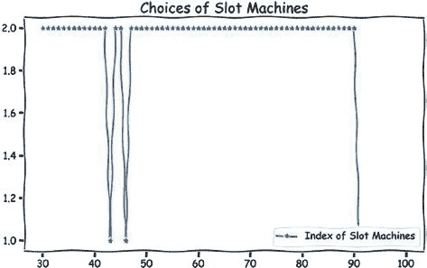
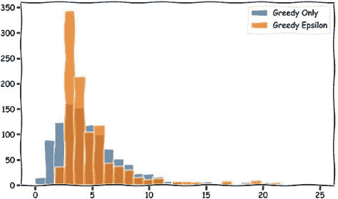
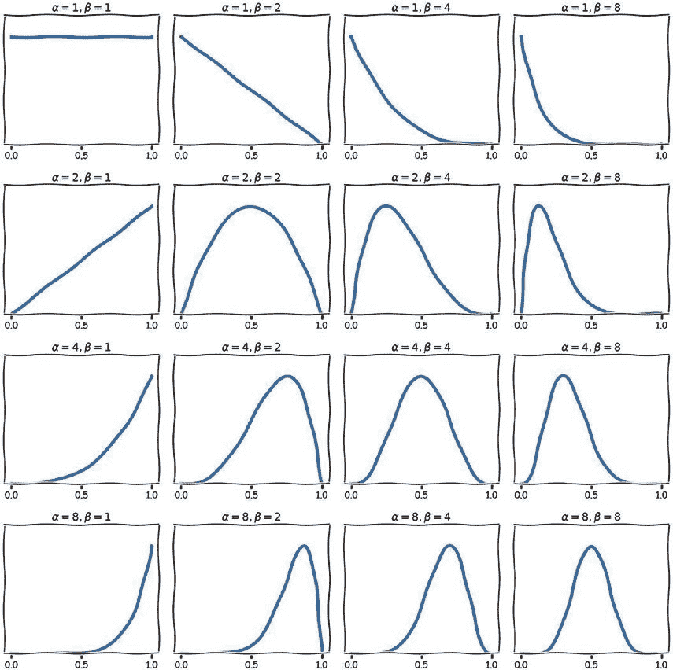
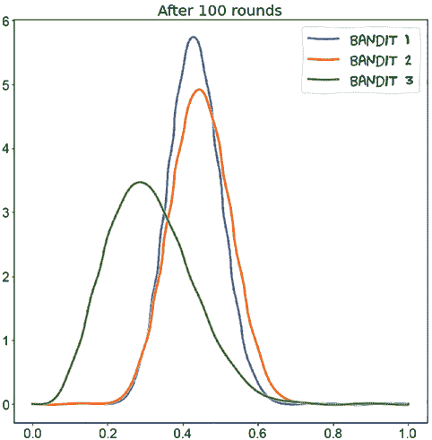
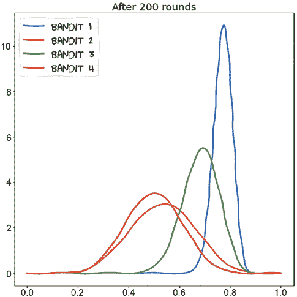

## 第三章 多臂老虎机、概率模拟与贝叶斯统计

鲍勃于黄昏走进一家赌场。他今晚想尽最大努力试试运气。他开始玩一种简单直接的老虎机游戏：三个相同符号出现，你便获胜。大厅里有三台不同的机器，鲍勃有 100 美元可供挥霍。

鲍勃知道这些机器的中奖概率不同，且每次拉杆将花费他 1 美元。现在的问题是，为鲍勃找到最佳的中奖策略。

老虎机也被称为单臂匪徒。这个问题也被称为经典的*多臂老虎机*问题。

让我们先考虑极端情况。如果我们有很多钱，我们可以在每台机器上花大价钱，以获得对中奖概率的良好估计，对吗？没有投入，就没有收获。如果我们钱很少，我们无法在每台机器上投入大量资金，因此只能依靠运气死磕一台曾经赢过钱的机器，并希望它表现不至于太差。

职业赌徒筹码的深度是决定其策略的巨大因素。口袋深的赌徒可以通过下高风险赌注来压制对手。然而，口袋浅的赌徒承受不起这种风险，这导致他们采取防守型玩法，或者有时孤注一掷地全押。

© 李荣鹏 与 A. 中野 2022

R. Li 与 A. Nakano，《使用 Python 进行模拟》，[`doi.org/10.1007/978-1-4842-8185-7_3`](https://doi.org/10.1007/978-1-4842-8185-7_3#DOI)

### 随机选择与朴素贪心方法

现在，让我们考虑更一般的情况，并用数学方式阐述问题。

假设我们有 *K* 台机器，并用 *i* 作为索引。每台机器的中奖概率记为 *pi*。为简单起见，可以假设 *pi* 值各不相同，因此不存在等效的机器。我们的目标是，在所有 *N* 次拉杆之后，获得最高的期望中奖次数。

理想情况是什么？当然，如果我们知道哪台机器的中奖概率最高，我们希望只玩那台中奖概率最高的机器 *p*∗ = *max* (*pi*)。在理想情况下，我们可以定义一个所谓的遗憾函数：

`*r* = *Np*∗ − Σ(*p*(*t*))` 对于 `*t* = 1` 到 `*N*`

这里，`*p*(*t*)` 是鲍勃在时间步 *t* 所玩机器的中奖概率。

如果我们能识别出最优机器并坚持玩它，我们将完全没有遗憾，即 `*r* = 0`。然而，如果我们一直玩最差的机器，遗憾函数的最大可能值将是 `*r* = *N*(*p*∗ − *min*(*pi*))`。在鲍勃的例子中，`*N* = 100` 且 `*K* = 3`。

让我们为遗憾函数建立一个基准线。假设鲍勃是个简单的人，因此他用两种简单策略之一来玩游戏：

1.  鲍勃每次随机选择一台机器，无论其表现如何。

2.  鲍勃每台机器玩十次，并计算中奖概率。然后，他坚持使用中奖概率最高的机器，并根据游戏结果更新统计数据。换句话说，鲍勃是*贪婪的*。

让我们用中奖概率 `p1 = 0.5`, `p2 = 0.3`, `p3 = 0.2` 来模拟这种大胆的策略：

```python
def cal_simple_random_regret(N = 100, probs = [0.5, 0.3, 0.2]):
    regret = max(probs)*N - sum(np.random.choice(probs) for t in range(N))
    return regret

cal_simple_random_regret()
```

我首次尝试时，遗憾函数的值大约为 *14.6*。我们来看看 1000 次试验的结果分布：

```python
trials = 1000
with plt.xkcd():
    fig, ax = plt.subplots(figsize=(8,6))
    plt.hist([cal_simple_random_regret() for _ in range(trials)], label="遗憾值", bins=20)
    ax.set_title("随机选择老虎机时的遗憾函数分布", fontsize=20)
    plt.legend()
    fig.savefig("random_slot_machine.jpg")
```

该分布如下图所示，如图 3-1 所示。

***图 3-1.** 随机选择的遗憾函数分布*

遗憾值似乎在 *16.5* 左右。

现在，让我们检验第二种策略：鲍勃在初始的 30 次拉杆（用于估算中奖概率）之后，坚持使用中奖概率最高的机器。该策略专注于在初始的*探索*阶段之后，对已知的最佳选择进行*利用*。

首先，我将定义一个名为 `Record` 的*数据类*，用于存储每台机器的记录信息：

```python
from dataclasses import dataclass

@dataclass
class Record:
    total:int
    win:int

    def cal_ratio(self):
        return self.win/self.total

    def update(self, prob):
        self.total += 1
        self.win += np.random.random() < prob
```

然后，我们使用贪心方法计算遗憾函数：

```python
def cal_greedy_regret(N = 100, probs = [0.5, 0.3, 0.2], evaluation_step = 10):
    K = len(probs)
    Records = [Record(0,0) for _ in range(K)]
```

# 初始评估步骤

```
for i in range(K):
    Records[i].total = evaluation_step
    Records[i].win = np.sum([np.random.random() < probs[i] for _ in range(10)])
```

# 获取当前表现最优的老虎机索引

```python
slots_trajectory = []
slot_index = np.argmax([record.cal_ratio() for record in Records])
slots_trajectory.append(slot_index)

for i in range(N - evaluation_step * K):
    # 进行剩余 80 轮游戏
    Records[slot_index].update(probs[slot_index])
    slot_index = np.argmax([record.cal_ratio() for record in Records])
    slots_trajectory.append(slot_index)
```

```python
# print(Records)
return max(probs)*N - sum([Records[i].total*probs[i] for i in range(K)]), slots_trajectory
```



## 第 3 章 多臂老虎机、概率模拟与贝叶斯统计

此处，我同时返回了遗憾值和老虎机轨迹，即最后 70 次对老虎机的选择。

如果你运行这段代码，你会看到一个典型的遗憾值 `5`。读者可以暂停阅读，思考其中原因。

在探索阶段，第一台老虎机很有可能会给你比第二台和第三台更高的获胜概率，因此我们从第一台老虎机开始并一直使用它。这样，我们将在 1 号老虎机上玩 `80` 次，在 2 号和 3 号老虎机上各玩 `10` 次。所以遗憾值为 `r = 0.5 * 100 - 0.5 * 80 - 0.3 * 10 - 0.2 * 10 = 5`。

然而，有时遗憾值可能会很高，因为我们坚持使用的并非获胜概率最高的老虎机。你可以看到类似下面的 `slot_trajectory`。我在图 3-2 中为你绘制了一个示例。

***图 3-2.** 老虎机的选择*

在这种情况下，2 号老虎机在探索阶段给鲍勃留下了良好印象，因此鲍勃坚持使用它。然而在利用阶段，真正的最佳老虎机 1 号试图赢得鲍勃的青睐，但未能成功。于是鲍勃在剩余的大部分游戏中都使用 2 号老虎机。这样的轨迹给鲍勃带来了 `16.8` 的遗憾值，甚至比随机猜测还要稍差一些。

如果鲍勃不愿意花 30 美元进行探索/估算概率，情况可能会更糟。这样，他选择次优老虎机的概率会更大。

现在的问题是要找到一种改进版的贪心方法，以避免此类问题。

### 贪心-ε：并非总是贪心

让我们尝试引入一种新策略。假设鲍勃大致上根据`历史记录`坚持使用最佳老虎机。然而，每次鲍勃都有一个较小的概率，记为 `ε`，随机选择另一台老虎机来玩。这是`探索`和`利用`的混合：鲍勃放弃了一些`利用`的机会，转而进行`探索`，以寻求未来更大的收益。

实现起来很简单，作为练习留给读者。请将函数命名为 `cal_greedy_epsilon_regret`。关键代码是以下三行。 `ε` 的值由你决定，而在本演示中我将其设为 `0.02`。

```python
if np.random.random() < epsilon:
    slot_index = np.random.choice([i for i in range(K) if i != slot_index])
    slots_trajectory.append(slot_index)
```

让我们比较一下纯贪心方法与带有限初始探索步数的贪心-epsilon 方法的性能。我将每台机器的初始探索次数设为 `1`，`ε` 设为 `0.02`。以下代码将绘制两种方法的直方图：

```python
rounds = 1000
greedy_only = [cal_greedy_regret(evaluation_step=1)[0] for _ in range(rounds)]
greedy_epsilon = [cal_greedy_epsilon_regret(epsilon=0.02)[0] for _ in range(rounds)]

with plt.xkcd():
    fig, ax = plt.subplots(figsize=(10,6))
    plt.hist(greedy_only, label="纯贪心方法", bins=np.linspace(0,25,30), alpha=0.5)
    plt.hist(greedy_epsilon, label="贪心-epsilon 方法", bins=np.linspace(0,25,30), alpha=0.5)
    plt.legend(loc='upper right')
    fig.savefig("greedy_approach_epsilon_compare.jpg")
```

结果如图 3-3 所示。



***图 3-3.** 纯贪心方法与贪心-epsilon 方法的遗憾值分布*

请注意，纯贪心方法确实产生了更多低遗憾值，但其分布不如贪心-epsilon 方法集中。这意味着贪心方法的最差情况比贪心-epsilon 方法的最差情况更差。

# 改变胜率结果的影响

如果改变胜率的真实值，结果可能会发生巨大变化。尝试修改它，看看这对两种策略的表现有何影响。如果老虎机数量增加到像`5`或`10`台会怎样？

如果鲍勃采取激进策略，他会选择纯粹的贪婪方法。如果鲍勃更为谨慎，他可以尝试贪心-ε方法，以避免出现低概率但灾难性的遗憾值。

## 一种改进的贪心-ε算法

朴素贪心方法的一个问题是，它在进行随机选择时没有考虑老虎机的表现。我们可以通过采用所谓的`softmax`策略来解决这个问题。其核心思路是引入一个参数，模仿物理学中温度的概念，称为`τ`。温度`τ`越高，选择越随机。当`τ ≈ 0`时，我们的策略应退化为朴素贪心方法。当`τ ≈ ∞`时，我们的策略应退化为随机选择策略。

公式如下：

`p(i,t) = e^(p(i,t)) / Σ e^(p(i,t))`

其中，`p(i,t)`代表老虎机`i`在时间`t`时的观测胜率。

例如，如果在第`100`步时，鲍勃已经玩了老虎机`1`共`11`次，并且赢了`4`次，那么`p(1,100) = 4/11`。

`softmax`这个名称是什么意思？如果我们将表达式展开到三台老虎机的情况，并假设第一台老虎机到目前为止表现最佳，那么我们可以通过调整温度`τ`的值来观察其对下一轮选择的影响。

例如，当`τ`趋近于无穷大时，我们得到：

`p(1,t) / Σ p(i,t) = e^(p(1,t)) / (e^(p(1,t)) + e^(p(2,t)) + e^(p(3,t))) ≈ 1/3`

这意味着在极高温度下，无论老虎机 1 的表现比其他老虎机好多少，算法都会退化为基准随机策略。

让我们看看另一个极端情况，当温度`τ`设定接近`0`时：

`p(1,t) / Σ p(i,t) = e^(p(1,t)/τ) / (e^(p(1,t)/τ) + e^(p(2,t)/τ) + e^(p(3,t)/τ))`

由于`p(1,t)`是最大值，像`e^(p(2,t)/τ)`这样的表达式实质上变成了`e^(-∞)`，即零。这意味着我们的算法退化为朴素贪心方法。

请随意调整`τ`的值，看看它如何影响策略的表现。

该策略最大的改进在于，它会优先考虑表现最佳的选项，同时也为其他选项留出尝试的机会。

## 练习

1.  尝试使用不同评估步数的贪心方法。尝试较小的值如`5`，以及较大的值如`20`。你可能需要多次运行模拟才能获得统计上一致的结果。
2.  研究真实概率如何影响不同策略的表现。我们一直使用`probs = [0.5, 0.3, 0.2]`。尝试其他概率选择会怎样？

## 贝叶斯方法：贝叶斯统计入门

现在，让我们回到理想情况：鲍勃有足够的钱可以一直玩到天亮。鲍勃如何在玩的过程中更新他对多台老虎机胜率的估计？我们对多台老虎机胜率的最佳估计是什么？鲍勃能否获得这些胜率的`分布`而不仅仅是单一数值？答案是`可以`，鲍勃需要贝叶斯统计来优化他的估计。

在这个老虎机情景中，核心思想是鲍勃最初会持有对胜率分布的信念。假设某台老虎机的胜率`p`有一个名为`prior(p)`的先验分布。然后，鲍勃会通过观察多台老虎机的实际胜率来更新他的信念，从而得到一个更新后的分布，称为`posterior(p)`（后验分布）。`p`是被建模的胜率，而获胜或失败次数则是观测结果。对于给定的概率，观测结果将遵循二项分布。回顾一下，`Binomial(k | n, p) = (n choose k) * p^k * (1-p)^(n-k)` 是在底层概率为`p`的`n`轮二项实验中观察到`k`次成功的概率。

先验分布不过是一种`信念`。假设你出生在美国，小时候相信美国拥有世界上最辣的辣椒。因此，`P(美国有最辣的辣椒) = 1` 是你的先验信念。然后你周游世界，发现墨西哥有很辣的辣椒。于是你的`观测`将你的信念更新为`P(美国有最辣的辣椒) = 0.5`。接着你尝试了一些印度辣椒，你的信念又变为`P(美国有最辣的辣椒) = 0.3`。你不断重复这个过程，随着观测的到来，上一轮的信念被不断更新。

在鲍勃的例子中，观测结果取决于我们不断更新的参数`p`。

更新规则如下：

`posterior(p) ∝ likelihood(p|x) * prior(p)`

回顾一下，贝叶斯定理指出，对于任意事件，我们有 `P(A|B) = P(B|A) * P(A) / P(B)`

将这个公式映射到鲍勃的游戏中，我们可以看到`A`本质上是底层参数`p`，而`B`是拉杆的结果。由于观测结果是`事实`，`P(B)`与我们选择`A`无关。试想一下鲍勃的场景：如果他来自未来并已知自己的输赢结果，他大概不会关心胜率的分布，对吧？

不幸的是，贝叶斯更新规则需要精确计算，因为我们关心的是`p`的精确分布。贝叶斯更新规则并不简单，其计算可能非常昂贵，尤其是在连续情况下。我们现在需要的是一个性质良好的`prior(p)`先验分布，使得更新后的分布同样性质良好，从而可以快速且顺序地进行计算。

是否存在这样良好的先验分布？有的！它被称为似然分布的`共轭先验`。在这里，似然函数是二项分布，它的共轭先验称为`贝塔分布`，由两个参数`α`和`β`决定：`B(α, β)`。

贝塔分布是二项分布的一种推广。让我们看图 3-4 中的一些例子。



**图 3-4.** 不同参数集下的贝塔分布

它与二项分布非常相似。如果`α`和`β`相同，分布是对称的。如果两个参数都较大，分布更集中。如果`α`大于`β`，分布左偏，反之亦然。

如果我们将贝塔分布的公式代入更新规则，会得到以下结果：

`posterior(p) ∝ likelihood(p|x) * prior(p)`

`posterior(p) ∝ Binomial(k; n, p) * B(p; α, β)`

展开二项分布和贝塔分布的表达式：

```
posterior(p) ∝ (n choose k) * p^k * (1-p)^(n-k) * (1/B(α,β)) * p^(α-1) * (1-p)^(β-1)
posterior(p) ∝ p^(α+k-1) * (1-p)^(β+n-k-1)
posterior(p) ∝ B(p; α+k, β+n-β)
posterior(p) = B(p; α+k, β+n-k)
```

这里，我们有 `B(α,β) = Γ(α) * Γ(β) / Γ(α+β)`，其中 `Γ(x)` 是伽马函数。请不要

# 内容排版

被吓到了，因为在`α`和`β`是整数的情况下，伽马函数`Γ(x)`就是`n`的阶乘`(x - 1)!`，这抵消了表达式中的`k`部分。

好了，数学到此为止。这在鲍勃的赌博情境中意味着什么？

这意味着，如果鲍勃以信念`B(α, β)`开始，每当出现一次成功，他就可以简单地将信念更新为`B(α + 1, β)`；如果出现一次失败，他就可以简单地将信念更新为`B(α, β + 1)`。这完全不需要计算，只是参数更新而已！

我们有了一个新问题：鲍勃应该选择`α`和`β`的什么值？这相当依赖经验。鲍勃可以将他的历史记录与不同参数的分布进行比较，并选出最佳的那个。然而，归根结底，初始选择不会产生太大影响。另一个实际问题是：如何决定下一轮玩哪台机器？简单！我们只需使用老虎机的 Beta 分布生成一组样本，然后选出最大的那个。这个思路与上一节中的`softmax`策略相同。

## 第三章 多臂老虎机、概率模拟与贝叶斯统计

让我们看看执行模拟并可视化结果的代码：

```python
probs = [0.5, 0.3, 0.2]
K = len(probs)
N = 100
rounds = [9, 49, 99]
fig, axis = plt.subplots(1, 3, figsize=(30,10))
x_ticks = np.linspace(0,1,500)
plot_index = 0
betas = [stats.beta(1,1) for _ in range(K)]
wins = [0, 0, 0]
totals = [0, 0, 0]

with plt.xkcd():
    for rnd in range(N):
        for i in range(K):
            betas[i] = stats.beta(1+wins[i], 1+totals[i]-wins[i])
        p_value_samples = np.array([betas[i].rvs() for i in range(K)])
        slot_next_round_index = p_value_samples.argmax()
        win = np.random.random() < probs[slot_next_round_index]
        wins[slot_next_round_index] += win
        totals[slot_next_round_index] += 1
        if rnd in rounds:
            ax = axis[plot_index]
            for i in range(K):
                # plotting
                beta = betas[i]
                ax.plot(x_ticks, beta.pdf(x_ticks),
                        label='Bandit {}'.format(i+1),
                        linewidth=3)
            ax.set_title('After {} rounds'.format(rnd + 1), fontsize=20)
            ax.legend(fontsize=20)
            plot_index += 1
```

图 3-5 是我们的获胜概率分布的可视化。由于存在随机性，你的结果可能会有所不同。



**图 3-5.** 运行 100 轮后的获胜概率

我们能从这个结果中学到什么？嗯，我们对获胜概率最大的那台机器（即第一台）的获胜概率有更高的置信度。原因是，因为它有更高的获胜概率，鲍勃更有可能选择它，从而产生了正反馈。此外，随着鲍勃玩得越来越多，我们对所有机器的置信度总体上都会提高。

让我们尝试更多轮次和更多机器。假设鲍勃有 200 美元，有 4 台获胜概率相近的机器：`probs = [0.8, 0.7, 0.6, 0.5]`。概率估计结果如图 3-6 所示。



**图 3-6.** 200 轮后的老虎机获胜概率估计

很明显，在 200 轮之后，哪台是优机器已经相当明显，并且我们可以用精确的置信度水平来断言。

### 练习

1.  自己简化后验更新的表达式。

2.  你能想出一种将`softmax`策略与贝叶斯策略结合的方法吗？假设你使用贝叶斯估计的结果来调整`softmax`策略的温度。你的结果不需要在数学上严谨，但需要在直觉上说得通。

3.  使用贝叶斯方法计算遗憾函数。它是否显著优于其他策略？

### 总结

在本章中，我们研究了一个有趣的赌博场景。我们展示了不同的赌博策略基于对探索或利用的不同偏好程度。我们还基于贝叶斯方法进行了模拟。

---
