## 第四章 二维盒子中的球：一个简单的物理引擎

如果你是游戏迷或动漫迷，你可能听说过“物理引擎”这个词。当你在《战神》中操控奎托斯时，他的斧头与敌人和环境相互作用。你会觉得这种互动是真实的，并且他的斧头确实很沉重，像金属一样。你实际控制的只是一个 PlayStation 手柄，但印象却达到了另一个层次。在这里，物理引擎负责创造这种身处物理世界的感觉。

物理引擎是一种计算机软件，用于模拟某些物理系统，例如刚体相互作用、流体动力学、光照系统等。在电子游戏中，物理引擎负责模拟玩家与环境的互动。

如果玩家摧毁了一座建筑，建筑的倒塌必须像现实一样：砖块是重的，木质结构是轻的。在《海洋奇缘》等动画中，水效果是由专门模拟水运动的物理引擎创造的。

也有为雪花、头发和其他系统设计的物理引擎。

在本章中，我们将构建自己的简单物理引擎，以模拟一个非常有限的系统：二维盒子中的球。

### 二维盒子中的一个球

让我们从最简单的例子开始。这个场景非常类似于台球或斯诺克，但我们只从一个球开始。下面的代码片段在一个矩形盒子的中心绘制了一个球：

```python
RADIUS = 0.2
POSITION = [1, 1]
VELOCITY = [0.2, 0.2]
```

© Rongpeng Li and Aiichiro Nakano 2022

R. Li 和 A. Nakano 著，《使用 Python 进行模拟》，[`doi.org/10.1007/978-1-4842-8185-7_4`](https://doi.org/10.1007/978-1-4842-8185-7_4#DOI)

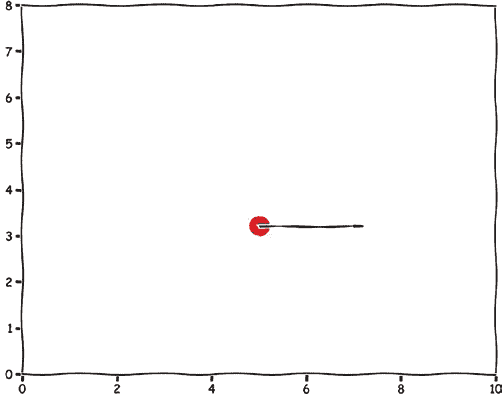

`WIDTH, HEIGHT = 10, 8`

`ARROW_HEAD_WIDTH, ARROW_HEAD_LENGTH = 0.05, 0.2`

```python
with plt.xkcd():
    fig, ax = plt.subplots(figsize=(WIDTH, HEIGHT))
    plt.xlim(0,WIDTH)
    plt.ylim(0,HEIGHT)

    ball_1 = plt.Circle(POSITION, RADIUS, color='r')
    ax.add_patch(ball_1)

    ax.arrow(*POSITION,
             *VELOCITY,
             head_width=ARROW_HEAD_WIDTH,
             head_length=ARROW_HEAD_LENGTH,
             fc='k', ec='k')
    plt.plot()
```

图 4-1 中的可视化结果清晰地展示了小球的位置、大小和速度。请注意，小球正在向上运动，其方向由箭头指示。

**图 4-1.** 一个向右运动的小球

我们所说的速度为 `(0.2, 0.2)` 到底是什么意思？让我们为模拟定义一些具体的单位。假设长度以米为单位，时间以秒为单位。因此，小球的速度单位是米/秒。我们的小球从位置 `(0.2, 0.2)` 开始，以大约 0.28 米/秒的速度向右上方运动。

以上描述的是物理设置，这意味着在现实世界中，这样一个小球会连续运动。然而，模拟是离散的，我们需要定义*时间步长*，记作 `Δt`，来近似现实中的连续运动。*时间步长*是模拟中连续两步之间经过的时间量。

`Δt` 越小，我们每秒获得的*帧数*就越多。例如，如果时间步长为 0.1 秒，那么我们将有 `10` 帧每秒（fps）。对于每一帧，小球将移动 `0.1 * 0.28 = 0.028` 米。如果时间步长为 0.01 秒，我们将有 100 帧每秒（fps）。对于每一帧，小球将移动 `0.01 * 0.28 = 0.0028` 米。在游戏中，如果 fps 超过 60，玩家通常不会察觉到任何卡顿。在电影动画中，如果 fps 超过 24，动画看起来就会很流畅。

然而，高 fps 也需要更多的计算量来计算物体的位置、朝向、旋转和速度。在我们只有一个小球的例子中，我们可以选择 0.1 秒的时间步长。要模拟 1 秒钟，我们的计算机需要更新小球的位置十次。

模拟系统中的时间与现实世界中的时间是不同的。为了在模拟系统中模拟一秒钟，如果系统很复杂，计算机可能运行数小时才能完成。对于游戏来说，这甚至是不可接受的。有一些`游戏引擎`可以让游戏开发者摆脱直接处理`物理引擎`的负担，例如`虚幻引擎`。

### 运动物理定律

让我们先稍微简化一下系统。我们假设以下条件：

1.  系统中没有摩擦力。小球不会因为与空气或其他物体的摩擦而减速。

2.  系统中没有旋转。小球不会旋转。如果你打过乒乓球，你就会知道旋转对比赛结果影响巨大。

3.  碰撞是弹性的。弹性碰撞意味着小球在与盒子壁碰撞时不会损失能量。如果有多个小球（我们将在下一节中看到），碰撞的小球作为一个整体不会损失能量。

4.  系统中没有重力。小球不会因重力而下落。不过，我们很快就会移除这个限制。

基于这些简化，我们可以根据牛顿运动定律写出系统的以下更新规则：

`x(t+1) = x(t) + v(t) * Δt`

`a(t) = 0`

由于我们假设没有外力，加速度 `a(t)` 初始为 0。现在，让我们以 0.2 秒的时间步长和 `(2,2)` 的速度，模拟十次迭代的运动来更新我们的系统。执行模拟的代码如下，它们只是两个简单的函数：

```python
def render(pos = POSITION, vel = VELOCITY):
    with plt.xkcd():
        fig, ax = plt.subplots(figsize=(WIDTH, HEIGHT))
        plt.xlim(0,WIDTH)
        plt.ylim(0,HEIGHT)

        ball_1 = plt.Circle(pos, RADIUS, color='r')
        ax.add_patch(ball_1)

        ax.arrow(*pos,
                 *vel,
                 head_width=ARROW_HEAD_WIDTH,
                 head_length=ARROW_HEAD_LENGTH,
                 fc='k', ec='k')
        plt.show()

def update(pos=POSITION, vel = VELOCITY, acc = None, delta_t = DELTA_T):
```

# 注意所有值都是可变的，因此更新会就地执行

```
for i in range(len(pos)):
    pos[i] += vel[i] * delta_t

if acc:
    for i in range(len(pos)):
        vel[i] += acc[i] * delta_t
```

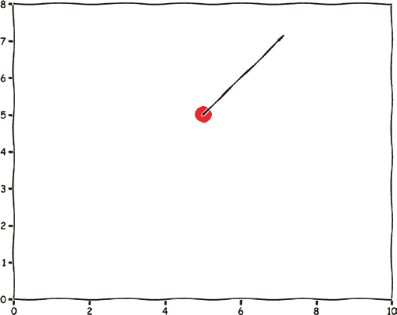

## 第 4 章 二维盒子中的小球：一个简单的物理引擎

现在，我们可以使用预设参数来执行模拟：

`RADIUS = 0.2`
`POSITION = [1,1]`
`VELOCITY = [2,2]`
`WIDTH, HEIGHT = 10, 8`
`ARROW_HEAD_WIDTH, ARROW_HEAD_LENGTH = 0.05, 0.2`
`DELTA_T = 0.2`

```
render(pos=POSITION, vel = VELOCITY)
for _ in range(10):
    update(pos=POSITION, vel = VELOCITY, delta_t = DELTA_T)
    render(pos=POSITION, vel = VELOCITY)
```

让我们看看经过十次迭代后小球的位置，如图 4-2 所示。

**图 4-2.** 十次迭代后小球的位置与速度

正如预期，以 0.2 秒的时间步长迭代十次，系统总共演进了 2 秒。在速度为`(2,2)`的情况下，小球将在水平和垂直方向上各移动 4 米。

现在，让我们为系统添加一些重力，以消除之前剩余的假设条件。修改起来非常简单。为了让小球在最初几帧画面内保持在盒子中，我将加速度设置为每秒向下 1 米。地球上正常重力加速度约为每秒 9.8 米。

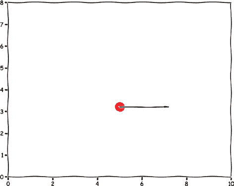

`ACCELERATION = [0,-1]`

```
for _ in range(10):
    update(pos=POSITION, vel = VELOCITY, acc = ACCELERATION, delta_t = DELTA_T)
    render(pos=POSITION, vel = VELOCITY)
```

让我们对速度做一个粗略估算。2 秒后，小球在垂直方向上的速度将完全降为零，因此速度向量应该完全是水平方向的。让我们在图 4-3 中进行验证。

**图 4-3.** 在重力场中经过 2 秒后小球的位置与速度

正如预期，小球在垂直方向上完全失去了速度。

### 碰撞检测

现在，我们来处理房间里的“大象”——碰撞检测。

要检测碰撞，我们首先需要对碰撞有一个清晰的定义。小球与墙壁发生碰撞意味着什么？思路很简单：如果小球的几何中心与墙壁之间的距离小于半径，那么就发生了碰撞。图 4-4 清晰地说明了这一点。

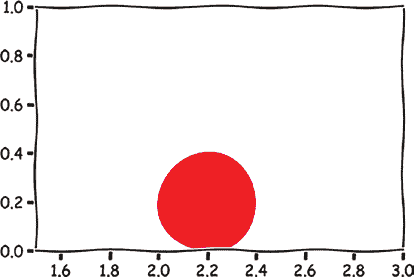

**图 4-4.** 碰撞放大图

检测逻辑因此变得简单：如果在某个时间点，小球中心与任一侧墙壁之间的距离小于小球半径，那么就发生了碰撞。在下一个迭代中，小球将通过与墙壁碰撞并翻转相应速度分量的符号来反弹。系统随后从该状态继续演化。

我们引入一个函数来检测小球与墙壁之间可能发生的碰撞：如果小球仍在向墙壁运动，并且距离已经小于半径，则检测到碰撞。如果检测到碰撞，该函数还会翻转相应速度分量的符号。

```python
def detect_collision_wall(pos = POSITION, vel = VELOCITY, radius = RADIUS, height = HEIGHT, width = WIDTH):
    # 左墙
    if abs(pos[0]-0) < radius and vel[0] < 0:
        vel[0] = - vel[0]
        return
    # 右墙
    if abs(width-pos[0])< radius and vel[0] > 0:
        vel[0] = -vel[0]
        return
    # 上墙
    if abs(height-pos[1]) < radius and vel[1] > 0:
        vel[1] = -vel[1]
        return
```

# 下壁

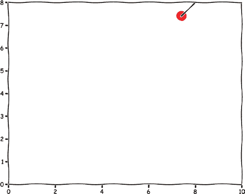

## 第 4 章 二维盒子中的球体：一个简单的物理引擎

```python
if abs(pos[1]-0) < radius and vel[1] < 0:
    vel[1] = -vel[1]
    return
```

你可能注意到，碰撞条件依赖于一个假设，即球以*中等*速度运动。如果球的速度过快，以至于在两个相邻帧之间穿过了墙壁，即所谓的*隧穿*问题，那么碰撞检测将永远不会被触发。

另一个问题是碰撞条件滞后于球的实际运动。这可以通过引入一个称为*delta*的小正参数来缓解，将球与墙壁之间的距离计算转变为类似 `abs(pos[0]-0) < radius + delta` 的形式。

通过根据球的速度或针对多球模拟的速度分布来选取适当的 `delta` 值，我们可以减少滞后的影响。

现在，让我们看一下模拟系统，看看球是如何弹跳的。

图 4-5 展示了我们红球的运动方向。

***图 4-5.** 球正朝碰撞方向运动*

碰撞后，球改变了方向。我们的算法运行良好！

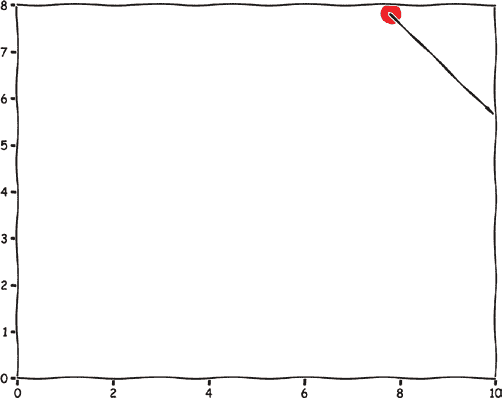

***图 4-6.** 碰撞后球的速度立即发生变化*

在继续之前，让我们快速了解一下如何创建 GIF 动画。

你可以使用 `imageio` Python 库来创建 GIF 动画。假设你已经将系统的快照保存为 `1.png`、`2.png`、`3.png` 等文件。你可以使用以下命令创建 GIF 动画：

```python
import imageio

filenames = ["1.png", "2.png","3.png"]

with imageio.get_writer('one_ball_bounce.gif', mode='I') as writer:
    for filename in filenames:
        image = imageio.imread(filename)
        writer.append_data(image)
```

对于单个球的情况，动画效果如 GIF 4-1 所示。

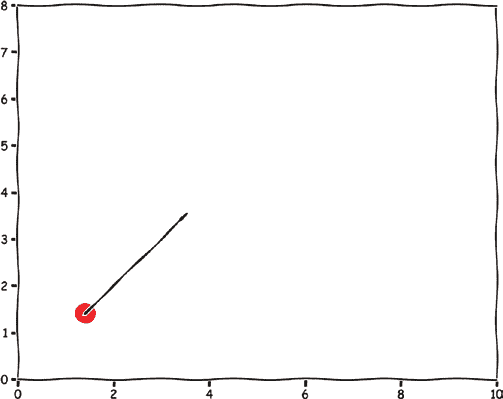

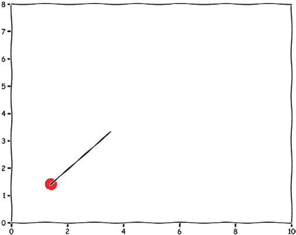

***GIF 4-1.** 无重力情况下的球体运动*

如果我们向系统添加重力，动画效果将如 GIF 4-2 所示。

***GIF 4-2.** 有重力情况下的球体运动*

已经非常酷了，不是吗？

### 练习

1.  将 `delta` 引入模拟。球的速度与 `delta` 值之间有什么关系？

2.  你能提高动画的帧率（fps）吗？它看起来更真实吗？

## 二维盒子中的多个球体

现在，我们来讨论多个球体的情况。除了可能发生球与墙壁的碰撞外，球与球之间也可能发生碰撞。这引入了两个新问题：

1.  如何检测球与球之间的碰撞？

2.  球在碰撞时如何表现？

如果你思考第一个问题，如果盒子里有 100 个球，那么球间碰撞理论上是一个 *n*² 量级的操作，粗略计算可达数千次。这很快会变得难以处理，因此不可接受。我们不希望计算量呈二次方增长。然而，由于大多数球并不会有机会相互碰撞，我们可能希望使用更高效的算法来检测或预测球之间的碰撞。

我们先来解决第二个问题。与第一个问题相比，它似乎更简单，不是吗？

### 碰撞时位置和速度的更新

支配纯弹性球体运动的物理定律有两条：动量守恒定律和能量守恒定律。在球与墙壁的碰撞模拟中，我们假设墙壁质量无限大，因此墙壁强制反转球的动量，同时保持球的能量不变。由于球的能量是动能和势能之和，如果引入重力，球的速度是不变的。

对于球与球的碰撞，情况会变得稍微复杂一些。我们不打算详细推导公式，但在查看公式后，可以进行一些粗略分析。

让我们将两个球的中心记为 *c*1 和 *c*2，两个球的半径记为 *r*1 和 *r*2，两个球的速度记为 *υ*1 和 *υ*2。我们将使用带撇的符号 1 和 2 来表示碰撞后球的速度。与球-壁碰撞的情况不同，我们还需要考虑两个球的质量。这与我们的直觉相符，因为即使是一个快速飞行的乒乓球，也不太可能让一个高尔夫球移动多少。

我们称它们的质量为 *m*1 和 *m*2。

现在，支配运动的两条物理定律如下：动量守恒和能量守恒。

*m*1 *υ*1 + *m*2 *υ*2 = *m*1 *υ*1' + *m*2 *υ*2'

*m*1 *υ*1² + *m*2 *υ*2² = *m*1 *υ*1'² + *m*2 *υ*2'²

请注意，所有速度都是向量而非标量。例如，*υ*1 有两个分量 `υ1[0]` 和 `υ1[1]`，而 *υ*2 有两个分量 `υ2[0]` 和 `υ2[1]`，等等。由于我们唯一不知道的两个量是 *υ*1' 和 *υ*2'，我们可以重新排列方程来求解它们。这是一个很好的数学练习，留给读者作为作业。现在，我将直接给出解：

*υ*1' = *υ*1 - (2*m*2/(*m*1 + *m*2)) * ((*c*1 - *c*2) / |*c*1 - *c*2|) * ((*υ*1 - *υ*2) · (*c*1 - *c*2) / |*c*1 - *c*2|)

*υ*2' = *υ*2 - (2*m*1/(*m*1 + *m*2)) * ((*c*2 - *c*1) / |*c*2 - *c*1|) * ((*υ*2 - *υ*1) · (*c*2 - *c*1) / |*c*2 - *c*1|)

让我们直观地感受一下正在发生的事情，并编写一个函数来计算碰撞后的速度。假设两个球正在相互碰撞，如图 4-7 所示。

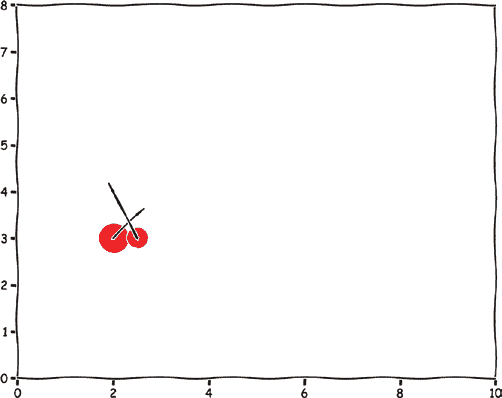

***图 4-7.** 两个球相互碰撞*

我们假设球非常坚硬，以至于两个球心之间的距离始终恰好等于它们的半径之和。我为这两个球选取了参数，如表 4-1 所示。

***表 4-1.** 两球参数：位置、半径、速度和质量*

| 参数 | 值               |
|-----------|---------------------|
| *υ*1      | (0.5, 0.5)          |
| *υ*2      | (-0.5, 1)           |
| *r*1      | 0.3                 |
| *r*2      | 0.2                 |
| *c*1      | (2,3)               |
| *c*2      | (2.5, 3)            |
| *m*1      | 3                   |
| *m*2      | 3                   |

让我们进行计算：

*υ*1' = *υ*1 - (2*m*2/(*m*1 + *m*2)) * ((*c*1 - *c*2) / |*c*1 - *c*2|) * ((*υ*1 - *υ*2) · (*c*1 - *c*2) / |*c*1 - *c*2|)


代入数值：

*υ*1' = (0.5, 0.5) - (2*3/(3+3)) * ((2,3)-(2.5,3) / |(2,3)-(2.5,3)|) * (((0.5,0.5)-(-0.5,1)) · ((2,3)-(2.5,3)) / |(2,3)-(2.5,3)|)

我们得到第一个球碰撞后的速度：

*υ*1' = (0.7, 0.5)

同理，我们可以计算球 2 碰撞后的速度。其速度为：

*υ*2' = (0.3, 1)

直观地看，速度向量如图 4-8 所示。

***图 4-8.** 两个球碰撞后的速度*

我们的结果是否符合动量守恒和能量守恒？这留给读者作为练习来验证。

现在，让我们重写渲染函数以处理多个球体。同时，是时候重写我们的代码，将球、盒子等对象表示为对象，并封装碰撞逻辑了。我之所以之前没有这样做，是因为我希望数学公式清晰易懂。现在这样做，可以使我们教程的下一部分干净简洁。

首先，我们创建 `Box`、`Ball` 和 `System` 类。我们将它们创建为 `dataclass`，因为我们希望利用自动生成的方法，如 `__init__` 和 `__repr__`。`Box` 类是最简单的。

```python
from dataclasses import dataclass

@dataclass
class Box:
    height: float
    width: float
```

接下来，我们创建 `Ball` 类，在其中实现碰撞处理的主要逻辑。请注意，这仅仅是前面数学公式的直接翻译。

```
@dataclass
class Ball:
    pos: [float, float]
    vel: [float, float]
    mass: float
    radius: float

    def update(self, acc = None, delta_t = 0.2) -> None:
        for i in range(len(self.pos)):
            self.pos[i] += self.vel[i] * delta_t
        if acc:
            for i in range(len(self.pos)):
                self.vel[i] += acc[i] * delta_t

    def detect_ball_collision(self, other) -> None:
        distance = np.sqrt((self.pos[0] - other.pos[0])**2 + (self.pos[1] - other.pos[1])**2)
        if self.radius + other.radius >= distance:
            self.ball_collision_update(other)

    def ball_collision_update(self, other)-> None:
        '''
        第 4 章 二维盒子中的球体：一个简单的物理引擎
        实现球碰撞逻辑，利用对称性。
        ball_1: self
        ball_2: other
        '''
        mass_factor_1 = 2*other.mass/(self.mass + other.mass)
        mass_factor_2 = 2*self.mass/(self.mass + other.mass)
        velocity_diff = [self.vel[0] - other.vel[0], self.vel[1] - other.vel[1]]
        center_diff = [self.pos[0] - other.pos[0], self.pos[1] - other.pos[1]]
        squared_center_diff = sum([diff**2 for diff in center_diff])
        velocity_factor = np.dot(velocity_diff, center_diff)/squared_center_diff
        self.vel[0] -= mass_factor_1 * velocity_factor * center_diff[0]
        self.vel[1] -= mass_factor_1 * velocity_factor * center_diff[1]
        other.vel[0] += mass_factor_2 * velocity_factor * center_diff[0]
        other.vel[1] += mass_factor_2 * velocity_factor * center_diff[1]

    def detect_box_collision(self, box: Box) -> None:
```

# 左墙

如果`abs(self.pos[0]-0) < self.radius`且`self.vel[0] < 0`：`self.vel[0] = -self.vel[0]`

`return`

# 右墙

如果`abs(box.width-self.pos[0]) < self.radius`且`self.vel[0] > 0`：`self.vel[0] = -self.vel[0]`

`return`

# 上墙

如果`abs(box.height-self.pos[1]) < self.radius`且`self.vel[1] > 0`：`self.vel[1] = -self.vel[1]`

`return`

# 下墙

如果`abs(self.pos[1]-0) < self.radius`且`self.vel[1] < 0`：`self.vel[1] = -self.vel[1]`

`return`

最后一部分是`System`类。它是一个容器，包含`Box`和`Ball`类，并管理它们之间的交互。我们还为其捆绑了一些有用的函数，例如渲染等。

```python
from typing import List

@dataclass
class System:
    box: Box
    balls: List[Ball]
    acc: float = None
    delta_t: float = 0.2

    def init_balls(self):
        raise NotImplementedError

    def update(self):
        # 球-球碰撞检测
        for idx_1 in range(0, len(self.balls)-1):
            for idx_2 in range(idx_1 + 1, len(self.balls)):
                self.balls[idx_1].detect_ball_collision(self.balls[idx_2])
        # 球-墙碰撞检测
        for ball in self.balls:
            ball.detect_box_collision(self.box)
        # 更新速度
        for ball in self.balls:
            ball.update(self.acc, self.delta_t)

    def render(self, save=False, file_name=None, return_array=False):
        with plt.xkcd():
            fig, ax = plt.subplots(figsize=(self.box.width, self.box.height))
        if return_array:
            from matplotlib.backends.backend_agg import FigureCanvasAgg
            canvas = FigureCanvasAgg(fig)
        ax.set_xlim(0, self.box.width)
        ax.set_ylim(0, self.box.height)
        for ball in self.balls:
            pos, vel, radius = ball.pos, ball.vel, ball.radius
            ball_patch = plt.Circle(pos, radius, color='r')
            ax.add_patch(ball_patch)
            ax.arrow(*pos, *vel, fc='k', ec='k')
        if save:
            plt.savefig("{}.png".format(file_name))
        if return_array:
            # 获取渲染器缓冲区视图
            canvas.draw()
            buf = canvas.buffer_rgba()
            # 转换为 NumPy 数组
            return np.asarray(buf)

    def generate_gif(self, file_name="multiple_ball_collision.gif", steps=100):
        with imageio.get_writer(file_name, mode='I') as writer:
            for _ in range(steps):
                system.update()
                image = system.render(return_array=True)
                writer.append_data(image)
```

让我们看看我们的双球系统是如何演变的，如 GIF 4-3 所示。如果您正在阅读纸质版，请务必在线查看动画。

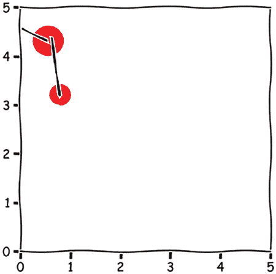

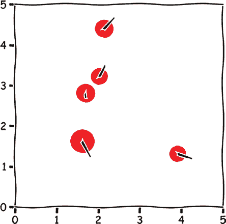

**GIF 4-3.** 两个球在盒子中碰撞运动

我们还可以生成一堆随机球，并观察它们如何演变，如 GIF 4-4 所示。

该实验的实现留给读者作为练习。下面是一个五球系统。请注意，球的大小与质量不成比例。你能猜出哪个球质量最大吗？

**GIF 4-4.** 盒子中具有随机半径、质量和速度的多个球

### 多球场景中的碰撞检测

现在，让我们解决一个显而易见的问题：碰撞检测的性能问题。

有许多成熟的碰撞检测算法；我们将讨论并实现其中一个最直观的算法：`扫描与剪枝`算法。

扫描与剪枝算法的思路非常直接。如果两个球碰撞，那么它们在 x 轴或 y 轴上的投影也必然重叠！因此，我们可以利用球的投影来预测它们是否碰撞，因为这是一个必要但不充分的条件。

扫描与剪枝算法的最大优点是，我们可以事先按球在某一轴上的投影进行排序。然后进行一次扫描就可以找到所有可能发生碰撞的球对。排序的时间复杂度为`O(n log n)`，这已经比朴素方法有了显著改进。还可以进一步优化。

现在，让我们实现该算法。我们只需要在`System`类中实现一个新方法，该方法仅负责返回可能碰撞的球对列表。

```python
def sweep_prune(self) -> List[Tuple[int, int]]:
    # 返回可能碰撞的球的索引列表
    self.balls.sort(key=lambda ball: ball.pos[0])  # <1>
    active_balls = []
    candidates = []
    for idx, ball in enumerate(self.balls):
        if not active_balls:
            active_balls.append(idx)
        else:
            closest_ball = self.balls[active_balls[-1]]
            if closest_ball.pos[0] + closest_ball.radius >= ball.pos[0] - ball.radius:  # <2>
                candidates.append((active_balls[-1], idx))
                active_balls.append(idx)
            else:  # <3>
                active_balls = [idx]
    return candidates
```

该算法执行以下三个步骤：

1. 球按照它们的 x 坐标原地排序。

2. 如果两个球在 x 轴上足够接近，则它们成为碰撞候选。

3. 否则，清空`active_balls`列表并将当前球添加到`active_balls`列表中，因为我们正远离之前的球投影簇。

我们还需要在`System`类的`update`方法中做一个小改动：使用`sweep_prune`来选择候选球对。

```python
def update(self):
    # 球-球碰撞检测
    candidates = self.sweep_prune()
    for pair_idx in candidates:
        self.balls[pair_idx[0]].detect_ball_collision(self.balls[pair_idx[1]])
```

# 其他内容均保持不变

现在，请尝试运行模拟。注意，如果禁用渲染，模拟运行速度会更快。在当前的例子中，渲染所花费的时间很可能远多于检测碰撞。

至此，本章内容已全部结束。在进入下一章之前，请尝试完成以下练习。

## 练习

1.  根据二维空间中的能量守恒和动量守恒，推导碰撞后速度的表达式。使用另一组参数验证碰撞后的速度计算是否符合动量守恒和能量守恒。

2.  编写一个程序，将一个包含 20 个小球的系统的总动能限制在给定值。验证整个模拟过程中动能是否保持不变。

3.  为包含五个小球的系统添加重力。

4.  如果每次与墙壁碰撞都会导致能量损失，结果会怎样？假设每次小球与箱壁碰撞都会损失`10%`的动能；运行一个模拟，并观察系统最终的状态。

## 总结

在本章中，我们探讨了物理规则模拟这一激动人心的话题。我们实现了一个检测碰撞的算法，并推导出了计算二维系统中小球碰撞后速度的公式。此外，我们还针对多球情况实现了一个更高效的碰撞检测算法。
