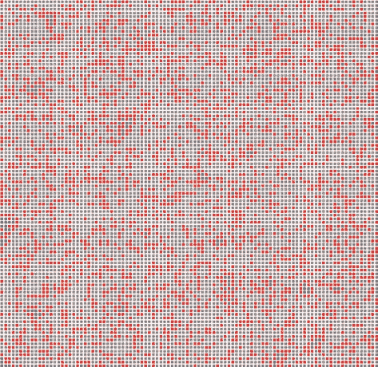
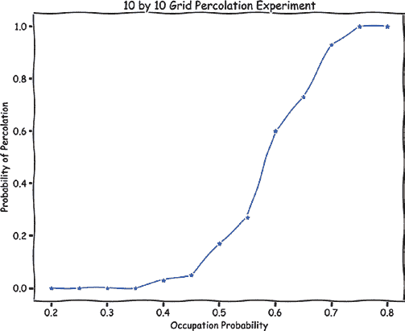
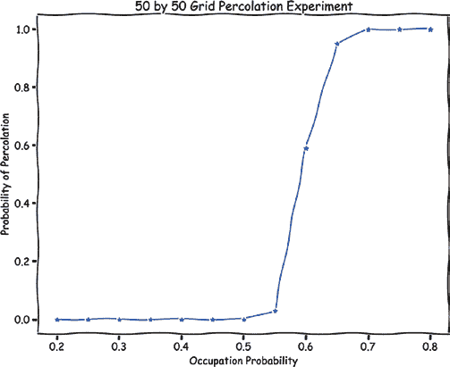
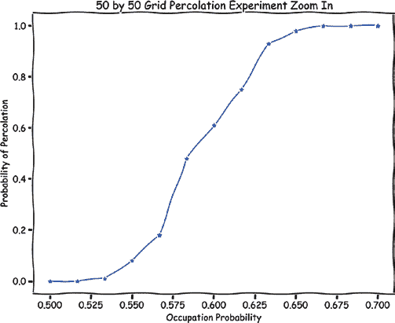
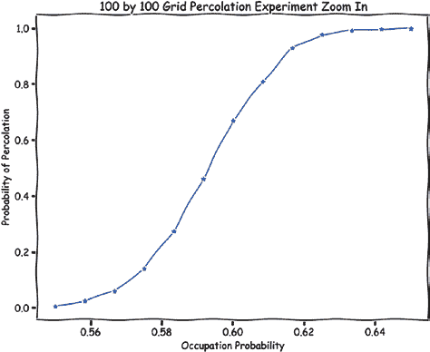
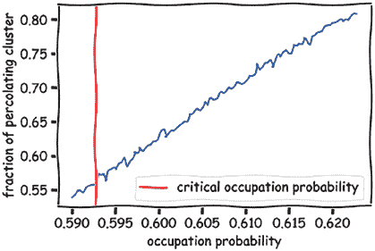
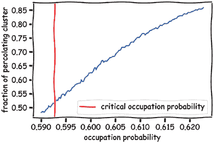
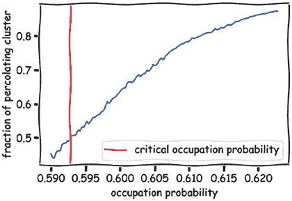

# 第 5 章：渗流、阈值与相变

一位科学家正在研究森林中野火的蔓延。她正在寻找一个简单的模型，能够在对森林、天气、气候等情况了解有限的前提下，预测一场野火的规模会有多大。例如，如果一个不负责任的游客在森林的某处丢弃了一个烟头，那么在最坏情况下，火灾规模的期望值是多少？平均规模又是多少？

另一位科学家正在研究计算机网络系统的稳健性。他正在寻找极端情况下的灾难恢复解决方案。假设网络瘫痪，管理员只有有限的资源来启动某些关键节点。这种情况下，网络能恢复到什么程度？在资源有限的情况下，应该优先启动哪些节点？

这两个问题看似无关，但实际上在`渗流`这一概念下具有高度相似性。渗流，或称渗流理论，是研究随机网络聚类行为的学科。该理论源于许多物理、化学和生物系统。例如，在水通过多孔材料的运动中，水能否渗透材料取决于材料的孔隙率。对于肌肉组织中的药物输运而言，药物分子的运动也可以建模为渗流过程。

回到森林火灾的问题上，如果我们假设森林是一个树木网络，而火势在树木间的蔓延由一个概率决定，那么森林火灾的预防问题就转化为确定渗流过程中火势蔓延的临界概率。对于网络恢复问题，可以优先启动的节点百分比同样可以建模为临界概率。

直观上，网络中不同节点的重要性不同，因此我们现在对网络情况进行了很大程度的简化。对网络更好的建模方法是使用图（graph），我们将在后续章节中重新讨论这一点。

© 李荣鹏 & 中野爱一郎 2022

R. Li 与 A. Nakano 著，《用 Python 进行模拟》，[`doi.org/10.1007/978-1-4842-8185-7_5`](https://doi.org/10.1007/978-1-4842-8185-7_5#DOI)

## 问题简介

理论上，聚类行为可以发生在任意维度的任何类型网络中。

最容易可视化的情况是二维情形，如图 5-1 所示。为简单起见，我们假设网络是一个方形网格/晶格。

**图 5-1.** 一个 10×10 的方形晶格

你在图 5-1 中看到的是一大小为 10×10 的方形网格。我们将每个红色方块称为一个位点，那么这个有限网格共有 100 个位点。每个位点有两种状态：被占用或未被占用。在我们的森林火灾案例中，树木要么在燃烧，要么是安全的。

现在，我将被占用的位点标记为蓝色，并重新绘制网格。我还可以使用键来连接相邻的被占用位点。网格的一种典型状态如图 5-2 所示。

**图 5-2.** 被占用位点相连的网格

注意，我还缩小了位点的大小，以便你更清晰地看到键。我们称这些相连的被占用位点为簇。在上述例子中，有一个大簇几乎遍及整个网格，除了右上角的三个位点。

正如你能联想到的森林火灾情景，这表明某处起火后，火势蔓延至整个网格。不过，右上角也有一些随机的零星小火，每处只烧毁了一棵孤立的树。

我们刚才展示的例子是位点渗流问题。还有一种类型称为键渗流问题，其中连通性是通过连接键（而非位点）来衡量的。为简单起见，本章我们只关注位点渗流问题。键渗流问题的模拟留作读者的练习。

继续之前，我想向你展示 `Grid` 类是如何定义的，以及网格是如何渲染的：

```python
from enum import Enum

class State(Enum):
    Working = 1
    Broken = 0

class Grid:
    state_to_color = {State.Broken: "red",
                      State.Working: "blue"}

    def __init__(self, width = WIDTH, height = HEIGHT, prob = PROB, random_init = False):
        self.width = width
        self.height = height
        self.prob = prob
        self.states = [[State.Broken for _ in range(self.height)] for _ in range(self.width)]
        if random_init:
            self.random_init()

    def random_init(self):
        for w in range(self.width):
            for h in range(self.height):
                if np.random.uniform() < self.prob:
                    self.states[w][h] = State.Working

    def render(self, return_array = False, block_size = 1300):
        with plt.xkcd():
            fig, ax = plt.subplots(figsize=(self.width+1, self.height+1))
            if return_array:
                from matplotlib.backends.backend_agg import FigureCanvasAgg
                canvas = FigureCanvasAgg(fig)
            ax.set_xlim(0,self.width+1)
            ax.set_ylim(0,self.height+1)
            ax.axis('off')

            # 绘制位点
            x, y, c = [], [], []
            # 注意 w,h 用于绘制坐标。
            for w in range(1,self.width+1):
                for h in range(1,self.height+1):
                    x.append(w)
                    y.append(h)
                    state = self.states[w-1][h-1]
                    c.append(Grid.state_to_color[state])
            plt.scatter(x, y, c = c, marker="s", s = block_size)

            # 在工作位点之间绘制键
            # 从左下角开始，向上和向右扩展连接
            for w in range(1,self.width):
                for h in range(1,self.height):
                    origin_state = self.states[w-1][h-1]
                    if origin_state == State.Working:
                        up_state = self.states[w-1][h]
                        if up_state == State.Working:
                            plt.plot((w, w), (h, h+1), c = Grid.state_to_color[State.Working])
                        right_state = self.states[w][h-1]
                        if right_state == State.Working:
                            plt.plot((w, w+1), (h, h), c = Grid.state_to_color[State.Working])

            # 顶边线
            for w in range(1,self.width):
                origin_state = self.states[w-1][self.height-1]
                right_state = self.states[w][self.height-1]
                if origin_state == State.Working and right_state == State.Working:
                    plt.plot((w,w+1),(self.height,self.height), c = Grid.state_to_color[State.Working])
```

# 右线

```python
for h in range(1, self.height):
    origin_state = self.states[self.width - 1][h - 1]
    up_state = self.states[self.width - 1][h]
    if origin_state == State.Working and up_state == State.Working:
        plt.plot((self.width, self.width), (h, h + 1), c=Grid.state_to_color[State.Working])
```

## 第五章：逾渗、阈值与相变

现在，让我们切入关键问题。给定可变的占据概率 `p` 以及格点（或键）之间的独立性，何时会有一个簇从网格顶部边缘渗流到底部边缘？

### 逾渗与临界概率

实际上，数学家们更关心另一个问题：对于一个无限大的簇，何时才能确定地形成一个无限簇？从模拟的角度来看，我们无法模拟无限大的网格，但可以通过回答前面那个更简单的问题来逼近这个难题。如果一个簇以 100% 的概率无法渗穿过网格，那么就不可能形成无限簇。

我们将这样的阈值概率称为 `pc`，其中 `c` 代表临界（critical）。

### 一维情况的解析解

虽然这本书是关于模拟的，但我还是想向你展示一维情况是如何解析求解的。

对于一维情况下的格点逾渗或键逾渗，临界概率 `pc` 均为 1。这很容易想象：在一维空间中，形成无限簇的路径有且仅有一条。因此，任何小于 1 的概率都会阻止无限簇的形成。

假设一个大小为 `L` 的簇存在的概率记为 `P(p, L)`，那么临界概率必须满足以下方程：

```
lim_{L→∞} P(p, L) = { 0  p < pc, 1  p > pc }
```

幸运的是，`P(p, L)` 的精确表达式很容易推导：

```
lim_{L→∞} P(p, L) = lim_{L→∞} p^L = { 0  p < 1, 1  p = 1 }
```

因此，我们的临界概率 `pc` 为 1。

从一维到二维，解析推导的难度急剧增加。事实上，数学家们花费了大约 20 年时间才获得并证明了二维方形网格键逾渗情况的临界概率的解析形式。哈里·凯斯滕证明，在二维方形网格中，键逾渗的临界概率恰好是 `1/2`。而格点逾渗的情况则众所周知难以推导。事实证明，我们只能通过运行模拟来估算它。这种方法你在[第 1 章](https://doi.org/10.1007/978-1-4842-8185-7_1)中已经见过。

### 二维情况的模拟

我们将分两步进行模拟。第一部分，我们编写一个函数来检测是否存在一个可以渗穿过网格的簇，并将其标记为灰色。我们的目标只是找到一个，因此一旦找到一个，就停止探索其他可能的簇。

第二部分，我们将多次运行模拟，以逼近临界概率 `pc`。

要发现渗流簇的存在，我们需要编写一个图遍历算法来遍历相邻的占据格点。有两种选择：一种是广度优先搜索，另一种是深度优先搜索。这里我实现了深度优先搜索算法。其思路是递归地访问邻居，直到访问完一条最长的可能路径，然后返回到上一轮递归中的另一条可能路径。

```python
def dfs(self, site, visited) -> None:
    visited.add(site)  # (1)
    (w, h) = site
    neighbors = [site for site in [(w - 1, h), (w + 1, h), (w, h - 1), (w, h + 1)] if self.filter_illegal_site(site)]
    for neighbor in neighbors:
        if neighbor not in visited and self.states[neighbor[0]][neighbor[1]] == State.Working:
            self.dfs(neighbor, visited)
```

接下来，我们编写另一个函数来完成寻找簇的主要工作。我们从网格的最底行开始，每当遇到一个占据的格点，就开始搜索簇。如果在搜索过程中，发现一个格点位于网格的顶部边缘，我们的任务就完成了。如果我们在底边找不到任何能通向渗流簇的格点，搜索也会结束。

```python
def percolate_through(self):
    clusters = []
    success = False
    for w in range(self.width):
        if clusters:
            all_visited = reduce(lambda x, y: x.union(y), clusters)  # (1)
        else:
            all_visited = set()
        if self.states[w][0] == State.Working and (w, 0) not in all_visited:
            clusters.append(set())
            self.dfs((w, 0), clusters[-1])
            latest_cluster = clusters[-1]
            if max([site[1] for site in latest_cluster]) == self.height - 1:
                success = True
                return clusters[-1], success
    return None, success

def filter_illegal_site(self, site):  # (2)
    (w, h) = site
    if w < 0 or w >= self.width:
        return False
    if h < 0 or h >= self.height:
        return False
    return True
```

我们还可以更新程序的其他部分，以便高亮显示渗流簇。以下是关键代码行。你可以在本书的在线网站上找到完整代码。

```python
class State(Enum):
    Working = 1
    Broken = 0
    Cluster = -1

class Grid:
    state_to_color = {State.Broken: "red",
                      State.Working: "blue",
                      State.Cluster: "gray"}
```


```python
def render(self, return_array=False, block_size=1300, percolating=False):
    if percolating:
        cluster, success = self.percolate_through()
        if success:
            for site in cluster:
                w, h = site
                self.states[w][h] = State.Cluster
```

请注意，该方法只应运行一次。深度优先搜索算法的正确性保证了如果存在渗流簇，就一定能发现一个。

好了，让我们运行一次模拟渲染，看看能否在不同的网格大小和占据概率下找到渗流簇。首先，尝试一个大小为 10×10、占据概率为 0.5 的网格：

```python
Grid(width=10, height=10, random_init=True, prob=0.5).render(percolating=True)
```

我们很幸运！确实存在一个渗流簇！图 5-3 中的灰色格点显示了渗流簇。

图 5-3. 包含渗流簇的网格




让我们再次运行代码；这次结果就没那么幸运了，如图 5-4 所示。

图 5-4. 不含渗流簇的网格

让我们尝试一个更大的 100×100 方形网格，占据概率为 0.7。结果如图 5-5 所示。

图 5-5. 包含渗流簇的 100×100 网格

希望你的眼睛还能受得了。这个渗流簇非常大，几乎包含了所有占据格点。你可能还会遇到递归深度错误；你可以通过设置 `sys.setrecursionlimit` 参数临时增加最大递归深度。

接下来，让我们运行一次模拟，看看能否缩小临界占据概率`pc`的值。首先，尝试一个大小为 10×10 的网格，占据概率从 0.2 到 0.8，步长为 0.05。总共有大约 13 个设置。我们将每个设置运行 100 次，以获得`pc`的概率，其中`L`是网格的大小。

```python
L = 10
ROUND = 100
p_clustering = []

for prob in np.linspace(0.2, 0.8, num=13):
    res = []
    for _ in range(ROUND):
        _, success = Grid(L, L, prob=prob, random_init=True).percolate_through()
        res.append(success)
    p_clustering.append(np.mean(res))

with plt.xkcd():
    fig, ax = plt.subplots(figsize=(10, 8))
    ax.plot(x=np.linspace(0.2, 0.8, num=13), y=p_clustering, marker="*")
    ax.set_xlabel("占据概率")
    ax.set_ylabel("逾渗概率")
```

# `ax.set_title("10x10 网格渗流实验")`

我们的结果应与直觉相符。当占据概率较低时，应完全看不到渗流团簇；当占据概率较高时，渗流概率应趋近于 1。可参见图 5-6 所示关系。





## 第 5 章 渗流、阈值与相变

`图 5-6.` 10x10 网格中渗流概率随占据概率的变化

在 0.5 到 0.6 之间，渗流概率似乎存在一个跃迁点。

现在我们将网格扩大至 50x50 并再次尝试。请注意，这可能需要更长的运行时间和更深的递归深度。结果如图 5-7 所示。

`图 5-7.` 50x50 网格中渗流概率随占据概率的变化





### 趋势分析

趋势变得更加明显。一旦超过约`0.6`的阈值，渗流团簇的形成几乎成为必然。现在，让我们聚焦`0.5`至`0.7`的范围进行放大查看。我们得到图 5-8。

`图 5-8.` 放大后的 50x50 网格

在进入下一节之前，我们针对 100x100 网格进行模拟，且每个占据概率数据点运行 1000 次。图 5-9 是我得到的结果。

`图 5-9.` 100x100 网格中渗流概率随占据概率的变化

### 临界概率估计

请注意，虽然曲线形状相似，但 x 轴范围更小：这也是一种放大可视化。我们对临界概率的估计越来越精确。可以清晰地看到，临界占据概率约为 0.6。

借助学术研究中更强大的模拟与计算能力，当前对正方形网格座渗流临界概率的估计约为`0.592746`。在后续内容中，我们将以此值作为*基准真值*。

### 练习

1. 实现用于团簇发现的广度优先搜索算法。

2. 实现一个算法，计算网格中最大团簇的大小，并将其与占据概率的关系绘制成图。请注意，你可能需要运行多次以获得有意义的统计数据。

### 二维网格渗流中的另一项有趣统计

如果我们回到最初的森林火灾问题，我们更关心的一个问题是火灾的严重程度，即渗流团簇的大小。

然而，在模拟中，我们通过改变网格大小来模拟无限大的网格。由于最大团簇的大小依赖于网格尺寸，因此无法直接计算。我们可以计算另一个值——比例`f`，即渗流团簇中占据点位的比例。随着占据概率增大，该比例应趋近于 1；但当占据概率从高于临界值的区间向临界概率趋近时，该比例应趋近于 0。

想象一个无限大的网格，如果占据概率仅略大于临界概率，则存在一个渗流团簇。尽管概率论告诉我们，这样的团簇在无限大网格中必然存在，但即使占据概率略小于临界值，也绝不会形成渗流团簇！你能想象这个团簇的样子吗？是的，它极可能非常蜿蜒曲折，虽然无限大，但几乎将自身置于所有占据点位之外。听起来矛盾，但事实如此。

### 比例计算方法

首先，我们实现一个计算该比例的新方法：

```python
def percolating_cluster_fraction(self):
    assert(self.percolated)
    total_occupied = sum([sum([h in (State.Cluster, State.Working) for h in row]) for row in self.states])
    cluster_size = sum([sum([h == State.Cluster for h in row]) for row in self.states])
    return cluster_size / total_occupied
```

接下来，我们运行模拟以评估该比例与占据概率之间的关系。我们使用 100x100、200x200 和 300x300 的网格进行模拟。从高于基准真值的位置开始，我们逐渐将占据概率降低至 0.59 左右，并对每个概率点运行 1000 次以获得平均值。

```python
L = 100
ROUND = 1000
TRUTH = 0.592746

fractions = []
probs = []
start = 0.622746
steps = 110
step = (start - TRUTH) / (steps - 10)

for i in tqdm(range(steps)):
    res = []
    prob = start - i * step
    probs.append(prob)
    for _ in range(ROUND):
        while True:
            grid = Grid(L, L, prob=prob, random_init=True)
            grid.percolate_through()
            if grid.percolated:
                frac = grid.percolating_cluster_fraction()
                res.append(frac)
                break
    fractions.append(res)
```





### 模拟结果与收敛性

然后我们可以估算出达到临界占据概率时的比例值。绘图代码较为简单故省略。我们得到图 5-10。

`图 5-10.` 100x100 网格中渗流团簇比例与占据概率的关系

嗯，这看起来不太理想，因为理想情况下比例应为 0；但我们得到的值约为`0.57`。我们尝试更大的 200x200 网格。得到图 5-11。

`图 5-11.` 200x200 网格中渗流团簇比例与占据概率的关系

200x200 网格尺寸下，在临界占据概率时我们得到的比例约为`0.52`。

请注意，该项模拟在我的 2019 款 MacBook Pro（16GB 内存）上运行了数小时。如果你有可以全天开机的机器，可以像我一样尝试 300x300 网格的模拟。我必须将`max recursion depth`设置为相当大的数值以避免递归错误。经过数小时的计算，我得到了图 5-12。



`图 5-12.` 300x300 网格中渗流团簇比例与占据概率的关系

我们成功在临界占据概率处使比例值达到了`0.5`，但距离理论值仍相去甚远。这个例子展示了模拟结果收敛有多难。在临界占据概率附近进行模拟的难度是众所周知的，因为我们正趋近于模拟中所说的*相变*。系统的属性在临界占据概率附近发生突变。我们使用的是较为朴素的方法进行模拟，且硬件性能也有限。这是预料之中的结果。不必感到沮丧。

### 练习

1. 你能推导出一维情况下比例作为占据概率函数的解析方程吗？

2. `percolate_through`方法在找到第一个潜在渗流团簇后会停止搜索。请评估两个不重叠的渗流团簇共存的概率有多大。

3. 对 100x100 网格进行键渗流模拟。同样绘制渗流团簇比例随占据概率变化的图。

### 总结

在本章中，我们研究了网格上的渗流模拟。这类模拟在数学和理论物理学中有着深厚根基。我们推导了一维情况下的解析解，并模拟了二维情况下越来越大的网格。我们还看到了一个令人*痛苦*的例子，说明有时模拟会变得极其困难。
