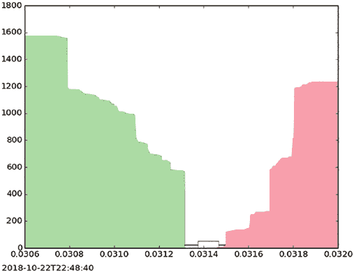

## 第 6 章 排队系统：股票交易如何达成

# 股票交易所模拟系统

股票交易所是一个迷人的系统，人们在其中交易股票并希望从交易中获利。在电子交易出现之前的旧时代，经纪人会聚在一起，通过互相喊叫来代表客户交易股票。如今，一切都变得电子化。散户投资者可以使用移动应用程序或网络应用程序进行交易。

在本章中，我们将构建一个系统来模拟股票交易所并可视化订单簿。此模拟的关键在于处理订单排队。例如，有些订单提交得早，而另一些则提交得晚但价格更低。在这种情况下，我们需要正确确定订单优先级。另一方面，我们还需要管理消息广播。在现实中，投资者可以看到由股票交易所广播的实时股票价格变化。

## 交易流程基础

首先，让我们分解交易流程，以确定应模拟哪些实体和流程。

一笔成功交易包含三个主要部分。首先，投资者向交易所发送订单。然后，`match engine`（撮合引擎）接收订单并尝试找到订单的对手方。例如，如果新卖单进入，`match engine`将尝试在排队订单中找到一个现有买单来匹配该新卖单。在接下来的第三步中，有两种可能性。如果成功找到匹配，交易将完成，交易成功的消息将广播给原始投资者，同时由于交易可能导致最新价格变化，市场上所有投资者也将获得新的价格。如果没有成功找到匹配，新卖单也将排队，直到未来有交易进入。投资者还可以请求撤销他们已排队的订单。

© Rongpeng Li and Aiichiro Nakano 2022

R. Li and A. Nakano, *Simulation with Python*，[`doi.org/10.1007/978-1-4842-8185-7_6`](https://doi.org/10.1007/978-1-4842-8185-7_6#DOI)

第六章 排队系统：股票交易是如何进行的

简而言之，我们需要模拟以下实体：

1. 投资者

2. `match engine`（撮合引擎）

当然，进一步拆分`match engine`也是有意义的，例如将一个部分专门负责匹配交易，另一个部分负责广播信息等。然而，为了简化，我们将把股票市场一侧的所有功能都打包到`match engine`实体中。

为了完全模拟交易过程，需要模拟以下四个过程：

1. 投资者向`match engine`发送订单。

2. `match engine`处理并尝试匹配交易。

3. 如果交易成功，`match engine`向原始订单提交者广播消息。

4. `match engine`向市场上的*所有人*广播最新价格。

由于篇幅限制，本章的重点是前两个部分。然而，你可以看出步骤 3 和步骤 4 只是步骤 1 的反向操作。我将把这两个部分留作本书末尾的练习。你会看到本章中有许多简化和假设。我将把所有这些问题留作练习，供你实现一个完整功能的系统。

## 订单簿

`match engine`跟踪订单的方式是维护一个*订单簿*。订单簿是一个动态的买单和卖单列表，由`match engine`不断更新。你可以将订单簿想象成两堆订单：所有买单在左边，所有卖单在右边。`match engine`尝试从买方和卖方中找到可交易的配对。

订单簿需要以所有市场参与者感到公平和平等的方式来维护。有一些原则需要被尊重。其中最重要的有两条。



第六章 排队系统：股票交易是如何进行的

首先，**卖单**中价格较低的订单优先级高于价格较高的订单。

同理，**买单**中价格较高的订单优先级高于价格较低的订单。然而，这仅适用于所谓的`限价单`。`市价单`较为特殊，因为它可以接受任意价格。例如，一个市价买单会从最低价格开始依次匹配卖单，直到买单中要求的股票数量全部成交，这可能会显著推高`市场价`（即所有参与者看到的价格）。

另一方面，还有`止损单`和`止盈单`。这类订单会在价格达到特定水平时被触发。例如，止损单会在价格跌至某一水平时执行以控制损失。本章不会涉及此类订单，但鼓励读者将其作为我们模拟系统的扩展来实现。

其次，如果价格相同，则先提交的订单优先级更高。请注意，原则上不会有提交时间完全相同的两个订单，因此总会有明确的顺序依据。

随着订单的不断涌入，订单簿会动态变化；某一价格水平上的订单数量被称为`深度`。深度越大，说明买卖该股票的意向越强烈。如前所述，价格越接近`市场价`的订单，其优先级高于远离市场价的订单。因此，订单簿始终呈现为深度快速变化的`山谷`形态。GIF 6-1 清晰地展示了这一点。

**GIF 6-1.** 订单簿深度动态变化

第 6 章 队列系统：股票交易如何达成 请注意，在实际交易中，如果订单尚未被撮合引擎执行，投资者可以随时请求撤销订单。不过，本章也不会实现这一部分。你可以尝试自行实现，它并没有你想象的那么困难。

## 创建接口并确定数据模式

好了！现在我们准备构建一个撮合引擎。首先，创建一个能够接收订单的`端点`。为此，我们将使用`flask`来构建一个简单的 API（应用程序编程接口）。API 向外部用户和其他程序公开特定功能。在本例中，我们的 API 只做一件事：接收传入的订单。

如果你之前没用过`flask`，下面是一个入门示例。

首先安装我们要使用的两个库：

```
pip3 install flask, requests
```

接着，用你喜欢的编辑器创建一个`engine.py`文件，复制并粘贴以下代码：

```
from flask import Flask

app = Flask(__name__)

@app.route('/submit', methods = ['GET'])

def process_order():

return '<h1>order received</h1>'

def main():

app.run(host='localhost', port=8080, debug=True)

if __name__ == '__main__':

main()
```

现在，在命令行中运行这个 flask `app`，输入：

```
python engine.py
```


第 6 章 队列系统：股票交易如何达成

你应该会看到以下信息。请注意，你的具体`调试器 PIN 码`可能与我的不同。

```
* Serving Flask app 'app' (lazy loading)
* Environment: production

WARNING: This is a development server. Do not use it in a production deployment.
Use a production WSGI server instead.

* Debug mode: on
* Running on http://localhost:8080/ (Press CTRL+C to quit)
* Restarting with stat
* Debugger is active!
* Debugger PIN: 374-303-372
```

我们刚刚创建了最简单的网页应用！如果打开浏览器并导航到`http://localhost:8080/submit`，你会看到如图 6-1 所示的消息。

**图 6-1.** 网站返回的“订单已收到”消息

非常酷！

不到十行代码，我们就创建了一个端点，通过`process_order`函数，用户可以访问并与我们的应用交互。我们的应用只做一件事：返回一些`字节`，浏览器会将其解释为一级标题的字符串。

这就是为什么你会看到这么大的字体。

请注意，`process_order` 函数有一个参数 `method`，所需的请求方法是 `GET`。这一设置规定了 `/submit` 端点所接受的请求方法。`GET` 方法只允许用户从该端点**获取**数据。如果用户尝试向该端点发送数据，请求将会失败，因为目前还不允许这样操作。

我们模拟的投资者（我通常称之为*机器人*）无法通过刷新浏览器来与我们的股票交易所进行交互。让我们看看能否用 Python 来实现这一点。现在，在另一个名为 `bot.py` 的文件中，复制并粘贴以下代码片段。在保持上一个终端中 `engine.py` 运行的同时，运行此代码。

```
import requests
from time import sleep

for i in range(10):
    res = requests.get('http://localhost:8080/submit')
    print(res.content.decode('utf-8'))
    sleep(1)
```

这里，我们使用 `requests` 库，以每秒一次的间隔，连续十次从 `engine.py` 应用程序中获取信息。

代码中的 URL 包含三部分。`http` 是协议名称，代表超文本传输协议。类似地，还有用于安全版本 http 和文件传输的 `https` 或 `ftp` 协议。`localhost` 是`主机名`（也称为`域名`），而 `8080` 是`端口号`。主机名和端口号共同定义了应用程序所在的`位置`。我们在启动 `engine.py` 文件时指定了主机名和端口号。路径 `/submit` 也是在 `process_order` 函数中指定的；它通常被称为`资源路径`。用户可以访问此路径来检索某些信息，这些信息被视作一种`资源`。

现在，让我们将这个基础示例改造成对撮合引擎模拟真正有用的代码。撮合引擎应该能够接收来自投资者（机器人）包含订单信息的`负载`。不过，我们首先需要弄清楚从投资者角度来看，负载中应包含哪些信息。

从投资者的角度来看，负载至少应包含订单类型（是市价单还是限价单）、订单规模（投资者计划买入/卖出的股票数量）以及订单方向（是买单还是卖单）。如果是限价单，则还需指定价格。

从股票交易所的角度来看，还需要时间戳和 ID。时间戳用于确定相同价格限价单的优先级。ID 用于标识订单，以便在订单被取消或执行时采取相应的操作。

通常，任何实体都需要 ID。为简单起见，我们将允许投资者/机器人自行设置 ID 并将负载发送给撮合引擎。ID 将通过 `id()` 方法加上随机数生成，因此在我们的模拟中不太可能出现冲突。另请注意，有时一个订单可能会被部分成交。我们也将实现部分成交的功能。

综上所述，来自投资者的负载应如下所示：

```python
from flask import Flask
from flask import request, jsonify
import json
import time

app = Flask(__name__)

@app.route('/submit', methods = ['POST'])
def process_order():
    order = request.get_json(force=True)
    order["submit_timestamp"] = time.time()
    print(order) # 用于测试
    return jsonify({"status": "received"})

def main():
    app.run(host='localhost', port=8080, debug=True)

if __name__ == '__main__':
    main()
```

请注意，我们导入了 `request` 和 `jsonify` 模块，用于处理 POST 过来的数据并向机器人发回确认信息。

为了适应这种变化，我们的 `bot.py` 增加了一个生成模拟订单的函数。现在它看起来是这样的：

```python
import requests
from time import sleep
import random
import json

def generate_order():
    return {
        "order_id": id(random.random()),
        "order_type":random.choice(["market", "limit"]),
        "order_size": random.randint(1, 100),
        "order_price": random.randint(1, 100), # 如果订单类型是市价单，此字段将被忽略
        "order_direction": random.choice(["buy", "sell"]),
    }

for i in range(10):
    order = generate_order()
    res = requests.post('http://localhost:8080/submit',
                        data = json.dumps(order))
    print(res.json())
    sleep(1)
```

### 实现订单簿逻辑

下一步是实现一个合适的数据结构来维护订单簿。我们将使用字典的列表形式来维护每一侧的订单。例如，在买单侧，我们将使用一个字典的列表来跟踪所有订单。

字典的键是订单价格。股票价格并非无限精确，这意味着存在最小变动单位。例如，每股价格要么是 1.5 美元，要么是 1.6 美元，而不会是 1.55 美元。这确保了字典中的键的数量总是可控的，因此对键进行排序就相当简单。

字典中的每个值是一个提交订单的列表。该列表的行为类似于队列，不允许取消订单，这样一来，如果市场上有合适的对手盘，较早的订单就能优先被撮合。

让我们来看看 `OrderBook` 类的代码以及相应的订单接收代码：

```python
from collections import defaultdict
import numpy

class OrderBook:
    def __init__(self):
        self.buy_orders = defaultdict(list)
        self.sell_orders = defaultdict(list)
        self.latest_ordr = None

    def receive_orders(self, order):
        if order["order_type"] == "market":
            order["order_price"] = np.inf if order["order_direction"] == "buy" else -np.inf
        # 愿意以极高的价格买入
        if order["order_direction"] == "buy":
            self.buy_orders[order["order_price"]].append(order)
        else:
            self.sell_orders[order["order_price"]].append(order)
        self.latest_order = order
        self.fulfill_orders()

    def fulfill_orders(self):
        raise NotImplementedError
```

你能看出我是如何实现市价单的吗？如果一个买单是市价单，我将可接受价格设为正无穷大。这意味着该买单可以接受任意高的价格。同样的道理也适用于市价卖单，卖单会接受任意低的价格来卖出。一旦价格确定，我们就简单地找到对应的字典值（即列表），并将新订单追加到其中。这就是 `defaultdict` 让代码更简洁的地方：如果列表尚不存在，`defaultdict` 会为我们创建一个空列表。

请注意，我们有一个未实现的函数叫 `fulfill_orders`。它负责实际执行订单，也是这段代码的关键。让我们来看看：

```python
def fulfill_orders(self):

    """


# 当该方法运行时，只会出现以下三种情况中的一种。

1.  有且仅有一笔市价单能与对手方挂单成交
2.  没有市价单
    - 2.1 没有匹配的对手方订单
    - 2.2 最新的限价单可以通过逐一满足对手方订单来成交

这三种情况互斥，因此我们将逐一处理。

## 第 6 章 排队系统：股票交易是如何进行的

```python

latest_order = self.latest_order.copy()

opposite_orderbook = self.buy_orders if latest_order["order_direction"] == "sell" else self.sell_orders

if latest_order["order_direction"] == "buy":

    opposite_prices = sorted(opposite_orderbook.keys())

else:

    opposite_prices = sorted(opposite_orderbook.keys(), reverse=True)

for opposite_price in opposite_prices:

    valid_buy = latest_order["order_direction"] == "buy" and opposite_price <= latest_order["order_price"]

    valid_sell = latest_order["order_direction"] == "sell" and opposite_price >= latest_order["order_price"]

    valid = (valid_buy or valid_sell) and latest_order["order_size"] > 0

    if not valid:
```

# 第 6 章 排队系统：股票交易是如何进行的

```python
        break

    for queued_order in opposite_orderbook[opposite_price]:

        if queued_order["order_size"] <= latest_order["order_size"]:

            latest_order["order_size"] -= queued_order["order_size"]

            if latest_order["order_direction"] == "buy":

                self.buy_orders[latest_order["order_price"]][-1]["order_size"] -= queued_order["order_size"]

            else:

                self.sell_orders[latest_order["order_price"]][-1]["order_size"] -= queued_order["order_size"]

            fill_size = queued_order["order_size"]

            queued_order["order_size"] = 0

        elif latest_order["order_size"] > 0:

            # print("最新订单不够大，无法完全吃掉当前排队订单")

            queued_order["order_size"] -= latest_order["order_size"]

            fill_size = latest_order["order_size"]

            # 标记最新订单已完全成交。

            latest_order["order_size"] = 0

            # 最新订单始终是最后一个。现在它已被耗尽，将其大小设为 0。

            if latest_order["order_direction"] == "buy":

                self.buy_orders[latest_order["order_price"]][-1]["order_size"] = 0

            else:

                self.sell_orders[latest_order["order_price"]][-1]["order_size"] = 0

        else:

            break

self.clean_limit_orderbook()
```

请注意，代码中的某些行相当长，但内联注释应该足以让你理解。基本上，分为三个步骤：

1.  首先，确定最新订单的方向，因为我们的订单簿只会且仅会被最新订单改变。
2.  方向确定后，检查是否存在可能的交易。如果最新订单是市价单，则无需检查对手方订单的价格；否则，我们需要确保存在价格重叠。例如，如果最新订单是买单，那么最低的卖单价格应不高于最新的买单价格。
3.  然后，我们按照提交时间顺序（从最早到最晚）遍历符合条件的对手方订单，以确保公平性，直到最新订单的成交量耗尽。另一种情况是，如果出现巨大的市价单，可能没有更多的对手方订单，但这种情况非常罕见。

根据上述逻辑，代码应该相当易于阅读。

为了清晰起见，我们还可以实现一个 `clean_limit_orderbook` 函数，在订单成交后运行。这可能不是必需的，但对于像 `print_orderbook` 这样的实用辅助函数很有帮助，其定义如下：

```python
def print_orderbook(self):

    print("-------------------Orderbook-------------------")

    for price in sorted(self.sell_orders.keys(), reverse=True):

        depth = sum(map(lambda order: order["order_size"], self.sell_orders[price]))

        print("sell side price: {}, depth: {}".format(price, depth))

    print("-----------------------------------------------")

    for price in sorted(self.buy_orders.keys(), reverse=True):

        depth = sum(map(lambda order: order["order_size"], self.buy_orders[price]))

        print("buy side price: {}, depth: {}".format(price, depth))

    print("\n")
```

最后，`clean_limit_orderbook` 函数的实现如下，相当直接：

```python
def clean_limit_orderbook(self):

    """

    移除限价订单簿中的无用键

    """

    for orderbook in [self.buy_orders, self.sell_orders]:

        empty_prices = []

        for price in orderbook.keys():

            new_orders = list(filter(lambda order: order["order_size"] > 0, orderbook[price]))

            if len(new_orders) == 0:

                empty_prices.append(price)

            else:

                orderbook[price] = new_orders

        for price in empty_prices:

            del orderbook[price]
```

## 将机器人和引擎连接起来

现在连接机器人和引擎非常简单。让我们修改 `engine.py` 文件来处理订单并构建订单簿：

```python
from orderbook import OrderBook

orderbook = OrderBook()

app = Flask(__name__)

@app.route('/submit', methods = ['POST'])

def process_order():

    order = request.get_json(force=True)

    order["submit_timestamp"] = time.time()

    orderbook.receive_orders(order)

    return jsonify({"status": "received"})
```

为了获得一个合理的订单簿结构，我们还需要更改订单类型的频率。如果市价单太多，订单簿会很快被耗尽，而不会呈现出山谷状结构。因此，让我们修改 `bot.py` 文件中 `generate_order` 函数的一行代码：

```python
"order_type": random.choice(["market", "limit", "limit", "limit", "limit",

                             "limit", "limit", "limit", "limit", "limit"]),
```

基本上，我们声明了百分之九十的订单将是限价单。

通过此设置，我们可以提交 1000 个订单，并在模拟结束时通过调用 `print_orderbook` 方法来打印订单簿；你将看到类似如下的输出：

```
-------------------Orderbook-------------------

sell side price: 100, depth: 816
```

# 第 6 章 排队系统：股票交易如何进行

```
sell side price: 99, depth: 1511
sell side price: 98, depth: 1325
sell side price: 97, depth: 1063
sell side price: 96, depth: 1262
sell side price: 95, depth: 1314
sell side price: 94, depth: 1227
sell side price: 93, depth: 1350
sell side price: 92, depth: 1392
sell side price: 91, depth: 1105
sell side price: 90, depth: 722
sell side price: 89, depth: 1260
sell side price: 88, depth: 716
sell side price: 87, depth: 922
sell side price: 86, depth: 809
sell side price: 85, depth: 1040
sell side price: 84, depth: 1066
sell side price: 83, depth: 1038
sell side price: 82, depth: 943
sell side price: 81, depth: 1312
sell side price: 80, depth: 605
sell side price: 69, depth: 12
sell side price: 64, depth: 23
sell side price: 63, depth: 39
sell side price: 43, depth: 84
sell side price: 31, depth: 80
buy side price: 30, depth: 55
buy side price: 28, depth: 67
buy side price: 22, depth: 72
buy side price: 21, depth: 189
buy side price: 20, depth: 63
buy side price: 19, depth: 71
buy side price: 18, depth: 154
buy side price: 16, depth: 213
buy side price: 15, depth: 390
buy side price: 14, depth: 413
buy side price: 13, depth: 649
buy side price: 12, depth: 841
buy side price: 11, depth: 900
buy side price: 10, depth: 1068
buy side price: 9, depth: 982
buy side price: 8, depth: 1477
buy side price: 7, depth: 748
buy side price: 6, depth: 1271
buy side price: 5, depth: 1704
buy side price: 4, depth: 1514
buy side price: 3, depth: 1511
buy side price: 2, depth: 956
buy side price: 1, depth: 1102
```

很明显，当前市场价格附近的深度要小得多。可视化工作留作练习，详见下一节。

## 练习与扩展思路

在本节中，我将提出五个可显著扩展股票交易所功能的思路。它们按难度排序。

### 多机器人

在我们的模拟中，我们只使用了一个机器人，所以基本上是在与自己交易，这毫无意义。你可以扩展订单的数据模式，新增一个名为`bot_id`或`investor_id`的字段，以便只有不同的机器人才能相互交易。

请注意，机器人的 ID 需要是一个有限的集合。你可以模拟套利场景，即一个机器人可以同时提交买入订单和卖出订单，以从价格波动中获利。

### 知情机器人

聪明的投资者不会盲目交易。他们需要了解当前的*市场价格*才能做出明智的决策。撮合引擎可以将最新价格发送给一个外部的*监控器*，这样每个机器人都能查看它。

### 订单簿可视化

`print_orderbook`方法还不够好。让我们用一个新的`visualize_orderbook`方法来替代它。你能把它做成动画吗？

### 支持取消订单

让我们支持订单取消功能。如果一个机器人请求取消订单（也许是通过一个名为`/cancel`的不同的*资源路径*），撮合引擎应该能够快速定位该订单，并将其从该价格对应的队列中移除。你能想到一种高效实现此功能的方法吗？

### 支持止损订单

既然已经支持取消订单，为什么不更进一步，支持止损订单呢？如果机器人提交了一个止损订单，撮合引擎只有在价格触及止损线时才会执行该订单。请自行研究，并高效、公平地为所有市场参与者实现此功能。

## 总结

在本章中，我们研究了一个排队系统。这样的模拟不仅涉及技术层面，也涉及社会层面。撮合引擎应当基于一套规则来运行，以强制执行公平性。

---
