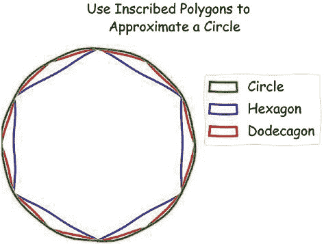

# 引言

这本书是送给年少时的我——大概是高中甚至更早时期的一份小礼物。这本书绝非为经验丰富的研究者或专业人士所写。它应当被视作第一口令人意犹未尽的冰淇淋。

本书涵盖多个科学仿真主题，涉及物理、生物甚至金融领域。写作风格非常温和，对新手友好。我尽力移除那些本可凭借已有知识和科学训练来理解的复杂内容，反而在每个主题中保留了最核心的精髓。我脑海中设想的人物形象是一位充满好奇心的年轻学生——他刚拥有第一台电脑，并可能从哥哥那里学到了一些基础编程知识。这位学生（正如年少时的我）将能毫无困难地跟上本书内容，并为美丽的可视化效果和科学结论感到惊叹。

本书各个主题相对独立。根据技术难度和所需背景知识，我将各章节分为三组。读者可以从任意章节开始阅读。

**简单：**

- 第 1 章：用蒙特卡洛模拟计算圆周率π
- 第 4 章：二维盒子中的小球，一个简单的物理引擎

**中等：**

- 第 2 章：马尔可夫链，窥探未来的一瞥
- 第 3 章：多臂赌博机、概率模拟与贝叶斯统计
- 第 7 章：石头、剪刀、布：多智能体模拟
- 第 8 章：疾病传播，模拟 COVID-19 疫情爆发
- 第 9 章：错误信息传播与图上的模拟

**困难：**

- 第 5 章：渗流、阈值与相变
- 第 6 章：排队系统：股票交易是如何进行的

希望你们能像我一样享受这本书。

xv

## 第 1 章  
**用蒙特卡洛模拟计算圆周率π**

### 背景

当波兰裔美国数学家、核物理学家斯坦尼斯瓦夫·乌拉姆在 20 世纪 40 年代发明并系统阐述了现代蒙特卡洛方法时，他和同事们将其命名为“蒙特卡洛”，因为乌拉姆的叔叔经常借亲戚的钱去摩纳哥的蒙特卡洛赌场赌博。斯坦尼斯瓦夫·乌拉姆和其他许多杰出科学家当时正致力于如今被称为“曼哈顿计划”的秘密核武器项目。蒙特卡洛方法被用来编程模拟核反应。在某种程度上，蒙特卡洛方法塑造了我们今天所看到的世界。

在定理或算法获得学术上的正式名称之前，它们常常已被充满好奇心的先驱们通过有趣的、基于示例的方法研究过了。让我们从一个故事开始。

### 智者竞赛

假设在 16 世纪的某一天，在中东的某个地方，一位国王给他王国中最聪明的两位智者（包括你）24 小时时间，要求用最优雅的方式计算出π的值。国王慷慨地承诺提供你想要的任何合理资源。

π是圆的周长与直径的比值。通常，我们也称圆的周长为**C**，如图 1-1 所示。

© 李荣鹏与中野爱一郎 2022

R. Li 和 A. Nakano，《用 Python 进行仿真》，[`doi.org/10.1007/978-1-4842-8185-7_1`](https://doi.org/10.1007/978-1-4842-8185-7_1#DOI)


***图 1-1.** 圆的符号表示*

你的对手要了王国里最好的纸张、细绳和直尺。国王宣布竞赛后，他立即开始分割圆。他的方法与大约 1000 年前中国数学家**祖冲之**使用的方法相同。

嗯，在 16 世纪，微积分还没被发明出来。聪明的你打算怎么办？你可不会坐以待毙，让对手获胜！相反，你向国王要了 1000 人来帮你计算。你还索要了足够多的细沙粒、10 英寸乘 10 英寸的普通纸张、直尺和细绳。国王好奇地慷慨批准了你的请求。

### 通过撒沙粒估算π

现在，你手下有 1000 人听候你的命令。你将这样做：你让每个人在方形纸上画一个最大的内接圆。之后，让他们将*1000*颗沙粒*随机地*撒在纸上。每个人都需要仔细计数并记录落在圆内的沙粒数量。当然，沙粒可能意外落到纸张外面。如果是这样，这个人需要重新撒，直到全部 1000 颗沙粒都落在纸上为止。

国王感到困惑。而你显得胸有成竹，因为你知道你的国王并不精通数学——就像本书的大部分读者一样——并且很容易对枯燥的方程式感到厌烦。而你的对手有一堆几何学上的胡言乱语要向国王解释。



你的对手正在用多边形的周长来逼近圆。正如你从图 1-2 中所见，随着边数的增加，对周长进行分割变得明显繁琐起来。

***图 1-2.** 用多边形逼近圆*

你注意到，你的对手总是会得到一个低于真实周长的值，因为这些多边形是内接的，意味着它们始终位于圆内。为了得到一个所谓的上界，你的对手还必须使用外切多边形。

另一方面，你所要做的就是坐在那里，从容地向国王解释你的方法之美。你所做的其实正是一场*蒙特卡洛模拟*。

你只需等待手下送来越来越多的数据，直到一天结束。

角色扮演先到此为止，让我们来探究一下，为什么让 1000 个人反复撒下 1000 颗沙粒，就能得到一个相当不错的π估计值。

记住，π不仅描述了直径与周长之间的关系，也描述了半径**R**与圆的面积**A**之间的关系。这里，**C**是周长，**D**是直径：

**C** = π **D**

**A** = π **R**² = π **D**² / 4

现在，假设一颗沙粒随机落在正方形上，这颗沙粒落在圆内的概率是多少？嗯，这很明显：它是圆的面积与正方形的面积**S**之比。只要存在良好的*随机性*，这个比值必然也是我们正在寻找的概率。

等等，我们还有用π表示的面积**A**的表达式，对吧？如果我们代入会怎样？让我用\( P(\text{沙粒在圆内}) \)来表示沙粒落在圆内的概率。我们有以下表达式：

\[
P(\text{沙粒在圆内}) = \frac{\text{圆的面积}}{\text{正方形的面积}} = \frac{A}{S} = \frac{\pi D² / 4}{D²} = \frac{\pi}{4}
\]

惊喜！这个概率并*不*依赖于正方形的大小。唯一的问题是，这个美妙的结论仅在理论上是正确的；我们必须通过采样来估计这个概率。这就是为什么扮演智者的你，索要了大量沙粒和 1000 名眼尖心细的人来重复这些实验。每个实验都会给出一个π值，到了这一天结束时，我们可以取所有实验结果的平均值。


```python
import random

import numpy as np

random.seed(2021)

pi_values = list()

num_persons = 1000

num_rounds = 20

num_grains = 1000

edge = 10

for r in range(num_rounds):

    for p in range(num_persons):

        in_circle = 0

        for g in range(num_grains):

            x, y = (random.random() - 0.5)*edge, (random.random() - 0.5)*edge

            if x**2 + y**2 <= (edge/2)**2:

                in_circle += 1

        pi = in_circle/num_grains * 4

        pi_values.append(pi)

print(np.mean(pi_values))
```

以下是执行模拟的 Python 代码。别担心，我会逐行解释。随着你对本书风格的熟悉，未来一些较为琐碎的内容将会略过。

这段代码模拟了 1000 个人的撒豆行为，假设每人每天可以进行 20 次实验。对于每一粒撒下的豆子，我们使用 `random.random()` 函数计算其坐标。此处，我们假设圆心位于原点。

为了确保结果在你的电脑上可重现，我将*随机种子*设置为 2021。我们在计算机科学中见到的几乎所有随机性都称为伪随机性。它们并非完全随机，正如那位智者的 1000 个人不会真正均匀地在纸上撒豆子。不过，对于 Python 编程而言，在几乎所有情况下，你都可以信任内置随机数生成器的高水平随机性。不过，本书中并非所有模拟都设置了随机种子。

`random.random()` 函数会返回一个介于 0 和 1 之间的随机变量。请参考图 1-3 的可视化展示，以了解 1000 个 `random.random()` 结果的分布情况。这种分布有一个名称：*标准均匀分布*。

**图 1-3.** 1000 个介于 0 和 1 之间的随机生成数的分布

生成该可视化效果的对应代码如下：

```python
random.seed(2021)

fig, ax = plt.subplots()

ax.hist([random.random() for _ in range(1000)], bins=10, rwidth=0.9)

ax.set_title("Histogram of 1000 random.random() results")
```

接下来，让我们在图 1-4 中展示无限种可能的 1000 粒撒豆结果中的一种可能形态。

**图 1-4.** 正方形中的 1000 粒撒豆

代码如下：

```python
random.seed(2021)

edge = 10

num_grains = 1000

with plt.xkcd():

    fig, ax = plt.subplots(figsize=(6, 6))

    # plt.axis("off")

    plt.axis("equal")

    ax.set_xlim(-edge/2, edge/2)

    ax.set_ylim(-edge/2, edge/2)

    xs_in, ys_in = list(), list()

    xs_out, ys_out = list(), list()

    for g in range(num_grains):

        x, y = (random.random() - 0.5)*edge, (random.random() - 0.5)*edge

        if x**2 + y**2 <= (edge/2)**2:

            xs_in.append(x)

            ys_in.append(y)

        else:

            xs_out.append(x)

            ys_out.append(y)

    ax.scatter(xs_in, ys_in, color="r")

    ax.scatter(xs_out, ys_out, color="b")

    circle = plt.Circle((0, 0), edge/2, fill=False, color="g", lw=3)

    ax.add_patch(circle)

    ax.set_title("An experiment with 1000 sprinkled grains", fontsize=20)
```

从可视化中我没有看到任何令人担忧的聚集或偏差，你呢？这意味着存在良好的*随机性*，因此我们使用面积比来逼近 π 的方法是有效的。接下来，让我们绘制这 20K 个 π 值的直方图，看看结果的分布情况。我们得到了图 1-5。

**图 1-5.** 20,000 个计算所得的 π 值的分布

请注意，*平均值*和*中位数*非常接近，因此图中仅绘制了中位数。得到此可视化效果主要有三点：

1.  *平均值*和*中位数*都非常接近 π 的真实值。这是个好迹象，因为这说明我们的数据没有被大的异常值所扭曲。
2.  四分位数是将数据分成等数量段的值。第一四分位数为 3.104 表示 25% 的结果小于 3.104。同理，25% 的结果大于 3.176。
3.  标准差（STD），由水平误差线表示，表示某个结果与样本平均值的平均偏差。标准差约为 0.052。

样本标准差的计算公式如下：

```
STD = sqrt( (1/(N-1)) * sum_{i=1}^{N} (x_i - x̄)² )
```

其中，`x̄` 表示样本的平均值，`N` 是样本总数。标准差量化了我们对结果的置信程度。通常，标准差越小，结果越集中在平均值附近；因此，我们对结果也越有信心。

你可能也注意到了直方图的优美曲线。这背后是有原因的。这里简单剧透一下：模拟出的 π 值的分布遵循所谓的正态分布。这是著名的*中心极限定理*（CLT）的推论。其核心思想是，在一系列相当宽松的条件下，我们在自然界中观测到的量往往呈钟形曲线分布。这些量包括一个相当大的人群的体重、森林中树叶的长度等。

生成上述可视化效果的代码片段如下：

```python
with plt.xkcd():

    fig, ax = plt.subplots(figsize=(12, 6))

    ax.hist(pi_values, bins=50, rwidth=0.8)

    pi_mean = np.mean(pi_values)

    pi_median = np.median(pi_values)
```


