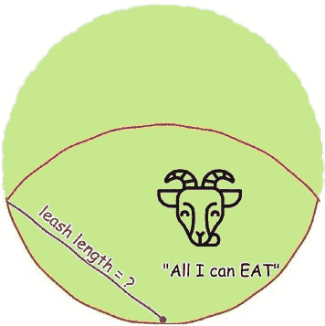
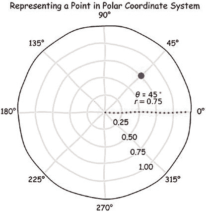
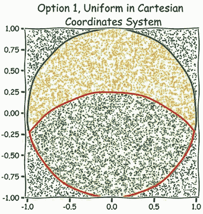
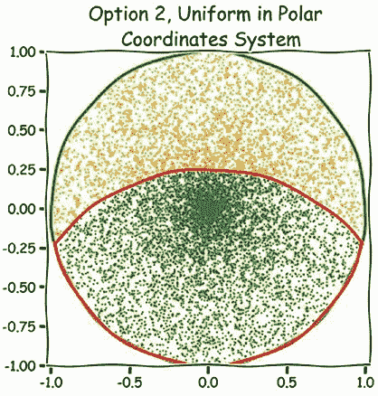
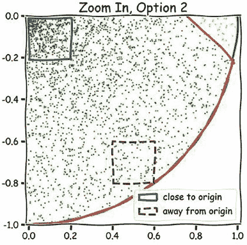

# `pi_mean` 和 `pi_median` 非常接近。图中仅绘制了中位数。

## 第 1 章 使用蒙特卡洛模拟计算 π

`pi_std = np.std(pi_values)`

`pi_quartiles = np.quantile(pi_values, [0, 0.25, 0.5, 0.75, 1])`

`ax.set_title("撒沙粒实验结果统计", fontsize=20)`

`line_1 = ax.axvline(pi_mean, color='red', lw=1)`

`line_2 = ax.axvline(pi_quartiles[1], color='purple', lw=3, linestyle="dotted")`

`line_3 = ax.axvline(pi_quartiles[3], color='green', lw=3, linestyle="dashed")`

`std_bar = ax.errorbar(pi_mean, 1200, xerr=pi_std, capsize=5, elinewidth=3, markeredgewidth=2, linestyle=":")`

`ax.legend([line_1, line_2, line_3, std_bar], ["中位数 = {}".format(pi_median), "第一四分位数 = {}".format(pi_quartiles[1]), "第三四分位数 = {}".format(pi_quartiles[3]), "标准差 =\n {}".format(round(pi_std, 3))], fontsize=18)`

回到角色扮演的场景中，在你的对手能够产生一个四位有效数字（例如 `3.1416`）之前，他会发现他的笔太粗了，无法进一步细分圆。而你呢，则可以将早期结果呈献给国王。随着你的手下不断报告新结果，你对结果的信心也会随之增加。

在进入下一小节（该小节中，蒙特卡洛模拟比精确解析解早了 200 多年）之前，我为你准备了一些练习，以加深你对蒙特卡洛模拟的理解。你可能需要利用 `numpy` 库的向量化计算来加速运算。

## 第 1 章 使用蒙特卡洛模拟计算 π

### 练习

1.  验证模拟结果确实不依赖于正方形边长这一事实。

2.  假设国王对你的模拟方法着迷。现在你有一百万人可供调遣进行计算。请利用 `numpy` 的向量化计算来执行模拟。

    同时进行统计计算。你发现了结果数量与标准差之间的关系吗？你能绘制出这两个值之间的关系图吗？

3.  你能使用蒙特卡洛模拟计算五维单位球的体积吗？注意，这个问题是刻意模糊的。请做一些研究并享受探索的过程。

### 圈住山羊！

希望你享受了 16 世纪的中东冒险之旅。现在，让我们穿越到 19 世纪的大不列颠。你作为一名牧羊人，遇到了一个需要解决的问题。

你拥有一块奇特的圆形土地。嗯，它必须是圆形的；否则就不好玩啦！你还有一只非常顽皮的山羊，它必须被拴住。否则，它会吃掉够得着的一切东西，并造成拥堵问题。

现在，你需要将牵引绳的一端固定在圆形围栏的某一点上；牵引绳需要多长，才能使山羊恰好能够到你一半的土地呢？图 1-6 是该问题的可视化示意图。为简化起见，我们可以将你的土地半径设为 `1`。



## 第 1 章 使用蒙特卡洛模拟计算 π

***图 1-6.** 一只被拴住的山羊被限制在圆形围栏内*

这个问题就是所谓的内部放牧问题。它已经为人所知 200 年了，但其解析解直到 2020 年初才被发现。

```
⎛
⎞
1 ∫
*z*
*z z*
*z*
*dz*
*z*− / sin cos
/
3 /8 =
(
−
−π 2)
γ
π
π
=
⎜ √
/4
cos
⎟.
⎜ 2 ∫
( *z z z* −π 2) *dz* ⎟
⎝
*z*
1/ sin − ccos
/
− π
3 /8 π
= /4
√
⎠
```

然而，利用我们刚刚讨论的蒙特卡洛模拟，你只需编写几行 Python 代码就能计算出牵引绳的长度。

其基本思路与撒沙粒的方法相同。首先，你在土地内部生成一个均匀分布的随机点；然后，给定一个牵引绳长度，检查山羊是否能到达那个点。经过足够多的采样后，如果山羊能够到达超过一半的面积，就缩短牵引绳；否则，就加长它。我们可以重复这个过程，直到达到所需的精度。


您可能已经注意到，前面的方法在计算上并非最优。更好的方法是首先生成足够的点，然后再确定绳子的长度。我们之后将以此改进方式来进行计算。

**什么是随机性？**

等等，这里存在一个歧义。很容易想象一个正方形内的均匀分布随机点：你只需让它在一条边上均匀分布，并在另一条边上也均匀分布即可。然而，一个圆内的均匀分布随机点意味着什么？你又要如何生成成千上万个这样的点？



## 第 1 章 使用蒙特卡罗模拟计算圆周率 π

你有两个选择：

1.  你只关心一个圆，但你使用恰好外接该圆的正方形来完成工作。你仍然在正方形内生成均匀分布的点，但丢弃那些落在圆外的点。只使用落在圆内的点进行计算。这确实保证了同样的均匀性，但轰鸣的 CPU 可能不会高兴，因为只有大约 `78.5%` 的工作得到了回报。
2.  另一个选择是使用极坐标，如图 1-7 所示。首先，你在 `0` 与你的地块半径（例如，`R`）之间生成一个均匀分布的半径，然后在 `0` 度到 `360` 度之间生成一个均匀分布的弧度值。点的位置也是唯一确定的。

**图 1-7.** 极坐标系也可以唯一地定义一个二维平面上的点

在前面说明的例子中，二维空间中的一个点由一对值 (`θ`, `γ`) 唯一确定，其中 `θ` 是该点相对于 `θ = 0` 线（由虚线表示）逆时针旋转的角度。`γ` 是该点与原点之间的距离。`θ` 取值在 `0°` 和 `360°` 之间，而 `γ` 可以是任何正数。

## 第 1 章 使用蒙特卡罗模拟计算圆周率 π

普通笛卡尔坐标与极坐标之间的转换可以使用以下公式获得：

`x = γ cos θ`
`y = γ sin θ`
`γ² = x² + y²`

以下是用于极坐标系演示的代码片段。它将让你很好地了解如何用极坐标操作对象：

```python
from matplotlib.patches import Arc

with plt.xkcd():
    fig, ax_polar = plt.subplots(figsize=(6, 6),
                                 subplot_kw={'projection': 'polar'})
    ax_polar.set_rmax(1)
    ax_polar.set_rticks([0.25, 0.5, 0.75, 1],)
    ax_polar.set_rlabel_position(-60)
    ax_polar.grid(True, linewidth=3, alpha=0.4)
    ax_polar.set_axisbelow(True)
    ax_polar.plot([0, 0], [0, 1.2], lw=3, color="red",
                  linestyle="dotted")
    ax_polar.scatter([np.pi/4], [0.75], s=120, color="blue")
    ax_polar.text(np.pi/7, 0.5, r"$\theta$ = $45^\circ$")
    ax_polar.text(np.pi/12, 0.45, r"$r = 0.75$")
    ax_polar.set_title("在极坐标系中表示一个点", fontsize=20)
```

现在，你会选择哪个选项？它们听起来都挺合理的，不是吗？让数据说话吧。以下代码片段使用两种方法在圆内生成 `10,000` 个随机点。让我们通过可视化生成的点的分布来找出答案。



## 第 1 章 使用蒙特卡罗模拟计算圆周率 π

将绳子长度设为 `1.25`，选项 1 给出了图 1-8。

**图 1-8.** 使用笛卡尔坐标采样的结果

表 1-1 中的统计数据告诉我们，有多少点会因为落在圆外而不会被使用，以及有多少点能被山羊到达等。

**表 1-1.** 笛卡尔坐标系采样中每个区域的点的数量

| **圆外点** | **不可达点** | **可达点** |
| :--- | :--- | :--- |

如果选项 1 是正确的，这实际上意味着 `1.25` 可能太长了。并且大约 `20%` 的 CPU 时间被浪费了。

让我们看一下选项 2 产生的结果，如图 1-9 所示。



## 第 1 章 使用蒙特卡罗模拟计算圆周率 π

**图 1-9.** 使用极坐标采样的结果

如果选项 2 是正确的，我们没有浪费 CPU 时间，但统计数据看起来令人担忧。

我统计了表 1-2 中的数字。

**表 1-2.** 极坐标系采样中每个区域的点的数量

| **圆外点** | **不可达点** | **可达点** |
| :--- | :--- | :--- |

用于绘图的源代码太长，因此省略。然而，它们应该很容易复现。

好吧，看看这些点的散点图；哪一个看起来更随机？很明显，选项 1 展示了比选项 2 更高水平的随机性。如果我们放大选项 2 的结果，这一点就更加明显了，如图 1-10 所示。



## 第 1 章 使用蒙特卡罗模拟计算圆周率 π

**图 1-10.** 放大极坐标系的结果后，密度不均变得清晰

两个方形区域显然包含不同数量的点。更靠近原点的那个包含更多的点，而离原点更远的那个包含更少的点。

原因是，如果你对坐标系进行变换，均匀分布将会失真。尽管这些点在极坐标方面是均匀分布的，但使用三角公式进行的变换扭曲了它们，使得它们在笛卡尔坐标中不再是均匀分布的。这无疑敲响了警钟。

以下代码片段将使用二分法估算绳子的长度。当然，你可以改变绳子另一端的位置，但我们还是坚持使用地块左下角的简单位置。注意，我们将使用选项 1 的结果，因为它是正确的模拟。

二分法是一种求根方法。在这里，我们只是借用这个思想。

因为随着绳子长度的增加，可达点的数量单调增长。假设我们从范围 `[0, 2]` 开始寻找长度，并从中间点 `1` 开始；如果超过一半的点是可达的，我们开始在 `[0, 1]` 中搜索，并从新的中间点 `0.5` 开始。同理，如果少于一半的点是可达的，我们选择 `1.5` 作为新的中间点，并在范围 `[1, 2]` 中搜索。迭代继续，直到满足停止条件。

```python
## 第 1 章 使用蒙特卡罗模拟计算圆周率 π

random.seed(2021)

num_points = 10000
num_valid_points = 0
xs, ys = list(), list()

for g in range(num_points):
    x, y = (random.random() - 0.5)*2, (random.random() - 0.5)*2
    if x**2 + y**2 <= 1:
        xs.append(x)
        ys.append(y)
        num_valid_points += 1
```


