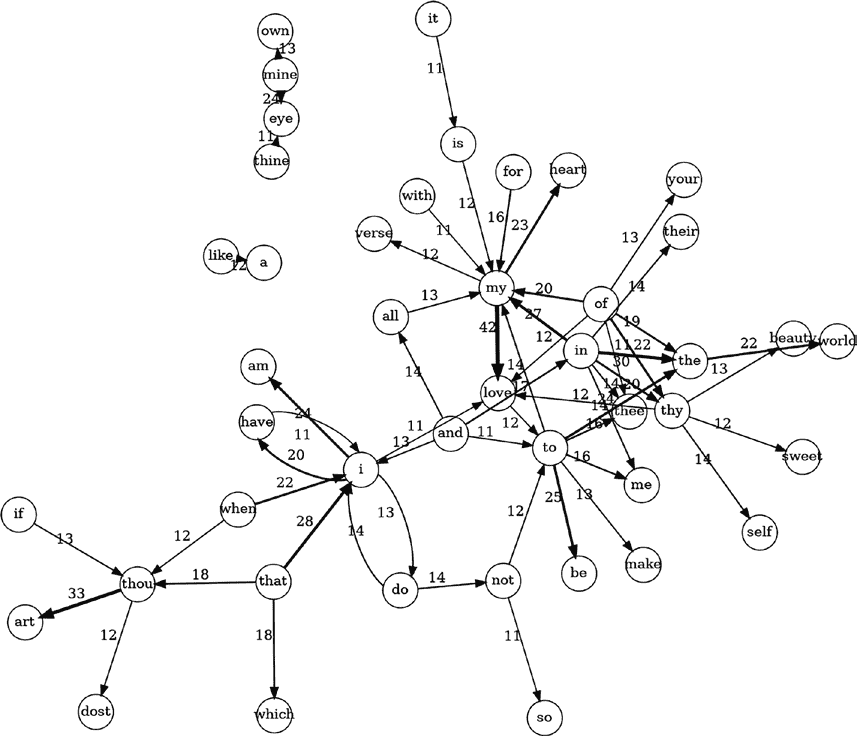

# 十四行诗预处理

```
import string
import nltk
from nltk.stem.wordnet import WordNetLemmatizer
# nltk.download('wordnet')
lemmatizer = WordNetLemmatizer()
```

## 第 2 章 马尔可夫链，窥探未来

```
sonnet_path = "../../code_examples/chap2/sonnet.txt"
with open(sonnet_path, "r") as fp:
    sonnets = fp.readlines()
sonnets = [sentence.strip().lower().replace("'s", "") for sentence in sonnets if sentence != "\n"]
sonnets = ["".join([char for char in sentence if char not in string.punctuation]) for sentence in sonnets]
```

请注意，你可能需要取消注释 `wordnet` 下载行来下载额外数据。`sonnets` 变量是一个句子列表。我们通过仅处理小写字母并忽略像 *beauty’s* 这样的标点符号（它变为 *beauty*）来简化问题。

现在，让我们构建一个 `defaultdict`，用于存储每个词到其后面出现在 `sonnets` 中的词的出现次数。这种词对也被称为*二元组*。

```
from collections import defaultdict
transition_dict = defaultdict(lambda: defaultdict(int))
for sentence in sonnets:
    words = list(filter(lambda x: len(x.strip()) > 0, sentence.split(" ")))
    words_pairs = [(lemmatizer.lemmatize(words[i]), lemmatizer.lemmatize(words[i+1])) for i in range(len(words)-1)]
    for (word_from, word_to) in words_pairs:
        transition_dict[word_from][word_to] += 1
```

在使用 `transition_dict` 生成句子之前，我们先来看看这些二元组的路径。以下可视化通过边的宽度来表示二元组的频率。由于无法显示所有边，我们使用 `count_threshold` 变量来控制一个词可以有多少条转移边来连接到下一个词：

```
# sonnet
from graphviz import Digraph
count_threshold = 10
# dot, fdp, neato, circo, twopi, and osage.
G = Digraph('G', format='png', engine='neato')
font_size = "300"
```



## 第 2 章 马尔可夫链，窥探未来

```
G.attr('graph', pad='1', ranksep='1', nodesep='1')
G.attr('node', shape='circle', fixedsize='true')
G.attr(overlap="false")
for word_from in transition_dict.keys():
    for word_to in transition_dict[word_from].keys():
        lw = transition_dict[word_from][word_to]
        if lw > count_threshold:
            G.edge(word_from, word_to, penwidth=str(lw*0.1), label=str(lw))
G.view("sonnet")
```

结果看起来像一个巨大的蜘蛛网，如图 2-7 所示。

***图 2-7.** 词与词之间的转移关系*

你可以尝试调整边阈值的数值。你将能看到更多精细结构，但代价是更多的边重叠。

现在，我们可以使用 `transition_dict` 来生成一个句子。以下是一个示例：我从 `i` 开始，不断往句子中添加词，直到 `transition_dict` 中没有匹配项为止：

```
def sample_according_to_value(to_dict: dict):
```


