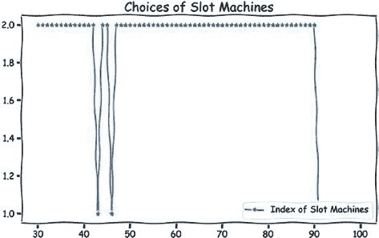
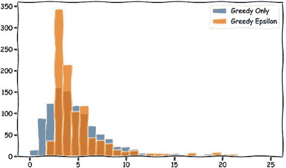

# 获取当前表现最优的老虎机索引

```
slots_trajectory = []
slot_index = np.argmax([record.cal_ratio() for record in Records])
slots_trajectory.append(slot_index)

for i in range(N - evaluation_step * K):
    # 进行剩余 80 轮游戏
    Records[slot_index].update(probs[slot_index])
    slot_index = np.argmax([record.cal_ratio() for record in Records])
    slots_trajectory.append(slot_index)
```

```
# print(Records)
return max(probs)*N - sum([Records[i].total*probs[i] for i in range(K)]), slots_trajectory
```



## 第 3 章 多臂老虎机、概率模拟与贝叶斯统计

此处，我同时返回了遗憾值和老虎机轨迹，即最后 70 次对老虎机的选择。

如果你运行这段代码，你会看到一个典型的遗憾值 `5`。读者可以暂停阅读，思考其中原因。

在探索阶段，第一台老虎机很有可能会给你比第二台和第三台更高的获胜概率，因此我们从第一台老虎机开始并一直使用它。这样，我们将在 1 号老虎机上玩 `80` 次，在 2 号和 3 号老虎机上各玩 `10` 次。所以遗憾值为 `r = 0.5 * 100 - 0.5 * 80 - 0.3 * 10 - 0.2 * 10 = 5`。

然而，有时遗憾值可能会很高，因为我们坚持使用的并非获胜概率最高的老虎机。你可以看到类似下面的 `slot_trajectory`。我在图 3-2 中为你绘制了一个示例。

***图 3-2.** 老虎机的选择*

在这种情况下，2 号老虎机在探索阶段给鲍勃留下了良好印象，因此鲍勃坚持使用它。然而在利用阶段，真正的最佳老虎机 1 号试图赢得鲍勃的青睐，但未能成功。于是鲍勃在剩余的大部分游戏中都使用 2 号老虎机。这样的轨迹给鲍勃带来了 `16.8` 的遗憾值，甚至比随机猜测还要稍差一些。

如果鲍勃不愿意花 30 美元进行探索/估算概率，情况可能会更糟。这样，他选择次优老虎机的概率会更大。

现在的问题是要找到一种改进版的贪心方法，以避免此类问题。

### 贪心-ε：并非总是贪心

让我们尝试引入一种新策略。假设鲍勃大致上根据`历史记录`坚持使用最佳老虎机。然而，每次鲍勃都有一个较小的概率，记为 `ε`，随机选择另一台老虎机来玩。这是`探索`和`利用`的混合：鲍勃放弃了一些`利用`的机会，转而进行`探索`，以寻求未来更大的收益。

实现起来很简单，作为练习留给读者。请将函数命名为 `cal_greedy_epsilon_regret`。关键代码是以下三行。 `ε` 的值由你决定，而在本演示中我将其设为 `0.02`。

```
if np.random.random() < epsilon:
    slot_index = np.random.choice([i for i in range(K) if i != slot_index])
    slots_trajectory.append(slot_index)
```

让我们比较一下纯贪心方法与带有限初始探索步数的贪心-epsilon 方法的性能。我将每台机器的初始探索次数设为 `1`，`ε` 设为 `0.02`。以下代码将绘制两种方法的直方图：

```
rounds = 1000
greedy_only = [cal_greedy_regret(evaluation_step=1)[0] for _ in range(rounds)]
greedy_epsilon = [cal_greedy_epsilon_regret(epsilon=0.02)[0] for _ in range(rounds)]

with plt.xkcd():
    fig, ax = plt.subplots(figsize=(10,6))
    plt.hist(greedy_only, label="纯贪心方法", bins=np.linspace(0,25,30), alpha=0.5)
    plt.hist(greedy_epsilon, label="贪心-epsilon 方法", bins=np.linspace(0,25,30), alpha=0.5)
    plt.legend(loc='upper right')
    fig.savefig("greedy_approach_epsilon_compare.jpg")
```

结果如图 3-3 所示。



***图 3-3.** 纯贪心方法与贪心-epsilon 方法的遗憾值分布*

请注意，纯贪心方法确实产生了更多低遗憾值，但其分布不如贪心-epsilon 方法集中。这意味着贪心方法的最差情况比贪心-epsilon 方法的最差情况更差。


