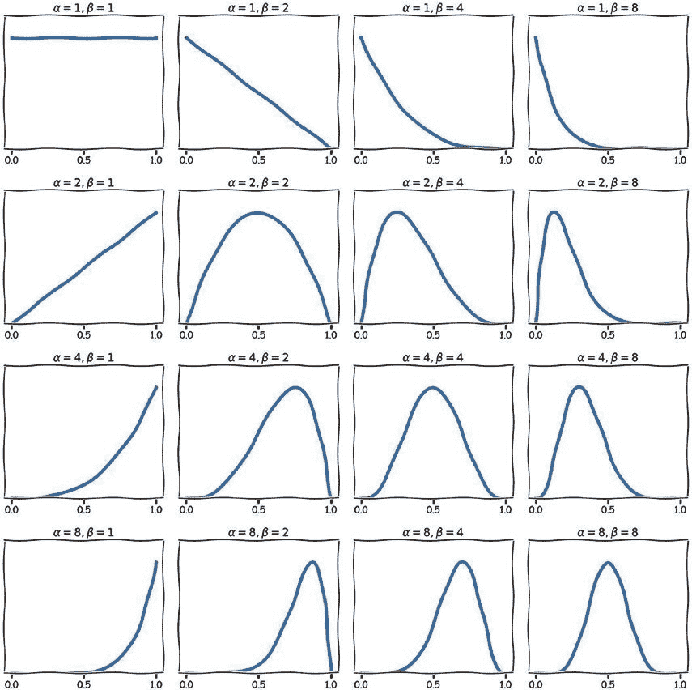

# 改变胜率结果的影响

如果改变胜率的真实值，结果可能会发生巨大变化。尝试修改它，看看这对两种策略的表现有何影响。如果老虎机数量增加到像`5`或`10`台会怎样？

如果鲍勃采取激进策略，他会选择纯粹的贪婪方法。如果鲍勃更为谨慎，他可以尝试贪心-ε方法，以避免出现低概率但灾难性的遗憾值。

### 一种改进的贪心-ε算法

朴素贪心方法的一个问题是，它在进行随机选择时没有考虑老虎机的表现。我们可以通过采用所谓的*softmax*策略来解决这个问题。其核心思路是引入一个参数，模仿物理学中温度的概念，称为`τ`。温度`τ`越高，选择越随机。当`τ ≈ 0`时，我们的策略应退化为朴素贪心方法。当`τ ≈ ∞`时，我们的策略应退化为随机选择策略。

公式如下：

`p(i,t) = e^(p(i,t)) / Σ e^(p(i,t))`

其中，`p(i,t)`代表老虎机`i`在时间`t`时的观测胜率。

例如，如果在第`100`步时，鲍勃已经玩了老虎机`1`共`11`次，并且赢了`4`次，那么`p(1,100) = 4/11`。

*softmax*这个名称是什么意思？如果我们将表达式展开到三台老虎机的情况，并假设第一台老虎机到目前为止表现最佳，那么我们可以通过调整温度`τ`的值来观察其对下一轮选择的影响。

例如，当`τ`趋近于无穷大时，我们得到：

`p(1,t) / Σ p(i,t) = e^(p(1,t)) / (e^(p(1,t)) + e^(p(2,t)) + e^(p(3,t))) ≈ 1/3`

这意味着在极高温度下，无论老虎机 1 的表现比其他老虎机好多少，算法都会退化为基准随机策略。

让我们看看另一个极端情况，当温度`τ`设定接近`0`时：

`p(1,t) / Σ p(i,t) = e^(p(1,t)/τ) / (e^(p(1,t)/τ) + e^(p(2,t)/τ) + e^(p(3,t)/τ))`

由于`p(1,t)`是最大值，像`e^(p(2,t)/τ)`这样的表达式实质上变成了`e^(-∞)`，即零。这意味着我们的算法退化为朴素贪心方法。

请随意调整`τ`的值，看看它如何影响策略的表现。

该策略最大的改进在于，它会优先考虑表现最佳的选项，同时也为其他选项留出尝试的机会。

### 练习

1. 尝试使用不同评估步数的贪心方法。尝试较小的值如`5`，以及较大的值如`20`。你可能需要多次运行模拟才能获得统计上一致的结果。

2. 研究真实概率如何影响不同策略的表现。我们一直使用`probs = [0.5, 0.3, 0.2]`。尝试其他概率选择会怎样？

### 贝叶斯方法：贝叶斯统计入门

现在，让我们回到理想情况：鲍勃有足够的钱可以一直玩到天亮。鲍勃如何在玩的过程中更新他对多台老虎机胜率的估计？我们对多台老虎机胜率的最佳估计是什么？鲍勃能否获得这些胜率的*分布*而不仅仅是单一数值？答案是*可以*，鲍勃需要贝叶斯统计来优化他的估计。

在这个老虎机情景中，核心思想是鲍勃最初会持有对胜率分布的信念。假设某台老虎机的胜率`p`有一个名为`prior(p)`的先验分布。然后，鲍勃会通过观察多台老虎机的实际胜率来更新他的信念，从而得到一个更新后的分布，称为`posterior(p)`（后验分布）。`p`是被建模的胜率，而获胜或失败次数则是观测结果。对于给定的概率，观测结果将遵循二项分布。回顾一下，`Binomial(k | n, p) = (n choose k) * p^k * (1-p)^(n-k)` 是在底层概率为`p`的`n`轮二项实验中观察到`k`次成功的概率。

先验分布不过是一种*信念*。假设你出生在美国，小时候相信美国拥有世界上最辣的辣椒。因此，`P(美国有最辣的辣椒) = 1` 是你的先验信念。然后你周游世界，发现墨西哥有很辣的辣椒。于是你的*观测*将你的信念更新为`P(美国有最辣的辣椒) = 0.5`。接着你尝试了一些印度辣椒，你的信念又变为`P(美国有最辣的辣椒) = 0.3`。你不断重复这个过程，随着观测的到来，上一轮的信念被不断更新。

在鲍勃的例子中，观测结果取决于我们不断更新的参数`p`。

更新规则如下：

`posterior(p) ∝ likelihood(p|x) * prior(p)`

回顾一下，贝叶斯定理指出，对于任意事件，我们有 `P(A|B) = P(B|A) * P(A) / P(B)`

将这个公式映射到鲍勃的游戏中，我们可以看到`A`本质上是底层参数`p`，而`B`是拉杆的结果。由于观测结果是*事实*，`P(B)`与我们选择`A`无关。试想一下鲍勃的场景：如果他来自未来并已知自己的输赢结果，他大概不会关心胜率的分布，对吧？

不幸的是，贝叶斯更新规则需要精确计算，因为我们关心的是`p`的精确分布。贝叶斯更新规则并不简单，其计算可能非常昂贵，尤其是在连续情况下。我们现在需要的是一个性质良好的`prior(p)`先验分布，使得更新后的分布同样性质良好，从而可以快速且顺序地进行计算。

是否存在这样良好的先验分布？有的！它被称为似然分布的*共轭先验*。在这里，似然函数是二项分布，它的共轭先验称为*贝塔分布*，由两个参数`α`和`β`决定：`B(α, β)`。

贝塔分布是二项分布的一种推广。让我们看图 3-4 中的一些例子。



**图 3-4.** 不同参数集下的贝塔分布

它与二项分布非常相似。如果`α`和`β`相同，分布是对称的。如果两个参数都较大，分布更集中。如果`α`大于`β`，分布左偏，反之亦然。

如果我们将贝塔分布的公式代入更新规则，会得到以下结果：

`posterior(p) ∝ likelihood(p|x) * prior(p)`

`posterior(p) ∝ Binomial(k; n, p) * B(p; α, β)`

展开二项分布和贝塔分布的表达式：

```
posterior(p) ∝ (n choose k) * p^k * (1-p)^(n-k) * (1/B(α,β)) * p^(α-1) * (1-p)^(β-1)
posterior(p) ∝ p^(α+k-1) * (1-p)^(β+n-k-1)
posterior(p) ∝ B(p; α+k, β+n-β)
posterior(p) = B(p; α+k, β+n-k)
```

这里，我们有 `B(α,β) = Γ(α) * Γ(β) / Γ(α+β)`，其中 `Γ(x)` 是伽马函数。请不要


