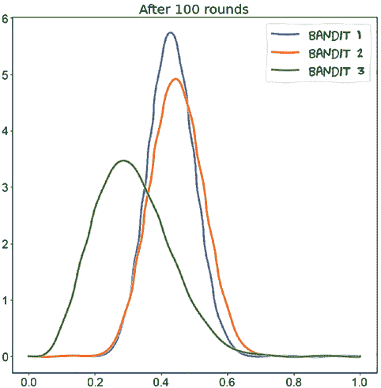
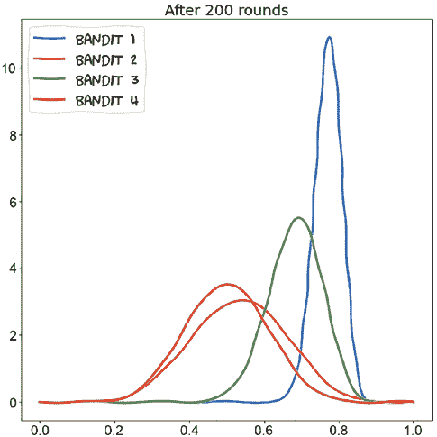
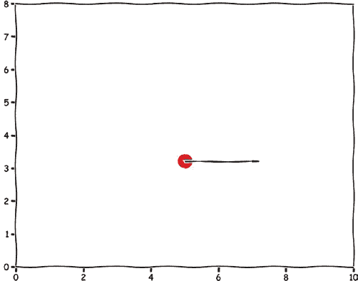

# 内容排版

被吓到了，因为在`α`和`β`是整数的情况下，伽马函数`Γ(x)`就是`n`的阶乘`(x - 1)!`，这抵消了表达式中的`k`部分。

好了，数学到此为止。这在鲍勃的赌博情境中意味着什么？

这意味着，如果鲍勃以信念`B(α, β)`开始，每当出现一次成功，他就可以简单地将信念更新为`B(α + 1, β)`；如果出现一次失败，他就可以简单地将信念更新为`B(α, β + 1)`。这完全不需要计算，只是参数更新而已！

我们有了一个新问题：鲍勃应该选择`α`和`β`的什么值？这相当依赖经验。鲍勃可以将他的历史记录与不同参数的分布进行比较，并选出最佳的那个。然而，归根结底，初始选择不会产生太大影响。另一个实际问题是：如何决定下一轮玩哪台机器？简单！我们只需使用老虎机的 Beta 分布生成一组样本，然后选出最大的那个。这个思路与上一节中的`softmax`策略相同。

## 第三章 多臂老虎机、概率模拟与贝叶斯统计

让我们看看执行模拟并可视化结果的代码：

```python
probs = [0.5, 0.3, 0.2]
K = len(probs)
N = 100
rounds = [9, 49, 99]
fig, axis = plt.subplots(1, 3, figsize=(30,10))
x_ticks = np.linspace(0,1,500)
plot_index = 0
betas = [stats.beta(1,1) for _ in range(K)]
wins = [0, 0, 0]
totals = [0, 0, 0]

with plt.xkcd():
    for rnd in range(N):
        for i in range(K):
            betas[i] = stats.beta(1+wins[i], 1+totals[i]-wins[i])
        p_value_samples = np.array([betas[i].rvs() for i in range(K)])
        slot_next_round_index = p_value_samples.argmax()
        win = np.random.random() < probs[slot_next_round_index]
        wins[slot_next_round_index] += win
        totals[slot_next_round_index] += 1
        if rnd in rounds:
            ax = axis[plot_index]
            for i in range(K):
                # plotting
                beta = betas[i]
                ax.plot(x_ticks, beta.pdf(x_ticks),
                        label='Bandit {}'.format(i+1),
                        linewidth=3)
            ax.set_title('After {} rounds'.format(rnd + 1), fontsize=20)
            ax.legend(fontsize=20)
            plot_index += 1
```

图 3-5 是我们的获胜概率分布的可视化。由于存在随机性，你的结果可能会有所不同。



**图 3-5.** 运行 100 轮后的获胜概率

我们能从这个结果中学到什么？嗯，我们对获胜概率最大的那台机器（即第一台）的获胜概率有更高的置信度。原因是，因为它有更高的获胜概率，鲍勃更有可能选择它，从而产生了正反馈。此外，随着鲍勃玩得越来越多，我们对所有机器的置信度总体上都会提高。

让我们尝试更多轮次和更多机器。假设鲍勃有 200 美元，有 4 台获胜概率相近的机器：`probs = [0.8, 0.7, 0.6, 0.5]`。概率估计结果如图 3-6 所示。



**图 3-6.** 200 轮后的老虎机获胜概率估计

很明显，在 200 轮之后，哪台是优机器已经相当明显，并且我们可以用精确的置信度水平来断言。

### 练习

1.  自己简化后验更新的表达式。

2.  你能想出一种将`softmax`策略与贝叶斯策略结合的方法吗？假设你使用贝叶斯估计的结果来调整`softmax`策略的温度。你的结果不需要在数学上严谨，但需要在直觉上说得通。

3.  使用贝叶斯方法计算遗憾函数。它是否显著优于其他策略？

### 总结

在本章中，我们研究了一个有趣的赌博场景。我们展示了不同的赌博策略基于对探索或利用的不同偏好程度。我们还基于贝叶斯方法进行了模拟。

---

## 第四章 二维盒子中的球：一个简单的物理引擎

如果你是游戏迷或动漫迷，你可能听说过“物理引擎”这个词。当你在《战神》中操控奎托斯时，他的斧头与敌人和环境相互作用。你会觉得这种互动是真实的，并且他的斧头确实很沉重，像金属一样。你实际控制的只是一个 PlayStation 手柄，但印象却达到了另一个层次。在这里，物理引擎负责创造这种身处物理世界的感觉。

物理引擎是一种计算机软件，用于模拟某些物理系统，例如刚体相互作用、流体动力学、光照系统等。在电子游戏中，物理引擎负责模拟玩家与环境的互动。

如果玩家摧毁了一座建筑，建筑的倒塌必须像现实一样：砖块是重的，木质结构是轻的。在《海洋奇缘》等动画中，水效果是由专门模拟水运动的物理引擎创造的。

也有为雪花、头发和其他系统设计的物理引擎。

在本章中，我们将构建自己的简单物理引擎，以模拟一个非常有限的系统：二维盒子中的球。

### 二维盒子中的一个球

让我们从最简单的例子开始。这个场景非常类似于台球或斯诺克，但我们只从一个球开始。下面的代码片段在一个矩形盒子的中心绘制了一个球：

```python
RADIUS = 0.2
POSITION = [1, 1]
VELOCITY = [0.2, 0.2]
```

© Rongpeng Li and Aiichiro Nakano 2022

R. Li 和 A. Nakano 著，《使用 Python 进行模拟》，[`doi.org/10.1007/978-1-4842-8185-7_4`](https://doi.org/10.1007/978-1-4842-8185-7_4#DOI)



`WIDTH, HEIGHT = 10, 8`

`ARROW_HEAD_WIDTH, ARROW_HEAD_LENGTH = 0.05, 0.2`

```python
with plt.xkcd():
    fig, ax = plt.subplots(figsize=(WIDTH, HEIGHT))
    plt.xlim(0,WIDTH)
    plt.ylim(0,HEIGHT)

    ball_1 = plt.Circle(POSITION, RADIUS, color='r')
    ax.add_patch(ball_1)

    ax.arrow(*POSITION,
             *VELOCITY,
             head_width=ARROW_HEAD_WIDTH,
             head_length=ARROW_HEAD_LENGTH,
             fc='k', ec='k')
    plt.plot()
```

图 4-1 中的可视化结果清晰地展示了小球的位置、大小和速度。请注意，小球正在向上运动，其方向由箭头指示。

**图 4-1.** 一个向右运动的小球

我们所说的速度为 `(0.2, 0.2)` 到底是什么意思？让我们为模拟定义一些具体的单位。假设长度以米为单位，时间以秒为单位。因此，小球的速度单位是米/秒。我们的小球从位置 `(0.2, 0.2)` 开始，以大约 0.28 米/秒的速度向右上方运动。

以上描述的是物理设置，这意味着在现实世界中，这样一个小球会连续运动。然而，模拟是离散的，我们需要定义*时间步长*，记作 `Δt`，来近似现实中的连续运动。*时间步长*是模拟中连续两步之间经过的时间量。

`Δt` 越小，我们每秒获得的*帧数*就越多。例如，如果时间步长为 0.1 秒，那么我们将有 `10` 帧每秒（fps）。对于每一帧，小球将移动 `0.1 * 0.28 = 0.028` 米。如果时间步长为 0.01 秒，我们将有 100 帧每秒（fps）。对于每一帧，小球将移动 `0.01 * 0.28 = 0.0028` 米。在游戏中，如果 fps 超过 60，玩家通常不会察觉到任何卡顿。在电影动画中，如果 fps 超过 24，动画看起来就会很流畅。

然而，高 fps 也需要更多的计算量来计算物体的位置、朝向、旋转和速度。在我们只有一个小球的例子中，我们可以选择 0.1 秒的时间步长。要模拟 1 秒钟，我们的计算机需要更新小球的位置十次。

模拟系统中的时间与现实世界中的时间是不同的。为了在模拟系统中模拟一秒钟，如果系统很复杂，计算机可能运行数小时才能完成。对于游戏来说，这甚至是不可接受的。有一些`游戏引擎`可以让游戏开发者摆脱直接处理`物理引擎`的负担，例如`虚幻引擎`。

### 运动物理定律

让我们先稍微简化一下系统。我们假设以下条件：

1.  系统中没有摩擦力。小球不会因为与空气或其他物体的摩擦而减速。

2.  系统中没有旋转。小球不会旋转。如果你打过乒乓球，你就会知道旋转对比赛结果影响巨大。

3.  碰撞是弹性的。弹性碰撞意味着小球在与盒子壁碰撞时不会损失能量。如果有多个小球（我们将在下一节中看到），碰撞的小球作为一个整体不会损失能量。

4.  系统中没有重力。小球不会因重力而下落。不过，我们很快就会移除这个限制。

基于这些简化，我们可以根据牛顿运动定律写出系统的以下更新规则：

`x(t+1) = x(t) + v(t) * Δt`

`a(t) = 0`

由于我们假设没有外力，加速度 `a(t)` 初始为 0。现在，让我们以 0.2 秒的时间步长和 `(2,2)` 的速度，模拟十次迭代的运动来更新我们的系统。执行模拟的代码如下，它们只是两个简单的函数：

```python
def render(pos = POSITION, vel = VELOCITY):
    with plt.xkcd():
        fig, ax = plt.subplots(figsize=(WIDTH, HEIGHT))
        plt.xlim(0,WIDTH)
        plt.ylim(0,HEIGHT)

        ball_1 = plt.Circle(pos, RADIUS, color='r')
        ax.add_patch(ball_1)

        ax.arrow(*pos,
                 *vel,
                 head_width=ARROW_HEAD_WIDTH,
                 head_length=ARROW_HEAD_LENGTH,
                 fc='k', ec='k')
        plt.show()

def update(pos=POSITION, vel = VELOCITY, acc = None, delta_t = DELTA_T):
```