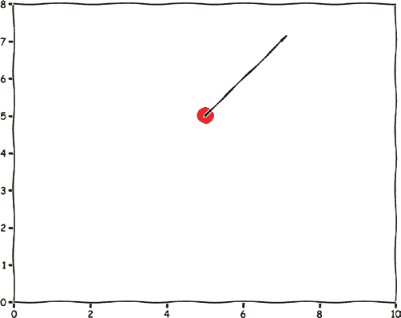
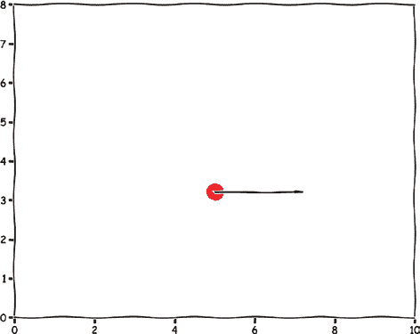
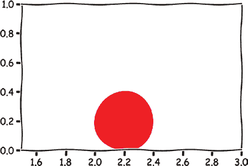

# 注意所有值都是可变的，因此更新会就地执行

```
for i in range(len(pos)):
    pos[i] += vel[i] * delta_t

if acc:
    for i in range(len(pos)):
        vel[i] += acc[i] * delta_t
```



## 第 4 章 二维盒子中的小球：一个简单的物理引擎

现在，我们可以使用预设参数来执行模拟：

`RADIUS = 0.2`

`POSITION = [1,1]`

`VELOCITY = [2,2]`

`WIDTH, HEIGHT = 10, 8`

`ARROW_HEAD_WIDTH, ARROW_HEAD_LENGTH = 0.05, 0.2`

`DELTA_T = 0.2`

```
render(pos=POSITION, vel = VELOCITY)
for _ in range(10):
    update(pos=POSITION, vel = VELOCITY, delta_t = DELTA_T)
    render(pos=POSITION, vel = VELOCITY)
```

让我们看看经过十次迭代后小球的位置，如图 4-2 所示。

***图 4-2.** 十次迭代后小球的位置与速度* 正如预期，以 0.2 秒的时间步长迭代十次，系统总共演进了 2 秒。在速度为(2,2)的情况下，小球将在水平和垂直方向上各移动 4 米。

现在，让我们为系统添加一些重力，以消除之前剩余的假设条件。修改起来非常简单。为了让小球在最初几帧画面内保持在盒子中，我将加速度设置为每秒向下 1 米。地球上正常重力加速度约为每秒*9.8*米。



## 第 4 章 二维盒子中的小球：一个简单的物理引擎

`ACCELERATION = [0,-1]`

```
for _ in range(10):
    update(pos=POSITION, vel = VELOCITY, acc = ACCELERATION, delta_t = DELTA_T)
    render(pos=POSITION, vel = VELOCITY)
```

让我们对速度做一个粗略估算。2 秒后，小球在垂直方向上的速度将完全降为零，因此速度向量应该完全是水平方向的。让我们在图 4-3 中进行验证。

***图 4-3.** 在重力场中经过 2 秒后小球的位置与速度* 正如预期，小球在垂直方向上完全失去了速度。

### 碰撞检测

现在，我们来处理房间里的“大象”——碰撞检测。

要检测碰撞，我们首先需要对碰撞有一个清晰的定义。小球与墙壁发生碰撞意味着什么？思路很简单：如果小球的几何中心与墙壁之间的距离小于半径，那么就发生了碰撞。图 4-4 清晰地说明了这一点。



## 第 4 章 二维盒子中的小球：一个简单的物理引擎

***图 4-4.** 碰撞放大图*

检测逻辑因此变得简单：如果在某个时间点，小球中心与任一侧墙壁之间的距离小于小球半径，那么就发生了碰撞。在下一个迭代中，小球将通过与墙壁碰撞并翻转相应速度分量的符号来反弹。系统随后从该状态继续演化。

我们引入一个函数来检测小球与墙壁之间可能发生的碰撞：如果小球仍在向墙壁运动，并且距离已经小于半径，则检测到碰撞。如果检测到碰撞，该函数还会翻转相应速度分量的符号。

```python
def detect_collision_wall(pos = POSITION, vel = VELOCITY, radius = RADIUS, height = HEIGHT, width = WIDTH):
    # 左墙
    if abs(pos[0]-0) < radius and vel[0] < 0:
        vel[0] = - vel[0]
        return
    # 右墙
    if abs(width-pos[0])< radius and vel[0] > 0:
        vel[0] = -vel[0]
        return
    # 上墙
    if abs(height-pos[1]) < radius and vel[1] > 0:
        vel[1] = -vel[1]
        return
```


