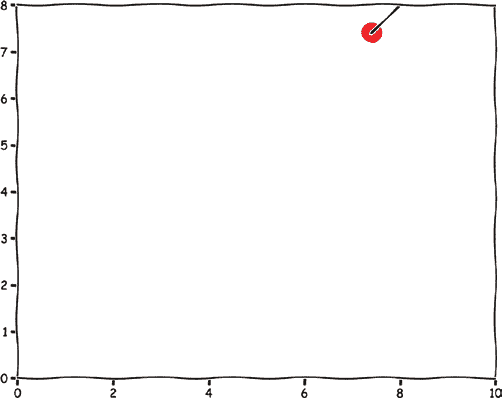
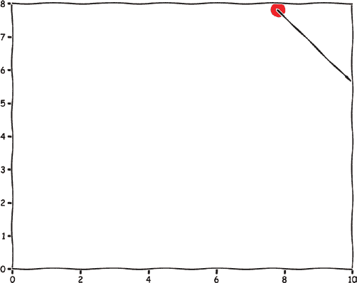
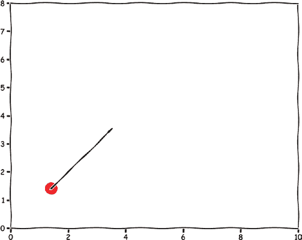
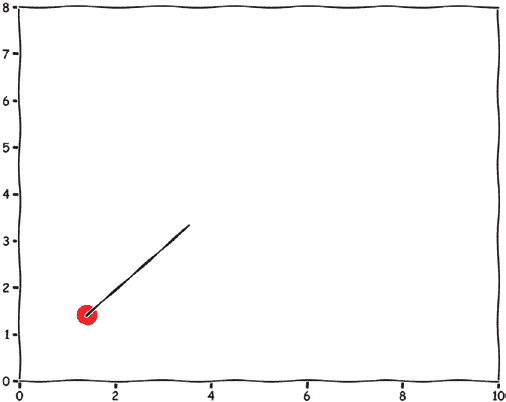
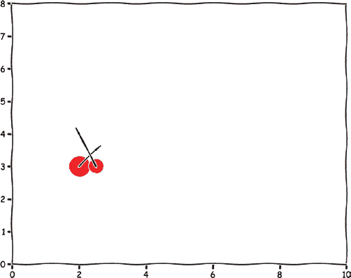

# 下壁



## 第 4 章 二维盒子中的球体：一个简单的物理引擎

```python
if abs(pos[1]-0) < radius and vel[1] < 0:
    vel[1] = -vel[1]
    return
```

你可能注意到，碰撞条件依赖于一个假设，即球以*中等*速度运动。如果球的速度过快，以至于在两个相邻帧之间穿过了墙壁，即所谓的*隧穿*问题，那么碰撞检测将永远不会被触发。

另一个问题是碰撞条件滞后于球的实际运动。这可以通过引入一个称为*delta*的小正参数来缓解，将球与墙壁之间的距离计算转变为类似 `abs(pos[0]-0) < radius + delta` 的形式。

通过根据球的速度或针对多球模拟的速度分布来选取适当的 `delta` 值，我们可以减少滞后的影响。

现在，让我们看一下模拟系统，看看球是如何弹跳的。

图 4-5 展示了我们红球的运动方向。

***图 4-5.** 球正朝碰撞方向运动*

碰撞后，球改变了方向。我们的算法运行良好！



***图 4-6.** 碰撞后球的速度立即发生变化*

在继续之前，让我们快速了解一下如何创建 GIF 动画。

你可以使用 `imageio` Python 库来创建 GIF 动画。假设你已经将系统的快照保存为 `1.png`、`2.png`、`3.png` 等文件。你可以使用以下命令创建 GIF 动画：

```python
import imageio

filenames = ["1.png", "2.png","3.png"]

with imageio.get_writer('one_ball_bounce.gif', mode='I') as writer:
    for filename in filenames:
        image = imageio.imread(filename)
        writer.append_data(image)
```

对于单个球的情况，动画效果如 GIF 4-1 所示。





***GIF 4-1.** 无重力情况下的球体运动*

如果我们向系统添加重力，动画效果将如 GIF 4-2 所示。

***GIF 4-2.** 有重力情况下的球体运动*

已经非常酷了，不是吗？

### 练习

1.  将 `delta` 引入模拟。球的速度与 `delta` 值之间有什么关系？

2.  你能提高动画的帧率（fps）吗？它看起来更真实吗？

## 二维盒子中的多个球体

现在，我们来讨论多个球体的情况。除了可能发生球与墙壁的碰撞外，球与球之间也可能发生碰撞。这引入了两个新问题：

1.  如何检测球与球之间的碰撞？

2.  球在碰撞时如何表现？

如果你思考第一个问题，如果盒子里有 100 个球，那么球间碰撞理论上是一个 *n*² 量级的操作，粗略计算可达数千次。这很快会变得难以处理，因此不可接受。我们不希望计算量呈二次方增长。然而，由于大多数球并不会有机会相互碰撞，我们可能希望使用更高效的算法来检测或预测球之间的碰撞。

我们先来解决第二个问题。与第一个问题相比，它似乎更简单，不是吗？

### 碰撞时位置和速度的更新

支配纯弹性球体运动的物理定律有两条：动量守恒定律和能量守恒定律。在球与墙壁的碰撞模拟中，我们假设墙壁质量无限大，因此墙壁强制反转球的动量，同时保持球的能量不变。由于球的能量是动能和势能之和，如果引入重力，球的速度是不变的。

对于球与球的碰撞，情况会变得稍微复杂一些。我们不打算详细推导公式，但在查看公式后，可以进行一些粗略分析。

让我们将两个球的中心记为 *c*1 和 *c*2，两个球的半径记为 *r*1 和 *r*2，两个球的速度记为 *υ*1 和 *υ*2。我们将使用带撇的符号 1 和 2 来表示碰撞后球的速度。与球-壁碰撞的情况不同，我们还需要考虑两个球的质量。这与我们的直觉相符，因为即使是一个快速飞行的乒乓球，也不太可能让一个高尔夫球移动多少。

我们称它们的质量为 *m*1 和 *m*2。

现在，支配运动的两条物理定律如下：动量守恒和能量守恒。

*m*1 *υ*1 + *m*2 *υ*2 = *m*1 *υ*1' + *m*2 *υ*2'

*m*1 *υ*1² + *m*2 *υ*2² = *m*1 *υ*1'² + *m*2 *υ*2'²

请注意，所有速度都是向量而非标量。例如，*υ*1 有两个分量 `υ1[0]` 和 `υ1[1]`，而 *υ*2 有两个分量 `υ2[0]` 和 `υ2[1]`，等等。由于我们唯一不知道的两个量是 *υ*1' 和 *υ*2'，我们可以重新排列方程来求解它们。这是一个很好的数学练习，留给读者作为作业。现在，我将直接给出解：

*υ*1' = *υ*1 - (2*m*2/(*m*1 + *m*2)) * ((*c*1 - *c*2) / |*c*1 - *c*2|) * ((*υ*1 - *υ*2) · (*c*1 - *c*2) / |*c*1 - *c*2|)

*υ*2' = *υ*2 - (2*m*1/(*m*1 + *m*2)) * ((*c*2 - *c*1) / |*c*2 - *c*1|) * ((*υ*2 - *υ*1) · (*c*2 - *c*1) / |*c*2 - *c*1|)

让我们直观地感受一下正在发生的事情，并编写一个函数来计算碰撞后的速度。假设两个球正在相互碰撞，如图 4-7 所示。



***图 4-7.** 两个球相互碰撞*

我们假设球非常坚硬，以至于两个球心之间的距离始终恰好等于它们的半径之和。我为这两个球选取了参数，如表 4-1 所示。

***表 4-1.** 两球参数：位置、半径、速度和质量*

| 参数 | 值               |
|-----------|---------------------|
| *υ*1      | (0.5, 0.5)          |
| *υ*2      | (-0.5, 1)           |
| *r*1      | 0.3                 |
| *r*2      | 0.2                 |
| *c*1      | (2,3)               |
| *c*2      | (2.5, 3)            |
| *m*1      | 3                   |
| *m*2      | 3                   |

让我们进行计算：

*υ*1' = *υ*1 - (2*m*2/(*m*1 + *m*2)) * ((*c*1 - *c*2) / |*c*1 - *c*2|) * ((*υ*1 - *υ*2) · (*c*1 - *c*2) / |*c*1 - *c*2|)


代入数值：

*υ*1' = (0.5, 0.5) - (2*3/(3+3)) * ((2,3)-(2.5,3) / |(2,3)-(2.5,3)|) * (((0.5,0.5)-(-0.5,1)) · ((2,3)-(2.5,3)) / |(2,3)-(2.5,3)|)

我们得到第一个球碰撞后的速度：

*υ*1' = (0.7, 0.5)

同理，我们可以计算球 2 碰撞后的速度。其速度为：

*υ*2' = (0.3, 1)

直观地看，速度向量如图 4-8 所示。

***图 4-8.** 两个球碰撞后的速度*

我们的结果是否符合动量守恒和能量守恒？这留给读者作为练习来验证。

现在，让我们重写渲染函数以处理多个球体。同时，是时候重写我们的代码，将球、盒子等对象表示为对象，并封装碰撞逻辑了。我之所以之前没有这样做，是因为我希望数学公式清晰易懂。现在这样做，可以使我们教程的下一部分干净简洁。

首先，我们创建 `Box`、`Ball` 和 `System` 类。我们将它们创建为 `dataclass`，因为我们希望利用自动生成的方法，如 `__init__` 和 `__repr__`。`Box` 类是最简单的。

```python
from dataclasses import dataclass

@dataclass
class Box:
    height: float
    width: float
```

接下来，我们创建 `Ball` 类，在其中实现碰撞处理的主要逻辑。请注意，这仅仅是前面数学公式的直接翻译。

```
@dataclass
class Ball:
    pos: [float, float]
    vel: [float, float]
    mass: float
    radius: float

    def update(self, acc = None, delta_t = 0.2) -> None:
        for i in range(len(self.pos)):
            self.pos[i] += self.vel[i] * delta_t
        if acc:
            for i in range(len(self.pos)):
                self.vel[i] += acc[i] * delta_t

    def detect_ball_collision(self, other) -> None:
        distance = np.sqrt((self.pos[0] - other.pos[0])**2 + (self.pos[1] - other.pos[1])**2)
        if self.radius + other.radius >= distance:
            self.ball_collision_update(other)

    def ball_collision_update(self, other)-> None:
        '''
        第 4 章 二维盒子中的球体：一个简单的物理引擎
        实现球碰撞逻辑，利用对称性。
        ball_1: self
        ball_2: other
        '''
        mass_factor_1 = 2*other.mass/(self.mass + other.mass)
        mass_factor_2 = 2*self.mass/(self.mass + other.mass)
        velocity_diff = [self.vel[0] - other.vel[0], self.vel[1] - other.vel[1]]
        center_diff = [self.pos[0] - other.pos[0], self.pos[1] - other.pos[1]]
        squared_center_diff = sum([diff**2 for diff in center_diff])
        velocity_factor = np.dot(velocity_diff, center_diff)/squared_center_diff
        self.vel[0] -= mass_factor_1 * velocity_factor * center_diff[0]
        self.vel[1] -= mass_factor_1 * velocity_factor * center_diff[1]
        other.vel[0] += mass_factor_2 * velocity_factor * center_diff[0]
        other.vel[1] += mass_factor_2 * velocity_factor * center_diff[1]

    def detect_box_collision(self, box: Box) -> None:
```