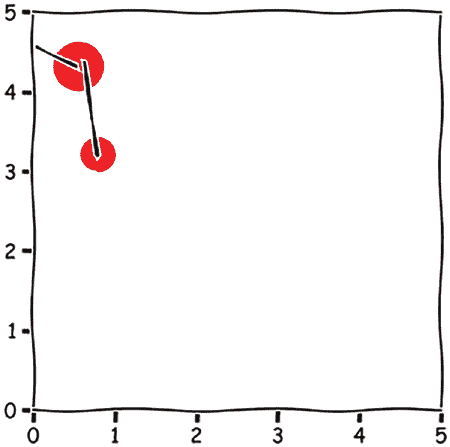
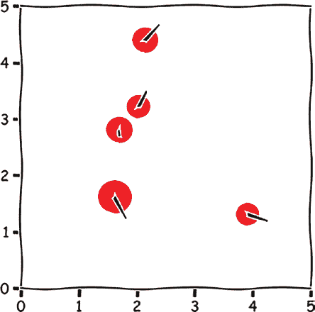

# 下墙

如果`abs(self.pos[1]-0) < self.radius`且`self.vel[1] < 0`：`self.vel[1] = -self.vel[1]`

`return`

最后一部分是`System`类。它是一个容器，包含`Box`和`Ball`类，并管理它们之间的交互。我们还为其捆绑了一些有用的函数，例如渲染等。

```
from typing import List

@dataclass
class System:
    box: Box
    balls: List[Ball]
    acc: float = None
    delta_t: float = 0.2

    def init_balls(self):
        raise NotImplementedError

    def update(self):
        # 球-球碰撞检测
        for idx_1 in range(0, len(self.balls)-1):
            for idx_2 in range(idx_1 + 1, len(self.balls)):
                self.balls[idx_1].detect_ball_collision(self.balls[idx_2])
        # 球-墙碰撞检测
        for ball in self.balls:
            ball.detect_box_collision(self.box)
        # 更新速度
        for ball in self.balls:
            ball.update(self.acc, self.delta_t)

    def render(self, save=False, file_name=None, return_array=False):
        with plt.xkcd():
            fig, ax = plt.subplots(figsize=(self.box.width, self.box.height))
        if return_array:
            from matplotlib.backends.backend_agg import FigureCanvasAgg
            canvas = FigureCanvasAgg(fig)
        ax.set_xlim(0, self.box.width)
        ax.set_ylim(0, self.box.height)
        for ball in self.balls:
            pos, vel, radius = ball.pos, ball.vel, ball.radius
            ball_patch = plt.Circle(pos, radius, color='r')
            ax.add_patch(ball_patch)
            ax.arrow(*pos, *vel, fc='k', ec='k')
        if save:
            plt.savefig("{}.png".format(file_name))
        if return_array:
            # 获取渲染器缓冲区视图
            canvas.draw()
            buf = canvas.buffer_rgba()
            # 转换为 NumPy 数组
            return np.asarray(buf)

    def generate_gif(self, file_name="multiple_ball_collision.gif", steps=100):
        with imageio.get_writer(file_name, mode='I') as writer:
            for _ in range(steps):
                system.update()
                image = system.render(return_array=True)
                writer.append_data(image)
```

让我们看看我们的双球系统是如何演变的，如 GIF 4-3 所示。如果您正在阅读纸质版，请务必在线查看动画。




**GIF 4-3.** 两个球在盒子中碰撞运动

我们还可以生成一堆随机球，并观察它们如何演变，如 GIF 4-4 所示。

该实验的实现留给读者作为练习。下面是一个五球系统。请注意，球的大小与质量不成比例。你能猜出哪个球质量最大吗？

**GIF 4-4.** 盒子中具有随机半径、质量和速度的多个球

### 多球场景中的碰撞检测

现在，让我们解决一个显而易见的问题：碰撞检测的性能问题。

有许多成熟的碰撞检测算法；我们将讨论并实现其中一个最直观的算法：**扫描与剪枝**算法。

扫描与剪枝算法的思路非常直接。如果两个球碰撞，那么它们在 x 轴或 y 轴上的投影也必然重叠！因此，我们可以利用球的投影来预测它们是否碰撞，因为这是一个必要但不充分的条件。

扫描与剪枝算法的最大优点是，我们可以事先按球在某一轴上的投影进行排序。然后进行一次扫描就可以找到所有可能发生碰撞的球对。排序的时间复杂度为`O(n log n)`，这已经比朴素方法有了显著改进。还可以进一步优化。

现在，让我们实现该算法。我们只需要在`System`类中实现一个新方法，该方法仅负责返回可能碰撞的球对列表。

```
def sweep_prune(self) -> List[Tuple[int, int]]:
    # 返回可能碰撞的球的索引列表
    self.balls.sort(key=lambda ball: ball.pos[0])  # <1>
    active_balls = []
    candidates = []
    for idx, ball in enumerate(self.balls):
        if not active_balls:
            active_balls.append(idx)
        else:
            closest_ball = self.balls[active_balls[-1]]
            if closest_ball.pos[0] + closest_ball.radius >= ball.pos[0] - ball.radius:  # <2>
                candidates.append((active_balls[-1], idx))
                active_balls.append(idx)
            else:  # <3>
                active_balls = [idx]
    return candidates
```

该算法执行以下三个步骤：

1. 球按照它们的 x 坐标原地排序。
2. 如果两个球在 x 轴上足够接近，则它们成为碰撞候选。
3. 否则，清空`active_balls`列表并将当前球添加到`active_balls`列表中，因为我们正远离之前的球投影簇。

我们还需要在`System`类的`update`方法中做一个小改动：使用`sweep_prune`来选择候选球对。

```
def update(self):
    # 球-球碰撞检测
    candidates = self.sweep_prune()
    for pair_idx in candidates:
        self.balls[pair_idx[0]].detect_ball_collision(self.balls[pair_idx[1]])
```


