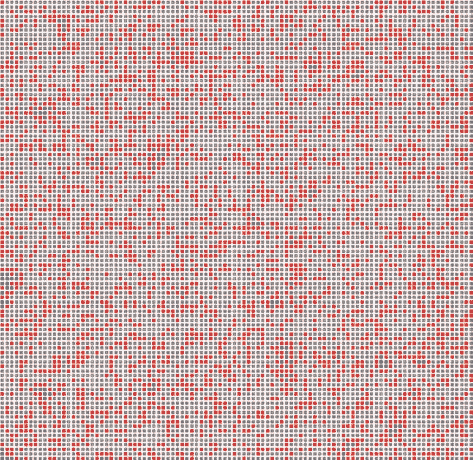

# 右线

```python
for h in range(1, self.height):
    origin_state = self.states[self.width - 1][h - 1]
    up_state = self.states[self.width - 1][h]
    if origin_state == State.Working and up_state == State.Working:
        plt.plot((self.width, self.width), (h, h + 1), c=Grid.state_to_color[State.Working])
```

## 第五章：逾渗、阈值与相变

现在，让我们切入关键问题。给定可变的占据概率 `p` 以及格点（或键）之间的独立性，何时会有一个簇从网格顶部边缘渗流到底部边缘？

### 逾渗与临界概率

实际上，数学家们更关心另一个问题：对于一个无限大的簇，何时才能确定地形成一个无限簇？从模拟的角度来看，我们无法模拟无限大的网格，但可以通过回答前面那个更简单的问题来逼近这个难题。如果一个簇以 100% 的概率无法渗穿过网格，那么就不可能形成无限簇。

我们将这样的阈值概率称为 `pc`，其中 `c` 代表临界（critical）。

### 一维情况的解析解

虽然这本书是关于模拟的，但我还是想向你展示一维情况是如何解析求解的。

对于一维情况下的格点逾渗或键逾渗，临界概率 `pc` 均为 1。这很容易想象：在一维空间中，形成无限簇的路径有且仅有一条。因此，任何小于 1 的概率都会阻止无限簇的形成。

假设一个大小为 `L` 的簇存在的概率记为 `P(p, L)`，那么临界概率必须满足以下方程：

```
lim_{L→∞} P(p, L) = { 0  p < pc, 1  p > pc }
```

幸运的是，`P(p, L)` 的精确表达式很容易推导：

```
lim_{L→∞} P(p, L) = lim_{L→∞} p^L = { 0  p < 1, 1  p = 1 }
```

因此，我们的临界概率 `pc` 为 1。

从一维到二维，解析推导的难度急剧增加。事实上，数学家们花费了大约 20 年时间才获得并证明了二维方形网格键逾渗情况的临界概率的解析形式。哈里·凯斯滕证明，在二维方形网格中，键逾渗的临界概率恰好是 `1/2`。而格点逾渗的情况则众所周知难以推导。事实证明，我们只能通过运行模拟来估算它。这种方法你在[第 1 章](https://doi.org/10.1007/978-1-4842-8185-7_1)中已经见过。

### 二维情况的模拟

我们将分两步进行模拟。第一部分，我们编写一个函数来检测是否存在一个可以渗穿过网格的簇，并将其标记为灰色。我们的目标只是找到一个，因此一旦找到一个，就停止探索其他可能的簇。

第二部分，我们将多次运行模拟，以逼近临界概率 `pc`。

要发现渗流簇的存在，我们需要编写一个图遍历算法来遍历相邻的占据格点。有两种选择：一种是广度优先搜索，另一种是深度优先搜索。这里我实现了深度优先搜索算法。其思路是递归地访问邻居，直到访问完一条最长的可能路径，然后返回到上一轮递归中的另一条可能路径。

```python
def dfs(self, site, visited) -> None:
    visited.add(site)  # (1)
    (w, h) = site
    neighbors = [site for site in [(w - 1, h), (w + 1, h), (w, h - 1), (w, h + 1)] if self.filter_illegal_site(site)]
    for neighbor in neighbors:
        if neighbor not in visited and self.states[neighbor[0]][neighbor[1]] == State.Working:
            self.dfs(neighbor, visited)
```

接下来，我们编写另一个函数来完成寻找簇的主要工作。我们从网格的最底行开始，每当遇到一个占据的格点，就开始搜索簇。如果在搜索过程中，发现一个格点位于网格的顶部边缘，我们的任务就完成了。如果我们在底边找不到任何能通向渗流簇的格点，搜索也会结束。

```python
def percolate_through(self):
    clusters = []
    success = False
    for w in range(self.width):
        if clusters:
            all_visited = reduce(lambda x, y: x.union(y), clusters)  # (1)
        else:
            all_visited = set()
        if self.states[w][0] == State.Working and (w, 0) not in all_visited:
            clusters.append(set())
            self.dfs((w, 0), clusters[-1])
            latest_cluster = clusters[-1]
            if max([site[1] for site in latest_cluster]) == self.height - 1:
                success = True
                return clusters[-1], success
    return None, success

def filter_illegal_site(self, site):  # (2)
    (w, h) = site
    if w < 0 or w >= self.width:
        return False
    if h < 0 or h >= self.height:
        return False
    return True
```

我们还可以更新程序的其他部分，以便高亮显示渗流簇。以下是关键代码行。你可以在本书的在线网站上找到完整代码。

```python
class State(Enum):
    Working = 1
    Broken = 0
    Cluster = -1

class Grid:
    state_to_color = {State.Broken: "red",
                      State.Working: "blue",
                      State.Cluster: "gray"}
```


```python
def render(self, return_array=False, block_size=1300, percolating=False):
    if percolating:
        cluster, success = self.percolate_through()
        if success:
            for site in cluster:
                w, h = site
                self.states[w][h] = State.Cluster
```

请注意，该方法只应运行一次。深度优先搜索算法的正确性保证了如果存在渗流簇，就一定能发现一个。

好了，让我们运行一次模拟渲染，看看能否在不同的网格大小和占据概率下找到渗流簇。首先，尝试一个大小为 10×10、占据概率为 0.5 的网格：

```python
Grid(width=10, height=10, random_init=True, prob=0.5).render(percolating=True)
```

我们很幸运！确实存在一个渗流簇！图 5-3 中的灰色格点显示了渗流簇。

图 5-3. 包含渗流簇的网格




让我们再次运行代码；这次结果就没那么幸运了，如图 5-4 所示。

图 5-4. 不含渗流簇的网格

让我们尝试一个更大的 100×100 方形网格，占据概率为 0.7。结果如图 5-5 所示。

图 5-5. 包含渗流簇的 100×100 网格

希望你的眼睛还能受得了。这个渗流簇非常大，几乎包含了所有占据格点。你可能还会遇到递归深度错误；你可以通过设置 `sys.setrecursionlimit` 参数临时增加最大递归深度。

接下来，让我们运行一次模拟，看看能否缩小临界占据概率`pc`的值。首先，尝试一个大小为 10×10 的网格，占据概率从 0.2 到 0.8，步长为 0.05。总共有大约 13 个设置。我们将每个设置运行 100 次，以获得`pc`的概率，其中`L`是网格的大小。

```python
L = 10
ROUND = 100
p_clustering = []

for prob in np.linspace(0.2, 0.8, num=13):
    res = []
    for _ in range(ROUND):
        _, success = Grid(L, L, prob=prob, random_init=True).percolate_through()
        res.append(success)
    p_clustering.append(np.mean(res))

with plt.xkcd():
    fig, ax = plt.subplots(figsize=(10, 8))
    ax.plot(x=np.linspace(0.2, 0.8, num=13), y=p_clustering, marker="*")
    ax.set_xlabel("占据概率")
    ax.set_ylabel("逾渗概率")
```