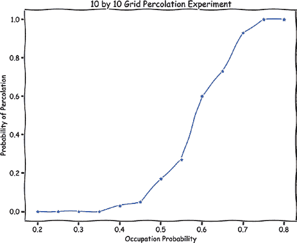
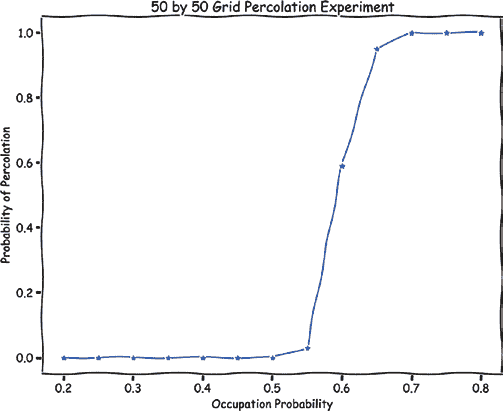
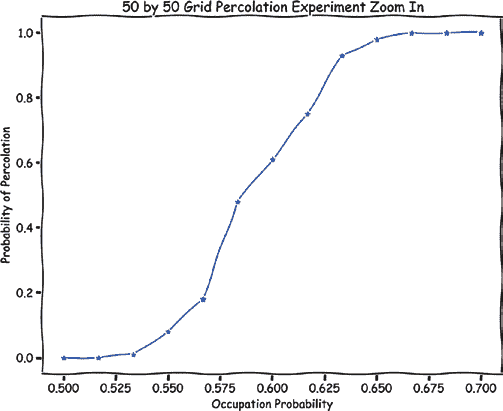
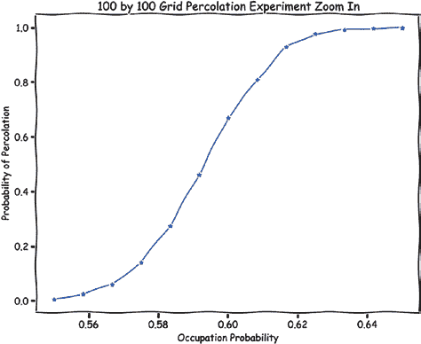
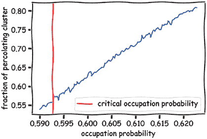
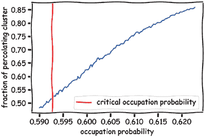
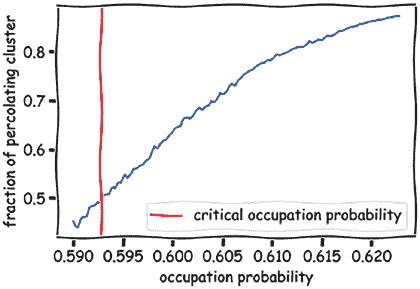

# `ax.set_title("10x10 网格渗流实验")`

我们的结果应与直觉相符。当占据概率较低时，应完全看不到渗流团簇；当占据概率较高时，渗流概率应趋近于 1。可参见图 5-6 所示关系。





## 第 5 章 渗流、阈值与相变

`图 5-6.` 10x10 网格中渗流概率随占据概率的变化

在 0.5 到 0.6 之间，渗流概率似乎存在一个跃迁点。

现在我们将网格扩大至 50x50 并再次尝试。请注意，这可能需要更长的运行时间和更深的递归深度。结果如图 5-7 所示。

`图 5-7.` 50x50 网格中渗流概率随占据概率的变化





### 趋势分析

趋势变得更加明显。一旦超过约`0.6`的阈值，渗流团簇的形成几乎成为必然。现在，让我们聚焦`0.5`至`0.7`的范围进行放大查看。我们得到图 5-8。

`图 5-8.` 放大后的 50x50 网格

在进入下一节之前，我们针对 100x100 网格进行模拟，且每个占据概率数据点运行 1000 次。图 5-9 是我得到的结果。

`图 5-9.` 100x100 网格中渗流概率随占据概率的变化

### 临界概率估计

请注意，虽然曲线形状相似，但 x 轴范围更小：这也是一种放大可视化。我们对临界概率的估计越来越精确。可以清晰地看到，临界占据概率约为 0.6。

借助学术研究中更强大的模拟与计算能力，当前对正方形网格座渗流临界概率的估计约为`0.592746`。在后续内容中，我们将以此值作为*基准真值*。

### 练习

1. 实现用于团簇发现的广度优先搜索算法。

2. 实现一个算法，计算网格中最大团簇的大小，并将其与占据概率的关系绘制成图。请注意，你可能需要运行多次以获得有意义的统计数据。

### 二维网格渗流中的另一项有趣统计

如果我们回到最初的森林火灾问题，我们更关心的一个问题是火灾的严重程度，即渗流团簇的大小。

然而，在模拟中，我们通过改变网格大小来模拟无限大的网格。由于最大团簇的大小依赖于网格尺寸，因此无法直接计算。我们可以计算另一个值——比例`f`，即渗流团簇中占据点位的比例。随着占据概率增大，该比例应趋近于 1；但当占据概率从高于临界值的区间向临界概率趋近时，该比例应趋近于 0。

想象一个无限大的网格，如果占据概率仅略大于临界概率，则存在一个渗流团簇。尽管概率论告诉我们，这样的团簇在无限大网格中必然存在，但即使占据概率略小于临界值，也绝不会形成渗流团簇！你能想象这个团簇的样子吗？是的，它极可能非常蜿蜒曲折，虽然无限大，但几乎将自身置于所有占据点位之外。听起来矛盾，但事实如此。

### 比例计算方法

首先，我们实现一个计算该比例的新方法：

```python
def percolating_cluster_fraction(self):
    assert(self.percolated)
    total_occupied = sum([sum([h in (State.Cluster, State.Working) for h in row]) for row in self.states])
    cluster_size = sum([sum([h == State.Cluster for h in row]) for row in self.states])
    return cluster_size / total_occupied
```

接下来，我们运行模拟以评估该比例与占据概率之间的关系。我们使用 100x100、200x200 和 300x300 的网格进行模拟。从高于基准真值的位置开始，我们逐渐将占据概率降低至 0.59 左右，并对每个概率点运行 1000 次以获得平均值。

```python
L = 100
ROUND = 1000
TRUTH = 0.592746

fractions = []
probs = []
start = 0.622746
steps = 110
step = (start - TRUTH) / (steps - 10)

for i in tqdm(range(steps)):
    res = []
    prob = start - i * step
    probs.append(prob)
    for _ in range(ROUND):
        while True:
            grid = Grid(L, L, prob=prob, random_init=True)
            grid.percolate_through()
            if grid.percolated:
                frac = grid.percolating_cluster_fraction()
                res.append(frac)
                break
    fractions.append(res)
```





### 模拟结果与收敛性

然后我们可以估算出达到临界占据概率时的比例值。绘图代码较为简单故省略。我们得到图 5-10。

`图 5-10.` 100x100 网格中渗流团簇比例与占据概率的关系

嗯，这看起来不太理想，因为理想情况下比例应为 0；但我们得到的值约为`0.57`。我们尝试更大的 200x200 网格。得到图 5-11。

`图 5-11.` 200x200 网格中渗流团簇比例与占据概率的关系

200x200 网格尺寸下，在临界占据概率时我们得到的比例约为`0.52`。

请注意，该项模拟在我的 2019 款 MacBook Pro（16GB 内存）上运行了数小时。如果你有可以全天开机的机器，可以像我一样尝试 300x300 网格的模拟。我必须将`max recursion depth`设置为相当大的数值以避免递归错误。经过数小时的计算，我得到了图 5-12。



`图 5-12.` 300x300 网格中渗流团簇比例与占据概率的关系

我们成功在临界占据概率处使比例值达到了`0.5`，但距离理论值仍相去甚远。这个例子展示了模拟结果收敛有多难。在临界占据概率附近进行模拟的难度是众所周知的，因为我们正趋近于模拟中所说的*相变*。系统的属性在临界占据概率附近发生突变。我们使用的是较为朴素的方法进行模拟，且硬件性能也有限。这是预料之中的结果。不必感到沮丧。

### 练习

1. 你能推导出一维情况下比例作为占据概率函数的解析方程吗？

2. `percolate_through`方法在找到第一个潜在渗流团簇后会停止搜索。请评估两个不重叠的渗流团簇共存的概率有多大。

3. 对 100x100 网格进行键渗流模拟。同样绘制渗流团簇比例随占据概率变化的图。

### 总结

在本章中，我们研究了网格上的渗流模拟。这类模拟在数学和理论物理学中有着深厚根基。我们推导了一维情况下的解析解，并模拟了二维情况下越来越大的网格。我们还看到了一个令人*痛苦*的例子，说明有时模拟会变得极其困难。

## 第 6 章 排队系统：股票交易如何达成