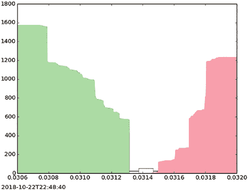
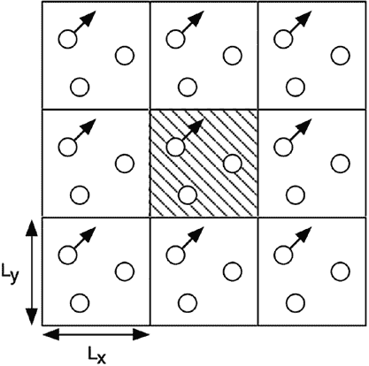
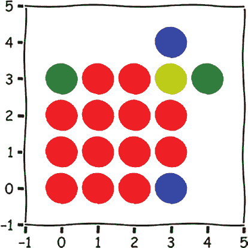

# 股票交易所模拟系统

股票交易所是一个迷人的系统，人们在其中交易股票并希望从交易中获利。在电子交易出现之前的旧时代，经纪人会聚在一起，通过互相喊叫来代表客户交易股票。如今，一切都变得电子化。散户投资者可以使用移动应用程序或网络应用程序进行交易。

在本章中，我们将构建一个系统来模拟股票交易所并可视化订单簿。此模拟的关键在于处理订单排队。例如，有些订单提交得早，而另一些则提交得晚但价格更低。在这种情况下，我们需要正确确定订单优先级。另一方面，我们还需要管理消息广播。在现实中，投资者可以看到由股票交易所广播的实时股票价格变化。

## 交易流程基础

首先，让我们分解交易流程，以确定应模拟哪些实体和流程。

一笔成功交易包含三个主要部分。首先，投资者向交易所发送订单。然后，`match engine`（撮合引擎）接收订单并尝试找到订单的对手方。例如，如果新卖单进入，`match engine`将尝试在排队订单中找到一个现有买单来匹配该新卖单。在接下来的第三步中，有两种可能性。如果成功找到匹配，交易将完成，交易成功的消息将广播给原始投资者，同时由于交易可能导致最新价格变化，市场上所有投资者也将获得新的价格。如果没有成功找到匹配，新卖单也将排队，直到未来有交易进入。投资者还可以请求撤销他们已排队的订单。

© Rongpeng Li and Aiichiro Nakano 2022

R. Li and A. Nakano, *Simulation with Python*，[`doi.org/10.1007/978-1-4842-8185-7_6`](https://doi.org/10.1007/978-1-4842-8185-7_6#DOI)

第六章 排队系统：股票交易是如何进行的

简而言之，我们需要模拟以下实体：

1. 投资者

2. `match engine`（撮合引擎）

当然，进一步拆分`match engine`也是有意义的，例如将一个部分专门负责匹配交易，另一个部分负责广播信息等。然而，为了简化，我们将把股票市场一侧的所有功能都打包到`match engine`实体中。

为了完全模拟交易过程，需要模拟以下四个过程：

1. 投资者向`match engine`发送订单。

2. `match engine`处理并尝试匹配交易。

3. 如果交易成功，`match engine`向原始订单提交者广播消息。

4. `match engine`向市场上的*所有人*广播最新价格。

由于篇幅限制，本章的重点是前两个部分。然而，你可以看出步骤 3 和步骤 4 只是步骤 1 的反向操作。我将把这两个部分留作本书末尾的练习。你会看到本章中有许多简化和假设。我将把所有这些问题留作练习，供你实现一个完整功能的系统。

## 订单簿

`match engine`跟踪订单的方式是维护一个*订单簿*。订单簿是一个动态的买单和卖单列表，由`match engine`不断更新。你可以将订单簿想象成两堆订单：所有买单在左边，所有卖单在右边。`match engine`尝试从买方和卖方中找到可交易的配对。

订单簿需要以所有市场参与者感到公平和平等的方式来维护。有一些原则需要被尊重。其中最重要的有两条。



第六章 排队系统：股票交易是如何进行的

首先，**卖单**中价格较低的订单优先级高于价格较高的订单。

同理，**买单**中价格较高的订单优先级高于价格较低的订单。然而，这仅适用于所谓的`限价单`。`市价单`较为特殊，因为它可以接受任意价格。例如，一个市价买单会从最低价格开始依次匹配卖单，直到买单中要求的股票数量全部成交，这可能会显著推高`市场价`（即所有参与者看到的价格）。

另一方面，还有`止损单`和`止盈单`。这类订单会在价格达到特定水平时被触发。例如，止损单会在价格跌至某一水平时执行以控制损失。本章不会涉及此类订单，但鼓励读者将其作为我们模拟系统的扩展来实现。

其次，如果价格相同，则先提交的订单优先级更高。请注意，原则上不会有提交时间完全相同的两个订单，因此总会有明确的顺序依据。

随着订单的不断涌入，订单簿会动态变化；某一价格水平上的订单数量被称为`深度`。深度越大，说明买卖该股票的意向越强烈。如前所述，价格越接近`市场价`的订单，其优先级高于远离市场价的订单。因此，订单簿始终呈现为深度快速变化的`山谷`形态。GIF 6-1 清晰地展示了这一点。

**GIF 6-1.** 订单簿深度动态变化

第 6 章 队列系统：股票交易如何达成 请注意，在实际交易中，如果订单尚未被撮合引擎执行，投资者可以随时请求撤销订单。不过，本章也不会实现这一部分。你可以尝试自行实现，它并没有你想象的那么困难。

## 创建接口并确定数据模式

好了！现在我们准备构建一个撮合引擎。首先，创建一个能够接收订单的`端点`。为此，我们将使用`flask`来构建一个简单的 API（应用程序编程接口）。API 向外部用户和其他程序公开特定功能。在本例中，我们的 API 只做一件事：接收传入的订单。

如果你之前没用过`flask`，下面是一个入门示例。

首先安装我们要使用的两个库：

```
pip3 install flask, requests
```

接着，用你喜欢的编辑器创建一个`engine.py`文件，复制并粘贴以下代码：

```
from flask import Flask

app = Flask(__name__)

@app.route('/submit', methods = ['GET'])

def process_order():

return '<h1>order received</h1>'

def main():

app.run(host='localhost', port=8080, debug=True)

if __name__ == '__main__':

main()
```

现在，在命令行中运行这个 flask `app`，输入：

```
python engine.py
```


第 6 章 队列系统：股票交易如何达成

你应该会看到以下信息。请注意，你的具体`调试器 PIN 码`可能与我的不同。

```
* Serving Flask app 'app' (lazy loading)
* Environment: production

WARNING: This is a development server. Do not use it in a production deployment.
Use a production WSGI server instead.

* Debug mode: on
* Running on http://localhost:8080/ (Press CTRL+C to quit)
* Restarting with stat
* Debugger is active!
* Debugger PIN: 374-303-372
```

我们刚刚创建了最简单的网页应用！如果打开浏览器并导航到`http://localhost:8080/submit`，你会看到如图 6-1 所示的消息。

**图 6-1.** 网站返回的“订单已收到”消息

非常酷！

不到十行代码，我们就创建了一个端点，通过`process_order`函数，用户可以访问并与我们的应用交互。我们的应用只做一件事：返回一些`字节`，浏览器会将其解释为一级标题的字符串。

这就是为什么你会看到这么大的字体。

请注意，`process_order` 函数有一个参数 `method`，所需的请求方法是 `GET`。这一设置规定了 `/submit` 端点所接受的请求方法。`GET` 方法只允许用户从该端点**获取**数据。如果用户尝试向该端点发送数据，请求将会失败，因为目前还不允许这样操作。

我们模拟的投资者（我通常称之为*机器人*）无法通过刷新浏览器来与我们的股票交易所进行交互。让我们看看能否用 Python 来实现这一点。现在，在另一个名为 `bot.py` 的文件中，复制并粘贴以下代码片段。在保持上一个终端中 `engine.py` 运行的同时，运行此代码。

```
import requests
from time import sleep

for i in range(10):
    res = requests.get('http://localhost:8080/submit')
    print(res.content.decode('utf-8'))
    sleep(1)
```

这里，我们使用 `requests` 库，以每秒一次的间隔，连续十次从 `engine.py` 应用程序中获取信息。

代码中的 URL 包含三部分。`http` 是协议名称，代表超文本传输协议。类似地，还有用于安全版本 http 和文件传输的 `https` 或 `ftp` 协议。`localhost` 是`主机名`（也称为`域名`），而 `8080` 是`端口号`。主机名和端口号共同定义了应用程序所在的`位置`。我们在启动 `engine.py` 文件时指定了主机名和端口号。路径 `/submit` 也是在 `process_order` 函数中指定的；它通常被称为`资源路径`。用户可以访问此路径来检索某些信息，这些信息被视作一种`资源`。

现在，让我们将这个基础示例改造成对撮合引擎模拟真正有用的代码。撮合引擎应该能够接收来自投资者（机器人）包含订单信息的`负载`。不过，我们首先需要弄清楚从投资者角度来看，负载中应包含哪些信息。

从投资者的角度来看，负载至少应包含订单类型（是市价单还是限价单）、订单规模（投资者计划买入/卖出的股票数量）以及订单方向（是买单还是卖单）。如果是限价单，则还需指定价格。

从股票交易所的角度来看，还需要时间戳和 ID。时间戳用于确定相同价格限价单的优先级。ID 用于标识订单，以便在订单被取消或执行时采取相应的操作。

通常，任何实体都需要 ID。为简单起见，我们将允许投资者/机器人自行设置 ID 并将负载发送给撮合引擎。ID 将通过 `id()` 方法加上随机数生成，因此在我们的模拟中不太可能出现冲突。另请注意，有时一个订单可能会被部分成交。我们也将实现部分成交的功能。

综上所述，来自投资者的负载应如下所示：

```python
from flask import Flask
from flask import request, jsonify
import json
import time

app = Flask(__name__)

@app.route('/submit', methods = ['POST'])
def process_order():
    order = request.get_json(force=True)
    order["submit_timestamp"] = time.time()
    print(order) # 用于测试
    return jsonify({"status": "received"})

def main():
    app.run(host='localhost', port=8080, debug=True)

if __name__ == '__main__':
    main()
```

请注意，我们导入了 `request` 和 `jsonify` 模块，用于处理 POST 过来的数据并向机器人发回确认信息。

为了适应这种变化，我们的 `bot.py` 增加了一个生成模拟订单的函数。现在它看起来是这样的：

```python
import requests
from time import sleep
import random
import json

def generate_order():
    return {
        "order_id": id(random.random()),
        "order_type":random.choice(["market", "limit"]),
        "order_size": random.randint(1, 100),
        "order_price": random.randint(1, 100), # 如果订单类型是市价单，此字段将被忽略
        "order_direction": random.choice(["buy", "sell"]),
    }

for i in range(10):
    order = generate_order()
    res = requests.post('http://localhost:8080/submit',
                        data = json.dumps(order))
    print(res.json())
    sleep(1)
```

### 实现订单簿逻辑

下一步是实现一个合适的数据结构来维护订单簿。我们将使用字典的列表形式来维护每一侧的订单。例如，在买单侧，我们将使用一个字典的列表来跟踪所有订单。

字典的键是订单价格。股票价格并非无限精确，这意味着存在最小变动单位。例如，每股价格要么是 1.5 美元，要么是 1.6 美元，而不会是 1.55 美元。这确保了字典中的键的数量总是可控的，因此对键进行排序就相当简单。

字典中的每个值是一个提交订单的列表。该列表的行为类似于队列，不允许取消订单，这样一来，如果市场上有合适的对手盘，较早的订单就能优先被撮合。

让我们来看看 `OrderBook` 类的代码以及相应的订单接收代码：

```python
from collections import defaultdict
import numpy

class OrderBook:
    def __init__(self):
        self.buy_orders = defaultdict(list)
        self.sell_orders = defaultdict(list)
        self.latest_ordr = None

    def receive_orders(self, order):
        if order["order_type"] == "market":
            order["order_price"] = np.inf if order["order_direction"] == "buy" else -np.inf
        # 愿意以极高的价格买入
        if order["order_direction"] == "buy":
            self.buy_orders[order["order_price"]].append(order)
        else:
            self.sell_orders[order["order_price"]].append(order)
        self.latest_order = order
        self.fulfill_orders()

    def fulfill_orders(self):
        raise NotImplementedError
```

你能看出我是如何实现市价单的吗？如果一个买单是市价单，我将可接受价格设为正无穷大。这意味着该买单可以接受任意高的价格。同样的道理也适用于市价卖单，卖单会接受任意低的价格来卖出。一旦价格确定，我们就简单地找到对应的字典值（即列表），并将新订单追加到其中。这就是 `defaultdict` 让代码更简洁的地方：如果列表尚不存在，`defaultdict` 会为我们创建一个空列表。

请注意，我们有一个未实现的函数叫 `fulfill_orders`。它负责实际执行订单，也是这段代码的关键。让我们来看看：

```python
def fulfill_orders(self):

    """


# 当该方法运行时，只会出现以下三种情况中的一种。

1.  有且仅有一笔市价单能与对手方挂单成交
2.  没有市价单
    - 2.1 没有匹配的对手方订单
    - 2.2 最新的限价单可以通过逐一满足对手方订单来成交

这三种情况互斥，因此我们将逐一处理。

## 第 6 章 排队系统：股票交易是如何进行的

```python

latest_order = self.latest_order.copy()

opposite_orderbook = self.buy_orders if latest_order["order_direction"] == "sell" else self.sell_orders

if latest_order["order_direction"] == "buy":

    opposite_prices = sorted(opposite_orderbook.keys())

else:

    opposite_prices = sorted(opposite_orderbook.keys(), reverse=True)

for opposite_price in opposite_prices:

    valid_buy = latest_order["order_direction"] == "buy" and opposite_price <= latest_order["order_price"]

    valid_sell = latest_order["order_direction"] == "sell" and opposite_price >= latest_order["order_price"]

    valid = (valid_buy or valid_sell) and latest_order["order_size"] > 0

    if not valid:
```

# 第 6 章 排队系统：股票交易是如何进行的

```python
        break

    for queued_order in opposite_orderbook[opposite_price]:

        if queued_order["order_size"] <= latest_order["order_size"]:

            latest_order["order_size"] -= queued_order["order_size"]

            if latest_order["order_direction"] == "buy":

                self.buy_orders[latest_order["order_price"]][-1]["order_size"] -= queued_order["order_size"]

            else:

                self.sell_orders[latest_order["order_price"]][-1]["order_size"] -= queued_order["order_size"]

            fill_size = queued_order["order_size"]

            queued_order["order_size"] = 0

        elif latest_order["order_size"] > 0:

            # print("最新订单不够大，无法完全吃掉当前排队订单")

            queued_order["order_size"] -= latest_order["order_size"]

            fill_size = latest_order["order_size"]

            # 标记最新订单已完全成交。

            latest_order["order_size"] = 0

            # 最新订单始终是最后一个。现在它已被耗尽，将其大小设为 0。

            if latest_order["order_direction"] == "buy":

                self.buy_orders[latest_order["order_price"]][-1]["order_size"] = 0

            else:

                self.sell_orders[latest_order["order_price"]][-1]["order_size"] = 0

        else:

            break

self.clean_limit_orderbook()
```

请注意，代码中的某些行相当长，但内联注释应该足以让你理解。基本上，分为三个步骤：

1.  首先，确定最新订单的方向，因为我们的订单簿只会且仅会被最新订单改变。
2.  方向确定后，检查是否存在可能的交易。如果最新订单是市价单，则无需检查对手方订单的价格；否则，我们需要确保存在价格重叠。例如，如果最新订单是买单，那么最低的卖单价格应不高于最新的买单价格。
3.  然后，我们按照提交时间顺序（从最早到最晚）遍历符合条件的对手方订单，以确保公平性，直到最新订单的成交量耗尽。另一种情况是，如果出现巨大的市价单，可能没有更多的对手方订单，但这种情况非常罕见。

根据上述逻辑，代码应该相当易于阅读。

为了清晰起见，我们还可以实现一个 `clean_limit_orderbook` 函数，在订单成交后运行。这可能不是必需的，但对于像 `print_orderbook` 这样的实用辅助函数很有帮助，其定义如下：

```python
def print_orderbook(self):

    print("-------------------Orderbook-------------------")

    for price in sorted(self.sell_orders.keys(), reverse=True):

        depth = sum(map(lambda order: order["order_size"], self.sell_orders[price]))

        print("sell side price: {}, depth: {}".format(price, depth))

    print("-----------------------------------------------")

    for price in sorted(self.buy_orders.keys(), reverse=True):

        depth = sum(map(lambda order: order["order_size"], self.buy_orders[price]))

        print("buy side price: {}, depth: {}".format(price, depth))

    print("\n")
```

最后，`clean_limit_orderbook` 函数的实现如下，相当直接：

```python
def clean_limit_orderbook(self):

    """

    移除限价订单簿中的无用键

    """

    for orderbook in [self.buy_orders, self.sell_orders]:

        empty_prices = []

        for price in orderbook.keys():

            new_orders = list(filter(lambda order: order["order_size"] > 0, orderbook[price]))

            if len(new_orders) == 0:

                empty_prices.append(price)

            else:

                orderbook[price] = new_orders

        for price in empty_prices:

            del orderbook[price]
```

## 将机器人和引擎连接起来

现在连接机器人和引擎非常简单。让我们修改 `engine.py` 文件来处理订单并构建订单簿：

```python
from orderbook import OrderBook

orderbook = OrderBook()

app = Flask(__name__)

@app.route('/submit', methods = ['POST'])

def process_order():

    order = request.get_json(force=True)

    order["submit_timestamp"] = time.time()

    orderbook.receive_orders(order)

    return jsonify({"status": "received"})
```

为了获得一个合理的订单簿结构，我们还需要更改订单类型的频率。如果市价单太多，订单簿会很快被耗尽，而不会呈现出山谷状结构。因此，让我们修改 `bot.py` 文件中 `generate_order` 函数的一行代码：

```python
"order_type": random.choice(["market", "limit", "limit", "limit", "limit",

                             "limit", "limit", "limit", "limit", "limit"]),
```

基本上，我们声明了百分之九十的订单将是限价单。

通过此设置，我们可以提交 1000 个订单，并在模拟结束时通过调用 `print_orderbook` 方法来打印订单簿；你将看到类似如下的输出：

```
-------------------Orderbook-------------------

sell side price: 100, depth: 816
```

# 第 6 章 排队系统：股票交易如何进行

```
sell side price: 99, depth: 1511
sell side price: 98, depth: 1325
sell side price: 97, depth: 1063
sell side price: 96, depth: 1262
sell side price: 95, depth: 1314
sell side price: 94, depth: 1227
sell side price: 93, depth: 1350
sell side price: 92, depth: 1392
sell side price: 91, depth: 1105
sell side price: 90, depth: 722
sell side price: 89, depth: 1260
sell side price: 88, depth: 716
sell side price: 87, depth: 922
sell side price: 86, depth: 809
sell side price: 85, depth: 1040
sell side price: 84, depth: 1066
sell side price: 83, depth: 1038
sell side price: 82, depth: 943
sell side price: 81, depth: 1312
sell side price: 80, depth: 605
sell side price: 69, depth: 12
sell side price: 64, depth: 23
sell side price: 63, depth: 39
sell side price: 43, depth: 84
sell side price: 31, depth: 80
buy side price: 30, depth: 55
buy side price: 28, depth: 67
buy side price: 22, depth: 72
buy side price: 21, depth: 189
buy side price: 20, depth: 63
buy side price: 19, depth: 71
buy side price: 18, depth: 154
buy side price: 16, depth: 213
buy side price: 15, depth: 390
buy side price: 14, depth: 413
buy side price: 13, depth: 649
buy side price: 12, depth: 841
buy side price: 11, depth: 900
buy side price: 10, depth: 1068
buy side price: 9, depth: 982
buy side price: 8, depth: 1477
buy side price: 7, depth: 748
buy side price: 6, depth: 1271
buy side price: 5, depth: 1704
buy side price: 4, depth: 1514
buy side price: 3, depth: 1511
buy side price: 2, depth: 956
buy side price: 1, depth: 1102
```

很明显，当前市场价格附近的深度要小得多。可视化工作留作练习，详见下一节。

## 练习与扩展思路

在本节中，我将提出五个可显著扩展股票交易所功能的思路。它们按难度排序。

### 多机器人

在我们的模拟中，我们只使用了一个机器人，所以基本上是在与自己交易，这毫无意义。你可以扩展订单的数据模式，新增一个名为`bot_id`或`investor_id`的字段，以便只有不同的机器人才能相互交易。

请注意，机器人的 ID 需要是一个有限的集合。你可以模拟套利场景，即一个机器人可以同时提交买入订单和卖出订单，以从价格波动中获利。

### 知情机器人

聪明的投资者不会盲目交易。他们需要了解当前的*市场价格*才能做出明智的决策。撮合引擎可以将最新价格发送给一个外部的*监控器*，这样每个机器人都能查看它。

### 订单簿可视化

`print_orderbook`方法还不够好。让我们用一个新的`visualize_orderbook`方法来替代它。你能把它做成动画吗？

### 支持取消订单

让我们支持订单取消功能。如果一个机器人请求取消订单（也许是通过一个名为`/cancel`的不同的*资源路径*），撮合引擎应该能够快速定位该订单，并将其从该价格对应的队列中移除。你能想到一种高效实现此功能的方法吗？

### 支持止损订单

既然已经支持取消订单，为什么不更进一步，支持止损订单呢？如果机器人提交了一个止损订单，撮合引擎只有在价格触及止损线时才会执行该订单。请自行研究，并高效、公平地为所有市场参与者实现此功能。

## 总结

在本章中，我们研究了一个排队系统。这样的模拟不仅涉及技术层面，也涉及社会层面。撮合引擎应当基于一套规则来运行，以强制执行公平性。

---

# 第 7 章：石头、剪刀、布：多智能体模拟

到目前为止，我们已经接触了多种不同类型的模拟。还有另一种非常重要的类型，称为基于智能体的模拟（ABS）。有时，它也被称为基于智能体的建模（ABM）。基于智能体的模拟是一个总称，你可以将许多特定于情境或特定领域的模拟归类为基于智能体的模拟。

这些模拟的共同点是，它们都模拟了所谓的自主智能体与环境之间的行动，最重要的是它们之间的交互。智能体只是一个能够采取行动的最小单元。环境是外部因素的集合，包括其他智能体。例如，如果你实现了第一个扩展（添加不止一个机器人），那么我们在第 6 章中的股票交易所模拟就可以被视为一个基于智能体的模拟。不同的机器人根据撮合引擎设定的规则相互交互。不过，我们重点关注的是规则的实现。

基于智能体的模拟对于理解*涌现行为*尤为重要，这意味着非平凡的现象可以从支配智能体行为的平凡规则中涌现出来。例如，由氨基酸形成大蛋白质分子的过程仍然是一个谜，尽管单个氨基酸看起来相当简单。在金融市场中，不同的投资者以最大化自身利益为目标行事。意图看似简单直接，但集体行为可能导致意想不到的崩盘。

现在让我们深入探讨。

© 李荣鹏、中野爱一郎 2022
R. Li and A. Nakano, *Simulation with Python*, https://doi.org/10.1007/978-1-4842-8185-7_7

## 街道上的社群形成

首先，让我们从头构建一个最简单的基于智能体的模拟：谢林隔离模型。这是经济学家托马斯·谢林提出的模型。其思路很简单：在没有外部因素的情况下，一个区域中的人会根据他们与邻居的相似度，决定是搬离还是留在原地。最终，不同的社群会自发形成。

你可能已经注意到，这个思路与我们之前讨论的森林火灾渗流模型有共同特征。没错。它们都基于一个*网格*，并以*智能体*或*节点*作为改变状态的元素。然而，与森林火灾模型不同的是，在森林火灾模型中，一个预定义的概率控制着节点的行为；而在谢林模型中，人们会根据环境的变化动态地决定是搬离还是留下。

为了简单起见，我们在一维的“街道”上研究谢林模型，而不是二维的“社区”。问题的通俗描述如下：假设有一条街道，上面有*N*处出租房；其中一些有人居住，一些可以随时入住。我们假设更换住处没有成本。有两种人，*A*型和*B*型。两种人都喜欢和自己同类的人住在一起。如果他们两边的邻居都是不同类别的，他们就会选择一个无人居住的房子搬过去，直到大多数人对他们的邻居感到满意为止。

我们用一个`list`数据结构来模拟这条街道，并用`0`来表示某个位置/出租房无人居住。我们将用`-1`和`1`来表示一个被*A*组或*B*组人群居住的房子。请注意，选择这种表示法是为了可视化方便，因为我们可以通过散点图轻松检查聚类的形成。

第一个版本看起来很简单：

```python
N = 300
OCCUPATE_RATE = 0.9 # 初始时 90% 被占用
AB_RATIO = 1 # A 与 B 的比例
ROUNDS = 100

street = np.array([0 for _ in range(N)])
for idx, house in enumerate(street):
    if np.random.rand() < OCCUPATE_RATE:
        street[idx] = -1 if np.random.rand() < AB_RATIO/(1+AB_RATIO) else 1
```

# 运行模拟直至没有移动或超过最大轮数

`stable = False`
`iteration = 0`
`while not stable and iteration < ROUNDS:`
    `print("starting round {}".format(iteration))`
    `moves = 0`
    # 获取空置房产
    `empties = set(i for i, house in enumerate(street) if house == 0)`
    `for idx, house in enumerate(street):`
        `if idx > 0 and idx < len(street)-1:`
            `if street[idx-1]*street[idx] == -1 and street[idx+1]*street[idx] == -1:`
                # 移动至随机空位
                `target = np.random.choice(tuple(empties))`
                `empties.remove(target)`
                `empties.add(idx)`
                `street[target] = street[idx]`
                `street[idx] = 0`
                `moves += 1`
    `if moves == 0:`
        `break`
    `iteration += 1`

请注意，有几个参数可以调整。我们的住户居住的街道相当密集，因为 90%的房产都有人居住。让我们先看看模拟开始前街道的样子，如图 7-1 所示。

图 7-1. 模拟前的随机居住模式

强烈的锯齿状表明 A 组和 B 组正处于交错居住的状态。

运行迭代，经过四轮后，系统达到稳定状态，如图 7-2 所示。

图 7-2. 四轮迭代后的稳定居住模式

如您所见，出现了仅包含 A 组和 B 组的*街道段落*。

如果我们将密度进一步提高到 98%的居住率会怎样？随着街道变得更加拥挤，住户更容易感到不满，聚集现象也会更加显著。

以下是一个随机生成的拥有 98%居住率的街道，如图 7-3 所示。

图 7-3. 拥有 98%居住率的随机居住模式

猜猜怎么着？强制执行的 100 次迭代并不足够。即使经过数十万次迭代，街道仍在持续变化。住户们彼此憎恶，但却无处可去。图 7-4 是大约 10 万次迭代后的结果。

图 7-4. 拥有 98%居住率的不稳定居住模式

让我们尝试另一种情景。假设住户只要*有一个*邻居来自不同群体就会感到不满，而不是*两个*都是。模拟会发生什么变化？直观上，我们应该会看到一条隔离程度更高的街道。如果我们从一条居住率为 90%的街道开始，稳定的结果如图 7-5 所示。

图 7-5. 针对“一个邻居不满”情况的稳定居住模式

肉眼可见，更大的同质化社区出现了。这种*涌现*现象在基于智能体的模拟中很典型。每个智能体都独立行动，遵循仅涉及*局部*环境的简单规则。然而，*全局*模式却依然会涌现。

### 练习

**原始谢林模型**

在本练习中，请将我们的一维街道扩展为二维社区。这样也更接近谢林最初的模型。现在每个房产有八个邻居，并且我们多了一个可选参数：触发搬迁的不同邻居数量。运行您的模拟，并在一个 10x10 的方格网格（居住率为 80%）上找到能引发显著隔离的参数。

**三个群体**

在一维和二维两种情况下，引入第三个群体并再次运行模拟。您预期会发生什么？隔离会更加显著还是减轻？

**如何赢得全球石头剪刀布比赛**

有许多成熟的库可用于基于智能体的模拟/建模。对于 Python 来说，最流行且维护最活跃的一个库叫做`Mesa`。

`Mesa` 提供了一套用于基于智能体模拟的核心组件和调度策略。这使得快速原型开发和迭代成为可能。例如，我们可以定义一个*智能体*类和一个*环境*类并从中继承。每个智能体还可以根据不同的策略被*激活*。例如，在我们的谢林模型中，我们逐个激活智能体，这被称为*顺序激活*。

是否可能让一条街道上的住户同时做出决定？答案是肯定的，但实现起来会更棘手。我们需要预先识别所有当前空置和即将空置的房产，并同时将搬迁的住户分配给他们。

在这个示例中，让我们使用`Mesa`来模拟一个竞赛。十六位剪刀-石头-布大师聚在一起相互竞争。他们被排列成一个 4 乘 4 的网格，在每一轮中，他们的选择将与直接相邻的邻居（不包括对角线方向）进行比较。如果他们处于获胜方，则该轮获得 1 分；如果失败，则得-1 分；如果出现平局，则所有人都得 0 分。



第 7 章 剪刀、石头、布：多智能体模拟

那么，对于边界或角落的选手来说，这公平吗？简单来看，并不公平，因为他们拥有更少的邻居。然而，我们可以引入周期性边界条件（PBC）来使其公平。图 7-6 是分子动力学中周期性边界条件的一个示例，其中一个分子在虚拟的邻近盒子里拥有自身的镜像。

图 7-6. 分子动力学中的周期性边界条件

周期性边界条件在分子动力学模拟中非常普遍。图 7-6 中的图像取自中野教授的讲义幻灯片。其基本思想是通过平移系统来创建*副本*，从而使系统在虚拟上无限大。

在我们的竞赛网格案例中，如果索引从 0 开始，位于右上角的选手`(0, 3)`将有两个普通邻居`(0,2)`和`(1,3)`，但它也会有位于`(0,0)`和`(3,3)`的两个*镜像*邻居。这一概念在图 7-7 的可视化中进行了说明。



第 7 章 剪刀、石头、布：多智能体模拟

图 7-7. 黄色选手与虚拟对手（绿色和蓝色）对战

黄色点表示位于网格角落的选手，其*虚拟*的蓝色上邻居实际上是右下角的选手，而其*虚拟*的绿色右邻居是左上角的选手。角落选手依然拥有四个邻居，其中两个是虚拟的。边界选手也将拥有四个邻居，其中一个为虚拟。竞赛的公平性得以恢复。

参赛者被分为两种策略家：一组是固执型选手，他们很有可能坚持一个选择，偶尔会以较低概率改变，然后以高概率坚持新的选择。例如，如果某人开始时出布，那么该选手在下一轮有 80%的概率坚持出布，然后分别以 10%的概率偶尔改变为剪刀或石头。一旦改变，该选手将以高概率坚持新的选择。他们完全不关心当前轮次的结果。我们称这一组为*固执型*参赛者。

另一组则试图通过心理博弈变得聪明。他们总是选择能够击败上一轮获胜招式的招数。例如，如果上一轮石头获胜，则他们会在当前轮次选择布，因为布击败了石头。如果上一轮没有胜者，他们将随机选择一个。他们的想法是，上一轮的获胜者会试图用相同的招式再次获胜，他们可以利用这一点。我们称这一组为*狡猾型*参赛者。

第 7 章 剪刀、石头、布：多智能体模拟

如你所见，这两种策略都相当天真。现在的问题是，如果有 8 个固执型和 8 个狡猾型参赛者，在网格上以交错模式排列，并且他们进行 100 轮比赛，哪一组的平均得分会更高？

首先，让我们看看`Mesa`代码通常是如何组织的：

```python
from mesa import Model, Agent
from mesa.time import SimultaneousActivation

class NewAgent(Agent):
    def __init__(self):
        pass
    def step(self):
        pass

class NewModel(Model):
    def __init__(self):
        self.schedule = SimultaneousActivation(self)
        pass
    def step(self):
        pass
```

从`Mesa`库中，我们导入两个要继承的类：`Model`和`Agent`。一个智能体（`Agent`）有一个`step`方法，该方法定义了智能体在模拟的每一轮中的行为。一个模型类（`Model`）也有一个`step`方法，它定义了模型作为一个整体在每一步中如何演化。

一个模型还有一个调度（`schedule`）实例。在本例中，它被称为`SimultaneousActivation`。此外，还有随机激活、顺序激活等。`SimultaneousActivation`策略意味着所有智能体将同时行动，这对于我们的竞赛模拟保持*公平*是必要的。

第 7 章 剪刀、石头、布：多智能体模拟

以下是我们的实际代码。让我们先看一些辅助类：

```python
from enum import Enum

class Type(Enum):
    STUBBORN = 1
    SNEAKY = 0

class Move(Enum):
    Scissors = 0
```

# 第七章 石头、剪刀、布：多智能体模拟

我们为智能体类型及其选择的招式定义了两个枚举。在`Move`类中，我们定义了一个特殊的`__lt__`方法，用于控制如何比较两个`Move`实例。`__lt__`代表“小于”。如果比较运算符左侧的实例小于右侧的实例，则该方法返回`True`。

```python
Rock = 1
Paper = -1

def __lt__(self, other):
    if self == Move.Scissors and other == Move.Rock:
        return True
    if self == Move.Rock and other == Move.Paper:
        return True
    if self == Move.Paper and other == Move.Scissors:
        return True
    return False
```

```python
Move.Scissors < Move.Rock == True
Move.Rock == Move.Paper == False
```

现在，让我们看一下`Agent`的代码：

```python
from mesa import Model, Agent
from mesa.time import SimultaneousActivation
from mesa.space import SingleGrid
from mesa.datacollection import DataCollector
import random

class GameAgent(Agent):
    def __init__(self, unique_id, pos, model, contestant_type):
        super().__init__(pos, model)
        self.unique_id = unique_id
        self.pos = pos
        self.contestant_type = contestant_type
        self.scores = []
        self.score = 0
        self.move = random.choice(list(Move))

    def step(self):
        self.score = 0
        # find all neighbors
        neighbors = [neighbor for neighbor in self.model.grid.neighbor_iter(self.pos)]
        neighbor_moves = [neighbor.move for neighbor in neighbors]
        self.score, winning_move = GameAgent.calculate_score(self.move, neighbor_moves)
        # determine next move based on current score
        if self.contestant_type == Type.STUBBORN:
            r = random.random()
            if r < 0.8:
                self.next_move = self.move
            else:
                moves = list(Move)
                moves.remove(self.move)
                self.next_move = random.choice(moves)
        else:
            # sneaky strategy
            if winning_move:
                for move in list(Move):
                    if move > winning_move:
                        self.next_move = move
                        break
            else:
                self.next_move = random.choice(list(Move))

    def advance(self):
        self.scores.append(self.score)
        self.move = self.next_move

    @staticmethod
    def calculate_score(move, all_moves):
        # also return winning move
        if len(set(all_moves + [move])) == 3 or len(set(all_moves + [move])) == 1:
            # 没有必胜之招，这是一场平局
            return 0, None
        win = all(move > other_move or move == other_move for other_move in all_moves)
        lose = all(move < other_move or move == other_move for other_move in all_moves)
        if win:
            return 1, move
        elif lose:
            return -1, random.choice(all_moves)
        return 0, None
```

一个智能体通过四个参数进行初始化。其中`model`参数是包含该智能体的模型。这一点很重要，因为不仅模型需要访问智能体的数据，智能体也需要访问模型的数据。这让智能体能够观察其周围的环境。例如，智能体需要识别它的邻居。

智能体的行动是随机初始化的。然而，根据智能体的类型，在每个回合中，智能体将选择**固执策略**或**狡猾策略**。具体细节在`step`方法中实现。不过，`next_move`仅在`step`方法中计算，但并未赋值。赋值操作在`advance`方法中完成。如果模型的激活策略是`SimultaneousActivation`，则必须使用该方法，这一点我们很快会看到。所有智能体会同时更新其状态，这保证了公平性。

`calculate_score`方法是一个静态方法。它独立于智能体类发挥作用，但在逻辑上与之相关联，因此我们将该方法设为静态。它计算一个回合的得分以及该回合的获胜行动。如果出现平局，获胜行动则为`None`。

现在，让我们看一下模型类：

```python
class Contest(Model):
    def __init__(self, height=4, width=4, total_rounds = 100):
        self.height = height
        self.width = width
        self.total_rounds = total_rounds
        self.round = 0
        self.schedule = SimultaneousActivation(self)
        self.grid = SingleGrid(width, height, torus=True)
        self.datacollector = DataCollector(
            model_reporters={
                "stubborn_avg_score": lambda self: np.mean([np.mean(agent.scores) for agent in self.schedule.agents if agent.contestant_type == Type.STUBBORN]),
                "sneaky_avg_score": lambda self: np.mean([np.mean(agent.scores) for agent in self.schedule.agents if agent.contestant_type == Type.SNEAKY])
            },
        )
```

# 第七章：石头、剪刀、布：多智能体模拟

我们的模型实例将用一个网格进行初始化。该网格的参数 `torus` 设为 `true`，这意味着启用了周期性边界条件。模型类还拥有一个数据收集器属性，用于在模拟过程中收集模型数据。

在这里，我们每轮结束后收集两类智能体的平均得分。这两个数据收集器被称为 `model_reporters`，其名称分别为 `stubborn_avg_score` 和 `sneaky_avg_score`。您也可以定义 `agent_reporters` 来收集智能体层面的数据。

数据收集发生在模拟每一轮结束后的 `step` 方法中。

模型的初始化过程还将智能体以交替的方式放置到网格单元格中。请注意，智能体并非直接添加到模型中，而是通过我们之前讨论过的 `schedule` 属性：即同步激活策略。

## 收集数据

```python
self.round += 1
if self.round == self.total_rounds:
    self.running = False
    self.datacollector.collect(self)
```

现在，我们可以运行模拟 100 轮：

```python
model = Contest(4, 4, 100)
while model.running:
    model.step()
```

模型的数据收集器会收集全局平均值。运行结束后，数据收集器可以将结果以 `pandas` 数据框的形式输出：

```python
model.datacollector.get_model_vars_dataframe()
```

您应该会看到类似以下内容：

```
   stubborn_avg_score  sneaky_avg_score
0          -0.125000          0.000000
1          -0.062500          0.000000
2          -0.083333          0.000000
3          -0.062500          0.031250
4          -0.050000          0.025000
...              ...               ...
95         -0.011719          0.013021
96         -0.011598          0.011598
97         -0.011480          0.010204
98         -0.012626          0.011364
99         -0.016250          0.013750

100 rows × 2 columns
```

我们运行的时间越长，智能体的 `scores` 列表积累的数据就越多。看起来在这一轮中，`狡猾`策略略胜一筹。这能令人信服吗？

再运行一次，我得到了以下结果：

```
   stubborn_avg_score  sneaky_avg_score
0           0.000000          0.000000
1           0.000000         -0.062500
2          -0.041667          0.000000
3          -0.031250          0.000000
4          -0.025000          0.050000
...              ...               ...
95          0.011719         -0.011719
96          0.011598         -0.011598
97          0.011480         -0.011480
98          0.012626         -0.011364
99          0.012500         -0.011250

100 rows × 2 columns
```

嗯，这一次，`固执`策略似乎占了上风。

探寻事实真相的任务就交给各位读者了。

### 练习

1.  `更优策略`

使用 4×4 网格，增加迭代次数，找出哪种策略表现更优。请注意，您可能需要更改数据收集器收集数据的频率。建议使用直方图等分布可视化方法来比较结果。

2.  `更大的网格`

尝试在更大的网格上进行模拟，并将结果与较小的网格进行比较。您能尝试 5×5 的网格吗？

### 本章小结

在本章中，我们讨论了一种新型模拟：基于智能体的模拟（建模）。基于智能体的模拟之所以引人入胜，是因为它能够从支配局部智能体行为的简单规则中生成复杂模式。它被广泛应用于计算社会科学。我们还利用`Mesa` Python 库对多智能体竞争进行了建模。

---

## 第八章：疾病传播，模拟 COVID-19 疫情

自 2019 年底开始，一种最初在中国武汉发现的区域性呼吸道疾病迅速传播到全世界。数千万人受到感染，数十万人死亡。该疾病后来被世界卫生组织命名为 COVID-19。从 2021 年初开始，疫苗开始投入使用，这显著降低了感染者的死亡率。

截至 2022 年初，COVID-19 与人类之间的战斗仍在继续。在本章中，我们将尝试使用数学模型来建模和模拟疾病传播。我们将学习微分方程的基础知识，并运行一些 Python 代码来模拟疫情的蔓延。

### 简化现实世界

在现实世界中，疾病传播是一个非常复杂的问题。不同的疾病有不同的病原体：病毒、细菌或其他微生物。它们有不同入侵宿主的途径。例如，COVID-19 病毒主要通过空气传播，当感染者咳嗽或说话，而易感人群吸入携带病毒的颗粒时。病毒也可以在物体表面存活相当长的时间：如果另一个人接触了该表面，然后触摸自己的鼻子或眼睛，病毒也可以入侵新的宿主。其他病原体可以通过水或食物传播，例如各种寄生虫。某些病毒也可以通过血液传播，例如引起艾滋病的 HIV。

© Rongpeng Li 和 Aiichiro Nakano 2022
R. Li 和 A. Nakano，《使用 Python 进行模拟》，[`doi.org/10.1007/978-1-4842-8185-7_8`](https://doi.org/10.1007/978-1-4842-8185-7_8#DOI)

受感染人群内部也存在巨大的多样性。以 COVID-19 为例，年轻且免疫系统强健的人通常无需治疗即可康复。然而，对于有基础疾病的老年人来说，症状可能是致命的。一些感染者更倾向于户外活动，因此他们可能成为病毒传播源，而另一些人则可能选择待在室内。

在本章中，我们将尝试通过关注人群的划分以及病原体与人群之间的简化交互来对疾病传播进行建模。

关于病原体-宿主相互作用途径和生物学动态的具体细节将被省略。

以下是主要假设：

1.  世界上的总人口被分为三组：用 `S` 表示的`易感人群`，用 `I` 表示的`感染人群`，以及用 `R` 表示的`康复人群`。
    a. 易感人群代表当前未受感染的人群。
    b. 感染人群代表当前已感染并具有传染性的人群。
    c. 康复人群代表在某个时间点对该疾病具有免疫力的人群。请注意，某些版本的模型会使用 `移除` 代替 `康复`，以包含死亡人口。

2.  群体人口不是静态的，而是动态变化的。例如，易感人群可能被感染并变为感染人群。根据疾病的性质，人们可能会或不会产生免疫力。例如，对于由寄生虫引起的疾病，如果宿主在康复后再次接触病原体，疾病可能会复发。

3.  该模型用于模拟疫情爆发，因此许多潜在的量是固定的。例如，总人口的年龄结构是固定的，总人口也保持不变。

总之，模型最基本的框架如下所示。一个易感者被感染，然后（希望如此）该人康复。

图 8-1 阐释了这种关系。

***图 8-1.** 易感人群、感染人群和康复人群之间的关系*

除了这种简单的轨迹之外，可能还有其他轨迹，这增加了系统的复杂性。然而，在深入研究这些之前，让我们先从一个更简单的模型开始：SI 模型，即`易感-感染`模型。

### SI 模型

SI 模型没有`康复`类别；人们要么是易感者，要么是感染者。易感者可能被感染，感染者可能会康复。这种疾病通常不致命，死亡率很低，但它就是不会消失。图 8-2 显示了易感人群和感染人群之间的双向关系。

***图 8-2.** 易感人群和感染人群的人口迁移*

从一个类别到另一个类别的变化取决于属于每个群体的人之间的互动。让我们用 `S(t)` 和 `I(t)` 来表示时间戳 `t` 时这两个群体的人口数量。经过一个时间步长后，比如一小时或一天（取决于我们选择哪种时间单位来定义时间域上的模块化），它们将如何变化？我将使用“天”作为时间单位，因为按天（而非按小时）收集统计数据更符合现实意义。

想象一个小型社区。在最开始时，有 `S(0)` 名易感者和 `I(0)` 名已感染者。每个易感者都有`机会`与任何一个感染者互动。这是一个组合问题。如果有五个易感者和四个感染者，那么理论上他们有 20 种互动方式。

严格来说，并非每次互动都会导致易感者被感染，因此存在一个比率。我们用 `α` 来表示这个比率。新感染的人数将是 `αSI`。

另一方面，感染者也有机会摆脱感染并再次变为易感者。这种变化独立于易感者-感染者之间的互动。我们为该过程分配一个比率 `β`。

总而言之，这就是两个类别的人口数量随时间演化的方式：

`S(t + 1) = S(t) − αS(t)I(t) + βI(t)`

`I(t + 1) = I(t) − αS(t)I(t) + βI(t)`

这两个方程被称为差分方程，因为我们是对数量的差异进行建模。这些方程的连续版本被称为微分方程，定义如下：

`dS/dt = −αS(t)I(t) + βI(t)`

`dI/dt = −αS(t)I(t) + βI(t)`

微分方程可以解析求解，但我们将重点放在差分方程上。

请记住，总人口是固定的，因此我们可以进一步将两个差分方程简化为一个。我们用 `N` 表示总人口。该约束表明，对于任何时间 `t`，我们有 `N = S(t) + I(t)`。

因此，我们可以将 `S(t+1)` 的表达式重写为：

`S(t + 1) = S(t) − αS(t)(N − S(t)) + β(N − S(t))`

然后

`S(t + 1) = αS(t)² + (1 − αN − β)S(t) + βN`

看起来足够直接了。现在让我们编写一些代码：

```python
N = 1000
beta = 0.01
alpha = 0.001
Ss = [500]
Is = [500]
Steps = 20

for _ in range(Steps):
    s = Ss[-1]
    s = alpha*s*s + (1-alpha*N-beta)*s + beta*N
    Ss.append(s)
    Is.append(N-s)
```

让我们绘制易感人群和感染人群的追踪图。请注意，我们可能会得到浮点数，这是不可避免的。

```python
with plt.xkcd():
    plt.scatter([i for i in range(Steps+1)], Ss, label = 'susceptible')
    plt.scatter([i for i in range(Steps+1)], Is, label = 'infected')
    plt.title("高传染性疾病的 SI 模型")
    plt.xlabel("天数")
    plt.ylabel("群体规模")
    plt.legend()
```

# SIR 模型与参数影响

图 8-3 中的结果显示，我们最终得到了一个几乎完全被感染的社区。

图 8-3. 20 天后易感群体和感染群体的人口演化

有两种方法可以降低感染人群的数量。我们可以尝试两种方法。

第一种方法是限制感染者与易感者之间的传播：减少 `α`；另一种方法是增加 `β` 来治愈感染人群。让我们看看它们如何影响人口演化曲线。

首先，让我们将 `α` 改为原来的十分之一：`alpha = 0.0001`。

看起来我们成功地延迟了疾病的传播！请注意，我将时间范围延长到了 100 天，以便在图 8-4 中看到全貌。

图 8-4. 人口演化

嗯，这就是居家令或封锁政策背后的理念。如果人们限制面对面互动以降低传播率，病毒传播速度就会慢得多。

如果我们进一步降低 `α` 呢？将 `α` 设为 `0.00002` 怎么样？你会发现人口根本没有变化，如图 8-5 所示。

图 8-5. 临界参数达到平衡

简单计算表明，当 `α` 和 `β` 的值处于临界状态时，两个群体之间的转移将达到平衡状态：易感者转变为感染者的人数恰好等于感染者转变为易感者的人数。

### 练习

1.  如果我们进一步限制人们的互动呢？你能验证疾病是否会真正消失吗？
2.  操控 `β` 的值，并检查其对人口演化的影响。
3.  改变两个群体的初始人口。如果开始时只有少数几个感染者，与感染者较多的情况相比，最终状态会改变吗？你能识别比率 `αS(0)/β` 的重要性吗？

### SIR 模型

现在，让我们更进一步，加入康复群体。康复的定义稍后可以进一步扩展。但是，目前我们先假设让人们康复只有一种可能途径：被感染，然后康复并获得免疫力。

我们引入另一个变量 `R(t)` 来表示康复的总人数。

它遵循以下差分方程。我们有一个用 `γ` 表示的康复率。康复的人将拥有永久免疫力。

`R(t + 1) = R(t) + γI(t)`

因此，我们社区人口的约束变为：

`N = S(t) + I(t) + R(t)`

让我们从一个很小的 `γ` 开始，并且没有康复人口。你期望看到什么？

代码与我们之前使用的非常相似，但这次我们将显式更新三个群体：

```
N = 1000
beta = 0.01
alpha = 0.0001
gamma = 0.0001
Ss = [500]
Is = [500]
Rs = [0]
Steps = 50

for _ in range(Steps):
    s, i, r = Ss[-1], Is[-1], Rs[-1]
    s_next = s - alpha*s*i + beta*i
    i_next = i + alpha*s*i - beta*i - gamma*i
    r_next = r + gamma*i
    Ss.append(s_next)
    Is.append(i_next)
    Rs.append(r_next)

with plt.xkcd():
    plt.scatter([i for i in range(Steps+1)], Ss, label = 'susceptible')
    plt.scatter([i for i in range(Steps+1)], Is, label = 'infected')
    plt.scatter([i for i in range(Steps+1)], Rs, label = 'recovered')
    plt.title(r"小$\gamma$下的 SIR 模型")
    plt.xlabel("天数")
    plt.ylabel("群体规模")
    plt.legend()
```

## 第八章：群体免疫与疫苗接种

如图 8-6 所示，在 50 步之后，康复群体并没有显著增加。

**图 8-6.** 康复人口保持不变

为什么？因为我们依赖的是自然免疫力，它的特征就是 `γ` 值很小。

然而，请注意，获得免疫的人将永远保持免疫状态；最终，社区中的每个人都会安全。这需要多长时间？我将这个问题留给你，但我的发现是，要使大约一半的人口（500 人）获得免疫，需要超过 20 年。结果如图 8-7 所示。

**图 8-7.** 实现自然群体免疫的漫长征程

现在，我们可以引入什么？答案是疫苗接种！如果我们能够将易感人群转化为`康复`状态，那么所谓的群体免疫状态就可以更快实现！请注意，这里的`康复`一词已不再按字面意思定义。

我们该怎么做呢？假设在任何时间点，大约有 2% 的易感人群愿意接种疫苗，那么我们就更有可能控制疾病的传播。我们将相关参数命名为 `μ`。

`R(t + 1) = R(t) + γI(t) + μS(t)`

让我们看看这将如何影响我们的模拟，如图 8-8 所示。

**图 8-8.** 疫苗接种增强免疫力

不错，对吧？仅在 100 天内，我们就让大约四分之一的总人口获得了免疫。

如果人群中有更高的疫苗接种意愿呢？假设 5% 的易感人群想要接种疫苗。结果非常有希望，如图 8-9 所示。

**图 8-9.** 更强的疫苗接种将加速群体免疫

结果更加令人印象深刻；我们在 100 天内让一半的人口获得了免疫。

### 练习

1.  存在一种可能性：已接种疫苗的人可能再次变得易感。你能模拟这种现象吗？这将如何影响群体免疫的进程？
2.  死亡将如何影响我们的模型？进一步将`康复`群体划分为真正的康复群体和不幸的死亡群体，并解释模拟行为将如何变化。

### 本章小结

在本章中，我们模拟了大流行爆发期间不同群体之间的互动。我们简化了病原体传播过程的假设，并介绍了易感-感染（SI）模型和易感-感染-康复（SIR）模型。通过模拟，我们可以清楚地看到不同因素如何影响病毒传播过程，以及疫苗接种如何帮助社区达到群体免疫。

---

## 第九章：错误信息传播与图上的模拟

在 COVID-19 时代，错误信息从未如此致命。在 Twitter 和 Facebook 等社交网络上，关于病毒起源、治疗方法和疫苗接种的阴谋论猖獗蔓延。它们常常在社区和圈子里传播，并与美国总统大选相关的其他阴谋论相互呼应。这种错误信息和阴谋论相互加强，形成了一个密不透风的回音室。

错误信息（Misinformation）和虚假信息（Disinformation）非常相似。区别在于，虚假信息是为了欺骗而故意传播的虚假信息。换句话说，虚假信息是蓄意的错误。错误信息是虚假信息的超集。

错误信息的传播者可能并未意识到错误信息的错误性或危害性。在本章中，我们将研究错误信息如何在网络/图设置下传播。

### 建模社交网络

我们之前已经研究过一些类似网络的系统，例如马尔可夫模型的状态转换和森林火灾蔓延模型。在诗歌生成的马尔可夫模型中，我们将每个单词视为一个节点，并且每个节点都有一定的概率后接另一个词，从而形成一个带有有向边的词语网络。

在森林火灾蔓延模型中，每一棵树在方形网格上都有四个最近的相邻树。火可以以预定的概率从一棵树蔓延到另一棵树。这个网络在某种程度上是同质的，因为它们（除了边界上的树）都有四个邻居，并且没有任何一棵树在任何方面比其他树特殊。

在本章中，我们将研究通用网络，它可以表示任意社区的连接性。让我们先介绍一些术语。

到目前为止，我在本章中一直在互换使用“网络”和“图”。它们的定义差异通常取决于背后的科学领域。例如，有时人们在网络中会使用链接（links）而不是边（edges），但它们本质上代表同一事物。为了与其他文献保持一致，我将在以下内容中使用“图”。

一个图由节点和边组成。例如，图 9-1 有五个节点和六条边。

**图 9-1.** 一个包含五个节点和六条边的简单图

图 9-1 中的图也是一个连通图，因为你可以通过遍历边从任意一个节点到达任意另一个节点。情况并非总是如此。图 9-2 中的图是一个不连通图。

**图 9-2.** 一个不连通图的例子

这个图有五个不连通的团簇（也称为社区）。它们之间没有通过边连接。

一个常见的误解是子图的定义。从一个图中取出的任何节点和边的子集都会形成一个子图。这些节点和边在视觉上可能不形成一个团簇。例如，在前面那个有五个团簇的图中，节点 1 形成了一个单节点子图，而节点 1、2、3 和 6 以及节点 2 和 6 之间的边也形成了一个四节点子图，尽管它在视觉上是三个互不连通的团簇，看起来很奇怪。

图的边也可以是有方向的，这使图成为有向图。例如，Twitter 的关注关系就是一种有向关系。你可能关注一位明星，但这位明星不太可能回关你。如果两个 Twitter 账号互相关注，那么它们之间必须存在两条边来表示这种关系：一条从一个指向另一个，另一条反向。我们将这种允许节点之间存在多条边的图称为多重图。通常，多重图表示有向关系，但并非总是如此。

图 9-3 是一个有向多重图。边是有方向的，并且允许多条边存在。例如，节点 2 和 3 之间有两条边。另一个有趣的边是自环边，它指向节点自身，例如节点 0、1 和 2。通过适当的建模，自环可以表示推文的自我转发或类似的行为。

**图 9-3.** 一个带有自环的有向图

节点和边也可以有属性。例如，节点可以有权重，表示它们在图中的影响力大小，而边的权重可以表示两个节点之间联系的强弱。为了对社交网络进行建模，我们需要为图元素分配某些属性，这些属性可以是固有的，也可以是计算得来的。

让我们使用图来定义我们的社交网络，特别是 Twitter 生态系统。

每个节点代表一个账户，每条边代表一个关注关系。因此，信息可以通过发布推文从被关注者流向关注者。

想想 Twitter 账户的属性。一个账户影响力的最重要指标是关注者数量；在我们的例子中，这正好是出边的数量。在图论中，它有一个名字：出度，即出边的数量。类似地，入度计数入边的数量。出度越大，社交网络上可能受到影响的账户就越多。

我们还希望借鉴前一章的一些概念。我们将节点分为三类，除了错误信息的来源之外，类似于易感、感染和康复模型。易感者是尚未接触过错误信息的账户；如果他们关注的人中是错误信息的来源或已感染者，他们就有被感染的概率。感染节点类似于疾病传播模拟中的感染患者，他们通过转发和分享错误信息来积极影响其关注者。康复节点是指那些要么天生抵制（`R` 既可表示抵制（resistance），也可表示康复（recovered））错误信息，要么从错误信息污染中恢复过来的账户。

总之，我们使用表 9-1 中的属性来描述图上的一个节点。

**表 9-1.** 社交网络中节点/账户的属性

| 名称        | 描述                                           | 可能的值                     | 是否可变 |
|-------------|------------------------------------------------|-------------------------------------|------------|
| 状态       | 节点的状态                                 | "来源"、"易感"、"感染"或"康复" | 是        |
| 影响力   | 节点的影响力大小，通过出度衡量 | 非负整数               | 否*        |
| 抵抗力  | 账户对错误信息的抵抗能力   | 介于 0 和 1 之间的值             | 是        |

*影响力*是不可变的，因为我们的社交网络不是动态的。如果我们允许在模拟过程中关注者-被关注者关系发生变化（这更加现实），那么如果一个账户的关注者越来越少，其影响力就会改变。

现在，我们已经布置好了所有静态设置。下一步是定义控制模拟的机制。

### 模拟错误信息传播

模拟开始时，少数几个节点（很可能是恶意的）开始传播错误信息。它们的易感追随者将响应错误信息并做出反应。这些追随者可能变为感染者，也可能保持易感状态。如果一个追随者变为感染者，该追随者的追随者也将暴露在错误信息中，依此类推。

在任何时候，易感节点都有机会康复。

模拟中的概率也是动态的。例如，如果一个节点暴露于多个错误信息来源，那么它们被感染的可能性就会变得非常高，而康复的可能性则会受到强烈抑制。

### 简单案例

让我们从一个简单的案例开始，如图 9-4 所示，只有五个节点来测试我们代码的准确性。该图看起来像图 9-4。请注意，节点 `0` 和 `1` 互相关注。

**图 9-4.** 一个包含五个节点的有向图

以下是生成该图的代码：

```