# 生成图的代码在此处

```python
import networkx as nx
import matplotlib.pyplot as plt

fig, ax = plt.subplots()
sg = nx.fast_gnp_random_graph(n=5, p=0.2, seed=3, directed=True)
pos = nx.spring_layout(sg, seed=5)
nx.draw_networkx_nodes(sg, pos, ax=ax)
nx.draw_networkx_labels(sg, pos, ax=ax, font_weight='bold')
nx.draw_networkx_edges(sg, pos, ax=ax, edgelist=sg.edges())
```

`Networkx` 是一个用于操作图的强大 Python 库。它的语法相当直观。上述代码中唯一不太直观的方法是 `fast_gnp_random_graph`。这是一个内置的图生成器，在本示例中，它生成 `5` 个节点，并以 `20%` 的概率任意连接每一对节点。你也可以选择生成有向图，并设置随机种子以确保结果可复现。我选择名称 `sg`，是因为它确实是一个*小*图。

我们可以通过运行以下代码来检查图的节点和边：`sg.nodes`、`sg.edges`

结果会返回两个有序的可迭代对象：

```
(NodeView((0, 1, 2, 3, 4)),
 OutEdgeView([(0, 1), (1, 0), (1, 3), (2, 3), (3, 4), (4, 0), (4, 1)]))
```

我们还可以检查特定节点的邻居：

```python
list(sg.neighbors(1))
```

对于节点 `1`，代码返回节点 `0` 和 `3`。节点 `4` 未被返回，因为 `neighbors` 方法仅返回*后继节点*。在社交网络的语境中，这意味着我们只查看节点 `1` 的关注者。

为了查看包括被关注者在内的所有邻居，我们使用：

```python
list(nx.all_neighbors(sg, 1))
```

这将返回 `[0, 4, 0, 3]`；之所以有重复项，是因为节点 `0` 和 `1` 之间的关系是*双向的*。我们可以轻松地使用集合操作来去重。

最后一个关于 networkx 的知识点是属性的使用。图中的每个节点和边都可以拥有属性。例如，以下代码将为节点 `1` 赋予一个属性名 `attr1_1` 并赋值。这对于更新社交网络账户的属性非常方便。

```python
sg.nodes[1]["attr_1"] = "val_1"
```

首先，让我们定义一些有用的数据结构：

```python
class State(Enum):
    SOURCE = 0
    SUSCEPTIBLE = 1
    INFECTED = 2
    RECOVERED = 3

STATE2COLOR = {
    State.SOURCE: "red",
    State.SUSCEPTIBLE: "grey",
    State.INFECTED: "orange",
    State.RECOVERED: "green"
}
```

现在，我们可以如下初始化简单五节点图的属性：

```python
import numpy as np
np.random.seed(1)

for node in sg.nodes:
    sg.nodes[node]["influence"] = len(list(sg.neighbors(node)))
    if node == 4:
        sg.nodes[node]["state"] = State.SOURCE
        sg.nodes[node]["resistance"] = 0
    else:
        sg.nodes[node]["state"] = State.SUSCEPTIBLE
        sg.nodes[node]["resistance"] = np.random.random()
```

现在，我们可以用颜色表示账户初始状态来绘制该图。如字典 `STATE2COLOR` 所示，红色代表错误信息的来源。

图 9-5 显示了错误信息的来源。

**图 9-5.** 错误信息来源以红色显示

为了模拟一步内同时更新状态，我们需要：
1. 更新每个节点的状态，并将状态保存到图的副本中
2. 将状态复制回原图
3. 重复步骤 1 和步骤 2

以下是每次迭代的代码框架：

```python
for _ in range(5):
    sg_copy = sg.copy()
    for node in sg.nodes:
        update_state(sg, sg_copy, node)
    # 复制状态
    for node in sg.nodes:
        sg.nodes[node]["state"] = sg_copy.nodes[node]["state"]
```

所有属性更新的细节都在函数 `update_state` 中。相关逻辑可以进一步扩展，但这里是第一版：

```python
def update_state(sg, sg_copy, node):
    # 在 sg_copy 中更新状态以实现同步更新
    successors = set(sg.neighbors(node))
    predecessors = set(nx.all_neighbors(sg, node)) - successors
    state = sg.nodes[node]["state"]

    if state == State.SOURCE:
        return
    elif state == State.RECOVERED:
        if sg.nodes[node]["resistance"] > np.random.random():
            sg.nodes[node]["resistance"] = min(
                sg.nodes[node]["resistance"] * 2,
                sg.nodes[node]["resistance"] + np.random.random(),
                1
            )
        else:
            sg_copy.nodes[node][state] = State.SUSCEPTIBLE
    elif state == State.SUSCEPTIBLE:
        source_influenced = State.SOURCE in [
            sg_copy.nodes[pre]["state"] for pre in predecessors
        ]
        infected_influenced = State.INFECTED in [
            sg_copy.nodes[pre]["state"] for pre in predecessors
        ]
        if source_influenced or infected_influenced:
            if sg.nodes[node]["resistance"] < np.random.random():
                sg_copy.nodes[node]["state"] = State.INFECTED
    elif state == State.INFECTED:
        # (内容继续)
        # 感染者有机会转为恢复者
        if sg.nodes[node]["resistance"] > np.random.random():
            sg_copy.nodes[node]["state"] = State.RECOVERED
        else:
            sg.nodes[node]["resistance"] = max(
                sg.nodes[node]["resistance"] / 2,
                sg.nodes[node]["resistance"] - np.random.random()
            )
    else:
        print("Unsupported state, exit.")
```

我们的逻辑基于对社交媒体上账户行为的观察。信息来源总是试图影响其关注者。如果易感者的抵抗力小于某个随机数，他们就会被感染。

对于感染者，通过比较随机数，有机会转为恢复者；但如果失败，其抵抗力将减半或减去一个随机数，取两者中的较大值。

对于恢复者，每轮若抵抗力大于随机数，则增强抵抗力，最高可达 100%免疫；否则，该人将回落至易感状态。

我们已经看到了初始状态，但还需要留意抵抗力数值：

# 第 9 章 图上的错误信息传播与模拟

```python
{node: sg.nodes[node]["resistance"] for node in sg.nodes}
```

```
{0: 0.417022004702574,
 1: 0.7203244934421581,
 2: 0.00011437481734488664,
 3: 0.30233257263183977,
 4: None}
```

接下来，我们逐步探索系统。根据随机数种子的不同，你的结果可能与我不同。经过四轮迭代后，我的网络如图 9-6 所示。抵抗力数值保持不变，但账户`0`相信了账户`4`推送的故事。图 9-6 展示了状态的更新。

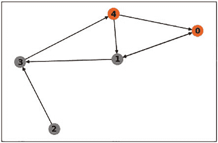
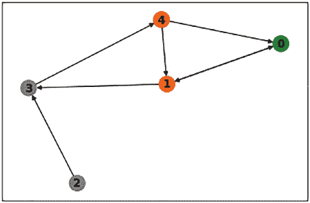

**图 9-6.** 账户 0 被错误信息污染

仅再经过一次迭代，我的图变成如下状态。抵抗力相对较高的账户 1 也相信了该故事，如图 9-7 所示。

**图 9-7.** 账户 0 恢复，而账户 1 相信了故事

再经过两次迭代，情况又发生了变化。图 9-8 显示，账户 4 的所有关注者都不再相信它。

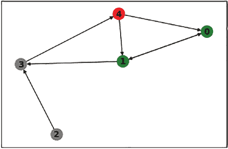
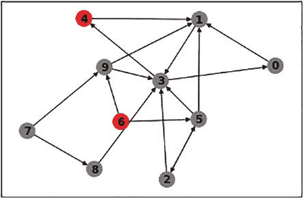

**图 9-8.** 账户 0 和 1 都对账户 4 的错误信息免疫

抵抗力数据显示，账户`1`不仅已经恢复，而且几乎不可能再相信错误信息传播者的故事。

```
{0: 0.417022004702574,
 1: 0.9184259825270369,
 2: 0.00011437481734488664,
 3: 0.30233257263183977,
 4: None}
```

除非有广告可用，否则这种状态很可能会持续下去，因为账户`4`无法触及账户`3`。可以说，我们的系统是稳定的。

让我们尝试一个更大的系统，包含十个账户和不同的拓扑结构。在这个拓扑结构中，存在更多的双向连接，可以代表一个小型社区，比如家庭群组或本地社区。该拓扑结构如图 9-9 所示。

**图 9-9.** 具有更多双向关系的图

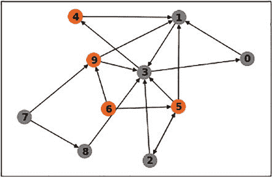
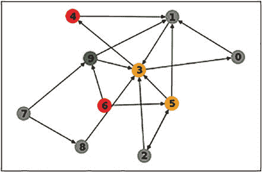

我随机选取账户`4`和`6`作为来源。经过一次迭代后，另外两个账户被“感染”，如图 9-10 所示。

**图 9-10.** 错误信息来源的两个关注者被感染

经过四次迭代后，账户`9`恢复，而账户`3`被感染。图 9-11 展示了这一演变过程。

**图 9-11.** 账户 9 恢复，而账户 3 被感染

继续模拟，我的系统稳定状态如图 9-12 所示。

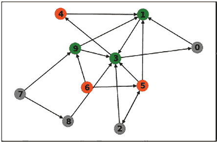
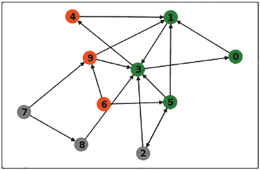

**图 9-12.** 第一次模拟的稳定状态

请注意，仅仅改变随机数种子就可以显著改变图的最终稳定状态。图 9-13 展示了另一种稳定状态。

**图 9-13.** 使用不同随机数种子的另一种稳定状态

好了，让我们转向更大的图。

### 不同网络上的错误信息传播

前面的图实际上并未捕捉到在线社交网络的本质。首先，它们太小了。其次，它们没有展现社交媒体网络最重要的特性：只有一小部分账户拥有绝大多数的关注者。

为了理解这一点，让我们绘制网络中关注者数量的分布图。我们需要使用`fast_gnp_random_graph()`函数创建一个更大的图：

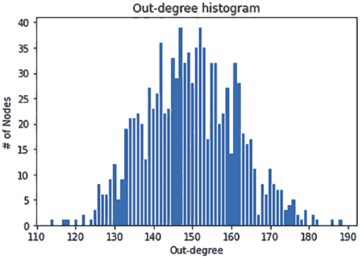

```python
fig, ax = plt.subplots()
bg = nx.fast_gnp_random_graph(n=1000, p=0.15, seed = 1, directed = True)
degree_sequence = sorted((d for n, d in bg.out_degree()), reverse=True)
ax.bar(*np.unique(degree_sequence, return_counts=True))
ax.set_title("Degree histogram")
ax.set_xlabel("Degree")
ax.set_ylabel("# of Nodes");
```

结果如图 9-14 所示。

**图 9-14.** 随机图的出度分布

如你所见，该网络没有单个或少数几个强大的影响力人物。平均关注者数量约为 150，且分布几乎对称。但这在真实社交网络中并不成立。人们不会以 15%的概率随机互相关注。

我们需要使用另一个随机图生成器，即`scale_free_graph()`方法。它有很多参数，但为简单起见，我们将采用默认参数。

让我们快速比较一下由`fast_gnp_random_graph()`和`scale_free_graph()`生成的十节点图：

```python
fig, axes = plt.subplots(1,2, figsize=(15,6))
G = nx.fast_gnp_random_graph(n=10, p =0.2, seed = 1)
pos=nx.circular_layout(G)
nx.draw(G, with_labels=True, font_weight='bold', pos = pos, ax = axes[0])
```

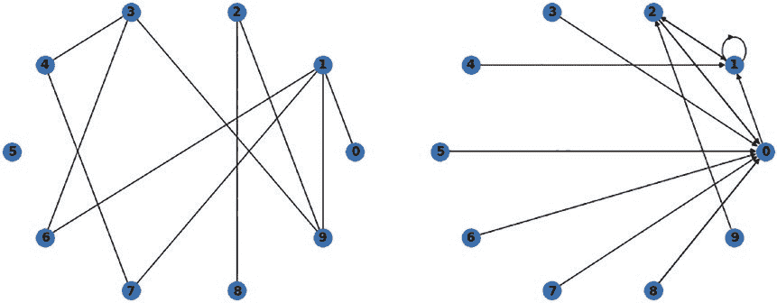
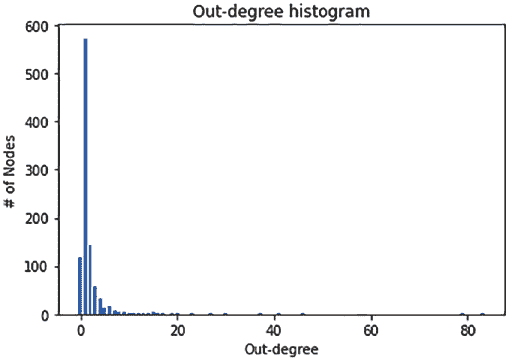

```python
G = nx.scale_free_graph(10)
pos=nx.circular_layout(G)
nx.draw(G, with_labels=True, font_weight='bold', pos = pos, ax = axes[1])
```

结果如图 9-15 所示。左边的图在视觉上更加集中。嗯，账户 0“关注”了许多其他账户，但反之则不成立。

**图 9-15.** 随机图与无标度图的视觉效果对比

让我们为 1000 节点的无标度图创建同样的出度分布可视化。结果如图 9-16 所示。

**图 9-16.** 无标度图的出度分布

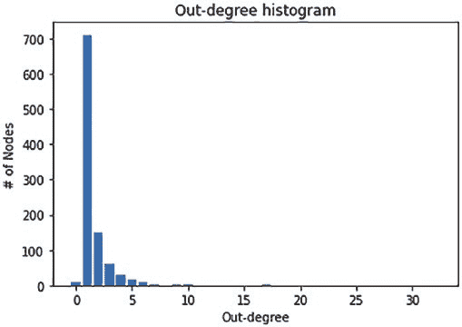

如你所见，有些账户拥有超过 80 个关注者，但大多数账户仅有 1 或 2 个关注者。通过控制`scale_free_graph`函数的参数，你可以控制图生成的机制。生成无标度图的算法是根据一组偏好，不断地向现有图中添加新节点。我更改了默认参数来调整出度分布。例如：

```python
fig, ax = plt.subplots()
g = nx.scale_free_graph(1000, alpha = 0.6, beta = 0.39, gamma = 0.01, seed = 0)
degree_sequence = sorted((d for n, d in g.out_degree()), reverse=True)
ax.bar(*np.unique(degree_sequence, return_counts=True))
ax.set_title("Out-degree histogram")
ax.set_xlabel("Out-degree")
ax.set_ylabel("# of Nodes");
```

前面的代码让我得到了一个更*平等*的世界，社区中最大的影响者不再那么有影响力。图 9-17 中的最大出度大约为 30，而不是图 9-16 中的 80。

**图 9-17.** 一个最大出度较小的无标度图

其*无标度*这一名称源于如下事实：如果网络足够大，并且你能够放大到局部的子图，你将识别出相似的属性和指标。

我们之所以关心这两种不同情况，是因为在第二种情况下，错误信息传播得更快、更危险。为了量化这一点，我们需要一个函数来首先汇总处于不同状态的账户数量。

```python
from collections import Counter

def count_states(g):
    states = [g.nodes[node]["state"] for node in g.nodes]
    return Counter(states)
```

好的，让我们追踪两种类型图中错误信息的传播情况。我们将为每种情况随机生成包含 1000 个节点的图，并检查达到稳定状态所需的时间。同时，我们还会检查达到稳定状态时受感染账户的比例。

我们将从设置前两个最具影响力的账户作为错误信息的来源开始。请注意，我们还可以通过控制`fast_gnp_random_graph`函数中的`p`参数来控制边的密度。这是一个关键参数，因为如果`p`非常大，那么每个节点基本上都会与其他所有节点相连。错误信息在第一步就会传播给所有人。我们将深入探讨它如何影响模拟结果。

首先，让我们将之前的代码打包成几个函数：

```python
def initialize(g, top_k = 5):
    tops = sorted(((n, d) for n, d in g.out_degree()), reverse=True, key = lambda pair: pair[1])[:top_k]
    for node in g.nodes:
        g.nodes[node]["influence"] = len(list(g.neighbors(node)))
        if node in [pair[0] for pair in tops]:
            g.nodes[node]["state"] = State.SOURCE
            g.nodes[node]["resistance"] = None
        else:
            g.nodes[node]["state"] = State.SUSCEPTIBLE
            g.nodes[node]["resistance"] = np.random.random()

def simulate(g, steps = 100, top_k = 5):
    initialize(g, top_k)
    res = []
    for _ in range(steps):
        g_copy = g.copy()
        for node in g.nodes:
            update_state(g, g_copy, node)
        # 复制状态
        for node in g.nodes:
            g.nodes[node]["state"] = g_copy.nodes[node]["state"]
        res.append(count_states(g))
    return res

def visualize(res):
    steps = range(1, len(res) + 1)
    susceptible = [r.get(State.SUSCEPTIBLE,0) for r in res]
    recovered = [r.get(State.RECOVERED,0) for r in res]
    infected = [r.get(State.INFECTED,0) for r in res]
    fig, ax = plt.subplots()
    ax.plot(steps, susceptible, label="susceptible")
    ax.plot(steps, recovered, label="recovered")
    ax.plot(steps, infected, label="infected")
    plt.legend()
```

`initialize`方法会将`SOURCE`状态分配给图中前`top k`个最具影响力的账户。其余代码则相当直接。

现在，让我们运行模拟 20 步并收集统计数据。

对于普通图，我们使用以下代码进行模拟。

```python
g_normal = nx.fast_gnp_random_graph(n=1000, p=0.002, directed = True)
res = simulate(g_normal, steps = 20, top_k = 5)
visualize(res)
```

图 9-18 显示的结果表明，尽管所有可能的边中只有 0.2%存在，系统确实倾向于相当快速地达到稳定状态。请自行计算，这实际上是一个相当大的数字。

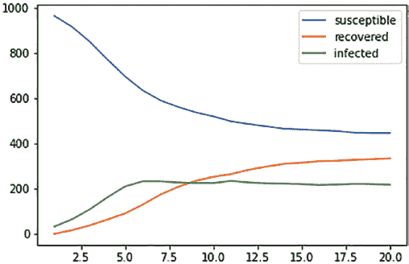
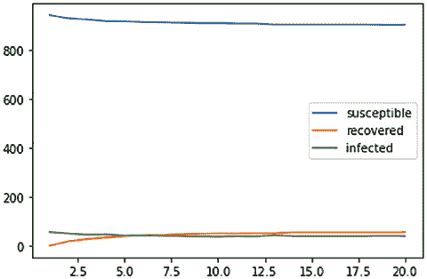

图 9-18. 1000 节点随机图中种群数量的演变

无标度图的情况又如何呢？我们预期错误信息的传播应该更快。然而，图 9-19 显示的情况并非如此。

```python
g_scale_free = nx.scale_free_graph(1000, alpha = 0.5, beta = 0.1, gamma = 0.4, delta_out = 0.9)
res = simulate(g_scale_free, steps = 20, top_k = 5)
visualize(res)
```

图 9-19. 1000 节点无标度图中种群数量的演变

显然，有些地方不对劲。系统似乎在不到五步内就停滞了。这是为什么呢？让我们查看一下最具影响力账户的邻居：

```python
tops = sorted(((n, d) for n, d in g_scale_free.out_degree()), reverse=True, key = lambda pair: pair[1])[:5]
```

在我的例子中，账户`2`拥有最多的追随者：

```python
[(2, 15), (18, 14), (6, 12), (11, 12), (32, 10)]
```

让我们检查账户`2`的邻居。我们主要关心它们的追随者数量：

```python
[g_scale_free.out_degree()[k] for k in list(nx.neighbors(g_scale_free,2))]
```

看起来它们中的大多数没有任何追随者！

```python
[2, 0, 0, 0, 1, 3, 1, 0, 9, 0, 0, 0, 0, 0, 0]
```

这就是为什么在使用简单创建的有向无标度图时，错误信息的传播仅限于源的一个小*邻域*。

一个简单的解决方法是使用无向图。或者在更大的图中显著提高顶级账户的影响力。不幸的是，第二个选项导致我的笔记本电脑崩溃了。请自行尝试第一种方法。

最后，让我们检查`fast_gnp_random_graph`方法中的`p`参数如何影响错误信息传播的速度。

为此，我们需要对`simulate`函数进行小幅修改，并做一个近似处理。当最后两次迭代中不同状态的计数不再变化时，我们假设系统达到了稳定状态。当然，情况有可能会改变，但由于随机数生成，这不太可预测。

代码如下：

```python
def simulate(g, steps = 100, top_k = 5):
    initialize(g, top_k)
    res = []
    for _ in range(steps):
        g_copy = g.copy()
        for node in g.nodes:
            update_state(g, g_copy, node)
```

# 第九章 图上的虚假信息传播与模拟

## 复制状态

```python
for node in g.nodes:
    g.nodes[node]["state"] = g_copy.nodes[node]["state"]
```

```python
if len(res) > 1 and res[-2] == res[-1] == count_states(g):
    return res
res.append(count_states(g))
return res
```

```python
for p in [0.001, 0.002, 0.004, 0.01, 0.02, 0.04, 0.08, 0.1, 0.2, 0.4]:
    for _ in range(1000):
        len_res = []
        infected_rate = []
        recovered_rate = []
        g_normal = nx.fast_gnp_random_graph(n=100, p=p, directed=True)
        res = simulate(g_normal, steps=1000, top_k=5)
        len_res.append(len(res))
        infected_rate.append(res[-1][State.INFECTED]/100)
        recovered_rate.append(res[-1][State.RECOVERED]/100)
        print(p, np.mean(len_res), np.mean(infected_rate), np.mean(recovered_rate))
```

结果相当有趣，如下所示。此处直接粘贴数据：

```
0.001 3.0 0.02 0.02
0.002 4.0 0.03 0.05
0.004 5.0 0.04 0.04
0.01 16.0 0.21 0.12
0.02 10.0 0.2 0.29
0.04 19.0 0.31 0.54
0.08 11.0 0.23 0.64
0.1 17.0 0.4 0.51
0.2 11.0 0.38 0.47
0.4 13.0 0.28 0.6
```

起初，由于连通性较差，模拟很早就停止了，只有一小部分账户接触到虚假信息并从中恢复。随着图中边的不断增加，达到稳定状态所需的时间变得更长，受感染群体和已恢复群体的规模通常都变得更大。

### 练习

1. 使用无标度的无向图重做模拟。查看内置的 `networkx` 图生成器以选择正确的生成器。
2. 每个账户都有一个 `influence` 属性，该属性应影响其粉丝接受虚假信息的可能性。引入一种机制来处理这种行为。

### 总结

在本章中，我们讨论了另一种重要的模拟类型：在图数据结构上的模拟。具体来说，我们研究了虚假信息在社交媒体上传播的模拟。我们介绍了图的基本概念，并量化了描述图元素的性质。在此基础上，我们在不同类型的图上运行了模拟并解释了相关行为。

# 索引

## A

节能，66
连续时间马尔可夫链，19
吸收态，31
`count_threshold` 变量，33
`Agent` 类，116, 119, 120
COVID-19 病毒，127
基于 Agent 的建模 (ABM)，111
临界占据概率，93
基于 Agent 的模拟 (ABS)，111, 112
临界概率，77, 82
自主 Agent，111

## B

数据类，42
贝叶斯统计，47–53
数据收集，124
钟形曲线分布，8
数据模式，98–102
Beta 分布，48, 50
调试器 PIN，99
二项分布，48, 49
Delta，62
二分法，16
深度，97
键渗流问题，79
深度优先搜索，83
宽度优先搜索，83
字典键，102
差分方程，130

## C

含自环的有向图，142
有向多重图，141
`calculate_score` 方法，122
非连通图，141
计算 Pi
`distribution`，7
虚假信息，139
疾病传播，127, 128, 136
`sprinkling grains`，2–9
分布，47
笛卡尔坐标，13, 14, 16
笛卡尔坐标系采样，14
中心极限定理 (CLT)，8

## D

马尔可夫链的本征态，25–27
`clean_limit_orderbook` 函数，106
涌现行为，111
圆周长，1, 2
利用，41, 44
碰撞检测，60–64, 74, 75
探索，44
街道上的社区形成，112–115

© Rongpeng Li and Aiichiro Nakano 2022
R. Li and A. Nakano，*使用 Python 进行模拟*，[`doi.org/10.1007/978-1-4842-8185-7`](https://doi.org/10.1007/978-1-4842-8185-7#DOI)

## E

市价单，97
`fast_gnp_random_graph()` 函数，152, 153, 156, 159
市场价格，110
火灾蔓延，77
马尔可夫链
Flask，98
应用
模拟人类语言，31–36
非平凡概率

## F

本征态，25–27
天气预报，19–25
通用网络，140
图
簇，141
社区，141
循环边，141
节点与边，140, 142
撮合引擎，95, 98
撮合引擎实体，96
矩阵乘法运算，23
矩阵表示法，23
引力，65
均值，8
贪婪-epsilon 算法，45, 46
中位数，8
网格类，79
Mesa Python 库，126
虚假信息，139
虚假信息传播

## G

双向关系，150
群体免疫，136
数据结构，145
人类语言，31
有向图，144
网络，152–160
概率，143

## H, I, J, K

模拟，146, 151
知情机器人，110
来源，146
内部放牧问题，11
稳定状态，152
投资者，95
`update_state`，147, 148
模型，119, 122
`model_reporters`，124

## L

分子动力学模拟，117
词形还原，32
蒙特卡洛模拟，3, 9, 11, 17
限价单，97
多臂老虎机问题，39
列表数据结构，112
多重图，141
localhost，100
二维盒子中的多个球

## M

碰撞检测，74, 75
周期性边界条件 (PBC)，117
碰撞时的位置更新与速度，65–74
相变，93
多个机器人，109
物理引擎，55, 57
极坐标系，12, 13, 15
多边形周长，3

## N

种群演化，132
碰撞后球的速度，68
朴素贪心方法，40–43
先验分布，47
Networkx，144
`process_order` 函数，99, 100
非稳定占据模式，115
纯贪心方法，45

## O

占据概率，92
随机图，153
二维盒子中的一个球
随机性，11–17
代码片段，55
随机占据模式，113, 114
碰撞检测，60–64
`random.random()` 函数，5
物理运动定律，57–60
已恢复节点，142
时间步，57
已恢复人群，135
速度，56
恢复率，134
订单簿
遗憾函数，40–42
机器人与引擎协同工作，107–109
纯贪心方法 / 贪婪-epsilon 方法，45
定义，96
随机选择，41
深度动态，97
遗憾值，43
逻辑实现，102–107
资源路径，110
市场价格，97
石头剪刀布，116
可视化，110
订单撤销功能，110
订单接收消息，99

## P, Q

无标度图，154, 155
`scale_free_graph` 函数，153, 155
逾渗簇，85–87, 90
调度属性，124
逾渗概率，88, 89
Schelling 模型，112, 116
逾渗
隔离，112
定义，77
一维情况，解析解，82
SIR 模型，133–137
二维情况模拟，83–90
老虎机轨迹，43

## R

`transition_dict`，35
隐蔽策略，122
转移矩阵，25, 30
社交网络模型，139–143
转移概率，20, 22
Softmax 策略，45, 50
隧道问题，62
正方形，11
二维网格逾渗，90–93
稳定占据模式，115
标准差 (STD)，8

## S

标准均匀分布，5
证券交易所，95, 100, 109
均匀分布，16
止损单，97
Unreal Engine，57
止损单支持，110
止盈单，97

## T

疫苗接种，136
固执策略，122
子图，141

## U

易感人群和感染人群，129
易感-感染模型 (SI)，129–133

## V

扫描与剪枝算法，74
系统类，74

## W, X, Y, Z

天气预报
马尔可夫链的本征态，25–27
马尔可夫链的性质，21
状态概率，24
时间步，57
轨迹，21
交易过程基础，95–98
转移概率，20–22

# 文档大纲

# 目录

- 关于作者
- 关于技术审校者
- 致谢
- 引言
- 第 1 章：使用蒙特卡洛模拟计算圆周率
    - 背景
    - 智者竞赛
        - 通过撒米粒估算圆周率
        - 练习
    - 围住山羊！
        - 什么叫随机性？
        - 练习
    - 总结
- 第 2 章：马尔可夫链，窥探未来
    - 天气预报
        - 马尔可夫链的本征态
        - 练习
    - 马尔可夫链的应用
        - 有终点的随机游走
        - 酒醉的莎士比亚所写的十四行诗
        - 练习
    - 总结
- 第 3 章：多臂老虎机、概率模拟与贝叶斯统计
    - 随机选择与朴素贪心算法
    - 贪心-ε算法：大多时候贪心
    - 改进的贪心-ε算法
        - 练习
    - 贝叶斯方法：贝叶斯统计入门
        - 练习
    - 总结
- 第 4 章：二维盒子中的球体，一个简单的物理引擎
    - 二维盒子中的一个球体
        - 物理运动定律
        - 碰撞检测
        - 练习
    - 二维盒子中的多个球体
        - 碰撞时位置与速度的更新
        - 多球场景下的碰撞检测
        - 练习
    - 总结
- 第 5 章：渗流、阈值与相变
    - 问题介绍
    - 渗流与临界概率
        - 一维情形的解析解
        - 二维情形的模拟
        - 练习
    - 二维网格渗流中的另一个有趣的统计量
        - 练习
    - 总结
- 第 6 章：排队系统：股票交易是如何进行的
    - 交易流程基础
        - 订单簿
    - 创建接口并定义数据模式
    - 实现订单簿逻辑
        - 将机器人程序与引擎连接起来
    - 练习与扩展思路
        - 多个机器人程序
        - 知情机器人程序
        - 订单簿可视化
        - 支持订单撤销
        - 支持止损订单
    - 总结
- 第 7 章：石头、剪刀、布：多智能体模拟
    - 社区在一条街道上的形成
        - 练习
            - 原始谢林模型
            - 三个群体
    - 如何赢得一场全球性的石头剪刀布比赛
        - 练习
    - 总结
- 第 8 章：疾病传播，模拟 COVID-19 疫情爆发
    - 简化现实世界
    - SI 模型
        - 练习
    - SIR 模型
        - 练习
    - 总结
- 第 9 章：图上的虚假信息传播与模拟
    - 对社交网络建模
    - 模拟虚假信息传播
        - 简单情况
        - 不同网络上的虚假信息传播
    - 练习
    - 总结
- 索引